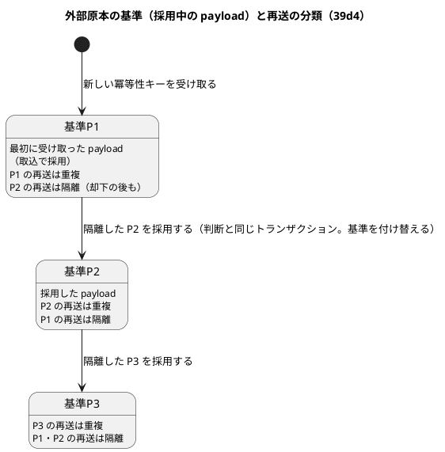
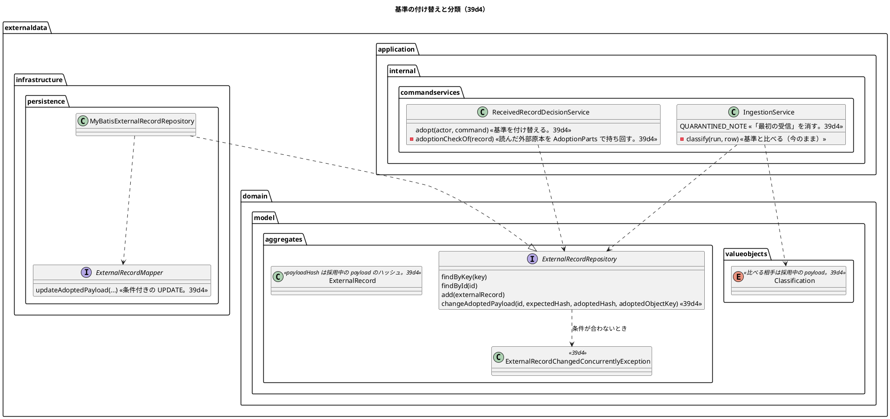

# Bolt 39d4 計画 - 判断の後に送り直された原本を業務の決まりどおりに分類し、直して送り直す道を示す

## 基本情報

| 項目 | 内容 |
| :--- | :--- |
| Bolt | 第 39d4 回（W7 の 22 本目。release_plan :970 の 39d4 の行。Bolt 39d の開始準備で 39d から縦に分けた 4 本目） |
| 状態 | 初稿（承認待ち）。推奨を 1 つに決めて書いた。2 つの整合性検証はまだ流していない |
| 予定 | W7（2026-11-16 の週。前倒しで着手できる）。作業は約 3 時間 49 分（決定 (1)。目安の 4 時間 05 分（T-250）に 16 分の余りがあるので、送るものはない。ただし 2 つの整合性検証の指摘の反映の前例は +11〜+19 分なので、反映の後に超えたら、テストの完全修飾名（115 か所・20 分）を W7 の締めに送る）。下の「時間の配分と打ち切り」。`check`・`uiTest`・`manualScreenshots`・`demoVideo`・`performanceTest`（CI の手動のジョブ）・SonarQube・CI とステップごとの承認の待ちを除く |
| アプローチ | インサイドアウト（分類の規則から。release_plan :970 のとおり）。受入条件の中心は「採用・却下の判断の後に原本が送り直されたときの分類」で、基準のハッシュの付け替え（ポート → 判断のサービス → 分類）が内側にあり、画面は今のまま結果を示すだけなので、内側のテストから入り、外側の受入シナリオ（ステップ 6）で通す |
| 対象 | (1) 採用の判断のときに外部原本の基準のハッシュと原本のキーを採用した payload に付け替える（【業務の判断】(b)。読んだ基準のハッシュを条件にした更新）、(2) 採用した payload の再送は重複、元の payload の再送は隔離、却下した payload の再送は再び隔離、直した行と新しい外部版の扱い（【業務の判断】(b)・(c)・(e)・(f)）を単体と受入シナリオで確かめる、(3) 重複の定義と注記の文の直し（「最初の受信」を消す。【前の決定の変更】(2)）、(4) 同じ内容の判断を待つ隔離の扱い（【業務の判断】(p)。同じ値の文の直し。【前の決定の変更】(1)）、(5) 情報源の並びの規則（S-16 の選択肢。Bolt 39d の決定 (14)）、(6) S-17 の一覧の上限いっぱいの照会の計測（39d の行 19）、(7) 39d の行 7 を契約のテストに上げる、(8) 同じ公開時刻の採用値の UUID の比べ方の契約のテスト、(9) テストの完全修飾名を import にまとめる（115 か所）、(10) マニュアル 12 章の「直して送り直すとき」と付録 B、キャプチャ、デモの動画（`@demo-bolt-39d4/resend`） |
| トレース | US-14 AC3・AC4（user_story :547-560）、UC-15 3b（system_usecase :527）、BR-12、ED-INV-02（domain_model :1517）、data_model の外部原本・受信記録（:1156・:1158・:1223）、domain_model の外部原本・分類・重複（:318・:329・:348・:350・:1516・:1548）、ui_design の S-17（:142・:194・:1946）、non_functional の PERF-01（:57）、test_strategy（:347）、ADR-004（:131）、台帳 D-95 |
| GitHub | [#18](https://github.com/k2works/practical-domain-driven-design-in-enterpris-application/issues/18)（US-14。クローズは 39h） |
| SP | 0 |
| 承認ゲート | **ステップごとに止める**（release_plan :970 の「ステップごと」、:895 の外部原本の取込のゲート）。スキーマ（外部原本の列のコメントのマイグレーション 1 つ。ステップ 3）、画面（注記の文・同じ値の文。ステップ 5）、新しいファイル（マイグレーション、`IngestibleDataSourceQueryServiceTest`、`resend_after_decision_ui.feature`、デモの動画 `docs/assets/demo/bolt-39d4/resend.webm`）。新しいセキュリティの判断と本番の操作はない（下の「人に諮ること」） |
| 開始準備で決めたこと | 下の (1)〜(15)（初稿。推奨を 1 つに決めて書いた。承認待ち）。【業務の判断】(p) を新しく記録する。【前の決定の変更】(1)・(2) |

### 開始準備の決定

(1) **範囲と見積り**: release_plan :970 の 39d4 の行（Bolt 39d の決定 (1) の表で約 2 時間 40 分。bolt_39d_plan.md :36。その後に 39d の計測 10 分（:425）、39d2b の行 7 の 10 分（bolt_39d2b_plan.md :38）、39d3b の 2 つの 30 分（bolt_39d3b_plan.md :119）が足された）を、コードで確かめて引き直すと、約 3 時間 49 分になる（下の表）。目安（CLAUDE.md の「Bolt がイテレーションであり、時間単位（目安 2〜4 時間）で回す。半日を超える Bolt は分割する」の 4 時間に、見積りの誤差の 5 分を含めた 4 時間 05 分まで。T-250）に収まるので、送るものはない。

| 内訳 | 分 |
| :--- | ---: |
| 分けて増える分（bolt_39d3_plan.md :54。設計の文書 20、Red 15、品質ゲート 30、終了報告 10、キャプチャと文の突き合わせ 15、受入シナリオの土台と予備 15、UI の流し直しと動画 10） | 115 |
| 受入シナリオの土台はある（内容の違う原本を作る Steps は ExternalDataIngestionUiSteps.java :237・:292、却下は RejectQuarantineUiSteps.java、採用は AdoptQuarantineUiSteps.java :61-71。15 分のうち 10 分を引く。前例 bolt_39d3b2_plan.md :47） | −10 |
| 受入シナリオの例 4 つ（行 17〜20。送り直すファイルの組と Steps） | 8 |
| 基準の付け替えのポート・メモリ・MyBatis と契約のテスト（行 13・14。決定 (3)） | 10 |
| 外部原本の列のコメントのマイグレーション（決定 (3)。スキーマ） | 2 |
| 判断のサービス（行 6・7。決定 (3)） | 5 |
| 同時の組み合わせ（行 10〜12。決定 (4)） | 8 |
| 分類の組み合わせの単体（行 1〜5・8・9。実装は付け替えだけで増えない。決定 (6)・(7)） | 8 |
| 注記の文と直す既存のテスト 7 か所（行 15。決定 (5)） | 5 |
| 同じ値の文（行 16。決定 (7)。【前の決定の変更】(1)） | 3 |
| 定義と Javadoc（`ExternalRecord`・`Classification`・`ExternalRecordRepository`・`IngestionService`。決定 (5)） | 3 |
| 設計の文書の増え（直す文書が 9 つある。ステップ 1） | 5 |
| マニュアルの「直して送り直すとき」と分類の定義・注記・付録 B（12-外部データ.md :98・:173・:421 など） | 8 |
| 情報源の並び（行 21。決定 (9)） | 8 |
| S-17 の一覧の上限いっぱいの照会の計測と CI の注（行 24。決定 (10)。bolt_39d_plan.md :425 の 10 分に注の 1 分） | 11 |
| 39d の行 7 を契約のテストに上げる（行 22。決定 (11)。bolt_39d2b_plan.md :197） | 10 |
| 同じ公開時刻の採用値の UUID の比べ方（行 23。決定 (12)。release_plan :970） | 10 |
| テストの完全修飾名を import にまとめる 115 か所（行 25。決定 (13)。release_plan :970） | 20 |
| **合計** | **229（約 3 時間 49 分）** |

比べた案（超えそうなときの候補を先に並べる）: (i) **そのまま 1 本（229 分）**（推奨。余りは 16 分）、(ii) 数え方の外の完全修飾名 93 か所も含める（+15 分で 244 分。余りが 1 分になり、整合性検証の反映で必ず超える。振る舞いが変わらないのに、そのために Bolt を分ける値打ちはない。決定 (13)）、(iii) テストの完全修飾名 115 か所を W7 の締めに送る（−20 分で 209 分。反映の後に 4 時間 05 分を超えたときの最初の候補）、(iv) 39d4（再送の扱い。約 2 時間 45 分）と 39d4b（情報源の並び・計測・契約のテスト・UUID・完全修飾名。約 1 時間 45 分）に縦に分ける（目安に収まる 1 本を分けると、分けて増える分の設計の文書・品質ゲート・終了報告（約 60 分）が 39d4b に増え、39d4b は利用者に見える成果が情報源の並びだけの横の切り方になる。半日を超えていないので分けない）。release_plan の 39d4 の行は分けないので直さない（ステップ 1 で見積りと計画へのリンクを足す）。

(2) **【業務の判断】(e) の案内が通るか**（39d2 の終了報告の議題 2。bolt_39d2_report.md :20。最初に確かめた）: **通る。却下した原本をそのまま送り直すと、「重複」にならず再び隔離になり、判断を待つ一覧に戻る。** 39d2 の担当の懸念（内容が却下した隔離と同じなので重複になる）は、比べる相手を却下した隔離と読んだもので、コードは外部原本の基準のハッシュとだけ比べる。

| 確かめた前提 | 出典 |
| :--- | :--- |
| 分類は既にある外部原本のハッシュと今のハッシュだけで決まる | IngestionService.java :192-193、Classification.java :29-34 |
| 内容の違う原本の隔離は外部原本の基準を変えない（外部原本は既にあるのでそのまま）。基準は最初の payload のまま | IngestionService.java :194-198、ExternalRecord.java :18-19、ExternalRecordMapper.xml :38-44（UPDATE がない） |
| 却下は判断の表への追記と DE-29 だけで、外部原本を変えない | ReceivedRecordDecisionService.java :229-236 |
| 送り直すと新しい受信記録ができ（ID は新しい）、判断がないので判断を待つ一覧に出る | IngestionService.java :199-211、ReceivedRecordMapper.xml :75-76（`classification = 'QUARANTINED'` かつ判断の行がない） |
| キーのない隔離は外部原本を引かず、毎回新しい受信記録になる。取込に同じファイルを断る一意制約はない | IngestionService.java :265-278・:318-334、V20261103100000 :18・:62・:115・:138（一意制約はこの 4 つだけ） |
| 今のテストも同じ振る舞いを確かめている（内容の違う原本を含むファイルをもう一度取り込むと隔離 1 になる） | ingest_external_data_ui.feature :40 |

コードの読み合わせで確かめたので、動く確かめは行 3・4（単体）と行 18・19（受入シナリオ）に置く。案内の文（decision.html :83 の「却下すると取り消せません。誤って却下したときは、提供元に同じ原本を送り直してもらってください。」）は直さない。分類を直す必要もない。39d4 の付け替えの後も通る: 却下した payload のハッシュは採用中の payload と違うので隔離になる。例外は、同じ内容の別の隔離を採用して基準がその内容になったときだけで、送り直すと重複になるが、その内容はすでに業務で使われているので判断し直す必要がない（行 9 (c)。【業務の判断】(p)）。bolt_39d2b_plan.md :198 の申し送りを受け、マニュアルの取り消せないことの文（12-外部データ.md :416）に「直したファイルを取り込み直すと、形式の誤りは再び判断を待つ隔離になります」の案内を足す（画面の文は変えない）。「同じ原本」は行の原文が同じことで、`acquired_at` の列も原文に含まれる（IngestFileCommandAssembler.java :336-338、CsvRecords.java :217-219、CsvFileKind.java :11-20）。提供元が取得時刻を変えて出し直すと原本は違うものとして扱われ、却下の後の送り直しなら隔離で一覧に戻るので案内は変わらない。

(3) **基準の付け替え**（【業務の判断】(b)。Bolt 39d の決定 (9)・【前の決定の変更】(3)。bolt_39d_plan.md :56・:74）: 採用の判断と同じトランザクションで、外部原本の `payload_hash` と `payload_object_key` を採用した受信記録のハッシュとオブジェクトキーに変える。

- ポート `ExternalRecordRepository.changeAdoptedPayload(UUID externalRecordId, PayloadHash expectedHash, PayloadHash adoptedHash, PayloadObjectKey adoptedObjectKey)` を足す（ExternalRecordRepository.java :11-28 の隣）。MyBatis は `UPDATE external_data.external_record SET payload_hash = #{adoptedHash}, payload_object_key = #{adoptedObjectKey} WHERE id = #{externalRecordId} AND payload_hash = #{expectedHash}` の 1 文（マッパーの `updateAdoptedPayload`。更新の数を返す）。0 行なら `ExternalRecordChangedConcurrentlyException`（`domain.model.aggregates`。前例 DuplicateExternalRecordException.java :10）を上げる。メモリの実装（InMemoryExternalRecordRepository.java :15-37）も同じ条件で置き換える。H2 と PostgreSQL の共通の構文（ADR-007）
- 冪等性キーと `first_received_at` は変えない（最初の受信時刻の意味のまま）
- `external_record` は追記専用でない: 表の印がなく（V20261103100000 :65）、権限の剥奪の対象外（afterMigrate__grant_app_user.sql :27・:30-39、AppendOnlyGrantIntegrationTest.java :42-46）。新しい権限は要らない
- 判断のサービスの順: 判断（セーブポイントの中）→ 採用値 → 付け替え → DE-29 → 採用値のイベント（ReceivedRecordDecisionService.java :124-139 の `adoptedValues.add` の後に足す）。`expectedHash` は採用の定めで読んだ外部原本のハッシュ（`adoptionCheckOf` が :162-165 で読み、キーだけを取り出して捨てている）で、`AdoptionParts`（:321）の `key` を `ExternalRecord externalRecord` に置き換えて持ち回る（`AdoptionFactory` へは `externalRecord.key()` を渡す）。新しい照会を足さない（T-236）
- 付け替えは採用だけ（却下・採用できない・判断済みでは呼ばない。行 7）。取込の採用は外部原本を新しく作るので呼ばない
- 列のコメント（V20261103100000 :71-72 の「最初に受け取った payload の…」）は事実と合わなくなるので、共通のマイグレーション 1 つで `COMMENT ON COLUMN` を「採用中の payload のハッシュ（はじめは最初に受け取った payload。採用の判断で付け替える）」「採用中の payload のオブジェクトキー（同じ）」に直す（文は data_model :1156 の予定と Bolt 39d の決定 (9) の文）。列は変えない
- 誰が基準を読むか: 分類（IngestionService.java :193）だけ。`payload_object_key` を読む main のコードはなく（`externalRecord.payloadObjectKey()` は MyBatisExternalRecordRepository.java :50 の書き込みだけ）、原本の保存は上書きしない（受信記録ごとに新しいキー。IngestionService.java :187-188）ので、元の原本も受信記録から読める

(4) **同時の組み合わせ**（Bolt 39d の決定 (9) が「取込と判断の同時の楽観ロック」を 39d4 の開始準備に預けた。bolt_39d_plan.md :56・:196、data_model :1156）: 版の列は足さず（スキーマの列を増やさない）、**読んだ基準のハッシュを条件にする条件付きの更新**で採用同士の競り合いを防ぐ（決定 (3) の `WHERE … AND payload_hash = #{expectedHash}`）。

- **取込と採用の同時はロックが要らない**: 取込は既にある外部原本を更新しない（IngestionService.java :194-198）。取込が付け替えの前に基準を読めば前の基準で、後に読めば新しい基準で分類し、どちらも「取込が判断の前（後）に行われた」直列の順と同じ結果になる。採用値も基準も変えない（前の基準で分類された元の payload の再送が重複になることはあるが、値は増えない）。行 11
- **取込の長いトランザクションを待たない**: 更新はキーでない列だけを変えるので、受信記録の外部キーが外部原本の行に取るロックと PostgreSQL では競合しない見込みで、1 万件の取込の途中でも採用は待たない。これを行 12 で確かめる（`SELECT … FOR UPDATE` を選ばなかった理由がこの確かめ。外部キーのロックと競合し、取込のコミットまで採用が待つ）
- **採用と採用の同時（同じ外部原本の別の隔離）**: 後の側の更新は 0 行になり、例外でトランザクションごと巻き戻す（判断・採用値・イベントの発行記録が残らない）。先の側の基準と採用値が残るので、基準は「採用中の payload」と食い違わない（無条件の更新だと、後の更新が公開した時刻の新しい採用値と違う payload を基準にしうる）。負けた側には一般のエラーの画面が出る（前例: 同時の取込の `DuplicateExternalRecordException` は捕まえずに上げる。ExternalRecordRepository.java :22-23）。2 人のデータ責任者が同じ外部 ID・外部版の別の隔離を同じ時に採用した場合だけで、開き直すと比べる相手が先に採用された値に変わっている
- 同じ受信記録への同時の採用は今のまま判断の一意制約で 1 つに決まる（ReceivedRecordDecisionService.java :126-128。39d3b の行 7）。付け替えは判断の後なので、負けた側は基準を変えない
- 比べた案: (i) 条件付きの更新（推奨）、(ii) `version` 列の楽観ロック（スキーマの列が増え、比べるものがハッシュと同じ意味になる。行き先のない列が残る）、(iii) `SELECT … FOR UPDATE`（取込のコミットまで採用が待つ）、(iv) 無条件の更新（競り合いで基準と採用中の値が食い違う。下流の分類がずれる）

(5) **重複の定義と注記の文**（【業務の判断】(f)。Bolt 39d の決定 (9)。bolt_39d_plan.md :56・:461）: 比べる相手は「最初に受け取った payload」でなく「採用中の payload」。

- 定義の文を直す: 外部原本（domain_model :318・:1516、ExternalRecord.java :12-13・:18-19）、重複（domain_model :350。「同じ冪等性キーで、採用中の payload と同じ payload」）、隔離と ED-INV-02（domain_model :1517、Classification.java :15・:18・:24-29）、ポートの Javadoc（ExternalRecordRepository.java）、取込のサービスの Javadoc（IngestionService.java :47-61）、data_model :1156
- 注記の文（IngestionService.java :72）を `"%s: 同じ外部 ID・外部版で内容の違う原本を受け取りました。"` にする（【前の決定の変更】(2)）。比べる相手の時刻は 1 つに決められない（付け替えの後の基準の受信時刻は外部原本に持たない）ので消し、値と時刻は判断の画面の「受け取った値」「この外部版の採用値」で読む。`noteOf` の外部原本の引数と `NOTE_TIME`（:75-76）を消す。重複の注記（:70）は変えない。追記専用なので今までの受信記録の注記は元の文のまま（パイロットの前で業務のデータはない）。
- 語は【業務の判断】(f) の「同じ外部 ID・外部版で採用中の値と内容の違う原本は隔離」から写す。設計の文書の「採用中の payload」は Bolt 39d の語のまま使い、画面・マニュアルの語は【業務の判断】(j) のとおり「この外部版の採用値」にする（注記の文は「内容の違う原本」のままで、どちらの語も増やさない）
- 直す既存のテストは「ふりかえりと前の Bolt からの引き継ぎ」の T-217 の行に名前で書く

(6) **直した行と版の扱いは今の分類の規則のまま**（【業務の判断】(c)・(f)。Bolt 39d の決定 (10)。bolt_39d_plan.md :58）: コードを変えず、組み合わせを確かめる。キーのない隔離を直して取り込み直すと、そのキーの外部原本がないので採用（IngestionService.java :192-198）。新しい外部版は新しい冪等性キーなので採用（`IdempotencyKey` は 4 列。:190-191）。同じ外部版のまま内容を直して送り直すと再び隔離（付け替えの後は採用中の値と比べる。(f)）。外部版をまたいで採用中の値と矛盾するときの差異は 39h で、今は新しい外部版の採用になる（行 5 (d)。申し送りの表）。

(7) **同じ内容の判断を待つ隔離**（【業務の判断】(p)。新しい。Bolt 39d3 の申し送り bolt_39d3_plan.md :249 の組み合わせを確かめて見つけた）: 同じ原本を 2 度受け取ると判断を待つ隔離が 2 つでき（ingest_external_data_ui.feature :40 の形）、1 つを採用すると、もう 1 つは基準と同じ内容なのに一覧に残る。**自動で判断せず一覧に残し、データ責任者が判断する**（前例 Bolt 39d3b2 の (o) の比べた案 (i)。データ責任者の判断でない判断を記録と監査に残さない）。

- 判断の画面は「受け取った値はこの外部版の採用値と同じです」を示す（QuarantineValueViews.java :74-79）。今の文の後半「原本の書き方（引用符・空白など）だけが違います。」（:34）は、同じ原本では事実と違うので「受け取った値はこの外部版の採用値と同じです。同じ原本か、原本の書き方（引用符・空白など）だけが違います。」に直す（【前の決定の変更】(1)。判断の材料を増やさず 1 つの文で両方を言う。外部原本の基準と比べる照会は足さない）
- 採用もできる（2 つ目の採用値とイベントが出る。公開した時刻が新しくなり値は同じ。決定 (3) の更新は `expectedHash` と `adoptedHash` が同じで 1 行）。採用を断る理由を増やさない（`NotAdoptableReason` を増やさない）。マニュアルに「同じ値のときは却下で片付けてください」を足す

(8) **受入シナリオ**: 新しい feature `resend_after_decision_ui.feature` に 4 シナリオ（行 17〜20）。判断ごとに 1 つの feature の前例（bolt_39d3b_plan.md :121）で、送り直しは取込・判断・再取込を通す別の話なので `adopt_quarantine_ui.feature`・`reject_quarantine_ui.feature` に足さない。行のデータは今の Steps（ExternalDataIngestionUiSteps.java :237・:292・:304）で作り、もう一度取り込む手順は今の `キー操作だけで取込の結果から続けて取り込むを開く`（:551）を使う（T-230）。ドメインの受入シナリオ（`ingest_external_records.feature`）の注記の文（:52）を直し、シナリオ名と `外部原本は 1 件だけで、最初の原本のハッシュとオブジェクトキーのままである`（:43・:54。ExternalRecordIngestionSteps.java :183）は、隔離と重複では基準が変わらないことの確かめなのでそのまま残す。

(9) **情報源の並び**（Bolt 39d の決定 (14)。bolt_39d_plan.md :66）: 取り込める情報源の選択肢（S-16）を照会のサービス（IngestibleDataSourceQueryService.java :27-28）で Java の `String` の順（提供元、原本種別）に並べ、ポートは並びを約束しない。SQL の `ORDER BY`（DataSourceMapper.xml :23）とメモリの実装の並べ替え（InMemoryDataSourceRepository.java :42）を消し、`DataSourceRepositoryContract.java` :79-81 の `containsExactly` を `containsExactlyInAnyOrder` に直す。照会のサービスの単体のテストは今ないので `IngestibleDataSourceQueryServiceTest` を足す（新しいファイル）。提供元の名前の DB の照合順序に頼らなくなり、画面の順はテストのメモリの実装と同じになる。

(10) **S-17 の一覧の計測**（39d の行 19。bolt_39d_plan.md :168・:406・:420、non_functional :57）: `ExternalDataIngestionPerformanceTest` に 1 本足す（前例 :300-332 の「PERF-06 notes」、:358-402 の「PERF-06 keyless-rejection」）。隔離 1 万件の取込の最後のページ（`page=100`）と絞らない 1 ページ目の GET で、照会（件数・頁）と描画の時間をログの「PERF-06 undecided」の行に出す（T-241・T-242）。照会が 1 秒を超えたら値を記録して止め、索引を足すか（スキーマ）を諮る（bolt_39d_plan.md :197）。CI の性能のジョブの本数の注（.github/workflows/cargo-tracker-ci.yml :167-169）を 7 本に直す。`performanceTest` は Linux の CI の手動のジョブで人の側で流す（:162-164）。

(11) **39d の行 7 を契約のテストに上げる**（bolt_39d2b_plan.md :65・:197、release_plan :970）: `ExternalDataRecordRepositoriesContract` に「判断のポートで判断を追記した隔離は絞らない一覧と件数からも消える」を足す（追記の前と後の絞らない件数の差が 1）。JDBC の本体（MyBatisExternalDataRecordRepositoriesIntegrationTest.java :173-184 の入れ子と :324-367 の `assertDecidedQuarantineIsNotListed`、:372 の `keylessQuarantine`）と H2 の行 7（H2ExternalDataRecordRepositoriesTest.java :215-224）を消す。契約の注（:610・:742）も消す。絞らない件数と 1 ページの照会は共有の DB のほかの隔離も含むので、差と自分の受信記録だけを確かめる（Contract.java :448 の注のとおり）。

(12) **同じ公開時刻の採用値の UUID の比べ方**（bolt_39d3b_plan.md :119 の (i)、release_plan :970）: `AdoptedValueRepositoryContract` に、上の位が符号で違う 2 つの UUID（`7fffffff-…` と `80000000-…`）と同じ公開時刻の採用値を足し、`currentOf` が `80000000-…` を返す（符号なしの順）ことをメモリ（InMemoryAdoptedValueRepository.java :52-53 の `id().toString()`）・H2・PostgreSQL で確かめる（AdoptedValueMapper.xml :32 の `a.id DESC`）。今の Contract の :125 は符号が同じ UUID の組。H2 の版は Spring Boot の管理で、比べ方はテストを流すまで分からない。**H2 だけが逆なら止めて諮る**（選び方（SQL の並び）を変えるか。H2 は開発・テスト・デモの DB で本番は PostgreSQL。ADR-007。release_plan :970）。

(13) **テストの完全修飾名**（bolt_39d3c_report.md :74、release_plan :970）: 2026-11-09 の版（`cdbea1e5b`）で release_plan と同じ数え方で数え直した: UndecidedRecordControllerTest 46、ExternalDataRecordRepositoriesContract 14、UndecidedRecordQueryServiceTest 11、MilestoneValuesTest 2 の計 73 か所と、`org.junit.jupiter.params.provider.Arguments` の 42 か所（Controller 40・Contract 2）で計 115 か所（release_plan の数と同じ）。これを import にまとめる（名前の重なりで完全修飾名が要る箇所は残す）。**数え方の外の 93 か所（`org.assertj`・`org.mockito`・`org.springframework` の本文 73 か所と注釈の行の 20 か所。Controller 76・QueryServiceTest 5・Contract 2・MilestoneValuesTest 10）は含めない**（比べた案 (ii) のとおり +15 分で余りがなくなる）。W7 の締めの返済の候補に挙げる（申し送りの表）。

(14) **変えないもの**: 判断と採用値の順（判断のセーブポイント）、公開した時刻は判断の時刻、監査（付け替えは新しい監査のイベントを持たない。DE-29・DE-12・DE-13 に操作者と判断があり、基準は取り直せる派生の値）、採用できる隔離の定めと `NotAdoptableReason`、判断の画面の URL・認可・CSRF、誤った判断の取り消し（D-95）。

(15) **新しい型の名前**（T-246。`apps/cargo-tracker/src` で `ExternalRecordChangedConcurrently`・`changeAdoptedPayload`・`updateAdoptedPayload`・`resend_after_decision`・`demo-bolt-39d4`・`IngestibleDataSourceQueryServiceTest` を検索し、ないことを確かめた）: 足す型は `ExternalRecordChangedConcurrentlyException`、ポートのメソッド `changeAdoptedPayload`、マッパーの `updateAdoptedPayload`。テストは既存のクラスに `@Nested class Bolt39d4_…`、契約のテストは名前の頭に `Bolt39d4_`、新しいテストは `IngestibleDataSourceQueryServiceTest`、受入シナリオは `resend_after_decision_ui.feature`、デモのタグは `@demo-bolt-39d4/resend`。

【前の決定の変更】(1): Bolt 39d3 の決定 (7)（同じ値の文「受け取った値はこの外部版の採用値と同じです。原本の書き方（引用符・空白など）だけが違います。」。bolt_39d3_plan.md :104・行 22）を改め、「受け取った値はこの外部版の採用値と同じです。同じ原本か、原本の書き方（引用符・空白など）だけが違います。」にする（決定 (7)）。

【前の決定の変更】(2): Bolt 39b2 の確認ポイント 6（内容の違う原本の隔離の注記に「最初の受信: 時刻」を添える。IngestionService.java :71-72）を改め、注記の「最初の受信: …」を消す（決定 (5)）。Bolt 39d の決定 (9) は注記の文を直すと決めていて、時刻を消すことはここで決めた。

新しいファイル（39d4）: 共通のマイグレーション `V20261109…__change_external_record_payload_comment.sql`（列のコメントだけ）、`IngestibleDataSourceQueryServiceTest`、`resend_after_decision_ui.feature`、デモの動画 `docs/assets/demo/bolt-39d4/resend.webm`（`demoVideo` が作る）。直すもの: `ExternalRecordRepository`・`ExternalRecord`・`ExternalRecordMapper`（.java・.xml）・`MyBatisExternalRecordRepository`・`InMemoryExternalRecordRepository`、`ReceivedRecordDecisionService`、`IngestionService`、`Classification`、`QuarantineValueViews`、`decision.html`（:56 の見本の文）、`IngestibleDataSourceQueryService`・`DataSourceMapper.xml`・`InMemoryDataSourceRepository`、CI の注、テスト `IngestionServiceTest`・`ReceivedRecordDecisionServiceTest`・`ExternalDataRecordRepositoriesContract`・`AdoptedValueRepositoryContract`・`DataSourceRepositoryContract`・`MyBatisExternalDataRecordRepositoriesIntegrationTest`・`H2ExternalDataRecordRepositoriesTest`・`UndecidedRecordControllerTest`・`UndecidedRecordQueryServiceTest`・`MilestoneValuesTest`・`ExternalDataIngestionPerformanceTest`・`ExternalDataIngestionSecurityIntegrationTest`、受入シナリオ `ingest_external_records.feature`・`compare_quarantine_values_ui.feature`、Steps（`ExternalDataIngestionUiSteps`・`RejectQuarantineUiSteps`・`UndecidedRecordUiSteps`）、マニュアル 12 章と付録 B。スキーマの列は変えない。

### 前の Bolt から引き継いだもの

| 出典 | 内容 | この計画 |
| :--- | :--- | :--- |
| bolt_39d_plan.md :36・:56 決定 (9) | 付け替え、再送の扱い、定義と注記の直し | 決定 (3)・(5)、行 1〜3・6・13・15 |
| bolt_39d_plan.md :58 決定 (10) | 直した行・新しい外部版・同じ外部版の 3 つの受入シナリオ | 決定 (6)、行 5・20 |
| bolt_39d_plan.md :66 決定 (14) | 情報源の並び | 決定 (9)、行 21 |
| bolt_39d_plan.md :196 | 取込と判断の同時の楽観ロック | 決定 (4)、行 10〜12 |
| bolt_39d_plan.md :197・:406 | 行 19 の計測、1 秒を超えたときの索引 | 決定 (10)、行 24 |
| bolt_39d2_plan.md :56、bolt_39d2_report.md :20・:83 | (e) の送り直しが業務で通るか | 決定 (2)、行 3・18 |
| bolt_39d2b_plan.md :197 | 39d の行 7 を契約のテストに | 決定 (11)、行 22 |
| bolt_39d2b_plan.md :198、:71 | 同じファイルの取り込み直しの受入シナリオ、マニュアルの案内を足すか | 決定 (2)、行 4・19 |
| bolt_39d3_plan.md :249、bolt_39d3b_plan.md :267 | 片方を採用したとき、もう 1 つの隔離の比べる相手（付け替えと組み合わせる分） | 行 8 |
| bolt_39d3b_plan.md :264・:265 | UUID の比べ方、完全修飾名 | 決定 (12)・(13)、行 23・25 |
| bolt_39d3b2_plan.md :252、bolt_39d3b2_report.md :103 | 主要実績の再送の組み合わせ | 行 1・2・6 のパラメーター（航海と主要実績） |

## Bolt ゴール

データ責任者が隔離を採用した後に、提供元が採用した原本を送り直すと「重複」になり、値は増えず、判断を待つ一覧にも出ない。元の原本を送り直すと「隔離」になり、一覧で判断できる。誤って却下した原本を同じまま送り直してもらうと「隔離」になり、判断を待つ一覧に戻って判断し直せる。形式の誤りのファイルを同じまま取り込み直すと、形式の誤りは再び判断を待つ隔離になり、直して取り込み直すと採用になる。新しい外部版で送り直してもらうと採用になり、同じ外部版のまま内容を直して送り直すと再び隔離になる。S-16 の情報源は提供元・原本種別の決まった順に並ぶ。S-17 の一覧の上限いっぱいの照会の時間が記録されている。マニュアル 12 章に「直して送り直すとき」があり、付録 B・キャプチャ・デモの動画が新しい振る舞いに合う。

### 開始準備で確かめたこと

- **release_plan の 39d4 の行**（:970）: 「判断の後に送り直されたときの扱いの縦: 採用した後の外部原本の基準のハッシュの付け替え、採用・元・却下した payload の再送の受入シナリオ、直した行の取り込み直しと新しい外部版の送り直しの受入シナリオ、同じ外部版は隔離・版をまたげば差異（39h）、重複の定義と注記の「最初の受信」の直し、情報源の並びの規則の実装、マニュアル 12 章の「直して送り直すとき」と付録 B、デモの動画」と、39d・39d2・39d2b・39d3b から送られたもの（計測、(e)、行 7、同じファイルの取り込み直し、UUID、完全修飾名、:249）。アプローチはインサイドアウト、承認ゲートはステップごと
- **基準は最初の payload のまま**: 列のコメント（V20261103100000 :71-72）、record の Javadoc（ExternalRecord.java :18-19）。UPDATE は main にない（ExternalRecordMapper.xml :38-44 は INSERT だけ、MyBatisExternalRecordRepository.java :40-55）
- **採用の順**: 判断 → 採用値 → DE-29 → 採用値のイベント（ReceivedRecordDecisionService.java :124-139）。外部原本は定めの中で読んでいる（:162-165）。付け替えの差し込み点は :136 の後
- **取込は既にある外部原本を更新しない**: IngestionService.java :194-198。外部原本の一意制約の同時の負けは捕まえずに上げる（ExternalRecordRepository.java :22-23）
- **`external_record` は UPDATE できる**: afterMigrate__grant_app_user.sql :27・:30-39、表の印がない（V20261103100000 :65）、AppendOnlyGrantIntegrationTest.java :42-46 の一覧にない
- **注記の文と読む場所**: IngestionService.java :72・:75-76・:336-343。テストと Steps の 7 か所は T-217 の行。列の値は S-16 の結果の画面と S-17 の一覧・判断の画面に出る（decision.html :56）
- **同じ値の文**: QuarantineValueViews.java :34・:36・:74-79、decision.html :62。テスト UndecidedRecordControllerTest.java :1048・:1290、compare_quarantine_values_ui.feature :33
- **並びの今**: ポートのメモリの実装と SQL が並べ、サービスは並べない（DataSourceMapper.xml :23、InMemoryDataSourceRepository.java :42、IngestibleDataSourceQueryService.java :27-28、DataSourceRepositoryContract.java :79-81）
- **この外部版の採用値**: 公開した時刻の新しい順、同じ時刻は採用値 ID の順の最後（AdoptedValueMapper.xml :32、InMemoryAdoptedValueRepository.java :52-53、AdoptedValueRepositoryContract.java :125）
- **性能のテストと CI**: ExternalDataIngestionPerformanceTest.java :300-332・:358-402、CI :162-169
- **行 7 の今**: MyBatisExternalDataRecordRepositoriesIntegrationTest.java :173-184・:324-367・:372、H2ExternalDataRecordRepositoriesTest.java :215-224、Contract.java :610・:742
- **マニュアル**: 重複の定義（12-外部データ.md :98）、注記の表（:173）、案内（:279・:341・:416）、採用した行の再取込（:421 の「最初に受け取った原本と比べて」は消す）、値が同じことの文（:274）。付録 B の採用の行（付録B-トラブルシューティング.md :225-231）。キャプチャ 3 枚（manual_screenshots.feature :250-262 の `12-undecided-records`・`12-undecided-record-decision` と :231 の `12-ingestion-result`）

## 設計の決定

| 項目 | 決定 | 根拠 |
| :--- | :--- | :--- |
| 範囲と見積り | 開始準備の決定 (1)。約 3 時間 49 分で送るものはない | bolt_39d_plan.md :36・:425、bolt_39d2b_plan.md :197、bolt_39d3b_plan.md :119、release_plan :970 |
| (e) の案内 | 決定 (2)。通る。比べる相手は基準のハッシュだけで、却下は基準を変えない | IngestionService.java :192-199、Classification.java :29-34、ReceivedRecordDecisionService.java :229-236、ReceivedRecordMapper.xml :75-76 |
| 基準の付け替え | 決定 (3)、【業務の判断】(b)。採用の判断のトランザクションで条件付きの更新。キーと最初の受信時刻は変えない | bolt_39d_plan.md :56、ReceivedRecordDecisionService.java :124-139・:162-165・:321、ExternalRecord.java :18-20 |
| 同時 | 決定 (4)。版の列を足さず条件付きの更新。取込と採用はロックしない。負けた採用はトランザクションごと巻き戻す | IngestionService.java :194-198、ExternalRecordRepository.java :22-23、bolt_39d_plan.md :196 |
| 定義と注記 | 決定 (5)、【業務の判断】(f)、【前の決定の変更】(2)。比べる相手は採用中の payload。注記の時刻を消す | bolt_39d_plan.md :56・:461、IngestionService.java :72、domain_model :318・:350・:1516・:1517 |
| 直した行と版 | 決定 (6)、【業務の判断】(c)・(f)。分類の規則のまま | bolt_39d_plan.md :58、IngestionService.java :190-198 |
| 同じ内容の隔離 | 決定 (7)、【業務の判断】(p)、【前の決定の変更】(1)。一覧に残す。同じ値の文を直す | bolt_39d3_plan.md :249、ingest_external_data_ui.feature :40、QuarantineValueViews.java :34 |
| 受入シナリオ | 決定 (8)。新しい feature に 4 シナリオ | bolt_39d3b_plan.md :121、ExternalDataIngestionUiSteps.java :237・:292・:551 |
| 情報源の並び | 決定 (9)。サービスで Java の `String` の順 | bolt_39d_plan.md :66、DataSourceMapper.xml :23、InMemoryDataSourceRepository.java :42 |
| 計測 | 決定 (10)。1 秒を超えたら止めて索引を諮る | bolt_39d_plan.md :168・:197、non_functional :57 |
| 行 7 | 決定 (11)。契約のテストに上げ、JDBC と H2 の本体を消す | bolt_39d2b_plan.md :65、MyBatisExternalDataRecordRepositoriesIntegrationTest.java :173-184・:324-372 |
| UUID の比べ方 | 決定 (12)。契約のテストで確かめ、H2 だけが逆なら諮る | bolt_39d3b_plan.md :119、AdoptedValueMapper.xml :32 |
| 完全修飾名 | 決定 (13)。115 か所。数え方の外の 93 か所は含めない | release_plan :970、bolt_39d3c_report.md :74 |
| 状態遷移・スキーマ | 受信記録の判断の状態遷移は変えない（基準の付け替えの状態遷移は下の図）。列は変えず、コメントだけのマイグレーション | domain_model :1534-1548、V20261103100000 :71-72 |
| 型の名前 | 決定 (15)（T-246 で検索した） | — |

## ふりかえりと前の Bolt からの引き継ぎ

| 出典 | 内容 | この Bolt での扱い |
| :--- | :--- | :--- |
| W6 の Try T-204・T-212、Bolt 38h の T-227、Bolt 39b の T-233、Bolt 39d・39d2・39d3・39d3c の Problem | サブエージェントへの指示の最初に heredoc と標準入力を待つコマンドを使わないと書く | 任せるときの指示の最初に書き、私の側の操作も同じ決まりで行う（ファイルは Write・Edit、検索は Grep） |
| Bolt 39d の T-247、Bolt 39d2・39d3 の Try | 決まりを文章の指示ではなく仕組みで守らせる（フック） | W7 の締めで諮る。任せる範囲をファイルを Write・Edit で書く作業と読むだけの検索に絞り、Gradle と git を人の側の 1 か所に残す。任せる指示に触らないもの（`.claude/agent-memory`・`.run/`・`apps/cargo-tracker/.claude/`、ほかの作業のテスト）を名前で書く |
| Bolt 39d の T-248 | `git add` は `git status --short` の出力を使わず、ディレクトリか `git add -u` で指定する | 各ステップのコミットで、本体・テストはパッケージのディレクトリ、文書は `docs/` の下のディレクトリで指定する |
| Bolt 39d2b の T-249 | 担当への指示に私の言葉を書くときは「（私の指示）」と出典を付け、計画に人の指示として書き写さない | 初稿は推奨を 1 つに決めて書き、人の承認として書かない（承認は計画の承認の場で更新履歴に書く）。見積りの目安は CLAUDE.md の決まりとして書く |
| Bolt 39d3 の T-250 | 見積りの受け入れは 4 時間 05 分まで（5 分は誤差）とし、超えたら必ず送るか分ける | 決定 (1)。約 3 時間 49 分で余りは 16 分。整合性検証の反映の後か実装の中で超えそうなら止め、まず完全修飾名の 115 か所を W7 の締めに送る |
| Bolt 39d3 の T-251 | マニュアルの担当には、用語の定義を計画の【業務の判断】の文から写させる | マニュアルの担当には、送り直しの案内を【業務の判断】(b)・(c)・(e)・(f)・(p) の文（下の「業務の判断の記録」）と決定 (2)・(7) から写させる |
| Bolt 39d3c の T-252 | ゲートが落ちたら、見込みを書く前に中身を一覧する手段（運用タスク）を先に確かめる | ステップ 10 で SonarQube が落ちたら、先に `sonar-local:hotspots` などで中身を一覧してから原因を書く |
| Bolt 39d3b の T-254 | 途中で止めるときは、コンパイルの通らない変更を develop にコミットせず、`wip/` のブランチか stash に置く | ステップ 2 の骨組みでポートのメソッドとメモリ・MyBatis の実装を同時に足し（中身は何もしない）、コンパイルの通らない状態を作らない。各ステップのコミットには、そのステップで緑になる行のテストだけを入れ、まだ Red の行は `wip/` のブランチか stash に置く。develop に落ちるテストを積まない |
| Bolt 39d3b2 の T-255 | 「報告を待っています」と書くときに、担当の記録の更新時刻を確かめる（セッションの入れ替わりの後は担当が止まっていることがある） | 担当に任せたステップで待つときに確かめる |
| W6 の Try T-217、Bolt 39b2 の Try | 本体を直す前に Red を流し、落ちた理由を記録する。直したテストの一覧を添える | ステップ 2。直す既存のテスト: 注記の文（IngestionServiceTest.java :500・:1357、ExternalDataIngestionSecurityIntegrationTest.java :697、ingest_external_records.feature :52、ExternalDataIngestionUiSteps.java :490、RejectQuarantineUiSteps.java :86、UndecidedRecordUiSteps.java :192）、同じ値の文（UndecidedRecordControllerTest.java :1048・:1290、compare_quarantine_values_ui.feature :33）、並び（DataSourceRepositoryContract.java :79-81）、行 7（MyBatisExternalDataRecordRepositoriesIntegrationTest.java :173-184、H2ExternalDataRecordRepositoriesTest.java :215-224）。controller のテストの注記の文字列（UndecidedRecordControllerTest.java :129・:384・:496-498・:1066・:1306、UndecidedRecordQueryServiceTest.java :282）は照会を mock した見本の文字列なので直さない（:384・:496-498 は注記の HTML を文字として示す確かめ） |
| W6 の Try T-225・T-213 | push の前に `check` | ステップ 10（`uiTest` も流す） |
| W6 の Try T-182・T-211・T-216 | 状態の組み合わせの表に重複・隔離と出口・誤った入力の行を置く | 下の表。重複と隔離（行 1〜5）、出口（行 3・18。判断を待つ一覧に戻る）、誤った入力（行 14 のない ID・違うハッシュ） |
| W6 の Try T-184 | listener は配信まで確かめる | 新しい listener はない。付け替えは監査を持たない（決定 (14)）。行 10 で負けた側の発行記録が残らないことを確かめる |
| W6 の Try T-219 | 変異の対象に単体・統合・契約のテスト | 下の変異の表 |
| W6 の Try T-215・T-222 | Gradle を流す担当を 1 つに、計画の初稿を先にコミット | Gradle は人の側の 1 か所で流す。初稿をコミットしてから実装に入る |
| Bolt 39a2 の T-229 | 時刻の出どころと同時の書き込みの行を置く | 時刻: 付け替えは時刻を持たず、最初の受信時刻を変えない（行 13）。同時の書き込みは決定 (4) と行 10〜12 |
| Bolt 39a3 の T-230 | 入ることを確かめる行のデータはドメインの規則に合う組み合わせにする | 内容の違う原本は発生時刻（主要実績）か寄港の時刻（航海）を変えた 2 行（今の Steps）。情報源は提供元の名前に自分の UUID を含める |
| Bolt 39b の T-232・39b2 の T-234・39b3 の T-237 | 本体を直したステップは承認の前に `spotbugsMain`・`checkstyleMain`・`sonar-local:check` | ステップ 3〜5・7 |
| Bolt 39b2b の T-235 | テストの名前の「行 N_」に Bolt の接頭辞を付けるかを W7 の締めで決める | 39d3b2 の前例のまま（`@Nested class Bolt39d4_…`。契約は名前の頭に `Bolt39d4_`） |
| Bolt 39b2b の T-236 | 「起きないこと」を確かめるテストは呼び出しの記録で確かめる | 付け替えを呼ばないこと（行 7）、採用値を作らないこと（行 1・2）、判断しないこと（行 9） |
| Bolt 39b3 の T-238 | サブエージェントへの指示は計画の決定を言い換えず計画の行を指す | 任せるときは「開始準備の決定」の番号と「状態の組み合わせ」の行番号を指す |
| Bolt 39b3b の T-239 | 人に諮る選択肢・主張の前提はコードで確かめ、出典の行を添える | 開始準備の決定の前提に出典の行を添えた（比べる相手、却下が基準を変えないこと、取込が外部原本を更新しないこと、権限、コメント、並び、数え直し） |
| Bolt 39b3b の T-240 | 表から作る規則には、全部の行が規則に入ることを確かめるテストを添える | 分類のすべての値と判断の結果の組（行 7。`Classification.values()` と `DecisionOutcome` の断る結果のパラメーター） |
| Bolt 39b4 の T-241・T-242 | 性能の目標を外れたら区切って測る。上限いっぱいの入力の行を入れる | 行 24（照会と描画を区切る。隔離 1 万件の最後のページと絞らない 1 ページ目） |
| Bolt 39c の T-243 | 状態の数を 0 件にする受入シナリオは計画の時点で controller のテストに下ろす | 情報源の順は共有の DB で作りにくいので単体（行 21）に下ろす |
| Bolt 39c2 の T-244 | パラメーターのテストは入力と期待する出力の組み合わせまで縛る | 行 1〜3・5（原本種別、再送する payload、分類、注記）、行 7 |
| Bolt 39c3 の T-245 | 並びの規則を足すテストは書く順を逆にしたデータを置く | 行 21（書く順を逆）、行 23（書く順を両方） |
| Bolt 39c4 の T-246 | 新しい型の名前は同じ単純名がないかを検索してから決める | 開始準備の決定 (15) |
| 画面の Bolt の前例（memory の manual-in-bolt-done-criteria、Bolt 37f2 の T-197） | 振る舞いが変わる Bolt はマニュアルの更新を完了条件に入れる。マニュアルの文を実装と突き合わせる | 完了条件に 12 章と付録 B の行を入れる。ステップ 9 で注記の文と同じ値の文を controller の定数とテンプレートに一字ずつ突き合わせる |
| Bolt 39d・39d2・39d2b・39d3・39d3c・39d3b・39d3b2 の終了報告の既知の課題 | 39d4: 付け替え、再送の扱い、直した行、情報源の並び、計測、行 7、同じファイルの取り込み直し、UUID、完全修飾名 | 決定 (2)〜(13) |

## 状態の組み合わせ（行ごとにテストを 1 本。T-182）

行の番号は 1 から振る。分類と判断の組み合わせは単体（`IngestionServiceTest` と `ReceivedRecordDecisionServiceTest` の `@Nested class Bolt39d4_…`。メモリの実装と固定の Clock、呼び出しの記録）、ポートは契約のテスト（`ExternalDataRecordRepositoriesContract`・`AdoptedValueRepositoryContract`。メモリ・H2・PostgreSQL）、同時は統合のテスト（`MyBatisExternalDataRecordRepositoriesIntegrationTest`・`H2ExternalDataRecordRepositoriesTest`）、画面の通しは `resend_after_decision_ui.feature`（axe、幅 320 px）。P1 は最初に受け取った payload、P2・P3 は同じ外部 ID・外部版で内容の違う payload。

| 行 | 状況 | 期待 | 確かめ方 |
| :--- | :--- | :--- | :--- |
| 1 | 採用した payload の再送（【業務の判断】(b)。航海・主要実績） | P2 を採用した後に P2 を受け取ると `DUPLICATE`。注記は重複の文（IngestionService.java :70）。採用値を作らず、イベントを出さない。基準は P2 のまま（AC3） | 単体（パラメーター。呼び出しの記録） |
| 2 | 元の payload の再送（(b)。航海・主要実績） | P2 を採用した後に P1 を受け取ると `QUARANTINED`。採用値を作らず DE-14 を出す。注記は新しい文。基準は P2 のまま。比べた案の「判断した受信記録のハッシュとも比べて重複にする」では落ちる | 単体（パラメーター） |
| 3 | 却下した payload の再送（【業務の判断】(e)。bolt_39d_plan.md :56） | (a) P2 を却下した後に P2 を受け取ると `QUARANTINED` の新しい受信記録ができ、判断の行がなく、判断を待つ一覧と件数に出る。元の受信記録の判断は残る。(b) P2 を却下し P3 を採用した後に P2 を受け取っても `QUARANTINED`（基準は P3） | 単体、照会のサービスの単体 |
| 4 | 形式の誤りの取り込み直し（(e)、bolt_39d2b_plan.md :71・:198） | キーのない隔離を却下した後に同じ行を受け取ると、再びキーのない隔離の新しい受信記録ができ、外部原本を作らず判断を待つ一覧に出る。ファイルの誤りも同じ（パラメーター） | 単体（パラメーター） |
| 5 | 直した行と版（【業務の判断】(c)・(f)） | (a) キーのない隔離を直した行 → `ADOPTED`（キーの外部原本がない）、(b) 新しい外部版 → `ADOPTED`（新しい冪等性キー。元の外部版の基準は変えない）、(c) 同じ外部版のまま内容を直した行 → `QUARANTINED`（採用中の payload と比べる）、(d) 外部版をまたいで採用中の値と矛盾する行 → 今は `ADOPTED`（差異は 39h。名前に「39h で差異になる」を書く） | 単体（パラメーター） |
| 6 | 採用で基準を付け替える | 採用すると `changeAdoptedPayload` を 1 回呼ぶ（読んだ外部原本のハッシュ、受信記録のハッシュとオブジェクトキー）。冪等性キーと最初の受信時刻は変わらない。呼ぶ順は判断 → 採用値 → 付け替え → DE-29 → 採用値のイベント。航海・主要実績で同じ | 単体（パラメーター。呼び出しの記録） |
| 7 | 付け替えない | 却下・`NotAdoptableReason` のすべて・判断済み・`NotFound`・`NotDecidable`・`NotPermitted`、取込の採用（外部原本を新しく作る）・重複・隔離のどれでも `changeAdoptedPayload` を呼ばない（T-236・T-240） | 単体（パラメーター。呼び出しの記録） |
| 8 | 同じ外部原本の別の隔離（bolt_39d3_plan.md :249） | P2・P3 が判断を待つときに P2 を採用し、P1 を受け取る: P3 と新しい隔離の比べる相手（この外部版の採用値）は P2 の値。続けて P3 を採用すると基準は P3、比べる相手は P3 の値、P2 の再送は `QUARANTINED`、P3 の再送は `DUPLICATE` | 単体（判断のサービスと照会のサービスと取込のサービスをメモリの実装で通す） |
| 9 | 同じ内容の判断を待つ隔離（【業務の判断】(p)） | (a) P2 を 2 度受け取り隔離が 2 つあり、1 つ目を採用すると 2 つ目は一覧に残り、判断の行を作らない。(b) 2 つ目を採用すると 2 つ目の採用値とイベントが出て、基準は同じハッシュ（更新 1 行）。(c) 2 つ目を却下して P2 を送り直すと `DUPLICATE`（すでに業務で使われている内容） | 単体（呼び出しの記録） |
| 10 | 採用と採用の同時（別の隔離） | 同じ外部原本の P2・P3 の隔離を、読んだ後に別の採用が先にコミットした形で採用すると、後の側は `ExternalRecordChangedConcurrentlyException` でトランザクションごと巻き戻り、判断も採用値もイベントの発行記録も残らない。基準は先の側。H2 と PostgreSQL（差し込み。前例 39d3b の行 7。MyBatisExternalDataRecordRepositoriesIntegrationTest.java :225-226） | 統合のテスト |
| 11 | 取込と採用の同時 | 取込が基準を読んだ直後に別の採用が付け替えても、取込は読んだ基準で分類し、値も基準も変えない（前の基準で分類された受信記録と、後の基準の両方の順）。前例 IngestionServiceTest.java :689 の差し込み | 単体（パラメーター） |
| 12 | 取込の途中の採用（PostgreSQL） | 外部原本を指す受信記録を書いてコミットしていないトランザクションがある間に、別の接続の付け替えが待たずに終わる（決定 (4)。外部キーのロックと更新が競合しない） | 統合のテスト（PostgreSQL。`statement_timeout` で待ちを落とす） |
| 13 | 付け替えの契約（`Bolt39d4_`） | 付け替えると `findByKey`・`findById` が新しいハッシュとオブジェクトキーを返し、冪等性キーと最初の受信時刻は同じ。ほかの外部原本の行は変わらない | 契約のテスト（メモリ・H2・PostgreSQL） |
| 14 | 付け替えの失敗（`Bolt39d4_`） | 条件のハッシュが違う、ない ID なら `ExternalRecordChangedConcurrentlyException`。行は変わらない（T-182 の誤った入力） | 契約のテスト（パラメーター） |
| 15 | 注記の文（決定 (5)） | 内容の違う原本の隔離の注記は「N 行目: 同じ外部 ID・外部版で内容の違う原本を受け取りました。」の全文で、「最初の受信」を含まない。重複の注記は今の全文 | 単体（全文）、セキュリティの統合（:697 を直す） |
| 16 | 同じ値の文（決定 (7)） | 値も取得時刻も同じなら「受け取った値はこの外部版の採用値と同じです。同じ原本か、原本の書き方（引用符・空白など）だけが違います。」、取得時刻だけ違えば今の文（:36）。文は一字ずつ | controller（`SAME_VALUES` の定数のテストを直す）、`compare_quarantine_values_ui.feature` :33 |
| 17 | UI（採用の後の再送） | 取込と採用の後に、同じ原本のファイルを取り込むと S-16 の分類別の件数は重複 1 で判断を待つ一覧に増えない。元の原本のファイルを取り込むと隔離 1 で一覧に出て、注記は新しい文、判断の画面のこの外部版の採用値は採用した値。axe の違反 0 | `resend_after_decision_ui.feature`（`@demo-bolt-39d4/resend`） |
| 18 | UI（却下の後の送り直し） | 内容の違う原本を却下した後に、同じ原本のファイルを取り込むと、S-16 の分類別の件数は隔離 1 で判断を待つ一覧に戻る（【業務の判断】(e) の案内が通る） | `resend_after_decision_ui.feature` |
| 19 | UI（形式の誤りの取り込み直し） | 形式の誤りをまとめて却下した後に同じファイルを取り込むと、形式の誤りが再び判断を待つ隔離になる。直したファイルを取り込むと採用になる | `resend_after_decision_ui.feature` |
| 20 | UI（新しい外部版と同じ外部版の直し） | 隔離の後、新しい外部版の行は採用、同じ外部版のまま直した行は隔離（シナリオアウトライン）。幅 320 CSS px で横スクロールが出ない | `resend_after_decision_ui.feature` |
| 21 | 情報源の並び（決定 (9)） | 照会のサービスが提供元 → 原本種別の Java の `String` の順で返す。ポートの返す順を逆にしても同じ（T-245）。大文字と小文字、日本語の提供元の組（パラメーター）。ポートの契約は順を約束しない | `IngestibleDataSourceQueryServiceTest`、`DataSourceRepositoryContract` |
| 22 | 39d の行 7（決定 (11)） | 判断のポートで却下を追記した隔離は、取込で絞った一覧と件数、絞らない一覧と件数から消える（追記の前と後の絞らない件数の差が 1） | 契約のテスト（`Bolt39d4_`。メモリ・H2・PostgreSQL） |
| 23 | 同じ公開時刻の UUID（決定 (12)） | 上の位が符号で違う 2 つの UUID で同じ公開時刻の採用値があると、`currentOf` は `80000000-…` を返す（書く順は両方） | 契約のテスト（`Bolt39d4_`。メモリ・H2・PostgreSQL） |
| 24 | S-17 の上限いっぱいの照会（T-241・T-242） | 隔離 1 万件の取込の最後のページ（`page=100`）と絞らない 1 ページ目の GET の、照会（件数・頁）と描画の時間をログの「PERF-06 undecided」の行に出す。照会が 1 秒を超えたら止める | `ExternalDataIngestionPerformanceTest`（`performanceTest`。CI の手動のジョブ） |
| 25 | 完全修飾名（決定 (13)） | 4 つのテストのクラスの 115 か所を import にまとめ、テストの数と結果が変わらない | 既存のテスト（数え直しの記録） |
| 26 | マニュアル | 注記の文・同じ値の文・「直して送り直すとき」・分類の定義・付録 B の行が実装と一致する。キャプチャ 3 枚を撮り直す（T-197） | ステップ 9 の突き合わせの記録 |
| 27 | 今の振る舞い | ドメインの受入シナリオ（`ingest_external_records.feature`）の隔離と重複で基準が変わらないこと（:43・:54）、採用（`adopt_quarantine_ui.feature`）、却下（`reject_quarantine_ui.feature`）、比べる（`compare_quarantine_values_ui.feature`） | 既存のシナリオ |

## スコープ

### 入れるもの

- 行 1〜27 のテスト（行 25〜27 は既存のテストと突き合わせで確かめる）。決定 (3)〜(13) の実装と文書
- マニュアル: 12 章に「直して送り直すとき」の節を足す（12.2 の判断の後。**【業務の判断】(b)・(c)・(e)・(f)・(p) の文から写す**: 採用した原本の再送は重複、元の原本の再送は隔離、却下した原本の再送は再び隔離で判断し直せる、形式の誤りは同じファイルなら再び判断を待つ隔離で直せば採用、新しい外部版は採用、同じ外部版のまま直すと隔離）。分類の定義（:98）を「その外部 ID・外部版の採用中の原本と内容も同じ行」に直す。注記の表（:173）から「最初の受信」を消し、「前に受け取った原本」を直す。:421 を「採用した隔離の行をもう一度取り込むと重複になり、元の行を取り込むと隔離になります」に直す。値が同じことの文（:274）を決定 (7) の文に直し、「同じ値のときは却下で片付けてください」を足す。取り消せないことの文（:416）に形式の誤りの案内を足す（決定 (2)）。付録 B に分類の変わる行を足す（付録B-トラブルシューティング.md :225-231 の形）。キャプチャ 3 枚を撮り直す（注記が写る。manual_screenshots.feature :231・:257・:262）
- 文書: 下の「設計文書に直す箇所」（ステップ 1）

### 入れないもの

- 同じ外部版は隔離・版をまたげば差異の差異そのもの（【業務の判断】(f)。39h）。行 5 (d) で今の振る舞いを確かめるだけ
- テストの完全修飾名の数え方の外の 93 か所（決定 (13)）
- 誤った判断の取り消し（【業務の判断】(e)。Release 1.0 の外）、判断済みの一覧（AUD-UI-01。W8）
- 付け替えの監査のイベント（決定 (14)）
- 取込で絞らない一覧から取込で絞る入口（39h。release_plan :975）

### 申し送り（既知の課題・入れないもの）

| 送り先 | 課題 | 扱い |
| :--- | :--- | :--- |
| 39h | 外部版をまたいで採用中の値と矛盾する原本は差異（【業務の判断】(f)）。今は新しい外部版の採用（行 5 (d) の名前で固定した） | release_plan の 39h の行のまま。39h の開始準備で行 5 (d) を差異に直す |
| W7 の締め | テストの完全修飾名の数え方の外の 93 か所（Controller 76（本文 69・注釈 7）、QueryServiceTest 5（本文 4・注釈 1）、Contract 2（注釈）、MilestoneValuesTest 10（注釈））。約 15 分 | W7 の締めの返済の候補に挙げる（release_plan の 39d4 の行に「含めなかった」と書く。ステップ 1） |
| 計測のとき | 行 24 の照会が 1 秒を超えたら索引（スキーマ。bolt_39d_plan.md :197） | ステップ 8 で値を記録して止めて諮る |

### 設計文書に直す箇所（ステップ 1）

ステップ 1 の開始で `docs/design`・`docs/requirements`・`docs/adr`・`docs/development/cargo-tracker`（release_plan・development_strategy）を「39d4」で検索し、39d4 の予定を書いた場所を作ったことに直す。開始準備の検索で挙がった場所は下の各行に名前で書いた（終わった Bolt の計画と終了報告は記録なので直さない）。

- data_model: 外部原本の行（:1156）の「最初に受け取った payload のハッシュを持つ」を「採用中の payload のハッシュ（はじめは最初に受け取った payload。採用の判断で付け替える）」に、予定の文を作ったことに直し、取込と判断の同時（決定 (4)）を足す。列のコメントの直しのマイグレーションを足す（決定 (3)）。索引の表の :1223 の「39d4 の付け替えと 39h の差異も外部原本ごとに受信記録を引く見込み」を、39d4 の付け替えは ID で 1 行を更新し受信記録を引かないに直す
- domain_model: 外部原本の要素の行（:318）と節（:1516）、外部原本のリポジトリの行（:329）に `changeAdoptedPayload` と条件付きの更新、例外の行を足す（`ExternalRecordChangedConcurrentlyException`。:331 の形）、分類の行（:348）、重複の行（:350）と ED-INV-02（:1517）を「採用中の payload と比べる」に直す、状態遷移図のコメント（:1548）の「39d4」を作ったことに直す、S-17 の判断の画面の説明に【業務の判断】(p)
- ui_design: S-17 の行（:142）と節（:1946）の 39d4 の予定を作ったことに直す、注記の見本の文（:1901・:1973・:2004・:2046。「最初の受信」を消す）、同じ値の文（:194・:1952・:2181）を決定 (7) の文に、S-16 の情報源の並び（S-16 の節に「提供元・原本種別の順（Java の文字列の順）」）
- user_story: US-14 AC3・AC4 の注（user_story :572 からの Bolt 39d3 の決定の注の後）に Bolt 39d4 の決定の注（再送の扱い、(b)・(c)・(e)・(f)・(p)）。同じ値の文（「原本の書き方」の検索で出る行）を決定 (7) の文に
- system_usecase: UC-15 3b（:527）の「採用した後の再送の扱いは 39d4」を作ったことに直す
- test_strategy: 外部データの画面の行（:347）に 39d4 の確かめ方（上の「状態の組み合わせ」の冒頭の段落）を足し、「39d の行 7 を契約のテストに上げることは 39d4」「上限いっぱいの一覧の照会の計測は 39d4」を作ったことに直す
- non_functional: PERF-01 の行（:57）に計測の結果を足す（ステップ 8 の後に値を書く）
- ADR-004: 「39d2〜39d4 の予定」（:131）を作ったことに直し、改訂の経緯に 39d4 の項（条件付きの更新、版の列を足さない理由、列のコメントの直し）を足す
- release_plan: 39d4 の行（:970）に計画へのリンクと見積り（約 3 時間 49 分）、開始準備で決めたこと、数え方の外の 93 か所を含めなかったことを足す。確認ポイント 2（:914）の付け替えを作ったことに直す。D-95（:1075）の「マニュアルに書く（39d3b・39d4）」に 39d4 で書いたことを足し、(e) の案内が通ることの注を足す。台帳の D-102 の後に D-103（【業務の判断】(p)。仮の決定）を足す
- development_strategy: W7 の行（:350）は 39d4 の名前があるのでそのまま（:478 は履歴なので直さない）
- コードの「39d4」の注記 1 か所: ExternalDataRecordRepositoriesContract.java :742（ステップ 8 で消す）、同じ趣旨の :610。Javadoc の「最初に受け取った payload」（ExternalRecord.java :12-13・:18-19、`Classification`）

## 設計（この Bolt の範囲）

### 画面遷移図

画面と URL を増やさず、行き先も変えないので省く（S-16 の結果と S-17 の一覧・判断の画面の遷移はそのまま）。

### 画面イメージ

注記の文と同じ値の文だけが変わるので、新しい図を省く（ui_design の見本の文を直す。ステップ 1）。S-16 の選択肢の並びは見本の文字の順と変わらない。

### 状態遷移図

外部原本の基準の遷移（39d4 で足す）。受信記録の判断の状態遷移（domain_model :1534-1548）は変えない。

### クラスと依存

注: 判断のサービスの組み立て（ExternalDataConfiguration.java）は変えない（`externalRecords` はすでにある。ReceivedRecordDecisionService.java :49・:60）。ER 図は省く（列を変えない。コメントだけ）。

## ステップ計画（ステップごとに止める）

- [ ] **1. 設計の文書**: 上の「設計文書に直す箇所」。開始準備の決定 (1)〜(15)、【業務の判断】(p)（台帳 D-103 を仮の決定として足す）、【前の決定の変更】(1)・(2) を反映する。始めに docs を「39d4」で検索する（完了の判定: 文書の差分と検索の記録。**承認ゲート**）
- [ ] **2. テストの Red（内側から）**: このステップで行 1〜9・10・11・13〜16 と行 21 のテストを書く（ステップ 3〜5 の目安にテストを書く時間は入れない）。まず骨組み（`changeAdoptedPayload` をポートとメモリ・MyBatis に足し、中身は何もしない。T-254）、続いて行 13・14 の契約、行 6・7 の判断のサービス、行 1〜5・8・9・11 の分類、行 10 の統合、行 15・16 の文。直す既存のテストを一覧にする（T-217。上の引き継ぎの表の行）（完了の判定: 期待した理由で落ちる記録。Red の行は `wip/` のブランチか stash に置き、develop に落ちるテストを積まない。このステップで develop に入れるのは緑の骨組みだけ。**承認ゲート**（契約））
- [ ] **3. 基準の付け替えの実装とマイグレーション**: `changeAdoptedPayload`（マッパー・MyBatis・メモリ）、例外、列のコメントのマイグレーション（共通）。行 13・14 が緑、`spotbugsMain`・`checkstyleMain`・`sonar-local:check`（完了の判定: 緑。**承認ゲート**（スキーマ・新しいファイル））
- [ ] **4. 判断のサービス**: `adopt` の付け替えと `AdoptionParts`（決定 (3)・(4)）、行 12 の PostgreSQL の統合のテスト。行 6・7・10・11・12 が緑（完了の判定: 緑、`spotbugsMain`・`checkstyleMain`・`sonar-local:check`。**承認ゲート**）
- [ ] **5. 分類の定義と注記、同じ値の文**: Javadoc の定義（決定 (5)）、注記の文と `noteOf`（決定 (5)、【前の決定の変更】(2)）、`SAME_VALUES`（決定 (7)、【前の決定の変更】(1)）、`decision.html` :56 の見本の文。行 1〜5・8・9・15・16 が緑（完了の判定: 緑、`spotbugsMain`・`checkstyleMain`・`sonar-local:check`、`uiTest` と axe 違反 0。**承認ゲート**（画面））
- [ ] **6. 受入シナリオ**: `resend_after_decision_ui.feature`（行 17〜20）と Steps、`@demo-bolt-39d4/resend`。行 17〜20・27 が緑（完了の判定: `uiTest` と axe 違反 0。**承認ゲート**（新しいファイル））
- [ ] **7. 情報源の並び**: `IngestibleDataSourceQueryService` で並べる、SQL の `ORDER BY` とメモリの実装の並べ替えを消す（決定 (9)）。行 21 が緑（完了の判定: 緑、`spotbugsMain`・`checkstyleMain`・`sonar-local:check`。**承認ゲート**（新しいファイル））
- [ ] **8. 契約のテストと計測と整理**: 行 22（決定 (11)。JDBC と H2 の本体、`keylessQuarantine`、注を消す）、行 23（決定 (12)。H2 だけが逆なら止めて諮る）、行 24 の計測（決定 (10)。CI の手動のジョブ。CI の注を 7 本に）、行 25 の完全修飾名（決定 (13)。数え直しの記録）（完了の判定: 緑と計測の値の記録。1 秒を超えたら止めて諮る。**承認ゲート**）
- [ ] **9. マニュアル**: 上の「入れるもの」のマニュアル（12 章、付録 B）。`manualScreenshots`（キャプチャ 3 枚の撮り直し）。文を controller の定数とテンプレートに突き合わせる（T-197）。行 26（完了の判定: キャプチャの差分と突き合わせの記録。**承認ゲート**（マニュアル））
- [ ] **10. 品質ゲートと開発レビュー**: 変異、`check`・`uiTest`、その後に SonarQube（落ちたら先に中身を一覧する。T-252）、開発レビューとその直し。push の前に `check`（T-225）（完了の判定: 緑と指摘の扱いの記録。**承認ゲート**）
- [ ] **11. 終了報告**: push して CI とデモ環境の配備を確かめ（デモ環境でデータ責任者でログインし、内容の違う原本を採用した後に同じ原本と元の原本を取り込み、S-16 の件数と S-17 の一覧を見る。却下した原本を取り込み直し、一覧に戻ることを見る）、`demoVideo` で `@demo-bolt-39d4/resend` を撮る（新しいファイル）。release_plan（39d4 の行の計画と終了報告のリンク）・開発の索引・mkdocs を直す。【業務の判断】(b)・(c)・(e)・(f)・(p) と【前の決定の変更】(1)・(2) を議題の先頭に置き、既知の課題に申し送りの表を書く

### 時間の配分と打ち切り

| # | 目安 | 打ち切り |
| :--- | :--- | :--- |
| 1 | 25 分（分けて増える分の 20 分（bolt_39d3_plan.md :47）、直す文書が 9 つあるので +5 分） | — |
| 2 | 40 分（分けて増える分の 15 分（:48）、付け替えのテスト 4 分、判断のサービス 2 分、同時 5 分、分類の組み合わせ 8 分、注記 2 分、同じ値の文 1 分、情報源の並び 3 分） | テストを書く時間が 40 分を超えそうなら、書いた分で Red を記録して止めて諮る |
| 3 | 8 分（実装 6 分、マイグレーション 2 分） | 既存の表の権限やコメントのテスト（`SchemaCommentIntegrationTest`・`AppendOnlyGrantIntegrationTest`）が落ちたら止めて諮る |
| 4 | 6 分（判断のサービス 3 分、同時の実装と行 12 の 3 分） | 行 12 で付け替えが待つときは、決定 (4) の前提が崩れるので止めて形を諮る |
| 5 | 8 分（注記の実装 3 分、定義と Javadoc 3 分、同じ値の文 2 分） | 定義の直しで取込の分類の振る舞いが変わるテストが出たら止めて諮る |
| 6 | 13 分（受入シナリオの土台と予備の 5 分（15 分から土台の 10 分を引いた）、シナリオの例 8 分） | 既存の Steps を変える必要が大きいときは止めて諮る |
| 7 | 5 分（情報源の並びの実装） | — |
| 8 | 51 分（行 7 の 10 分、UUID の 10 分、計測と CI の注の 11 分、完全修飾名の 20 分） | UUID で H2 だけが逆、または計測が 1 秒を超えたら止めて諮る |
| 9 | 23 分（分けて増える分の文の突き合わせとキャプチャの 15 分（:51）、「直して送り直すとき」と定義・注記・付録 B の 8 分） | — |
| 10 | 30 分（分けて増える分の 30 分（:49）。待ちを除く） | — |
| 11 | 20 分（分けて増える分の終了報告の 10 分（:50）と UI のシナリオの流し直しとデモの動画の 10 分（:53）。CI と動画の待ちを除く） | — |

合計 229 分（約 3 時間 49 分）。テストを書く時間はステップ 2 にまとめた（前例 bolt_39d3b2_plan.md :442）。目安（4 時間 05 分。T-250）に 16 分の余りがある。整合性検証の反映や実装の中で 4 時間 05 分を超えそうなときは止め、送る先の推奨は「テストの完全修飾名の 115 か所を W7 の締めへ」（20 分。決定 (1) の比べた案 (iii)）。マニュアルとデモの動画は後に送らない。

## 確認ポイント（計画の承認の場でまとめて確認する。Try T-6）

| # | 確認すること | 場所 | 推奨 |
| :--- | :--- | :--- | :--- |
| 1 | **範囲と見積り** | 開始準備の決定 (1) | 約 3 時間 49 分で送るものはない。分けない |
| 2 | **(e) の案内が通るか**（【業務の判断】(e)） | 決定 (2)、行 3・18 | 通る。案内も分類も直さない |
| 3 | **基準の付け替え**（【業務の判断】(b)） | 決定 (3)、行 6・13 | 採用の判断と同じトランザクションで、外部原本のハッシュとキーを採用した payload に変える。最初の受信時刻は変えない |
| 4 | **同時の組み合わせ** | 決定 (4)、行 10〜12 | 版の列を足さず、読んだハッシュを条件にした更新。取込と採用はロックせず、負けた採用はトランザクションごと巻き戻す |
| 5 | **重複の定義と注記**（【業務の判断】(f)、【前の決定の変更】(2)） | 決定 (5)、行 15 | 比べる相手は採用中の payload。注記の「最初の受信」を消す |
| 6 | **同じ内容の判断を待つ隔離**（【業務の判断】(p)、【前の決定の変更】(1)） | 決定 (7)、行 9・16 | 自動で判断せず一覧に残す。同じ値の文を「同じ原本か、原本の書き方だけが違います」に直す |
| 7 | **情報源の並び** | 決定 (9)、行 21 | 照会のサービスで Java の `String` の順に |
| 8 | **契約のテストと計測** | 決定 (10)〜(12) | 行 7 を契約に上げ、UUID は 3 つの実装で確かめ、計測は 1 秒で止める |
| 9 | **完全修飾名** | 決定 (13) | 115 か所を直し、数え方の外の 93 か所は含めない（W7 の締めの候補） |
| 10 | **型の名前** | 決定 (15) | `ExternalRecordChangedConcurrentlyException`、`changeAdoptedPayload`、`updateAdoptedPayload` |
| 11 | **変異** | ステップ 10 | 下の 13 個 |

### 人に諮ること

推奨を 1 つに決められない判断はない（業務の意味を含む (p) は推奨を 1 つに決め、下の「業務の判断の記録」に置き、台帳 D-103 に仮の決定として載せる（ステップ 1））。新しい本番・セキュリティの判断はない: `external_record` への UPDATE はアプリケーション利用者にすでに与えられ（afterMigrate__grant_app_user.sql :27）、追記専用の表は変えない。POST の URL・認可・CSRF は変えない。マイグレーションは列のコメントだけ。ログは足さない。打ち切りの 6 つ（Red の時間、コメントのテスト、行 12 の待ち、定義の直しの分類の変化、既存の Steps の変更、UUID・計測）に当たったときは、そのステップで止めて諮る。

### 業務の判断の記録

終了報告の議題の先頭に置き、人が後から見直せるようにする（前例 Bolt 39d の (a)〜(f)、39d2 の (g)、39d2b の (h)、39d3 の (i)・(j)、39d3c の (k)、39d3b の (l)・(m)・(n)、39d3b2 の (o)）。39d4 では (p) を新しく記録し、(b)・(c)・(f) を実装し、(e) の案内が通ることを確かめる。用語は前の【業務の判断】の文から写した: (b)「採用の判断で外部原本の基準を採用した payload に付け替え、採用した payload の再送は重複、元の payload の再送は隔離にする」（bolt_39d_plan.md :457）、(c)「直した行の取り込み直しと新しい外部版は採用、同じ外部版のまま内容を直すと再び隔離」（同 :458）、(e)「誤って採用したときは、提供元に新しい外部版で正しい原本を送ってもらい、誤って却下したときは同じ原本を送り直してもらう」（同 :64）、(f)「同じ外部 ID・外部版で採用中の値と内容の違う原本は隔離、外部版をまたいで採用中の値と矛盾するときは差異」（同 :461）、(i)「値も取得時刻も同じで原本の書き方だけが違うとき…はそう示す」（user_story の Bolt 39d3 の注）、(j)「画面・マニュアル・用語集の語は『この外部版の採用値』」（bolt_39d3_plan.md :95）。

1. 【業務の判断】(p) **同じ内容の判断を待つ隔離は、基準がその内容になった後も自動で判断せず一覧に残し、データ責任者が判断する。判断の画面に同じ値の文を示し、却下で片付けられる（採用もできる）**（決定 (7)、行 9。台帳 D-103 に仮の決定として載せる）: 同じ原本を判断の前に 2 度受け取ると隔離が 2 つでき（ingest_external_data_ui.feature :40）、1 つ目を採用すると 2 つ目の内容は基準と同じになる。比べた案: (i) 採用のときに同じ内容の判断を待つ隔離を自動で却下または採用済みにする（データ責任者の判断でない判断が記録と監査に残る。DE-29 と監査記録は判断者を必須にする。前例 39d3b2 の (o) の比べた案 (i)）、(ii) 同じ内容の隔離には採用を出さない（`NotAdoptableReason` を増やすことになり、値が同じなので業務の安全は増えない）

打ち切りの 6 つに当たったときは、そのステップで止めて諮る。

### 変異と落ちる見込みのテスト

| # | 変異 | 落ちる見込み |
| :--- | :--- | :--- |
| V1 | 採用で基準を付け替えない | 行 1・2・6（単体）、行 8、行 17（UI） |
| V2 | ハッシュだけ付け替え、原本のキーを変えない | 行 6・13（単体・契約） |
| V3 | 条件なしで更新する | 行 10（統合）、行 14（契約） |
| V4 | 却下でも基準を付け替える | 行 3 (b)・7（単体） |
| V5 | 判断の前に付け替える（順を変える） | 行 6（呼び出しの記録） |
| V6 | 採用できない隔離でも付け替える | 行 7（呼び出しの記録） |
| V7 | 判断した受信記録のハッシュとも比べて重複にする（比べた案 (ii)） | 行 2・3（単体）、行 18（UI） |
| V8 | 付け替えで最初の受信時刻も変える | 行 13（契約） |
| V9 | 注記に「最初の受信」を残す | 行 15（単体の全文） |
| V10 | 同じ値の文を元に戻す | 行 16（controller） |
| V11 | 同じ内容の隔離を採用のときに自動で却下する | 行 9（呼び出しの記録） |
| V12 | サービスの並べ替えを外す | 行 21 |
| V13 | 判断の行のある隔離を絞らない一覧に残す | 行 22（契約） |

## 完了条件

- [ ] 上のステップ 1〜11 の完了の判定を満たす（ステップごとの承認を受ける）
- [ ] 行 1〜24 に、それを名乗るテストがある（既存のテストのクラスでは `@Nested class Bolt39d4_…` の中、契約のテストは名前の頭に `Bolt39d4_`）。今のテストと突き合わせで確かめる行 25〜27 は名乗るテストを新しく作らない
- [ ] 採用した payload の再送が重複になり、元の payload の再送が隔離になり、却下した payload の再送が再び隔離になって判断を待つ一覧に戻る
- [ ] 形式の誤りの同じファイルの取り込み直しで再び判断を待つ隔離になり、直して取り込み直すと採用になる。新しい外部版は採用、同じ外部版のまま直すと隔離になる
- [ ] 基準の付け替えが採用の判断と同じトランザクションで、負けた採用は判断も採用値も発行記録も残さない
- [ ] 注記に「最初の受信」がなく、同じ値の文が決定 (7) のとおり
- [ ] S-16 の情報源の並びが照会のサービスの Java の `String` の順で、ポートと SQL は順を約束しない
- [ ] S-17 の一覧の上限いっぱいの照会の時間が記録されている（1 秒を超えたら諮った記録がある）。CI の注の本数が合う
- [ ] 39d の行 7 が契約のテストにあり、JDBC と H2 の本体が消えている。UUID の比べ方を 3 つの実装で確かめた
- [ ] テストの完全修飾名の 115 か所が import にまとまり、テストの数と結果が変わらない
- [ ] axe の違反 0、幅 320 px で横スクロールがない
- [ ] マニュアル 12 章の「直して送り直すとき」・分類の定義・注記・同じ値の文・注意・補足、付録 B の行が実装と合い、キャプチャ 3 枚を撮り直している
- [ ] デモの動画（`@demo-bolt-39d4/resend`）があり、終了報告のデモ項目からリンクしている
- [ ] `check`・`uiTest` が緑、SonarQube が PASS、CI が緑、デモ環境が新しい版で動く
- [ ] 【業務の判断】(b)・(c)・(e)・(f)・(p) と【前の決定の変更】(1)・(2) が終了報告の議題の先頭にある。台帳 D-103 があり、D-95 に (e) の案内が通ることの注がある
- [ ] 39h・W7 の締めの申し送りが release_plan の行と終了報告の既知の課題にある
- [ ] docs と `apps/cargo-tracker/src` に 39d4 の予定のままの記述が残っていない（ステップ 1・8 の検索）
- [ ] 終了報告が承認されている

## 更新履歴

| 日付 | 更新内容 | 更新者 |
| :--- | :--- | :--- |
| 2026-11-09 | 初版作成（承認待ち）。開始準備の決定: 約 3 時間 49 分で送るものはない（分けない）、(e) の案内は通る（比べる相手は基準のハッシュだけで、却下は基準を変えない）、採用の判断で基準を条件付きの更新で付け替える（版の列を足さない）、注記の「最初の受信」を消す（【前の決定の変更】(2)）、同じ内容の判断を待つ隔離は自動で判断しない（【業務の判断】(p)）と同じ値の文の直し（【前の決定の変更】(1)）、完全修飾名は 115 か所（93 か所は W7 の締めの候補）。人に諮ることはなし | anthropic/claude-opus-5-5 |

## 関連ドキュメント

- [リリース計画](release_plan.md)（W7 の節の 39d4・39h の行、確認ポイント 2、台帳の D-95・D-102）
- [Bolt 39d 計画](bolt_39d_plan.md)（開始準備の決定 (9)・(10)・(13)・(14)、【業務の判断】(b)・(c)・(e)・(f)、【前の決定の変更】(3)、行 19）・[Bolt 39d 終了報告](bolt_39d_report.md)
- [Bolt 39d2 計画](bolt_39d2_plan.md)（決定 (11)）・[Bolt 39d2 終了報告](bolt_39d2_report.md)（議題 2）、[Bolt 39d2b 計画](bolt_39d2b_plan.md)（決定 (6)・(9)、申し送り）・[Bolt 39d2b 終了報告](bolt_39d2b_report.md)
- [Bolt 39d3 計画](bolt_39d3_plan.md)（決定 (5)・(7)、申し送り :249）・[Bolt 39d3b 計画](bolt_39d3b_plan.md)（決定 (11)）・[Bolt 39d3b2 計画](bolt_39d3b2_plan.md)（手本）・[Bolt 39d3b2 終了報告](bolt_39d3b2_report.md)
- [データモデル](../../design/cargo-tracker/data_model.md)（外部原本・受信記録）、[ドメインモデル](../../design/cargo-tracker/domain_model.md)（外部原本、分類、ED-INV-02）、[UI 設計](../../design/cargo-tracker/ui_design.md)（S-17）、[非機能要件](../../design/cargo-tracker/non_functional.md)（PERF-01）、[テスト戦略](../../design/cargo-tracker/test_strategy.md)、[ADR-004](../../adr/cargo-tracker/004-external-data-ingestion.md)、[ユーザーマニュアル 12 章](../../manual/12-外部データ.md)、[付録 B](../../manual/付録B-トラブルシューティング.md)
