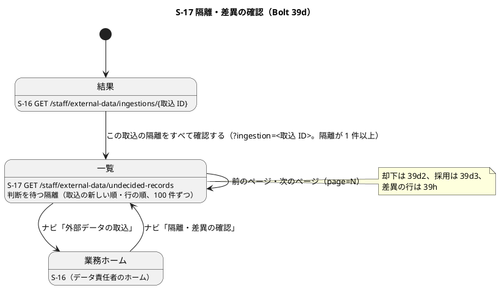
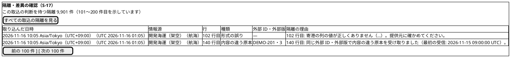
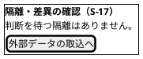
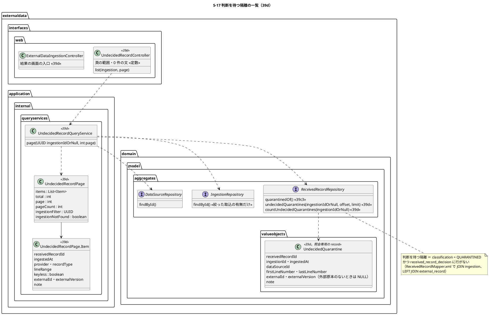
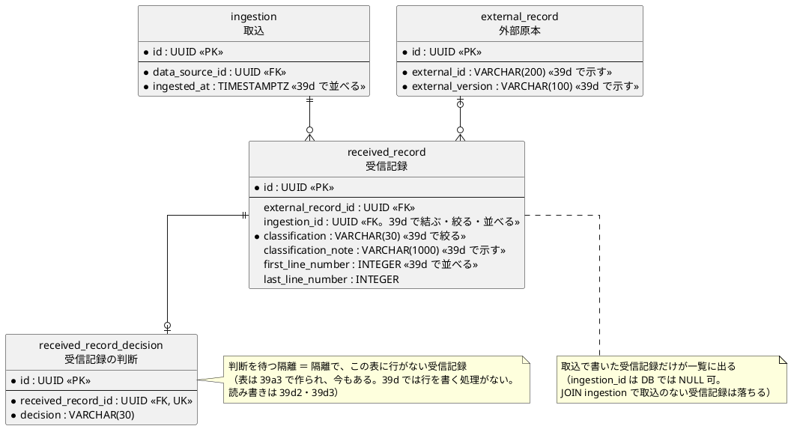

# Bolt 39d 計画 - S-17 判断を待つ隔離の一覧（すべての隔離と S-16 からの入口）

## 基本情報

| 項目 | 内容 |
| :--- | :--- |
| Bolt | 第 39d 回（W7 の 15 本目。release_plan :963 の 39d の行。この開始準備で 39d・39d2・39d3・39d4 に縦に分ける 1 つ目） |
| 状態 | 承認済み（2 つの整合性検証の指摘を反映した。2026-11-05、推奨のとおり。Recommend 承認の指示による。human:kakimomokuri） |
| 予定 | W7（2026-11-16 の週。前倒しで着手できる）。作業は約 4 時間 10 分（下の「時間の配分と打ち切り」。`check`・`uiTest`・`manualScreenshots`・`demoVideo`・`performanceTest`・SonarQube・CI とステップごとの承認の待ちを除く） |
| アプローチ | アウトサイドイン（S-17 の画面から。画面の層の受入シナリオ（`@ui`）の Red から入る。release_plan :963 の 39d の行のとおり。隔離の受信記録と注記は 39b2〜39c3 で固まっていて（ReceivedRecord.java :33-43、ReceivedRecordMapper.xml :39-47）、画面での示し方と一覧の照会が受入条件の中心） |
| 対象 | (1) S-17 の一覧の画面 `GET /staff/external-data/undecided-records`（判断を待つ隔離。取込で絞る `?ingestion=<取込 ID>`、1 ページ 100 件と前後のページ）、(2) 一覧の照会（判断の表に行のない隔離の受信記録を、取込の新しい順・行の範囲の順に読む。ポートに 2 つ足す。スキーマは変えない）、(3) 入口: S-16 の結果の画面の「隔離をすべて確認する」（隔離が 1 件以上のとき。39c の申し送り「S-17 への入口」）と、データ責任者のナビの「隔離・差異の確認」、(4) 上限いっぱい（隔離 1 万件の取込）の一覧の照会の計測（T-242。PERF-01）、(5) マニュアル 12 章に「12.2 隔離・差異の確認」の節（一覧の読み方。判断は 39d2・39d3 で足す）、用語集、新しいキャプチャ、(6) デモの動画（`@demo-bolt-39d/list`）。あわせて 39d 全体の論点（キーのない隔離の判断、採用の値の作り直し、再送の扱い、直した行、理由の符号、情報源の並び、判断のイベントと監査）をこの開始準備で決める（下の開始準備の決定 (6)〜(13)） |
| トレース | US-14 AC4（隔離しデータ責任者へ示す）・AC5（差異をデータ責任者へ示す。差異は 39h なので S-17 は隔離だけを示す）、UC-15 の主成功シナリオ 5（データ責任者が差異と採否を確認する）・代替 2a（形式の誤りは隔離して S-17 の一覧に出す。system_usecase :523）・3b（同一キー・異 payload を隔離しデータ責任者の確認対象にする）、ED-INV-02、PERF-01（画面の表示 p95 1.0 秒。non_functional :57）、ui_design の S-17（:142）・画面遷移（:511・:526-527）・オブジェクトの表（:74）、data_model の受信記録（:1154）・受信記録の判断（:1155）、ACC-01（WCAG 2.2 AA） |
| GitHub | [#18](https://github.com/k2works/practical-domain-driven-design-in-enterpris-application/issues/18)（US-14。クローズは 39h） |
| SP | 0 |
| 承認ゲート | **ステップごとに止める**（分ける前の release_plan :963 は「ステップごと（スキーマ・認可）」。分けた後の 39d の行は「ステップごと（画面・新しいファイル）」）。画面（S-17 の一覧、S-16 の入口、ナビ）、新しいファイル（下の一覧）。スキーマと認可は 39d では変えない（下の開始準備の決定 (3)・(4)。スキーマは 39d3 で変える）。注: 人の指示「Recommend 承認で進めて」により、各ステップの終わりで止めて推奨の案を承認として記録する（人が個別に見ていないことが分かるように「推奨のとおり（Recommend 承認の指示による）」と書く）。ステップを飛ばしたり束ねたりはしない。「人に諮ること」はない（【業務の判断】6 つは推奨のとおり記録し、終了報告の議題の先頭に置く） |
| 開始準備で決めたこと | 2026-11-05、推奨のとおり（Recommend 承認の指示による。human:kakimomokuri）: 下の (1)〜(15)。2 つの整合性検証の指摘（詳細 中 4・軽 3、横断 中 8・軽 8）を反映した |

### 開始準備の決定

(1) **分け方**（【前の決定の変更】(1)）: release_plan :963 の 39d の行と前の Bolt の申し送りを 1 本にすると約 14 時間 30 分で、半日を大きく超える（画面・判断の表・イベントと監査・スキーマ・再送の扱い・マニュアルとキャプチャと動画が重なる）。縦に 4 本に分ける。

| Bolt | 範囲（縦） | アプローチ | 承認ゲート | 見積り |
| :--- | :--- | :--- | :--- | ---: |
| **39d**（この計画） | データ責任者が判断を待つ隔離をすべて一覧で見る: S-17 の一覧（取込で絞る、1 ページ 100 件）、S-16 の結果とナビからの入口、上限いっぱいの一覧の照会の計測、マニュアル 12.2（一覧の読み方）とキャプチャ、デモの動画 | アウトサイドイン（S-17 の画面から） | ステップごと（画面・新しいファイル） | 約 4 時間 10 分 |
| **39d2** | データ責任者が隔離を却下する: 受信記録の判断（`ReceivedRecordDecision`）のポートと MyBatis の実装（追記専用、受信記録 1 件に 1 つ）、判断するのは隔離（のちに差異も）の受信記録だけをアプリケーションで守る（39a3 の論点。data_model :1155）、却下の POST（PRG・CSRF・理由は必須（決定 (11)）・判断済みや同時の判断は「判断済みです」）、判断のイベント（DE-29、決定 (12)）と identity の監査の listener（`EXTERNAL_RECORD_DECIDED`。配信まで確かめる。T-184）、一覧から判断済みが消えること（メモリの実装も判断のポートを見る）、マニュアル 12.2 の却下とキャプチャ、デモの動画 | アウトサイドイン（S-17 の判断から） | ステップごと（監査・画面） | 約 4 時間 00 分 |
| **39d3** | データ責任者が内容の違う原本の隔離を採用する: 受信記録に値の列（`target_key`・`value_summary`。NULL 可。スキーマ。決定 (8)）と取込での書き込み、採用の判断で採用値と DE-12・DE-13（操作者は判断者、公開した時刻は判断の時刻）と判断のイベント（決定 (12)）、キーのない隔離と値の列のない隔離は採用を出さない（決定 (7)）、監査の不変条件（（操作、受信記録）ごとにイベントは 1 つ。IA-INV-15）、AuditAction の `EXTERNAL_RECORD_ADOPTED` の Javadoc と domain_model の DE-12・DE-13 の `publishedAt` の属性の直し（判断による採用では判断の時刻）、マニュアル 12.2 の採用、デモの動画 | アウトサイドイン（S-17 の採用から） | ステップごと（スキーマ） | 約 3 時間 50 分 |
| **39d4** | 判断の後に送り直されたときの扱い: 採用した後の外部原本の基準のハッシュの付け替え（決定 (9)。【前の決定の変更】(3)）、同じ payload の再送は重複・元の payload の再送は隔離・却下した payload の再送は再び隔離の受入シナリオ、直した行の取り込み直しと新しい外部版の送り直しの受入シナリオ（決定 (10)）、情報源の並びの規則の実装（決定 (14)）、domain_model :339（重複の定義）と注記の文（IngestionService.java :69 の「最初の受信」）の直し（決定 (9) の【業務の判断】(f)）、マニュアル 12 章の「直して送り直すとき」と付録 B、デモの動画（再送の結果が S-16・S-17 に出る。画面の振る舞いが変わる） | インサイドアウト（分類の規則から） | ステップごと | 約 2 時間 40 分 |

W7 の残りは 39d〜39d4・39e・39f・39g・39g2・39h・39i の 10 本で（39d は W7 の 15 本目。W7 は 24 本前後になり、39e 以降を分ければ増える）、週の計画の期間（2026-11-16〜11-20）に対して実績は約 2 週先行しているので、4 本に分けてもバッファ消費ルールの範囲で吸収できる（W7 の週の見直しで確かめる）。release_plan の順序の段落の「W7 も 15 本前後になる見込み」を直す（ステップ 1）。

順序は 39c4 → 39d → 39d2 → 39d3 → 39d4 → 39e（39e・39f は採用値の DE-12 を受けるが、取込での自動の採用（39b3）で足り、隔離した行の採用（39d3）を待たない。release_plan :974 の「隔離した行の採用は 39d」を「39d3」に直す）。代わりの案は取らない: (a) 一覧と却下を 1 本（約 5 時間 20 分。半日を超える）、(b) 採用と再送の扱いを 1 本（約 5 時間。再送の扱いは外部原本の付け替えという取込の側の変更で、採用の画面と縦が違う）。各 Bolt の見積りは各 Bolt の開始準備で引き直す。

(2) **S-17 の URL と入口**: 一覧は `GET /staff/external-data/undecided-records`（任意の `ingestion=<取込 ID>` と `page=<1 から>`）。39d2 の判断は `POST /staff/external-data/undecided-records/{受信記録 ID}/decision`（PRG で一覧に戻る。ui_design :527 の「隔離差異 --> 取込 : 判断を記録」を「隔離差異 --> 隔離差異」に直すのは 39d2）。認可は `/staff/external-data/**` のデータ責任者（SecurityConfiguration.java :223-225）のまま変えない。入口は 2 つ: S-16 の結果の画面の「隔離の理由」の領域の最後（result.html :55-62 の `section` の中、「続けて取り込む」:63 の前）に「この取込の隔離をすべて確認する（S-17）」（`?ingestion=<取込 ID>`。隔離が 1 件以上のときだけ。押しても行き先のないリンクを出さない）、データ責任者のナビ（layout/staff.html :67-73）の「外部データの取込」の後に「隔離・差異の確認」（`active == 'undecided-records'`）。ホームは S-16 のまま（HomeController.java :28）。代わりの案（S-17 をデータ責任者のホームにする）は、取込が日々の起点で、39c で S-16 をホームに決めたので取らない

(3) **一覧の中身と並び**: 判断を待つ隔離（分類が `QUARANTINED` で、`received_record_decision` に行のない受信記録。差異 `DISCREPANCY` は 39h で同じ一覧に足す）。並びは取込の新しい順（`ingestion.ingested_at DESC`）、同じ時刻の取込は取込 ID の順（`r.ingestion_id`。同じ時刻の 2 つの取込の行が混ざらない）、同じ取込の中は 39c3 の順（ファイルの誤りを先、行の範囲の始まりの順、`id`。ReceivedRecordMapper.xml :45）。並びのキーは `i.ingested_at DESC, r.ingestion_id, r.first_line_number NULLS FIRST, r.id` で、時刻・数・UUID だけで、文字列の照合順序に頼らない（決定 (14) の情報源の並びの食い違いを持ち込まない）。1 ページ 100 件（39c3 の結果の画面の 100 件にそろえる）、前後のページへのリンクと「判断を待つ隔離 N 件（M〜L 件目を示しています）」（数は 3 桁の区切り）。項目は、取り込んだ日時（`DateTimeDisplay`。S-16 の形「2026-11-16 10:05 Asia/Tokyo（UTC+09:00）（UTC 2026-11-16 01:05）」。ui_design :1865）、情報源（提供元と原本種別）、行（行の範囲。39c3 の注記と同じ「N 行目」「N〜M 行目」。行を持たないファイルの誤りは「—」）、種類（「内容の違う原本」＝外部原本を持つ／「形式の誤り」＝キーのない隔離）、外部 ID・外部版（キーのない隔離は「—」と読み上げ用の「なし」）、隔離の理由（`classification_note` を `th:text`。39c3 と同じ文）。判断の列は 39d2 で足す。0 件のときは表を出さず「判断を待つ隔離はありません。」。取込で絞って 0 件（判断し終えた、または隔離のない取込）は「この取込に判断を待つ隔離はありません。」（状態の組み合わせの行 10）。取込で絞っているときは、件数の文を「この取込の判断を待つ隔離 N 件（…）」にし、「すべての取込の隔離を見る」（絞らない一覧へのリンク）を出す。代わりの案（39c3 の結果の画面と同じ「最初の 100 件と残りの件数」）は、すべての隔離を見られず（39c3 の申し送り）取らない

(4) **一覧の照会とポート（スキーマは変えない）**: `ReceivedRecordRepository`（ReceivedRecordRepository.java :12-25）に `undecidedQuarantines(UUID ingestionIdOrNull, int offset, int limit)`（`List<UndecidedQuarantine>` を返す）と `countUndecidedQuarantines(UUID ingestionIdOrNull)` を足す。`UndecidedQuarantine` は照会専用の record（受信記録 ID、取込 ID、取込の時刻、情報源 ID、行の範囲、外部原本の有無、外部 ID・外部版（外部原本のないときは NULL）、注記）で、`externaldata.domain.model.valueobjects` に置く（前例 RoutingCaseSummary・BookingSummary。ドメイン層の規則 DomainArchitectureTest :20-28 の中。受信記録の record `ReceivedRecord` に外部 ID・外部版を足さない）。SQL は ReceivedRecordMapper.xml で `received_record r JOIN external_data.ingestion i ON i.id = r.ingestion_id LEFT JOIN external_data.external_record e ON e.id = r.external_record_id` と結び、取込の時刻・情報源 ID・外部 ID・外部版を同じ 1 本の SQL で読む（1 ページで最大 100 回引かない）。`NOT EXISTS (SELECT 1 FROM external_data.received_record_decision d WHERE d.received_record_id = r.id)` を今から入れる（判断の表は 39a3 で作られ、今もある。V20261103100000 :107-128。39d では判断の行を書く処理がないので、すべての隔離が出る。39d2 で照会を変えない）。取込で書いた受信記録だけが一覧に出る（`ingestion_id` は DB では NULL 可で、`JOIN ingestion` で取込のない受信記録は落ちる。今の取込はいつも `ingestion_id` を書く）。並びは決定 (3) のキー。メモリの実装（`InMemoryReceivedRecordRepository`）はメモリの取込のリポジトリ（と外部原本のリポジトリ）を受け取って結び、同じキーで並べる。メモリの実装は 39d2 で判断のポートができるまで隔離をすべて返す（判断の表を持たない。39d2 で判断のポートを見る）。情報源だけはページの中の異なる ID ごとに 1 回だけ引く（`DataSourceRepository.findById`。最大 100 件で情報源はふつう数件）。索引は足さない（`ix_received_record_ingestion`・`ix_received_record_classification` がある。V20261103100000 :93-94）。上限いっぱいで 1 秒（PERF-01）を超えたら値を記録して止め、索引（スキーマ）を諮る（決定 (15)）

(5) **新しい型の名前**（T-246。`grep -rl "Undecided"` で apps/cargo-tracker/src にない、`ReceivedRecordDecision`・`ReceivedRecordDecided` も外部データにないことを確かめた。`UndecidedQuarantine` も検索してないことを確かめた）: ポートの照会専用の record `UndecidedQuarantine`（`externaldata.domain.model.valueobjects`。決定 (4)）、照会 `UndecidedRecordQueryService`、値 `UndecidedRecordPage`（入れ子の record `Item`。絞った取込が見つからないことを表す項目 `ingestionNotFound` を持つ。状態の組み合わせの行 13）（`externaldata.application.internal.queryservices`）、controller `UndecidedRecordController`（`externaldata.interfaces.web`）、テンプレート `templates/externaldata/undecided-records/index.html`。「Review」は見積りの審査（`ReviewRecord`・`ReviewForm`。quotation）と読み違えるので使わない。用語は「判断を待つ隔離」（用語集に足す）

(6) **理由の符号を表の列で持つか**（39b2・39c2・39c3 の申し送り）: 持たない（スキーマを変えない）。S-17 の一覧は理由で絞らず、理由は注記の文で読む。符号は DE-14 の `reason` にあり（ExternalRecordQuarantined.java :38）、監査（`EXTERNAL_RECORD_QUARANTINED` の理由）に残る。理由で絞る必要が業務で出たら（W10 の隔離の未判断の警告 OBS-06 など）、その Bolt で列を足す（追記専用の表に後から足す列は NULL 可で、それより前の受信記録は監査記録から読む）

(7) **キーのない隔離（形式の誤り・ファイルの誤り・取り込めなかった部分）の判断**【業務の判断】(a): 外部原本も冪等性キーも値も持たない（data_model :1154、IngestionService.java :278-326）ので採用できない。判断は却下だけ（39d2）にし、S-17 は「採用」を出さず「直したファイルを取り込み直してください」を示す（39d は一覧の種類の列「形式の誤り」と、マニュアルの説明まで）。直した行を取り込み直すと新しい受信記録になり、外部原本がなければ採用になる（決定 (10)）

(8) **採用の値の作り直し**（【前の決定の変更】(2)。Bolt 39b2b の申し送り「値を表に持たず原文から読み直さない」、39b3 の申し送り「要約を読む案を足す」）: 39d3 で、受信記録に `target_key VARCHAR(100)`・`value_summary VARCHAR(4000)`（NULL 可）を足し、取込で外部原本を持つ受信記録（採用・重複・隔離）に、採用値（data_model :1156）と同じ規則の値を書く（スキーマ。39d3 の承認ゲート）。採用の判断は要約から値を作り直し（要約は UTC・マイクロ秒の 6 桁に固定した正規の文字列で、寄港と主要実績に戻せる。data_model :1156）、採用値と DE-12・DE-13 を作る（`AdoptionFactory` を受信記録の値から作れる形にする。Bolt 39b3 の終了報告 :65）。39d3 より前の受信記録（値の列が NULL）は採用できず、却下だけにする（パイロットの前で業務のデータはない）。代わりの案は取らない: (a) 行の原文とファイル全体の原本のヘッダーから解析し直す（解析は `interfaces.file` にあり（ADR-004 の決定 5、LayerArchitectureTest :86-104）、application から呼べない。判断のたびに最大 40 MiB の原本を読む）、(b) 別の表に値を置く（受信記録と 1 対 1 で、表を増やすだけ）

(9) **隔離した payload を採用した後の再送**【業務の判断】(b)・【前の決定の変更】(3)（release_plan の W7 の確認ポイント 2、Bolt 39a3 の申し送り「`external_record` は 39d の再送の扱いで最初のハッシュを変えうる」）: 39d4 で、採用の判断のときに外部原本の基準のハッシュと原本のキー（`external_record.payload_hash`・`payload_object_key`）を採用した payload に付け替える（`external_record` は追記専用でない。Bolt 39a3 の決定 (4)）。付け替えの後、採用した payload の再送は重複（採用値を作らない。AC3）、元の payload の再送は隔離（採用中の値と違う原本としてデータ責任者に示す）。data_model :1152 の「最初に受け取った payload のハッシュ」を「採用中の payload のハッシュ（はじめは最初に受け取った payload。採用の判断で付け替える）」に直す。却下した payload の再送は、再び隔離（判断は受信記録 1 件に 1 つで、やり直しは再送の新しい受信記録で扱う。Bolt 39a3 の決定 (2)）。付け替えは採用の判断と同じトランザクションで、外部原本の行の楽観ロック（取込と判断の同時）を 39d4 の開始準備で決める。【業務の判断】(f) **同じ外部 ID・外部版で内容が違えば隔離、版をまたげば差異**: 同じ外部 ID・外部版で採用中の値と内容の違う原本は隔離（ED-INV-02）のままにし、外部版をまたいで採用中の値と矛盾するときは差異（ED-INV-03。39h）にする（推奨のとおり。Recommend 承認の指示による。human:kakimomokuri）。付け替えの後は比べる相手が「最初の受信」でなく「採用中の payload」になるので、39d4 で domain_model :339（重複の定義）と注記の文（IngestionService.java :69 の「最初の受信」）を直す。39d3・39d4 の終了報告の議題の先頭に置く

(10) **直した行の取り込み直し・新しい外部版の送り直し**【業務の判断】(c): 今の分類の規則（ED-INV-02、IngestionService.java :179-226）のまま変えない。キーのない隔離を直して取り込み直すと、そのキーの外部原本がない（キーのない隔離は外部原本を作らない）ので採用になる。内容の違う原本を新しい外部版で送り直すと、新しい冪等性キーなので採用になる。同じ外部版のまま内容を直して送り直すと、再び隔離（決定 (9) の付け替えの後は採用中の値と比べる）。39d4 でこの 3 つを受入シナリオで確かめ、マニュアルに「直して送り直すとき」を書く（39c3・39c4 の終了報告の既知の課題）

(11) **却下の理由**【業務の判断】(d): 却下は理由を必須にし（1000 文字まで。`received_record_decision.reason` は NULL 可のまま、アプリケーションで守る）、採用は理由を任意にする。却下は採用値を作らず業務に何も残らないので、後で監査（AUD-01）とデータ責任者の引き継ぎで「なぜ捨てたか」を読めるようにする。実装は 39d2。理由を読む手段は AUD-UI-01（監査の一覧の画面。W8 で決める。release_plan :1033）で、39d2 は監査記録に残すまで

(12) **判断のイベントと監査**（Bolt 39b3b の申し送り（[計画](bolt_39b3b_plan.md) :58・:136・:318）の推奨を取る）: 判断ごとに 1 つ「受信記録を判断した」（DE-29、`ReceivedRecordDecided`、`externaldata.domain.events`。受信記録 ID、取込 ID、情報源 ID、判断（`ADOPTED`・`REJECTED`）、理由、判断者、判断の時刻）を出し、identity の `ExternalRecordAuditEventHandler`（:46-90 の 3 つの `on` の隣）が新しい操作 `EXTERNAL_RECORD_DECIDED`（AuditAction.java :93-98 の後）で人の判断として書く（39d2）。採用の判断では、ほかに DE-12・DE-13 を出し、既存の `EXTERNAL_RECORD_ADOPTED` を書く（39d3。同じ受信記録に隔離・判断・採用の監査が 1 つずつで、（操作、受信記録）ごとにイベントは 1 つ（IA-INV-15）を守る。同じ受信記録を 2 回判断しないことは判断の表の一意制約で守る）。DE の番号は DE-28（domain_model :1675）の次

(13) **誤って採用・却下した判断を取り消すか**【業務の判断】(e)（Bolt 39a3 の申し送り）: Release 1.0 では取り消す操作を作らない（判断の表と採用値は追記専用。data_model :177）。誤って採用したときは、提供元に新しい外部版で正しい原本を送ってもらい（採用値は対象のキーの新しい版で効く）、誤って却下したときは同じ原本を送り直してもらう（再び隔離になり判断し直せる。決定 (9)）。マニュアルに書き（39d3・39d4）、台帳に既知の課題として残す

(14) **情報源の並びの規則**（39c の申し送り。[計画](bolt_39c_plan.md) :161）: 取り込める情報源の選択肢（S-16）は、照会のサービス（IngestibleDataSourceQueryService.java :27-28）が Java の `String` の順（提供元、原本種別）で並べることを規則にする（DB の照合順序（DataSourceMapper.xml :23 の `ORDER BY provider, record_type`）と、テストのメモリの実装（InMemoryDataSourceRepository.java :42）の食い違いを、並べる場所を 1 つにしてなくす。SQL の `ORDER BY` は消す）。実装は 39d4（S-16 の選択肢の振る舞いで、S-17 の縦と別）。S-17 の並びは決定 (3) のとおり文字列に頼らない

(15) **上限いっぱいの一覧の照会の計測**（T-241・T-242）: 隔離 1 万件の取込（値の誤りだけ。T-230）で、`?ingestion=<取込 ID>&page=100`（最後のページ）と絞らない 1 ページ目の GET（MockMvc）を `ExternalDataIngestionPerformanceTest` に 1 本足し、ログの「PERF-06 undecided」で始まる行に照会（件数と頁）と描画の時間を区切って出す。値は CI の手動のジョブ `performance`（cargo-tracker-ci.yml :161-164）で記録し、終了報告に書く。照会が 1 秒（PERF-01 の p95）を超えたら値を記録して止め、索引（`received_record (ingestion_id, classification, first_line_number)` など。スキーマ）を足すかを諮る

【前の決定の変更】(1): release_plan :963 の 39d の行を、この開始準備で 39d・39d2・39d3・39d4 に縦に分ける。順序（:974）は 39c4 → 39d → 39d2 → 39d3 → 39d4 → 39e、:974 の「隔離した行の採用は 39d」を「39d3」に、デモ項目（:980）の動画の Bolt に 39d2・39d3・39d4 を足す（39d4 も再送の結果が S-16・S-17 に出て画面の振る舞いが変わるので、39d4 の範囲に動画を入れた。決定 (1) の表）。release_plan の W7 の行は、この開始準備で 39d（一覧）・39d2・39d3・39d4 の 4 行に分けた（各行の範囲・SP 0・アプローチ・承認ゲートは決定 (1) の表のとおり）（2026-11-05、推奨のとおり。Recommend 承認の指示による。human:kakimomokuri）。

【前の決定の変更】(2): Bolt 39b2b の決定「値は `IngestedRow.values` に載せ、受信記録には書かない」（[終了報告](bolt_39b2b_report.md) :20）を変え、39d3 で受信記録に値の列（`target_key`・`value_summary`。NULL 可）を足す（スキーマ。39d3 の承認ゲート）（2026-11-05、推奨のとおり。Recommend 承認の指示による。human:kakimomokuri）。

【前の決定の変更】(3): data_model :1152 の外部原本の「最初に受け取った payload のハッシュを持つ」を、39d4 で「採用中の payload のハッシュ（採用の判断で付け替える）」に変える（2026-11-05、推奨のとおり。Recommend 承認の指示による。human:kakimomokuri）。

新しいファイル（39d）: 本体 `UndecidedQuarantine.java`（`externaldata/domain/model/valueobjects/`。照会専用の record）、`UndecidedRecordQueryService.java`・`UndecidedRecordPage.java`（`externaldata/application/internal/queryservices/`）、`UndecidedRecordController.java`（`externaldata/interfaces/web/`）、テンプレート `templates/externaldata/undecided-records/index.html`。テスト `UndecidedRecordQueryServiceTest.java`・`UndecidedRecordControllerTest.java`、受入シナリオ `features/ui/review_undecided_records_ui.feature` と Steps `UndecidedRecordUiSteps.java`。キャプチャ `docs/manual/assets/12-undecided-records.png`（`manualScreenshots` が作る）、デモの動画 `docs/assets/demo/bolt-39d/list.webm`（`demoVideo` が作る）。直すもの: `ReceivedRecordRepository`・`MyBatisReceivedRecordRepository`・`ReceivedRecordMapper`（.java・.xml）・`InMemoryReceivedRecordRepository`、`ExternalDataConfiguration`（照会のサービスの `@Bean`。前例 IngestionSummaryQueryService。ExternalDataConfiguration.java :38-42）、受信記録のリポジトリの契約のテスト（`ExternalDataRecordRepositoriesContract`）と、判断の行を入れる行 7 の `H2ExternalDataRecordRepositoriesTest`・`MyBatisExternalDataRecordRepositoriesIntegrationTest`、`ExternalDataIngestionSecurityIntegrationTest`（S-17 の認可と DB の通し）、`ExternalDataIngestionPerformanceTest`、`result.html`・`ExternalDataIngestionControllerTest`（入口）、`layout/staff.html`（ナビ）、`manual_screenshots.feature`、マニュアル 12 章・用語集。マニュアルは新しいファイルを作らない（12 章に 12.2 を足す。39c の確認ポイント 12）。

## Bolt ゴール

データ責任者が、S-16 の結果の画面の「この取込の隔離をすべて確認する」か、ナビの「隔離・差異の確認」から S-17 を開くと、判断を待つ隔離が取込の新しい順・ファイルの行の順に 100 件ずつ並び、取り込んだ日時・情報源・種類（内容の違う原本／形式の誤り）・外部 ID と外部版・隔離の理由を読める。取込で絞ると、その取込の隔離だけがすべて（1 万件でも 100 ページで）見られる。判断を待つ隔離がなければ、そう示す。S-17 はデータ責任者だけが開ける。隔離 1 万件の一覧の照会の時間が記録されている。マニュアル 12.2 に一覧の読み方があり、キャプチャとデモの動画がある。却下は 39d2、採用は 39d3、送り直したときの扱いは 39d4。

### 開始準備で確かめたこと

- **release_plan の 39d の行**（:963。分ける前の行）: 「S-17 隔離・差異の確認: 判断（採用・却下）の記録と判断者、採用の判断で採用値と DE-12・DE-13、判断のイベントと監査、隔離した payload の再送の扱い、マニュアルとキャプチャ、axe。注: キーのない隔離は外部原本も冪等性キーも持たないので採用値を作れない。判断は却下と再送だけかを決める」、アプローチはアウトサイドイン、承認ゲートは「ステップごと（スキーマ・認可）」。順序は :974、デモ項目は :980、確認ポイント 2（:914。判断を別の追記専用の表に、再送は 39d で決める）・3（:915。データ責任者）・23（:935。39d が 12 章に隔離・差異の確認の節を足す）、承認ゲート :895（外部原本の取込はステップごと）
- **前の Bolt の申し送り**: Bolt 39c4（[計画](bolt_39c4_plan.md) :127-138、[終了報告](bolt_39c4_report.md) :102-105。すべての隔離の一覧、理由の符号、情報源の並び、直した行の取り込み直し）、Bolt 39c3（[計画](bolt_39c3_plan.md) :155-157、[終了報告](bolt_39c3_report.md) :103）、Bolt 39c2（[計画](bolt_39c2_plan.md) :151）、Bolt 39c（[計画](bolt_39c_plan.md) :161・:163、[終了報告](bolt_39c_report.md) :99。情報源の並び、S-17 への入口）、Bolt 39b3b（[計画](bolt_39b3b_plan.md) :54・:58・:136・:318、[終了報告](bolt_39b3b_report.md) :98。二重の監査と不変条件）、Bolt 39b3（[計画](bolt_39b3_plan.md) :149-150、[終了報告](bolt_39b3_report.md) :96・:99。採用値の要約、`AdoptionFactory`）、Bolt 39b2b（[計画](bolt_39b2b_plan.md) :147、[終了報告](bolt_39b2b_report.md) :20・:98。値の作り直し）、Bolt 39b2（[計画](bolt_39b2_plan.md) :153-154、[終了報告](bolt_39b2_report.md) :105。キーのない隔離の判断、理由の符号）、Bolt 39a3（[計画](bolt_39a3_plan.md) :25・:47-48・:92、[終了報告](bolt_39a3_report.md) :19-20・:91。判断の表、誤った採用の取り消し、再送）
- **判断の表の今の形**: `received_record_decision` は 39a3 で作られ、今もある（V20261103100000 :107-128。一意制約 `uk_received_record_decision_received_record`、CHECK `decision IN ('ADOPTED','REJECTED')`、追記専用）。読み書きのクラス・マッパーはない（`externaldata` に `ReceivedRecordDecision` はない。domain_model :320 は「クラスは 39d で作る」）。判断と分類の整合はアプリケーションで守る（data_model :1155-1156）
- **隔離の受信記録の今の形**: 内容の違う原本は外部原本を持ち（IngestionService.java :179-226）、形式の誤りは外部原本と取得時刻を持たない（同 :258-326、ReceivedRecord.java :52-57）。値は受信記録に書かない（ReceivedRecord.java :33-43 に値の項目はない。採用値だけが要約を持つ。AdoptionFactory.java の `adoptedValue`）。取込ごとの隔離の照会は 39c3 の `quarantinedOf`（ReceivedRecordRepository.java :24、ReceivedRecordMapper.xml :39-47。`ORDER BY first_line_number NULLS FIRST, id`）
- **認可とナビ**: `/staff/external-data/**` はデータ責任者だけ（SecurityConfiguration.java :223-225）。ナビは「外部データの取込」だけ（layout/staff.html :67-73）。ホームは S-16（HomeController.java :28）。S-16 の結果の画面は隔離の理由の領域（result.html :55-62）の後に「続けて取り込む」（:63）
- **画面の設計**: ui_design に S-17 の画面イメージと URL の行はない（:142 の画面一覧の行、:511・:526-527 の画面遷移、:74 のオブジェクトの表だけ）。ページ送りの前例はない（ui_design の一覧は件数を絞った最小の表示。:168-169・:180）
- **監査**: `ExternalRecordAuditEventHandler` は DE-12・DE-13・DE-14 を受ける（:46-90）。`AuditAction` は `EXTERNAL_RECORD_ADOPTED`・`EXTERNAL_RECORD_QUARANTINED`（:93-98）。監査の表の操作に CHECK はない（common の migration に `EXTERNAL_RECORD_QUARANTINED` の CHECK はない）。39d はイベントと監査を変えない（39d2・39d3）
- **情報源の並び**: `selectApproved` は `ORDER BY provider, record_type`（DataSourceMapper.xml :20-24）、メモリの実装は `Comparator.comparing(DataSource::provider)`（InMemoryDataSourceRepository.java :42）
- **マイグレーション**: common の最新は V20261104170000（39c3）。この Bolt はスキーマを変えない

## 設計の決定

| 項目 | 決定 | 根拠 |
| :--- | :--- | :--- |
| 分け方 | 開始準備の決定 (1)。39d・39d2・39d3・39d4 の 4 本（【前の決定の変更】(1)） | 下の「時間の配分と打ち切り」 |
| URL と入口 | 決定 (2)。`/staff/external-data/undecided-records`、S-16 の結果の画面のリンク、ナビ | SecurityConfiguration.java :223-225、result.html :55-63 |
| 一覧の中身と並び | 決定 (3)。判断を待つ隔離、取込の新しい順・行の順、100 件ずつ | ReceivedRecordMapper.xml :45 |
| 照会とポート | 決定 (4)。ポートに 2 つ（照会専用の record `UndecidedQuarantine`）、取込と外部原本を SQL で結ぶ、判断の表との `NOT EXISTS`、スキーマと索引は変えない | V20261103100000 :93-94・:107-128、DomainArchitectureTest :20-28 |
| 型の名前 | 決定 (5)。`UndecidedRecord…`（T-246 で検索した） | — |
| 理由の符号 | 決定 (6)。持たない | ExternalRecordQuarantined.java :38 |
| キーのない隔離の判断 | 決定 (7)。却下だけ。【業務の判断】(a) | data_model :1154 |
| 採用の値 | 決定 (8)。39d3 で受信記録に値の列（【前の決定の変更】(2)） | data_model :1156 |
| 採用した後の再送 | 決定 (9)。39d4 で外部原本の基準を付け替える（【前の決定の変更】(3)）。【業務の判断】(b)。同じ外部版は隔離、版をまたげば差異（【業務の判断】(f)） | data_model :1152、domain_model :339 |
| 直した行 | 決定 (10)。分類の規則のまま。【業務の判断】(c) | IngestionService.java :179-226 |
| 却下の理由 | 決定 (11)。必須。【業務の判断】(d)。読む手段は AUD-UI-01（W8） | data_model :1155、release_plan :1033 |
| 判断のイベントと監査 | 決定 (12)。DE-29 `ReceivedRecordDecided`、`EXTERNAL_RECORD_DECIDED` | Bolt 39b3b 計画 :318、IA-INV-15 |
| 判断の取り消し | 決定 (13)。作らない。【業務の判断】(e) | data_model :177 |
| 情報源の並び | 決定 (14)。照会のサービスで Java の順に（実装 39d4） | DataSourceMapper.xml :23、InMemoryDataSourceRepository.java :42 |
| 上限いっぱいの照会 | 決定 (15)。「PERF-06 undecided」の行に照会と描画を区切る | PERF-01、cargo-tracker-ci.yml :161-164 |

## ふりかえりと前の Bolt からの引き継ぎ

| 出典 | 内容 | この Bolt での扱い |
| :--- | :--- | :--- |
| W6 の Try T-204・T-212、Bolt 38h の T-227、Bolt 39b の T-233、Bolt 39c4 の Problem | サブエージェントへの指示の最初に heredoc（`<<`）と標準入力を待つコマンド（引数のない `cat >`、`python -` など）を使わないと書く | 任せるときの指示の最初に書く（39c4 で `python -` を 1 度流した。[終了報告](bolt_39c4_report.md) :94）。私が計画を直すときもファイルは Write・Edit で書く |
| W6 の Try T-217、Bolt 39b2 の Try | 本体を直す前に Red を流し、落ちた理由を記録する。直したテストの一覧を添える | ステップ 2。ナビの項目が増えて落ちる既存のテスト（ナビの項目を数える・並びを確かめるテスト）と、S-16 の結果の画面にリンクが増えて落ちるテスト（ExternalDataIngestionControllerTest の 39c3・39c4 の `@Nested`）を、ステップ 2 の開始で grep して一覧にする |
| W6 の Try T-191 | 環境の前提に設定ファイルの行を添える | CI の手動のジョブ（cargo-tracker-ci.yml :161-164）を決定 (15) に添えた |
| W6 の Try T-225・T-213 | push の前に `check` | ステップ 9（`uiTest` も流す） |
| W6 の Try T-182・T-211・T-216 | 状態の組み合わせの表に重複・隔離と出口・誤った入力の行を置く | 下の表（行 1〜20）。隔離の 2 つの種類（行 1・2）、重複・採用は出ない（行 3）、出口（行 9・10 の 0 件）、誤った入力（行 13・14 の不正な取込 ID・ページ） |
| W6 の Try T-184 | listener は配信まで確かめる | 39d はイベントを足さない。39d2 の DE-29 の listener で当てる |
| W6 の Try T-219 | 変異の対象に単体・統合・契約のテスト | 下の変異の表（照会の単体・契約・controller・UI） |
| W6 の Try T-215・T-222 | Gradle を流す担当を 1 つに、計画の初稿を先にコミット | Gradle は人の側の 1 か所で流す（`uiTest`・`manualScreenshots`・`demoVideo`・`performanceTest` を含む）。初稿をコミットしてから実装に入る |
| Bolt 39a2 の T-229 | 永続化の Bolt の状態の組み合わせに時刻の出どころと同時の書き込みの行を置く | 時刻: 読むだけで時刻を作らない（並びは取込の時刻）。同時の書き込み: 一覧を読んでいる間に取込が増えると、ページの境が 1 件ずれうる（行 15。読み直せば正しい。判断のある 39d2 で同時の判断を扱う） |
| Bolt 39a3 の T-230 | 入ることを確かめる行のデータはドメインの規則に合う組み合わせにする | 内容の違う原本の隔離（行 1）は、寄港 2 つ以上・時刻の順の航海の行を 2 度（同じキー・違う値）取り込んで作る。上限いっぱい（行 19）は値の誤りだけの行。情報源は提供元の名前に自分の UUID を含める |
| Bolt 39b の T-231 | `@Transactional` は契約のクラスに付ける。継ぐ側だけに付けない | 契約のテストの `@Transactional` は抽象の契約のクラス（`ExternalDataRecordRepositoriesContract`）に付ける（継ぐ側（H2・MyBatis のテスト）だけでは効かない）。行 3・4・6・15 は契約のクラスに足し、行 7 は継ぐ側の 2 つに置くが、トランザクションは契約のクラスの注釈で受ける |
| Bolt 39b の T-232・Bolt 39b2 の T-234・Bolt 39b3 の T-237 | 本体を直したステップは承認の前に `spotbugsMain`・`checkstyleMain`・`sonar-local:check` | ステップ 3・4・5 |
| Bolt 39b2b の T-235 | テストの名前の「行 N_」に Bolt の接頭辞を付けるかを W7 の締めで決める | W7 の締めで決める。39d は新しいテストのクラスでは接頭辞なしの `行N_…`、既存のテストのクラスでは `@Nested class Bolt39d_…`、契約のテストは名前の頭に `Bolt39d_`（39c3・39c4 の前例） |
| Bolt 39b2b の T-236 | 「起きないこと」を確かめるテストは、件数ではなく呼び出しの記録で確かめる | 判断を待つ隔離が 0 件のとき、ページの照会（`undecidedQuarantines`）を呼ばず取込・情報源も引かない（行 9）ことを、呼び出しの記録で確かめる |
| Bolt 39b3 の T-238 | サブエージェントへの指示は計画の決定を言い換えず計画の行を指す | 任せるときは「開始準備の決定」の番号と「状態の組み合わせ」の行番号を指す |
| Bolt 39b3b の T-239 | 人に諮る選択肢の前提はコードで確かめ、出典の行を添える | 開始準備の決定と【業務の判断】の前提に出典の行を添えた（判断の表があること、キーのない隔離が外部原本を作らないこと、値を受信記録に書かないこと、認可の行、並びの 2 か所） |
| Bolt 39b3b の T-240 | 表から作る規則には、全部の行が規則に入ることを確かめるテストを添える | 種類の列（行 1・2）を分類と外部原本の有無の組み合わせのすべてで縛る（隔離で外部原本あり・なし。採用・重複は一覧に出ない） |
| Bolt 39b4 の T-241 | 性能の目標を外れたら、どの処理に時間がかかっているかを実測する | 行 19 の計測は照会（件数・頁）と描画を区切る |
| Bolt 39b4 の T-242 | 性能のテストの行には、上限いっぱいの入力の行を必ず入れる | 行 19（隔離 1 万件の取込の最後のページと絞らない 1 ページ目） |
| Bolt 39c の T-243 | 状態の数を 0 件にする受入シナリオが要るときは、計画の時点でコントローラーのテストに下ろすと決める | 判断を待つ隔離が全体で 0 件（行 9）は共有の PostgreSQL で作れないので controller のテスト（照会を mock）に下ろす。取込で絞って 0 件（行 10）は UI で作れる（隔離のない取込） |
| Bolt 39c2 の T-244 | パラメーターのテストは、入力と期待する出力の組み合わせまで縛る | 行 5（ページの境の組: 件数 0・100・101・10,000 と頁の範囲の文）、行 1・2（種類と外部 ID の表示の組） |
| Bolt 39c3 の T-245 | 並びの規則を足すテストは、書く順を行の順と逆にしたデータを契約のテストに置く | 行 4 の契約のテストは、取込を時刻の古い順に、同じ取込の受信記録を行の範囲の逆の順に書き、照会が取込の新しい順・行の順に返すことを確かめる |
| Bolt 39c4 の T-246 | 新しい型の名前は、同じコンテキストの中で同じ単純名のクラスがないかを検索してから決める | 開始準備の決定 (5)。`Undecided`・`ReceivedRecordDecision`・`ReceivedRecordDecided` を apps/cargo-tracker/src で検索してないことを確かめた |
| 画面の Bolt の前例（memory の manual-in-bolt-done-criteria、Bolt 37f2 の T-197） | 振る舞いが変わる Bolt はマニュアルの更新を完了条件に入れる。マニュアルの文を実装と突き合わせる | 完了条件に 12.2・用語集・キャプチャを入れる。ステップ 7 で一覧の文（0 件・頁の範囲・種類）を controller の定数とテンプレートに突き合わせる |
| Bolt 39c4 の開発レビューの低（送った 2 件） | 「N 行目」の行の番号を 3 桁で区切らない、案内の文の定数が 2 つに割れている | 39d は注記の文を変えない（受信記録に保存した文をそのまま示す）。送ったまま |

## 状態の組み合わせ（行ごとにテストを 1 本。T-182）

一覧の照会の DB の通しは受信記録のリポジトリの契約のテスト（`ExternalDataRecordRepositoriesContract`。H2 と PostgreSQL とメモリ）、判断の表に行のある隔離（行 7）は共有の契約のテストに置かず、`H2ExternalDataRecordRepositoriesTest` と `MyBatisExternalDataRecordRepositoriesIntegrationTest` だけに置く（判断の行は JDBC で入れる。前例 ExternalDataSchemaIntegrationTest :340・:473。メモリの実装は 39d2 で判断のポートができるまで隔離をすべて返すので、行 7 を持たない）、照会の値は照会の単体テスト（`UndecidedRecordQueryServiceTest`。ポートを mock）、画面は WebMvc のテスト（`UndecidedRecordControllerTest`。照会は mock）、認可と DB の通しはセキュリティの統合テスト（`ExternalDataIngestionSecurityIntegrationTest` に `@Nested class Bolt39d_…`。PostgreSQL。取込のサービスで取り込んでから S-17 を開く）、画面の通しは `review_undecided_records_ui.feature`（Feature の `@ui @US-14 @must`、幅 320 px、axe）。

| 行 | 状況 | 期待 | 確かめ方 |
| :--- | :--- | :--- | :--- |
| 1 | 内容の違う原本の隔離（同じキー・違う payload） | 一覧に出る。種類「内容の違う原本」、外部 ID・外部版を示す、隔離の理由は 39b2 の注記の文 | 照会の単体（種類と表示の組のパラメーターのテスト。T-240・T-244）、セキュリティの統合テスト |
| 2 | キーのない隔離（行の誤り・ファイルの誤り・取り込めなかった部分） | 一覧に出る。種類「形式の誤り」、外部 ID・外部版は「—」（読み上げ「なし」）、隔離の理由は 39b2・39c3 の注記の文 | 同上 |
| 3 | 採用・重複の受信記録 | 一覧に出ない | 契約のテスト |
| 4 | 並び（T-245） | 取込の新しい順、同じ時刻の取込は取込 ID の順、同じ取込はファイルの誤りを先・行の範囲の始まりの順。書く順を逆にしたデータでも同じ | 契約のテスト（H2・PostgreSQL・メモリ） |
| 5 | ページの境（T-244） | 件数 0・100・101・10,000 の組で、ページ数、前後のリンクの有無、「判断を待つ隔離 N 件（M〜L 件目を示しています）」の文（3 桁の区切り）が期待どおり | 照会の単体（ページの値）と controller（文とリンク）のパラメーターのテスト |
| 6 | 取込で絞る | その取込の隔離だけが出る。ほかの取込の隔離は出ない | 契約のテスト、セキュリティの統合テスト |
| 7 | 判断の表に行のある隔離 | 一覧に出ず、件数にも数えない（39d2 の前に `NOT EXISTS` を入れておく） | `H2ExternalDataRecordRepositoriesTest`・`MyBatisExternalDataRecordRepositoriesIntegrationTest`（判断の行を JDBC で入れる。共有の契約のテストに置かない） |
| 8 | 情報源の引き方 | 取込の時刻と情報源 ID・外部 ID・外部版はページの照会の結合で読み、情報源だけを 1 ページの中の異なる情報源 ID ごとに 1 回だけ引く（`DataSourceRepository.findById`） | 照会の単体（呼び出しの記録） |
| 9 | 判断を待つ隔離が全体で 0 件（T-236・T-243） | 表を出さず「判断を待つ隔離はありません。」。ページの照会と取込・情報源を引かない | controller のテスト（照会を mock）、照会の単体（呼び出しの記録） |
| 10 | 取込で絞って 0 件（隔離のない取込） | 「この取込に判断を待つ隔離はありません。」 | `review_undecided_records_ui.feature`、controller のテスト |
| 11 | S-16 の結果の画面の入口 | 隔離が 1 件以上のときだけ、隔離の理由の領域の最後に「この取込の隔離をすべて確認する」（`?ingestion=<取込 ID>`）。隔離が 0 件なら出さない | ExternalDataIngestionControllerTest（`@Nested class Bolt39d_入口`）、UI |
| 12 | ナビの入口 | データ責任者にだけ「隔離・差異の確認」が出て、S-17 で `aria-current="page"` | layout のテスト（既存のナビのテストに 1 行）、UI |
| 13 | 不正な取込 ID（UUID でない、ない取込） | 取込の ID は `String` で受けて controller で UUID に変える。UUID でないは 400 の画面ではなく、絞らない一覧に「指定された取込が見つかりません。」（ない取込も同じ。ページの値の `ingestionNotFound` で示す。絞った取込の有無は `IngestionRepository.findById` で 1 回だけ確かめる） | controller のテスト、照会の単体 |
| 14 | 不正なページ（0・負・数でない・最後より後） | 1 ページ目（最後より後は最後のページ）を示す | controller のテスト |
| 15 | 読んでいる間に取込が増える（T-229） | 読み直すと新しい取込が先頭に出る（ページの境のずれは読み直しで直る。ずれを画面で示さない） | 契約のテスト（2 回読む） |
| 16 | 認可: データ責任者のほかの役割・未ログイン | ほかの役割は A-04、未ログインは A-01（`/staff/external-data/**` の今の規則） | セキュリティの統合テスト |
| 17 | 注記の文字の扱い | 注記は `th:text` で、HTML の文字（`<`・`&`）を含む行の原文の注記もそのまま文字で示す | controller のテスト（39c3 の行 18 の前例） |
| 18 | UI の幅と axe | S-17 の一覧（2 つの種類とページのリンクあり）が幅 320 px で横スクロールを出さず（表は横に流れる領域の中）、axe の違反 0 | `review_undecided_records_ui.feature` |
| 19 | 上限いっぱい（隔離 1 万件の取込。T-242） | 最後のページ（`page=100`）と絞らない 1 ページ目の GET の、照会（件数・頁）と描画の時間をログの「PERF-06 undecided」の行に出す（照会が 1 秒を超えたら止める） | `performanceTest`（`ExternalDataIngestionPerformanceTest` に 1 本）。値は CI の手動のジョブ `performance` で記録する |
| 20 | マニュアルのキャプチャ | 新しい `12-undecided-records.png`（内容の違う原本と形式の誤りが写る一覧）。既存の 5 枚は撮り直されても変わらない。マニュアルの文（0 件・頁の範囲・種類）が実装と一致する（T-197） | `manual_screenshots.feature`（12 章のシナリオの最後の後に 1 本）、ステップ 7 の突き合わせ |

## スコープ

### 入れるもの

- 行 1〜20 のテスト。`ReceivedRecordRepository` の 2 つの読み出しと照会専用の record `UndecidedQuarantine`、MyBatis・メモリの実装、`ExternalDataConfiguration` の結線、`UndecidedRecordQueryService`・`UndecidedRecordPage`、`UndecidedRecordController` とテンプレート、S-16 の結果の画面のリンク、ナビ、`ExternalDataIngestionPerformanceTest` の 1 本、受入シナリオと Steps、キャプチャのシナリオ、デモのシナリオ（`@demo @demo-bolt-39d/list`）
- マニュアル: `docs/manual/12-外部データ.md` に「12.2 隔離・差異の確認」（この画面でできること・開き方・画面の説明・一覧の読み方・判断を待つ隔離がないとき。判断の操作は「39d2・39d3 で足す」と書かず、今できることだけを書く）、12.1 の「隔離の理由を読む」から 12.2 への案内、12 章の冒頭（:12-21）の 3 か所（「隔離・差異の確認は準備中です」の文、画面と節の表に「隔離・差異の確認」の行、画面の開き方の段落にナビの「隔離・差異の確認」と S-16 の結果の画面のリンク）、`docs/manual/用語集.md`（「判断を待つ隔離」）、新しいキャプチャ。00-はじめに・index の章の表に 12.2 が要るかを確かめる
- 文書: 下の「設計文書に直す箇所」（ステップ 1）

### 入れないもの

- 却下の判断と判断の表の読み書き、判断のイベントと監査（39d2）
- 採用の判断、受信記録の値の列（スキーマ）、採用値と DE-12・DE-13（39d3）
- 採用した後の再送の扱い、直した行・新しい外部版の送り直しの受入シナリオ、情報源の並びの実装（39d4）
- 差異の一覧（39h）、理由で絞ること（開始準備の決定 (6)）、取込ごとにまとめて却下すること（39d2 の開始準備の論点）

### 申し送り（既知の課題・入れないもの）

| 送り先 | 課題 | 扱い |
| :--- | :--- | :--- |
| 39d2 | 1 つの取込に形式の誤りが多いとき（最大 1 万件）、1 件ずつの却下はデータ責任者の手間が大きい。取込ごとにまとめて却下するか | 39d2 の開始準備で【業務の判断】として決める（推奨の案を 1 つに決めて議題の先頭に置く） |
| 39d2 | 判断の POST の同時（2 人のデータ責任者、二重送信）は判断の表の一意制約で 1 つになる。2 つ目の示し方 | 39d2（「判断済みです」と一覧に戻す案） |
| 39d2 | 却下の理由を後から読む手段（決定 (11)） | 理由を読む手段は AUD-UI-01（W8 で決める。release_plan :1033）。39d2 は監査記録に残すまで |
| 39d2 | メモリの実装の判断を待つ隔離（39d は隔離をすべて返す） | 39d2 で判断のポートを見るように直し、行 7 を契約のテストに上げるかを決める |
| 39h | 差異を同じ一覧に足す | 39h で差異を同じ一覧に足すとき、用語を「判断を待つ隔離・差異」に広げ、ポートの名前（`undecidedQuarantines`・`UndecidedQuarantine`）を見直す |
| 39d3 | 値の列の書き込みで取込の 1 万件の時間（PERF-06）が変わるか | 39d3 で 39b4 の性能のテストを流し直す |
| 39d4 | 外部原本の基準の付け替えと、同じキーの同時の取込（外部原本の行の楽観ロック） | 39d4 の開始準備 |
| 39d4（条件付き） | 行 19 の照会が 1 秒を超えたときの索引（スキーマ） | 39d4 で値を記録して止めて諮る |
| 既知の課題 | 描画を含む GET の時間（39c4 で 1.9 秒）。初回のテンプレートのコンパイルを含むか | W10 の負荷テストで分ける（39c4 の終了報告のまま） |

### 設計文書に直す箇所（ステップ 1）

- ui_design: 画面一覧の S-17 の行（:142）に URL と 39d〜39d4 の分担、オブジェクトの表（:74）の「S-17、Bolt 39d」に 39d2・39d3 の判断、URL の表に S-17 の一覧の行（`GET /staff/external-data/undecided-records`。項目・並び・100 件・0 件の文・取込で絞る）、S-16 の結果の行（:192）にリンク、画面遷移図（:511・:526）の S-17 の状態と「取込の結果 --> 隔離差異 : この取込の隔離をすべて確認する（Bolt 39d）」「業務ホーム --> 隔離差異 : ナビ（Bolt 39d）」、:527 の「判断を記録」は 39d2 と注、S-17 の画面イメージの節を S-16 の節（:1752）の後に新しく足す（下の「画面イメージ」）、ナビの構成表（:239）の社内業務 Web の項目に「隔離・差異の確認」（データ責任者だけ）、S-16 の salt の図（:1881）の「（…「隔離・差異を確認する」は 39d）」を「この取込の隔離をすべて確認する」のリンクに直す
- domain_model: 要素表に `UndecidedRecordQueryService`・`UndecidedRecordPage`（:332 の照会の行の近く）、用語集に「判断を待つ隔離」、受信記録の判断の行（:320・:1506）に「クラスは 39d2（却下）・39d3（採用）で作る」、DE の表に DE-29 の行を「39d2 で作る」として予約、IA-INV-15（:1445）に 39d2・39d3 の判断の監査の予定（決定 (12)）、外部原本（:1505 の近く）に 39d4 の付け替えの予定（決定 (9)）
- data_model: 受信記録（:1154）に S-17 の一覧の照会が `ix_received_record_ingestion`・`ix_received_record_classification` を使うこと、受信記録の判断（:1155）に判断を待つ隔離の定義（判断の行がない隔離）、外部原本（:1152）と受信記録に 39d3・39d4 の予定（【前の決定の変更】(2)・(3)。スキーマの変更は 39d3・39d4 のステップで）
- system_usecase: UC-15 の代替 2a（:523）の「W7 は S-17 の一覧に出す」に Bolt 39d、3b に S-17 の一覧（Bolt 39d）と判断（39d2・39d3）
- test_strategy: 外部データの画面の行に S-17 の一覧（照会の単体・契約・controller・セキュリティの統合・UI。`@demo-bolt-39d/list`）
- non_functional: PERF-01 の注に S-17 の一覧の上限いっぱいの計測（値はステップ 6）
- release_plan: 39d の行を 39d・39d2・39d3・39d4 の 4 行に分けた（開始準備で済み）。残りは、局面とアプローチ（:893）の「39c・39d」を「39c〜39c4・39d〜39d3」と 39d4 のインサイドアウト（分類の規則）に、承認ゲート（:895）の「39〜39d」を「39〜39d4」に、確認ポイント 2（:914）の「39d の計画で決める」を「39d の開始準備で決めた（39d4 で外部原本の基準を付け替える）」に、確認ポイント 23（:935）の「39c・39d」に 39d（12.2 の一覧の読み方）・39d2〜39d4、設計の文書（:940）の「39〜39d」を「39〜39d4」に、順序（:974）に 39d2〜39d4 と「隔離した行の採用は 39d3」、「W7 も 15 本前後になる見込み」を「24 本前後」（決定 (1)）に、デモ項目（:980）の動画の Bolt に 39d2・39d3・39d4、主なタスク（:985）の「39〜39d」を「39〜39d4」に（【前の決定の変更】(1)）
- development_strategy: W7 の行（:350）の外部データの画面に 39d〜39d3（アウトサイドイン）と 39d4（インサイドアウト。分類の規則）（開始準備で済み）
- ADR-004: 改訂の経緯に Bolt 39d の項（判断を待つ隔離の一覧の照会、理由の符号を列で持たない、39d3・39d4 の予定。決定は変えない）
- 台帳: 誤った判断を取り消す操作がないこと（決定 (13)）を既知の課題に

## 設計（この Bolt の範囲）

### 画面遷移図（S-17 の 39d の分）

### 画面イメージ

S-17 の一覧（取込で絞る。2 ページ目）:

S-17 の一覧（判断を待つ隔離がない）:

画面イメージの名前・件数・時刻・外部 ID は説明用の架空の値である（ui_design の画面イメージの決まり）。注記の文の形は IngestionService.java :69 と FormatDefect.java のとおり（39d は文を作らず、保存した注記を示す）。

### クラスと依存

注: 外部 ID・外部版は外部原本にある（受信記録は外部原本 ID だけを持つ。ReceivedRecord.java :35。`ExternalRecordRepository` には `findByKey` だけがある。ExternalRecordRepository.java :13）。ページの照会の SQL で `ingestion` を結び `external_record` を左外部結合して、取込の時刻・情報源 ID・外部 ID・外部版を照会専用の record `UndecidedQuarantine` に読む（決定 (4)。`findById` は足さない）。`UndecidedQuarantine` は `externaldata.domain.model.valueobjects` に置き（前例 RoutingCaseSummary・BookingSummary）、層の規則に当たれば置き場所を動かさず止めて諮る。

### ER 図（この Bolt で読む列。表は変えない）

- 状態遷移図: 39d は判断を作らず、受信記録・取込は追記専用で遷移しないので省く。判断を待つ隔離 → 却下済み（39d2）・採用済み（39d3）の遷移は 39d2 の計画で描く

## ステップ計画（ステップごとに止める）

- [x] **1. 設計の文書**（ui_design の 7 か所と S-17 の節、domain_model、data_model、system_usecase、test_strategy、non_functional、ADR-004、release_plan、台帳 D-95。推奨のとおり承認として記録した。Recommend 承認の指示による）（ui_design・domain_model・data_model・system_usecase・test_strategy・non_functional・release_plan・ADR-004・台帳）: 上の「設計文書に直す箇所」（開始準備の決定 (1)〜(15) を反映する）（完了の判定: 文書の差分。**承認ゲート**）
- [x] **2. テストの Red（外側から）**（推奨のとおり承認として記録した。Recommend 承認の指示による）: 行 10〜12・18 の feature の Red（今は S-17 がなく 404 で落ちることを確かめる）、続いて行 5・9〜14・17 の controller、行 1・2・5・8・9 の照会、行 3・4・6・7・15 の契約、行 1・2・6・16 のセキュリティの統合テスト、行 19 の計測（`performanceTest` は人の側で流す）。直す既存のテストを一覧にする（T-217。ナビのテスト、S-16 の結果の画面の controller のテスト）（完了の判定: 期待した理由で落ちる記録。**承認ゲート**（画面の振る舞いの契約））
- [x] **3. 一覧の照会とポート**（推奨のとおり承認として記録した。Recommend 承認の指示による）: `ReceivedRecordRepository` の 2 つの読み出し、照会専用の record `UndecidedQuarantine`、MyBatis（H2・PostgreSQL。`JOIN ingestion` と `LEFT JOIN external_record`）とメモリの実装（メモリの取込のリポジトリを受け取って並べる）、`ExternalDataConfiguration` の結線。行 3・4・6・7・15 が緑（完了の判定: 緑、`spotbugsMain`・`checkstyleMain`・`sonar-local:check`。**承認ゲート**）
- [x] **4. 照会のサービスと値**（推奨のとおり承認として記録した。Recommend 承認の指示による）: `UndecidedRecordQueryService`・`UndecidedRecordPage`（`ingestionNotFound` を含む）、情報源の引き方、`ExternalDataConfiguration` の `@Bean`。行 1・2・5・8・9 が緑（完了の判定: 同上。**承認ゲート**）
- [x] **5. 画面と入口**（推奨のとおり承認として記録した。Recommend 承認の指示による）: `UndecidedRecordController`、テンプレート、S-16 の結果の画面のリンク、ナビ。行 5・9〜14・16・17 が緑、受入シナリオ（行 10〜12・18）が緑、S-16 の 39c〜39c4 の UI のシナリオが緑（完了の判定: 緑、`spotbugsMain`・`checkstyleMain`・`sonar-local:check`、`uiTest` と axe 違反 0。**承認ゲート**（画面、新しいファイル））
- [x] **6. 上限いっぱいの一覧の照会の計測** → **39d4 に送った**（計画の承認の場で決めた。見積りを目安の 4 時間に収めるため（Bolt 39c3 の前例）。計測は 39d の照会を読むだけで画面の振る舞いもマニュアルも変えないので、後に送っても決まりに触れない。行 19 のテストと計測（T-241・T-242）、PERF-01 の注、CI の注の本数は 39d4 の計画に書き写す）
- [x] **7. マニュアルとキャプチャ**（12.2 の新しい節、12 章の冒頭の 3 か所、12.1 からの案内 3 か所、用語集、新しいキャプチャ 12-undecided-records.png。ナビの項目が増えて 12 章の既存の 5 枚も撮り直した（計画の行 20 の見込みと違う）。実装の文と突き合わせて一致。ui_design の入口のリンクの「（S-17）」を外した。推奨のとおり承認として記録した。Recommend 承認の指示による）: 12.2（できること・開き方・画面の説明・一覧の読み方・0 件のとき）、12.1 から 12.2 への案内、12 章の冒頭（:12-21）の 3 か所、用語集、`manualScreenshots`（行 20。新しい `12-undecided-records.png`）。一覧の文（0 件・頁の範囲・種類）を controller の定数とテンプレートに突き合わせる（T-197）（完了の判定: キャプチャの差分と突き合わせの記録。**承認ゲート**（マニュアル、新しいファイル））
- [x] **8. 品質ゲートと開発レビュー**（変異 V1〜V6 がすべて落ちた。開発レビューの中 1（ファイルの誤りの「—」の読み上げ）を直し、低 4 は送るか影響なし。推奨のとおり承認として記録した。Recommend 承認の指示による）: 変異、`check`・`uiTest`、その後に SonarQube、開発レビューとその直し。push の前に `check`（T-225）
- [x] **9. 終了報告**（[終了報告](bolt_39d_report.md)を 2026-11-05 に推奨のとおり承認として記録した。Recommend 承認の指示による）: push して CI とデモ環境の配備を確かめ（デモ環境でデータ責任者でログインし、閉じ忘れと内容の違う原本の取込から S-17 を開く）、`demoVideo` で `@demo-bolt-39d/list` を撮る（新しいファイル）。release_plan（39d の行の計画と終了報告のリンク）・開発の索引・mkdocs を直す

### 時間の配分と打ち切り

| # | 目安 | 打ち切り |
| :--- | :--- | :--- |
| 1 | 25 分（整合性検証で ui_design のナビ・S-16 の図、release_plan の 7 か所、development_strategy が増えた） | — |
| 2 | 25 分 | — |
| 3 | 35 分（2 つの読み出し、照会専用の record と結合、H2・PostgreSQL・メモリの契約） | ポートの値の置き場所や外部原本の結合を層の規則（LayerArchitectureTest・ModularityTest・MapperSchemaArchitectureTest）が拒むときは、置き場所を動かさず、ステップを止めて規則の例外を諮る（CLAUDE.md の層の規則の決まり） |
| 4 | 20 分（ページの値と情報源の引き方。取込は結合で読むので引かない） | — |
| 5 | 30 分（controller・テンプレート・入口 2 つ・受入シナリオの Steps） | — |
| 6 | 0 分（39d4 に送った） | 39d4 で: 照会が 1 秒を超えたら、区切りの値を記録して止め、索引を足すか（スキーマ）を諮る（T-241） |
| 7 | 35 分（新しい節とキャプチャ 1 枚、12 章の冒頭の 3 か所） | — |
| 8 | 30 分（待ちを除く） | — |
| 9 | 10 分（CI と動画の待ちを除く） | — |

合計 220 分に、受入シナリオの例の 20 分（ステップ 5 の外。2 つの種類・取込で絞って 0 件・ページ送り・幅 320 px）と予備の 10 分を足して約 4 時間 10 分（整合性検証の指摘で初稿の約 4 時間 00 分から 10 分増えた）。目安（2〜4 時間）の上限を 10 分超えるので、計画の承認の場でステップ 6 の計測（10 分）を 39d4 に送り、約 4 時間 00 分にした（推奨のとおり。Recommend 承認の指示による。Bolt 39c3 の前例。39d4 は約 2 時間 50 分になる）。実装の中でさらに増えるときは、行 14（不正なページ）の一部を最後のページに寄せる処理だけに絞る案を先に検討する（マニュアルは後に送らない）。39d2〜39d4 の見積りは開始準備の決定 (1) の表のとおりで、各 Bolt の開始準備で引き直す。

## 確認ポイント（計画の承認の場でまとめて確認する。Try T-6）

| # | 確認すること | 場所 | 推奨 |
| :--- | :--- | :--- | :--- |
| 1 | **分け方**（【前の決定の変更】(1)） | 開始準備の決定 (1) | 推奨のとおり（Recommend 承認の指示による。human:kakimomokuri）。39d（一覧、約 4 時間 10 分）・39d2（却下、約 4 時間 00 分）・39d3（採用、約 3 時間 50 分）・39d4（再送の扱い、約 2 時間 40 分）の 4 本 |
| 2 | **S-17 の URL と入口** | 決定 (2) | 推奨のとおり。`/staff/external-data/undecided-records`、S-16 の結果の画面のリンク（隔離があるときだけ）、ナビ。ホームは S-16 のまま。認可は変えない |
| 3 | **一覧の中身と並び** | 決定 (3) | 推奨のとおり。判断を待つ隔離、取込の新しい順・行の順、100 件ずつ、0 件の文 |
| 4 | **一覧の照会とポート**（スキーマを変えない） | 決定 (4) | 推奨のとおり。ポートに 2 つ、判断の表との `NOT EXISTS` を今から、索引は測ってから |
| 5 | **型の名前** | 決定 (5) | 推奨のとおり。`UndecidedRecord…`（「Review」は見積りの審査と重なる） |
| 6 | **理由の符号の列** | 決定 (6) | 推奨のとおり。持たない |
| 7 | **キーのない隔離の判断** | 決定 (7) | 推奨のとおり (a)。却下だけ。【業務の判断】 |
| 8 | **採用の値の作り直し**（【前の決定の変更】(2)） | 決定 (8) | 推奨のとおり。39d3 で受信記録に値の列（スキーマ。39d3 の承認ゲート） |
| 9 | **採用した後の再送**（【前の決定の変更】(3)） | 決定 (9) | 推奨のとおり (b)。39d4 で外部原本の基準を付け替える。同じ外部版は隔離、版をまたげば差異 (f)。【業務の判断】 |
| 10 | **直した行・新しい外部版** | 決定 (10) | 推奨のとおり (c)。分類の規則のまま、39d4 で受入シナリオとマニュアル。【業務の判断】 |
| 11 | **却下の理由** | 決定 (11) | 推奨のとおり (d)。却下は必須、採用は任意。【業務の判断】 |
| 12 | **判断のイベントと監査** | 決定 (12) | 推奨のとおり。DE-29 `ReceivedRecordDecided` と `EXTERNAL_RECORD_DECIDED`（39d2）、採用は DE-12・DE-13 と `EXTERNAL_RECORD_ADOPTED` も（39d3） |
| 13 | **誤った判断の取り消し** | 決定 (13) | 推奨のとおり (e)。Release 1.0 では作らず、送り直しで扱う。【業務の判断】 |
| 14 | **情報源の並びの規則** | 決定 (14) | 推奨のとおり。照会のサービスで Java の順に（39d4） |
| 15 | **上限いっぱいの一覧の照会の計測** | 決定 (15) | 推奨のとおり。照会と描画を区切って CI の手動のジョブで記録。1 秒を超えたら止めて諮る |
| 16 | **変異** | ステップ 8 | 下の 6 個 |

### 人に諮ること

なし。推奨を 1 つに決められない判断はない（業務の意味を含む 6 つは推奨を 1 つに決め、下の「業務の判断の記録」に置く）。新しい本番・セキュリティの判断はない（S-17 は `/staff/external-data/**` のデータ責任者の認可（SecurityConfiguration.java :223-225）の中で、認可を変えない。スキーマの変更は 39d3・39d4 のステップの承認ゲートで扱う）。

### 業務の判断の記録

終了報告の議題の先頭に置き、人が後から見直せるようにする（前例 Bolt 39b4 の上限、Bolt 39c4 の空のファイルの文）。

1. 【業務の判断】(a) **キーのない隔離は却下だけ**（決定 (7)）: 形式の誤り・ファイルの誤り・取り込めなかった部分は値もキーも信用できないので採用値を作れない。データ責任者は却下し、直したファイルを取り込み直す。比べた案: 採用の操作を出してデータ責任者が値を手で入れる（手動情報。US-15 の仮状態の扱いと重なり、W7 の範囲を超える）
2. 【業務の判断】(b) **採用した後の再送**（決定 (9)）: 採用の判断で外部原本の基準を採用した payload に付け替え、採用した payload の再送は重複、元の payload の再送は隔離にする。比べた案: (i) 基準を最初の payload のまま（採用した payload の再送が毎回隔離になり、データ責任者が同じ判断を繰り返す）、(ii) 採用と判断した受信記録のハッシュとも比べて重複にする（基準が 2 つになり、元の payload の再送も重複になって採用中の値との違いが見えない）
3. 【業務の判断】(c) **直した行・新しい外部版の送り直し**（決定 (10)）: 直した行の取り込み直しと新しい外部版は採用、同じ外部版のまま内容を直すと再び隔離。提供元には「直したら外部版を上げて送る」を頼む前提で、マニュアルに書く
4. 【業務の判断】(d) **却下の理由は必須、採用は任意**（決定 (11)）: 却下は業務に何も残らないので、監査と引き継ぎで理由を読めるようにする。比べた案: どちらも任意（表の NULL 可のまま。理由のない却下が残る）、どちらも必須（採用は隔離の注記と値で根拠が残り、毎回の入力が重い）
5. 【業務の判断】(e) **誤った判断の取り消しを作らない**（決定 (13)）: 判断と採用値は追記専用で、取り消しは送り直しで扱う。Release 1.0 の外の既知の課題として台帳に残す
6. 【業務の判断】(f) **同じ外部 ID・外部版なら隔離、版をまたげば差異**（決定 (9)）: 同じ外部 ID・外部版で採用中の値と内容の違う原本は隔離（ED-INV-02）、外部版をまたいで採用中の値と矛盾するときは差異（ED-INV-03。39h）。39d3・39d4 の終了報告の議題の先頭にも置き、39d4 で domain_model :339 と注記の文（IngestionService.java :69 の「最初の受信」）を直す。比べた案: 版をまたいでも隔離にする（差異の 39h と区別がなくなり、US-14 AC5 の差異を示せない）

打ち切りの 2 つ（層の規則の例外、照会が 1 秒を超えて索引を足すか）に当たったときは、そのステップで止めて諮る。

### 変異と落ちる見込みのテスト

| # | 変異 | 落ちる見込み |
| :--- | :--- | :--- |
| V1 | 照会から `NOT EXISTS`（判断の表）を外す | 行 7（契約） |
| V2 | 並びの `ingested_at DESC` を `ASC` にする | 行 4（契約）、行 15 |
| V3 | 分類の絞り込みを外す（採用・重複も出す） | 行 3（契約）、行 1・2 の件数 |
| V4 | ページの offset を `page * 100` にする（1 つずれる） | 行 5（照会の単体）、行 19 の最後のページ |
| V5 | 種類の判定を常に「内容の違う原本」にする | 行 2（照会の単体・UI） |
| V6 | S-16 の結果の画面のリンクの `th:if` を外す（いつも出す） | 行 11（controller） |

## 完了条件

- [ ] 上のステップ 1〜9 の完了の判定を満たす（ステップごとの承認を受ける）
- [ ] 行 1〜20 に、それを名乗るテストがある（既存のテストのクラスでは `@Nested class Bolt39d_…` の中）
- [ ] 一覧の照会が H2 と PostgreSQL の契約のテストで同じ並びと絞り込みを返す
- [ ] 上限いっぱいの一覧の照会の値（照会と描画）が CI の手動のジョブ `performance` で記録され、non_functional と終了報告にある
- [ ] マニュアル 12.2・用語集とキャプチャ（`12-undecided-records.png`）が実装と合っている
- [ ] デモの動画（`@demo-bolt-39d/list`）があり、終了報告のデモ項目からリンクしている
- [ ] `check`・`uiTest` が緑、SonarQube が PASS、CI が緑、デモ環境が新しい版で動く
- [ ] 【業務の判断】(a)〜(f)（開始準備の決定 (7)・(9)・(10)・(11)・(13)）が終了報告の議題の先頭にある
- [ ] release_plan に 39d2・39d3・39d4 の行があり、順序とデモ項目が直っている
- [ ] 終了報告が承認されている

## 更新履歴

| 日付 | 更新内容 | 更新者 |
| :--- | :--- | :--- |
| 2026-11-05 | 初版作成（承認待ち）。開始準備の決定: 縦に 39d（一覧）・39d2（却下）・39d3（採用）・39d4（再送の扱い）に分ける（【前の決定の変更】）、S-17 の一覧 `/staff/external-data/undecided-records` と S-16・ナビの入口、判断を待つ隔離の照会（スキーマを変えない）、理由の符号を列で持たない、キーのない隔離は却下だけ・採用した後の再送は外部原本の基準を付け替える・直した行は分類の規則のまま・却下の理由は必須・誤った判断は取り消さない（【業務の判断】5 つ）、採用の値は 39d3 で受信記録に値の列（【前の決定の変更】）、判断のイベント DE-29 と `EXTERNAL_RECORD_DECIDED`、情報源の並びは照会のサービスで Java の順（39d4）、上限いっぱいの一覧の照会の計測（2026-11-05、推奨のとおり（Recommend 承認の指示による。human:kakimomokuri））。人に諮ることはなし | anthropic/claude-opus-5-5 |
| 2026-11-05 | 2 つの整合性検証の指摘（詳細 中 4・軽 3、横断 中 8・軽 8）を反映し、計画を承認した（推奨のとおり。Recommend 承認の指示による。human:kakimomokuri） | anthropic/claude-opus-5-5、承認 human:kakimomokuri |
| 2026-11-05 | 見積りの超過（約 10 分）を、ステップ 6 の一覧の照会の計測を 39d4 に送って目安に収めた（約 4 時間 00 分。Bolt 39c3 の前例）。推奨のとおり。Recommend 承認の指示による。human:kakimomokuri | anthropic/claude-opus-5-5、承認 human:kakimomokuri |

## 関連ドキュメント

- [リリース計画](release_plan.md)（W7 の節の 39d の行）
- [Bolt 39c4 計画](bolt_39c4_plan.md)・[Bolt 39c4 終了報告](bolt_39c4_report.md)（39d に送った申し送り）
- [Bolt 39c3 計画](bolt_39c3_plan.md)・[Bolt 39c2 計画](bolt_39c2_plan.md)・[Bolt 39c 計画](bolt_39c_plan.md)（S-17 への入口、すべての隔離の一覧、理由の符号、情報源の並び）
- [Bolt 39b3b 計画](bolt_39b3b_plan.md)（二重の監査と不変条件）、[Bolt 39b3 計画](bolt_39b3_plan.md)（採用値の要約）、[Bolt 39b2b 終了報告](bolt_39b2b_report.md)（値の作り直し）、[Bolt 39b2 計画](bolt_39b2_plan.md)（キーのない隔離の判断）、[Bolt 39a3 計画](bolt_39a3_plan.md)（判断の表と再送）
- [UI 設計](../../design/cargo-tracker/ui_design.md)（S-17）、[データモデル](../../design/cargo-tracker/data_model.md)（受信記録・受信記録の判断・外部原本）、[ドメインモデル](../../design/cargo-tracker/domain_model.md)（DE-12〜DE-14、IA-INV-15）、[テスト戦略](../../design/cargo-tracker/test_strategy.md)、[非機能要件](../../design/cargo-tracker/non_functional.md)（PERF-01・PERF-06）
- [ADR-004](../../adr/cargo-tracker/004-external-data-ingestion.md)
