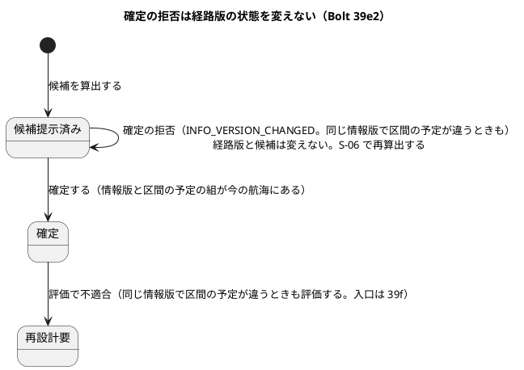
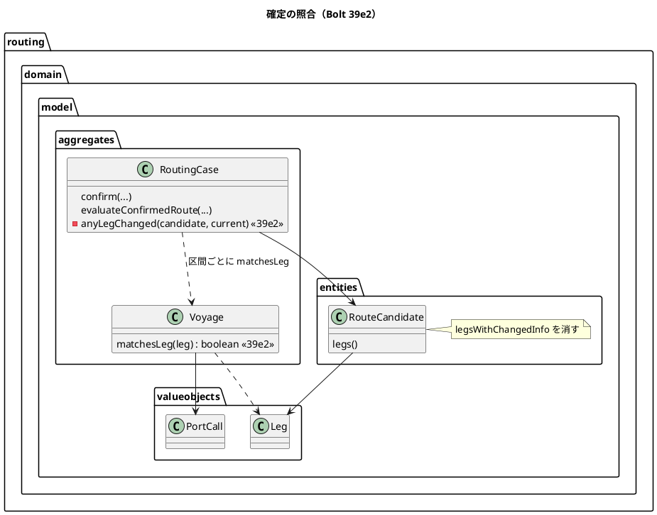
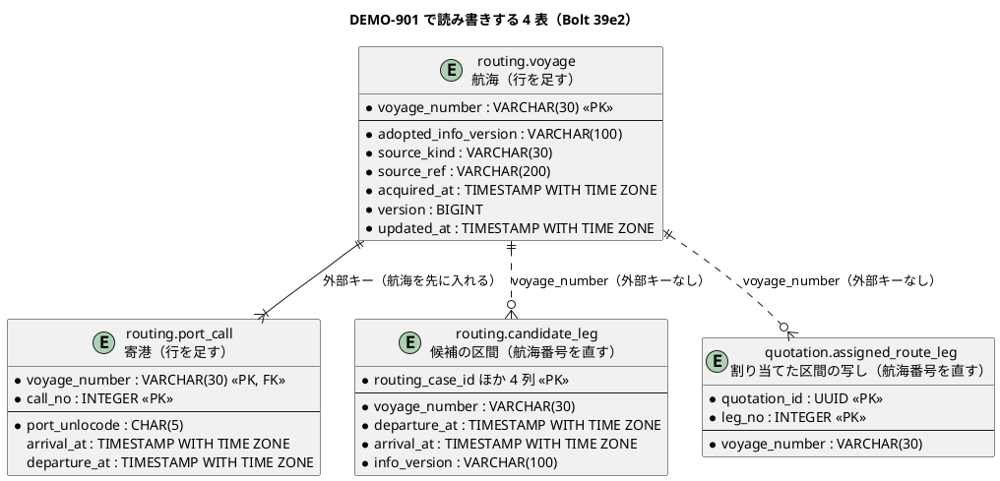

# Bolt 39e2 計画 - 確定の照合を情報版と区間の予定の組にし、見本の航海を分ける

## 基本情報

| 項目 | 内容 |
| :--- | :--- |
| Bolt | 第 39e2 回（W7 の 24 本目。release_plan :972 の 39e2 の行） |
| 状態 | 承認済み（2026-11-10。推奨のとおり。Recommend 承認の指示による）。2 つの整合性検証の指摘を反映した |
| 予定 | W7（2026-11-16 の週。前倒しで着手できる）。作業は約 2 時間 00 分（120 分。決定 (1)）。下の「時間の配分と打ち切り」。`check`・`uiTest`・`manualScreenshots`・SonarQube・CI と承認の待ちを除く |
| アプローチ | アウトサイドイン（受入シナリオから。release_plan :972、:893）。受入条件の中心は「同じ情報版のまま区間の予定が変わったら確定で止まる」こと。ステップ 2 で受入シナリオを先に Red にし、内側に入る |
| 対象 | (1) R-INV-03 の照合を情報版と区間の予定の組にする（`Voyage.matchesLeg`。`RouteCandidate.legsWithChangedInfo` と `RoutingCase.infoVersionsOf` を消す。確定した経路の評価も同じ照合に入る。【業務の判断】(s)、【前の決定の変更】(1)）、(2) 航海がない区間は変わったとみなす（今のまま）、(3) 見本の航海を分ける（`DEMO-901`。dev だけのマイグレーション）、(4) S-07 の注の 1 文を照合に合わせる（【前の決定の変更】(4)）、(5) マニュアル 8 章 :138・:119 の文 |
| トレース | US-07 AC3（user_story :327、:342 の注）、US-07 AC4（user_story :349 の注。確定した経路の評価）、US-14 AC1、UC-07 4a（system_usecase :482）、R-INV-03（domain_model :872・:925）、BR-11、台帳 D-106（release_plan :1087）、W7 の確認ポイント 14（release_plan :926）、技術リスク（release_plan :1111）、[Bolt 39e 計画](bolt_39e_plan.md) の決定 (1)・(7)・(11)・(15) と行 9・23〜28・35・41、[Bolt 39e 終了報告](bolt_39e_report.md) の既知の課題 |
| GitHub | [#18](https://github.com/k2works/practical-domain-driven-design-in-enterpris-application/issues/18)（US-14。クローズは 39h）。US-07 の #16 は Bolt 37e4c で閉じている（user_story :383）ので開け直さない |
| SP | 0 |
| 承認ゲート | **計画と終了報告で止める**（release_plan :972 の「計画と終了報告（開発データ）」）。確認必須のものは確認ポイントにして計画の承認に含める（前例 bolt_37d2_plan.md :22）: データベース（dev だけのマイグレーションで見本の航海を分ける。確認ポイント 3）、新しいファイル（確認ポイント 5）。各ステップは「ゲート: 既定（確認ポイント N で計画の承認に含む）」と書く。新しいセキュリティの判断と本番の操作はない（下の「人に諮ること」） |
| 開始準備で決めたこと | 下の (1)〜(9)（推奨を 1 つに決めて書いた。承認待ち）。【業務の判断】(s) と【前の決定の変更】(1) は Bolt 39e の開始準備で仮の決定として記録したものをここで作る。新しい【業務の判断】はない。【前の決定の変更】(4) を足す |

### 開始準備の決定

(1) **範囲と見積り**: release_plan :972 の 39e2 の行と Bolt 39e の決定 (1) の内訳（89 分）を、コードで確かめて引き直し、2 つの整合性検証の指摘の分を足すと 120 分（約 2 時間 00 分）になる。目安（CLAUDE.md の「Bolt がイテレーションであり、時間単位（目安 2〜4 時間）で回す。半日を超える Bolt は分割する」の 4 時間に、見積りの誤差の 5 分を含めた 4 時間 05 分まで。T-250）の内で、余りは 125 分。**分けない**（推奨。確認ポイント 1）。

| 内訳 | 分 |
| :--- | ---: |
| 分けて増える分（Bolt 39e の決定 (1) の比べた案 (iii)。設計の文書 10、Red 10、品質ゲート 30、終了報告 10） | 60 |
| `Voyage.matchesLeg`（行 1。Bolt 39e の表の 2 分） | 2 |
| R-INV-03 の照合（行 2〜7。Bolt 39e の表の 10 分） | 10 |
| 見本の航海を分ける（行 8。Bolt 39e の表の 12 分） | 12 |
| 受入シナリオの例（行 9。Bolt 39e の表の 3 分） | 3 |
| マニュアル 8 章 :138 の 1 文（Bolt 39e の表の 1 分） | 1 |
| 航海がない区間の注の直し（Bolt 39e の表の 1 分） | 1 |
| 確かめて増える分: 行 9 の Steps（確定へ進む・開き直す・拒否の確かめを取り込んだ航海で行う。今の Steps は `voyage("DIRECT")` 固定で、1 つのページを役割で切り替える。決定 (6)） | 5 |
| 確かめて増える分: 行 1 の組を広げる（港違い、寄港の時刻がない組、航海番号違い。決定 (2)） | 2 |
| 確かめて増える分: すべての見本の区間が今の航海と一致する行（行 10。決定 (5)） | 2 |
| 確かめて増える分: 今の振る舞いを書いた注の直し（ConfirmedRouteEvaluationSteps.java :64-65、RoutingCaseEvaluationTest.java :41。決定 (4)） | 1 |
| 確かめて増える分: 設計の文書の増え（デモ環境の手順書 :318、ui_design :175・:458、domain_model :971・:1710。ステップ 1） | 3 |
| 確かめて増える分: 8 章の文の突き合わせ（T-197。Bolt 39e の表は 39e の分の中で済ませるとしていたが、39e は完了済み） | 1 |
| 確かめて増える分: S-07 の注の 1 文と 8 章 :119（決定 (7)、【前の決定の変更】(4)） | 2 |
| 確かめて増える分: S-07 のキャプチャの撮り直しと確かめ（決定 (7)。`manualScreenshots` の待ちを除く） | 3 |
| 指摘の反映: 文書の増え（user_story :349、data_model :506、test_strategy :589、台帳 D-106 の文、release_plan :976 の 39h の行。ステップ 1） | 3 |
| 指摘の反映: 旧い定めの注の直し（RouteCandidateFinder.java :139、confirm_route.feature :8、evaluate_confirmed_route.feature :5、RoutingCaseConfirmationTest.java :49。決定 (4)） | 1 |
| 指摘の反映: 行 5 の再算出と行 8 のほかの見本の確かめ | 2 |
| 指摘の反映: `manualScreenshots` のあとの差分を戻す（ステップ 5） | 1 |
| 指摘の反映: 変異を 3 つ足す（V20〜V22） | 3 |
| 指摘の反映: 文書のステップの行の一覧の突き合わせ（T-197。ステップ 7） | 2 |
| **合計** | **120（約 2 時間 00 分）** |

比べた案: (i) このまま 1 本（120 分。推奨）。(ii) 見本の航海を 39f に送る（−12 分。W7 の確認ポイント 14 の決定を動かす理由がなく、39f の評価の入口の前に済ませる必要がある。release_plan :1111）。(iii) S-07 の文を 39f に送る（−5 分。39e2 の照合を入れたまま画面の説明が足りない期間ができるので採らない。決定 (7)）。

(2) **R-INV-03 の照合**（【業務の判断】(s)、【前の決定の変更】(1)。Bolt 39e の決定 (7) のとおり作る）: 今の照合は情報版だけで（RouteCandidate.java :50-54、RoutingCase.java :263・:330）、同じ情報版で値の違う DE-12（domain_model :1710、Voyage.java :99-112 の適用）を見落とす。**「区間の情報版が今の航海と同じで、かつ区間の出発予定・到着予定の組が今の航海の寄港にある」ときだけ変わっていないとする**。

- 判定は `Voyage.matchesLeg(Leg)` に置く（`entities` の `RouteCandidate` が `aggregates` の `Voyage` を参照しない）。真になるのは、(a) 航海番号が同じ、(b) 情報版が同じ、(c) 積地の港の寄港の出発予定が区間の出発予定と同じで、その後ろに揚地の港の寄港があり、その到着予定が区間の到着予定と同じ組が 1 つ以上あるとき。区間の時刻は候補探索が寄港から写したもの（RouteCandidateFinder.java :184-193）で、区間の列も寄港の列も `TIMESTAMP WITH TIME ZONE`（区間は V20261007100000 :69-70、寄港は同 :116-117）なので、文字ではなく時点（`UtcInstant` の等しさ。UtcInstant.java :13）で比べる
- 寄港の時刻は欠けることがある（始港の到着と終港の出発は null。PortCall.java :12-13）ので、出発のない寄港を積地に、到着のない寄港を揚地にしない（行 1。`refresh` の形。RouteCandidateFinder.java :157・:179）
- 航海番号の比べ（(a)）は、呼び出し側が番号で引く（RoutingCase.java :261-262）ので今は起きないが、別の航海の区間で真を返さないように足す（1 語）
- `RoutingCase` の確定（:263）と評価（:330）は private の `anyLegChanged(candidate, current)` で判定する（航海がなければ変わった。形は RoutingCase.java :278-281）。`RouteCandidate.legsWithChangedInfo`（:43-54）と `RoutingCase.infoVersionsOf`（:378-383）を消し、不要になる import（RouteCandidate.java :9 の `Map`、RoutingCase.java :29 の `HashMap`）も消す
- 比べた案は Bolt 39e の決定 (7): (i) 区間の予定も比べる（推奨。スキーマを変えない）、(ii) 版の列を足す（スキーマが増え、同じ値の組でも拒否する）、(iii) 経路設計の情報版を適用のたびに作り直す（画面の版と提供元の版が食い違う）、(iv) 同じ情報版の 2 つ目を適用しない（ADR-004 :43 に反する）。これに加えて確かめた案: (v) 確定に寄港の位置を持たせて組を 1 つに決める（W7 の確認ポイント 13。39f の範囲で、スキーマが増える。39e2 では「組が 1 つ以上」のまま）
- 拒否の理由と文は変えない（`INFO_VERSION_CHANGED`、「候補を算出した後に航海の情報が更新されたため確定できません。…」RoutingCaseController.java :231-232。受入シナリオの理由の名「情報版の更新」RouteConfirmationSteps.java :42 も変えない）。`RouteConfirmationRejectionReason` の Javadoc（:15）と RoutingCase.java :264 の例外の文は「航海の情報が更新された」に直す

(3) **2 度寄る航海**（Bolt 39e の決定 (7) のとおり）: 組は 1 つ以上あればよい。評価の引き直しの「1 つに決める」（RouteCandidateFinder.java :161-163。組が 2 つ以上なら引き直せない）とは別で、積地や揚地に 2 度寄っても区間の予定の組が残っていれば変わっていない（行 6）。確定の区間に寄港の位置を持たせて狭めるのは 39f（W7 の確認ポイント 13、release_plan :973）。

(4) **注の直し**: 航海がない区間は変わったとみなす（今のまま。行 4）。「情報版の違う区間」の注を区間の予定まで含めて直す: RoutingCase.java :228・:277・:308、domain_model :925・:941。Bolt 39e の決定 (7) は RoutingCaseConfirmationTest.java :581 と RoutingCaseEvaluationTest.java :177 も挙げたが、確かめると :581 のテスト名は理由の名（情報版の更新）を指し、:177 は版に触れないので直さない。代わりに、今の振る舞いをそのまま書いた次の 2 か所を直す（Bolt 39e の決定 (7) に載っていない）: RoutingCaseEvaluationTest.java :41 の「区間の航海の情報版が変わったときだけ評価し」、ConfirmedRouteEvaluationSteps.java :64-65 の「情報版を変えずに時刻だけを変えると評価されない」（39e2 の後は評価される）。今の定めを情報版だけで書いた次の文も直す: RouteCandidateFinder.java :139 の「情報版が変わるたびに」、confirm_route.feature :8 の「区間の情報版が違えば」、evaluate_confirmed_route.feature :5 の「区間の航海の情報版が変わったら」、RoutingCaseConfirmationTest.java :49 の「区間の情報版と比べ」。

直す既存のテスト（T-217）: `RoutingCaseConfirmationTest.java :604-615`（`legsWithChangedInfo` の 3 つの確かめを消し、行 1 の `VoyageTest` に移す。:20 の import の `Leg` は :608・:611 だけが使うので一緒に消す）。ほかのテストの航海は算出と同じ寄港のまま版を変える形（RoutingCaseConfirmationTest.java :808-811、RouteConfirmationSteps.java :81、RoutingUiSteps.java :261-272）か、予定と版を一緒に変える形（RoutingCaseEvaluationTest.java :328-338）なので、結果は変わらない見込み。RoutingCaseEvaluationTest.java :166-169 は同じ版の `V-B@1` の到着も変えているが、ほかの 2 本の版が変わっていて評価に入ることは同じ。ステップ 3 で `test` 全体を流して確かめる。

(5) **見本の航海を分ける**（Bolt 39e の決定 (11)、W7 の確認ポイント 14、release_plan :1111。Bolt 37e4b の決定 (2) を変える【前の決定の変更】は W7 の開始準備で記録済み。release_plan :926）: dev だけのマイグレーションで見本専用の航海 `DEMO-901` を足し、`RC-2026-0908`・`0909` の候補の区間（`routing.candidate_leg`。V20261023200900 :92-95）と割り当てた区間の写し（`quotation.assigned_route_leg`。同 :53-54）の航海番号を `DEMO-901` に直す。

- 版と場所: `db/dev-data/V20261109130900__split_dev_sample_departed_voyage.sql`（下 4 桁は dev データの慣例の `0900`。今の最新の共通のマイグレーション `V20261109110000` より新しい版にする。`spring.flyway.out-of-order` の設定はない。application.properties :4-8）。dev だけに足す（application-dev.properties :6。V20261023200900 :8 のとおり DevDataLocationTest が守る）
- 航海の値は写す: 情報版・出典の種類・参照・取得時刻と、NOT NULL の `version`・`updated_at`（V20261007100000 :102-107）は `DEMO-101` の行から `INSERT … SELECT` で写す（`PROVISIONAL-1`、取得時刻は V20261021170900 :7-10 で起動の時刻に寄せてある）。`DevSampleDataSmokeTest.java :431-434` は `DEMO-%` の全部の取得時刻が揃うことを確かめるので、`CURRENT_TIMESTAMP` で書かない。寄港の時刻は `routing.candidate_leg` の `RC-2026-0908` の行から写す（JPTYO の出発は起動した日の前日、NLRTM の到着は起動した日の 17 日後 9 時。V20261023200900 :92）。文を分けて書くより、見本の写しと必ず一致する
- 入れる順: `port_call` は航海への外部キーがある（V20261007100000 :119）ので、航海を先に入れる。区間の航海番号の更新は外部キーがないので順は自由（`candidate_leg` の外部キーは候補だけ。V20261007100000 :76-78。`assigned_route_leg` は見積りだけ。V20261008100000 :45）
- `V20261023200900` の注（:6-7 の「区間の航海は DEMO-101 のままにし」）は Flyway のチェックサムが変わるので直さない。新しいマイグレーションの頭に、その注を改めたことを書く
- 候補の算出に入らない: 判定時刻より後に出発する寄港を持たない（RoutingReferenceMapper.xml :42-43。JPTYO の出発は前日、NLRTM に出発はない）ので、同じ JPTYO → NLRTM の見本 `RC-2026-0902` の再算出は 5 件のまま（DevSampleDataSmokeTest.java :416）
- ほかの見本は変えない: V20261007120900 :107-123、V20261009110900 :88-90、V20261020150900 :70、V20261023180900 :92-94 の区間は、航海の見本の予定（V20261007100900 :22-35）と一致することを確かめた。39e2 の照合はこれらで拒否しない（行 10）
- `DEMO-101` を指すのは見本の seed だけで、ほかのコードにはない（`apps/cargo-tracker/src` を `DEMO-[0-9]+` で検索した。externaldata のテストと template の例の `DEMO-201` などは別）。0911・0912 の画面に示す航海番号が `DEMO-901` に変わるが、手順書の値（heroku_demo_setup.md :318）のほかに `DEMO-101` を 0911・0912 と結びつけて書いたところはない（`docs/manual` に 0911・0912 の記述はない）
- デモ環境は起動のたびに初期状態に戻るので（heroku_demo_setup.md :23・:368、application-dev.properties :2）、これまでのデータの移行はない

(6) **受入シナリオ**: `features/ui/adopted_voyage_reflected_ui.feature` に行 9 のシナリオを足す（タグは `@US-07-AC3 @US-14-AC1 @R-INV-03`）。流れは行 40 のシナリオ（同 :31-48）と同じ 2 行のファイルで、(a) 取り込んで候補を算出し、(b) 取り込んだ航海の候補の確定へ進み、(c) データ責任者が内容の違う原本の隔離を採用し、`採用した航海の予定が経路設計の航海に反映される`（RoutingUiSteps.java :334-340）まで待ち、(d) 経路設計者が確定の画面を開き直して判断根拠を入れて確定すると拒否される。

- Steps は 1 つのページを役割で切り替える（BrowserSession.java :102-117、ExternalDataIngestionUiSteps.java :292-296）ので、確定の画面は開いたまま残らない。(b) で URL を覚え、(d) の「経路設計者が確定の画面を開き直す」で開き直す。確定の GET は状態の判定（`confirmationRejection()`。domain_model :954）だけで航海を比べないので、開き直しても確定の POST で拒否される
- 足す Steps: 「取り込んだ航海の候補の確定へ進む」（今の「直行の航海の候補の確定へ進む」RoutingUiSteps.java :220-231 は `voyage("DIRECT")` 固定なので、共通の private に分ける）、「経路設計者が確定の画面を開き直す」、拒否の確かめ（今の RoutingUiSteps.java :274-285 は :283 が `voyage("DIRECT")` 固定なので、候補を引数にする private に分ける）。判断根拠の入力の Steps（:233-248）はそのまま使う
- 航海の時刻は今の Steps のまま 2099 年（T-230。ExternalDataIngestionUiSteps.java :275 の注の 2 行）で、取得時刻は今の時刻（情報鮮度の 24 時間の内）

(7) **マニュアルと S-07 の文**（T-251。用語は下の「業務の判断の記録」の (s) の文から写す）:

- 08-経路設計.md :138 の「（参照した航海情報の版が変わる）」を「（参照した航海情報の版が変わるか、同じ版のまま区間の予定が変わる）」に直す（Bolt 39e の決定 (15)）
- **【前の決定の変更】(4)**: confirmation.html :61 の注は、確定のときに見るものを「最新の航海の情報（情報版と取得から経った時間）」と列挙している。39e2 の後は同じ情報版でも区間の予定で拒否するので、列挙のままだと「情報版が同じなら通る」と読める。**「最新の航海の情報（情報版、区間の予定、取得から経った時間）」に直す**（推奨）。08-経路設計.md :119 の ③ も同じ文に直し、`08-confirmation` のキャプチャを撮り直す（manual_screenshots.feature :73。`manualScreenshots`）。ui_design :175 の S-07 の説明と :458 の遷移の文（「情報版が更新済み」）も直す。これは Bolt 39e の決定 (15)・release_plan :985 の「39e・39e2 は画面の文も配置も変えない」のうち「画面の文」を 1 文だけ改める。拒否の文（RoutingCaseController.java :231-232）は変えない。配置は変えない
- 比べた案: (i) 文を直す（推奨。1 語の足し算で、画面の説明を照合と一致させる）、(ii) 文を変えず、拒否の文だけに任せる（前の決定のまま。確定を試みるまで条件が分からず、拒否されたときに版が同じに見えて説明がつかない）
- 動画は撮らない（W7 のデモの動画は 39h。release_plan :972・:985。S-07 の注の 1 文は動画の振る舞いを変えない）。12-外部データ.md :347 の「反映の前に算出した候補は前の予定のままなので、候補を再算出してください。」は 39e2 の拒否とも合うので変えない

(8) **変えないもの**: DE-12 の型と順の規則（【業務の判断】(r)）、`Voyage.apply`、確定の順（状態・候補・除外 → 情報の更新 → 判断根拠 → 出発済み → 情報不足 → 規則。RoutingCase.java :228-230）、情報鮮度の判定（確定のときは読み直した航海の取得時刻。domain_model :926）、評価の入口（航海番号から案件を引く照会と `evaluateConfirmedRoute` をつなぐのは 39f）、拒否の理由と文、S-06・S-07 の配置と URL、スキーマ（共通のマイグレーションは足さない）。

(9) **新しい型の名前**（T-246。`apps/cargo-tracker/src` で `matchesLeg`・`anyLegChanged`・`Bolt39e2`・`DEMO-9`・`split_dev_sample` を検索し、ないことを確かめた。形は `RoutingCase` の private の判定（RoutingCase.java :278-281）と dev データの名前（V20261023200900 の `seed_dev_sample_…`）に合わせた）: 新しいクラスはない。`Voyage.matchesLeg`、`RoutingCase` の private の `anyLegChanged`、テストは既存のクラスの `@Nested class Bolt39e2_…`、見本の航海 `DEMO-901`、マイグレーション `split_dev_sample_departed_voyage`。

【前の決定の変更】(1)（Bolt 39e の開始準備で記録したものをここで作る）: Bolt 37c の決定（domain_model :925「照合は区間の写し（`candidate_leg.info_version`）で行う」）を改め、照合を情報版と区間の予定の組にする（決定 (2)。【業務の判断】(s)）。Bolt 37d・37d2 の決定（user_story :349「情報版が変わらなければ（接続時間規則だけが変わったときも）評価しない」、domain_model :925 の「Bolt 37d の確定した経路版の評価でも使う」、:941 の「版の違う区間（`legsWithChangedInfo`…）」）も同じ照合に改める。確定した経路の評価も同じ照合に入る（同じ情報版で予定が変わると評価し、不適合なら再設計要。入口は 39f。行 7、変異 V18）。

【前の決定の変更】(4)（決定 (7)。番号は Bolt 39e の (1)〜(3) に続ける）: Bolt 39e の決定 (15)・release_plan :985 の「画面の文も配置も変えない」を、S-07 の注の 1 文だけ改める。括弧は Bolt 37c で照合の対象を列挙するために足した文（bolt_37c_report.md :20）。Bolt 39e の決定 (16) の「S-05〜S-07 の画面と URL」は 39e の範囲の決定で、この Bolt を縛らない（配置と URL はこの Bolt でも変えない。決定 (8)）。

新しいファイル: dev のマイグレーション `db/dev-data/V20261109130900__split_dev_sample_departed_voyage.sql` の 1 つだけ。直すもの: `Voyage`（`matchesLeg`）・`RoutingCase`（照合、注、例外の文、`infoVersionsOf` を消す）・`RouteCandidate`（`legsWithChangedInfo` を消す）・`RouteConfirmationRejectionReason`（Javadoc）・`RouteCandidateFinder`（:139 の注）・`routing/staff/routing-cases/confirmation.html`（:61）、テスト `VoyageTest`・`RoutingCaseConfirmationTest`（:604-615 を `VoyageTest` に移す。:20 の import、:49 の注）・`RoutingCaseEvaluationTest`（:41 の注）・`ConfirmedRouteEvaluationSteps`（:64-65 の注）・`DevSampleDataSmokeTest`・`RoutingUiSteps`、受入シナリオ `adopted_voyage_reflected_ui.feature`・`confirm_route.feature`（:8 の注）・`evaluate_confirmed_route.feature`（:5 の注）、マニュアル 8 章（:119・:138）と `08-confirmation` のキャプチャ、デモ環境の手順書（:318）。

### 前の Bolt から引き継いだもの

| 出典 | 内容 | この計画 |
| :--- | :--- | :--- |
| release_plan :972、Bolt 39e の決定 (1) | 39e2 の範囲と見積り | 決定 (1) |
| Bolt 39e の決定 (7)、行 9・23〜28、変異 V9・V10 | R-INV-03 の照合 | 決定 (2)〜(4)、行 1〜7 |
| Bolt 39e の決定 (11)、行 35、変異 V14、W7 の確認ポイント 14 | 見本の航海 | 決定 (5)、行 8 |
| Bolt 39e の行 41 | 同じ情報版の採用で確定が拒否される受入シナリオ | 決定 (6)、行 9 |
| Bolt 39e の決定 (15) | マニュアル 8 章 :138 の 1 文 | 決定 (7)、行 12 |
| Bolt 39e の「業務の判断の記録」(s)、【前の決定の変更】(1)、台帳 D-106 | 同じ情報版でも区間の予定が変われば確定を拒否する | 下の「業務の判断の記録」 |
| bolt_39e_report.md の既知の課題の 39e2、議題 4 | R-INV-03 の照合と見本の航海、39e から 39e2 までの既知の間 | 決定 (2)・(5)。既知の間はこの Bolt で解消する（domain_model :971） |

## Bolt ゴール

候補を算出した後に区間の予定が変わる採用があると（同じ情報版のままでも）、経路設計者の確定は拒否され、候補の比較に戻って再算出を求められる。情報版が同じで区間の予定が変わらないときは確定できる。元の原本を採用し直して航海が元の値に戻ると、元の値で算出した候補は情報鮮度の内なら確定できる。確定の画面の注とマニュアルが、この照合を説明している。見本 TR-2026-0911・0912 の区間は見本専用の航海を指し、DEMO-101 の更新の影響を受けない（39f の評価の入口の前に済む）。

### 開始準備で確かめたこと

- **release_plan の 39e2 の行**（:972）: R-INV-03 の照合、見本の航海、Bolt 39e の行 9・23〜28・35・41 と変異 V9・V10・V14 を写す、設計の文書の「39e2 の分」、行 41 の受入シナリオ、マニュアル 8 章 :138、拒否の理由と文は変えない、動画は撮らない、【業務の判断】(s) と【前の決定の変更】(1) を終了報告の議題の先頭に置く。約 1 時間 29 分の見込み
- **39e の実装**（`01967117c`・`e71748b43`）: `Voyage` は class で `apply`・`adoptedFrom`・`reconstitute` を持ち（Voyage.java :71・:82・:99）、`matchesLeg` はまだない（`apps/cargo-tracker/src` の検索で 0 件）
- **照合は情報版だけのまま**: RouteCandidate.java :50-54、RoutingCase.java :263・:330・:379-383。呼び出しはテストの 3 か所（RoutingCaseConfirmationTest.java :607-613）を含む
- **区間の予定**: Leg.java :25-26、`candidate_leg` の `departure_at`・`arrival_at`（V20261007100000 :69-70）。候補探索が寄港から写す（RouteCandidateFinder.java :184-193）
- **寄港の時刻の欠け**: PortCall.java :12-13
- **同じ情報版で値の違う DE-12**: domain_model :1710、Voyage.java :93-112
- **拒否の文は情報版と言っていない**: RoutingCaseController.java :231-232
- **S-07 の注は版と言っている**: confirmation.html :61（決定 (7)）。08-経路設計.md :119 が同じ文
- **受入条件**: US-07 AC3（user_story :327「Given 承認中に候補の情報版が更新済み、When 確定する、Then 承認は無効となり再判断が要求される。」）、注（:342）
- **見本の写し**: V20261023200900 :53-54・:92-95（出発は起動した日の前日）。航海 V20261007100900 :10・:22-23（出発は +5 日）。取得時刻 V20261021170900 :7-10
- **`DEMO-901` は候補に入らない**: RoutingReferenceMapper.xml :42-43
- **デモ環境の手順書**: heroku_demo_setup.md :318 に「航海 DEMO-101 の予定…とは違います」とあり、Bolt 39e の「39e2 の分」に載っていない（ステップ 1 で直す）
- **最新の共通のマイグレーション**: `V20261109110000__add_routing_voyage_published_at.sql`

## 設計の決定

| 項目 | 決定 | 根拠 |
| :--- | :--- | :--- |
| 範囲と見積り | 決定 (1)。分けない（120 分） | CLAUDE.md、release_plan :972 |
| R-INV-03 | 決定 (2)、【業務の判断】(s)、【前の決定の変更】(1)。情報版と区間の予定の組で照合する | RouteCandidate.java :50-54、domain_model :872・:925 |
| 2 度寄る航海 | 決定 (3)。組は 1 つ以上 | RouteCandidateFinder.java :161-163 |
| 航海がない区間 | 決定 (4)。変わったとみなす（今のまま） | RoutingCase.java :228・:277 |
| 見本の航海 | 決定 (5)。`DEMO-901` を足し 0911・0912 の区間を直す。値は `INSERT … SELECT` で写す | release_plan :926・:1111、DevSampleDataSmokeTest.java :431-434 |
| 受入シナリオ | 決定 (6)。確定の画面を開き直して POST で拒否を確かめる | BrowserSession.java :102-117 |
| S-07 の注 | 決定 (7)、【前の決定の変更】(4)。「情報版、区間の予定、取得から経った時間」に直す | confirmation.html :61 |
| 型の名前 | 決定 (9)（T-246 で検索した） | — |

## ふりかえりと前の Bolt からの引き継ぎ

| 出典 | 内容 | この Bolt での扱い |
| :--- | :--- | :--- |
| W6 の Try T-204・T-212、Bolt 38h の T-227、Bolt 39b の T-233、Bolt 39d〜39e の Problem | サブエージェントへの指示の最初に heredoc と標準入力を待つコマンドを使わないと書く（39e でも破られた。bolt_39e_report.md :103） | 任せるときの指示の最初に書く。ファイルは Write・Edit、検索は Grep |
| Bolt 39d の T-247、Bolt 39d2〜39e の Try | 決まりを文章の指示ではなく仕組みで守らせる（フック） | W7 の締めで最初に諮る。任せる範囲をファイルを書く作業と読むだけの検索に絞り、Gradle と git を人の側の 1 か所に残す。触らないもの（`.claude/agent-memory`・`.run/`・`apps/cargo-tracker/.claude/`）を名前で書く |
| Bolt 39d の T-248 | `git add` はディレクトリか `git add -u` で指定する | 各ステップのコミットでパッケージと `docs/` の下のディレクトリを指定する |
| Bolt 39d2b の T-249 | 担当への指示に私の言葉を書くときは出典を付け、計画に人の指示として書き写さない | 初稿は推奨を 1 つに決めて書き、人の承認として書かない。見積りの目安は CLAUDE.md の決まりとして書いた |
| Bolt 39d3 の T-250 | 見積りの受け入れは 4 時間 05 分まで（5 分は誤差）。超えたら必ず送るか分ける | 決定 (1)。120 分で余りは 125 分 |
| Bolt 39d3 の T-251 | マニュアルの担当には、用語の定義を計画の【業務の判断】の文から写させる | 決定 (7)。下の「業務の判断の記録」の (s) の文（区間の予定）から写させる |
| Bolt 39d3c の T-252 | ゲートが落ちたら、見込みを書く前に中身を一覧する手段（運用タスク）を先に確かめる | ステップ 7 で SonarQube が落ちたら、先に `sonar-local:hotspots` などで中身を一覧してから原因を書く |
| Bolt 39d3b の T-254 | 途中で止めるときは、コンパイルの通らない変更を develop にコミットせず、`wip/` のブランチか stash に置く | ステップ 2 の骨組みで `matchesLeg`（中身なし。false を返し、本体の `RoutingCase` はまだ呼ばない）を足してコンパイルを通す。Red の行は `wip/` か stash に置き、develop に落ちるテストを積まない |
| Bolt 39d3b2 の T-255 | 「報告を待っています」と書くときに、担当の記録の更新時刻を確かめる | 担当に任せたステップで待つときに確かめる |
| W6 の Try T-217、Bolt 39b2 の Try | 本体を直す前に Red を流し、落ちた理由を記録する。直したテストの一覧を添える | ステップ 2。直す既存のテストは決定 (4) |
| W6 の Try T-225・T-213 | push の前に `check` | ステップ 7（`uiTest` も流す） |
| W6 の Try T-182・T-211・T-216 | 状態の組み合わせの表に重複・隔離と出口・誤った入力の行を置く | 下の表（航海がない区間は行 4、誤った組は行 1） |
| W6 の Try T-184 | listener は配信まで確かめる | 新しい listener はない。行 9 が DE-12 の配信を通して拒否まで確かめる |
| W6 の Try T-219 | 変異の対象に単体・統合・契約のテスト | 下の変異の表 |
| W6 の Try T-215・T-222 | Gradle を流す担当を 1 つに、計画の初稿を先にコミット | Gradle は人の側の 1 か所で流す。初稿をコミットしてから実装に入る |
| Bolt 39a2 の T-229 | 時刻の出どころと同時の書き込みの行を置く | 時刻: 比べるのは区間の写しと読み直した寄港の値で、Clock を足さない。同時は確定の同じトランザクションの読み直し（変えない。決定 (8)） |
| Bolt 39a3 の T-230 | 入ることを確かめる行のデータはドメインの規則に合う組み合わせにする | 行 9 の航海は 2099 年の JPTYO → NLRTM で期限内（決定 (6)） |
| Bolt 39b の T-232・39b2 の T-234・39b3 の T-237 | 本体を直したステップは承認の前に `spotbugsMain`・`checkstyleMain`・`sonar-local:check` | ステップ 3・4 の完了の判定 |
| Bolt 39b2b の T-235 | テストの名前の「行 N_」に Bolt の接頭辞を付けるかを W7 の締めで決める | 39e の前例のまま（`@Nested class Bolt39e2_…`） |
| Bolt 39b2b の T-236 | 「起きないこと」を確かめるテストは呼び出しの記録で確かめる | 該当なし（行 3 は集約の結果で確かめる） |
| Bolt 39b3 の T-238 | サブエージェントへの指示は計画の決定を言い換えず計画の行を指す | 任せるときは決定の番号と行番号を指す |
| Bolt 39b3b の T-239 | 人に諮る選択肢・主張の前提はコードで確かめ、出典の行を添える | 開始準備の決定の前提に出典の行を添えた |
| Bolt 39b3b の T-240 | 表から作る規則には、全部の行が規則に入ることを確かめるテストを添える | 該当なし（表から作る規則はない） |
| Bolt 39b4 の T-241・T-242 | 性能の目標を外れたら区切って測る。上限いっぱいの入力の行を入れる | 該当なし（照合は区間の寄港の数に比例し、航海の読みは Bolt 39e のまま） |
| Bolt 39c の T-243 | 状態の数を 0 件にする受入シナリオは計画の時点で controller のテストに下ろす | 該当なし |
| Bolt 39c2 の T-244 | パラメーターのテストは入力と期待する出力の組み合わせまで縛る | 行 1・2・3 |
| Bolt 39c3 の T-245 | 並びの規則を足すテストは書く順を逆にしたデータを置く | 行 1 の組の順が逆（揚地が積地より前） |
| Bolt 39c4 の T-246 | 新しい型の名前は同じ単純名がないかを検索してから決める | 決定 (9) |
| 画面の Bolt の前例（memory の manual-in-bolt-done-criteria、Bolt 37f2 の T-197） | 振る舞いが変わる Bolt はマニュアルの更新を完了条件に入れる。文を実装と突き合わせる | 完了条件に 8 章の行を入れる（決定 (7)・行 12） |
| Bolt 39d4 の学び | 業務の判断の推奨は受入条件の文と突き合わせる | (s) に US-07 AC3 の文を添えた（下の「業務の判断の記録」） |

## 状態の組み合わせ（行ごとにテストを 1 本。T-182）

行の番号はこの計画で 1 から振り、Bolt 39e の計画の行との対応を「39e の行」の列に書く（release_plan :972 の写す指示）。`Voyage` の振る舞いは単体（`VoyageTest` の `@Nested class Bolt39e2_…`）、確定と評価は単体（`RoutingCaseConfirmationTest`・`RoutingCaseEvaluationTest`）、見本は `DevSampleDataSmokeTest`、画面は `adopted_voyage_reflected_ui.feature`（axe、幅 320 px は今のシナリオで確かめているので足さない）。P1・P2 は同じ航海番号・同じ情報版で値の違う DE-12。

| 行 | 39e の行 | 状況 | 期待 | 確かめ方 |
| :--- | :--- | :--- | :--- | :--- |
| 1 | 9 | 区間の照合 `matchesLeg` | 情報版が同じで寄港の組があれば true（始港から終港、途中の寄港から途中の寄港、組が 2 つある航海の一方）。情報版違い、出発違い、到着違い、積地の港違い、揚地の港違い、組の順が逆（揚地が積地より前）、積地の寄港に出発がない（終港）、揚地の寄港に到着がない（始港）、航海番号違いは false（パラメーター。入力と期待の組まで縛る。T-244） | 単体（`VoyageTest`） |
| 2 | 23 | 確定: 同じ情報版で区間の出発か到着が違う（【業務の判断】(s)） | `INFO_VERSION_CHANGED`（S-06 に戻り再算出）。候補は変えない（パラメーター） | 単体（`RoutingCaseConfirmationTest`） |
| 3 | 24 | 確定: 同じ情報版で同じ予定（ほかの寄港だけ変わる、取得時刻だけ変わる） | 確定できる（パラメーター） | 単体 |
| 4 | 25 | 確定: 情報版が違う（予定は同じ）、または区間の航海がない | 今のまま `INFO_VERSION_CHANGED`（確定の順も今のまま。航海がない区間は変わったとみなす。決定 (4)） | 既存のテスト（RoutingCaseConfirmationTest.java :569・:581） |
| 5 | 26 | 確定: P1 で算出 → P2 → P1 | P2 の間は拒否（S-06 に戻り再算出）。P1 に戻した後は情報鮮度の内なら確定できる（RoutingCase.java :278-282）。P2 で再算出すると、P2 の候補は確定できる（単体） | 単体 |
| 6 | 27 | 確定: 2 度寄る航海 | 区間の組が 1 つ以上あれば変わっていない（決定 (3)） | 単体 |
| 7 | 28 | 評価: 同じ情報版で区間の予定が違う | 評価に入る（`evaluateConfirmedRoute`。到着が期限を過ぎれば再設計要。入口は 39f）。同じ情報版で同じ予定は評価しない（既存の RoutingCaseEvaluationTest.java :52） | 単体（`RoutingCaseEvaluationTest`） |
| 8 | 35 | 見本の航海（決定 (5)） | 見本 0911・0912 の区間と写しは `DEMO-901` で、`DEMO-901` の予定と一致する。`DEMO-101` を見本 0911・0912 の区間と写しが指さない。ほかの見本は `DEMO-101` のまま。`DEMO-901` の取得時刻と情報版は `DEMO-101` と同じ。候補の算出に入らない（RC-2026-0902 の再算出は 5 件のまま） | `DevSampleDataSmokeTest` |
| 9 | 41 | UI（同じ情報版の採用で確定が拒否される。【業務の判断】(s)） | 確定の画面を開いた後に同じ情報版で区間の予定が違う隔離を採用すると、確定は「候補を算出した後に航海の情報が更新されたため確定できません。…」で比較の画面に戻り、経路はまだ確定していない。axe の違反 0 | `adopted_voyage_reflected_ui.feature` |
| 10 | （足す） | すべての見本の候補の区間と今の航海（決定 (5)） | `voyage_number LIKE 'DEMO-%'` の区間について、`NOT EXISTS`（情報版と予定の組が今の航海の寄港にある）が 0 件（航海のない区間も数える。案件番号の LIKE は使わない。DevSampleDataSmokeTest.java :430-432、V20261007100000 :76-78。`DEMO-901` に分けた後に 1 行もはみ出さない） | `DevSampleDataSmokeTest`（SQL の件数） |
| 11 | （足す） | S-07 の注（決定 (7)、【前の決定の変更】(4)） | 確定の画面に「情報版、区間の予定、取得から経った時間」が示される | 行 9 の確定へ進むステップで確かめる |
| 12 | 42 の 39e2 の分 | マニュアル | 8 章 :138 の文、:119 の文、`08-confirmation` のキャプチャが実装と一致する | ステップ 5 の突き合わせの記録 |
| 13 | 43 | 今の振る舞い | 経路設計の受入シナリオ（`confirm_route.feature`・`evaluate_confirmed_route.feature`・`confirm_route_ui.feature`・`adopted_voyage_reflected_ui.feature` の行 39・40 のシナリオ）と、見本 0911・0912 を使う既存のテスト（`DevSampleDataSmokeTest`） | 既存のシナリオとテスト |

## スコープ

### 入れるもの

- 行 1〜13（行 4・13 は既存のテストで確かめる）。決定 (2)〜(7) の実装と文書
- マニュアル: 決定 (7) の 8 章 :138・:119 の文と `08-confirmation` のキャプチャ
- 文書: 下の「設計文書に直す箇所」（ステップ 1）

### 入れないもの

- 評価の入口（航海番号から確定した経路版を引く照会と索引、`evaluateConfirmedRoute` をつなぐ、配信までの統合テスト）（39f）
- 確定の区間の寄港の位置で 2 度寄る航海の照合を狭める（39f。W7 の確認ポイント 13）
- スキーマの変更（共通のマイグレーションは足さない）
- 動画（決定 (7)。W7 のデモの動画は 39h）

### 申し送り（既知の課題・入れないもの）

| 送り先 | 課題 | 扱い |
| :--- | :--- | :--- |
| 39f | 評価の入口が `matchesLeg` を使う（`evaluateConfirmedRoute` は 39e2 で切り替わる）。2 度寄る航海の照合を狭める。listener は競合を受けたら読み直して評価し直す（release_plan :973 に書いてある） | 39f の開始準備で計画に写す。行 7 の「評価に入る」は 39f が入口をつなぐまで単体の範囲 |
| 39h | W7 のデモの動画に、同じ情報版で確定が拒否される流れを含める | ステップ 1 で release_plan :976 の 39h の行に足す（release_plan :985 のデモ項目に 39e2 がある） |

Bolt 39e の報告の「39e2 までの間の受け入れ」（bolt_39e_report.md :22）は、この Bolt で解消する。

### 設計文書に直す箇所（ステップ 1）

ステップ 1 の開始で `docs/design`・`docs/requirements`・`docs/adr`・`docs/operation`・`docs/development/cargo-tracker`（release_plan・development_strategy）と `apps/cargo-tracker/src` を「39e2」「版の違う区間」「legsWithChangedInfo」「DEMO-101」「区間の写し」「info_version」「情報版が変わ」「情報版が」で検索し、39e2 の予定を書いた場所を作ったことに直す。開始準備の検索で挙がった場所は下の各行に名前で書いた。

- domain_model: R-INV-03（:872）に区間の予定と `Voyage.matchesLeg` を名指しで足す。Bolt 37c の決定（:925）の「照合は区間の写し…」と「版の違う区間」に【前の決定の変更】(1) を入れて直す。Bolt 37d2 の決定（:941）の「版の違う区間（`legsWithChangedInfo`…）」を直す。Bolt 39e の節の「既知の間」（:971）を解消に直し、節の後に「Bolt 39e2 で決めたこと」を足す（決定 (2)〜(5)）。DE-12 の注（:1710）の「作るのは Bolt 39e2」を作ったことに直す。`Voyage` の型の説明に `matchesLeg` を足す
- user_story: US-07 AC3 の注（:342）に、同じ情報版で区間の予定が変わったときも拒否することと【業務の判断】(s) を足す。注の「採用情報版が 1 つでも違うか、航海がなくなっている」を直す。US-07 AC4 の注（:349）の「確定の区間に情報版の違う区間があるとき」と「情報版が変わらなければ（接続時間規則だけが変わったときも）評価しない」を、区間の予定まで含めて直す（【前の決定の変更】(1)）
- data_model: `referenced_info_version` の行（:506）の「承認時の再検証は区間の写し `candidate_leg.info_version` で行う」を、区間の写しの情報版と区間の予定の組で今の航海と照合すると直す（【前の決定の変更】(1)）
- system_usecase: UC-07 4a（:482）に、同じ情報版で区間の予定が変わったときも確定を拒否することを足す
- ADR-004: 改訂の経緯（:160）の「広げるのは Bolt 39e2」を作ったことに直す
- ui_design: S-07 の説明（:175）の「情報版の更新」と遷移の文（:458「情報版が更新済み」）を、区間の予定まで含めて直す（決定 (7)。S-07 の注の文そのものは ui_design に載っていない）
- test_strategy: 経路設計の行（:348 の隣）に 39e2 の確かめ方を足す。US-07 AC3 の行（:589）の「区間の航海の情報版が更新されていれば」を区間の予定まで含めて直し、「候補の版の違う区間を含む」も直して、確かめるシナリオの一覧に `adopted_voyage_reflected_ui.feature` を足す
- release_plan: 39e2 の行（:972）に計画へのリンク、見積り（約 2 時間 00 分）、開始準備で決めたこと、【前の決定の変更】(4) を足す。W7 の確認ポイント 14（:926）と技術リスクの見本の行（:1111）を済みにする。台帳 D-106（:1087）の「Bolt 39e2 で作る」を作ったことに直し、「確定した経路の評価も同じ照合に入る（同じ情報版で予定が変わると評価し、不適合なら再設計要。入口は 39f）」を足す。W7 の行（:1003）の見本の航海の注を直す。デモ項目（:985）の「39e・39e2 は画面の文も配置も変えない」を 39e2 の S-07 の注の分だけ直す。39h の行（:976）に、W7 のデモの動画に同じ情報版で確定が拒否される流れを含めることを足す（申し送りの表）
- heroku_demo_setup: :318 の「0911・0912 の区間の出発は…航海 DEMO-101 の予定…とは違います（リリース計画の技術リスク）」を、見本専用の航海 `DEMO-901` に分けたことに直す
- development_strategy: W7 の行（:350）は 39e2 の名前があるのでそのまま
- コードの注: RoutingCase.java :228・:264・:277・:308、RouteConfirmationRejectionReason.java :15、RouteCandidateFinder.java :139、RoutingCaseEvaluationTest.java :41、RoutingCaseConfirmationTest.java :49、ConfirmedRouteEvaluationSteps.java :64-65、confirm_route.feature :8、evaluate_confirmed_route.feature :5（決定 (4)）

## 設計（この Bolt の範囲）

### 画面遷移図

画面と URL は増やさない。確定の拒否で比較の画面に戻る遷移は既存の `INFO_VERSION_CHANGED`（ui_design :458）で、文を直すだけなので新しい図を省く。

### 画面イメージ

配置は変えない。S-07 の注の括弧の中だけを直す（決定 (7)）ので新しい図を省く。

### 状態遷移図

経路版の状態と遷移は変えない。確定の拒否は状態を変えず、照合の対象だけが広がる（RoutingCase.java :263・:330、user_story :342）。

### クラスと依存

### ER 図（この Bolt で読み書きする表）

スキーマを変えない（決定 (8)）。dev のマイグレーションで `routing.voyage`・`routing.port_call` に `DEMO-901` の行を足し、`routing.candidate_leg`・`quotation.assigned_route_leg` の `voyage_number` を直す（決定 (5)）。図は `DEMO-901` で読み書きする 4 表の、この Bolt に関わる列だけを示す（V20261007100000 :61-78・:100-122、V20261008100000 :36-48）。

## ステップ計画（ゲートは下の各ステップに書く）

- [x] **1. 設計の文書**（2026-11-10 に実施した）: 上の「設計文書に直す箇所」。【業務の判断】(s)・【前の決定の変更】(1)・(4) を反映する。始めに検索する（完了の判定: 文書の差分と検索の記録。ゲート: 既定（確認ポイント 2・4 で計画の承認に含む））
- [ ] **2. 受入シナリオとテストの Red**: 外から入る。まず `adopted_voyage_reflected_ui.feature` に行 9 を書いて Red を記録する（同じ情報版の採用の後でも確定が成功する）。続いて行 1〜3・5〜8・10・11（行 3・6 は回帰の守りで最初から緑）。骨組みの `matchesLeg` を足してコンパイルを通す（T-254）。直す既存のテスト（決定 (4)）を一覧にする（T-217）（完了の判定: 期待した理由で落ちる記録。Red の行は `wip/` のブランチか stash に置き、develop に落ちるテストを積まない。ゲート: 既定）
- [ ] **3. R-INV-03 の照合**: `Voyage.matchesLeg`、`RoutingCase` の切り替え（`anyLegChanged`）、`legsWithChangedInfo` と `infoVersionsOf` を消す、注と例外の文（決定 (2)〜(4)）。行 1〜7 が緑、`test` 全体を流して既存のテストの影響を確かめる、`spotbugsMain`・`checkstyleMain`・`sonar-local:check`（完了の判定: 緑と影響の一覧。ゲート: 既定（確認ポイント 2 で計画の承認に含む））
- [ ] **4. 見本の航海を分ける**: dev のマイグレーション（決定 (5)）。行 8・10・13（見本）が緑、`spotbugsMain`・`checkstyleMain`（完了の判定: 緑。ゲート: 既定（確認ポイント 3・5 で計画の承認に含む））
- [ ] **5. マニュアルと S-07 の注**: confirmation.html :61、08-経路設計.md :138・:119、`08-confirmation` のキャプチャの撮り直し（決定 (7)。`manualScreenshots` のあと `08-confirmation` 以外の差分は戻す）。文を controller の定数と【業務の判断】(s) の文に一字ずつ突き合わせる（T-197・T-251）。行 12 を確かめる（完了の判定: 突き合わせの記録。ゲート: 既定（確認ポイント 4 で計画の承認に含む））
- [ ] **6. 受入シナリオの緑**: 行 9・11・13 が緑（S-07 の注はステップ 5 で直してある）（完了の判定: `uiTest` の該当の feature と axe 違反 0。ゲート: 既定）
- [ ] **7. 品質ゲートと開発レビュー**: 変異、`check`・`uiTest`、その後に SonarQube（落ちたら先に中身を一覧する。T-252）、開発レビューとその直し。計画の文書のステップに挙げた行（「設計文書に直す箇所」とステップ 5）は、実装のコミットの前に一覧で突き合わせ、直したかを行ごとに確かめる（T-197。bolt_37f2_report.md :85）（完了の判定: 緑と指摘の扱いと突き合わせの記録。ゲート: 既定）
- [ ] **8. 終了報告**: push して CI とデモ環境の配備を確かめる（デモ環境で見本 0911・0912 の航海番号が `DEMO-901` で出発済みの見え方が変わらないことを見る）。release_plan（39e2 の行の計画と終了報告のリンク）・開発の索引・mkdocs を直す。【業務の判断】(s) と【前の決定の変更】(1)（確定した経路の評価も同じ照合に入ることを含む）を議題の先頭に置き、続けて【前の決定の変更】(4)、既知の課題に申し送りの表を書く（完了の判定: 報告の承認。**承認ゲート**（終了報告））

### 時間の配分と打ち切り

| # | 目安 | 打ち切り |
| :--- | :--- | :--- |
| 1 | 16 分（分けて増える分の 10 分、文書の増え 3 分、指摘の反映の文書の増え 3 分） | — |
| 2 | 30 分（Red の 10 分、照合のテスト 4 分、`matchesLeg` のテスト 1 分、行 1 を広げる 2 分、見本のテスト 3 分、行 10 の 2 分、シナリオ 3 分、Steps 3 分、行 5 の再算出と行 8 のほかの見本 2 分） | テストを書く時間が 30 分を超えそうなら、書いた分で Red を記録して止めて諮る |
| 3 | 10 分（`matchesLeg` 1 分、照合の切り替え 6 分、注 3 分） | 既存のテストの多くが落ちる（予定の違う航海で確定していたテストが 5 本を超える）なら止めて諮る（決定 (4) の見込みが外れている） |
| 4 | 9 分 | `DevSampleDataSmokeTest` の見本の時刻の順や `RC-2026-0902` の再算出が変わるなら止めて諮る |
| 5 | 8 分（S-07 の注と 8 章 :119 の 2 分、8 章 :138 の 1 分、突き合わせ 1 分、キャプチャ 3 分、差分を戻す 1 分） | — |
| 6 | 2 分（Steps の残り） | 既存の Steps を変える必要が大きいときは止めて諮る |
| 7 | 35 分（待ちを除く。分けて増える分の 30 分、変異 V20〜V22 の 3 分、文書の行の突き合わせ 2 分） | — |
| 8 | 10 分（CI の待ちを除く） | — |

合計 120 分（約 2 時間 00 分）。テストを書く時間はステップ 2 にまとめた（前例 bolt_39d3b2_plan.md :442）。目安（4 時間 05 分。T-250）に 125 分の余りがある。実装の中で 4 時間 05 分を超えそうなときは止めて諮る。マニュアルは後に送らない。39e の完了の後、39f の前に行う。

## 確認ポイント（計画の承認の場でまとめて確認する。Try T-6）

| # | 確認すること | 場所 | 推奨 |
| :--- | :--- | :--- | :--- |
| 1 | **範囲と見積り** | 決定 (1) | 分けない（約 2 時間 00 分） |
| 2 | **R-INV-03 の照合**（【業務の判断】(s)、【前の決定の変更】(1)） | 決定 (2)、行 1〜7 | 情報版と区間の予定の組で照合する（スキーマを変えない）。確定した経路の評価も同じ照合に入る（同じ情報版で予定が変わると評価し、不適合なら再設計要。入口は 39f）。拒否の理由と文は変えない |
| 3 | **見本の航海**（開発データ） | 決定 (5)、行 8・10 | `DEMO-901` を足し、見本 0911・0912 の区間の航海番号を直す。値は `INSERT … SELECT` で写す。ほかの見本は変えない |
| 4 | **S-07 の注の 1 文**（【前の決定の変更】(4)） | 決定 (7)、行 11 | 「情報版、区間の予定、取得から経った時間」に直す。8 章 :119 とキャプチャも直す。動画は撮らない |
| 5 | **新しいファイル** | 決定 (9) の後の一覧 | dev のマイグレーション 1 つ |
| 6 | **型の名前** | 決定 (9) | `Voyage.matchesLeg`、`anyLegChanged`、`DEMO-901` |
| 7 | **変異** | ステップ 7 | 下の表（V9・V10・V14 は Bolt 39e の計画の番号のまま） |

### 人に諮ること

推奨を 1 つに決められない判断はない（業務の意味を含む (s) は推奨を 1 つに決め、下の「業務の判断の記録」に置き、台帳 D-106 に仮の決定として載っている）。新しい本番・セキュリティの判断はない: マイグレーションは dev のデータの場所だけに足し（application-dev.properties :6、application.properties :4 に `db/dev-data` はない）、ログと権限と認可は変えない。打ち切りの 3 つ（Red の時間、既存のテストの影響、見本の smoke）に当たったときは、そのステップで止めて諮る。

### 業務の判断の記録

終了報告の議題の先頭に置き、人が後から見直せるようにする（前例 Bolt 39e の (r)・(t)）。用語は Bolt 39e の【業務の判断】(s) の文から写した（bolt_39e_plan.md :519）。

1. 【業務の判断】(s) **候補を算出した後に区間の予定が変わったら、情報版が同じでも確定を拒否する。情報版が同じで予定が変わらなければ拒否しない**（決定 (2)、行 2・3・5・9。台帳 D-106（release_plan :1087）に仮の決定として載っている。【前の決定の変更】(1)）: 受入条件との突き合わせ: US-07 AC3（user_story :327「Given 承認中に候補の情報版が更新済み、When 確定する、Then 承認は無効となり再判断が要求される。」）の「情報版」を、同じ版で値が変わる採用の判断があるので、区間の予定まで含めて読む。情報版が違えば予定が同じでも今のとおり拒否する（AC3 の文のまま。行 4）。元の値に採用し直すと、元の値で算出した候補は情報鮮度の内なら確定できる（行 5）。確定した経路の評価も同じ照合に入る（同じ情報版で予定が変わると評価し、不適合なら再設計要。入口は 39f。行 7。US-07 AC4 の注 user_story :349 と Bolt 37d2 の決定 domain_model :941 を改める。【前の決定の変更】(1)）。比べた案は決定 (2)

新しい【業務の判断】はない。S-07 の注の 1 文（決定 (7)）は (s) の説明を画面に足すだけで、業務の規則を増やさない。

### 変異と落ちる見込みのテスト

番号は Bolt 39e の計画の V9・V10・V14 をそのまま使い、足す分は V16 から振る。

| # | 変異 | 落ちる見込み |
| :--- | :--- | :--- |
| V9 | `matchesLeg` で区間の予定を比べない | 行 1・2（単体）、行 9（UI） |
| V10 | 情報版を比べず予定だけ比べる | 行 1・4（単体） |
| V14 | 見本の写しの一方（候補の区間か割り当ての写し）を直さない | 行 8・10（smoke） |
| V16 | 揚地の寄港が積地の寄港の後ろであることを見ない | 行 1（単体） |
| V17 | 積地と揚地の港を比べない | 行 1（単体） |
| V18 | 評価だけ情報版の比べに戻す（`anyLegChanged` を確定だけで使う） | 行 7（単体） |
| V19 | `DEMO-901` の取得時刻を `DEMO-101` と別の値にする | 行 8（smoke。DevSampleDataSmokeTest.java :431-434） |
| V20 | 航海がない区間を変わっていないとする | 行 4（既存の単体。RoutingCaseConfirmationTest.java :581） |
| V21 | 区間の組ではなく寄港の全部を比べる | 行 3（単体） |
| V22 | 組が 1 つだけのときに真にする | 行 6（単体） |

## 完了条件

- [ ] 上のステップ 1〜8 の完了の判定を満たす（ゲートのあるステップは承認を受ける）
- [ ] 行 1〜3・5〜12 に、それを名乗るテストか確かめの記録がある（既存のテストのクラスでは `@Nested class Bolt39e2_…` の中。行 4・13 は既存のテストで確かめる）
- [ ] 同じ情報版で区間の予定が変わると確定が拒否され、同じ予定なら拒否されない。`RouteCandidate.legsWithChangedInfo` と `RoutingCase.infoVersionsOf` がない
- [ ] 見本 0911・0912 の区間と写しが `DEMO-901` を指し、すべての見本の区間が今の航海と一致する
- [ ] 確定の画面の注が「情報版、区間の予定、取得から経った時間」を示し、axe の違反 0
- [ ] マニュアル 8 章 :138・:119 の文と `08-confirmation` のキャプチャが実装と合う
- [ ] `check`・`uiTest` が緑、SonarQube が PASS、CI が緑、デモ環境が新しい版で動く
- [ ] 【業務の判断】(s) と【前の決定の変更】(1)（確定した経路の評価も同じ照合に入ることを含む）が終了報告の議題の先頭にあり、【前の決定の変更】(4) が続く。台帳 D-106 が作ったことになっている
- [ ] W7 の確認ポイント 14 と技術リスクの見本の行が済みになっている
- [ ] docs と `apps/cargo-tracker/src` に 39e2 の予定のままの記述が残っていない（ステップ 1 の検索。「情報版が」の検索で、情報版だけの照合を今の定めとして書いた文が残っていないことも確かめる）
- [ ] 終了報告が承認されている

## 更新履歴

| 日付 | 更新内容 | 更新者 |
| :--- | :--- | :--- |
| 2026-11-09 | 初版作成（承認待ち）。開始準備の決定: 約 1 時間 48 分で分けない、R-INV-03 は情報版と区間の予定の組で照合する（【業務の判断】(s)、【前の決定の変更】(1)）、見本の航海 `DEMO-901` を分ける、S-07 の注の 1 文を直す（【前の決定の変更】(4)）。人に諮ることはなし | anthropic/claude-opus-5-5 |
| 2026-11-10 | 2 つの整合性検証の指摘（詳細 中 4・軽 7、横断 重大 1・中 4・軽 8）を反映した（推奨のとおり。Recommend 承認の指示による）。見積りは約 2 時間 00 分（120 分） | anthropic/claude-opus-5-5 |
| 2026-11-10 | 計画を承認した（約 2 時間 00 分。【業務の判断】(s)（確定した経路の評価も同じ照合に入ることを含む）、【前の決定の変更】(1)・(4)）。推奨のとおり。Recommend 承認の指示による。human:kakimomokuri | anthropic/claude-opus-5-5、承認 human:kakimomokuri |

## 関連ドキュメント

- [リリース計画](release_plan.md)（W7 の節の 39e2 の行、W7 の確認ポイント 14、台帳 D-106、リスク台帳の見本の行）
- [Bolt 39e 計画](bolt_39e_plan.md)（手本、決定 (1)・(7)・(11)・(15)、行 9・23〜28・35・41、【業務の判断】(s)）・[Bolt 39e 終了報告](bolt_39e_report.md)（既知の課題）
- [Bolt 37c 計画](bolt_37c_plan.md)（照合の前の決定）・[Bolt 37e4b 計画](bolt_37e4b_plan.md)（見本の決定 (2)）
- [ドメインモデル](../../design/cargo-tracker/domain_model.md)（R-INV-03、Bolt 37c・37d2・39e の決定）、[UI 設計](../../design/cargo-tracker/ui_design.md)（S-07）、[ユーザーストーリー](../../requirements/cargo-tracker/user_story.md)（US-07）、[ADR-004](../../adr/cargo-tracker/004-external-data-ingestion.md)、[ユーザーマニュアル 8 章](../../manual/08-経路設計.md)、[デモ環境の手順書](../../operation/cargo-tracker/heroku_demo_setup.md)
