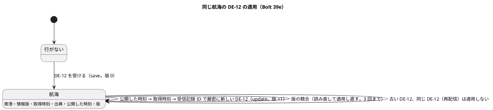
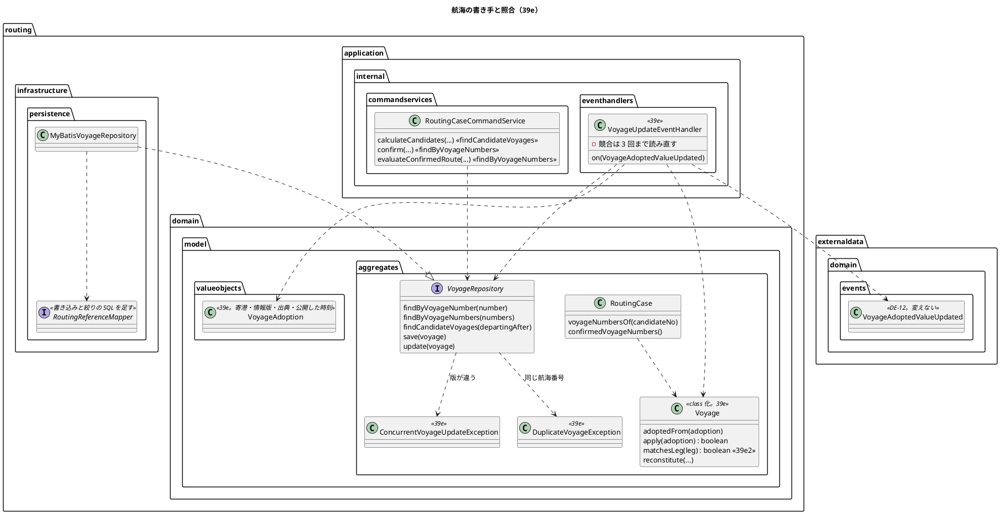
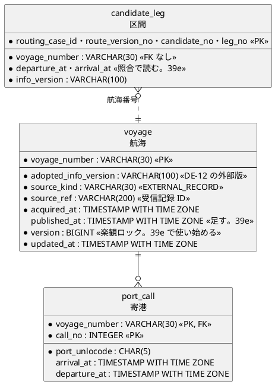

# Bolt 39e 計画 - 採用した航海の値を経路設計の航海に書き、候補の算出と確定で使う

## 基本情報

| 項目 | 内容 |
| :--- | :--- |
| Bolt | 第 39e 回（W7 の 23 本目。release_plan :971 の 39e の行） |
| 状態 | 承認済み（2026-11-09。推奨のとおり。Recommend 承認の指示による）。2 つの整合性検証の指摘を反映した |
| 予定 | W7（2026-11-16 の週。前倒しで着手できる）。作業は約 3 時間 42 分（39e。決定 (1)。分けた 39e2 は約 1 時間 29 分）。下の「時間の配分と打ち切り」。`check`・`uiTest`・SonarQube・CI と承認の待ちを除く |
| アプローチ | アウトサイドイン（受入シナリオから。release_plan :971、:893 の「既存の集約に受入条件を足す」）。受入条件の中心は「取り込み、採用した航海の値で、経路設計者が候補を算出でき、確定で照合される」こと。ステップ 2 で受入シナリオを先に Red にし、内側に入る |
| 対象 | (1) DE-12 を受けて経路設計の航海を書く listener（`externaldata :: events` への依存の宣言）、(2) 同じ航海の DE-12 の順の規則（【業務の判断】(r)、【前の決定の変更】(2)）と公開した時刻の列、(3) `version` の楽観ロックと読み直しの適用、(4) `Voyage` の class 化、(5) 航海の照会を時間の窓で絞り、確定と評価は区間の航海番号で引く（航海と寄港の JOIN の 1 文で読む）、(6) 寄港の時刻の順が矛盾した航海がほかの候補を巻き込まない（決定 (13)）、(7) 誤って採用したときの道の位置づけ（【業務の判断】(t)）、(8) マニュアルの「まだ反映されません」の文を経路設計の分だけ外す。R-INV-03 の照合を区間の予定まで広げること（【業務の判断】(s)、【前の決定の変更】(1)）と見本の航海を分けること（確認ポイント 14）は 39e2 に分ける（決定 (1)）。`ConnectionRule` の class 化と港で絞る照会は W10 に送る（【前の決定の変更】(3)） |
| トレース | US-14 AC1・AC3〜AC5（user_story :558-562）、US-06（:294・:304）、US-07 AC3（user_story :314 の節の受入条件）、ADR-004 :43（採用値だけを公開し、経路設計は航海集約を自分のコマンドで更新する）、R-INV-03（domain_model :865・:918）、DE-12（domain_model :1687 の注・:1710）、BR-11、確認ポイント 11・14・17（release_plan :923・:926・:929）、D-65 の残り（release_plan :784）、技術リスク（release_plan :1107） |
| GitHub | [#18](https://github.com/k2works/practical-domain-driven-design-in-enterpris-application/issues/18)（US-14。クローズは 39h） |
| SP | 0 |
| 承認ゲート | **計画と終了報告で止める**（release_plan :895 の既定、:971 の「計画と終了報告（構造・開発データ）」）。確認必須のものは確認ポイントにして計画の承認に含める（前例 bolt_37d2_plan.md :22）: スキーマ（`routing.voyage.published_at` のマイグレーション。確認ポイント 3）、構造（`routing` の `allowedDependencies` に `externaldata :: events`。確認ポイント 11）、新しいファイル（確認ポイント 14）。開発データ（見本の航海）は 39e2 のゲートにする（決定 (1)）。各ステップは「ゲート: 既定（確認ポイント N で計画の承認に含む）」と書く。新しいセキュリティの判断と本番の操作はない（下の「人に諮ること」） |
| 開始準備で決めたこと | 下の (1)〜(17)（初稿に 2 つの整合性検証の指摘を反映した。推奨を 1 つに決めて書いた。承認待ち）。【業務の判断】(r)・(s)・(t) を新しく記録する。【前の決定の変更】(1)・(2)・(3) |

### 開始準備の決定

(1) **範囲と見積り**: release_plan :971 の 39e の行と確認ポイント 11・14・17、Bolt 39d3b・39d4 の申し送りを、コードで確かめて引き直すと初稿は約 3 時間 48 分（228 分）で、2 つの整合性検証の指摘を入れると 266 分（約 4 時間 26 分）になり、目安（CLAUDE.md の「Bolt がイテレーションであり、時間単位（目安 2〜4 時間）で回す。半日を超える Bolt は分割する」の 4 時間に、見積りの誤差の 5 分を含めた 4 時間 05 分まで。T-250）を超える。まず比べた案 (ii)（`ConnectionRule` の class 化と港で絞る照会、計 15 分）を W10 に送る（【前の決定の変更】(3)。確認ポイント 1）が、251 分（約 4 時間 11 分）でまだ超える。**そこで 39e（書き手と候補の算出。222 分、約 3 時間 42 分）と 39e2（確定の照合と見本の航海。89 分、約 1 時間 29 分）に、利用者に価値が届く縦で分ける**（推奨。確認ポイント 1。39e の余りは 23 分）。

| 内訳 | 39e（分） | 39e2（分） |
| :--- | ---: | ---: |
| 分けて増える分（bolt_39d3_plan.md :54。設計の文書 20、Red 15、品質ゲート 30、終了報告 10、キャプチャと文の突き合わせ 15、受入シナリオの土台と予備 15、UI の流し直しと動画 10） | 115 | — |
| キャプチャと動画がない（マニュアルは文だけで、撮り直す画面がない。文の突き合わせ 15 → 5、UI の流し直しと動画 10 → 5。動画は 39h の W7 のデモで撮る。決定 (15)） | −15 | — |
| 受入シナリオの土台はある（取込の Steps ExternalDataIngestionUiSteps.java :245-252・:258-260、算出の Steps RoutingUiSteps.java :80-91。15 分のうち 10 分を引く。前例 bolt_39d4_plan.md :35） | −10 | — |
| 2 本目の分けて増える分（比べた案 (iii)。設計の文書 10、Red 10、品質ゲート 30、終了報告 10。文の突き合わせと UI の流し直しは 39e の分の中で済ませる） | — | 60 |
| `Voyage` の class 化と採用の振る舞い（行 1〜8。決定 (3)・(9)。行 9 の `matchesLeg` は 39e2） | 10 | 2 |
| 航海の書き手のポート・MyBatis・メモリと契約のテスト（行 14〜18。決定 (2)・(5)） | 15 | — |
| `published_at` のマイグレーション（決定 (4)。スキーマ） | 3 | — |
| listener・組み立て・依存の宣言・モジュールの規則（行 10〜13・36。決定 (2)・(6)） | 10 | — |
| 同時の組み合わせ（行 11・19・20。決定 (5)） | 8 | — |
| 配信まで確かめる統合テスト（行 21・22。T-184） | 6 | — |
| R-INV-03 の照合（行 23〜28。決定 (7)） | — | 10 |
| 時間の窓の照会（行 29・30。決定 (10)） | 8 | — |
| 確定と評価は区間の航海番号で引く（行 33・34。決定 (10)） | 8 | — |
| 既存のテストへの影響（共有の DB の見本のテストの絞り、手で出す DE-12 の確かめ。決定 (14)） | 6 | — |
| 見本の航海を分ける（行 35。決定 (11)。開発データ） | — | 12 |
| 写しの規則の注（行 37。決定 (13)） | 2 | — |
| 受入シナリオの例（39e は行 39・40、39e2 は行 41。決定 (12)） | 7 | 3 |
| マニュアル 12 章・8 章（行 42。決定 (15)。39e2 は 8 章 :138 の 1 文） | 7 | 1 |
| 設計の文書の増え（直す文書が 9 つある。ステップ 1） | 5 | — |
| 指摘の反映: 寄港の時刻の順が矛盾した航海の守り（行 44。決定 (13)） | 3 | — |
| 指摘の反映: 読みと書きの同時（JOIN の 1 文 2、行 45 の統合テスト 6。決定 (10)） | 8 | — |
| 指摘の反映: 外部版をまたいだ採用の組と、マニュアル 12 章 :343・:431 の書き分け（行 46。決定 (15)。【業務の判断】(r)） | 4 | — |
| 指摘の反映: 初めての航海の同時を NESTED と読み直しにする（行 17・20。決定 (5)） | 4 | — |
| 指摘の反映: 受入シナリオの印の共有と待ち（決定 (12)） | 5 | — |
| 指摘の反映: 窓で区間の航海が返る契約の行（行 32） | 3 | — |
| 指摘の反映: マニュアル 8 章 :76 の版の説明と文の突き合わせ（決定 (15)・行 42） | 2 | — |
| 指摘の反映: 内容の欠けの範囲と例外（決定 (6)・行 13） | 2 | — |
| 指摘の反映: 参考の値の測り直しの記録（決定 (14)・ステップ 11） | 1 | — |
| 指摘の反映: 設計の文書の増え（直す箇所が増える） | 5 | — |
| 指摘の反映: 航海がない区間の注の直し（決定 (7)・行 25） | — | 1 |
| **合計** | **222（約 3 時間 42 分）** | **89（約 1 時間 29 分）** |

比べた案: (i) そのまま 1 本（266 分。目安を超えるので採らない。T-250）。(ii) `ConnectionRule` の class 化（5 分）と港で絞る照会（10 分）を W10 に送って 1 本（251 分。約 4 時間 11 分でまだ超える。送ることは実施する。どちらも今は利用者に見える成果がなく、確認ポイント 17 の「候補探索の量は W10 の性能テスト」と一緒に見られる。【前の決定の変更】(3)）。(iii) **39e と 39e2 に利用者に価値が届く縦で分ける（推奨。(ii) と組み合わせる）**: 39e は書き手と候補の算出（行 1〜8・10〜22・29・30・32〜34・36・37・39・40・42〜46）で、データ責任者の採用が経路設計者の候補に効く（US-14 AC1）。39e2 は確定の照合と見本の航海（行 9・23〜28・35・41）で、同じ情報版のまま区間の予定が変わったら確定で止める（US-07 AC3、【業務の判断】(s)）。分けて増えるのは 60 分（設計の文書 10、Red 10、品質ゲート 30、終了報告 10）。39e2 は 39f の前に置く（39f の評価の入口が `matchesLeg` を使う）。39e から 39e2 までの間、同じ情報版で区間の予定が変わる組は確定で拒否されない（今の照合のまま。W7 のデモの動画は 39h で、39e2 より後。申し送りに書く）。(iv) 見本の航海を 39f に送る（−12 分。確認ポイント 14 が 39e と決めたので動かさない。39e2 に分けても 39f の前に済む）。

(2) **書き手の形**（確認ポイント 11）: 経路設計の中の listener `VoyageUpdateEventHandler`（`routing.application.internal.eventhandlers`、`@ApplicationModuleListener`、`@Service`、組み立ては RoutingConfiguration.java。形の前例は RoutingCaseOpeningEventHandler.java :29-48）が `VoyageAdoptedValueUpdated`（VoyageAdoptedValueUpdated.java :29-39）を受け、航海を読んで適用し、保存する。外部データは経路設計の表を書かない（確認ポイント 11、ADR-004 :43）。

- `routing` の `allowedDependencies`（routing/package-info.java :8）に `"externaldata :: events"` を足す（確認ポイント 11 の前の決定の「経路設計は 39e」。release_plan :902）。`ModularityTest`（前例 ModularityTest.java :68-81 の identity の行）に「経路設計は外部データのイベントだけに依存を宣言して参照する」を足す。`ApplicationModules.verify` はイベントの型の参照をそのまま許す（イベントの型の import の前例 RoutingCaseOpeningEventHandler.java :3）
- 置き場所は `application.internal.eventhandlers`（前例のコード RoutingCaseOpeningEventHandler.java と domain_model :239 の `eventhandlers` のハンドラーの行。外部の技術のポートでないので `domain.model.aggregates` に置くのは保存のポートだけ）
- 書く値の対応: `voyage_number` ← `voyageNumber`、寄港 ← `portCalls`（`AdoptedPortCall` → `PortCall`）、`adopted_info_version` ← `infoVersion`（外部版。AdoptionFactory.java :79）、`source_kind`・`source_ref`・`acquired_at` ← `source()`（Source.java :14。参照は受信記録 ID）、`published_at` ← `publishedAt`（決定 (4)）。`routing.voyage` の `voyage_number VARCHAR(30)`・`adopted_info_version VARCHAR(100)`・`source_ref VARCHAR(200)` はイベントの値の上限と合う（VoyageValues.java :25、V20261103100000 :57、受信記録 ID は UUID）。列の追加は `published_at` だけ
- 更新の順は `voyage` の条件付き UPDATE を先にし、0 件なら例外にして `port_call` を触らない（行 16）。そのあと寄港の更新は `port_call` の行を消して入れ直す（`routing` は `DELETE` の権限がある。afterMigrate__grant_app_user.sql :27、`routing` に追記専用の印はない）。`candidate_leg` の航海への外部キーはないので影響しない（V20261007100000 :76-78）
- 航海がないステージング・本番では初めての DE-12 で行を作る（data_model :522 の「ステージング・本番では 0 件」）

(3) **同じ航海の DE-12 の順**（【業務の判断】(r)。domain_model :1687 の注が 39e に預けた比べ方）: 情報版（外部版）は順序の分からない文字列なので比べず（ExternalRecord の冪等性キーの外部版。AdoptionFactory.java :79）、**公開した時刻の新しい方を効かせる**。同じ時刻（1 つの取込の行はすべて同じ時刻。domain_model :335 の「時刻は Clock から 1 回取り」）は取得時刻の新しい方、それも同じなら受信記録 ID（`source_ref`。UUID の文字の順で符号なしの順と同じ）の大きい方。適用する側は「今の航海より厳密に新しい DE-12 だけ」なので、再配信（少なくとも 1 回）は適用せず冪等になる。比べるのは `Voyage` の振る舞いで、listener は読むだけ。外部版をまたいだ採用の判断も、最後に公開した値が効く（経路設計は外部版の順を持たない）。同じ取込・同じ取得時刻の組は業務の順を持たない（受信記録 ID は UUID で、決定的に 1 つに決めるためだけの順）。

- 申し送りの組（状態の組み合わせの行 5〜8）: (a) 同じ情報版で値の違う組（39d3b の申し送り。取込の採用の後に隔離を採用した DE-12）は公開した時刻の新しい方、(b) 書き方や取得時刻だけが違う原本の採用で出る、同じ情報版で同じ値の組（39d4 の決定 (7)）も同じ規則で適用する（寄港は変わらず、取得時刻と出典が新しくなる）、(c) 同じ外部版を採用し直す組（39d4 の行 2 (c)）も順のとおり最後の採用が効く
- 外部版をまたいで古い版が後から届く（順序の逆転）: 39h までは取込が新しい外部版の採用にして DE-12 を出すので、経路設計はその値に置き換わる（39d4 の行 5 (d) と同じ「今は採用」）。US-14 AC5（user_story :562「順序逆転または既存値との矛盾…自動上書きせず差異」）は 39h の分類で受け、差異にすると DE-12 は出ない。比較で逆転を見ない（経路設計の側に情報版の順の規則を持たない）。V2 の取込の後に V1 の隔離を採用したときも、最後に公開した V1 の値が航海になる（行 46）。Bolt 39d の決定 (13)・D-97 の注の「新しい外部版」は【前の決定の変更】(2) で改める。この組を差異にするかは 39h で決める（申し送り）
- 比べた案: (i) 公開した時刻の新しい方（推奨。bolt_39b3_plan.md :153 の (a) に、同じ時刻の解決を足したもの）、(ii) 情報版を文字列で比べる（外部版に順序の定めがない。提供元の書き方で順が変わる）、(iii) 取得時刻の新しい方（誤って採用した原本を元の原本に採用し直したとき、元の原本の取得時刻が古いと直せない）、(iv) 届いた順に適用する（再配信や非同期の順の入れ替わりで古い値が残る）、(v) 取込 ID と公開した時刻の組で比べる（bolt_39b3_plan.md :153 の (b)。取込 ID は UUID で順がなく、同じ取込の中の順の決め手にならない）、(vi) 情報版の書き方を情報源ごとに登録してその規則で比べる（同 :153 の (c)。情報源の登録の変更になり、提供元が書き方を変えると比べられない）

(4) **公開した時刻の列**（スキーマ）: 共通のマイグレーション 1 つで `routing.voyage` に `published_at TIMESTAMP WITH TIME ZONE`（NULL を許す。`COMMENT` は「採用値を公開した時刻（取込を経ない仮の航海は NULL）」）を足す。NULL の航海（開発データの仮の航海）はどの DE-12 より古いとみなす。`updated_at` に重ねない（`updated_at` は監査用の列の規約。data_model :157）。比べた案: `updated_at` に公開した時刻を書く（列は増えないが、規約の監査用の列の意味が変わる）。既存の INSERT は列を名指ししているので NULL で通る（RoutingUiSteps.java :109、RouteConfirmedAssignmentIntegrationTest.java :328、RoutingAssignedScopeSecurityIntegrationTest.java :325、MyBatisRoutingRepositoriesIntegrationTest.java :644）。列のコメントは `SchemaCommentIntegrationTest` が守る。

(5) **`version` の楽観ロックと読み直し**（確認ポイント 11 に基づく 39e の決定）: 更新は `UPDATE routing.voyage SET …, version = version + 1, updated_at = … WHERE voyage_number = … AND version = …`（前例 RoutingCaseMapper.xml :153-155、MyBatisRoutingCaseRepository.java :86-87）で、0 件なら `ConcurrentVoyageUpdateException`（`domain.model.aggregates`。前例 ConcurrentRoutingCaseUpdateException.java :8）。

- listener は競合を捕まえて読み直し、同じ DE-12 を適用し直す（**3 回まで**。0 件の UPDATE は SQL のエラーにならないのでトランザクションは生きている。読み直しの直前に UPDATE があるので MyBatis の 1 次キャッシュは消えている）。3 回とも競合したら例外を上げ、イベントの発行記録に残して再起動の再配信（application.properties :54）に任せる。読み直した結果 DE-12 の方が古ければ適用しない
- 初めての航海の 2 つの DE-12 の同時は、`save` を NESTED にして（前例 MyBatisRoutingCaseRepository.java :64-77）一意制約の違反をセーブポイントに戻し、`DuplicateVoyageException`（前例 DuplicateRoutingCaseException。ポートの約束）にする。listener はこれを捕まえて読み直しの経路に入り（前例 ReceivedRecordDecisionService.java :286-295。上の 3 回の上限を共有する）、読み直した航海に順の規則で適用する（セーブポイントに戻すので PostgreSQL でもトランザクションは続けられ、失敗した INSERT で MyBatis の 1 次キャッシュは消えている）。起きるのは同じファイルに同じ航海の違う外部版の行があるときだけ（行 20）
- 確定は今のとおり同じトランザクションで航海を読み直して比べ、行のロックは足さない（確認ポイント 11。RoutingCaseCommandService.java :104-105）

(6) **内容の欠けた DE-12**（毒入りのメッセージ。前例 ExternalRecordAuditEventHandler.java :159。domain_model :316 の「内容の欠けたイベントは ERROR のログを残して捨て、DB の失敗は例外を上げて配り直させる」）: 欠けの範囲は `voyageNumber`・`portCalls`（null と 2 未満）・寄港の値（`PortCall` の規則）・`infoVersion`・`source`（null、参照、取得時刻）・`publishedAt` で、`VoyageAdoption` の組み立てが確かめて `VoyageAdoption.InvalidEventValueException`（前例 `AuditRecord.MissingEventValueException`）を投げる。listener はこの例外だけを捕まえて ERROR のログを残して捨てる（永久に失敗する配信を残さない）。`IllegalArgumentException` は広く捕まえない（`PortCall` を作る 1 か所だけを囲んで包む）。それ以外のプログラムの誤りと DB の失敗は例外を上げて配り直させる。寄港の規則は外部データの写し（ExternalDataCopiedRulesTest.java :137-151）が守るので、起きるのはイベントが壊れたときだけ。

(7) **R-INV-03 の照合**（**39e2 で実装する**。決定 (1)。【業務の判断】(s)、【前の決定の変更】(1)。39d3b の申し送り、domain_model :1687 の注）: 同じ情報版で値の違う DE-12 がありうるので、情報版だけの照合（RouteCandidate.java :50-54、RoutingCase.java :263・:330、domain_model :918）では値の変更を見落とす。**「区間の情報版が今の航海と同じで、かつ区間の出発予定・到着予定の組が今の航海の寄港にある」ときだけ変わっていないとする**（積地の寄港の出発と、その後の揚地の寄港の到着が区間の値と一致する組が 1 つ以上あること）。

- 判定は `Voyage` の振る舞い `matchesLeg(Leg)` に置く（`entities` の `RouteCandidate` が `aggregates` の `Voyage` を参照しない）。`RouteCandidate.legsWithChangedInfo` と `RoutingCase.infoVersionsOf` を消し、`RoutingCase` の確定（:263）と評価（:330）が `voyage.matchesLeg(leg)` で判定する（評価は 39f がつなぐが判定は 1 か所に置く）
- 比べた案: (i) 区間の予定も比べる（推奨。スキーマを変えず、同じ値の組で確定を拒否せず、元の値に採用し直すと元の候補は確定できる）、(ii) 版の列（DE-12 ごとの改訂）を `voyage` と `candidate_leg` に足す（スキーマが増え、同じ値の組でも拒否する）、(iii) 経路設計の情報版を適用のたびに作り直す（画面の「参照した航海情報の版」と DE-06 の旧情報版が提供元の版と食い違う。08-経路設計.md :76）、(iv) 同じ情報版の 2 つ目を適用しない（データ責任者の採用の判断が経路設計に届かない。ADR-004 :43 に反する）
- 2 度寄る航海: 組は 1 つ以上あればよい（評価の引き直しの「1 つに決める」とは別。積地や揚地に 2 度寄っても、区間の予定の組が残っていれば変わっていない。行 27）。確定の区間に寄港の位置を持たせるのは 39f（確認ポイント 13）
- 航海がない区間は変わったとみなす（今のまま。RoutingCase.java :228・:277。行 25）。「情報版の違う区間」の注は区間の予定まで含めて直す: RoutingCase.java :228・:277・:308、RouteCandidate.java :44、domain_model :918、テスト RoutingCaseConfirmationTest.java :581・RoutingCaseEvaluationTest.java :177
- 拒否の理由と文は変えない（`INFO_VERSION_CHANGED`、「候補を算出した後に航海の情報が更新されたため確定できません。…」RoutingCaseController.java :231-232。文は情報版と言っていない）。`RouteConfirmationRejectionReason` の Javadoc（:15）と RoutingCase.java :264 の例外の文は「情報が更新された」に直す

(8) **誤って採用したときの道**（【業務の判断】(t)。bolt_39d4_report.md :22 の議題 4）: **新しい外部版で正しい原本を送ってもらうのを基本の道、元の原本を同じ外部版のまま送り直して採用するのは新しい外部版を出してもらえないときの道とする**（今のマニュアルの書き分けのまま。12-外部データ.md :343・:427）。どちらも決定 (3) で経路設計に届き、算出済みの候補は決定 (7) で確定のときに照合される。元の値に戻した後は、元の値で算出していた候補は情報鮮度の内なら確定できる（RoutingCase.java :278-282。行 26）。マニュアルに経路設計への届き方の 1 文を足す（決定 (15)）。受入条件との突き合わせ: US-14 AC4（user_story :561「既存原本と採用値を上書きせず隔離されデータ責任者へ示される」）は隔離までの話で、採用の判断はデータ責任者の明示の操作（【業務の判断】(b)）なので矛盾しない。

(9) **class 化**（確認ポイント 17、D-65）: `Voyage`（Voyage.java :18-30）を `public final class` にする（集約の形の前例 RoutingCase.java :46-47）。読み取りのメソッド名（`voyageNumber()` など）は変えない。`ConnectionRule`（ConnectionRule.java :20-40）の class 化は W10 に送り、record のままにする（【前の決定の変更】(3)）。

- `Voyage` は `aggregateVersion`・`source`（出典）・`publishedAt` を足し、振る舞いを持つ: 作る `adoptedFrom(adoption)`、適用 `apply(adoption)`（決定 (3)。適用しないなら false）、`matchesLeg(leg)`（決定 (7)。39e2）、復元 `reconstitute(…)`（既存の形。RoutingCase.java :144）。既存の 4 引数の `new Voyage(…)`（テストに 20 か所。12 クラス）は「取込を経ない仮の航海」のコンストラクタとして残し、テストを書き換えない（出典は手入力、`publishedAt` は null、版 0）。等しさは今の record と同じ値の比べで、比べるのは今の 4 項目だけ（`source`・`publishedAt`・`aggregateVersion` は含めない。`MyBatisRoutingRepositoriesIntegrationTest.java :657-659` の `containsExactly` を変えない）
- 取り込んだ値の受け渡しは値オブジェクト `VoyageAdoption`（寄港・情報版・出典・公開した時刻）。listener が DE-12 から作る。`Voyage` は外部データの型を持たない

(10) **航海の照会を絞る**（確認ポイント 17、D-65。release_plan :784 の「確定の読み直しは候補の区間の航海番号で引く」）: `VoyageRepository.findAll()`（VoyageRepository.java :11）を、本番の呼び出しがなくなるので次の照会に置き換えて消す（テストも置き換える。DevSampleDataSmokeTest.java :407・:430、MyBatisRoutingRepositoriesIntegrationTest.java :657）。

- **読みは航海と寄港の JOIN の 1 文にする**（`findCandidateVoyages`・`findByVoyageNumber`・`findByVoyageNumbers` のすべて同じ形）。今の読みは寄港を先に航海を後に別の文で取るので（MyBatisVoyageRepository.java :29・:38・:41、RoutingReferenceMapper.xml :33-40）、READ COMMITTED で間に初めての航海がコミットされると寄港が空で `new Voyage` が例外になる（Voyage.java :26-28）。1 文なら文の開始の時点の 1 つのスナップショットで航海と寄港の組を読む（行 45）
- `findCandidateVoyages(UtcInstant departingAfter)`（算出。RoutingCaseCommandService.java :89）: **時間の窓**は、判定時刻より後に出発する寄港を持つ航海（積替えの区間も判定時刻より後に出発するので、候補を落とさない。RouteCandidateFinder.java :188-194）。絞りは航海の単位の `EXISTS` にし、寄港の行は落とさない（判定時刻より前の寄港を落とすと `Voyage` の寄港が欠ける）。窓の上の端は置かない（希望到着期限で切ると、期限に間に合わない候補とその理由が画面から消える。R-INV-02、US-06 の除外の理由）。**港で絞る照会は W10 に送る**（【前の決定の変更】(3)。候補探索の量と一緒に見る）
- `findByVoyageNumber(String)`（listener の読み直し）と `findByVoyageNumbers(Collection<String>)`（確定 :128・評価 :159）: 区間の航海番号だけを読む。`RoutingCase` に候補の航海番号を返す 2 つの読み取りを足す（`voyageNumbersOf(candidateNo)`、`confirmedVoyageNumbers()`）。候補がないときは空で、確定は従来の理由で拒否される。RoutingCase.java :260 の「全件」の注を直す
- 索引は足さない。港ごとの出発の索引は「候補探索の量」と一緒に W10 の性能テストで確かめる（確認ポイント 17）
- `RoutingReferenceMapper`（RoutingReferenceMapper.java :7 の「読み取りだけ」）に書き込みの SQL を足し、Javadoc を直す（新しいマッパーを作らない）。列と `resultMap`（航海に寄港の `collection`、`ORDER BY voyage_number, call_no`）を共通にし、3 つの照会で条件だけを変える

(11) **見本の航海を分ける**（**39e2 で実装する**。決定 (1)。確認ポイント 14、release_plan :1107。Bolt 37e4b の決定 (2) を変える【前の決定の変更】は W7 の開始準備で記録済み）: dev だけのマイグレーションで見本専用の航海 `DEMO-901`（JPTYO の出発は起動した日の前日、NLRTM の到着は起動した日の 17 日後 9 時。`V20261023200900` の写しと同じ値）を足し、`RC-2026-0908`・`0909` の候補の区間（`routing.candidate_leg`）と割り当てた区間の写し（`quotation.assigned_route_leg`）の航海番号を `DEMO-901` に直す。取得時刻と `PROVISIONAL-1` は DEMO-101 の行と同じにする（`DevSampleDataSmokeTest.java :430` の揃い）。ほかの見本の区間は `DEMO-101` の予定と一致するので変えない（`DEMO-101` を更新すると 39f で評価されるのが正しい振る舞い）。確かめは `DevSampleDataSmokeTest` に足す（`DEMO-101` を見本 0911・0912 の区間が指さない、`DEMO-901` の予定と区間の写しが一致する）。

(12) **受入シナリオ**: 新しい feature `features/ui/adopted_voyage_reflected_ui.feature` に 39e は 2 シナリオ（行 39・40。行 41 は 39e2 で足す）。経路の比較の feature と取込の feature のどちらにも足さない（取込と算出をまたぐ別の話。前例 bolt_39d4_plan.md の決定 (8)）。航海の行は既存の Steps の形（`voyageLine`）で、航海番号を `UI-<シナリオの印>-…` にする（30 文字の上限の内。VoyageValues.java :25）。`RoutingUiSteps` の後片付けの印（RoutingUiSteps.java :67-74・:106 の `voyagesInserted`）は取込の航海では立たないので、シナリオの印を Steps の間で共有し（`UiScenarioState`。RoutingUiSteps.java :32）、`ExternalDataIngestionUiSteps` の suffix（:258-260）と `RoutingUiSteps` の suffix（:35）を合わせ、取込の航海にも片付けが効く形にする（D-62）。配信は非同期なので、行 39 は S-06 を開き直して待つ（前例 RoutingUiSteps.java :129-135）。行 40・41 は画面だけでは前の値と区別できないので、Steps の `jdbc` で `routing.voyage.published_at`（または `port_call` の時刻）が変わるまで待つ。航海の時刻は今の Steps と同じ 2099 年（T-230）で、取得時刻は今の時刻（情報鮮度の 24 時間の内）。

(13) **写しの規則**（ExternalDataCopiedRulesTest.java :33・:45、VoyageValues.java :16 が 39e に預けた）: 経路設計の `Voyage` に寄港の重複の規則と寄港数の上限 60 を足さない（意図した食い違いのまま）。外部データから届く値はすでに検証済みで（ADR-004 の「採用値だけを公開」）、経路設計の不変条件を増やすと開発データと既存のテストにも当たる。ExternalDataCopiedRulesTest.java の注の「39e で決める」と VoyageValues.java の Javadoc を「決めた（足さない）」に直す。

寄港の時刻の順: 寄港をまたいだ時刻の順は取込も `Voyage` も確かめない（VoyageValues.java :46-62 は寄港の中だけ）ので、後の寄港の到着が前の寄港の出発より後でない航海は取込を通って保存される。今は `legsFromCall` の `new Leg` が `IllegalArgumentException` を投げ（Leg.java :38-40、RouteCandidateFinder.java :118-119。:158-163 の `refresh` だけ防いでいる）、その港から出る案件の算出がすべて失敗する。**`legsFromCall` で到着が出発より後でない組は区間にしない**（`refresh` と同じ失敗に倒す。取込の規則は増やさない）。該当の航海がほかの候補を巻き込まないことを行 44 で確かめる。

(14) **既存のテストへの影響**（共有の DB に DE-12 が航海を書くようになる）:

- `DevSampleDataSmokeTest.java :430` の「すべての航海の取得時刻が揃う」は、同じ JVM の H2 に取込のテストの航海が残るので `DEMO-%` の航海番号で引くように直す（決定 (10) の置き換えと一緒）
- 配信のテストへの影響: `ExternalRecordAuditDeliveryIntegrationTest`（:463・:764）・`ExternalDataIngestionIntegrationTest` など配信を確かめるテストは、正しいファイルの取込で有効な DE-12 が出て、`V2611E` などの航海の行が H2 に残る（候補には影響しない。JPTYO → USLAX で 2099 年の経路のテストとつながらない）。決定 (6) で捨てられるのは壊れたイベントだけ（ステップ 7 で全体を流して確かめる）
- UI の取込の航海（JPTYO → USLAX、2026-12。ExternalDataIngestionUiSteps.java :47-48）は 2099 年の経路のテストと繋がらないので候補に入らない（D-62 に当たらない）
- 性能のジョブ（`performanceTest`。1 万行の航海の取込で DE-12 が 1 万件配信される）: PERF-06 の判定は取込のコミットまでで配信の外なので判定は変わらないが、配信の待ち時間が増える（bolt_39b4_plan.md :136 の申し送り「39e・39g で行 10 の参考の値を測り直す」）。ステップ 11 で人の側の CI の手動のジョブで測り直し、値を記録する

(15) **マニュアル**（T-251。用語は下の「業務の判断の記録」の文から写す）: 12-外部データ.md :448 を「航海の採用値は、経路設計の候補の算出と確定に使われます（候補を再算出すると新しい予定で比べます）。主要実績の採用値は、まだ追跡の画面には反映されません（取込で採用した値も同じです）。反映されないのは不具合ではありません」に直す（追跡の分は 39g で外す。release_plan :973）。「誤って採用したとき」の節の :345 の後に「新しい外部版でも、元の原本の送り直しでも、最後に採用した値が経路設計の航海になります。経路設計への反映は採用の後に少し遅れます（非同期）」を足す（決定 (8)）。12-外部データ.md :343 の「業務で効くのは同じ外部 ID の新しい外部版の採用値」と :431 の同じ文は、外部データの分類（この外部版の採用値）と経路設計への効き方（最後に公開した採用値）を書き分ける（【前の決定の変更】(2)）。08-経路設計.md :76 の「航海番号@版」の説明を直す（取り込んだ航海は提供元の外部版がそのまま示される。区間どうしで同じ版なら 1 つにまとまる。RoutingCaseViews.java :308 の `.distinct()`）。08-経路設計.md :138 の「（参照した航海情報の版が変わる）」を「（参照した航海情報の版が変わるか、同じ版のまま区間の予定が変わる）」に直すのは 39e2（【業務の判断】(s) と一緒）。キャプチャは変わらない（画面の文も配置も変えない）。動画は作らない（39e の行に動画はなく、W7 のデモの動画は 39h。release_plan :975）。

(16) **変えないもの**: DE-12 の型と発行（VoyageAdoptedValueUpdated.java、AdoptionFactory.java）、外部データの分類と採用値、評価の入口（航海番号から案件を引く照会、`evaluateConfirmedRoute` をつなぐのは 39f）、確定の順、情報鮮度の判定（確定のときは読み直した航海の取得時刻。Bolt 37c の決定。domain_model :919）、S-05〜S-07 の画面と URL、`ConnectionRuleRepository`、接続時間規則の照会。

(17) **新しい型の名前**（T-246。`apps/cargo-tracker/src` で `VoyageUpdate`・`ConcurrentVoyage`・`DuplicateVoyage`・`VoyageAdoption`・`findCandidateVoyages`・`findByVoyageNumber`・`matchesLeg`・`VoyageRepositoryContract`・`DEMO-9`・`adopted_voyage_reflected`・`InvalidEventValue` を検索し、ないことを確かめた。形は `RoutingCaseOpeningEventHandler`・`ConcurrentRoutingCaseUpdateException`・`DuplicateRoutingCaseException`・`AuditRecord.MissingEventValueException` に合わせた）: `VoyageUpdateEventHandler`、`ConcurrentVoyageUpdateException`、`DuplicateVoyageException`、値オブジェクト `VoyageAdoption`（入れ子の例外 `VoyageAdoption.InvalidEventValueException`）、ポートの `findCandidateVoyages`・`findByVoyageNumber`・`findByVoyageNumbers`・`save`・`update`（`save`・`update` の分け方は RoutingCaseRepository の形）、`Voyage.matchesLeg`、テストは `@Nested class Bolt39e_…` と契約のテストの名前の頭に `Bolt39e_`、受入シナリオ `adopted_voyage_reflected_ui.feature`、見本の航海 `DEMO-901`。

【前の決定の変更】(1): Bolt 37c の決定（domain_model :918「照合は区間の写し（`candidate_leg.info_version`）で行う」）を改め、照合を情報版と区間の予定の組にする（決定 (7)。【業務の判断】(s)）。Bolt 37d の「版の違う区間」（domain_model :918・:934）の定義も同じ。実装は 39e2。

【前の決定の変更】(2)（【業務の判断】(r) に伴う。確認ポイント 2）: Bolt 39d の決定 (13)（bolt_39d_plan.md :64「採用値は対象のキーの新しい版で効く」）と台帳 D-97 の注（release_plan :1077「対象のキーで業務（経路設計・追跡）に効くのは新しい外部版の採用値」）の「新しい外部版」を「最後に公開した採用値」に改める（経路設計の航海の分。追跡の主要実績の分は 39g の開始準備で決める）。経路設計は外部版の順を持たないので、39d の決定 (13) のままでは作れない。

【前の決定の変更】(3)（決定 (1)、確認ポイント 1）: 確認ポイント 17（release_plan :929「`Voyage`・`ConnectionRule` の class 化と、航海の照会を時間の窓と港で絞ることは、書き手を作る 39e で行う」）を改め、`ConnectionRule` の class 化と港で絞る照会を W10 に送る（候補探索の量の性能テストと一緒に見る）。

新しいファイル（39e）: `VoyageUpdateEventHandler`（と単体のテスト）、`ConcurrentVoyageUpdateException`、`DuplicateVoyageException`、`VoyageAdoption`、共通のマイグレーション `V20261109…__add_routing_voyage_published_at.sql`、`VoyageTest`、`VoyageRepositoryContract`（`H2`・`MyBatis`・メモリの本体）、統合テスト（同時と配信と読みの同時。`VoyageUpdateDeliveryIntegrationTest`、`H2VoyageConcurrentUpdateTest`）、`adopted_voyage_reflected_ui.feature`。39e2 の新しいファイル: dev のマイグレーション `db/dev-data/V20261109…__split_dev_sample_departed_voyage.sql`。直すもの（39e）: `Voyage`・`VoyageRepository`・`MyBatisVoyageRepository`・`RoutingReferenceMapper`（.java・.xml）・`VoyageRow`・`RouteCandidateFinder`（`legsFromCall` の守り）・`RoutingCase`（読み取り 2 つ）・`RoutingCaseCommandService`・`RoutingConfiguration`・`routing/package-info.java`、テスト `InMemoryVoyageRepository`・`RouteCandidateFinderTest`・`ConfirmedRouteEvaluationTest`・`RoutingCaseCommandServiceScopeTest`・`DevSampleDataSmokeTest`・`MyBatisRoutingRepositoriesIntegrationTest`・`ModularityTest`・`ExternalDataCopiedRulesTest`・Steps（`RoutingUiSteps`・`ExternalDataIngestionUiSteps`・`UiScenarioState`）、`VoyageValues`（Javadoc）・`VoyageAdoptedValueUpdated`（Javadoc の 39e と「情報版で代える」）・`externaldata/domain/events/package-info.java`、マニュアル 12・8 章（:76）。直すもの（39e2）: `RoutingCase`（照合）・`RouteCandidate`（`legsWithChangedInfo` を消す）・`RouteConfirmationRejectionReason`（Javadoc）、テスト `RoutingCaseConfirmationTest`（:607-613 を `Voyage` の側に移す）・`RoutingCaseEvaluationTest`・`DevSampleDataSmokeTest`、マニュアル 8 章（:138）。

### 前の Bolt から引き継いだもの

| 出典 | 内容 | この計画 |
| :--- | :--- | :--- |
| release_plan :971、確認ポイント 11・14・17 | listener、class 化、楽観ロック、照会の絞り、見本の航海 | 決定 (2)・(5)・(9)〜(11)、行 1〜35 |
| domain_model :1687 の注、bolt_39d3b_plan.md の申し送り | 同じ情報版で値の違う DE-12、R-INV-03 | 決定 (3)・(7)、行 5・23 |
| Bolt 39d4 の決定 (7)、申し送りの表（bolt_39d4_plan.md :274） | 同じ情報版で同じ値の組 | 決定 (3)、行 6・24 |
| Bolt 39d4 の行 2 (c)、開発レビュー（bolt_39d4_report.md :79） | 同じ外部版を採用し直すと同じ情報版で値の違う DE-12 | 決定 (3)、行 7・26 |
| bolt_39d4_report.md :22（議題 4） | 誤って採用したときの道の位置づけ | 決定 (8)、【業務の判断】(t) |
| bolt_39d4_report.md :109 | マニュアルの「まだ反映されません」の文 | 決定 (15)、行 42 |
| ExternalDataCopiedRulesTest.java :33・:45、VoyageValues.java :16 | 経路設計の航海の規則 | 決定 (13)、行 37 |
| 確認ポイント 11（release_plan :923） | 航海の行は `version` の楽観ロックで守り、listener は競合を読み直す | 決定 (5)、行 11 |
| bolt_39b3_plan.md :56・:153 | 同じ航海の DE-12 が 2 つ非同期に届いたときの順の守り方（選択肢 (a)〜(c)） | 決定 (3)、【業務の判断】(r)、比べた案 |

## Bolt ゴール

データ責任者が取り込んだ航海や隔離から採用した航海の値が、経路設計の航海に書かれ、経路設計者が候補を算出すると新しい予定で比べられる。同じ航海の採用が重なっても（外部版をまたいでも）、最後に公開した採用値が航海に残る。寄港の時刻の順が矛盾した航海があっても、ほかの候補の算出を巻き込まない。マニュアル 12 章から航海の「まだ反映されません」の文が消えている。39e2 で、候補を算出した後に区間の予定が変わる採用があると（同じ情報版のままでも）確定は拒否され、再算出を求められるようにする（元の原本を採用し直すと航海は元の値に戻り、元の値で算出した候補は情報鮮度の内なら確定できる）。見本 TR-2026-0911・0912 が DEMO-101 の更新の影響を受けないようにするのも 39e2。

### 開始準備で確かめたこと

- **release_plan の 39e の行**（:971）: 「経路設計の航海の書き手: DE-12 の listener、`Voyage`・`ConnectionRule` の class 化、`version` の楽観ロック、航海の照会を時間の窓と港で絞る、見本の航海を分ける（確認ポイント 14）」と 39d3b・39d4 の申し送り。アプローチはアウトサイドイン、ゲートは計画と終了報告（構造・開発データ）
- **航海を読むだけで書き手がない**: VoyageRepository.java :10-11 は `findAll` だけ。RoutingReferenceMapper.java :7 は読み取りだけ、MyBatisVoyageRepository.java :27-45
- **`version` の列はあるが使っていない**: V20261007100000 :106、`selectVoyages` は読まない（RoutingReferenceMapper.xml :33-35）
- **DE-12 の値**: VoyageAdoptedValueUpdated.java :29-39。`infoVersion` は外部版（AdoptionFactory.java :79・:120）、`publishedAt` は取込の時刻か判断の時刻（:26）。同じ情報版で値の違う組は取込と採用の判断の両方から出る（domain_model :1687）
- **R-INV-03 の照合は情報版だけ**: RouteCandidate.java :50-54、RoutingCase.java :260-265・:328-332。呼び出しはテストを含めて 5 か所（RoutingCaseConfirmationTest.java :607-613）
- **区間の予定は候補に写されている**: Leg.java :25-26。`routing.candidate_leg` の `departure_at`・`arrival_at`（V20261007100000 :69 付近）
- **確定と算出の読み方**: RoutingCaseCommandService.java :89・:128・:159。`RouteCandidateFinder` はリポジトリを呼ばない（RouteCandidateFinder.java :37。ドメインサービスに航海を渡す。domain_model :881）
- **モジュールの宣言**: routing/package-info.java :6-8。`externaldata :: events` は名前付きインターフェースで公開済み（ModularityTest.java :53-61）
- **再配信**: application.properties :54 の再起動の再配信。自動の再試行はない（RetryTemplate はなし）
- **見本の写し**: V20261023200900 :50-54（`quotation.assigned_route_leg`）・:89-95（`routing.candidate_leg`）。航海は V20261007100900 :10・:22-23（出発は +5 日）
- **確定の拒否の文**: RoutingCaseController.java :231-232。画面の文は情報版と言っていない
- **受入条件**: US-14 AC3〜AC5（user_story :560-562）。US-07 の AC3「承認中に候補の情報版が更新済み、When 確定する、Then 承認は無効となり再判断が要求される」

## 設計の決定

| 項目 | 決定 | 根拠 |
| :--- | :--- | :--- |
| 範囲と見積り | 決定 (1)。比べた案 (ii) を W10 に送り、39e（約 3 時間 42 分）と 39e2（約 1 時間 29 分）に分ける | CLAUDE.md、release_plan :971 |
| 書き手の形 | 決定 (2)。経路設計の listener。`externaldata :: events` を宣言 | release_plan :923、ADR-004 :43、RoutingCaseOpeningEventHandler.java :29-48 |
| 順の規則 | 決定 (3)、【業務の判断】(r)、【前の決定の変更】(2)。公開した時刻 → 取得時刻 → 受信記録 ID。厳密に新しいものだけ適用。外部版をまたいでも最後に公開した採用値が効く | domain_model :1687、AdoptionFactory.java :79 |
| 公開した時刻 | 決定 (4)。`routing.voyage.published_at`（NULL を許す） | data_model :157 |
| 楽観ロック | 決定 (5)。`version` の条件付き更新。listener は 3 回まで読み直す。初めての航海の同時は NESTED と読み直し | release_plan :923 |
| 内容の欠け | 決定 (6)。`VoyageAdoption.InvalidEventValueException` だけを捕まえ、ERROR のログを残して捨てる | domain_model :316 |
| R-INV-03 | 決定 (7)、【業務の判断】(s)、【前の決定の変更】(1)。情報版と区間の予定の組で照合（39e2） | RouteCandidate.java :50-54、domain_model :865・:918 |
| 誤って採用したときの道 | 決定 (8)、【業務の判断】(t)。新しい外部版が基本 | bolt_39d4_report.md :22 |
| class 化 | 決定 (9)。`Voyage` に振る舞い。`ConnectionRule` は W10 に送る | release_plan :929、RoutingCase.java :46-47 |
| 照会の絞り | 決定 (10)。時間の窓は下の端だけ、確定と評価は航海番号、読みは航海と寄港の JOIN の 1 文。港で絞る照会は W10 に送る | release_plan :784・:929、RouteCandidateFinder.java :188-194、MyBatisVoyageRepository.java :29・:38 |
| 見本の航海 | 決定 (11)。`DEMO-901` を足し 0911・0912 の区間を直す（39e2） | release_plan :926・:1107 |
| 写しの規則 | 決定 (13)。経路設計に足さない。寄港の時刻の順が矛盾した組は区間にしない | ExternalDataCopiedRulesTest.java :33・:45、RouteCandidateFinder.java :118-119 |
| 型の名前 | 決定 (17)（T-246 で検索した） | — |

## ふりかえりと前の Bolt からの引き継ぎ

| 出典 | 内容 | この Bolt での扱い |
| :--- | :--- | :--- |
| W6 の Try T-204・T-212、Bolt 38h の T-227、Bolt 39b の T-233、Bolt 39d・39d2・39d3・39d3c・39d4 の Problem | サブエージェントへの指示の最初に heredoc と標準入力を待つコマンドを使わないと書く | 任せるときの指示の最初に書く。ファイルは Write・Edit、検索は Grep |
| Bolt 39d の T-247、Bolt 39d2・39d3・39d4 の Try | 決まりを文章の指示ではなく仕組みで守らせる（フック） | W7 の締めで最初に諮る。任せる範囲をファイルを書く作業と読むだけの検索に絞り、Gradle と git を人の側の 1 か所に残す。触らないもの（`.claude/agent-memory`・`.run/`・`apps/cargo-tracker/.claude/`）を名前で書く |
| Bolt 39d の T-248 | `git add` はディレクトリか `git add -u` で指定する | 各ステップのコミットでパッケージと `docs/` の下のディレクトリを指定する |
| Bolt 39d2b の T-249 | 担当への指示に私の言葉を書くときは「（私の指示）」と出典を付け、計画に人の指示として書き写さない | 初稿は推奨を 1 つに決めて書き、人の承認として書かない。見積りの目安は CLAUDE.md の決まりとして書いた |
| Bolt 39d3 の T-250 | 見積りの受け入れは 4 時間 05 分まで（5 分は誤差）。超えたら必ず送るか分ける | 決定 (1)。検証の反映で約 4 時間 26 分になったので比べた案 (ii) を送り（約 4 時間 11 分）、なお超えるので (iii) で 39e（約 3 時間 42 分）と 39e2（約 1 時間 29 分）に分けた |
| Bolt 39d3 の T-251 | マニュアルの担当には、用語の定義を計画の【業務の判断】の文から写させる | 決定 (15)。下の「業務の判断の記録」の文から写させる |
| Bolt 39d3c の T-252 | ゲートが落ちたら、見込みを書く前に中身を一覧する手段（運用タスク）を先に確かめる | ステップ 11 で SonarQube が落ちたら、先に `sonar-local:hotspots` などで中身を一覧してから原因を書く |
| Bolt 39d3b の T-254 | 途中で止めるときは、コンパイルの通らない変更を develop にコミットせず、`wip/` のブランチか stash に置く | ステップ 2 の骨組みでポートのメソッド（中身なし）を同時に足す。Red の行は `wip/` か stash に置き、develop に落ちるテストを積まない |
| Bolt 39d3b2 の T-255 | 「報告を待っています」と書くときに、担当の記録の更新時刻を確かめる | 担当に任せたステップで待つときに確かめる |
| W6 の Try T-217、Bolt 39b2 の Try | 本体を直す前に Red を流し、落ちた理由を記録する。直したテストの一覧を添える | ステップ 2。直す既存のテスト: `RoutingCaseConfirmationTest.java :607-613`（`legsWithChangedInfo`）、`DevSampleDataSmokeTest.java :407・:430`、`MyBatisRoutingRepositoriesIntegrationTest.java :657`（`findAll`）、`InMemoryVoyageRepository` |
| W6 の Try T-225・T-213 | push の前に `check` | ステップ 11（`uiTest` も流す） |
| W6 の Try T-182・T-211・T-216 | 状態の組み合わせの表に重複・隔離と出口・誤った入力の行を置く | 下の表。再配信（行 3・4）、競合（行 11・19・20）、誤った入力（行 13） |
| W6 の Try T-184 | listener は配信まで確かめる | 行 21・22（取込と採用の判断の両方、`event_publication` の完了） |
| W6 の Try T-219 | 変異の対象に単体・統合・契約のテスト | 下の変異の表 |
| W6 の Try T-215・T-222 | Gradle を流す担当を 1 つに、計画の初稿を先にコミット | Gradle は人の側の 1 か所で流す。初稿をコミットしてから実装に入る |
| Bolt 39a2 の T-229 | 時刻の出どころと同時の書き込みの行を置く | 時刻: 公開した時刻と取得時刻は DE-12 の値（決定 (3)）。`updated_at` だけ Clock。同時は決定 (5) と行 11・19・20 |
| Bolt 39a3 の T-230 | 入ることを確かめる行のデータはドメインの規則に合う組み合わせにする | 受入シナリオの航海は 2099 年の JPTYO → NLRTM で期限内、取得時刻は今（決定 (12)） |
| Bolt 39b の T-232・39b2 の T-234・39b3 の T-237 | 本体を直したステップは承認の前に `spotbugsMain`・`checkstyleMain`・`sonar-local:check` | ステップ 3〜6 の完了の判定 |
| Bolt 39b2b の T-235 | テストの名前の「行 N_」に Bolt の接頭辞を付けるかを W7 の締めで決める | 39d3b2 の前例のまま（`@Nested class Bolt39e_…`。契約は名前の頭に `Bolt39e_`） |
| Bolt 39b2b の T-236 | 「起きないこと」を確かめるテストは呼び出しの記録で確かめる | 適用しないときに保存しない（行 12）、確定が `findCandidateVoyages` を呼ばない（行 34） |
| Bolt 39b3 の T-238 | サブエージェントへの指示は計画の決定を言い換えず計画の行を指す | 任せるときは決定の番号と行番号を指す |
| Bolt 39b3b の T-239 | 人に諮る選択肢・主張の前提はコードで確かめ、出典の行を添える | 開始準備の決定の前提に出典の行を添えた |
| Bolt 39b3b の T-240 | 表から作る規則には、全部の行が規則に入ることを確かめるテストを添える | `SourceKind` の値（行 2）、順の比べの全部の組（行 2〜4） |
| Bolt 39b4 の T-241・T-242 | 性能の目標を外れたら区切って測る。上限いっぱいの入力の行を入れる | 寄港 60 の航海の更新（行 15）。候補探索の量は W10（確認ポイント 17） |
| Bolt 39c の T-243 | 状態の数を 0 件にする受入シナリオは計画の時点で controller のテストに下ろす | 該当なし |
| Bolt 39c2 の T-244 | パラメーターのテストは入力と期待する出力の組み合わせまで縛る | 行 2〜8（入力の順と残る値）、行 32（区間の航海の集合） |
| Bolt 39c3 の T-245 | 並びの規則を足すテストは書く順を逆にしたデータを置く | 行 2〜5（届く順を両方） |
| Bolt 39c4 の T-246 | 新しい型の名前は同じ単純名がないかを検索してから決める | 決定 (17) |
| 画面の Bolt の前例（memory の manual-in-bolt-done-criteria、Bolt 37f2 の T-197） | 振る舞いが変わる Bolt はマニュアルの更新を完了条件に入れる。文を実装と突き合わせる | 完了条件に 12 章・8 章の行を入れる |
| Bolt 39d4 の学び | 業務の判断の推奨は受入条件の文と突き合わせる | (r)・(s)・(t) に受入条件の文を添えた（下の「業務の判断の記録」） |

## 状態の組み合わせ（行ごとにテストを 1 本。T-182）

行の番号は 1 から振る。`Voyage` の振る舞いは単体（`VoyageTest`）、listener は単体（`VoyageUpdateEventHandlerTest`。メモリの実装、呼び出しの記録）、ポートは契約のテスト（`VoyageRepositoryContract`。メモリ・H2・PostgreSQL）、同時と配信は統合のテスト、画面は `adopted_voyage_reflected_ui.feature`（axe、幅 320 px）。P1・P2 は同じ航海番号・同じ情報版で値の違う DE-12、V は情報版の違う DE-12。「39e2」と書いた行（行 9・23〜28・35・41）は 39e2 の計画に写して実装し、39e では作らない（決定 (1)）。行 31・38 は W10 に送った（行の番号は振り直さない）。

| 行 | 状況 | 期待 | 確かめ方 |
| :--- | :--- | :--- | :--- |
| 1 | 初めての航海 | `adoptedFrom`: 寄港・情報版・取得時刻・出典（`EXTERNAL_RECORD`、受信記録 ID）・公開した時刻を持ち、版 0 | 単体 |
| 2 | 新しい公開した時刻の DE-12（同じ情報版／違う情報版。寄港の数が変わる。`SourceKind` の全値を受ける。T-240） | すべて置き換わる（寄港・情報版・取得時刻・出典・公開した時刻）。適用は true | 単体（パラメーター） |
| 3 | 古い公開した時刻の DE-12（再配信の順の入れ替わり。外部版が古い組も。39h まで） | 適用しない（false）。届く順を両方（T-245）で、残るのは新しい方 | 単体（パラメーター） |
| 4 | 同じ公開した時刻（1 つの取込の行）と、完全に同じ DE-12（再配信） | 取得時刻の新しい方、それも同じなら受信記録 ID の大きい方。完全に同じなら適用しない（冪等）。届く順を両方 | 単体（パラメーター） |
| 5 | 同じ情報版で値の違う 2 つの DE-12（取込の P1 の後に採用の判断の P2。domain_model :1687） | P2 が残る。届く順が逆でも P2 | 単体 |
| 6 | 同じ情報版で同じ値の DE-12（書き方・取得時刻だけ違う原本の採用。39d4 の決定 (7)） | 寄港は変わらず、公開した時刻・取得時刻・出典が新しくなる | 単体 |
| 7 | 同じ外部版を採用し直す（P1 → P2 → P1。39d4 の行 2 (c)） | 順のとおり。最後は P1 の値で、公開した時刻は最後のもの | 単体 |
| 8 | 仮の航海（`published_at` が null） | どの DE-12 より古い。置き換わる | 単体 |
| 9 | 区間の照合 `matchesLeg`（39e2） | 情報版が同じで寄港の組があれば true。情報版違い、出発違い、到着違い、組の順が逆（揚地が先）は false（パラメーター） | 単体 |
| 10 | listener: 行がないとき | `save` を 1 回呼ぶ。値の写しは決定 (2) の対応 | 単体（呼び出しの記録） |
| 11 | listener: 競合（決定 (5)） | 競合 1 回で読み直して適用し直す（2 回目の `update` が成功）。読み直した航海の方が新しければ適用しない。3 回とも競合したら `ConcurrentVoyageUpdateException` を上げる | 単体（メモリの実装で版を進める） |
| 12 | listener: 適用しないとき | 古い DE-12 では `update` を呼ばない（T-236） | 単体（呼び出しの記録） |
| 13 | 内容の欠けた DE-12（決定 (6)） | 寄港 1 つ、`source` が null、`publishedAt` が null、寄港の値が規則に合わない DE-12 は ERROR のログを残して捨て、例外を上げない。DB の失敗は上げる（パラメーター） | 単体 |
| 14 | ポート: 保存と読み取り（`Bolt39e_`） | `save` した航海を `findByVoyageNumber` で読める（寄港の順、出典、公開した時刻、版 0） | 契約のテスト |
| 15 | ポート: 更新（`Bolt39e_`。寄港 3 → 2、上限いっぱいの 60） | 寄港が置き換わり、版が 1 増える。ほかの航海の行は変わらない | 契約のテスト（パラメーター） |
| 16 | ポート: 版の違う更新 | `ConcurrentVoyageUpdateException`。航海の行も寄港の行も変わらない（更新の順。決定 (2)） | 契約のテスト |
| 17 | ポート: 同じ航海番号の `save` | `DuplicateVoyageException`。同じトランザクションで続けて読める（NESTED のセーブポイント） | 契約のテスト |
| 18 | ポート: ない航海番号 | `findByVoyageNumber` は空 | 契約のテスト |
| 19 | 同じ航海の 2 つの DE-12 の同時（既存の行） | 公開した時刻の新しい方が残る（両方の順）。版が進む。H2 と PostgreSQL | 統合のテスト（`@Transactional` を付けず別のトランザクションで確かめる。前例 bolt_39d4_plan.md の行 10） |
| 20 | 初めての航海の 2 つの DE-12 の同時（同じファイルの違う外部版の行） | 両方処理され、公開した時刻の新しい方が残る（負けた側は `DuplicateVoyageException` を捕まえて読み直し、適用する。発行記録は完了する。再起動の再配信に頼らない） | 統合のテスト（H2 と PostgreSQL） |
| 21 | 配信まで: 取込（T-184） | 取込のコミットの後に `routing.voyage`・`routing.port_call` に書かれ、`event_publication` が完了する | 統合のテスト `VoyageUpdateDeliveryIntegrationTest` |
| 22 | 配信まで: 採用の判断 | 隔離を採用すると同じく航海が書き換わる（同じ情報版で公開した時刻が新しい） | 統合のテスト |
| 23 | 確定: 同じ情報版で区間の出発か到着が違う（【業務の判断】(s)。39e2） | `INFO_VERSION_CHANGED`（パラメーター） | 単体（`RoutingCaseConfirmationTest`） |
| 24 | 確定: 同じ情報版で同じ予定（ほかの寄港だけ変わる、取得時刻だけ変わる。39e2） | 確定できる | 単体 |
| 25 | 確定: 情報版が違う、または区間の航海がない（39e2） | 今のまま `INFO_VERSION_CHANGED`（確定の順も今のまま。航海がない区間は変わったとみなす。決定 (7)） | 既存のテスト |
| 26 | 確定: P1 で算出 → P2 → P1（39e2） | P2 の間は拒否、P1 に戻した後は情報鮮度の内なら確定できる（RoutingCase.java :278-282） | 単体 |
| 27 | 確定: 2 度寄る航海（39e2） | 区間の組が 1 つ以上あれば変わっていない（決定 (7)） | 単体 |
| 28 | 評価: 同じ情報版で予定が違う（39e2） | 再評価に入る（`evaluateConfirmedRoute`。入口は 39f） | 単体（`RoutingCaseEvaluationTest`） |
| 29 | 時間の窓 | 判定時刻より後に出発する寄港のある航海だけ。同時刻は含めない。過去の航海は返さない（`Bolt39e_`。パラメーター） | 契約のテスト |
| 30 | 窓の上の端がない | 希望到着期限より後に出発する航海も返す（除外の理由を残す。R-INV-02） | 契約のテスト |
| 31 | （W10 に送った。港で絞る照会と結果の同値。【前の決定の変更】(3)） | — | — |
| 32 | 窓の一覧に区間の航海が返る | 直行・積替え 1・2 回の各区間の航海が窓の一覧に入る（最初の寄港が判定時刻より前で、途中の寄港から乗る航海も。寄港の行は判定時刻より前の行も落とさない。パラメーター。T-244） | 契約のテスト（H2・PostgreSQL） |
| 33 | 航海番号で引く | 区間の航海だけ。ない番号は含まない。空の一覧は空を返す（SQL の空の `IN` を出さない） | 契約のテスト（パラメーター） |
| 34 | 確定・評価の読み方 | 確定と評価は `findByVoyageNumbers` だけを呼び、算出は `findCandidateVoyages` だけを呼ぶ（T-236） | 単体（`ConfirmedRouteEvaluationTest`・`RoutingCaseCommandServiceScopeTest`） |
| 35 | 見本の航海（決定 (11)。39e2） | 見本 0911・0912 の区間と写しは `DEMO-901` で、航海の予定と一致する。ほかの見本は `DEMO-101` のまま。`DEMO-101` を更新しても見本 0911・0912 の区間は変わらない | `DevSampleDataSmokeTest` |
| 36 | モジュール | `routing` は `externaldata :: events` を宣言し、`externaldata.domain.events` だけを参照する | `ModularityTest` |
| 37 | 写しの規則（決定 (13)） | 経路設計の `Voyage` に重複の規則と上限を足さない（今のテストのまま）。注を「決めた（足さない）」に | `ExternalDataCopiedRulesTest` |
| 38 | （W10 に送った。`ConnectionRule` の class 化。【前の決定の変更】(3)） | — | — |
| 39 | UI（取込の航海が候補に出る） | データ責任者が航海のファイルを取り込むと、経路設計者が候補を算出して、その航海の候補が比較に出て、参照した版は取り込んだ外部版。axe の違反 0。幅 320 CSS px で横スクロールが出ない | `adopted_voyage_reflected_ui.feature` |
| 40 | UI（採用の判断が候補に効く） | 内容の違う原本の隔離を採用すると、候補を再算出して新しい予定で比較に出る | `adopted_voyage_reflected_ui.feature` |
| 41 | UI（同じ情報版の採用で確定が拒否される。39e2） | 確定の画面を開いた後に同じ情報版で区間の予定が違う隔離を採用すると、確定は「候補を算出した後に航海の情報が更新されたため確定できません。…」で比較の画面に戻る（【業務の判断】(s)） | `adopted_voyage_reflected_ui.feature` |
| 42 | マニュアル | 12 章の反映の文、誤って採用したときの 1 文（:345 の後）と :343・:431 の書き分け、8 章 :76 の版の説明（取り込んだ航海は提供元の外部版がそのまま示される。`.distinct()` で区間どうしの `1` は 1 つにまとまる。RoutingCaseViews.java :308）が実装と一致する | ステップ 10 の突き合わせの記録 |
| 43 | 今の振る舞い | 経路設計の受入シナリオ（`route_candidates.feature`・`confirm_route.feature`・`evaluate_confirmed_route.feature`・`compare_route_candidates_ui.feature`・`confirm_route_ui.feature`）と外部データの受入シナリオ | 既存のシナリオ |
| 44 | 寄港の時刻の順が矛盾した航海（決定 (13)） | 後の寄港の到着が前の寄港の出発より後でない航海があっても（同時刻を含む）算出は例外にならず、その組だけ区間を作らず、その航海のほかの組とほかの航海の候補は残る（パラメーター） | 単体（`RouteCandidateFinderTest`） |
| 45 | 読みと書きの同時（決定 (10)） | 読みの途中で更新がコミットされても例外にならない（寄港が空の航海を読まない。`findCandidateVoyages`・`findByVoyageNumbers` と初めての航海の `save` を並行に繰り返す。H2 と PostgreSQL） | 統合のテスト（`@Transactional` を付けない） |
| 46 | 外部版をまたいだ採用の判断（【業務の判断】(r)） | V2 の取込の後に V1 の隔離を採用 → V1 の値が航海になる（最後に公開した値。届く順を両方） | 単体（`VoyageTest`。パラメーターの組） |

## スコープ

### 入れるもの

- 行 1〜8・10〜22・29・30・32〜34・36・37・39・40・42〜46 のテスト（行 43 は既存のテストで確かめる）。決定 (2)〜(6)・(8)〜(10)・(12)・(13) の実装と文書
- マニュアル: 決定 (15) の 12 章と 8 章 :76 の文
- 文書: 下の「設計文書に直す箇所」（ステップ 1）

### 入れないもの

- R-INV-03 の照合と見本の航海（39e2。決定 (1)・(7)・(11)、行 9・23〜28・35・41、マニュアル 8 章 :138）
- `ConnectionRule` の class 化と港で絞る照会（W10。【前の決定の変更】(3)）
- 評価の入口（航海番号から確定した経路版を引く照会と索引、`evaluateConfirmedRoute` をつなぐ、UC-06 4a の旧版、2 度寄る航海の寄港の位置）（39f）
- 港ごとの出発の索引と、航海が数百本のときの候補探索の量（W10 の性能テスト。確認ポイント 17）
- 外部版の順序の逆転の分類（39h。US-14 AC5）
- 主要実績の DE-13（39g）
- 動画（決定 (15)）

### 申し送り（既知の課題・入れないもの）

| 送り先 | 課題 | 扱い |
| :--- | :--- | :--- |
| 39e2 | R-INV-03 の照合（決定 (7)、【業務の判断】(s)、【前の決定の変更】(1)）、見本の航海（決定 (11)）、行 9・23〜28・35・41 | release_plan に 39e2 の行を足す（ステップ 1）。39f の前に置く。39e から 39e2 までの間、同じ情報版で区間の予定が変わる組は確定で拒否されない（既知の間） |
| 39f | 同じ情報版で予定が違う組の評価の入口（`matchesLeg` は 39e2 で作る）。確定の区間の寄港の位置（確認ポイント 13）で 2 度寄る航海の照合を狭める。listener は競合を受けたら読み直して評価し直す（bolt_37d2_plan.md :108 の申し送り） | release_plan の 39f の行に足す（ステップ 1） |
| 39g | 同じ情報版の DE-13 の順の規則は (r) を参考に開始準備で決める。マニュアルの主要実績の「まだ反映されません」の文を外す | release_plan の 39g の行に足す（ステップ 1） |
| 39h | 外部版をまたいで古い版が後から届くとき、39h までは取込が採用して DE-12 を出し、経路設計はその値に置き換わる。差異にすると DE-12 は出ない（US-14 AC5）。V2 の取込の後に V1 の隔離を採用した組（行 46）を差異にするかを決める | release_plan の 39h の行に足す（ステップ 1） |
| W10 | 再配信が再起動だけなので、競合が 3 回続いて未完了のまま残った DE-12 に運用で気づく手段（OBS） | 既知の課題（終了報告に書く） |
| W10 | `ConnectionRule` の class 化と港で絞る照会（【前の決定の変更】(3)） | 既知の課題（終了報告に書く）。release_plan の確認ポイント 17 を直し、候補探索の量の性能テストと一緒に見る |

### 設計文書に直す箇所（ステップ 1）

ステップ 1 の開始で `docs/design`・`docs/requirements`・`docs/adr`・`docs/development/cargo-tracker`（release_plan・development_strategy）と `apps/cargo-tracker/src` を「39e」と「W7」で検索し、39e の予定を書いた場所を作ったことに直す（39e2 に分けた分と、W7 の他の Bolt の分は残す）。開始準備の検索で挙がった場所は下の各行に名前で書いた。R-INV-03 と【前の決定の変更】(1)・(s) の文書の直し（下で「39e2 の分」と書いた箇所）は 39e2 のステップ 1 で行う。

- domain_model: 用語集に `VoyageAdoption`（用語「採用した航海の値」。`LivingGlossaryConsistencyTest` は `@ValueObject` の型が用語集にあり Javadoc の書き出しが用語と一致することを確かめる。LivingGlossaryConsistencyTest.java :46-58・:69-71）と `VoyageUpdateEventHandler` の行（前例 domain_model :239-245）を足す。経路設計の節の航海の行（:744）に出典と公開した時刻を足し、確定の読み直しの「W7 で決める」（:918）を「確認ポイント 11 で決めた」に直す。R-INV-03（:865）に区間の予定と `Voyage.matchesLeg` を名指しで足し、Bolt 37c の決定（:918）に【前の決定の変更】(1)、Bolt 37d2 の決定（:934）の「版の違う区間」を直す（39e2 の分）。経路設計の「Bolt 39e で決めたこと」の節を足す（決定 (2)〜(6)・(8)〜(10)）。DE-12 の注（:1687）を「39e で決めた（公開した時刻の新しい方）」に直す。「情報版で代える」の 3 か所（:1687・:1710、VoyageAdoptedValueUpdated.java :15）を、発行元の集約の版は持たず公開した時刻の順で代えると直す（決定 (3)）。DE-12 の受け手（:1710）は航海の更新だけ作ったことに直す（確定済みの経路版の再評価は 39f）。`Voyage` の型の説明に class と振る舞い。例外 `ConcurrentVoyageUpdateException` の行を足す
- data_model: 航海の ER 図（:456-496）に `published_at`、航海の行（:522）の「W7 まで仮のデータだけ」を取込の分に直す、`port_call` の行（:507）に更新は置き換えと書く。data_model :156 の楽観ロックの適用先に `voyage` を足す
- user_story: US-06 の航海の注（:294）を「外部原本の取込で採用した航海を使う」に、:304 の港湾の注を「港湾は W7 では取り込まない（D-92）」に直す。US-07 AC3 の注に Bolt 39e2 の決定（同じ情報版で区間の予定が変わったときも）を足す（39e2 の分）
- system_usecase: UC-07 4a（:482）に、同じ情報版で区間の予定が変わったときも確定を拒否することを足す（39e2 の分）
- ADR-004: 改訂の経緯に 39e の項（順の規則、`published_at`）を足す（R-INV-03 の照合は 39e2 の分）
- architecture_backend: :132 の外部データ → 経路設計の行に `externaldata :: events` の listener を足す
- test_strategy: 経路設計の行に 39e の確かめ方を足す
- release_plan: 39e の行（:971）に計画へのリンク、見積り（約 3 時間 42 分）、開始準備で決めたことを足し、ゲートにスキーマを足す。39e の後に 39e2 の行を足す（確定の照合と見本の航海、約 1 時間 29 分、39f の前。ゲートは計画と終了報告（開発データ））。確認ポイント 17 を `Voyage` の class 化と時間の窓を作ったことと、`ConnectionRule` の class 化と港で絞る照会を W10 に送ったこと（【前の決定の変更】(3)）に直す。確認ポイント 14 とリスク台帳（:1107）の見本の行は 39e2 で済みにする（39e2 の分）。39f・39g・39h の行に上の申し送りを足す。台帳 D-97 の注を【前の決定の変更】(2) に直す。台帳の D-104 の後に D-105（【業務の判断】(r)。公開した時刻の新しい DE-12 を効かせる。仮の決定）・D-106（【業務の判断】(s)。同じ情報版でも区間の予定が変われば確定を拒否する。仮の決定）・D-107（【業務の判断】(t)。誤って採用したときの道。仮の決定）を足す
- development_strategy: W7 の行（:350）は 39e の名前があるのでそのまま
- コードの注: ExternalDataCopiedRulesTest.java :33・:45、VoyageValues.java :16、VoyageAdoptedValueUpdated.java :14、externaldata/domain/events/package-info.java :3、DomainEventSerializationContractTest.java :144、Voyage.java :10-11 の「外部原本の取込ができるまでは」、VoyageRepository.java :6

## 設計（この Bolt の範囲）

### 画面遷移図

画面と URL は増やさない。候補の算出と確定の画面（S-06・S-07）の遷移は変えない（確定の拒否で比較の画面に戻る遷移は既存の `INFO_VERSION_CHANGED`。ui_design の S-07）ので新しい図を省く。

### 画面イメージ

配置も文も変えない（参照した版の表示は今のまま。08-経路設計.md :76）ので新しい図を省く。

### 状態遷移図

航海の行の状態は持たない。DE-12 の適用の順を図にする（【業務の判断】(r)）。

### クラスと依存

注: `RouteCandidate.legsWithChangedInfo` を消し、`RoutingCase` が `Voyage.matchesLeg` で判定するのは 39e2（決定 (7)）。39e の間は今の照合のまま。

### ER 図（この Bolt で読み書きする表）

変えるのは `routing.voyage` の 1 列の追加だけ（決定 (4)）。`port_call` は行を消して入れ直す（決定 (2)）。

## ステップ計画（ゲートは下の各ステップに書く）

- [x] **1. 設計の文書**（domain_model・data_model・user_story・requirements_definition・ADR-004・architecture_backend・test_strategy・release_plan（39e2 の行、D-97 の注、D-105〜D-107）・development_strategy を直した。推奨のとおり承認として記録した。Recommend 承認の指示による）: 上の「設計文書に直す箇所」。決定 (1)〜(17)、【業務の判断】(r)・(t) と台帳 D-105〜D-107（(s) を含め仮の決定として足す）、【前の決定の変更】(2)・(3) を反映する（「39e2 の分」と書いた箇所は 39e2 のステップ 1）。始めに docs を「39e」と「W7」で検索する（完了の判定: 文書の差分と検索の記録。ゲート: 既定（計画の承認に含む））
- [x] **2. 受入シナリオとテストの Red**（結果: 行 39・40 は「取り込んだ航海が経路設計の航海に反映されない」で落ちた。単体・契約・統合は未実装の例外、listener が何もしない、`legsFromCall` の `IllegalArgumentException`、依存の未宣言、照会の呼び出しなしで落ちた。固定する行は等しさと仮の航海の 2 本とメモリの行 18。直した既存のテスト: `DevSampleDataSmokeTest` :407・:430、`MyBatisRoutingRepositoriesIntegrationTest` :657、`InMemoryVoyageRepository`）: 外から入る。まず `adopted_voyage_reflected_ui.feature`（行 39・40）を書いて Red を記録し（取込の航海が候補に出ない）、続いて行 1〜8・10〜13・14〜18・19〜22・29・30・32〜34・36・44〜46。骨組み（ポートのメソッドの中身なし、新しい例外と `VoyageAdoption`、class の `Voyage`）を先に足してコンパイルを通す（T-254）。直す既存のテストを一覧にする（T-217）（完了の判定: 期待した理由で落ちる記録。Red の行は `wip/` のブランチか stash に置き、develop に落ちるテストを積まない。ゲート: 既定（確認ポイント 14 で計画の承認に含む））（推奨のとおり承認として記録した。Recommend 承認の指示による）
- [x] **3. class 化とマイグレーション**（結果: `V20261109110000__add_routing_voyage_published_at.sql`。H2 と PostgreSQL で緑。行 1〜8・46 が緑）: `Voyage` の class 化（決定 (9)）、`published_at` のマイグレーションと `VoyageRow`（決定 (4)）。行 1〜8 が緑、`spotbugsMain`・`checkstyleMain`・`sonar-local:check`（完了の判定: 緑。ゲート: 既定（確認ポイント 3・14 で計画の承認に含む））（推奨のとおり承認として記録した。Recommend 承認の指示による）
- [x] **4. 書き手と listener**（結果: 行 10〜22・36 が H2 と PostgreSQL で緑）: ポートの実装（MyBatis・メモリ）、`VoyageUpdateEventHandler`、組み立て、`allowedDependencies`、`ModularityTest`。行 10〜22・36 が緑、`spotbugsMain`・`checkstyleMain`・`sonar-local:check`（完了の判定: 緑。ゲート: 既定（確認ポイント 11・14 で計画の承認に含む））（推奨のとおり承認として記録した。Recommend 承認の指示による）
- [ ] **5. （39e2 に分けた）R-INV-03 の照合**: 39e2 の計画で行う（決定 (1)・(7)、行 9・23〜28）。39e では何もしない
- [x] **6. 照会の絞り込みと候補の探索の守り**（結果: 行 29・30・32〜34・44・45 が緑。読みは平らな行 `VoyagePortCallRow` を Java で組み立てる形にした）: `findCandidateVoyages`（時間の窓）・`findByVoyageNumber`・`findByVoyageNumbers`、JOIN の 1 文（決定 (10)）、呼び出し、`findAll` を消す、`legsFromCall` の守り（決定 (13)）。行 29・30・32〜34・44・45 が緑、静的解析（完了の判定: 緑。ゲート: 既定（確認ポイント 8・10 で計画の承認に含む））（推奨のとおり承認として記録した。Recommend 承認の指示による）
- [x] **7. 既存のテストへの影響**（結果: `test` 全体 4,890 件が緑。写しの規則の注と DE-12 の順の注を直した）: 決定 (13)・(14) の直し。`test` 全体を流して、配信のテストに影響しないことを確かめる（完了の判定: 緑。ゲート: 既定）（推奨のとおり承認として記録した。Recommend 承認の指示による）
- [ ] **8. （39e2 に分けた）見本の航海を分ける**: 39e2 の計画で行う（決定 (1)・(11)、行 35）。39e では何もしない
- [x] **9. 受入シナリオの緑**（結果: 行 39・40・43 が緑。整形の後に `uiTest` 全体を流し直して失敗 0、axe の違反 0）: 行 39・40・43 が緑（完了の判定: `uiTest` と axe 違反 0。ゲート: 既定（確認ポイント 14 で計画の承認に含む））（推奨のとおり承認として記録した。Recommend 承認の指示による）
- [ ] **10. マニュアル**: 決定 (15)。文を controller の定数と【業務の判断】の文に一字ずつ突き合わせる（T-197・T-251）。行 42（完了の判定: 突き合わせの記録。ゲート: 既定）
- [ ] **11. 品質ゲートと開発レビュー**: 変異、`check`・`uiTest`、その後に SonarQube（落ちたら先に中身を一覧する。T-252）、開発レビューとその直し。性能のジョブは人の側の CI の手動のジョブで確かめ、行 10 の参考の値を測り直す（決定 (14)、bolt_39b4_plan.md :136）（完了の判定: 緑、指摘の扱いと測った値の記録。ゲート: 既定）
- [ ] **12. 終了報告**: push して CI とデモ環境の配備を確かめる（デモ環境でデータ責任者が航海のファイルを取り込み、経路設計者が候補を算出して候補に出ることを見る）。release_plan（39e の行の計画と終了報告のリンク）・開発の索引・mkdocs を直す。【業務の判断】(r)（【前の決定の変更】(2) とあわせて）を議題の先頭に置き、続けて【業務の判断】(t)、【前の決定の変更】(3)、既知の課題に申し送りの表を書く（(s)・【前の決定の変更】(1) は 39e2 の終了報告の議題の先頭に置く）（完了の判定: 報告の承認。**承認ゲート**（終了報告））

### 時間の配分と打ち切り

| # | 目安 | 打ち切り |
| :--- | :--- | :--- |
| 1 | 30 分（分けて増える分の 20 分、直す文書の増え 5 分、指摘で直す箇所の増え 5 分） | — |
| 2 | 60 分（Red の 15 分、`Voyage` 4 分、ポート 6 分、listener 4 分、同時 4 分、配信 6 分、窓 3 分、航海番号 3 分、行 32 の 3 分、行 44 の 2 分、行 45 の 6 分、行 46 の 1 分、NESTED 2 分、行 13 の 1 分） | テストを書く時間が 60 分を超えそうなら、書いた分で Red を記録して止めて諮る |
| 3 | 9 分（`Voyage` 6 分、マイグレーション 3 分） | 既存のスキーマのテスト（`SchemaCommentIntegrationTest`）が落ちたら止めて諮る |
| 4 | 22 分（ポート 9 分、listener 6 分、同時 4 分、NESTED 2 分、内容の欠け 1 分） | モジュールの規則が `externaldata.domain.events` の参照を拒否したら、置き場所を動かさず止めて諮る（T-125） |
| 5 | —（39e2） | — |
| 6 | 13 分（窓 5、航海番号 5、JOIN 2、`legsFromCall` の守り 1） | 行 32 で窓の一覧から区間の航海が落ちるときは止めて諮る（窓の条件が候補を落としている） |
| 7 | 8 分（既存のテスト 6、写しの注 2） | — |
| 8 | —（39e2） | — |
| 9 | 17 分（受入シナリオの土台と予備の 5 分、シナリオの例 7 分、印の共有と待ち 5 分） | 既存の Steps を変える必要が大きいときは止めて諮る |
| 10 | 17 分（文の突き合わせ 5 分、マニュアル 7 分、12 章 :343・:431 の書き分け 3 分、8 章 :76 と突き合わせ 2 分） | — |
| 11 | 31 分（待ちを除く。測った値の記録 1 分を含む） | — |
| 12 | 15 分（終了報告の 10 分、UI の流し直しの 5 分。CI の待ちを除く） | — |

合計 222 分（約 3 時間 42 分）。テストを書く時間はステップ 2 にまとめた（前例 bolt_39d3b2_plan.md :442）。目安（4 時間 05 分。T-250）に 23 分の余りがある。比べた案 (ii) の送りと (iii) の分割は決定 (1) で済ませたので、実装の中で 4 時間 05 分を超えそうなときは止めて諮る。マニュアルは後に送らない。39e2 は約 1 時間 29 分（分けて増える分の 60 分を含む）で、39e の完了の後、39f の前に行う。

## 確認ポイント（計画の承認の場でまとめて確認する。Try T-6）

| # | 確認すること | 場所 | 推奨 |
| :--- | :--- | :--- | :--- |
| 1 | **範囲と見積り**（【前の決定の変更】(3)） | 決定 (1) | `ConnectionRule` の class 化と港で絞る照会を W10 に送り（【前の決定の変更】(3)）、それでも約 4 時間 11 分で目安を超えるので 39e（書き手と候補の算出。約 3 時間 42 分）と 39e2（確定の照合と見本の航海。約 1 時間 29 分。39f の前）に分ける |
| 2 | **DE-12 の順の規則**（【業務の判断】(r)、【前の決定の変更】(2)） | 決定 (3)、行 2〜8・46 | 公開した時刻 → 取得時刻 → 受信記録 ID の順で厳密に新しいものだけ適用。外部版をまたいでも最後に公開した採用値が効く（経路設計は外部版の順を持たない。同じ取込・同じ取得時刻の組は業務の順を持たない）。**【前の決定の変更】(2): Bolt 39d の決定 (13)・D-97 の注の「新しい外部版」を「最後に公開した採用値」に改める**。V2 の取込の後に V1 の隔離を採用すると V1 の値が航海になる（この組を差異にするかは 39h で決める） |
| 3 | **公開した時刻の列**（スキーマ） | 決定 (4) | `routing.voyage.published_at` を足す（NULL を許す） |
| 4 | **楽観ロックと同時** | 決定 (5)、行 11・19・20 | `version` の条件付き更新。listener は 3 回まで読み直す。初めての航海の同時は `save` を NESTED にして `DuplicateVoyageException` を捕まえ、読み直しの経路に入る |
| 5 | **R-INV-03 の照合**（【業務の判断】(s)、【前の決定の変更】(1)。39e2） | 決定 (7)、行 23〜28 | 情報版と区間の予定の組で照合する（スキーマを変えない）。拒否の文は変えない |
| 6 | **誤って採用したときの道**（【業務の判断】(t)） | 決定 (8) | 新しい外部版が基本。元の原本の送り直しは新しい外部版を出してもらえないときの道 |
| 7 | **class 化** | 決定 (9) | `Voyage` に振る舞い。既存の 4 引数のコンストラクタは残す。`ConnectionRule` の class 化は W10 に送る |
| 8 | **照会の絞り** | 決定 (10)、行 29・30・32〜34・45 | 時間の窓は下の端だけ（期限の上の端は置かない）、確定と評価は航海番号で引き、`findAll` を消す。読みは航海と寄港の JOIN の 1 文。港で絞る照会は W10 に送る。索引は足さない |
| 9 | **見本の航海**（開発データ。39e2） | 決定 (11)、行 35 | `DEMO-901` を足し、見本 0911・0912 の区間の航海番号を直す。ほかの見本は変えない |
| 10 | **写しの規則と寄港の時刻の順** | 決定 (13)、行 44 | 経路設計に寄港の重複と上限 60 を足さない。寄港の時刻の順が矛盾した組は区間にしない（`refresh` と同じ失敗に倒す） |
| 11 | **依存の宣言**（構造） | 決定 (2)、行 36 | `routing` の `allowedDependencies` に `externaldata :: events` |
| 12 | **型の名前** | 決定 (17) | `VoyageUpdateEventHandler`、`ConcurrentVoyageUpdateException`、`DuplicateVoyageException`、`VoyageAdoption`、`VoyageAdoption.InvalidEventValueException` |
| 13 | **変異** | ステップ 11 | 下の表（39e は 12 個。V9・V10・V14 は 39e2） |
| 14 | **新しいファイル** | 決定 (17) の後の一覧 | 新しい型 4 つ（`VoyageUpdateEventHandler`・`ConcurrentVoyageUpdateException`・`DuplicateVoyageException`・`VoyageAdoption`）、マイグレーション 1 つ、`VoyageTest`・`VoyageRepositoryContract` と本体、統合テスト 2 つ、`adopted_voyage_reflected_ui.feature`（39e2 の dev のマイグレーションは 39e2 の確認ポイントにする） |

### 人に諮ること

推奨を 1 つに決められない判断はない（業務の意味を含む (r)・(s)・(t) は推奨を 1 つに決め、下の「業務の判断の記録」に置き、台帳 D-105〜D-107 に仮の決定として載せる（ステップ 1）。39e2 への分割と W10 への送りも推奨を 1 つに決めた。確認ポイント 1）。新しい本番・セキュリティの判断はない: `routing` の表の UPDATE・DELETE はアプリケーション利用者にすでに与えられ（afterMigrate__grant_app_user.sql :27）、追記専用の印は増やさない。マイグレーションは NULL を許す 1 列の追加で、スキーマの変更は本番の配備の手順に沿う（確認ポイント 3）。ログは内容の欠けの ERROR だけで、個人情報を持たない。打ち切りの 5 つ（Red の時間、スキーマのテスト、モジュールの規則、行 32 の窓の結果の違い、Steps の変更）に当たったときは、そのステップで止めて諮る。

### 業務の判断の記録

終了報告の議題の先頭に置き、人が後から見直せるようにする（前例 Bolt 39d の (a)〜(f)、39d2 の (g)、39d2b の (h)、39d3 の (i)・(j)、39d3c の (k)、39d3b の (l)・(m)・(n)、39d3b2 の (o)、39d4 の (p)・(q)）。用語は前の【業務の判断】の文から写した: (e)「誤って採用したときは、提供元に新しい外部版で正しい原本を送ってもらい、誤って却下したときは同じ原本を送り直してもらう」（bolt_39d_plan.md :64）、(b)「採用の判断で外部原本の基準を採用した payload に付け替え、採用した payload の再送は重複、元の payload の再送は隔離にする」（同 :457）。

1. 【業務の判断】(r) **同じ航海の採用値が複数あるときは、公開した時刻の新しい採用値を経路設計の航海にする**（同じ時刻は取得時刻、受信記録 ID の順。決定 (3)、行 2〜8・46。台帳 D-105 に仮の決定として載せる。【前の決定の変更】(2)）: 同じ情報版で値の違う採用、書き方だけ違う原本の採用、同じ外部版の採用し直しのどれも、最後に公開した採用値が効く。外部版をまたいだ採用の判断も、最後に公開した値が効く（経路設計は外部版の順を持たない）。同じ取込・同じ取得時刻の組は業務の順を持たない（受信記録 ID は UUID）。V2 の取込の後に V1 の隔離を採用すると V1 の値が航海になり、この組を差異にするかは 39h で決める。受入条件との突き合わせ: US-14 AC3（user_story :560「採用値を重複生成せず」）は外部データの採用値の話で、航海の行は置き換えなので重ならない。AC5（user_story :562）の順序逆転は 39h の分類で受ける（差異にすると DE-12 は出ない）。比べた案は決定 (3)
2. 【業務の判断】(s) **候補を算出した後に区間の予定が変わったら、情報版が同じでも確定を拒否する。情報版が同じで予定が変わらなければ拒否しない**（39e2 で実装する。決定 (7)、行 23〜28。台帳 D-106 に仮の決定として載せる。【前の決定の変更】(1)）: 受入条件との突き合わせ: US-07 AC3（「承認中に候補の情報版が更新済み、When 確定する、Then 承認は無効となり再判断が要求される」）の「情報版」を、同じ版で値が変わる採用の判断があるので、区間の予定まで含めて読む。元の値に採用し直すと、元の値で算出した候補は情報鮮度の内なら確定できる（行 26）。比べた案は決定 (7)
3. 【業務の判断】(t) **誤って採用したときは、新しい外部版で正しい原本を送ってもらうのを基本の道にし、元の原本を同じ外部版のまま送り直して採用するのは新しい外部版を出してもらえないときの道にする**（決定 (8)。台帳 D-107 に仮の決定として載せる。bolt_39d4_report.md :22 の議題 4）: どちらも最後に採用した値が経路設計の航海になる（(r)）。受入条件との突き合わせ: US-14 AC4（user_story :561）は隔離までの話で、採用の判断はデータ責任者の明示の操作（【業務の判断】(b)）なので矛盾しない。比べた案: 元の原本の送り直しを基本の道にする（提供元に新しい外部版を求めずに済むが、同じ外部版に 2 つの値が公開された履歴が残り、39h の差異の説明が難しくなる）

打ち切りの 5 つに当たったときは、そのステップで止めて諮る。

### 変異と落ちる見込みのテスト

| # | 変異 | 落ちる見込み |
| :--- | :--- | :--- |
| V1 | 公開した時刻の比べをなくし常に適用する | 行 3・4・5（単体） |
| V2 | 同じ時刻の比べを外す | 行 4（単体） |
| V3 | 完全に同じ DE-12 を適用する（再配信で版が進む） | 行 4・12（単体） |
| V4 | 適用で寄港を置き換えない | 行 2・15（単体・契約）、行 21（統合） |
| V5 | 競合を読み直さず例外にする | 行 11（単体） |
| V6 | 競合の読み直しで古い DE-12 も適用する | 行 11（単体） |
| V7 | 楽観ロックの条件を外す | 行 16（契約）、行 19（統合） |
| V8 | 内容の欠けで例外を上げる | 行 13（単体） |
| V9 | `matchesLeg` で区間の予定を比べない（39e2） | 行 9（単体）、行 23（単体）、行 41（UI） |
| V10 | 情報版を比べず予定だけ比べる（39e2） | 行 9・25（単体） |
| V11 | 時間の窓の境界を「以上」にする | 行 29（契約） |
| V12 | 時間の窓を最初の寄港の出発だけで見る（途中の寄港から乗る積替えの区間の航海を落とす） | 行 32（契約。H2・PostgreSQL） |
| V13 | 確定で `findCandidateVoyages` を呼ぶ | 行 34（単体） |
| V14 | 見本の写しの一方（候補の区間か割り当ての写し）を直さない（39e2） | 行 35（smoke） |
| V15 | `legsFromCall` の守りを外す（到着が出発より後でない組も区間にする） | 行 44（単体） |

## 完了条件

- [ ] 上のステップ 1〜4・6・7・9〜12 の完了の判定を満たす（ゲートのあるステップは承認を受ける。ステップ 5・8 は 39e2）
- [ ] 行 1〜8・10〜22・29・30・32〜34・36・37・39・40・42・44〜46 に、それを名乗るテストか確かめの記録がある（既存のテストのクラスでは `@Nested class Bolt39e_…` の中、契約のテストは名前の頭に `Bolt39e_`。行 43 は既存のテストで確かめる。行 9・23〜28・35・41 は 39e2、行 31・38 は W10 に送った）
- [ ] 取り込んだ航海と採用の判断の値が経路設計の航海に書かれ、公開した時刻の新しい値が残る。再配信で版が進まない
- [ ] 算出は時間の窓で絞った航海だけ、確定と評価は区間の航海番号だけを読み、読みは航海と寄港の JOIN の 1 文で、`findAll` が本番のポートにない
- [ ] 寄港の時刻の順が矛盾した航海があっても、ほかの候補の算出が失敗しない（行 44）
- [ ] `Voyage` が class で、`routing` の依存の宣言と `ModularityTest` が通る
- [ ] axe の違反 0、幅 320 px で横スクロールがない
- [ ] マニュアル 12 章の反映の文と誤って採用したときの 1 文と :343・:431 の書き分け、8 章 :76 の版の説明が実装と合う
- [ ] `check`・`uiTest` が緑、SonarQube が PASS、CI が緑、デモ環境が新しい版で動く
- [ ] 【業務の判断】(r)・(t) と【前の決定の変更】(2)・(3) が終了報告の議題の先頭にある（(r) を最初に置く。(s)・【前の決定の変更】(1) は 39e2）。台帳 D-105〜D-107 がある
- [ ] 39e2・39f・39g・39h の申し送りが release_plan の行にあり、W10 は既知の課題として終了報告にある
- [ ] 39e2 の行に、行 9・23〜28・35・41、決定 (7)・(11)、【業務の判断】(s)、【前の決定の変更】(1) が写されている
- [ ] docs と `apps/cargo-tracker/src` に 39e の予定のままの記述が残っていない（ステップ 1 の「39e」と「W7」の検索。39e2 に分けた分は除く）
- [ ] 終了報告が承認されている

## 更新履歴

| 日付 | 更新内容 | 更新者 |
| :--- | :--- | :--- |
| 2026-11-09 | 初版作成（承認待ち）。開始準備の決定: 約 3 時間 48 分で分けない（超えそうなら `ConnectionRule` の class 化と港で絞る照会を W10 に送る）、DE-12 は公開した時刻の新しい方を効かせる（【業務の判断】(r)）、R-INV-03 は情報版と区間の予定の組で照合する（【業務の判断】(s)、【前の決定の変更】(1)）、誤って採用したときは新しい外部版が基本の道（【業務の判断】(t)）。人に諮ることはなし | anthropic/claude-opus-5-5 |
| 2026-11-09 | 2 つの整合性検証の指摘（詳細 重大 3・中 7・軽 8、横断 重大 1・中 6・軽 9）を反映した（推奨のとおり。Recommend 承認の指示による）。寄港の時刻の順が矛盾した航海を候補の探索で巻き込まない（決定 (13)）、読みを航海と寄港の JOIN の 1 文にする（決定 (10)）、(r) に外部版をまたいだ採用の判断と【前の決定の変更】(2)、初めての航海の同時を NESTED と読み直しにする（決定 (5)）。見積りは 266 分に増え、`ConnectionRule` の class 化と港で絞る照会を W10 に送り（【前の決定の変更】(3)。251 分）、39e（222 分）と 39e2（89 分）に分けた（決定 (1)。確認ポイント 1） | anthropic/claude-opus-5-5 |
| 2026-11-09 | 計画を承認した（39e を書き手と候補の算出の 39e（約 3 時間 42 分）と照合と見本の航海の 39e2（約 1 時間 29 分）に分け、ConnectionRule の class 化と港で絞る照会は W10 に送る。【業務の判断】(r)・(s)・(t)、【前の決定の変更】(1)〜(3)。(2) の適用は経路設計の航海の分に限り、追跡の主要実績は 39g の開始準備で決める。39e から 39e2 までの間は同じ情報版で区間の予定が変わっても確定で拒否されないことを受け入れる）。推奨のとおり。Recommend 承認の指示による。human:kakimomokuri | anthropic/claude-opus-5-5、承認 human:kakimomokuri |

## 関連ドキュメント

- [リリース計画](release_plan.md)（W7 の節の 39e・39f・39g・39h の行、確認ポイント 11・14・17、D-65 の残り、リスク台帳の見本の行）
- [Bolt 39d4 計画](bolt_39d4_plan.md)（手本、決定 (7)・行 2 (c)、申し送りの表）・[Bolt 39d4 終了報告](bolt_39d4_report.md)（議題 4）
- [Bolt 37c 計画](bolt_37c_plan.md)・[Bolt 37d2 計画](bolt_37d2_plan.md)（競合の読み直し）・[Bolt 37e4b 計画](bolt_37e4b_plan.md)（見本の決定 (2)）・[Bolt 39d3b 計画](bolt_39d3b_plan.md)（申し送り）
- [ドメインモデル](../../design/cargo-tracker/domain_model.md)（R-INV-03、DE-12、Bolt 37c・37d2 の決定）、[データモデル](../../design/cargo-tracker/data_model.md)（航海、寄港、楽観ロック）、[ユーザーストーリー](../../requirements/cargo-tracker/user_story.md)（US-06・US-07・US-14）、[ADR-004](../../adr/cargo-tracker/004-external-data-ingestion.md)、[ユーザーマニュアル 12 章](../../manual/12-外部データ.md)、[ユーザーマニュアル 8 章](../../manual/08-経路設計.md)
