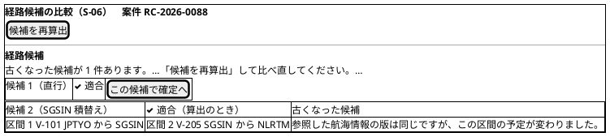
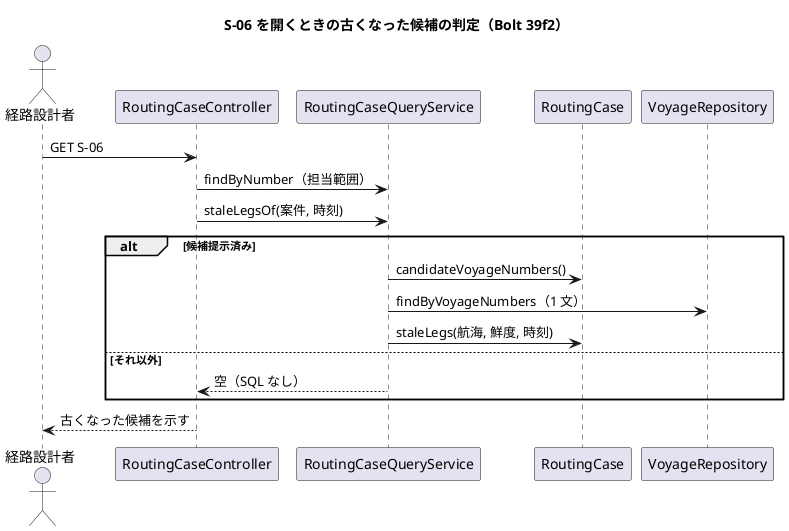
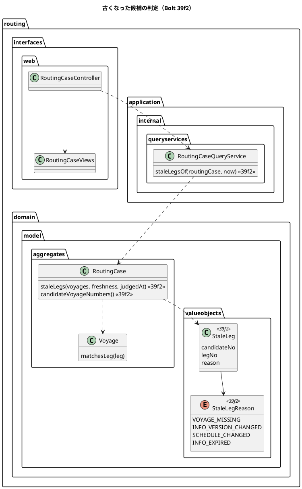

# Bolt 39f2 計画 - 算出の後に古くなった候補を S-06 で示し、再算出を促す

## 基本情報

| 項目 | 内容 |
| :--- | :--- |
| Bolt | 第 39f2 回（W7 の 26 本目。release_plan :974 の 39f2 の行） |
| 状態 | **draft（人の承認待ち）**。初稿。2 つの整合性検証（`validating-iteration-plan`・`validating-design`）はこの後に行う |
| 予定 | W7（2026-11-16 の週。前倒しで着手できる）。Bolt 39f の完了の後、39g の前に着手する（release_plan :980）。作業は約 2 時間 20 分（140 分。決定 (1)）。下の「時間の配分と打ち切り」。`check`・`uiTest`・`manualScreenshots`・SonarQube・CI と承認の待ちを除く |
| アプローチ | アウトサイドイン（S-06 の古くなった候補から。release_plan :974。状態の組み合わせの表を先に書く。T-182）。ステップ 2 で受入シナリオを先に Red にし、内側に入る |
| 対象 | (1) 候補の区間ごとに今の航海と比べる読み取りの判定（`RoutingCase.staleLegs`。状態を持たない。【業務の判断】(w)・(y)・(z)）、(2) S-06 を開くときに 1 文で航海を読む照会（`RoutingCaseQueryService.staleLegsOf`）、(3) S-06 の表示（「古くなった候補」の印、判定の印の「（算出のとき）」、区間ごとの文、再算出を促す文、「この候補で確定へ」を出さない）、(4) UC-06 4a の読み方を文書にする、(5) マニュアル 8 章・用語集とキャプチャ、動画 |
| トレース | UC-06 4a（system_usecase :473）、UC-07 4a（system_usecase :482）、US-06 AC1（user_story :286 の「情報鮮度を比較できる」）、US-07 AC3、R-INV-03・R-INV-09、W7 の確認ポイント 12・24（release_plan :924・:936）、台帳 D-110（release_plan :1092）、[Bolt 39f 計画](bolt_39f_plan.md) の決定 (1)・(10)、【前の決定の変更】(7)、【業務の判断】(w)、「39f2 に写す行」（:78）、[Bolt 39e2 終了報告](bolt_39e2_report.md) :72、[Bolt 37c 計画](bolt_37c_plan.md) :87、[Bolt 37c 終了報告](bolt_37c_report.md) :125、PERF-01 |
| GitHub | [#18](https://github.com/k2works/practical-domain-driven-design-in-enterpris-application/issues/18)（US-14。クローズは 39h）、[#50](https://github.com/k2works/practical-domain-driven-design-in-enterpris-application/issues/50)（「S-06 が、算出の後に古くなった候補を「適合」と示したまま（Bolt 37c）」にチェックを付ける）。US-06 の #15・US-07 の #16 は閉じている（user_story の Bolt 37f の決定、:383）ので開け直さない |
| SP | 0 |
| 承認ゲート | **計画と終了報告で止める**（【前の決定の変更】(8)。W7 の承認ゲートの既定（release_plan :895）にそろえる）。確認必須のものは確認ポイントにして計画の承認に含める: 新しいファイル（確認ポイント 7）。データベース・認可・外部連携・本番の操作はない。各ステップは「ゲート: 既定」と書く |
| 開始準備で決めたこと | 下の (1)〜(12)（推奨を 1 つに決めて書いた。承認待ち）。【業務の判断】(w) を人に示す（39f の申し送り）。【業務の判断】(y)・(z) を新しく記録する。【前の決定の変更】(8) |

## Bolt ゴール

候補を算出した後に航海の情報が変わるか、取得から許容時間を過ぎると、経路設計者は S-06 を開いた時点で、どの候補のどの区間が古くなったかを読み取れ、古くなった候補を「適合」と読み違えず、「この候補で確定へ」に進まず再算出に向かえる。元の値に戻るか取り込み直されて今の航海と合えば、表示は消える。確定済みと再設計要の案件の表示は変わらない。確定のときの照合（R-INV-03）は最後の守りとして今のまま残る。マニュアル 8 章と用語集が同じ語で説明している。

## 状態の組み合わせ（行ごとにテストを 1 本。T-182）

S-06 を開く時点の判定 → 画面まで。行の番号はこの計画で 1 から振る。テストは既存のクラスの `@Nested class Bolt39f2_…`（新しいクラスは決定 (11)）。「空」は `staleLegs` が返す一覧が空。理由の語は `StaleLegReason`（`VOYAGE_MISSING`・`INFO_VERSION_CHANGED`・`SCHEDULE_CHANGED`・`INFO_EXPIRED`。決定 (2)）。

| 行 | 状況 | 期待 | 確かめ方 |
| :--- | :--- | :--- | :--- |
| 1 | 候補のすべての区間が今の航海と合う | 空 | 単体（`RoutingCaseStaleLegsTest`） |
| 2 | 区間の情報版が違う（予定は同じ） | `INFO_VERSION_CHANGED` | 単体 |
| 3 | 同じ情報版で区間の予定が違う（パラメーター: 出発だけ、到着だけ。【業務の判断】(s)） | `SCHEDULE_CHANGED` | 単体 |
| 4 | 区間の航海がない（読んだ一覧に番号がない） | `VOYAGE_MISSING`（確定と同じく変わったとみなす。RoutingCase.java :377-383） | 単体 |
| 5 | 一度変わった航海が元の値に戻った（同じ候補、同じ区間の写し） | 空（状態を持たない。【業務の判断】(w)） | 単体 |
| 6 | 3 区間の候補の 2 区間目だけが古い | (候補番号, 区間の位置 2, 理由) の 1 件だけ（入力と期待の組まで縛る。T-244） | 単体 |
| 7 | 適合の候補で、今の航海の取得時刻から許容時間の直前・同時刻・直後（パラメーター。InfoFreshnessPolicy.java :33 の「同時刻は足りる」） | 直前と同時刻は空、直後だけ `INFO_EXPIRED` | 単体 |
| 8 | 区間の写しの取得時刻は古いが、同じ情報版を取り込み直して今の航海の取得時刻が新しい | 空（確定と同じく今の航海の取得時刻で判定する。Bolt 37c の決定） | 単体 |
| 9 | 情報版が違い、かつ取得から許容時間を過ぎている（理由の順。決定 (2)） | 1 区間に `INFO_VERSION_CHANGED` の 1 件だけ | 単体 |
| 10 | 除外の候補の区間が今の航海と合わない（【業務の判断】(z)） | 区間の理由を返す（除外の理由が今も当てはまるか分からない） | 単体 |
| 10b | 除外の候補で、取得から許容時間を過ぎているだけ（【業務の判断】(z)。情報不足で除外した直後の候補を含む） | 空（再算出を促さない。すでに「情報不足」と示している） | 単体 |
| 11 | 2 度寄る航海: 予定の一致する組が 1 つで位置がずれている、一致する組が 2 つ以上で位置の組がある・ない、位置が NULL（39f より前の候補）（パラメーター。39f の行 9 の `matchesLeg`） | `matchesLeg` が真のときは空、偽のときだけ `SCHEDULE_CHANGED` | 単体 |
| 12 | 経路版の状態（パラメーター: 作成中、確定、再設計要、旧版） | 空。候補提示済みのときだけ判定する（`confirmable` と同じ条件。RoutingCase.java :500） | 単体 |
| 13 | 候補提示済みで候補が 0 件 | 空。航海を読まない（空の `IN` を作らない） | 単体 |
| 14 | 算出の直後（算出に使った航海で判定する。T-230: 航海はドメインの規則に合う組み合わせ） | 空（算出した候補が初めから古く見えない）。積替え 2 回の候補と 2 度寄る航海の候補も空 | 単体 |
| 15 | 照会: 20 候補 × 3 区間で航海番号が重なる（`MAX_CANDIDATES`。RoutingCase.java :49） | `findByVoyageNumbers` を 1 回だけ、重複のない番号で呼ぶ（N+1 にしない。呼び出しの記録。T-236。決定 (4)） | 単体（`RoutingCaseQueryServiceTest`） |
| 16 | 照会: 確定できない状態（確定、再設計要、作成中） | 航海を読まない（呼び出しの記録。T-106: 候補提示済みでは読むことを行 15 で確かめてから） | 単体 |
| 17 | 上限の読み: 60 個の航海番号 | すべての航海が寄港の順で返り、SQL は 1 文。読みの時間をログの「PERF-01 S-06」の行に出す（参考の値。時間では落とさない。決定 (4)） | 統合（`MyBatisRoutingRepositoriesIntegrationTest`。H2 と PostgreSQL） |
| 18 | 画面: 適合の候補が 1 つで古い | 見出しに「✓ 適合（算出のとき）」と「古くなった候補」、区間の下に理由の文、「この候補で確定へ」がない | 単体（`RoutingCaseControllerTest`） |
| 19 | 画面: 一部だけ古い（候補 2 つ。候補 1 は適合で新しい、候補 2 は適合で古い） | 候補 1 は「✓ 適合」と「この候補で確定へ」があり「古くなった候補」がない。候補 2 だけ行 18 の表示。上に「古くなった候補が 1 件あります。」 | 単体（どの候補に出るかまで縛る。T-244） |
| 20 | 画面: すべて古い（候補 2 つ） | 上に「すべての候補が古くなっています。」。「この候補で確定へ」は 0 個。「候補を再算出」は出る | 単体 |
| 21 | 画面: 区間の文の 4 区分（パラメーター。決定 (3)） | 区分ごとに文が 1 つ。文の中に内部の語（「引き直す」など）がない。古くない区間には文がない | 単体 |
| 22 | 画面: 除外の候補で区間が今の航海と合わない | 「✕ 除外（算出のとき）」と「古くなった候補」。「除外の理由」は残す | 単体 |
| 23 | 画面: 確定済みの案件で区間の航海が変わった（再設計要にはならなかった） | 「古くなった候補」も「（算出のとき）」も出ない。今の表示のまま（「✓ 適合」「確定した経路」） | 単体 |
| 24 | 画面: 再設計要の案件 | 「✓ 適合（確定のとき）」「再設計要の経路」のまま（Bolt 37d2）。「（算出のとき）」「古くなった候補」が出ない | 単体 |
| 25 | スクリーンリーダーの読み上げの文（決定 (3)） | 候補の `article` の名前（`aria-labelledby`）になる見出しの全文が「候補 2（直行） ✓ 適合（算出のとき） 古くなった候補」。区間の文は `li` の中に文字で置く。上の文は静的な段落で `role="status"`・`role="alert"` を持たない（Bolt 37d2 の前例）。色だけで示さない | 単体（文の全文を比べる）と手動の確認（#50 に載せる） |
| 26 | 担当範囲の外と、ない案件 | 404 のまま。判定の照会を呼ばない（呼び出しの記録。範囲の中で呼ぶことは行 18 で確かめる。T-106） | 単体 |
| 27 | S-07 を古い候補の URL で開く（S-06 を開いた後に変わった、URL を直接開いた。決定 (6)） | S-07 は今のまま開く（判定を足さない）。送ると `INFO_VERSION_CHANGED` で拒否して S-06 に戻す | 既存の単体と `adopted_voyage_reflected_ui.feature` :52-68（Bolt 39e2 の行 9）で今の振る舞いを守る |
| 28 | 同じ情報版のまま確定を拒否されて S-06 に戻る（Bolt 39e2 のレビューの指摘。bolt_39e2_report.md :72） | 上の拒否の文に加えて、変わった区間の下に「参照した航海情報の版は同じですが、この区間の予定が変わりました。」が示される | 受入シナリオ（行 27 のシナリオに 1 行足す） |
| 29 | UI の主の流れ: 算出 → データ責任者が同じ情報版で到着の違う隔離を採用 → 経路設計者が S-06 を開き直す → 再算出 | 開き直すと行 18 の表示、再算出すると「古くなった候補」が消えて「この候補で確定へ」が出る | 受入シナリオ（`adopted_voyage_reflected_ui.feature`。`@demo-bolt-39f2/stale-candidate`。決定 (8)） |
| 30 | 幅 320 CSS px と axe（行 29 の画面。30 文字の航海番号の区間を含む） | 横スクロールが出ない。axe の違反 0（`text-bg-warning` の印を含む） | 受入シナリオ（`browser.checkAccessibility` と既存の「横スクロールが出ない」） |
| 31 | マニュアル | 8.2 の表 ⑦、注意・補足 :92、8.3 :138、用語集の文が実装と一字ずつ一致する | ステップ 6 の突き合わせの記録（T-197・T-251） |
| 32 | 今の振る舞い | 経路設計の受入シナリオ（`compare_route_candidates_ui.feature`・`confirm_route_ui.feature`・`adopted_voyage_reflected_ui.feature`・`route_redesign_required_ui.feature`・`route_already_departed_ui.feature`）と `DevSampleDataSmokeTest` | 既存のシナリオとテスト |

## 開始準備の決定

(1) **範囲と見積り**: release_plan :974 の見積り（100 分）をコードで確かめて引き直すと 140 分（約 2 時間 20 分）になる。増えたのは、行ごとのテスト（状態の組み合わせが 32 行）、S-06 の表示の語が増えたこと（判定の印の「（算出のとき）」、区間の文）、新しいキャプチャを別のシナリオで撮ること、文書の増え。目安（4 時間 05 分。T-250）の内で、余りは 105 分。**分けない**（推奨。確認ポイント 1）。

| 内訳 | 分 |
| :--- | ---: |
| 分けて増える分（release_plan :974 の 60。設計の文書 10、Red 10、品質ゲート 30、終了報告 10） | 60 |
| 集約の判定と値（行 1〜14） | 12 |
| 照会と組み立て（行 15・16、コンストラクタの 3 か所。決定 (5)） | 6 |
| 統合: 上限の読み（行 17） | 4 |
| 画面（`RoutingCaseViews`・`show.html`。行 18〜26） | 14 |
| 受入シナリオの例と Steps（行 28〜30） | 8 |
| UI の流し直しと動画 | 8 |
| マニュアル 8 章と用語集（行 31） | 6 |
| キャプチャ（別のシナリオを足して撮る。`manualScreenshots` の後に差分を戻す） | 6 |
| 文書の増え（設計の文書 10 を超える分。ステップ 1 の一覧） | 8 |
| 変異 3、文の突き合わせ 3（T-197・T-251） | 6 |
| #50 の更新と手動確認の項目 | 2 |
| **合計** | **140（約 2 時間 20 分）** |

比べた案: (i) **このまま 1 本（140 分。推奨）**。(ii) どの区間かの文（Bolt 39e2 の指摘）を W10 に送る（−8 分程度。release_plan :974 が「#50 の古くなった候補と一緒に示す」としており、印だけでは同じ版のままの拒否の説明が足りない）。(iii) 鮮度の分を後に送る（release_plan :974 の「取得から許容時間を過ぎた候補も同じ」に反する）。

(2) **判定の置き場所と形**（【業務の判断】(w)・(y)・(z)）: 読み取りの判定を集約に置く。`RoutingCase.staleLegs(List<Voyage> voyages, InfoFreshnessPolicy freshness, UtcInstant judgedAt)` が `List<StaleLeg>` を返す。`confirmable` が偽なら空（行 12）。確定と評価の `anyLegChanged`（RoutingCase.java :377-383）と同じく `Voyage.matchesLeg` で比べる（照合を 2 つにしない）。`RouteCandidate` は `Voyage` を参照しない（domain_model の Bolt 39e2 の決定）ので航海を受ける集約に置く。

- `StaleLeg(int candidateNo, int legNo, StaleLegReason reason)`（`routing.domain.model.valueobjects`。`legNo` は候補の中の区間の 1 始まりの位置）、`StaleLegReason`（4 値）
- 区間 1 つに理由は 1 つ。順は「航海がない → 今の航海と合わない（情報版が違えば `INFO_VERSION_CHANGED`、同じなら `SCHEDULE_CHANGED`）→ 適合の候補だけ取得から許容時間を過ぎた」（行 9・10b）。情報版の比較は `Leg.infoVersion` と `Voyage.adoptedInfoVersion` で、`matchesLeg` が偽のときの説明の分け方に使うだけにし、判定は `matchesLeg` の 1 か所に残す
- 取得時刻は区間の写しではなく今の航海の値で比べる（行 8。Bolt 37c の確定と同じ）
- 状態・列・候補の並びは変えない。保存しない（【業務の判断】(w)）
- 比べた案: (i) 集約の読み取りの判定（推奨）、(ii) `RoutingCaseViews` の中で比べる（画面の部品に R-INV-03 の知識が写り、確定と食い違う余地ができる）、(iii) 経路版に「旧版」の状態を持たせる（D-110 の取らない案）

(3) **S-06 の表示**（T-251。文は下の表のとおり）: `RoutingCaseViews.detail` が古い区間を受け取り、`CandidateView` に `stale`、`LegView` に `staleNote`、`CaseDetail` に古くなった候補の数と全件かどうかを足す。判定の印は Bolt 37d2 の「（確定のとき）」の前例（`judgedAtConfirmation`）にならって「（算出のとき）」を付ける。#50 の「適合と示したまま」を、判定を消さずに時点を添えて直す。

| 場所 | 文 |
| :--- | :--- |
| 候補の印 | 「古くなった候補」（`badge text-bg-warning`）。判定の印は「✓ 適合（算出のとき）」「✕ 除外（算出のとき）」で、古い候補は緑にしない（`text-bg-secondary`） |
| 区間の下（`VOYAGE_MISSING`） | 「今の航海の情報にこの航海がありません。」 |
| 区間の下（`INFO_VERSION_CHANGED`） | 「参照した航海情報の版が変わりました。」 |
| 区間の下（`SCHEDULE_CHANGED`） | 「参照した航海情報の版は同じですが、この区間の予定が変わりました。」 |
| 区間の下（`INFO_EXPIRED`） | 「航海の情報が取得から許容時間を過ぎています。」 |
| 「経路候補」の見出しの下（一部） | 「古くなった候補が n 件あります。候補を算出した後に航海の情報が更新されたか、取得から許容時間を過ぎました。古くなった候補は確定できません。「候補を再算出」して比べ直してください。取得から許容時間を過ぎた航海は、航海の情報の取込をデータ責任者に依頼し、取り込まれたら再算出してください。」 |
| 「経路候補」の見出しの下（すべて） | 先頭を「すべての候補が古くなっています。」にし、後は同じ |

- 今の値（今の情報版や今の予定）は区間の文に出さない。2 度寄る航海では「今の予定」を 1 つに決められないことがあり、再算出すると新しい値が候補に出る。比べた案: (i) 変わったことだけ示す（推奨）、(ii) 今の情報版と予定を示す（組を決められない航海の表示の定めが増える。幅 320 px で長くなる）
- 再算出を促す文は静的な段落にする（画面を開いたときに読む文で、ライブリージョンの通知ではない。Bolt 37d2 の前例。行 25）
- Bolt 37b2 の「画面の上の警告は出さない（候補ごとの理由と重なるため。ui_design :1180）」は変えない。この文は算出の後に古くなった候補の文で、算出のときに情報不足で除外した候補は数えない（行 10b）ので重ならない
- 文の語は【業務の判断】(w) の「古くなった候補」と、Bolt 29c の「参照した航海情報の版」から写す

(4) **N+1 と性能（PERF-01）**: 判定は S-06 の GET ごとに **SQL を 1 文だけ増やす**。`RoutingCase` の候補の区間の航海番号を重複なしで集め（新しい `candidateVoyageNumbers()`。前例 RoutingCase.java :530-547）、`VoyageRepository.findByVoyageNumbers`（:18。航海と寄港を JOIN の 1 文で読む。RoutingReferenceMapper.xml :47-54）を 1 回呼ぶ。候補ごと・区間ごとに読まないので N+1 は起きない（行 15）。上限は 20 候補（`MAX_CANDIDATES`）× 3 区間で航海番号は最大 60 個。主キー（`pk_voyage`・`pk_port_call`。V20261007100000 :108・:118）で引くので索引は足さない（スキーマの変更なし）。候補提示済みでないときと候補が 0 件のときは SQL を流さない（行 13・16）。S-06 の GET は書き込みも行のロックも持たない。PERF-01（p95 1.0 秒。non_functional :57）に 1 文の増えが収まる見込みで、non_functional の PERF-01 に注を足す（ステップ 1）。**測っていない**ので行 17 で上限の読みの時間をログに出し、読みが 1 秒を超えたら値を記録して止めて諮る（前例: PERF-01 の S-17。Bolt 39d4）。負荷の下の p95 は W10 の性能の評価で測る。読むのは案件と別の文なので、間に航海が更新されても表示がずれるだけで、確定は R-INV-03 で守る。

(5) **読みの組み立て**: `RoutingCaseQueryService` に `staleLegsOf(RoutingCase routingCase, Instant now)` を足し、`VoyageRepository` と `InfoFreshnessPolicy` を受け取る。controller の `show` は `clock.instant()` を 1 回だけ読み、判定と表示に同じ時刻を渡す（T-229）。担当範囲を確かめた案件にだけ呼ぶ（`findByNumber` の後。行 26）。S-07 の `RoutingCaseViews.confirmation` には古い区間を渡さない（行 27）。比べた案: (i) 既存の照会サービスに足す（推奨。controller の形が変わらない。`@MockitoBean` の既定で空の一覧が返り、既存の controller のテストが動く）、(ii) 新しい照会サービスを作る（クラスとテストの部品が増える）。

(6) **S-07 の GET は変えない**（確認ポイント 4）: S-06 を開いた後に航海が変わったときや URL を直接開いたときは、今のまま S-07 が開き、送ると `INFO_VERSION_CHANGED` で拒否して S-06 に戻す（行 27）。受け入れること: このとき書いた判断根拠は残らない（今も同じ。8.3 :138）。release_plan :974 の範囲は「この候補で確定へ」を出さないことで、S-06 から入る道は閉じる。S-07 の GET は 39e2 のシナリオ（`adopted_voyage_reflected_ui.feature` :50 の注「確定の GET は航海を比べない」）が前提にしている。比べた案: (i) 変えない（推奨）、(ii) S-07 の GET でも判定して S-06 に戻す（判断根拠を失う窓は小さくなるが、SQL が GET に増え、39e2 のシナリオの作り直しが要る。GET と POST の順の扱い（Bolt 37e3）も増える）。

(7) **確定の照合は変えない**: `RoutingCase.confirm` の順・拒否の理由・文（Bolt 37c・39e2）は変えない。S-06 の表示は確定の前の案内で、確定のときの読み直しが最後の守りである（画面を開いた後の更新があるため）。

(8) **受入シナリオ**: `adopted_voyage_reflected_ui.feature` に行 29・30 を足す（タグ `@US-14-AC1 @R-INV-03 @demo @demo-bolt-39f2/stale-candidate`。UC-06 4a の照合の表の扱いはステップ 1 で test_strategy に書く）。データは今の 2 行のファイル（ExternalDataIngestionUiSteps.java の到着の違う 2 行）と、39e2 の行 9 の流れ（同 :52-68）を使う。足す Steps は「経路設計者が案件を開き直す」と「古くなった候補の表示」の 2 つ（`RoutingUiSteps`）。再算出は既存の「経路設計者が案件を開き直して候補を再算出する」（:396）を使う。行 28 は 39e2 の行 9 のシナリオに「その区間の下に…」の 1 行を足す。元の値に戻る組（行 5）は単体で確かめ、画面の層では取り込み直しを作らない（テスト戦略の「画面の層は主成功と画面に固有の表示」）。

(9) **マニュアルとキャプチャ**（T-251。用語は下の「業務の判断の記録」の文から写す）: 08-経路設計.md の 8.2 の表 ⑦（:77「適合の候補だけに出ます」に「古くなった候補には出ません」）、注意・補足 :92（「④ … から 24 時間を過ぎていたら、確定の前に「候補を再算出」」を、画面が示すことに直す）、古くなった候補の説明と画面を足す。8.3 :138 は S-06 を開いた後に更新された場合の説明に直す。用語集に「古くなった候補」を足す（情報不足 :43 と区別する）。キャプチャは新しい `08-candidates-stale` を 1 枚、**別のシナリオ**で撮る（主の流れに入れると後続のキャプチャの情報版が変わる。前例: manual_screenshots.feature :270-272 の別のシナリオ。航海の更新は既存の「直行の航海の情報版が外部原本の取込で更新される」（RoutingUiSteps.java :280）を使う）。既存の `08-candidates` は古くなった表示を写さないので撮り直さない。`manualScreenshots` の後は `08-candidates-stale` 以外の PNG の差分を戻す（Bolt 39e2 のステップ 5 の前例）。動画は `@demo-bolt-39f2/stale-candidate` を撮る（release_plan :986 のデモ項目。39f2 は対象）。

(10) **層の規則とガイドライン**（第 3 章、ADR-017）: 値は `routing.domain.model.valueobjects`、照会は `application.internal.queryservices`（既存）、表示は `interfaces.web`（既存）。ポートは既存の `VoyageRepository`。新しいコンテキスト間の依存、イベント、公開 API はない。読んだ範囲の規則に当たるものはなく、**規則の例外は要らない見込み**で、当たったら置き場所を動かさず止めて諮る（T-125）。列挙型を足すので `switch` を数える（T-175）: `StaleLegReason` を分岐するのは `RoutingCaseViews` の 1 か所（4 分岐）で、循環的複雑度の上限（10）に当たらない。

(11) **新しい型の名前**（T-246。`apps/cargo-tracker/src` を大文字小文字を区別せず `StaleLeg`・`staleLegs`・`candidateVoyageNumbers`・`demo-bolt-39f2`・`古くなった候補` で検索し、ないことを確かめた）: `StaleLeg`、`StaleLegReason`、`RoutingCase.staleLegs`・`candidateVoyageNumbers`、`RoutingCaseQueryService.staleLegsOf`、テスト `RoutingCaseStaleLegsTest`・`RoutingCaseQueryServiceTest`、タグ `@demo-bolt-39f2/stale-candidate`、キャプチャ `08-candidates-stale`。

(12) **変えないもの**: `Voyage.matchesLeg`（39f の形のまま）、確定と評価の照合、確定の拒否の理由と文、S-07 の画面、候補の並びと「適合する候補がありません」の文（算出のときの判定で出す）、経路版の状態、スキーマ、DE-12・DE-30、接続時間規則と出発済みの扱い（【業務の判断】(y)）。

【前の決定の変更】(8)（確認ポイント 2。Bolt 39f の (5)〜(7) に続ける）: release_plan :974 の 39f2 の承認ゲート「ステップごと（画面。39f2 の開始準備で確かめる）」を、**計画と終了報告で止める** に改める。確かめた結果、スキーマ・認可・外部連携・本番の操作がなく、W7 の承認ゲートの既定（:895「経路設計と追跡の Bolt（39e〜39g2・39i）は既定」）と揃える方が筋が通る。ステップごとに止める理由にしていた「画面」は、同じ経路設計の 39e2・39f の画面を変える Bolt でも既定で進めている（ステップごとに止めるのは外部原本の取込の 39〜39d4・39h）。

直す既存のテストと文（T-217。ステップ 2 で一覧を確かめる）: `RoutingConfiguration.java` :117-120 と `AcceptanceTestConfiguration.java` :214、`RouteVersionLegQueryAdapterTest.java` :20（`RoutingCaseQueryService` のコンストラクタ）。`RoutingCaseControllerTest` は既定の空の一覧で動く見込み。既存の UI のシナリオで航海を書き換えるのは RoutingUiSteps.java :280 の 1 か所だけで、S-07 を開いた後なので「この候補で確定へ」の消失に当たらない。

新しいファイル: `StaleLeg`、`StaleLegReason`、`RoutingCaseStaleLegsTest`、`RoutingCaseQueryServiceTest`、`docs/manual/assets/08-candidates-stale.png`、動画（`@demo-bolt-39f2/stale-candidate`）。直すもの: `RoutingCase`、`RoutingCaseQueryService`、`RoutingConfiguration`、`RoutingCaseController`、`RoutingCaseViews`、`show.html`、テスト（`RoutingCaseControllerTest`・`MyBatisRoutingRepositoriesIntegrationTest`・`AcceptanceTestConfiguration`・`RouteVersionLegQueryAdapterTest`・`RoutingUiSteps`）、受入シナリオ（`adopted_voyage_reflected_ui.feature`・`manual_screenshots.feature`）、マニュアル 8 章と用語集。

### 前の Bolt から引き継いだもの

| 出典 | 内容 | この計画 |
| :--- | :--- | :--- |
| release_plan :974、Bolt 39f の「39f2 に写す行」（:78） | 古くなった候補の表示、確定へを出さない、鮮度、元の値に戻ると消える、確定と再設計要に出さない、axe と 320 px | 行 1〜14・18〜30 |
| Bolt 39f の決定 (10)、【業務の判断】(w)、D-110 | UC-06 4a の読み方を開始準備で人に示す | 下の「業務の判断の記録」の 1、確認ポイント 3 |
| bolt_39e2_report.md :72（release_plan :974 の「:62」の行の中身。行番号は :72） | 同じ版のまま拒否されると、どの区間が変わったか分からない | 決定 (3) の区間の文、行 3・21・28 |
| bolt_37c_plan.md :87、bolt_37c_report.md :125、#50 | S-06 が古くなった候補を「適合」と示したまま | 決定 (3) の判定の印、行 18 |
| 確認ポイント 12・24（release_plan :924・:936） | UC-06 4a と S-06 の古くなった候補は 39f2 で作る | 全体 |
| Bolt 39f の行 28 | 候補提示済みの案件に DE-12 が来ても案件は変わらない（候補の見え方は 39f2） | 行 2・3・29 |

### 開始準備で確かめたこと（`git show HEAD:` で読んだ。作業ツリーは 39f の実装中）

- **S-06 の読み**: RoutingCaseController.java :101-110 は `findByNumber` だけを読み、航海を読まない。RoutingCaseViews.java :145-181・:250-280 の `CandidateView.confirmable` は `versionConfirmable && conforming` で、保存した判定だけを見る
- **テンプレート**: show.html :74-108。候補は `article` で `aria-labelledby` が見出しを指す
- **照合**: Voyage.java :137-147（39f で位置を足す。計画の決定 (3) のとおり使う）、RoutingCase.java :377-383 の `anyLegChanged`
- **鮮度**: InfoFreshnessPolicy.java :33（同時刻は足りる）、確定は今の航海の取得時刻で判定する（RoutingCase.java :277-282）
- **航海の読み**: `findByVoyageNumbers` は 1 文（MyBatisVoyageRepository.java :48-54、RoutingReferenceMapper.xml :47-54）
- **状態**: `confirmable` は候補提示済みで確定した経路版がないとき（RoutingCase.java :489-502）
- **受入条件**: UC-06 4a（system_usecase :473）。US-06 に 4a を直接書いた受入条件はなく、AC1 の「情報鮮度を比較できる」（user_story :286）に当たる
- **開発データ**: 見本の区間は今の航海と一致している（Bolt 39e2 の決定 (5)）。デモ環境は起動から 24 時間を超えると見本の適合の候補が「古くなった候補」になり確定へが消える（下の申し送り）

## 設計の決定

| 項目 | 決定 | 根拠 |
| :--- | :--- | :--- |
| 範囲と見積り | 決定 (1)。分けない（140 分） | T-250 |
| UC-06 4a の読み方 | 【業務の判断】(w)。状態を持たない読み取りの判定 | D-110 |
| 古くなった候補の範囲 | 【業務の判断】(y)。区間の不一致と鮮度だけ | UC-06 4a、release_plan :974 |
| 除外の候補 | 【業務の判断】(z)。不一致は示し、鮮度だけでは示さない | ui_design :1180 |
| 判定の置き場所 | 決定 (2)。`RoutingCase.staleLegs` | domain_model（Bolt 39e2） |
| 表示と語 | 決定 (3)。「古くなった候補」「（算出のとき）」 | Bolt 37d2 の前例 |
| 性能 | 決定 (4)。SQL 1 文、索引なし | PERF-01 |
| S-07 の GET | 決定 (6)。変えない | Bolt 39e2 の行 9 |
| 承認ゲート | 【前の決定の変更】(8)。計画と終了報告 | release_plan :895 |

## ふりかえりと前の Bolt からの引き継ぎ

Bolt 39f の終了報告はまだない（実装中）。終了報告の Try は 39f2 の開始のときに足す。

| 出典 | 内容 | この Bolt での扱い |
| :--- | :--- | :--- |
| W6 の Try T-204・T-212、Bolt 38h の T-227、Bolt 39b の T-233 | サブエージェントへの指示の最初に heredoc と標準入力を待つコマンドを使わないと書く | 任せるときの指示の最初に書く。ファイルは Write・Edit、検索は Grep |
| Bolt 39d の T-247 | 触らないもの（`.claude/agent-memory`・`.run/`・`apps/cargo-tracker/.claude/`）を名前で書く。Gradle と git を人の側の 1 か所に残す | 任せるときの指示 |
| Bolt 39d の T-248 | `git add` はディレクトリか `git add -u` | 各ステップのコミット |
| Bolt 39d2b の T-249 | 担当への指示に書く私の言葉に出典を付ける | 初稿は人の承認として書かない |
| Bolt 39d3 の T-250 | 見積りは 4 時間 05 分まで | 決定 (1) |
| Bolt 39d3 の T-251 | マニュアルの担当に用語を【業務の判断】の文から写させる | 決定 (9) |
| Bolt 39d3c の T-252 | ゲートが落ちたら先に中身を一覧する | ステップ 7 |
| Bolt 39d3b の T-254 | コンパイルの通らない変更を develop にコミットしない | ステップ 2 の骨組み。Red の行は `wip/` か stash に置く |
| W6 の Try T-182・T-211・T-216 | 状態の組み合わせに重複・出口・誤った入力の行を置く | 上の表（行 4・13・26・27） |
| W6 の Try T-217 | 本体を直す前に Red を流し、直すテストの一覧を添える | ステップ 2 |
| W6 の Try T-219、T-225・T-213 | 変異の対象に単体・統合、push の前に `check` | ステップ 7 |
| Bolt 37c の T-175 | 列挙型を足す Bolt は `switch` を数える | 決定 (10) |
| Bolt 39a2 の T-229 | 時刻の出どころ | 決定 (5)。controller の `Clock` を 1 回読む |
| Bolt 39a3 の T-230 | データはドメインの規則に合う組み合わせに | 行 14 |
| Bolt 39b の T-232・39b2 の T-234・39b3 の T-237 | 本体を直したステップは承認の前に `spotbugsMain`・`checkstyleMain`・`sonar-local:check` | ステップ 3・4 の完了の判定 |
| Bolt 39b2b の T-236 | 「起きないこと」は呼び出しの記録で確かめる | 行 15・16・26 |
| W5 の T-106・T-119 | 「ないこと」を確かめる前に対象があることを確かめる | 行 16・26 |
| Bolt 39c2 の T-244、39c4 の T-246 | パラメーターは組まで縛る、型の名前は検索する | 行 6・19、決定 (11) |
| Bolt 39d4 の学び | 業務の判断の推奨は受入条件の文と突き合わせる | 下の「業務の判断の記録」 |
| memory の manual-in-bolt-done-criteria、Bolt 37f2 の T-197 | マニュアルを完了条件に入れ、文を実装と突き合わせる | 完了条件、行 31 |
| Bolt 39e2 の Try（番号なし） | 変異テストと同時に検証を流すときは `git show HEAD:` で読む | 開始準備で 39f の実装中の作業ツリーと分けて読んだ |

## スコープ

### 入れるもの

- 行 1〜32（行 27・32 は既存のシナリオとテストで確かめる）。決定 (2)〜(9) の実装と文書
- マニュアル 8 章・用語集、キャプチャ 1 枚、動画 `@demo-bolt-39f2/stale-candidate`
- 文書: 下の「設計文書に直す箇所」（ステップ 1）

### 入れないもの

- 接続時間規則の変更と出発済みを「古くなった候補」に含めること（【業務の判断】(y)。確定で拒否するまま）
- S-07 の GET の判定（決定 (6)）
- 今の情報版と今の予定の表示（決定 (3)）
- 候補の表の部分更新とライブリージョン（ui_design の「再算出」。後の Bolt）
- 再設計の操作（US-08）

### 申し送り（既知の課題・入れないもの）

| 送り先 | 課題 | 扱い |
| :--- | :--- | :--- |
| W10 | S-06 の GET の p95（PERF-01）を負荷の下で測る | W10 の性能の評価で。行 17 の参考の値を渡す |
| デモ環境 | 起動から 24 時間を超えると見本の適合の候補が「古くなった候補」になる（heroku_demo_setup :324 の「情報不足」の窓と同じ） | ステップ 1 で手順書の文を足す。再起動の手順は変えない |
| 39h | W7 のデモの動画 | release_plan :986 のとおり |

### 設計文書に直す箇所（ステップ 1）

ステップ 1 の開始で `docs/design`・`docs/requirements`・`docs/adr`・`docs/operation`・`docs/manual`・`docs/development/cargo-tracker`（release_plan）と `apps/cargo-tracker/src` を「39f2」「古くなった候補」「UC-06 4a」で検索し、39f2 の予定を書いた場所を作ったことに直す。

- system_usecase: UC-06 4a（:473）に【業務の判断】(w) の読み方の注
- user_story: US-06 に Bolt 39f2 の決定（古くなった候補、【業務の判断】(w)・(y)・(z)）
- ui_design: S-06 の行（:174）に Bolt 39f2 の表示、S-06 の振る舞いの表（:1176〜:1182）に「古くなった候補」の行と salt、S-07 の行（:175）の「この候補で確定へ」の条件
- domain_model: 「Bolt 39f2 で決めたこと」を足す（Bolt 39f で決めたことの後）、用語の表に `StaleLeg`・`StaleLegReason`（用語集の整合テストに合わせる）
- test_strategy: 経路設計の行（:349・:350）と AC の照合の行
- non_functional: PERF-01 の注（決定 (4)）
- heroku_demo_setup: :324 に古くなった候補の窓の 1 文
- release_plan: 39f2 の行（:974）に計画へのリンク、見積り、決めたこと、承認ゲート（【前の決定の変更】(8)）、確認ポイント 12・24（:924・:936）の済み、台帳 D-110 の状態、D-112・D-113（仮）、更新履歴

## 設計（この Bolt の範囲）

### 画面遷移図

画面と URL は増やさない。S-06 の候補の表示だけが変わるので図を省く。

### 画面イメージ

### 状態遷移図

経路版の状態と遷移は変えない。「古くなった候補」は状態ではなく、S-06 を開いた時点の読み取りの結果である（【業務の判断】(w)）ので図を省く。

### 読みの流れ

### クラスと依存

### ER 図

スキーマを変えないので省く。

## ステップ計画（ゲートは下の各ステップに書く）

- [ ] **1. 設計の文書**: 上の「設計文書に直す箇所」。【業務の判断】(w)・(y)・(z)、【前の決定の変更】(8) を反映する。始めに検索する（完了の判定: 文書の差分と検索の記録。ゲート: 既定（確認ポイント 2〜5 で計画の承認に含む））
- [ ] **2. 受入シナリオとテストの Red**: 外から入る。まず `adopted_voyage_reflected_ui.feature` に行 29 を書いて Red を記録する（古くなった候補が「✓ 適合」と「この候補で確定へ」のままで落ちる）。続いて行 1〜26・28・30 を書く（行 27・32 は既存のテスト）。骨組み（`staleLegs` は空を返す、`StaleLeg`・`StaleLegReason`、`staleLegsOf` は空を返す、コンストラクタの足し算）でコンパイルを通す（T-254）。直す既存のテストを一覧にする（T-217）（完了の判定: 期待した理由で落ちる記録。Red の行は `wip/` か stash に置き、develop に落ちるテストを積まない。ゲート: 既定）
- [ ] **3. 判定と照会**: 決定 (2)・(4)・(5)。行 1〜17 が緑。`ModularityTest`・`LayerArchitectureTest` を流す（当たったら止めて諮る。T-125）。`spotbugsMain`・`checkstyleMain`・`sonar-local:check`（完了の判定: 緑。行 17 の読みの時間を記録する。ゲート: 既定）
- [ ] **4. S-06 の表示**: 決定 (3)。`RoutingCaseViews`・`show.html`・controller。行 18〜26 が緑。`spotbugsMain`・`checkstyleMain`・`sonar-local:check`（完了の判定: 緑。ゲート: 既定（確認ポイント 3 で計画の承認に含む））
- [ ] **5. 受入シナリオの緑と動画**: 行 27〜30・32 が緑、axe 違反 0、幅 320 px、`@demo-bolt-39f2/stale-candidate` を撮る（完了の判定: `uiTest` の該当の feature と動画。ゲート: 既定）
- [ ] **6. マニュアルとキャプチャ**: 決定 (9)。08-経路設計.md・用語集・`08-candidates-stale`。`08-candidates-stale` 以外の PNG の差分を戻す。文を実装と【業務の判断】(w)・(y)・(z) の文に一字ずつ突き合わせる（T-197・T-251）（完了の判定: 突き合わせの記録と行 31。ゲート: 既定）
- [ ] **7. 品質ゲートと開発レビュー**: 変異（下の表）、`check`・`uiTest`、その後に SonarQube（落ちたら先に中身を一覧する。T-252）、開発レビュー（マニュアルを書く立場の観点を入れる。T-90）とその直し。文書のステップの行を一覧で突き合わせる（T-197）（完了の判定: 緑と指摘の扱いと突き合わせの記録。ゲート: 既定）
- [ ] **8. 終了報告**: push して CI とデモ環境の配備を確かめる。release_plan（39f2 の行の計画と終了報告のリンク）・開発の索引・mkdocs を直す。#50 の「S-06 が、算出の後に古くなった候補を「適合」と示したまま」にチェックを付け、画面を変えた分の手動確認の項目（S-06。行 25 の読み上げの文）を載せる（Bolt 37e4c の前例）。【業務の判断】(w)・(y)・(z)、【前の決定の変更】(8) を議題の先頭に置き、既知の課題に申し送りの表を書く（完了の判定: 報告の承認。**承認ゲート**（終了報告））

### 時間の配分と打ち切り

| # | 目安 | 打ち切り |
| :--- | :--- | :--- |
| 1 | 18 分（文書 10、増え 8） | — |
| 2 | 30 分（Red の 10 分、テストを書く 20 分） | テストを書く時間が 30 分を超えそうなら、書いた分で Red を記録して止めて諮る |
| 3 | 13 分（集約 7、照会 4、統合 2） | 層の規則に当たったら止めて諮る（T-125）。行 17 の読みが 1 秒を超えたら、値を記録して止めて諮る（決定 (4)） |
| 4 | 8 分（画面 8。テストを書く時間はステップ 2） | — |
| 5 | 11 分（Steps の残り 3、流し直しと動画 8） | 既存の Steps を変える必要が大きいときは止めて諮る |
| 6 | 15 分（8 章と用語集 6、キャプチャ 6、突き合わせ 3） | — |
| 7 | 33 分（待ちを除く。品質ゲート 30、変異 3） | — |
| 8 | 12 分（CI の待ちを除く。報告 10、#50 の 2） | — |

合計 140 分（約 2 時間 20 分）。目安（4 時間 05 分。T-250）に 105 分の余りがある。実装の中で 4 時間 05 分を超えそうなときは止めて諮る。マニュアルは後に送らない。39f の完了の後、39g の前に行う。

## 確認ポイント（計画の承認の場でまとめて確認する。Try T-6）

| # | 確認すること | 場所 | 推奨 |
| :--- | :--- | :--- | :--- |
| 1 | **範囲と見積り** | 決定 (1) | 分けない（約 2 時間 20 分） |
| 2 | **承認ゲート**（【前の決定の変更】(8)） | 上の【前の決定の変更】 | 計画と終了報告で止める |
| 3 | **UC-06 4a の読み方と S-06 の表示**（【業務の判断】(w)・(y)・(z)） | 決定 (2)・(3)、下の記録 | 下の記録のとおり |
| 4 | **S-07 の GET** | 決定 (6) | 変えない（URL を直接開いたときは今のまま、確定で拒否する） |
| 5 | **性能** | 決定 (4) | SQL 1 文で索引を足さない。上限の読みを参考の値として測る |
| 6 | **変異** | ステップ 7 | 下の表 |
| 7 | **新しいファイルと型の名前** | 決定 (11) の後の一覧 | 上の一覧 |

### 人に諮ること

推奨を 1 つに決められない判断はない。業務の意味を含む (w)・(y)・(z) は推奨を 1 つに決め、下の「業務の判断の記録」に置く。(w) は Bolt 39f の申し送りのとおり**この開始準備で人に示す**（bolt_37c_plan.md :87 の「要るかを業務担当者に確かめてから」に当たる）。新しい本番・セキュリティ・データベースの判断はない。打ち切りの 4 つ（Red の時間、層の規則、読みの時間、Steps の変更）に当たったときは、そのステップで止めて諮る。

### 業務の判断の記録

終了報告の議題の先頭に置き、人が後から見直せるようにする。台帳の番号は仮。

1. 【業務の判断】(w)（Bolt 39f で仮に決めた。台帳 D-110（仮）。この開始準備で人に示す）**UC-06 4a の「候補を旧版として保持し、再算出を要求する」は、候補の行を残したまま、S-06 を開いた時刻の航海と比べて「古くなった候補」と示し、再算出を促す文を添え、「この候補で確定へ」を出さないことと読む。状態は持たない（元の値に戻れば表示は消える。【業務の判断】(s) と同じ）**: 受入条件との突き合わせ: UC-06 4a は MVP で、「旧版として保持」は候補の行と判定を残すこと、「再算出を要求」は確定の入口を出さず再算出を促すことで満たす。US-06 に 4a を直接書いた受入条件はなく、AC1 の「情報鮮度を比較できる」に当たる。取らない案: 経路版の状態を「旧版」に変える（R-INV-05 の経路版の旧版と語が重なり、元の値に戻したときに戻せない）、表示だけ変えて確定へは残す（確定で必ず拒否されると分かる操作を残す）
2. 【業務の判断】(y) **「古くなった候補」に入れるのは、候補の区間が今の航海と一致しない（航海がないときも）候補と、適合の候補の航海の情報が取得から許容時間を過ぎた候補だけとする。接続時間規則の変更と最初の区間の出発済みは入れず、確定のときの拒否（`NO_LONGER_CONFORMING`・`ALREADY_DEPARTED`）のままにする**（決定 (2)、行 1〜12。台帳 D-112（仮））: 受け入れること: 算出の後に規則が変わった候補や出発済みの候補は S-06 で適合と示され、確定で S-07 に拒否が示される（今のまま）。受入条件との突き合わせ: UC-06 4a の「候補の根拠となる情報」には接続時間規則も読めるが、release_plan :974 の範囲は航海の一致と鮮度で、規則の判定し直しを開くたびに行うと規則の全件の読みと判定が S-06 の GET に入る。業務責任者に確かめる（Release 1.0 のパイロットの前）。比べた案: (i) 航海の一致と鮮度だけ（推奨）、(ii) 規則と出発済みも含める（GET ごとに規則を全件読んで判定し直す。出発済みは時間の経過で、情報の更新ではない）
3. 【業務の判断】(z) **除外の候補は、区間が今の航海と合わないときは「古くなった候補」と示し、取得から許容時間を過ぎただけのときは示さない**（決定 (2)、行 10・10b・22。台帳 D-113（仮））: 除外の候補はもともと確定できないが、航海が変わると除外の理由が今も当てはまるか分からない。鮮度だけのときに示すと、情報不足で除外した直後の候補に、再算出を促す文が出る（再算出しても同じ結果で、取込の依頼が先。マニュアル 8.2 :91）。受入条件との突き合わせ: US-06 AC2 の除外の理由の表示は変えない。比べた案: (i) 不一致だけ示す（推奨）、(ii) 除外の候補には何も示さない（変わった航海による除外を今も正しいと読み違える）、(iii) 適合と同じに鮮度でも示す（再算出で変わらない候補に促す文が出る）

### 変異と落ちる見込みのテスト

| # | 変異 | 落ちる見込み |
| :--- | :--- | :--- |
| V1 | 候補の最初の区間だけを比べる | 行 6 |
| V2 | `matchesLeg` を情報版だけの比較に置き換える | 行 3 |
| V3 | 航海がない区間を古くないとする | 行 4 |
| V4 | 今の航海ではなく区間の写しの取得時刻で鮮度を判定する | 行 8 |
| V5 | 鮮度の境界の同時刻を古いとする | 行 7 |
| V6 | 除外の候補も鮮度で古いとする | 行 10b |
| V7 | 除外の候補は不一致を見ない | 行 10・22 |
| V8 | 経路版の状態を見ない | 行 12・23・24 |
| V9 | `INFO_VERSION_CHANGED` と `SCHEDULE_CHANGED` の分け方を逆にする | 行 2・3・21 |
| V10 | 同じ区間に 2 つの理由を返す | 行 9 |
| V11 | `confirmable` に古い候補を足さない（「この候補で確定へ」を出す） | 行 18・20・29 |
| V12 | 判定の印に「（算出のとき）」を付けない | 行 18・22・25 |
| V13 | 再設計要の経路版にも「（算出のとき）」を付ける | 行 24 |
| V14 | 候補ごとに航海を読む（N+1） | 行 15 |
| V15 | 確定できない状態でも航海を読む | 行 16 |
| V16 | 担当範囲の外でも判定を呼ぶ | 行 26 |
| V17 | S-07 の候補にも判定を渡す（「この経路で確定する」を隠す） | 行 27 |
| V18 | 古い候補の印を外す（全件の文だけ残す） | 行 19 |

## 完了条件

- [ ] 上のステップ 1〜8 の完了の判定を満たす（ゲートのあるステップは承認を受ける）
- [ ] 行 1〜26・28〜31（枝番を含む）に、それを名乗るテストか確かめの記録がある（行 27・32 は既存のテストで確かめる）
- [ ] 候補の区間が今の航海と合わない候補と、取得から許容時間を過ぎた適合の候補が S-06 で「古くなった候補」と示され、「この候補で確定へ」が出ない。どの区間かが示される
- [ ] 元の値に戻るか取り込み直して今の航海と合うと、表示が消える
- [ ] 確定済みと再設計要の案件の表示が変わらない
- [ ] 確定のときの照合と拒否の文が変わっていない
- [ ] S-06 の GET で増える SQL が 1 文で、N+1 がない（行 15）。PERF-01 の注がある。行 17 の参考の値が終了報告にある
- [ ] マニュアル 8 章と用語集の文が実装と合う。キャプチャ `08-candidates-stale` と動画 `@demo-bolt-39f2/stale-candidate` がある
- [ ] `check`・`uiTest` が緑、axe の違反 0、幅 320 px で横スクロールなし、SonarQube が PASS、CI が緑、デモ環境が新しい版で動く
- [ ] 【業務の判断】(w)・(y)・(z) と【前の決定の変更】(8) が終了報告の議題の先頭にある。台帳 D-110 の状態を更新し、D-112・D-113（仮）を作っている
- [ ] 確認ポイント 12・24 の 39f2 の分が済みになっている。#50 にチェックと手動確認の項目がある
- [ ] docs と `apps/cargo-tracker/src` に 39f2 の予定のままの記述が残っていない（ステップ 1 の検索）
- [ ] 終了報告が承認されている

## 更新履歴

| 日付 | 更新内容 | 更新者 |
| :--- | :--- | :--- |
| 2026-11-10 | 初版作成（承認待ち）。開始準備の決定: 分けない（約 2 時間 20 分）、UC-06 4a の読み方を人に示す（【業務の判断】(w)）、古くなった候補の範囲（【業務の判断】(y)）、除外の候補の扱い（【業務の判断】(z)）、承認ゲートを既定にそろえる（【前の決定の変更】(8)）。2 つの整合性検証はこの後 | anthropic/claude-opus-5-5 |

## 関連ドキュメント

- [リリース計画](release_plan.md)（W7 の節の 39f2 の行、確認ポイント 12・24、台帳 D-110）
- [Bolt 39f 計画](bolt_39f_plan.md)（手本、決定 (1)・(10)、【業務の判断】(w)）・[Bolt 39e2 計画](bolt_39e2_plan.md)（手本）・[Bolt 39e2 終了報告](bolt_39e2_report.md)（:72）・[Bolt 37c 計画](bolt_37c_plan.md)（:87）・[Bolt 37c 終了報告](bolt_37c_report.md)（:125）
- [ドメインモデル](../../design/cargo-tracker/domain_model.md)（R-INV-03・R-INV-09、Bolt 39e2・39f の決定）、[UI 設計](../../design/cargo-tracker/ui_design.md)（S-06・S-07）、[非機能要件](../../design/cargo-tracker/non_functional.md)（PERF-01）、[システムユースケース](../../requirements/cargo-tracker/system_usecase.md)（UC-06 4a）、[ユーザーストーリー](../../requirements/cargo-tracker/user_story.md)（US-06）、[ユーザーマニュアル 8 章](../../manual/08-経路設計.md)、[第 3 章 Spring Platform × モジュラーモノリス](../../article/03-spring-modular-monolith.md)
