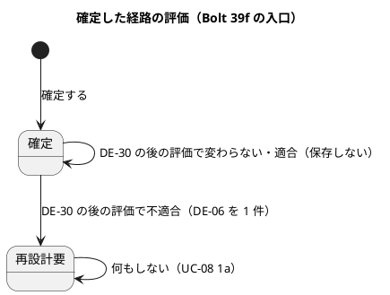
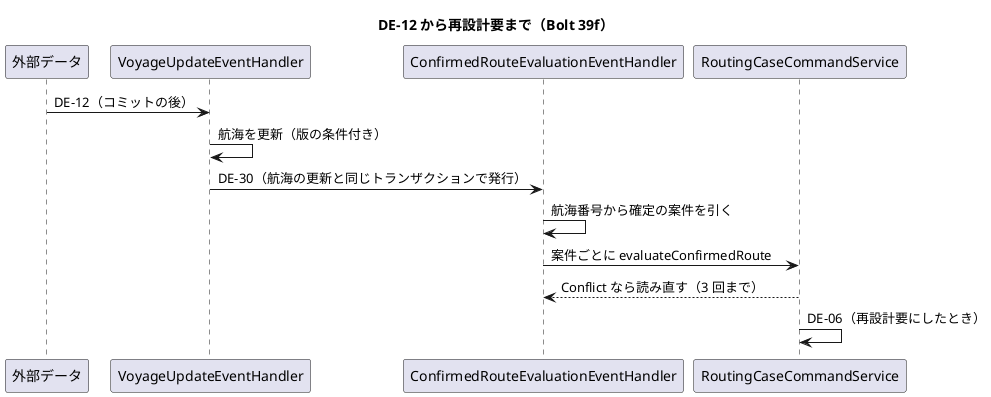
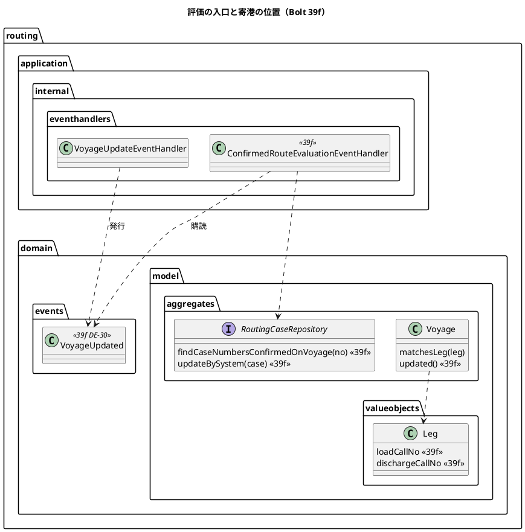
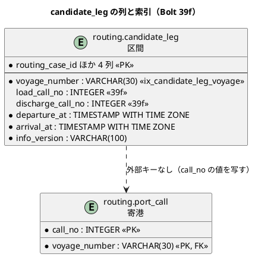

# Bolt 39f 計画 - 航海の更新から確定した経路を評価する入口をつなぎ、2 度寄る航海の寄港の位置を持たせる

## 基本情報

| 項目 | 内容 |
| :--- | :--- |
| Bolt | 第 39f 回（W7 の 25 本目。release_plan :973 の 39f の行） |
| 状態 | 承認済み（2026-11-10。推奨のとおり。Recommend 承認の指示による）。2 つの整合性検証（`validating-iteration-plan`・`validating-design`）の指摘を反映した |
| 予定 | W7（2026-11-16 の週。前倒しで着手できる）。Bolt 39e2 の完了（ステップ 7・8 が残っている）の後に着手する。作業は約 4 時間 05 分（245 分。決定 (1)。T-250 の上限いっぱい）。分けた 39f2 は約 1 時間 40 分。下の「時間の配分と打ち切り」。`check`・`uiTest`・`manualScreenshots`・SonarQube・CI と承認の待ちを除く |
| アプローチ | アウトサイドイン（状態の組み合わせの表を先に書く。release_plan :973、:893、T-182）。受入条件の中心は「データ責任者の採用で確定した経路が条件を満たさなくなると、再設計要になる」こと。ステップ 2 で受入シナリオを先に Red にし、内側に入る |
| 対象 | (1) 航海番号から確定した経路版を持つ案件を引く照会と索引（`candidate_leg.voyage_number`）、(2) 確定の区間の寄港の位置（`candidate_leg` の 2 列。2 度寄る航海の照合と引き直し。確認ポイント 13。【業務の判断】(u)、【前の決定の変更】(5)）、(3) 航海の更新のコミットの後に確定した経路を評価する 2 段の配信（DE-30 と listener。【前の決定の変更】(6)）、(4) 競合を受けたら読み直して評価し直す（bolt_37d2_plan.md :108）、(5) システムの更新の操作を分ける（`update(routingCase, null)`。確認ポイント 13）、(6) 配信までの統合テスト（T-184）と受入シナリオ、(7) マニュアル 8 章、動画。UC-06 4a と S-06 の古くなった候補（#50）は 39f2 に分ける（決定 (1)、【前の決定の変更】(7)） |
| トレース | US-07 AC4（user_story :328、:348-349 の注）、US-14 AC1、R-INV-03・07（domain_model :873・:877）、DE-05・DE-06・DE-12、W7 の確認ポイント 11〜13（release_plan :923〜:925）、[Bolt 37d2 計画](bolt_37d2_plan.md) :108、[Bolt 39e 終了報告](bolt_39e_report.md) :109 の既知の課題、[Bolt 39e2 計画](bolt_39e2_plan.md) の申し送り（:227）、台帳 D-106 |
| GitHub | [#18](https://github.com/k2works/practical-domain-driven-design-in-enterpris-application/issues/18)（US-14。クローズは 39h）。US-07 の #16 は Bolt 37e4c で閉じている（user_story :383）ので開け直さない |
| SP | 0 |
| 承認ゲート | **計画と終了報告で止める**（release_plan :973 の「計画と終了報告（スキーマ・構造）」）。確認必須のものは確認ポイントにして計画の承認に含める（前例 bolt_37d2_plan.md :22）: データベース（確認ポイント 2）、構造（確認ポイント 3）、新しいファイル（確認ポイント 8）。各ステップは「ゲート: 既定（確認ポイント N で計画の承認に含む）」と書く。新しいセキュリティの判断と本番の操作はない |
| 開始準備で決めたこと | 下の (1)〜(13)（推奨を 1 つに決めて書いた。承認待ち）。【業務の判断】(u)・(v)・(w)・(x) を新しく記録する。【前の決定の変更】(5)・(6)・(7) |

## Bolt ゴール

データ責任者が採用した航海の予定で確定した経路の到着が希望到着期限を過ぎるか接続が足りなくなると、経路設計者の S-06 に再設計要が示され、見積りに印が付く（US-07 AC4）。同じ情報版のまま区間の予定が変わったときも同じように評価される（【業務の判断】(s)）。情報版だけが上がって区間の予定が変わらなければ、確定の経路は確定のまま残り、積地か揚地に 2 度寄る航海でも再設計要にならない（確認ポイント 13）。評価は航海の更新のコミットの後に動き、同じファイルの 2 行で別々の航海が更新されても両方の更新を見て判定する。マニュアル 8 章から 2 度寄る航海の注が消えている。

## 状態の組み合わせ（行ごとにテストを 1 本。T-182）

配信 → 評価 → 案件の状態まで。行の番号はこの計画で 1 から振る。テストは既存のクラスの `@Nested class Bolt39f_…`（新しいクラスは決定 (13)）。P1・P2 は同じ航海番号・同じ情報版で値の違う DE-12（【業務の判断】(s)）。「1 件」は発行した DE-06 の件数。

| 行 | 状況 | 期待（案件の状態と DE-06） | 確かめ方 |
| :--- | :--- | :--- | :--- |
| 1 | 照会 `findCaseNumbersConfirmedOnVoyage`（決定 (2)） | 返す: 最新の経路版が確定で、確定の候補の区間にその航海がある案件（1 区間目、2 区間目）。返さない: 確定でない候補の区間だけにある、候補提示済み、再設計要、旧版、ほかの航海。同じ案件は 1 件（パラメーター。T-244） | 統合（`MyBatisRoutingRepositoriesIntegrationTest`）と `InMemoryRoutingCaseRepository` |
| 2 | スキーマ（決定 (2)・(3)） | 索引 `ix_candidate_leg_voyage` がある。`load_call_no`・`discharge_call_no` は片方だけの値と `load_call_no >= discharge_call_no` を CHECK で拒否する。列のコメントがある | 統合（`SchemaCommentIntegrationTest` と CHECK の確かめ） |
| 3 | 区間の寄港の位置の往復 | 候補の算出で位置を書き、読み直して同じ値。39f より前の行（NULL）は NULL で読む | 統合 |
| 3b | `Leg` のコンストラクタ | 片方だけ null、`loadCallNo >= dischargeCallNo` は例外。そろって null（7 引数）は通る（パラメーター） | 単体（`LegTest`） |
| 4 | 候補探索の位置 | A→B→A→C の航海で、A(1)→C(4) と A(3)→C(4) の 2 候補がそれぞれの `call_no`（1 始まり。MyBatisVoyageRepository.java :91）を持つ（T-245: 書く順を逆にした航海も置く） | 単体（`RouteCandidateFinderTest`） |
| 5 | 引き直し: 組が 1 つ | 位置に関わらず今のまま引き直す（1 度寄る航海で寄港が増えて位置がずれても引き直せる） | 単体 |
| 6 | 引き直し: 組が 2 つ以上で、出発と到着が区間と一致する組がなく、位置がある | 位置の組を選ぶ（新しい時刻の区間を作る） | 単体 |
| 6b | 引き直し: 組が 2 つ以上で、出発と到着が区間と一致する組が 1 つある（照合の順。決定 (3)） | その組を選ぶ（位置は見ない。ほかの港の寄港の増減で位置がずれていても、予定が同じなら引き直せる） | 単体 |
| 7 | 引き直し: 組が 2 つ以上で、一致する組がなく、位置の組を使えない（【業務の判断】(u)。パラメーター: 位置の港が違う、位置が寄港の数を超える、位置の組の出発か到着が欠ける） | 引き直せない（`VOYAGE_UNAVAILABLE`。選ばずに失敗に倒す） | 単体 |
| 7b | 評価: 組が 2 つ以上で、位置が範囲外、位置の寄港が組に入らない、到着が出発より後でない（`calls.get(no - 1)` で落とさない） | 例外にせず再設計要（`VOYAGE_UNAVAILABLE`）。1 件の失敗で同じトランザクションの全体が戻らない | 単体（`RoutingCaseEvaluationTest`） |
| 8 | 引き直し: 組が 2 つ以上で位置がない（39f より前に算出した候補） | 今のまま引き直せない（RouteCandidateFinderTest.java :364 を変えない） | 既存の単体 |
| 9 | 照合 `matchesLeg`（決定 (3)） | 一致する組が 1 つなら位置がずれていても真（情報版が同じで予定が同じなら拒否しない。【業務の判断】(s)）。一致する組が 2 つ以上なら位置の組があるときだけ真。位置がなければ今のまま（組が 1 つ以上で真。VoyageTest.java :276-278） | 単体（`VoyageTest`。入力と期待の組まで縛る） |
| 10 | 評価: 2 度寄る経路で情報版だけが上がり予定は同じ（【前の決定の変更】(5)） | 確定のまま、DE-06 は 0 件（Bolt 37d2 の既知の制限を解消） | 単体（`RoutingCaseEvaluationTest`） |
| 11 | 評価: 2 度寄る経路で確定した寄港の到着が期限を過ぎる | 再設計要（`DEADLINE_EXCEEDED`）、DE-06 は 1 件。確定していない方の寄港の変更だけでは評価に入らない | 単体 |
| 11b | 評価: 接続を満たさなくなる（W6 レビュー L-8） | 再設計要（`CONNECTION_TOO_SHORT`）、DE-06 は 1 件 | 受入シナリオ（`evaluate_confirmed_route.feature` に 1 本足す） |
| 12 | 評価: 同じ情報版で区間の予定が違う | 評価に入る（Bolt 39e2 の行 7。今のまま） | 既存の単体 |
| 13 | DE-30 の発行（決定 (4)） | 1 件: 更新を適用した DE-12。0 件: 古い DE-12（`Voyage.apply` が偽）、完全に同じ DE-12 の再配信、初めての航海（`save`。確定の区間はまだない）、内容の欠けた DE-12、競合で読み直すと古くて適用しない DE-12。競合で読み直して適用したときも 1 件 | 単体（`VoyageUpdateEventHandlerTest`。呼び出しの記録。T-236） |
| 14 | 評価の listener: 確定の案件なし | 評価を呼ばない | 単体（`ConfirmedRouteEvaluationEventHandlerTest`） |
| 15 | 評価の listener: 確定の案件が 2 件 | 2 件とも評価する | 単体 |
| 16 | 評価の listener: 競合を 1 回受ける（決定 (5)） | 読み直して評価し直し、先の評価で再設計要になっていれば `Unchanged` で終わる。DE-06 は重ならない | 単体 |
| 17 | 評価の listener: 競合が 3 回続く | 例外を上げて戻し、発行記録に残す（再起動の再配信。application.properties :54。`VoyageUpdateEventHandler` と同じ 3 回） | 単体 |
| 17b | 評価の listener: 確定の案件 2 件で、1 件目が再設計要、2 件目が競合 3 回（案件は 1 つのトランザクション。決定 (4)） | 例外で全体を戻す。1 件目の再設計要と DE-06 も戻り、DE-30 の発行記録が未完了で残る（再配信で両方とも評価し直す） | 統合（PostgreSQL） |
| 18 | 評価の listener: 照会の後に案件がない（`NotFound`） | 例外にせず次の案件へ進む（WARN のログ） | 単体 |
| 19 | 配信: 情報版が変わり到着が期限を過ぎる（取込の DE-12） | 再設計要、DE-06 は 1 件、見積りに再設計要の印、DE-12 と DE-30 の発行記録が完了（T-184） | 統合（PostgreSQL。`ConfirmedRouteEvaluationDeliveryIntegrationTest`） |
| 20 | 配信: 同じ情報版で予定が違う（P1 → 隔離の採用で P2。【業務の判断】(s)） | P2 が期限を過ぎれば再設計要、DE-06 は 1 件 | 統合 |
| 20b | 配信: P1 → 誤った採用の P2 で再設計要 → P1 に戻す（【業務の判断】(x)） | 再設計要のまま、DE-06 は 1 件（UC-08 1a） | 統合 |
| 21 | 配信: 同じ情報版で予定も同じ（書き方か取得時刻だけ違う原本の採用） | 確定のまま、DE-06 は 0 件。DE-30 は 1 件（`apply` は真。Voyage.java :100-113）で評価に入らない | 統合 |
| 22 | 配信: 情報版が変わり予定は同じ | 評価で適合、確定のまま（区間は確定のときのまま）、DE-06 は 0 件 | 統合 |
| 22b | 配信: 予定が変わるが今の予定でも適合 | 確定のまま（区間は確定のときのまま）、DE-06 は 0 件 | 統合 |
| 23 | 配信: 2 度寄る経路で情報版だけが上がる（行 10 を配信で） | 確定のまま、DE-06 は 0 件 | 統合 |
| 24 | 配信: DE-30 の再配信 | 再設計要は 1 回、DE-06 は 1 件（すでに再設計要なら何もしない。RoutingCase.java :322） | 統合 |
| 25 | 同時: 別々の航海の 2 つの DE-12 のトランザクションが重なり、片方だけなら適合で両方なら接続不足（決定 (4)） | 両方のコミットの後の評価で再設計要（`CONNECTION_TOO_SHORT`）、DE-06 は 1 件 | 統合（H2 と PostgreSQL）。2 つのトランザクションをラッチで重ねる（両方が書いた後にコミットする。前例 `MyBatisVoyageConcurrentUpdateIntegrationTest.java` :312-315 の `AnnouncingBeforeWrite`）。1 段に戻す変異 V9 はこの行で確実に落ちる |
| 26 | 同時: 2 つの DE-30 の評価が同じ案件で重なる（競合で読み直す組。決定 (5)） | 再設計要は 1 回、DE-06 は 1 件。遅れた方は 0 件の UPDATE で `Conflict` を受けて読み直す（`MyBatisRoutingCaseRepository.update` は `@Transactional` を持たないのでトランザクションは戻らない。:84-88） | 統合（H2 と PostgreSQL。前例 `MyBatisVoyageConcurrentUpdateIntegrationTest`） |
| 27 | 再設計要の案件に後から DE-12 | 再設計要のまま、DE-06 は 0 件（行 1 の照会で引かれない） | 統合 |
| 28 | 候補提示済みの案件に DE-12 | 案件は変わらない（行 1 の照会で引かれない。候補の見え方は 39f2） | 統合 |
| 29 | システムの更新の操作（決定 (7)） | `updateBySystem` は最終更新者を変えず版を進める。`update` に操作者 null を渡すと例外 | 統合と単体 |
| 30 | UI（確定した後にデータ責任者が期限を過ぎる隔離を採用する） | S-06 が「再設計要の経路（候補 n）」と理由「期限超過」を示す。axe の違反 0 | `adopted_voyage_reflected_ui.feature` |
| 31 | マニュアル | 8 章 :95 の 2 度寄る航海の注と、:53 の文、12 章 :343・:449 の【業務の判断】(x) の 1 文が実装と一致する | ステップ 7 の突き合わせの記録 |
| 32 | 今の振る舞い | 経路設計の受入シナリオ（`confirm_route.feature`・`evaluate_confirmed_route.feature`・`adopted_voyage_reflected_ui.feature` の既存 3 シナリオ・`route_redesign_required_ui.feature`）と `DevSampleDataSmokeTest` | 既存のシナリオとテスト |

39f2 に写す行（【前の決定の変更】(7)。39f2 の計画で番号を振り直す）: 候補の区間が今の航海と一致しない候補は S-06 で「古くなった候補」と示し「この候補で確定へ」を出さない、取得から許容時間を過ぎた候補も同じ、元の値に戻ると表示が消える、確定と再設計要の経路版には出さない、axe と幅 320 px。

## 開始準備の決定

(1) **範囲と見積り**: release_plan :973 の 39f の行をコードで確かめて引き直すと、まとめて 285 分（約 4 時間 45 分。39f の 245 分と下の 39f2 の作業の 40 分）になり、目安（CLAUDE.md の「半日を超える Bolt は分割する」の 4 時間に誤差の 5 分を含めた 4 時間 05 分まで。T-250）を超える。**39f（評価の入口と寄港の位置。245 分）と 39f2（UC-06 4a と S-06 の古くなった候補。約 100 分）に縦に分ける**（推奨。確認ポイント 1、【前の決定の変更】(7)）。39f の余りは 0 分で、超えそうなときは **行 26 の H2 の分（−4 分）、配信の参考の値の測り直し（−3 分）の順に 39f2 へ送る**。寄港の位置は入口と同じ Bolt に残す（確認ポイント 13「評価の入口をつなぐと本番で起きる」）。

| 内訳 | 分 |
| :--- | ---: |
| 分けて増えない土台（設計の文書 20、Red 15、品質ゲート 30、終了報告 10、キャプチャと文の突き合わせ 10、UI の流し直しと動画 10。bolt_39e_plan.md :34 の形。受入シナリオの土台は 39e の Steps を使うので 15 を足さない） | 95 |
| マイグレーションと `CandidateLegRow`（列 2 つ、索引、CHECK、コメント。行 2） | 5 |
| 区間の位置（`Leg`・候補探索・保存の往復。行 3・4） | 8 |
| 引き直しと照合（行 5〜9） | 10 |
| 評価の 2 度寄る組（行 10〜12） | 5 |
| 照会（H2・PostgreSQL・メモリ。行 1） | 12 |
| DE-30 と発行（行 13） | 6 |
| 評価の listener と組み立て（行 14〜18） | 10 |
| 配信までの統合テスト（行 19〜25・27・28。ファイルから確定した案件を作る土台を含む） | 20 |
| 同時（行 26。H2 と PostgreSQL） | 8 |
| 受入シナリオの例と Steps（行 30） | 8 |
| システムの更新の操作を分ける（行 29） | 5 |
| 既存のテストへの影響（`VoyageUpdateEventHandlerTest` の構築、`RouteCandidateFinderTest` :48・:302 の期待、注の直し） | 3 |
| マニュアル 8 章（行 31） | 5 |
| 配信の参考の値の測り直し（bolt_39b4_plan.md :136。人の側の CI の手動のジョブ） | 3 |
| 変異を足す分 | 5 |
| 文書のステップの行の一覧の突き合わせ（T-197） | 2 |
| 指摘の反映: 引き直しの順と使えない位置（行 6b・7・7b）、`Leg` の規則（行 3b） | 6 |
| 指摘の反映: 競合 3 回で全体が戻る（行 17b）、誤採用を戻す組（行 20b）、適合の組（行 22b）、行 13 の組 | 9 |
| 指摘の反映: 行 25 をラッチで重ねる統合テストにする（配信の行の分との差） | 6 |
| 指摘の反映: 接続不足のシナリオ（L-8。行 11b） | 2 |
| 指摘の反映: マニュアル 12 章の 1 文と突き合わせ（【業務の判断】(x)） | 2 |
| 指摘の反映: 設計の文書の増え（ステップ 1 の足した行） | 5 |
| 指摘の反映: 既存のテストの直し（コンストラクタ、`update` の null。下の T-217 の一覧。上の 3 分に足す） | 5 |
| **合計（39f）** | **245（約 4 時間 05 分）** |

39f2 の内訳（参考。39f2 の開始準備で引き直す）: 分けて増える分 60、判定と照会 12、画面の注とテンプレート 8、受入シナリオ 6、マニュアルとキャプチャ 8、UC-06 4a の文書 3、変異と突き合わせ 3、合計 100。

比べた案: (i) そのまま 1 本（285 分。T-250 を超える）。(ii) **39f と 39f2 に分ける（推奨）**。(iii) S-06 の古くなった候補を W10 に送る（−40 分で 1 本に収まるが、UC-06 4a は MVP で確認ポイント 24 が W7 に返すと決めている。候補が古くなる場面は Bolt 39e から起きている）。(iv) 寄港の位置を後に送る（確認ポイント 13 の決定に反し、情報版が上がるたびに 2 度寄る経路が再設計要になる）。

(2) **照会と索引**（W7 の確認ポイント 12）: `RoutingCaseRepository.findCaseNumbersConfirmedOnVoyage(String voyageNumber)` を足す。`route_version.status = 'CONFIRMED'` かつ最新の経路版（`selectSummaries` の `MAX(route_version_no)` の形。RoutingCaseMapper.xml :243-245）で、`selected_candidate_no` の候補の区間にその航海がある案件番号を `DISTINCT` で返す。索引は `ix_candidate_leg_voyage`（`candidate_leg (voyage_number)`。data_model :1217 の決めたとおり。今は V20261007100000 :61-80 に索引がない）。共通のマイグレーション `V20261110100000__add_routing_candidate_leg_call_no_and_voyage_index.sql` 1 つで決定 (3) の列と一緒に足す（版は 39e2 の dev の `V20261109130900` より新しくする）。スキーマは確認ポイント 2。

(3) **確定の区間の寄港の位置**（確認ポイント 13。【業務の判断】(u)、【前の決定の変更】(5)。比べた案の (i) を推奨）: 問題は引き直しが組を 1 つに決められないこと（RouteCandidateFinder.java :161-163）で、組が 2 つ以上の航海は情報版が上がるたびに `VOYAGE_UNAVAILABLE` になる（domain_model :943-944）。

- `candidate_leg` に `load_call_no`・`discharge_call_no`（INTEGER、NULL を許す）を足す。値は `port_call.call_no`（1 始まりの運航の順。MyBatisVoyageRepository.java :91）。`CHECK`（そろって NULL か、そろって値を持ち `load_call_no` が小さい）。NULL は 39f より前に算出した候補だけ（ステージング・本番に案件の行はない。data_model :522。開発データの見本は算出し直すまで NULL のまま）なので埋め直さない
- `Leg`（Leg.java :21-28）に `Integer loadCallNo`・`Integer dischargeCallNo` を足す。7 引数のコンストラクタを残す（前例 RouteVersion.java :79-106。呼び出しはテストの 7 クラス）。候補探索 `legsFromCall` が `from + 1`・`j + 1` を入れる（RouteCandidateFinder.java :114-133）。record の等しさに位置が入るので RouteCandidateFinderTest.java :48・:302 の期待を直す（直すのはこの 2 か所の見込み。ステップ 3 で `test` 全体を流して確かめる。T-217）
- **位置は組が 2 つ以上のときだけ使う**。引き直しは組が 1 つなら今のまま、2 つ以上なら、出発と到着が区間と一致する組が 1 つあればそれを選び、なければ位置の組を選ぶ。位置が範囲外か、位置の寄港が組に入らないか、到着が出発より後でないときは、例外にせず引き直せないとする（行 5〜8・7b。`calls.get(no - 1)` で落とすと 1 件の失敗で全体が戻る）。照合は「一致する組が 1 つ以上」のまま、一致する組が 2 つ以上のときだけ位置の組があることを足す（行 9）。一致する組が 2 つ以上になるのは同じ港に同じ時刻で 2 度寄る航海だけで（全く同じ寄港は取込で拒否する。VoyageValues.java :55-56）、照合の狭まりは実際にはほぼ効かない。効くのは引き直し
- 比べた案: (i) `call_no` を持つ（推奨。列 2 つ）、(ii) 「その港への n 度目」を持つ（ほかの港の増減に強いが、同じ港の増減で壊れる点は同じで、値を候補探索で数える手間が増える）、(iii) 区間に位置を持たせず寄港 ID を振る（`port_call` は更新のたびに消して入れ直すので ID が保てない。data_model :508）

(4) **評価の入口は 2 段にする**（【前の決定の変更】(6)）: W7 の確認ポイント 12（release_plan :924）は「DE-12 の listener が航海を更新した後、…で `evaluateConfirmedRoute` を呼ぶ」だった。DE-12 の listener のトランザクションで評価すると、同じファイルの 2 行で別々の航海 V・W が同時に更新されたときに（`VoyageUpdateEventHandler` の `@ApplicationModuleListener` は `@Async` と `REQUIRES_NEW` で、Spring Boot の `applicationTaskExecutor` はコア 8・キュー無制限で上書きがない。最大 8 本が並行し、順は保証されない）、V の評価は W の古い値を、W の評価は V の古い値を読み、片方ずつなら適合で両方なら不適合の組を見落とす。**航海の更新と同じトランザクションで DE-30 を発行し、DE-30 の listener がコミットの後に評価する**。後にコミットした側の評価が両方の値を見る（行 25）。

- DE-30 `VoyageUpdated`（`routing.domain.events`。航海番号・情報版・公開した時刻。形は RouteConfirmed.java）。ガイドライン第 3 章 :662・:741「ドメインイベントは集約から公開する」に合わせ `Voyage` が作り（`voyage.updated()`）、`VoyageUpdateEventHandler` が `update` の成功の後に発行する（行 13）。`apply` の成功の後に集約が返す形で、ADR-014 の戻り値の形に当たる。予定が同じでも発行する（行 21）ので名前は「航海を更新した」にする。`save`（初めての航海）では発行しない
- `ConfirmedRouteEvaluationEventHandler`（`routing.application.internal.eventhandlers`、`@ApplicationModuleListener`、`@Service`、組み立ては RoutingConfiguration）が DE-30 を受け、照会の案件ごとに `RoutingCaseCommandService.evaluateConfirmedRoute` を呼ぶ。案件は 1 つのトランザクションで評価する（`evaluateConfirmedRoute` の `@Transactional` は listener のトランザクションに参加する）。1 件の失敗は全体を戻して再配信に任せる（案件ごとの切り離しは要れば W10）
- 比べた案: (i) 2 段（推奨）、(ii) DE-12 の listener のトランザクションで評価する（確認ポイント 12 のまま。上の見落としが残る）、(iii) 同じ DE-12 を受ける 2 つ目の listener（航海の書き込みとの順が保証されない）、(iv) 1 段のまま案件の行を `lockByNumber` で押さえて直列にする（評価の失敗で航海の更新も戻る、複数案件の順で deadlock の余地がある、削れるのは約 6〜10 分だけ）

(5) **競合の読み直し**（W7 の確認ポイント 11、bolt_37d2_plan.md :108）: `Conflict` を受けたら同じトランザクションで読み直して評価し直す（**3 回まで**。`VoyageUpdateEventHandler.java` :53-61 と同じ。読み直しの直前に 0 件の UPDATE があるので MyBatis の 1 次キャッシュは消えている。Bolt 39e の決定 (5) と同じ理由）。3 回とも競合したら例外を上げる（行 17）。`ConfirmedRouteEvaluationOutcome.java` :36-39 の Javadoc と domain_model :941 の「再試行は要らない」は、確認ポイント 11 で決めた振る舞いに文を直す（新しい決定ではない）。先の評価が再設計要にしていれば読み直しの結果は `Unchanged` で、DE-06 は重ならない（行 26）。

(6) **確定と同時の DE-12**（【業務の判断】(v)。確認ポイント 11「行のロックは足さない」のまま）: 確定のトランザクションが航海を読んだ後、コミットの前に DE-30 の照会が走ると、その案件はまだ確定でないので評価されない。窓は確定の 1 トランザクションの間（ミリ秒）で、残るのはその航海の次の DE-12 で評価されるまでの間。**受け入れて W10 の OBS の項目に送る**（推奨）。比べた案: (i) 受け入れる（推奨）、(ii) DE-05 を受けて確定の後に 1 度評価する listener を足す（約 8 分で窓は閉じるが、確定のたびに評価が走り、DE-05 の割当てとの届く順の扱いが増える）。

(7) **システムの更新の操作を分ける**（確認ポイント 13。RoutingCaseCommandService.java :169、RoutingCaseRepository.java :24-30）: `RoutingCaseRepository.updateBySystem(RoutingCase)` を足し、`update` は操作者を必須にする（null は例外）。`touchRoutingCase` の `updatedBy` の `if`（RoutingCaseMapper.xml :156）は `updateBySystem` のために残す。`update(null)` は Bolt 37d2 の確認ポイント 5 の決定で、これを改める【前の決定の変更】は W7 の確認ポイント 13 で記録済み。

(8) **受入シナリオ**: `features/ui/adopted_voyage_reflected_ui.feature` に行 30 を足す（タグ `@US-07-AC4 @US-14-AC1 @R-INV-07 @DE-06 @demo @demo-bolt-39f/redesign-by-adoption`）。流れは Bolt 39e2 の行 9 のシナリオ（同 :52-68）で、確定まで進めた後にデータ責任者が到着の遅い隔離を採用する。今の 2 行のファイルは到着が 2099-10-30・10-31（ExternalDataIngestionUiSteps.java :70・:74）で希望到着期限 2099-11-02 09:00 JST（SubmitTransportRequestUiSteps.java :32）の内なので、到着を期限より後にした 2 行のファイルの Steps を足す。確定の後の待ちは `jdbc` で `route_version.status = 'REDESIGN_REQUIRED'` まで待つ（`candidate_leg` を航海番号で結ぶ。前例 RoutingUiSteps.java :354-380 の `awaitVoyageCondition`。40 回 × 250 ms）。配信が DE-12 と DE-30 の 2 段に増えるが、UI の 1 行の配信で負荷はなく（`VoyageUpdateDeliveryIntegrationTest` の待ちの上限も 10 秒）、10 秒のままで足りる見込み。測っていないので、ステップ 6 で足りなければ回数を増やして記録する。`route_redesign_required_ui.feature` の「データベースで入れる」形（RouteRedesignUiSteps.java :70-82。同 feature :9 の注）は変えない（見積りの側の理由の網羅が主題で、入口ができても別の話）。注の「本番には評価の入口がまだない（W7）」だけ直す。

(9) **マニュアルと動画**（T-251。用語は下の「業務の判断の記録」の文から写す）: 08-経路設計.md :95 の「区間の積地か揚地に 2 度寄る航海は、予定が変わらなくても航海の情報が更新されると…再設計要になります」を、位置がずれたときの (u) の文に直す。:53 の「航海の情報などの外部情報の更新を受けてシステムが…」は入口ができたのでそのままでよい（確かめる）。:95 の前半（「区間の航海の予定が使えなくなる」の説明）は変えない。12-外部データ.md :343・:449（誤って採用したとき）に【業務の判断】(x) の 1 文（すでに再設計要になった確定の経路は、正しい原本を採用し直しても確定に戻らない）を足す。キャプチャは撮り直さない（画面の配置も文も変わらない）。動画は `@demo-bolt-39f/redesign-by-adoption` を撮る（release_plan :985）。

(10) **39f2 に送るもの**（決定 (1)、【前の決定の変更】(7)、【業務の判断】(w)）: UC-06 4a（system_usecase :473）と S-06 の古くなった候補（release_plan :936、bolt_37c_plan.md :87、bolt_37c_report.md :125）。39f2 は、39f の照合を使うので 39f の後に、経路設計の残りをまとめるので 39g の前に置く。読み方の推奨は下の「業務の判断の記録」の (w)。

(11) **層の規則とガイドライン**（第 3 章、ADR-017）: DE-30 は `routing.domain.events`（前例 RouteConfirmed）、listener は `application.internal.eventhandlers`（名前が `…EventHandler` で `@Service`。LayerArchitectureTest.java :278-284）、照会のポートは `domain.model.aggregates` の既存の `RoutingCaseRepository`、実装は `infrastructure`。新しいコンテキスト間の依存はない（DE-30 は `routing` の中だけで受ける）。listener が同じコンテキストの `commandservices` を呼ぶ前例はまだない（`eventhandlers` の中に `CommandService` の参照は今 0 件）が、読んだ範囲の規則に当たるものはない。**規則の例外は要らない見込み**で、当たったら置き場所を動かさず止めて諮る（T-125）。

(12) **変えないもの**: `evaluateConfirmedRoute` の判定の中身（Bolt 37d2。鮮度と貨物種別は見ない）、確定の照合の順と拒否の文、DE-06 と見積りの印、`Voyage.apply` の順の規則（【業務の判断】(r)）、接続時間規則だけの変更は評価のきっかけにしない（domain_model :942）、再設計要は原因が解消しても戻さない（UC-08 1a）、S-05・S-06・S-07 の配置と URL（39f2 で S-06 を変える）。

(13) **新しい型の名前**（T-246。`apps/cargo-tracker/src` で `VoyageUpdated`・`ConfirmedRouteEvaluationEventHandler`・`updateBySystem`・`loadCallNo`・`load_call_no`・`findCaseNumbers`・`ix_candidate_leg`・`Bolt39f` を検索し、ないことを確かめた）: DE-30 `VoyageUpdated`、`ConfirmedRouteEvaluationEventHandler`、`Voyage.updated`、`RoutingCaseRepository.findCaseNumbersConfirmedOnVoyage`・`updateBySystem`、`Leg` の `loadCallNo`・`dischargeCallNo`、統合テスト `ConfirmedRouteEvaluationDeliveryIntegrationTest`、受入シナリオのタグ `@demo-bolt-39f/redesign-by-adoption`。DE-30 は台帳の次の番号（domain_model に DE-30 以降はない）。

【前の決定の変更】(5)（決定 (3)。Bolt 39e の (1)〜(3)、39e2 の (4) に続ける）: Bolt 37d2 の決定（domain_model :943「組が 2 つ以上あるなら引き直せない」、:944 の既知の制限）を、確定の区間に寄港の位置があれば位置の組を選ぶ形に改める。Bolt 39e2 の決定 (3)「組は 1 つ以上」も、一致する組が 2 つ以上のときだけ位置を見る形に改める。

【前の決定の変更】(6)（決定 (4)）: W7 の確認ポイント 12「DE-12 の listener が航海を更新した後、…で `evaluateConfirmedRoute` を呼ぶ」を、DE-12 の listener は航海の更新と同じトランザクションで DE-30 を発行し、DE-30 の listener がコミットの後に評価する形に改める。

【前の決定の変更】(7)（決定 (1)）: W7 の確認ポイント 12 の「UC-06 4a も同じ Bolt」と確認ポイント 24 の「S-06 が古くなった候補を適合と示したまま（39f）」を、39f2 に送る。

直す既存のテスト（T-217。ステップ 2 で一覧を確かめる）: `RouteCandidateFinderTest.java` :48・:302（`Leg` の等しさ）、`VoyageUpdateEventHandlerTest.java` :57 と `MyBatisVoyageConcurrentUpdateIntegrationTest.java` :272・:274・:312・:315（listener のコンストラクタ）、`ConfirmedRouteEvaluationTest.java` :85-91（`update` の override と `operators`）・:119（`super.update(other, null)`）、`MyBatisRoutingCaseLockIntegrationTest.java` :56・:76、`MyBatisRoutingRepositoriesIntegrationTest.java` :543（`update(…, null)` を `updateBySystem` に）。

新しいファイル: 共通のマイグレーション 1 つ、`VoyageUpdated`、`ConfirmedRouteEvaluationEventHandler` とその単体テスト、`LegTest`、`ConfirmedRouteEvaluationDeliveryIntegrationTest`。直すもの: `Voyage`・`Leg`・`RouteCandidateFinder`・`VoyageUpdateEventHandler`・`RoutingCase`（注）・`RoutingCaseCommandService`（注と `updateBySystem`）・`ConfirmedRouteEvaluationOutcome`（Javadoc）・`RoutingCaseRepository`・`MyBatisRoutingCaseRepository`・`RoutingCaseMapper`（.java・.xml）・`CandidateLegRow`・`RoutingConfiguration`、テスト `RouteCandidateFinderTest`・`VoyageTest`・`RoutingCaseEvaluationTest`・`VoyageUpdateEventHandlerTest`・`MyBatisRoutingRepositoriesIntegrationTest`・`InMemoryRoutingCaseRepository`・UI の Steps（`ExternalDataIngestionUiSteps`・`RoutingUiSteps`）、受入シナリオ `adopted_voyage_reflected_ui.feature`・`evaluate_confirmed_route.feature`（L-8）・`route_redesign_required_ui.feature`（:9 の注）、`RedesignReasonCode`（Javadoc）、マニュアル 8 章・12 章。

### 前の Bolt から引き継いだもの

| 出典 | 内容 | この計画 |
| :--- | :--- | :--- |
| release_plan :973、W7 の確認ポイント 12 | 照会と索引、`evaluateConfirmedRoute` をつなぐ、配信までの統合テスト | 決定 (2)・(4)、行 1・19〜28 |
| W7 の確認ポイント 13 | 寄港の位置、`update(routingCase, null)` | 決定 (3)・(7)、行 2〜11・29 |
| bolt_37d2_plan.md :108、W7 の確認ポイント 11 | listener は競合を受けたら読み直して評価し直す | 決定 (5)、行 16・17・26 |
| Bolt 39e2 の申し送り（bolt_39e2_plan.md :227）、bolt_39e_report.md :109 | 同じ情報版で予定が違う組の評価の入口、寄港の位置 | 行 12・20、決定 (3) |
| Bolt 39e2 の【業務の判断】(s)、【前の決定の変更】(1) | 確定した経路の評価も同じ照合に入る（入口は 39f） | 行 12・20 |
| bolt_39b4_plan.md :136 | listener が増えたら配信の参考の値を測り直す | ステップ 8 |
| W7 の確認ポイント 24（release_plan :936）、system_usecase :473 | S-06 の古くなった候補、UC-06 4a | 決定 (10)。39f2 |
| W6 レビュー L-8（w6_review_20261102.md :77） | US-07 AC4 の「接続を満たさなくなる」が受入シナリオにない（39f で評価の入口のシナリオと一緒に） | 行 11b |

### 開始準備で確かめたこと

- **release_plan の 39f の行**（:973）と確認ポイント 11〜13（:923〜:925）、半日を超えそうな Bolt は開始準備で分ける（:979）。動画は 39f で撮る（:985）
- **評価の操作はあるが呼び手がない**: RoutingCaseCommandService.java :152-178。`evaluateConfirmedRoute` はテストの呼び出しだけ
- **DE-12 の listener**: VoyageUpdateEventHandler.java :40-74。`apply` が偽なら保存しない、初めての航海は `save`
- **照合は `matchesLeg`**: RoutingCase.java :378-383、Voyage.java :137-157。一致する組が 1 つ以上で真
- **引き直しは組が 1 つだけで作る**: RouteCandidateFinder.java :145-171
- **`Leg` に位置はない**: Leg.java :21-28、`candidate_leg`（V20261007100000 :61-80）、保存は RoutingCaseMapper.xml :136-143・:223-228
- **`Conflict` の扱い**: ConfirmedRouteEvaluationOutcome.java :36-39、RoutingCaseCommandService.java :168-172。リポジトリの `update` は例外を投げるがトランザクションの属性を持たない（MyBatisRoutingCaseRepository.java :83-88）
- **DE-05 の listener は案件の行を押さえて評価と直列にする**: QuotationRouteAssignmentEventHandler.java :47-50、RoutingCaseRepository.java :35-39
- **listener の非同期の設定**: `@ApplicationModuleListener` は `@Async` と `REQUIRES_NEW`。application.properties に `spring.task` の上書きはなく、再配信の設定だけがある（:54）
- **受入条件**: US-07 AC4（user_story :328）、注（:348-349）。UC-06 4a（system_usecase :473）

## 設計の決定

| 項目 | 決定 | 根拠 |
| :--- | :--- | :--- |
| 範囲と見積り | 決定 (1)。39f と 39f2 に分ける（245 分） | CLAUDE.md、T-250、release_plan :979 |
| 照会と索引 | 決定 (2)。`ix_candidate_leg_voyage` | release_plan :924、data_model :1217 |
| 寄港の位置 | 決定 (3)、【業務の判断】(u)、【前の決定の変更】(5)。`call_no` を 2 列持ち、組が 2 つ以上で予定の一致する組がないときだけ使う | domain_model :943-944、RouteCandidateFinder.java :161-163 |
| 評価の入口 | 決定 (4)、【前の決定の変更】(6)。DE-30 の後に評価する | ガイドライン第 3 章 :662・:741 |
| 競合 | 決定 (5)。3 回まで読み直す | bolt_37d2_plan.md :108、release_plan :923 |
| 確定と同時の DE-12 | 決定 (6)、【業務の判断】(v)。受け入れて W10 に送る | release_plan :923 |
| システムの更新 | 決定 (7)。`updateBySystem` | release_plan :925 |
| S-06・UC-06 4a | 決定 (10)、【前の決定の変更】(7)、【業務の判断】(w)。39f2 | release_plan :936 |
| 型の名前 | 決定 (13)（T-246 で検索した） | — |

## ふりかえりと前の Bolt からの引き継ぎ

Bolt 39e2 の終了報告はまだない（ステップ 7・8 が残っている）。終了報告の Try は 39f の開始のときに足す。

| 出典 | 内容 | この Bolt での扱い |
| :--- | :--- | :--- |
| W6 の Try T-204・T-212、Bolt 38h の T-227、Bolt 39b の T-233、Bolt 39d〜39e の Problem | サブエージェントへの指示の最初に heredoc と標準入力を待つコマンドを使わないと書く | 任せるときの指示の最初に書く。ファイルは Write・Edit、検索は Grep |
| Bolt 39d の T-247 | 決まりを仕組みで守らせる（フック） | W7 の締めで最初に諮る。Gradle と git を人の側の 1 か所に残す。触らないもの（`.claude/agent-memory`・`.run/`・`apps/cargo-tracker/.claude/`）を名前で書く |
| Bolt 39d の T-248 | `git add` はディレクトリか `git add -u` | 各ステップのコミット |
| Bolt 39d2b の T-249 | 担当への指示に書く私の言葉に出典を付ける | 初稿は人の承認として書かない |
| Bolt 39d3 の T-250 | 見積りは 4 時間 05 分まで | 決定 (1) |
| Bolt 39d3 の T-251 | マニュアルの担当に用語を【業務の判断】の文から写させる | 決定 (9) |
| Bolt 39d3c の T-252 | ゲートが落ちたら先に中身を一覧する | ステップ 8 |
| Bolt 39d3b の T-254 | 途中で止めるときはコンパイルの通らない変更を develop にコミットしない | ステップ 2。骨組みでコンパイルを通し、Red の行は `wip/` か stash に置く |
| Bolt 39d3b2 の T-255 | 「報告を待っています」のときに記録の更新時刻を確かめる | 任せたステップで待つとき |
| W6 の Try T-182・T-211・T-216 | 状態の組み合わせに重複・出口・誤った入力の行を置く | 上の表 |
| W6 の Try T-184 | listener は配信まで確かめる | 行 19〜24 |
| W6 レビュー L-8 | US-07 AC4 の接続不足の受入シナリオ | 行 11b |
| W6 の Try T-217 | 本体を直す前に Red を流し、直すテストの一覧を添える | ステップ 2、決定 (3) |
| W6 の Try T-219、T-225・T-213 | 変異の対象に単体・統合、push の前に `check` | ステップ 8 |
| Bolt 39a2 の T-229 | 時刻の出どころと同時の書き込みの行を置く | 時刻は入力ポートの Clock（変えない）。同時は行 25・26 |
| Bolt 39a3 の T-230 | 入ることを確かめるデータはドメインの規則に合う組み合わせにする | 行 30 は 2099 年で確定できる航海 |
| Bolt 39b の T-232・39b2 の T-234・39b3 の T-237 | 本体を直したステップは承認の前に `spotbugsMain`・`checkstyleMain`・`sonar-local:check` | ステップ 3・4 の完了の判定 |
| Bolt 39b2b の T-236 | 「起きないこと」は呼び出しの記録で確かめる | 行 13・14 |
| Bolt 39b3 の T-238・39b3b の T-239 | 任せるときは決定の番号を指す、諮る主張の前提はコードで確かめる | 開始準備の決定に出典を添えた |
| Bolt 39b4 の T-241・T-242 | 性能の目標を外れたら区切って測る | 配信の参考の値はステップ 8。DE-12 の 1 万件で DE-30 と照会が増える |
| Bolt 39c2 の T-244、39c3 の T-245、39c4 の T-246 | パラメーターは組まで縛る、並びの規則は逆順のデータ、型の名前は検索する | 行 1・4・9、決定 (13) |
| Bolt 39d4 の学び | 業務の判断の推奨は受入条件の文と突き合わせる | 下の「業務の判断の記録」 |
| memory の manual-in-bolt-done-criteria、Bolt 37f2 の T-197 | 振る舞いが変わる Bolt はマニュアルを完了条件に入れ、文を実装と突き合わせる | 完了条件、行 31 |

## スコープ

### 入れるもの

- 行 1〜32（行 8・12・32 は既存のテストで確かめる）。決定 (2)〜(9) の実装と文書
- マニュアル 8 章（決定 (9)）と動画 `@demo-bolt-39f/redesign-by-adoption`
- 文書: 下の「設計文書に直す箇所」（ステップ 1）

### 入れないもの

- UC-06 4a と S-06 の古くなった候補（39f2）
- 確定と同時の DE-12 の窓を閉じること（W10。【業務の判断】(v)）
- 案件ごとに評価のトランザクションを切り離すこと（要れば W10）
- 再設計の操作（US-08）

### 申し送り（既知の課題・入れないもの）

| 送り先 | 課題 | 扱い |
| :--- | :--- | :--- |
| 39f2 | 表の「39f2 に写す行」と【業務の判断】(w) | 39f の承認の後に開始準備で計画を作る |
| W10 | 確定と同時の DE-12 の窓（【業務の判断】(v)）、評価が 3 回競合して未完了のまま残った DE-30 に気づく手段（Bolt 39e の DE-12 の OBS の項目と一緒に） | release_plan の W10 の行に足す |
| 39h | W7 のデモの動画に再設計要になる流れを含める | release_plan :985 のデモ項目のとおり |

### 設計文書に直す箇所（ステップ 1）

ステップ 1 の開始で `docs/design`・`docs/requirements`・`docs/adr`・`docs/operation`・`docs/manual`・`docs/development/cargo-tracker`（release_plan・development_strategy）と `apps/cargo-tracker/src` を「39f」「評価の入口」「寄港の位置」「2 度寄」「W7（US-14）」「再試行は要らない」で検索し、39f の予定を書いた場所を作ったことに直す。

- domain_model: 用語の表 :158（`VOYAGE_UNAVAILABLE` の「2 度寄る」の説明）、:941（評価の入口と競合の文）、:942（入口は Bolt 39f の文）、:943-944（【前の決定の変更】(5)、既知の制限の解消）、:979（2 度寄る航海）。節の後に「Bolt 39f で決めたこと」を足す。イベントの表に DE-30 の行を足す（「監査しない、発行元の集約の版を持たない」の注）。DE-12 の行（:1744）の反応に DE-30 の発行を足す。用語の表に `ConfirmedRouteEvaluationEventHandler`・DE-30 を足す。`RoutingCaseRepository`・`Leg`・`Voyage` の説明
- data_model: `candidate_leg` の ER（:425）と列の注に位置の 2 列、:506・:1217 の索引を「作った」に直す、「Bolt 39f で足す列」を足す
- user_story: US-07 AC4 の注（:348・:349。:349 の「同じ港に 2 度寄って区間を選べないとき」の文）の「W7 でつなぐ」を作ったことに、Bolt 37e2 の注（:367・:374）の評価の入口の文
- system_usecase: UC-07 5b（:484）の 2 度寄る航海の文
- test_strategy: 経路設計の行（:349）の「入口は 39f」、DE-30 と配信の確かめ方
- release_plan: 39f の行（:973）に計画へのリンク、見積り、決めたことを足し、39f2 の行を足す。確認ポイント 12・13・24（:924・:925・:936）を済みに。順の行（:979）、デモ項目（:985）の 39f2、進捗のチェックの行（:991）に 39f2、台帳 D-108〜D-111（仮）、W10 の行、更新履歴
- development_strategy: W7 の行（:350）に 39f2 を足す
- ADR-004: Bolt 39f の項（DE-30 の 2 段）を足す
- architecture_backend: `VoyageUpdateEventHandler` の記述に DE-30 の発行と評価の listener を足す
- コードの注: `ConfirmedRouteEvaluationOutcome.java` :36-39、RoutingCaseCommandService.java :105-106・:147-151、RouteCandidateFinder.java :136-139、`route_redesign_required_ui.feature` :9。`RedesignReasonCode.java` :17 の Javadoc はコードなのでステップ 3 で直す

## 設計（この Bolt の範囲）

### 画面遷移図

画面と URL は増やさない。S-06 の再設計要の表示は Bolt 37d2 のままで、図を省く。

### 画面イメージ

配置も文も変えないので省く（S-06 の古くなった候補は 39f2）。

### 状態遷移図

経路版の状態と遷移は変えない。起こす入口が増える。

### 配信の流れ

### クラスと依存

### ER 図（この Bolt で変える表）

## ステップ計画（ゲートは下の各ステップに書く）

- [x] **1. 設計の文書**（2026-11-10 に実施した）: 上の「設計文書に直す箇所」。【業務の判断】(u)・(v)・(w)・(x)、【前の決定の変更】(5)〜(7) を反映する。始めに検索する（完了の判定: 文書の差分と検索の記録。ゲート: 既定（確認ポイント 2〜5 で計画の承認に含む））
- [x] **2. 受入シナリオとテストの Red**: （結果: 行 30 は「確定した経路が再設計要にならない」、ほかは DE-30 が届かない・位置がない・照会が空の期待した理由で落ちた。行 8・12 は緑。行 11b は Red の実行に含めず、実装の後の test で緑）外から入る。まず `adopted_voyage_reflected_ui.feature` に行 30 を書いて Red を記録する（確定した後に期限を過ぎる隔離を採用しても S-06 に再設計要が出ない）。続いて行 1〜7b・9〜11b・13〜30（行 8・12 は回帰の守りで最初から緑の見込み。行 11b は 39f の入口によらず最初から緑の見込みで、緑なら記録する）。骨組み（`findCaseNumbersConfirmedOnVoyage` は空を返す、`VoyageUpdated`、`updateBySystem` は `update` に委ねる、`Leg` の 9 引数のコンストラクタ、listener の中身なし）でコンパイルを通す（T-254）。直す既存のテストを一覧にする（T-217）（完了の判定: 期待した理由で落ちる記録。Red の行は `wip/` か stash に置き、develop に落ちるテストを積まない。ゲート: 既定）
- [x] **3. 寄港の位置**: （結果: V20261110100000、行 2〜11b が緑。`Leg` の等しさで直したテストは 5 か所）マイグレーション、`CandidateLegRow`、`Leg`、候補探索、`matchesLeg`、引き直し（決定 (3)）、`RedesignReasonCode.java` :17 の Javadoc。行 2〜11b が緑、`test` 全体で既存のテストの影響を確かめる、`spotbugsMain`・`checkstyleMain`・`sonar-local:check`（完了の判定: 緑と影響の一覧。ゲート: 既定（確認ポイント 2・4 で計画の承認に含む））
- [x] **4. 照会・DE-30・評価の listener・システムの更新**: （結果: 行 1・13〜18・29 が緑。層の規則に当たらなかった）決定 (2)・(4)・(5)・(7)。行 1・13〜17・18・29 が緑（行 17b はステップ 5）。`ModularityTest`・`LayerArchitectureTest` を流す（当たったら止めて諮る）。`spotbugsMain`・`checkstyleMain`・`sonar-local:check`（完了の判定: 緑。ゲート: 既定（確認ポイント 3・5 で計画の承認に含む））
- [x] **5. 配信までの統合と同時**: （結果: 行 17b・19〜28 が緑。行 25・26 は H2 と PostgreSQL の両方）行 17b・19〜28 が緑（完了の判定: 緑。発行記録の完了まで待って確かめる。T-184。ゲート: 既定）
- [x] **6. 受入シナリオの緑と動画**: （結果: 行 30・32 が緑、axe 違反 0、幅 320 px、`docs/assets/demo/bolt-39f/redesign-by-adoption.webm`）行 30・32 が緑、axe 違反 0、幅 320 px、`@demo-bolt-39f/redesign-by-adoption` を撮る（完了の判定: `uiTest` の該当の feature と動画。ゲート: 既定）
- [x] **7. マニュアル**: （結果: 8 章 :95 の 2 度寄る航海の注を【業務の判断】(u) の文に直し、12 章 :343・:449 に (x) の 1 文を足した。:53 は変えない。文は `RedesignReasonCode`・`RoutingCaseViews`・`RouteCandidateFinder.chosenPair`・`Voyage.matchesLeg`・`show.html` と突き合わせて一致した。位置のない 39f より前の区間はステージング・本番に行がないので書かない。キャプチャは撮り直さない）08-経路設計.md :95 と 12-外部データ.md :343・:449（決定 (9)）。文を実装と【業務の判断】(u)・(x) の文に一字ずつ突き合わせる（T-197・T-251）（完了の判定: 突き合わせの記録と行 31。ゲート: 既定）
- [x] **8. 品質ゲートと開発レビュー**: （結果: 変異は守りの場所ごとに分けて 64 個、V4d・V8a（行 16）・V8a2・V2c が生き残りテストを足して落とした。`check` の `test` 5,020 件・`uiTest` 216 シナリオとも失敗 0、axe 違反 0、`spotbugsMain`・`checkstyleMain` は指摘なし、SonarQube は PASS（新しいコードのカバレッジ 96.0%、重複 0.02%、違反 0）。レビューは高 0・中 2（行 26・16 が読み直しを見ていない、旧版の区間の照会）・低は直すか送り先を決めた。行 1〜31 の名乗りを一覧で突き合わせた（T-197）。開発データの見本は別の Flyway を足さない。配信の参考の値は人の側の `performanceTest` で測る）変異（下の表）、`check`・`uiTest`、その後に SonarQube（落ちたら先に中身を一覧する。T-252）、人の側の `performanceTest` で配信の参考の値を測り直す、開発レビューとその直し。文書のステップの行を一覧で突き合わせる（T-197）（完了の判定: 緑と指摘の扱いと突き合わせの記録。ゲート: 既定）
- [x] **9. 終了報告**（[終了報告](bolt_39f_report.md)を 2026-11-10 に推奨のとおり承認として記録した。Recommend 承認の指示による）: push して CI とデモ環境の配備を確かめる。release_plan（39f の行の計画と終了報告のリンク）・開発の索引・mkdocs を直す。【業務の判断】(u)・(v)・(x) と【前の決定の変更】(5)・(6)・(7) を議題の先頭に置き、既知の課題に申し送りの表を書く（完了の判定: 報告の承認。**承認ゲート**（終了報告））

### 時間の配分と打ち切り

| # | 目安 | 打ち切り |
| :--- | :--- | :--- |
| 1 | 25 分（文書 20、指摘の反映の増え 5） | — |
| 2 | 74 分（Red の 15 分、テストを書く 59 分） | テストを書く時間が 74 分を超えそうなら、書いた分で Red を記録して止めて諮る |
| 3 | 19 分（マイグレーション 5、`Leg`・候補探索・保存 5、照合と引き直し 7、評価 2） | `Leg` の等しさで直す既存のテストが 5 本を超えるなら止めて諮る（決定 (3) の見込みが外れている） |
| 4 | 27 分（照会 6、DE-30 3、listener 5、システムの更新 5、既存の影響 8） | 層の規則に当たったら止めて諮る（T-125） |
| 5 | 17 分（Green の調整。テストを書く時間はステップ 2） | 発行記録が完了しないなら、原因を確かめて止めて諮る |
| 6 | 16 分（Steps の残り 5、L-8 のシナリオ 1、流し直しと動画 10） | 既存の Steps を変える必要が大きいときは止めて諮る |
| 7 | 17 分（8 章の文 5、12 章の文 2、突き合わせ 10） | — |
| 8 | 40 分（待ちを除く。品質ゲート 30、変異 5、参考の値 3、文書の行 2） | — |
| 9 | 10 分（CI の待ちを除く） | — |

合計 245 分（約 4 時間 05 分）。目安（4 時間 05 分。T-250）の上限いっぱいで余りはない。実装の中で超えそうなときは、**行 26 の H2 の分（−4 分）、配信の参考の値の測り直し（−3 分）の順に 39f2 へ送る**。それでも超えるなら止めて諮る。マニュアルは後に送らない。

## 確認ポイント（計画の承認の場でまとめて確認する。Try T-6）

| # | 確認すること | 場所 | 推奨 |
| :--- | :--- | :--- | :--- |
| 1 | **範囲と見積り**（【前の決定の変更】(7)） | 決定 (1) | 39f と 39f2 に分ける（39f は約 4 時間 05 分。超えそうなら行 26 の H2 の分、配信の参考の値の順に 39f2 へ） |
| 2 | **スキーマ** | 決定 (2)・(3) | `candidate_leg` に 2 列（NULL 可）と CHECK、索引 `ix_candidate_leg_voyage` を足す |
| 3 | **構造**（【前の決定の変更】(6)） | 決定 (4)・(11) | DE-30 を足し、コミットの後に評価する。新しいコンテキストの依存はなし。規則の例外は要らない見込み |
| 4 | **寄港の位置**（【業務の判断】(u)、【前の決定の変更】(5)） | 決定 (3) | `call_no` を持ち、組が 2 つ以上で予定の一致する組がないときだけ使う。位置で決められなければ再設計要 |
| 5 | **確定と同時の DE-12**（【業務の判断】(v)） | 決定 (6) | 窓を受け入れて W10 に送る |
| 6 | **S-06 と UC-06 4a の読み方**（【業務の判断】(w)） | 決定 (10) | 39f2 で作る。推奨は下の記録 |
| 6b | **誤った採用を直しても再設計要は戻らない**（【業務の判断】(x)） | 決定 (9)、行 20b | このまま受け入れ、業務責任者に確かめる項目にする。マニュアル 12 章に 1 文足す |
| 7 | **システムの更新の操作** | 決定 (7) | `updateBySystem` を足し `update` の null を禁じる |
| 8 | **新しいファイルと型の名前** | 決定 (13) の後の一覧 | 上の一覧 |
| 9 | **変異** | ステップ 8 | 下の表 |

### 人に諮ること

推奨を 1 つに決められない判断はない。業務の意味を含む (u)・(v)・(w)・(x) は推奨を 1 つに決め、下の「業務の判断の記録」に置く。新しい本番・セキュリティの判断はない: マイグレーションは列と索引の追加で、ステージング・本番に案件の行はない（data_model :522）。打ち切りの 4 つ（Red の時間、`Leg` の等しさの影響、層の規則、発行記録が完了しない）に当たったときは、そのステップで止めて諮る。

### 業務の判断の記録

終了報告の議題の先頭に置き、人が後から見直せるようにする。台帳の番号は仮。

1. 【業務の判断】(u) **2 度寄る航海の確定の区間の引き直しは、組が 2 つ以上なら、出発と到着が区間と一致する組が 1 つあればそれを選ぶ。なければ確定した寄港の位置の組を選ぶ。そのうえで位置で決められないときは、選ばずに再設計要（航海の予定が使えない）にする**（決定 (3)、行 5〜11。台帳 D-108（仮））: 受け入れること: ほかの港の寄港の増減で位置がずれ、区間の予定も変わると再設計要になり、戻らない（UC-08 1a）。位置の港が偶然同じなら、別の寄港を選んで判定する（位置の値だけでは見分けられない）。受入条件との突き合わせ: US-07 AC4（user_story :328「確定経路の外部情報が更新され日時制約を満たさなくなる、…再設計要」）は、位置がずれたときは日時制約を満たさなくなったとは言い切れないが、運ぶ寄港を決められない経路を確定のまま残さない方に倒す（Bolt 37d2 の「選ばずに失敗に倒す」domain_model :943 のまま）。情報版だけが上がったときは再設計要にしない（行 10）。比べた案は決定 (3)
2. 【業務の判断】(v) **確定のトランザクションの間に届いた DE-12 の評価が抜ける窓を受け入れる**（決定 (6)。台帳 D-109（仮））: AC1・AC3（user_story :325・:327）、UC-07 4a の窓で、次の DE-12 まで確定のまま残り得る。上限はない。窓そのものは確定の 1 トランザクションの間（ミリ秒）。業務責任者に確かめる（Release 1.0 のパイロットの前）。比べた案は決定 (6)
3. 【業務の判断】(w)（39f2 で作る。台帳 D-110（仮）） **UC-06 4a の「候補を旧版として保持し、再算出を要求する」は、候補の行を残したまま、S-06 を開いた時刻の航海と比べて「古くなった候補」と示し、再算出を促す文を添え、「この候補で確定へ」を出さないことと読む。状態は持たない（元の値に戻れば表示は消える。【業務の判断】(s) と同じ）**: bolt_37c_plan.md :87 の「要るかを業務担当者に確かめてから」に当たるので、39f2 の開始準備で人に示す。比べた案: 経路版の状態を「旧版」に変える（R-INV-05 の経路版の旧版と語が重なり、元の値に戻したときに戻せない）、表示だけ変えて確定へは残す（確定で必ず拒否されると分かる操作を残す）
4. 【業務の判断】(x) **誤った採用を新しい外部版で直しても、再設計要になった確定の経路は戻らない**（決定 (9)、行 20b。台帳 D-111（仮））: UC-08 1a（原因が解消しても戻さない）のまま。【業務の判断】(e)（判断の取り消しを作らない）・(t)（誤った採用は新しい外部版で直す）、D-105 の古い版の採用、39h までの後着も同じ扱いになる。入口をつなぐので誤った採用 1 回で再設計要が残るようになる。推奨はこのまま受け入れて業務責任者に確かめる項目にする（Release 1.0 のパイロットの前）。マニュアル 12 章 :343・:449 に 1 文足す

### 変異と落ちる見込みのテスト

| # | 変異 | 落ちる見込み |
| :--- | :--- | :--- |
| V1 | 照会で最新の経路版に絞らない | 行 1（統合） |
| V2 | 照会で確定の候補に絞らない（すべての候補の区間で引く） | 行 1 |
| V3 | 候補探索が位置を書かない | 行 3・4 |
| V4 | 引き直しで組が 2 つ以上のとき最初の組を選ぶ | 行 6・6b・7 |
| V5 | 組が 1 つのときも位置の一致を求める | 行 5・9 |
| V6 | `update` の後に DE-30 を発行しない | 行 13・19 |
| V7 | `apply` が偽でも DE-30 を発行する | 行 13 |
| V8 | 評価の listener が `Conflict` を読み直さない | 行 16・26 |
| V9 | 評価を DE-12 の listener のトランザクションで行う（DE-30 を通さない） | 行 13（単体）・行 25（統合。ラッチで重ねるので確実に落ちる） |
| V10 | 照合で位置を見ない（一致する組が 2 つ以上のとき） | 行 9 |
| V11 | `updateBySystem` が最終更新者を書く | 行 29 |
| V12 | 索引のマイグレーションから CHECK を外す | 行 2 |
| V13 | 位置の範囲を確かめずに `calls.get(no - 1)` で読む | 行 7・7b |
| V14 | 再設計要の評価を確定に戻す（誤採用を戻したとき） | 行 20b |

## 完了条件

- [ ] 上のステップ 1〜9 の完了の判定を満たす（ゲートのあるステップは承認を受ける）
- [ ] 行 1〜7b・9〜11b・13〜31（枝番を含む）に、それを名乗るテストか確かめの記録がある（行 8・12・32 は既存のテストで確かめる）
- [ ] データ責任者の採用で確定した経路が条件を満たさなくなると、S-06 に再設計要が示され、DE-06 が 1 件発行される。配信まで確かめた（T-184）
- [ ] 2 度寄る航海の確定した経路が、情報版だけの更新で再設計要にならない
- [ ] `update` に null を渡す呼び出しがない
- [ ] マニュアル 8 章 :95 と 12 章 :343・:449 の文が実装と合う。動画 `@demo-bolt-39f/redesign-by-adoption` がある
- [ ] `check`・`uiTest` が緑、axe の違反 0、SonarQube が PASS、CI が緑、デモ環境が新しい版で動く
- [ ] 【業務の判断】(u)・(v)・(x) と【前の決定の変更】(5)・(6)・(7) が終了報告の議題の先頭にある。台帳 D-108〜D-111（仮）が作られている
- [ ] 確認ポイント 12・13・24 の 39f の分が済みになっている。39f2 の行が release_plan にある
- [ ] docs と `apps/cargo-tracker/src` に 39f の予定のままの記述が残っていない（ステップ 1 の検索）
- [ ] 終了報告が承認されている

## 更新履歴

| 日付 | 更新内容 | 更新者 |
| :--- | :--- | :--- |
| 2026-11-10 | 初版作成（承認待ち）。開始準備の決定: 約 3 時間 30 分で 39f2 に分ける、寄港の位置を `call_no` で持つ（【業務の判断】(u)、【前の決定の変更】(5)）、評価の入口を DE-30 の 2 段にする（【前の決定の変更】(6)）、S-06 と UC-06 4a を 39f2 に送る（【前の決定の変更】(7)）、確定と同時の DE-12 の窓を受け入れる（【業務の判断】(v)）。2 つの整合性検証はこの後 | anthropic/claude-opus-5-5 |
| 2026-11-10 | 2 つの整合性検証の指摘を反映した。状態の組み合わせに行 3b・6b・7b・11b・17b・20b・22b を足し、行 25 をラッチで重ねる統合テストにした。【業務の判断】(x) を足し、(u)・(v)・(w) を直した。イベント名を `VoyageUpdated` にした。見積りは約 4 時間 05 分（245 分）で、T-250 の上限いっぱい | anthropic/claude-opus-5-5 |
| 2026-11-10 | 計画を推奨のとおり承認として記録した（【業務の判断】(u)・(v)・(w)・(x)、【前の決定の変更】(5)・(6)・(7)、スキーマの変更を含む。Recommend 承認の指示による。human:kakimomokuri） | anthropic/claude-opus-5-5、承認 human:kakimomokuri |

## 関連ドキュメント

- [リリース計画](release_plan.md)（W7 の節の 39f の行、確認ポイント 11〜13・24、台帳 D-106）
- [Bolt 39e2 計画](bolt_39e2_plan.md)（手本、申し送り）・[Bolt 39e 計画](bolt_39e_plan.md)・[Bolt 39e 終了報告](bolt_39e_report.md)（既知の課題）
- [Bolt 37d2 計画](bolt_37d2_plan.md)（評価の操作、:108）・[Bolt 37c 計画](bolt_37c_plan.md)（:87）
- [ドメインモデル](../../design/cargo-tracker/domain_model.md)（R-INV-03・07、Bolt 37d2・39e2 の決定）、[データモデル](../../design/cargo-tracker/data_model.md)、[UI 設計](../../design/cargo-tracker/ui_design.md)（S-06）、[ユーザーストーリー](../../requirements/cargo-tracker/user_story.md)（US-07）、[システムユースケース](../../requirements/cargo-tracker/system_usecase.md)（UC-06 4a）、[ユーザーマニュアル 8 章](../../manual/08-経路設計.md)、[第 3 章 Spring Platform × モジュラーモノリス](../../article/03-spring-modular-monolith.md)
