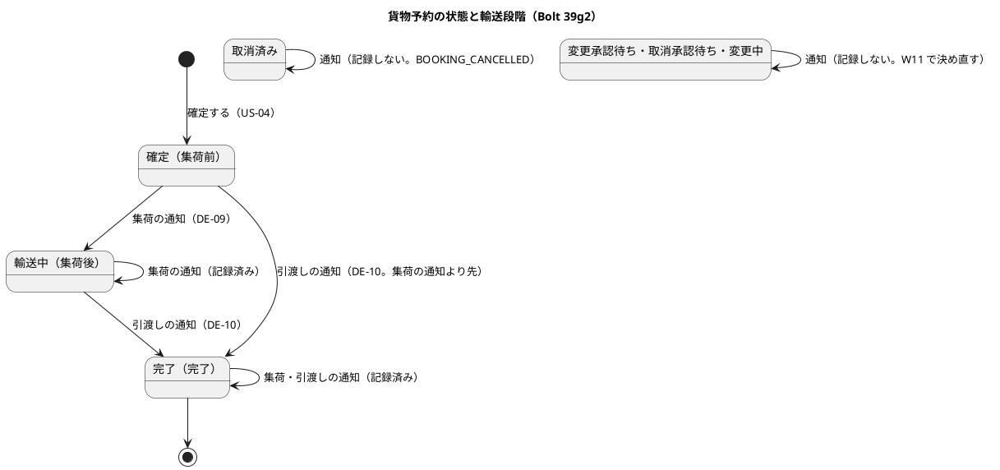
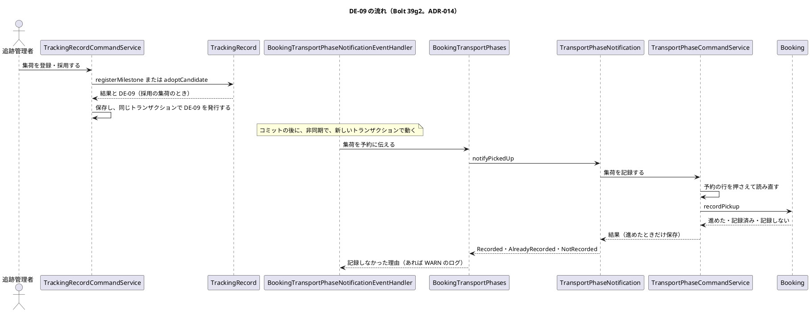
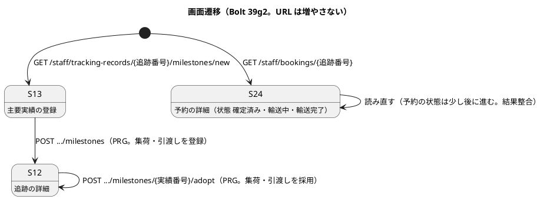
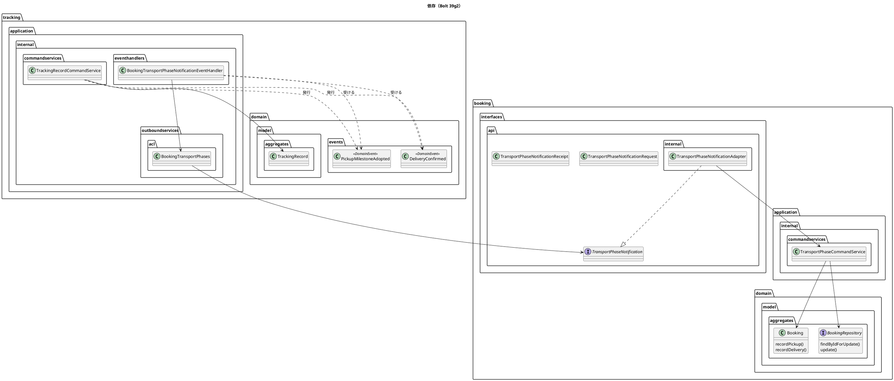
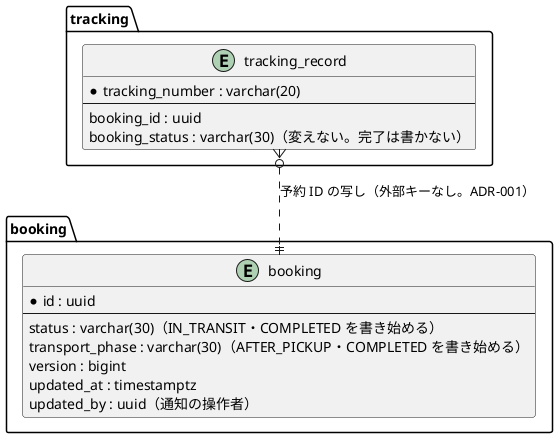

# Bolt 39g2 計画 - 集荷の採用と引渡しの確認を予約の公開 API で予約に返し、追加する実績の選び方を直す

## 基本情報

| 項目 | 内容 |
| :--- | :--- |
| Bolt | 第 39g2 回（W7 の 30 本目。release_plan :978 の 39g2 の行） |
| 状態 | 計画（承認済み。2026-11-11。確認ポイント 1〜11 を推奨のとおり承認。human:kakimomokuri。2 つの整合性検証（`validating-iteration-plan`・`validating-design`）の指摘を反映した） |
| 予定 | W7（2026-11-16 の週。前倒しで着手できる）。Bolt 39gc の終了報告の承認（2026-11-11）の後に着手する。約 3 時間 35 分（約 215 分）の見込み（下の「ステップ計画」）。`check`・`uiTest`・`manualScreenshots`・SonarQube・CI と承認の待ちを除く |
| アプローチ | アウトサイドイン（release_plan :978。状態の組み合わせの表を先に書く。T-182）。既存の受入シナリオ（US-12 の AC1〜AC5、US-04 の確定）を守ったまま、受入シナリオ（集荷・引渡しで予約の状態が進む）を先に Red にし、内側（予約の集約 → 予約のコマンドサービスと保存 → 予約の公開 API → 追跡のイベント → 追跡の listener と腐敗防止層）に入る |
| 対象 | (1) DE-09（集荷実績を採用した）・DE-10（引渡しを確認した）を追跡のイベントとして作る、(2) 追跡の listener が予約の公開 API を呼ぶ形（ADR-014）、(3) 予約の集約の「集荷実績の採用を記録する」「引渡しを記録する」と届く順の守り、(4) 予約の保存（状態・輸送段階）と同時の通知、(5) 予約状態 `COMPLETED` の書き手の見直し（Bolt 39g の行 18・39gc の決定 (6) の完了後の判定）、(6) P-3（追加する実績の選び方）、(7) S-24 の状態の表示とマニュアル 7 章・9 章 |
| トレース | DE-09・DE-10（domain_model :1847・:1848、:1866）、ADR-014、BR-04、B-INV-06・B-INV-12、T-INV-05、W7 CP19（release_plan :931）、architecture_backend :134、Bolt 26b 計画 :67・:312・終了報告 :91・:107（P-3）、Bolt 23 終了報告 :128、[Bolt 39g 計画](bolt_39g_plan.md) の行 18・決定 (7)・申し送り :280、[Bolt 39gc 計画](bolt_39gc_plan.md) の決定 (6)・申し送り :172、[Bolt 39gc 終了報告](bolt_39gc_report.md) の既知の課題 :100（本計画の確認ポイントは「本計画 CP-n」、W7 の確認ポイントは「W7 CPn」と書き分ける） |
| GitHub | #19 は 39gc でクローズ済み。この Bolt の Issue はない（US を数えない技術の Bolt。release_plan :978 の SP は 0） |
| SP | 0 |
| 承認ゲート | **計画と終了報告で止める**（release_plan :978「計画と終了報告（構造・公開 API）」）。確認必須のもの（公開 API とイベントの形＝構造変更、新しいファイル、既存データを補正しない判断）は本計画の確認ポイントにまとめ、計画の承認に含める（前例 bolt_39gc_plan.md）。スキーマは変えない（下の決定 (8)）。認可は変えない（新しい URL を足さない。下の決定 (10)）。`/goal` の下でも、この計画は承認を受けてから実行する |

## Bolt ゴール

追跡管理者が集荷の実績を登録または採用すると、少し後に予約の状態が「輸送中」・輸送段階が「集荷後」になり、引渡しの実績を登録または採用すると予約の状態と輸送段階が「完了」になる。予約は追跡のイベントを購読せず、追跡の listener が予約の公開 API を呼ぶ（ADR-014。依存は追跡 → 予約のまま）。確認中・保持のみ・下書きの集荷・引渡しでは予約は変わらない。通知は冪等で、集荷と引渡しがどの順に届いても予約は戻らない。完了した追跡への手入力は今までどおり保持のみになる（完了後の判定は採用済みの実績から導いた状態）。主要実績の保存は、表にある実績の中身が集約と違えば黙って飛ばさずに止める（P-3）。

## 状態の組み合わせ（行ごとにテストを 1 本。T-182）

行の番号はこの計画で 1 から振る。「通知」は予約の公開 API の呼び出し、「段」は予約の輸送段階（集荷前・集荷後・完了）。テストは新しいクラスは決定 (12)、既存のクラスは `@Nested class Bolt39g2_…`。

| 行 | 状況 | 期待 | 確かめ方 |
| :--- | :--- | :--- | :--- |
| 1 | 予約の集荷の記録（パラメーター。入力と期待の組まで縛る。T-244）: (a) 確定・集荷前、(b) 輸送中・集荷後、(c) 完了・完了、(d) 取消済み、(e) 変更承認待ち・取消承認待ち・変更中 | (a) 輸送中・集荷後に進めて「記録した」。(b)(c) 「記録済み」で何もしない（段を戻さない）。(d) 「記録しない」（`BOOKING_CANCELLED`）。(e) 「記録しない」（`BOOKING_UNDER_REQUEST`。W11 で決め直す。本計画 CP-5） | 単体（`BookingTest`） |
| 2 | 予約の引渡しの記録（パラメーター）: (a) 確定・集荷前、(b) 輸送中・集荷後、(c) 完了・完了、(d) 取消済み、(e) 申請中の 3 つ | (a)(b) 完了・完了に進めて「記録した」（(a) は集荷の通知より先に届いたとき、または集荷を採用しないまま引渡しを採用したとき）。(c) 「記録済み」。(d) `BOOKING_CANCELLED`。(e) `BOOKING_UNDER_REQUEST` | 単体（`BookingTest`） |
| 3 | 届く順（パラメーター）: 集荷 → 引渡し、引渡し → 集荷、同じ通知を 2 度 | どの順でも最後は完了・完了。後から届いた集荷は「記録済み」（B-INV-12 の版の比べの代わりに段を戻さない。決定 (5)） | 単体 |
| 4 | 予約のコマンドサービス | 予約 ID の予約がなければ「記録しない」（`BOOKING_NOT_FOUND`）と WARN のログ。「記録した」ときだけ保存する（「記録済み」「記録しない」は書かず、版を上げない） | 単体（`TransportPhaseCommandServiceTest`） |
| 5 | 予約の保存 | 版の条件で `status`・`transport_phase`・`version`（+1）・`updated_at`・`updated_by`（通知の操作者。決定 (7)）だけを書く。`booking_version` は書かない（B-INV-08）。版が違えば競合の例外 | 統合（`MyBatisBookingRepositoriesIntegrationTest`。H2 と PostgreSQL） |
| 6 | 予約の行を押さえる | 読む前に予約 ID の行を `SELECT … FOR UPDATE` で押さえ（`Propagation.MANDATORY`）、押さえた後に読み直す（前例 `findByTrackingNumberForExternalMilestone`）。行がなければ空 | 統合 |
| 7 | 同時: 集荷と引渡しの通知を PostgreSQL でラッチで重ねる（本計画 CP-6） | 片方が待ち、両方とも例外なく終わり、予約は完了・完了。版は 2 つ上がるか（集荷が先）1 つ上がる（引渡しが先） | 統合（PostgreSQL） |
| 8 | 予約の公開 API のアダプター | 結果の写し（記録した・記録済み・記録しない（理由））。理由は公開 API の定数で、予約のドメインの名前と独立（前例 `TrackingStartNotificationReceipt`） | 単体（`TransportPhaseNotificationAdapterTest`） |
| 9 | 公開 API の型 | 引数と戻り値は Java の標準と共有カーネルの型と文字列だけ。置き場所は `booking.interfaces.api`、実装は `booking.interfaces.api.internal` | `PublicApiArchitectureTest`（既存の規則が新しい型を拾うことを確かめる） |
| 10 | 手入力で DE-09・DE-10（パラメーター: 登録した実績の状態（採用・確認中・保持のみ）× 種類（集荷・引渡し・搬入）） | 採用の集荷 → DE-09、採用の引渡し → DE-10、確認中・保持のみと搬入 → 出さない（本計画 CP-4。39gc の申し送り :172） | 単体（`TrackingRecordMilestoneTest`） |
| 11 | 採用の経路で DE-09・DE-10（パラメーター: 採用・確認中・拒否・判断済みと同じ値 × 集荷・引渡し） | 採用に移った集荷 → DE-09、引渡し → DE-10。確認中に移った（DE-18 だけ）・拒否・同じ値 → 出さない | 単体（`TrackingRecordCandidateAdoptionTest`） |
| 12 | 確認中の追跡で、時系列どおりの集荷・引渡しを採用・登録する（本計画 CP-4、【業務の判断】(al)） | DE-09・DE-10 を出す（実績は採用）。DE-18 は出さない（すでに確認中）。現在状態は確認中のまま | 単体 |
| 13 | 同じ出典の二重送信（`AlreadyRegistered`） | 出さない | 単体 |
| 14 | 1 つの操作で出るイベント | DE-09・DE-10・DE-18 のどれか 1 つまで（採用と確認中は同じ実績で重ならない） | 単体（パラメーター） |
| 15 | DE-09・DE-10 の属性（本計画 CP-3） | 追跡番号・予約 ID・実績番号・発生時刻・操作者（登録者か採用者）・発行元の集約の版（保存した後の版。39gc の議題 2 と同じ読み方） | 単体 |
| 16 | 保存と同じトランザクションで発行 | コマンドサービスが保存の後に発行する。保存が `Conflict` なら出ない | 単体（`TrackingRecordCommandServiceTest`）、統合 |
| 17 | 追跡の listener | DE-09 → 集荷の通知、DE-10 → 引渡しの通知。「記録しない」は WARN のログで終える（追跡は戻さない。結果整合）。公開 API の例外はそのまま上げる（listener のトランザクションごと戻り、発行の記録は未完了で残る。ADR-014 の技術の失敗） | 単体（`BookingTransportPhaseNotificationEventHandlerTest`） |
| 18 | 腐敗防止層 | 受領の型を層の外に出さない（記録しなかった理由だけを返す。前例 `BookingTrackingStarts`） | 単体 |
| 19 | 配信まで（T-184） | 手入力で集荷を登録 → コミットの後に予約が輸送中・集荷後、引渡しの登録 → 完了・完了、発行の記録が完了になる | 統合（`TransportPhaseNotificationIntegrationTest`。PostgreSQL、Awaitility） |
| 20 | イベントの直列化の契約 | DE-09・DE-10 の V1 の JSON を直列化・復元できる（受け手ができたので契約に入れる） | `DomainEventSerializationContractTest` |
| 21 | 完了後の判定（Bolt 39g の行 18、39gc の決定 (6)、本計画 CP-7） | DE-10 の後も追跡記録の予約状態の写しは確定のまま。以後の手入力は保持のみ、採用は `TRACKING_COMPLETED`、DE-13 は保持のみ（採用済みの実績から導いた状態が引渡し済みなので）。写しが完了のパラメーター（テストデータ）も今のまま通る | 統合（行 19 に続けて）と既存の単体（回帰） |
| 22 | P-3（パラメーター。本計画 CP-10）: 表の実績が集約と (a) 同じ、(b) 種類・場所・発生時刻・出典・登録者・登録時刻のどれかが違う、(c) 表にあって集約にない | (a) 何もしない。(b)(c) `IllegalStateException`（版の条件の後には起きないはずの誤り。トランザクションを戻す。前例 P-6 の「例外のまま上げる」）。下書き → 採用・確認中の書き換えは今のまま | 統合（`MyBatisTrackingRecordRepositoryIntegrationTest`） |
| 23 | 層の規則 | listener は `tracking.application.internal.eventhandlers`、腐敗防止層は `…outboundservices.acl`、公開 API は `booking.interfaces.api`。`allowedDependencies` は変えない（追跡はすでに `booking :: api` に依存してよい）。予約は追跡に依存しない | `ModularityTest`・`LayerArchitectureTest`（既存） |
| 24 | 用語の検査 | `PickupMilestoneAdopted`・`DeliveryConfirmed`（`@DomainEvent`）の用語の行と Javadoc の最初の語 | `LivingGlossaryConsistencyTest` |
| 25 | S-24 の状態 | 輸送中・輸送完了を示す（`BookingViews.status` の既存の表示名） | コントローラーの単体（`BookingControllerTest`） |
| 26 | 受入シナリオ（業務ルール層） | 集荷の実績を登録すると予約が輸送中・集荷後に、引渡しで完了になる。時系列に反する集荷（確認中）では予約は変わらない | `features/booking/transport_phase_from_tracking.feature` |
| 27 | UI（追跡管理者が S-13 で集荷を登録し、営業担当者が S-24 で状態「輸送中」を見る） | 結果整合なので S-24 を読み直して待つ（応答で待つ。39gb の Try）。axe の違反 0。幅 320 px | `features/ui/transport_phase_from_tracking_ui.feature` |
| 28 | 認可は変えない | S-13・採用の POST は追跡管理者だけ、S-24 は営業担当者（回帰） | 既存の `@WebMvcTest` |
| 29 | マニュアル | 7 章の S-24 の状態（輸送中・輸送完了）と 9 章の「集荷・引渡しを登録すると予約の状態が少し後に変わる」が実装と一致する | ステップの突き合わせの記録（T-197・T-251） |
| 30 | 今の振る舞い | 下の「守る既存のテスト」が通る | 既存 |

### 守る既存のテスト（本体を直す前に Red を流し直すテストの一覧。T-217）

- 予約: `BookingTest`、`BookingCommandServiceTest`、`BookingSagaCommandServiceTest`、`MyBatisBookingRepositoriesIntegrationTest`、`BookingConfirmationConcurrentIntegrationTest`、`BookingControllerTest`、`TrackingStartNotificationAdapterTest`、`features/booking/confirm_booking.feature`、`features/ui/confirm_booking_ui.feature`
- 追跡: `TrackingRecordMilestoneTest`、`TrackingRecordCandidateAdoptionTest`、`TrackingRecordExternalMilestoneTest`、`TrackingRecordCommandServiceTest`、`ExternalMilestoneEventHandlerTest`、`BookingTrackingStartNotificationEventHandlerTest`、`MyBatisTrackingRecordRepositoryIntegrationTest`、`MyBatisTrackingRecordRepositoryUniqueKeyTest`、`MyBatisTrackingRecordLockIntegrationTest`、`features/tracking/register_milestone.feature`（US-12 の AC1〜AC5）、`features/ui/register_milestone_ui.feature`、`features/ui/under_review_milestone_ui.feature`、`features/ui/adopted_milestone_reflected_ui.feature`
- 横断: `ModularityTest`、`LayerArchitectureTest`、`PublicApiArchitectureTest`、`DomainEventSerializationContractTest`、`LivingGlossaryConsistencyTest`

## 開始準備の決定（推奨を 1 つに決めて書いた。承認済み）

(1) **範囲と見積り**（本計画 CP-1、【前の決定の変更】(15)）: release_plan :978 の 39g2 の行は、DE-09・DE-10、到着見込みと鮮度、P-3 の 3 つ（W7 CP19）。コードで確かめると DE-09・DE-10 は「直す」ではなく、まだどこにもない（追跡のイベントは DE-22 と DE-18 だけ、予約の集約に状態・輸送段階を変える操作も保存の UPDATE もない）。DE-09・DE-10 と P-3 で約 215 分（下のステップ計画）。到着見込み（`latest_eta` を何で動かすか）と鮮度（`last_acquired_at` の書き手と鮮度超過の判定）は、どちらも業務の規則がまだ決まっておらず（domain_model の `LatestEstimate`・`FreshnessPolicy` は名前だけ、許容範囲は NFR-FRESH-01）、足すと約 60 分以上増えて T-250 の目安（4 時間 05 分）を超える。そこで **到着見込みと鮮度を 39g3 に分け、39g2 の直後（39h の前）に置く**。分けても見えない状態の Bolt はできない（DE-09・DE-10 は予約の画面の状態で見え、到着見込みと鮮度は S-11・S-12・C-10 の表示で見える）。超えそうなときは 行 7（−8 分）、行 27 の動画（−5 分）の順に後へ送る（行 7 は W7 の締めの返済に）。マニュアルは後に送らない。
- 比べた案: (i) **39g3 に分ける（推奨）**。(ii) W9 の US-09（C-10 の取得時刻・最新性を保証しない旨）に送る（W7 CP19 の決定から 2 週ずれ、S-11 の到着の列（Bolt 26 の U-3）も待つ）。(iii) 39g2 に入れる（目安を超えて半日を超える）

(2) **公開 API**（本計画 CP-2。構造変更）: 予約の公開 API に `booking.interfaces.api.TransportPhaseNotification` を足す。操作は `notifyPickedUp(TransportPhaseNotificationRequest)` と `notifyDelivered(TransportPhaseNotificationRequest)` の 2 つ（1 つのインターフェースにまとめる。追跡の腐敗防止層が 1 つで済む）。引数 `TransportPhaseNotificationRequest(UUID bookingId, String trackingNumber, int milestoneNo, UtcInstant occurredAt, UUID recordedBy)`、戻り値 `TransportPhaseNotificationReceipt`（sealed。`Recorded`・`AlreadyRecorded`・`NotRecorded(String reason)`、理由の定数 `BOOKING_NOT_FOUND`・`BOOKING_CANCELLED`・`BOOKING_UNDER_REQUEST`）。実装は `booking.interfaces.api.internal.TransportPhaseNotificationAdapter` がアプリケーションサービス `booking.application.internal.commandservices.TransportPhaseCommandService` に委ねる（前例 `TrackingStartNotification`・`TrackingStartNotificationAdapter`・`BookingSagaCommandService`）。冪等のキーは予約 ID と通知の種類（段を戻さないので、同じ通知の再実行は「記録済み」）。コマンド ID と期待版（ARCH-HO-01）は持たない（前例と同じ）。
- 比べた案: (i) **1 つのインターフェースに 2 つの操作（推奨）**。(ii) 集荷と引渡しで 2 つのインターフェース（型が倍になるだけで、腐敗防止層と組み立ても 2 つになる）。(iii) 段を引数にする 1 つの操作（`notify(段)`。追跡が予約の段の語彙を持つことになり、予約のドメインの値が公開 API に漏れる）

(3) **DE-09・DE-10 の形**（本計画 CP-3）: `tracking.domain.events.PickupMilestoneAdopted`（DE-09）と `tracking.domain.events.DeliveryConfirmed`（DE-10）。どちらも `@DomainEvent` の record で、属性は domain_model :1847・:1848 の追跡番号・予約 ID・発生時刻に、**実績番号・操作者（登録者か採用者）・発行元の集約の版**（保存した後の版。B-INV-12 の「イベントは発行元の集約の版を持つ」。39gc の DE-18 と同じ読み方）を足す。集約が結果に載せ、コマンドサービスが保存の後に同じトランザクションで発行する（ADR-014 の「イベントの発行の仕方の基準」。前例 DE-18）。結果の型にどう載せるか（`Optional` を 2 つ足すか、1 つの操作で出るイベントは 1 つまで（行 14）なので 1 つにまとめるか）はステップ 6 の Refactor で決める（前例 39gc の決定 (4)。外から見える違いは発行されるイベントで、行 10〜16 が縛る）。型は移動しない（発行の記録は完全修飾クラス名で保存する。package-info）。

(4) **いつ出すか**（本計画 CP-4、【業務の判断】(al)、台帳 D-128（仮））: 登録・採用で **状態が採用になった** 集荷の実績ごとに DE-09、引渡しの実績ごとに DE-10 を出す。確認中・保持のみ・下書きの実績では出さない（39gc の申し送り :172）。**追跡が確認中でも、採用になった集荷・引渡しなら出す**（行 12。完了後の判定（39gc の決定 (6)）と同じく、採用済みの実績を事実として扱う）。2 つ目の採用の集荷（別の出典）でも出し、予約は「記録済み」で何もしない（追跡は前の採用を覚えず、冪等は予約が持つ）。手入力（`registerMilestone`）と採用（`adoptCandidate`）の 2 つの経路だけで起き、DE-13 の受け取り（下書き・保持のみ）では起きない。受け入れること: 確認中になった集荷では予約は集荷前のままで、変更・取消しの申請（US-05・W11）が通りうる。B-INV-06 の承認のときの集荷実績の確かめ（W11）と、確認中を補正の承認で採用にしたときの DE-09・DE-10（US-13・W12）で拾う（申し送り）。
- 比べた案: (i) **採用になった実績ごと、確認中の追跡でも出す（推奨）**。(ii) 追跡が確認中の間は出さず、確認中を出たときにまとめて出す（出る道は W12 で、それまで予約が進まない）。(iii) 初めての採用の集荷だけ出す（追跡に「出した」状態が要り、冪等が 2 か所になる）

(5) **予約の遷移と届く順の守り**（本計画 CP-5、【業務の判断】(am)、台帳 D-129（仮）、【前の決定の変更】(16)）: 予約の集約に `recordPickup()`（domain_model の「集荷実績の採用を記録する」）と `recordDelivery()`（「引渡しを記録する」）を足す。集荷は確定・集荷前 → 輸送中・集荷後。引渡しは確定または輸送中 → 完了・完了（**確定から完了へ直接進める**。集荷の採用がないまま引渡しを採用したとき、または listener が非同期で引渡しの通知を先に処理したとき）。段は戻さないので、完了の後に届いた集荷は「記録済み」。取消済みは「記録しない」（`BOOKING_CANCELLED`）。変更承認待ち・取消承認待ち・変更中は「記録しない」（`BOOKING_UNDER_REQUEST`）にし、US-05（W11）で決め直す（今は起きない状態。先回りして作らない）。DE-09・DE-10 には B-INV-12（発行元の集約の版を記録済みの版と比べる）を当てず、**段を戻さないこと** で古い通知を無視する（予約に追跡の版を写す列が要らない。前例 ADR-018 の順の守り）。domain_model の予約の状態遷移図に「確定 → 完了」を足す。
- 結果の型は `TransportPhaseChange`（予約のドメインの sealed。`Changed(予約)`・`Unchanged`・`Refused(理由)`）。理由のドメインの値は `TransportPhaseRefusal`（`BOOKING_CANCELLED`・`BOOKING_UNDER_REQUEST`）。名前はステップ 3 の Refactor で直してよい（行 1〜3 が縛る）
- 比べた案: (i) **段を戻さない（推奨）**。(ii) B-INV-12 どおり追跡の集約の版を予約に写して比べる（スキーマ。DE-09 と DE-10 で同じ追跡記録の版を比べるだけで、段の守りと同じ結果になる）。(iii) 引渡しの前に集荷を求め、確定のときの引渡しは「記録しない」（集荷を採用しない運用で予約が完了にならない）

(6) **同時**（本計画 CP-6）: 集荷と引渡しの通知が同じ予約に重なると、楽観ロックの負けた側は例外になり、発行の記録は起動のときまで再配信されない（ADR-014 の技術の失敗。定期の再配信は W10）。そこで `TransportPhaseCommandService` は予約の行を `SELECT … FOR UPDATE` で押さえてから読み直す（`BookingRepository.findByIdForUpdate`。`Propagation.MANDATORY`。前例 `TrackingRecordRepository.findByTrackingNumberForExternalMilestone`、待ちの上限 10 秒）。ロックの後は競合しないので読み直しの繰り返しは作らない。予約の確定（`BookingCommandService`）は行を INSERT するだけで、この UPDATE と重ならない。
- 比べた案: (i) **行を押さえる（推奨）**。(ii) 楽観ロックのまま（負けた通知が起動まで残り、予約が輸送中のまま止まる）。(iii) 楽観ロックで数回読み直す（前例 Bolt 39g で、重なる数が増えると勝てない通知が残りうると退けた形）

(7) **予約の更新者**（本計画 CP-8）: `booking.updated_by` は NOT NULL。通知に操作者（DE-09・DE-10 の操作者＝集荷・引渡しを登録または採用した追跡管理者）を載せ、予約の保存の `updated_by` に書く（予約の状態を進めたきっかけの人）。監査は足さない（DE-09・DE-10 の監査は US-17・W11。前例 DE-18）。
- 比べた案: (i) **通知の操作者（推奨）**。(ii) `updated_by` を変えない（最後に予約を変えた人が確定者のまま残り、状態の変化と合わない）。(iii) システムの利用者 ID を作る（今はない。identity の決定が要る）

(8) **予約状態 `COMPLETED` の書き手**（本計画 CP-7、【前の決定の変更】(17)、台帳 D-117 の注）: 追跡記録が持つ予約状態の写し（`TrackedBookingStatus`）の **完了は書かない**。DE-10 は追跡の事実（引渡しを採用した）から出るので、完了後の判定は 39gc の決定 (6) のとおり「予約状態の写しが完了か、採用済みの実績から導いた状態が引渡し済み」のままで、DE-10 の後も後者で効く（行 21。Bolt 39g の行 18 が通る）。予約の公開 API の結果で写しを書くと、listener のトランザクションで追跡記録の版が上がり、画面の登録・採用が理由なく `Conflict` になる。写しの完了は、予約の側で完了を決める操作ができたとき（今は設計にない）か、DE-08 の写し（W11）を作るときに写しの形と一緒に決め直す（それまでテストデータだけで起きる。Bolt 39g の決定 (7) の「DE-10 の作り直しの前は」を「DE-10 の作り直しの後も」に読み替える）。スキーマは変えない（`ck_tracking_record_booking_status` の値はそのまま）。
- 比べた案: (i) **写しの完了は書かない（推奨）**。(ii) listener が予約の結果を受けて写しを完了にする（版の競合が増え、写しが下流の事実から上流を経て戻る遠回り）。(iii) 集約が DE-10 を出すときに写しも完了にする（追跡が予約の状態を決めることになり、写しの意味と合わない。引渡しの訂正（US-13）で戻せなくなる）

(9) **既存のデータ**（本計画 CP-9。データベース）: 39g2 の前に登録・採用した集荷・引渡しの予約は、確定・集荷前のまま残る（DE-09・DE-10 を後から出さない）。補正のマイグレーションは作らない。Release 1.0 のパイロットの前で業務のデータはなく、デモ環境のデータは見本。配備の前にステージング・本番で、採用の集荷を持つ追跡の予約が確定のままの行の数を確かめ、あれば人が判断する（申し送り）。

(10) **認可は変えない**: 新しい URL を足さない。listener は画面を経ない。S-13・採用の POST は追跡管理者、S-24 は営業担当者のまま（行 28）。セキュリティの承認ゲートには当たらない。

(11) **P-3**（本計画 CP-10。Bolt 26b 終了報告 :91）: `MyBatisTrackingRecordRepository.saveMilestones` は、表にない実績番号の実績を INSERT し、表にある実績は状態・採用者・採用時刻だけを比べる。版の条件を通った後に、表の実績の中身（種類・場所・発生時刻・出典・登録者・登録時刻・外部の出どころ）が集約と違うか、表にあって集約にない実績があれば、版を通さずに実績を書いた経路があるという誤りなので、`IllegalStateException` を上げてトランザクションを戻す（黙って飛ばさない）。比べには読み込んでいる表の行（`findMilestones`）を使い、照会は増やさない。Javadoc の「まだ表にない主要実績を追加する」の理由を直す。
- 比べた案: (i) **表の行の中身を比べ、違えば例外（推奨）**。(ii) 集約が読み込んだときの実績の数を持ち、それより後だけを INSERT する（集約に保存の都合の値が入る）。(iii) 理由の記述だけを直す（版を通さない経路を見逃す）

(12) **層と新しい型の名前**（第 3 章、ADR-014・017、CLAUDE.md。T-246。`apps/cargo-tracker/src` で `PickupMilestoneAdopted`・`DeliveryConfirmed`・`TransportPhaseNotification`・`TransportPhaseCommandService`・`TransportPhaseChange`・`BookingTransportPhases`・`BookingTransportPhaseNotificationEventHandler`・`recordPickup`・`recordDelivery`・`findByIdForUpdate`・`transport_phase_from_tracking`・`Bolt39g2`・`demo-bolt-39g2` を検索し、ないことを確かめた）:
- 予約: `booking.interfaces.api.TransportPhaseNotification`・`TransportPhaseNotificationRequest`・`TransportPhaseNotificationReceipt`、`booking.interfaces.api.internal.TransportPhaseNotificationAdapter`、`booking.application.internal.commandservices.TransportPhaseCommandService`・`TransportPhaseOutcome`、`booking.domain.model.aggregates.TransportPhaseChange`、`booking.domain.model.valueobjects.TransportPhaseRefusal`
- 追跡: `tracking.domain.events.PickupMilestoneAdopted`・`DeliveryConfirmed`、`tracking.application.internal.eventhandlers.BookingTransportPhaseNotificationEventHandler`、`tracking.application.internal.outboundservices.acl.BookingTransportPhases`
- テスト: `TransportPhaseCommandServiceTest`、`TransportPhaseNotificationAdapterTest`、`BookingTransportPhaseNotificationEventHandlerTest`、`TransportPhaseNotificationIntegrationTest`、受入シナリオ `features/booking/transport_phase_from_tracking.feature`・`features/ui/transport_phase_from_tracking_ui.feature`、タグ `@demo-bolt-39g2/transport-phase`
- 直すもの: `Booking`、`BookingRepository`・`MyBatisBookingRepository`・`BookingMapper`（.java・.xml）、`BookingConfiguration`、`TrackingRecord`、`MilestoneRegistration`・`MilestoneAdoption`、`TrackingRecordCommandService`、`TrackingConfiguration`、`MyBatisTrackingRecordRepository`、`DomainEventSerializationContractTest`、`tracking.domain.events` の package-info、`TransportPhase`・`BookingStatus` の Javadoc、マニュアル 7 章・9 章・用語集
- 新しいコンテキスト間の依存はない（`tracking` → `booking :: api` は Bolt 25 から）。共有カーネルは変えない。**規則の例外は要らない見込み**で、当たったら置き場所を動かさず止めて諮る（T-125）。外部の技術のポートは足さない

### 前の Bolt から引き継いだもの

| 出典 | 内容 | この計画 |
| :--- | :--- | :--- |
| release_plan :978、W7 CP19（:931） | DE-09・DE-10 を ADR-014 の形に、到着見込みと鮮度、P-3 | 決定 (1)〜(11)。到着見込みと鮮度は 39g3（決定 (1)） |
| architecture_backend :134、domain_model :1866 | 予約が追跡のイベントを購読すると依存が循環する。追跡の listener が予約の公開 API を呼ぶ形にそろえる | 決定 (2)・(3)、行 17・23 |
| Bolt 23 終了報告 :128 | DE-09・DE-10 を ADR-014 の形にし、B-INV-06 を予約の状態で判定できるようにする（US-05 の前提） | 決定 (5)。B-INV-06 の承認のときの確かめは W11 |
| Bolt 26b 計画 :67・:312 | DE-09 は ADR-014 の形に直す W7 の Bolt で足す。そのとき `DomainEventSerializationContractTest` に足す | 決定 (3)、行 20 |
| Bolt 26b 終了報告 :91・:107 | P-3（追加する実績の選び方）、到着見込みと鮮度 | 決定 (11)、行 22。到着見込みと鮮度は 39g3 |
| Bolt 39g 計画 :280、行 18、決定 (7) | DE-09・DE-10 は手入力と採用の両方の経路。予約状態 `COMPLETED` の書き手を見直すとき、行 18 の完了後の判定が通ること | 決定 (4)・(8)、行 10・11・21 |
| Bolt 39gb 計画 :113、終了報告 :98 | 採用の経路にも DE-09・DE-10 が掛かる | 行 11 |
| Bolt 39gc 計画 :172、終了報告 :100 | 確認中になった集荷・引渡しでは DE-09・DE-10 を出さない。完了後の判定（採用済みから導いた状態）が通ること | 決定 (4)・(8)、行 10〜12・21 |

### 開始準備で確かめたこと（作業ツリーの `apps/cargo-tracker/src` で読んだ）

- **DE-09・DE-10 はない**: `tracking.domain.events` は `TrackingStarted`（DE-22）と `TrackingPlacedUnderReview`（DE-18）だけ。集約の結果（`MilestoneRegistration`・`MilestoneAdoption.Adopted`）は DE-18 だけを `Optional` で持つ（MilestoneRegistration.java、TrackingRecord.java :274・:383）。発行はコマンドサービスの 2 か所（TrackingRecordCommandService.java :94・:149）
- **予約に状態を進める操作も UPDATE もない**: `Booking` は `confirm` と `reconstitute` だけ（Booking.java）。`BookingRepository` は `save`（INSERT）と照会だけで、`findById` もない。`BookingMapper.xml` の UPDATE は予約サガ（`updateBookingSaga` :102）だけ。`TransportPhase`（`BEFORE_PICKUP`・`AFTER_PICKUP`・`COMPLETED`）と `BookingStatus`（`IN_TRANSIT`・`COMPLETED` を含む）、表の CHECK（`ck_booking_status`・`ck_booking_transport_phase`。V20261008150000 :25-27）はある。`booking.updated_by` は NOT NULL
- **前例の形がある**: 予約の公開 API `TrackingStartNotification`（`notifyStarted`。受領 `Completed`・`AlreadyCompleted`・`NotCompleted(reason)`）、アダプター `TrackingStartNotificationAdapter`、追跡の listener `BookingTrackingStartNotificationEventHandler`（DE-22 を受ける。`@ApplicationModuleListener`）、腐敗防止層 `BookingTrackingStarts`
- **依存はすでに許されている**: `tracking` の `allowedDependencies` に `booking :: api`（tracking/package-info.java）。予約は追跡に依存しない（`ModularityTest` の「予約と経路設計は追跡に依存しない」）
- **予約状態の写し**: `TrackedBookingStatus`（確定・取消済み・完了）。書くのは `TrackingRecord.start` の確定だけ（TrackingRecord.java :134）。完了後の判定は `isCompleted`（:391-393。写しが完了か `statusFromAdopted()` が引渡し済み）
- **S-24 の状態の表示名はある**: `BookingViews.status`（:223-232。輸送中・輸送完了）。マニュアル 7 章 :128 は「状態は「確定済み」」だけ
- **P-3**: `saveMilestones`（MyBatisTrackingRecordRepository.java :133-147）は表にない実績番号を INSERT し、表にある実績は `sameState`（状態・採用者・採用時刻）だけを比べる
- **到着見込みと鮮度は書き手がない**: `latest_eta` は追跡の開始の最後の区間の到着予定のまま（TrackingRecord.java :139）、`last_acquired_at` はどの経路も書かない（行の型 `TrackingRecordRow` とマッパー `TrackingRecordMapper.xml` に列がない。列は V20261009130000 :21）

## 業務の判断の記録（本計画 CP-4・CP-5。仮。パイロットの前に業務責任者に確かめる）

| 判断 | 推奨 | 理由 |
| :--- | :--- | :--- |
| (al) DE-09・DE-10 をいつ出すか | 採用になった集荷・引渡しの実績ごと。確認中・保持のみ・下書きでは出さない。追跡が確認中でも、採用になった集荷・引渡しなら出す | 予約の輸送段階は「集荷実績が採用された」事実で決まる（BR-04）。確認中は別の実績の時系列の問題で、採用した集荷の事実は変わらない。完了後の判定（39gc の決定 (6)）と同じく採用済みの実績を事実として扱う |
| (am) 予約の状態をどう進めるか | 集荷で確定 → 輸送中、引渡しで確定・輸送中 → 完了。段は戻さない。取消済み・申請中は記録しない | 引渡しの事実があれば集荷の通知を待たずに完了にする（通知の届く順に業務の結果を左右させない）。申請中の扱いは US-05（W11）の承認の規則と一緒に決める |

## スコープ

### 入れるもの

- 行 1〜30。決定 (2)〜(12) の実装と文書
- マニュアル 7 章（S-24 の状態）・9 章（集荷・引渡しの登録と予約の状態）・用語集（輸送中・輸送完了）、動画 `@demo-bolt-39g2/transport-phase`

### 入れないもの

- 到着見込みと鮮度（39g3。決定 (1)）
- 予約状態の写しの完了の書き手（決定 (8)）と、DE-08（取消し。W11）
- B-INV-06 の承認のときの集荷実績の確かめと、申請中の予約への集荷・引渡し（US-05・W11）
- DE-09・DE-10 の監査（US-17・W11）、確認中を補正の承認で採用にしたときの DE-09・DE-10（US-13・W12）
- 荷主の画面（C-06 の「追跡中」は予約サガの状態で示すので変えない）
- 39gc の議題 3（S-12 の「同じ値」の結果の文。次に S-12 を触る Bolt。この Bolt は S-12 を触らない）

### 申し送り

| 送り先 | 課題 |
| :--- | :--- |
| 39g3 | 到着見込み（`latest_eta` を何で動かすか。T-INV-10）と鮮度（`last_acquired_at` の書き手、`FreshnessPolicy`、NFR-FRESH-01 の許容範囲）、S-11 の到着の列（Bolt 26 の U-3） |
| W7 の締め | 行 7 を送ったときはその返済。T-247（標準入力のコマンドを拒むフック） |
| W10 | 定期の再配信と未完了の発行の件数の監視（ADR-014。DE-09・DE-10 の通知が起動まで残る経路） |
| W11 | 申請中の予約への集荷・引渡し（`BOOKING_UNDER_REQUEST` の決め直し）、B-INV-06 の承認のときの確かめ、予約状態の写しの形（DE-08 と完了）、DE-09・DE-10 の監査（US-17） |
| W12 | 確認中を補正の承認で採用にしたとき DE-09・DE-10 を出す（US-13） |
| 配備の前 | ステージング・本番で、採用の集荷・引渡しを持つ追跡の予約が確定・集荷前のままの行の数を確かめる（決定 (9)） |
| Release 1.0 のパイロットの前 | 業務の判断 (al)・(am) を業務責任者に確かめる（台帳 D-128・D-129） |

### 設計文書に直す箇所（ステップ 1。「DE-09」「DE-10」「39g2」「輸送段階」で検索して確かめる）

- domain_model: イベント一覧の DE-09・DE-10（:1847・:1848。英語名・属性・購読先を「追跡の中の listener が予約の公開 API（`booking :: api` の輸送段階の通知）を呼ぶ」に。DE-22 の行 :1846 の書き方に合わせる）、:1866 の段落（DE-09・DE-10 を ADR-014 の形にした）、主要実績の登録の「ドメインイベントは発行しない」（:1160）、予約の集約の図の操作（:1051・:1052 の名前を `recordPickup`・`recordDelivery` に）、予約の状態遷移図（「確定 → 完了 : 引渡しが確認された（集荷の通知より先）」を足す。:1089-1105）、B-INV-12 の注（DE-09・DE-10 は段を戻さないことで代える）、B-INV-06 の注（:1117。DE-09 ができた）、:1168 の完了後の注（DE-10 の作り直しの後も写しの完了は書かない）、用語の表（`PickupMilestoneAdopted`・`DeliveryConfirmed`・`TransportPhaseNotification` の行、`TrackedBookingStatus` の注、`TransportPhase` の行 :175）、「Bolt 39g2 で決めたこと」の節、P-3 の記述（Bolt 39g の「変えないもの」の「まだ表にない実績だけ INSERT する」）
- architecture_backend: コンテキストマップの「追跡 → 予約（イベントのみ）」の行（:134。ADR-014 の形にし、関係を「下流の listener が上流の公開 API を呼ぶ」に）、公開 API の一覧
- ADR-014: 「適用」に DE-09・DE-10（追跡 → 予約。Bolt 39g2）を足し、B-INV-12 の代わりに段を戻さないことを書く。改訂の経緯
- data_model: `booking` の注（:611 の近く。`status`・`transport_phase` は DE-09・DE-10 の通知で進む、`updated_by` は通知の操作者）。スキーマは変えない
- ui_design: S-24（画面一覧 :134、URL の表 :170 の「状態（確定済み）」）の状態に輸送中・輸送完了
- test_strategy: DE-09・DE-10 の行（T-184 を当てる配信まで）と受入シナリオのタグ
- release_plan: 39g2 の行（計画へのリンク・見積り・決めたこと）、39g3 の行を足す（到着見込みと鮮度）、順序の行（:982）、W7 CP19 の済み、台帳 D-128・D-129（仮）と D-117 の注、【前の決定の変更】(15)〜(17)
- development_strategy: W7 の行（:350。39g3 を足し、39g2 を「DE-09・DE-10 と P-3」に）
- マニュアル（ステップ 11）: 7 章 :128、9 章、用語集

## 設計（この Bolt の範囲）

### 状態遷移図（予約の状態と輸送段階）

### シーケンス図（集荷の通知）

### 画面遷移図

### 依存

### ER 図（この Bolt で書き始める列。スキーマは変えない）

## ステップ計画（ゲートは各ステップに書く）

| # | ステップ | ゲート | 分 |
| :--- | :--- | :--- | ---: |
| 1 | 設計文書を直す（上の一覧）、release_plan の 39g2 の行と 39g3 の行、日付の確認 | 既定 | 20 |
| 2 | Red: 受入シナリオ（行 26・27）と状態の組み合わせの単体（行 1〜4・8・10〜18）を同じ段で書いて流す（39gc の Try）。守る既存のテストの一覧を流し直す（T-217） | 既定 | 20 |
| 3 | 予約の集約（行 1〜3。`recordPickup`・`recordDelivery`・`TransportPhaseChange`・`TransportPhaseRefusal`）。Green → Refactor | 既定 | 15 |
| 4 | 予約のコマンドサービスと保存（行 4〜6。`TransportPhaseCommandService`、`findByIdForUpdate`・`update`、マッパー） | 既定 | 20 |
| 5 | 予約の公開 API とアダプター（行 8・9） | **本計画 CP-2 で計画の承認に含む** | 10 |
| 6 | 追跡のイベントと集約の結果、コマンドサービスの発行（行 10〜16） | **本計画 CP-3 で計画の承認に含む** | 20 |
| 7 | 追跡の listener と腐敗防止層、組み立て、直列化の契約（行 17・18・20・23・24） | 既定 | 15 |
| 8 | 配信までの統合と PostgreSQL の同時（行 7・19・21） | 既定 | 15 |
| 9 | P-3（行 22） | 既定 | 10 |
| 10 | S-24 の状態と画面の層のシナリオ（行 25・27・28）、動画 | 既定 | 10 |
| 11 | マニュアル 7 章・9 章・用語集（行 29） | 既定 | 10 |
| 12 | 品質ゲート（`check`・`uiTest`・`manualScreenshots`・SonarQube・CI）、変異、文書の突き合わせ。`spotbugsMain`・`checkstyleMain`・`uiTest` は最後の直しの後にも流す | 既定 | 40 |
| 13 | 終了報告 | **終了報告で止める** | 10 |
| | 合計 | | 215 |

時間の配分と打ち切り: 超えそうなときは決定 (1) の順（行 7 → 動画）に送る。

## 確認ポイント（計画の承認の場でまとめて確認する。Try T-6）

| # | 確認すること | 推奨 |
| :--- | :--- | :--- |
| 1 | 範囲: 到着見込みと鮮度を 39g3 に分け、39g2 の直後に置く（【前の決定の変更】(15)。W7 CP19 の読み替え） | 分ける（DE-09・DE-10 はまだどこにもなく、足すと目安を超える。到着見込みと鮮度は業務の規則が決まっていない） |
| 2 | 予約の公開 API（構造変更）: `TransportPhaseNotification` に `notifyPickedUp`・`notifyDelivered`、受領は記録した・記録済み・記録しない（理由） | 1 つのインターフェースに 2 つの操作で足す |
| 3 | DE-09・DE-10 の形（構造変更）: `PickupMilestoneAdopted`・`DeliveryConfirmed`。属性に実績番号・操作者・集約の版を足す | 足す（直列化の契約に V1 を入れる） |
| 4 | いつ出すか（【業務の判断】(al)） | 採用になった集荷・引渡しの実績ごと。確認中・保持のみ・下書きでは出さない。追跡が確認中でも採用なら出す |
| 5 | 予約の遷移と届く順（【業務の判断】(am)、【前の決定の変更】(16)） | 引渡しは確定から完了へ直接進める。段は戻さず、B-INV-12 の版の比べはこれで代える。申請中は記録せず W11 で決め直す |
| 6 | 同時の通知 | 予約の行を `SELECT … FOR UPDATE` で押さえてから読み直す |
| 7 | 予約状態の写しの完了の書き手（【前の決定の変更】(17)） | 書かない。完了後の判定は採用済みの実績から導いた状態で効く（Bolt 39g の行 18 が通る） |
| 8 | 予約の `updated_by` | 通知の操作者（集荷・引渡しを登録・採用した追跡管理者） |
| 9 | 既存のデータ（データベースの判断） | 補正しない。配備の前にステージング・本番で確定のままの行の数を確かめる |
| 10 | P-3 | 表の実績の中身が集約と違えば例外にして戻す |
| 11 | 新しいファイル（決定 (12) の型、テスト、2 つの feature、`bolt_39g2_plan.md`・終了報告、動画） | 作る |

### 変異と落ちる見込みのテスト

- 集荷の記録で輸送段階を集荷後にしない → 行 1・19・26 が落ちる
- 完了の後の集荷を輸送中に戻す → 行 3 が落ちる
- 確定からの引渡しを「記録しない」にする → 行 2 (a)・3 が落ちる
- 取消済みにも記録する → 行 1 (d)・2 (d) が落ちる
- 「記録済み」でも保存する → 行 4 が落ちる（版が上がる）
- 予約の行を押さえない → 行 7 が落ちる（片方が例外）
- 確認中の集荷でも DE-09 を出す → 行 10・26 が落ちる
- 追跡が確認中なら DE-09・DE-10 を出さない → 行 12 が落ちる
- 保存の前に発行する（`Conflict` でも出る） → 行 16 が落ちる
- listener が「記録しない」を例外にする → 行 17 が落ちる
- DE-10 で予約状態の写しを完了にする → 行 21 が落ちる（写しは確定のまま）
- P-3 の比べを外す → 行 22 (b)(c) が落ちる

## 完了条件

- 行 1〜30 のテストが通り、`check`・`uiTest`・CI が緑。SonarQube の品質ゲートが通る
- 変異が上の見込みどおりに落ちる
- **マニュアルに影響する**: 7 章（S-24 の状態に輸送中・輸送完了）、9 章（集荷・引渡しを登録・採用すると、予約の状態が少し後に進む。確認中の集荷では進まない）、用語集が実装と一致する。キャプチャは S-24 の撮り直しが要るかをステップ 11 で確かめる（今のキャプチャは確定済みの予約で、変わらない見込み）
- 動画 `@demo-bolt-39g2/transport-phase` を撮った（S-13 で集荷を登録すると、S-24 の状態が輸送中になる）
- `npx gulp okf:check` が ERROR 0
- 終了報告を作り、人が承認した

## ふりかえりと前の Bolt からの引き継ぎ

| 出典 | 内容 | この Bolt での扱い |
| :--- | :--- | :--- |
| Bolt 39gc の Problem・Try、議題 5 | 標準入力につなぐコマンド（`cat >`・`<<`・`python -`）を使わない。ファイルは Write と Read だけで作る・確かめる | ファイルは Write・Edit、コミットは `-m` を複数回。T-247 は W7 の締めで諮る |
| Bolt 39gc の Try、議題 6 | 受入シナリオは単体の Red と同じ段で書いて Red を流す | ステップ 2 |
| Bolt 39gc の議題 2 | DE-18 の集約の版は保存した後の版 | 決定 (3)、行 15 |
| Bolt 39gc の議題 3 | S-12 の「同じ値」の結果の文 | 入れない（この Bolt は S-12 を触らない） |
| Bolt 39gc の学び | 既存の画面のステップが「一覧の先頭」を前提にすると新しい項目を見落とす | 行 27 のステップは項目を値で引く |
| Bolt 39gb の Try | PRG で同じ画面に戻る操作の待ちは、URL でなく応答で書く | 行 27 |
| Bolt 39gb の品質ゲートの注 | 最後の直しの後に `spotbugsMain`・`uiTest` を流し直す | ステップ 12 |
| W6 の Try T-182・T-211・T-216、T-244・T-245・T-246 | 状態の組み合わせに重複・出口・誤った入力の行、パラメーターは組まで縛る、型の名前は検索する | 上の表（行 1〜3・10・11・22）、決定 (12) |
| W6 の Try T-217、T-219 | 本体を直す前に Red を流し直すテストの一覧を添える、変異は単体・統合 | 「守る既存のテスト」、ステップ 2・12 |
| Bolt 39d3 の T-250・T-251 | 見積りは 4 時間 05 分まで、マニュアルの文は決定の文から写す | 決定 (1)、ステップ 11 |
| memory の manual-in-bolt-done-criteria | 振る舞いが変わる Bolt はマニュアルを完了条件に入れる | 完了条件 |

## 更新履歴

| 日付 | 更新内容 | 更新者 |
| :--- | :--- | :--- |
| 2026-11-11 | 確認ポイント 1〜11 を推奨のとおり承認として記録した（39g3 への分割、予約の公開 API とイベントの形、既存データの扱いを含む。human:kakimomokuri） | anthropic/claude-opus-5-5、承認 human:kakimomokuri |
| 2026-11-11 | 初版作成。2 つの整合性検証の指摘（重大 1: domain_model の予約の状態遷移図に引渡しが集荷より先に届いたときの道がなく、非同期の listener で起きる。中 5: DE-09・DE-10 の属性に集約の版・実績番号・操作者がない（B-INV-12・updated_by）、B-INV-12 を予約がどう守るかが決まっていない、Bolt 39g の決定 (7) が DE-10 の作り直しで写しの完了を書く前提、architecture_backend :134 がイベントのみの関係のまま、development_strategy の W7 の行に 39g3 がない。軽 2: マニュアル 7 章 :128 の状態が確定済みだけ、test_strategy に DE-09・DE-10 の T-184 の行がない）を反映した | anthropic/claude-opus-5-5 |

## 関連ドキュメント

- [Bolt 39gc 計画](bolt_39gc_plan.md)、[Bolt 39gc 終了報告](bolt_39gc_report.md)、[Bolt 39gb 終了報告](bolt_39gb_report.md)、[Bolt 39g 計画](bolt_39g_plan.md)、[Bolt 26b 終了報告](bolt_26b_report.md)
- [リリース計画](release_plan.md)
- [ADR-014](../../adr/cargo-tracker/014-downstream-to-upstream-notification.md)、[ドメインモデル](../../design/cargo-tracker/domain_model.md)、[データモデル](../../design/cargo-tracker/data_model.md)、[UI 設計](../../design/cargo-tracker/ui_design.md)、[バックエンドアーキテクチャ](../../design/cargo-tracker/architecture_backend.md)
