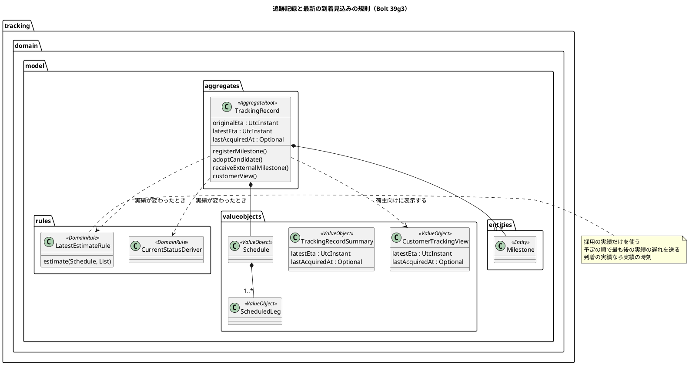
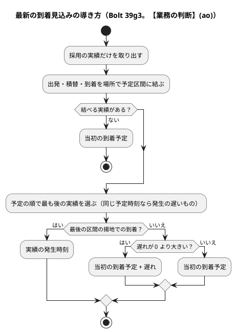
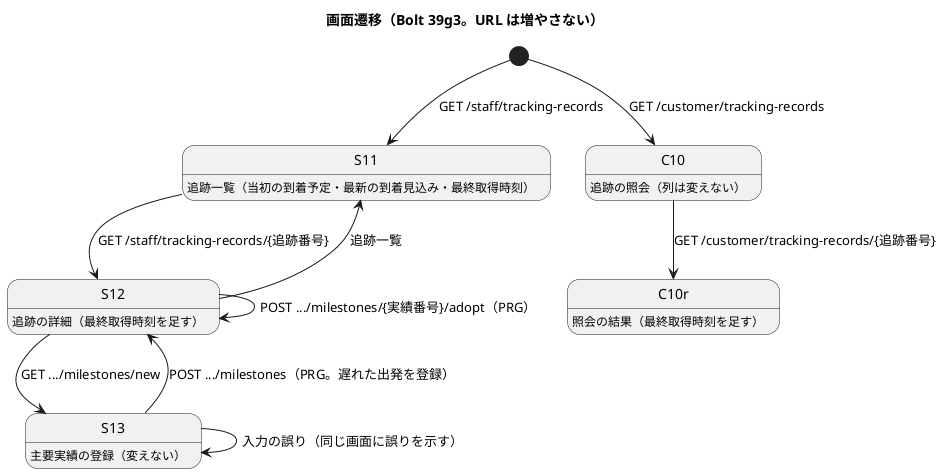
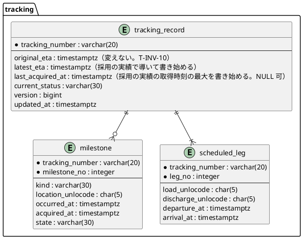

# Bolt 39g3 計画 - 採用した実績で最新の到着見込みを動かし、最終取得時刻を示す

## 基本情報

| 項目 | 内容 |
| :--- | :--- |
| Bolt | 第 39g3 回（W7 の 31 本目。release_plan :979 の 39g3 の行） |
| 状態 | 計画（承認済み。2026-11-11。確認ポイントを推奨のとおり承認。human:kakimomokuri。2 つの整合性検証（`validating-iteration-plan`・`validating-design`）の指摘を反映した） |
| 予定 | W7（2026-11-16 の週。前倒しで着手できる）。Bolt 39g2 の終了報告の承認（2026-11-11）の後に着手する。約 3 時間 15 分（約 195 分）の見込み（下の「ステップ計画」）。`check`・`uiTest`・`manualScreenshots`・SonarQube・CI と承認の待ちを除く |
| アプローチ | アウトサイドイン（release_plan :979「既存の追跡記録を広げる」。development_strategy :350 の W7 の追跡の残りは中盤の例外でアウトサイドイン。状態の組み合わせの表を先に書く。T-182）。受入シナリオ（遅れた出発で見込みが動く）を先に Red にし、内側（見込みの規則 → 追跡記録の集約 → 保存と照会 → 画面）に入る |
| 対象 | (1) 最新の到着見込み（`latest_eta`）を採用の実績から導く規則（`LatestEstimate`。T-INV-10）、(2) 最終取得時刻（`last_acquired_at`）の書き手、(3) 保存の UPDATE と一覧の照会、(4) S-11 の到着の列（Bolt 26 の U-3）と最終取得時刻、S-12・C-10 の最終取得時刻、(5) マニュアル 5 章・9 章・用語集 |
| トレース | T-INV-10、`LatestEstimate`・`Freshness`・`FreshnessPolicy`（domain_model :207・:209・:1408）、NFR-FRESH-01（FRS-02・FRS-03。non_functional :124・:125）、US-09 AC1（取得時刻）、W7 CP19（release_plan :931）、Bolt 26 終了報告 :99（U-3）、Bolt 26b 終了報告 :107、[Bolt 39g2 計画](bolt_39g2_plan.md) の決定 (1)・申し送り、[Bolt 39g2 終了報告](bolt_39g2_report.md) の既知の課題 :116（本計画の確認ポイントは「本計画 CP-n」、W7 の確認ポイントは「W7 CPn」と書き分ける） |
| GitHub | この Bolt の Issue はない（US を数えない技術の Bolt。release_plan :979 の SP は 0） |
| SP | 0 |
| 承認ゲート | **計画と終了報告で止める**（release_plan :979「計画と終了報告」）。確認必須のもの（範囲の分割、業務の規則、画面の項目、既存データを補正しない判断、新しいファイル）は本計画の確認ポイントにまとめ、計画の承認に含める（前例 bolt_39g2_plan.md）。スキーマは変えない（列 `latest_eta`・`last_acquired_at` は V20261009130000 :20・:21 にある。下の決定 (6)）。認可は変えない（新しい URL を足さない）。外部連携は足さない。`/goal` の下でも、この計画は承認を受けてから実行する |

## Bolt ゴール

追跡管理者が予定より遅れた出発・積替の実績を登録または採用すると、最新の到着見込みが遅れの分だけ後ろに動き、到着（最後の区間の揚地）の実績を採用すると見込みはその実績の時刻になる。当初の到着予定は変わらない（T-INV-10）。追跡管理者は S-11 で当初の到着予定と最新の到着見込みと最終取得時刻を並べて見られ（U-3）、S-12 と荷主の C-10 の照会の結果には最終取得時刻が出る（FRS-03 の「最終取得時刻を常に表示する」の照会の結果の分）。確認中・下書き・保持のみの実績では見込みも最終取得時刻も動かない。

## 状態の組み合わせ（行ごとにテストを 1 本。T-182）

行の番号はこの計画で 1 から振る。「予定時刻」は予定区間の出発予定・到着予定、「遅れ」は実績の発生時刻から予定時刻を引いた時間。見本の予定は 2 区間（区間 1: JPTYO から KRPUS、区間 2: KRPUS から USLAX）。テストは新しいクラスは決定 (8)、既存のクラスは `@Nested class Bolt39g3_…`。

| 行 | 状況 | 期待 | 確かめ方 |
| :--- | :--- | :--- | :--- |
| 1 | 対応づけ（パラメーター。入力と期待の組まで縛る。T-244）: (a) 出発・JPTYO、(b) 出発・KRPUS、(c) 積替・KRPUS、(d) 到着・USLAX、(e) 集荷・搬入・引渡し、(f) 区間にない場所（出発・CNSHA）、(g) 種類と区間の位置が合わない（到着・KRPUS、積替・USLAX、出発・USLAX） | (a) 区間 1 の出発予定、(b) 区間 2 の出発予定、(c) 区間 1 の到着予定、(d) 区間 2 の到着予定、(e)(f)(g) 対応しない（見込みを動かさない） | 単体（`LatestEstimateRuleTest`） |
| 2 | 遅れ（パラメーター）: 出発・積替の実績が予定時刻の (a) 6 時間後、(b) ちょうど、(c) 3 時間前 | (a) 当初の到着予定 + 6 時間、(b)(c) 当初の到着予定（遅れだけを先へ送り、早い出発で見込みを早めない。本計画 CP-3） | 単体 |
| 3 | 到着（最後の区間の揚地）の実績（パラメーター）: 予定より (a) 遅い、(b) 同じ、(c) 早い | 見込みは実績の発生時刻（(c) 早着も実績にする） | 単体 |
| 4 | 対応する実績が 2 つ以上: (a) 区間 1 の出発が 6 時間遅れ、区間 2 の出発がちょうど、(b) 同じ予定時刻に 2 つの出典の出発（4 時間遅れと 6 時間遅れ） | (a) 当初の到着予定（予定の順で最も後の実績を使う。積替港で遅れを取り戻した）、(b) 当初 + 6 時間（同じ予定時刻なら発生時刻の遅い方） | 単体 |
| 5 | 使う実績の状態（パラメーター）: 採用・確認中・下書き・保持のみの 6 時間遅れの出発 | 採用だけが見込みを動かす。ほかは当初の到着予定のまま（T-INV-08 と同じく現在状態に効く実績だけを使う） | 単体 |
| 6 | 対応する採用の実績がない（実績なし、集荷だけ） | 当初の到着予定 | 単体 |
| 7 | 最終取得時刻（パラメーター）: (a) 実績なし、(b) 採用 1 件、(c) 採用 2 件で発生の新しい実績の取得時刻のほうが古い、(d) 採用 1 件と取得時刻の新しい下書き・確認中・保持のみ | (a) 空、(b) その取得時刻、(c) 2 件の取得時刻の新しい方（発生時刻の順と独立）、(d) 採用の取得時刻（ほかの状態は使わない。本計画 CP-4） | 単体（`TrackingRecordTest`） |
| 8 | 追跡の開始 | 見込みは当初の到着予定、最終取得時刻は空（今のまま） | 単体（既存の開始のテストに足す） |
| 9 | 手入力の登録（パラメーター: 登録の結果 採用・確認中・保持のみ・拒否・同じ出典） | 採用だけが見込みと最終取得時刻を変える。当初の到着予定・予定は変えない（T-INV-10） | 単体（`TrackingRecordMilestoneTest`） |
| 10 | 下書きの採用（パラメーター: 採用・確認中に移る・拒否・判断済みと同じ値） | 採用に移ったときだけ変わる | 単体（`TrackingRecordCandidateAdoptionTest`） |
| 11 | DE-13 の受け取り（下書き・保持のみ・拒否） | 変わらない | 単体（`TrackingRecordExternalMilestoneTest`） |
| 12 | 確認中の追跡に時系列どおりの遅れた出発を採用する | 見込みは動く（採用の実績で決める）。現在状態は確認中のまま | 単体 |
| 13 | 引渡しの後（完了後）に届いた実績 | 保持のみなので変わらない | 単体 |
| 14 | 保存 | 版の条件で `latest_eta`・`last_acquired_at`（空なら NULL）を今の列と一緒に書く。`original_eta`・経路版・予定区間は書かない。版が違えば今のとおり競合 | 統合（`MyBatisTrackingRecordRepositoryIntegrationTest`。H2 と PostgreSQL） |
| 15 | 読み込みと往復 | 組み立てで `last_acquired_at` を読む（NULL は空）。保存した見込みと最終取得時刻が読み直しても同じ | 統合 |
| 16 | 一覧の要約（S-11・C-10） | 要約に最新の到着見込み（今もある）と最終取得時刻を載せる。並びと上限と荷主企業・担当企業の絞りは変えない | 統合、`InMemoryTrackingRecordRepository` |
| 17 | S-11 の列 | 追跡番号・現在状態・当初の到着予定・最新の到着見込み・最終取得時刻・追跡の開始時刻。最終取得時刻がなければ「なし」（本計画 CP-5） | コントローラーの単体（`TrackingRecordControllerTest`） |
| 18 | S-12 の定義リスト | 最新の到着見込みの次に「最終取得時刻」。なければ「まだありません」 | コントローラーの単体 |
| 19 | C-10 の照会の結果 | 最新の到着見込みの次に「最終取得時刻」（荷主の日時表示）。なければ「まだありません」。一覧の列は変えない（値は動く） | `CustomerTrackingControllerTest`、`TrackingRecordCustomerViewTest` |
| 20 | 開示（T-INV-09） | C-10 の最終取得時刻は採用の実績から決まり、下書き・確認中の取得時刻を漏らさない | `TrackingRecordCustomerViewTest`（行 7 (d) の組で） |
| 21 | 受入シナリオ（業務ルール層） | 区間 1 の出発を予定の 6 時間後で登録すると最新の到着見込みが 6 時間後になり、当初の到着予定は変わらない。到着の実績で見込みが実績の時刻になる。時系列に反する実績（確認中）では動かない | `features/tracking/latest_estimate.feature`（`@T-INV-10`） |
| 22 | UI（追跡管理者が S-13 で遅れた出発を登録し、S-12・S-11 で見込みと最終取得時刻を見る。荷主が C-10 で見る） | 文字で示す。axe の違反 0。幅 320 px（S-11 は今の横スクロールの囲み） | `features/ui/latest_estimate_ui.feature`、タグ `@demo-bolt-39g3/latest-estimate` |
| 23 | 認可は変えない | S-11・S-12・S-13 は追跡管理者（担当企業の範囲。Bolt 38g）、C-10 は荷主担当者の自社だけ（回帰） | 既存の `@WebMvcTest`・`TrackingAssignedScopeSecurityIntegrationTest` |
| 24 | 層の規則と用語の検査 | 規則は `tracking.domain.model.rules`（`@DomainRule`）。`LivingGlossaryConsistencyTest` が用語の行と Javadoc の最初の語を確かめる | `LayerArchitectureTest`・`LivingGlossaryConsistencyTest`（既存） |
| 25 | マニュアル | 5 章（C-10 の最終取得時刻、見込みの動き方）・9 章（S-11 の列、S-12 の最終取得時刻、見込みの動き方）・用語集が実装と一致する | ステップの突き合わせの記録（T-197・T-251） |
| 26 | 今の振る舞い | 下の「守る既存のテスト」が通る | 既存 |

### 守る既存のテスト（Red のテストを書く前に流すテストの一覧。T-217、Bolt 39g2 の Try）

- 追跡: `TrackingRecordTest`、`TrackingRecordMilestoneTest`、`TrackingRecordCandidateAdoptionTest`、`TrackingRecordExternalMilestoneTest`、`TrackingRecordCustomerViewTest`、`TrackingRecordCommandServiceTest`、`TrackingRecordQueryServiceTest`、`CustomerTrackingQueryServiceTest`、`TrackingRecordControllerTest`、`CustomerTrackingControllerTest`、`MilestoneRegistrationControllerTest`、`MyBatisTrackingRecordRepositoryIntegrationTest`、`MyBatisTrackingRecordRepositoryUniqueKeyTest`、`MyBatisTrackingRecordLockIntegrationTest`、`TrackingAssignedScopeSecurityIntegrationTest`、`features/tracking/register_milestone.feature`・`query_tracking.feature`、`features/ui/register_milestone_ui.feature`・`query_tracking_ui.feature`・`under_review_milestone_ui.feature`・`adopted_milestone_reflected_ui.feature`・`transport_phase_from_tracking_ui.feature`
- 横断: `LayerArchitectureTest`、`LivingGlossaryConsistencyTest`

## 開始準備の決定（推奨を 1 つに決めて書いた。承認済み）

(1) **範囲と見積り**（本計画 CP-1、【前の決定の変更】(18)）: release_plan :979 の 39g3 の行は、`latest_eta` を何で動かすか、`last_acquired_at` の書き手と鮮度超過の判定（`FreshnessPolicy`、NFR-FRESH-01）、S-11 の到着の列の 3 つ。コードで確かめると、鮮度超過の判定（FRS-02）は次の 3 つが未決で、規則だけでなく置き場所も決まらない: (a) 「次の予定の実績」と「最後に取り込んだファイルの取得時刻」（外部データのコンテキストの取込の時刻。追跡は持たない）をどう読むか、(b) FRS-02 のとおり現在状態を確認中（理由 鮮度超過）に変えるか（時刻の経過で変わるので定期の処理が要る）、読むときの判定で示すだけにするか（前例 Bolt 39f2 の古くなった候補。【業務の判断】(w)）、(c) S-11 の一覧で示すなら、一覧の照会は集約を組み立てないので予定区間の時刻を一覧の行に持つ（スキーマ）か照会を増やす。加えて domain_model :209 の `LatestEstimate` は「実績と採用値から見込む」で、採用値（航海の DE-12）で見込みを動かすには追跡に DE-12 の listener と航海番号で追跡記録を引く照会（索引。スキーマ）が要る。全部を入れると目安（T-250 の 4 時間 05 分）を超え、スキーマと定期の処理の判断が入る。そこで **39g3 は採用の実績で動く見込みと最終取得時刻（スキーマを変えない）にし、鮮度超過の判定と航海の採用値で動く見込みを 39g4 に分け、39g3 の直後（39h の前）に置く**。分けても見えない状態の Bolt はできない（39g3 は S-11・S-12・C-10 の値で見え、39g4 は鮮度超過の印で見える）。39g3 は約 195 分。超えそうなときは 行 22 の動画（−5 分）、行 16 の C-10 の一覧の確かめ（−5 分）の順に後へ送る。マニュアルは後に送らない。
- 比べた案: (i) **39g4 に分ける（推奨）**。(ii) 39g3 に全部入れる（目安を超え、スキーマと定期の処理の判断が開始準備に積まれる）。(iii) 鮮度超過を W9 の US-09 AC2・AC3（荷主への「最新性を保証しない旨」）に送る（S-11 で追跡管理者が鮮度超過を見つける運用（operation.md :74）が W9 まで待つ。W7 CP19 の決定から 2 週ずれる）

(2) **見込みを何で動かすか**（本計画 CP-2、【業務の判断】(an)、台帳 D-130（仮））: 39g3 は **採用の実績** で動かす（`LatestEstimate` の「実績」の分）。航海の採用値（DE-12。区間の航海の到着予定が変わったとき）で動かす分は 39g4 の開始準備で諮る（決定 (1)）。2 つがそろったときにどちらを先に使うか（例: 到着の実績があれば実績、なければ遅れと航海の新しい到着予定の遅い方）も 39g4 で決める。
- 比べた案: (i) **採用の実績で動かす（推奨）**。(ii) 航海の採用値だけで動かす（追跡に新しい listener と照会が要り、手入力の運用では動かない）。(iii) 見込みは動かさず、当初の到着予定と同じまま表示だけ直す（U-3 の「実績で見込みが動く」を満たさない）

(3) **遅れの伝え方**（本計画 CP-3、【業務の判断】(ao)、台帳 D-131（仮））: 規則 `LatestEstimateRule`（`tracking.domain.model.rules`、`@DomainRule`。純粋な関数）が、予定と採用の実績の列から最新の到着見込みを返す。
- 対応づけ: 出発は積地が実績の場所の区間の出発予定、積替は揚地が実績の場所の区間（最後の区間でない）の到着予定、到着は最後の区間の揚地が実績の場所なら最後の区間の到着予定に結ぶ。集荷・搬入・引渡しは予定に時刻がないので結ばない。場所が区間にない実績、種類と区間の位置が合わない実績、同じ場所が 2 つ以上の区間に当たる実績は結ばない（見込みを動かさない。候補は同じ港を 2 度使わない（Bolt 37f の開始準備の決定 (4)）が、予定の規則（`Schedule`）は禁じていないので守りとして置く）
- 使う実績: 対応づけた採用の実績のうち、予定の順で最も後のもの（同じ予定時刻に 2 つあれば発生時刻の遅いもの）
- 見込み: 到着の実績なら、その発生時刻（早着も実績にする）。出発・積替なら、当初の到着予定に遅れ（発生時刻 − 予定時刻）を足す。遅れが 0 以下なら当初の到着予定（早い出発で見込みを早めない。航海の到着予定は出発が早くても変わらないため）
- 対応づけた採用の実績がなければ当初の到着予定
- 比べた案: (i) **予定の順で最も後の実績の遅れだけを送る（推奨）**。(ii) すべての実績の遅れの最大を送る（積替港で遅れを取り戻しても見込みが戻らない）。(iii) 早い出発も見込みを早める（航海の予定は早まらないので、荷主に早い見込みを示して外す）

(4) **最終取得時刻**（本計画 CP-4、【業務の判断】(ap)、台帳 D-132（仮））: 追跡記録の最終取得時刻は、**採用の実績の出典の取得時刻のうち最も新しいもの**（採用の実績がなければ空）。下書き・確認中・保持のみの取得時刻は使わない（荷主の C-10 は採用の実績だけを示すので、示していない実績の時刻を出さない。T-INV-09。現在状態の根拠になる情報の新しさを示す）。受け入れること: 下書きが届いていても最終取得時刻は進まない（下書きは S-12 で採用を待っていると分かる）。39g4 の鮮度超過の判定がこの値を使うかは 39g4 で決める（FRS-02 は「最後に取り込んだファイルの取得時刻」）。
- 比べた案: (i) **採用の実績だけ（推奨）**。(ii) すべての実績（荷主に示さない実績の時刻が C-10 に出る。確認中の実績の時刻が見えると、確認中の中身を推せる）。(iii) 外部データの最後の取込の時刻（追跡が外部データの取込を参照することになり、手入力の実績で進まない）

(5) **画面に出すもの**（本計画 CP-5。画面の項目）: S-11 の列に「最新の到着見込み」（当初の到着予定の次。U-3）と「最終取得時刻」を足す（6 列。今の横スクロールの囲みのまま）。最終取得時刻がないセルは「なし」。S-12 と C-10 の照会の結果の定義リストに「最終取得時刻」（最新の到着見込みの次。なければ「まだありません」）。C-10 の一覧は列を変えない（荷主の一覧の最終取得時刻と「最新性を保証しない旨」は US-09 AC3・W9 で一緒に決める）。見込みの根拠（どの実績の遅れか）は示さない（39g4 で採用値と合わせて決める）。新しい URL・新しい操作はない。日時の書式は今の社内・荷主の表示（`DateTimeDisplay`）。
- 比べた案: (i) **S-11 に 2 列、S-12・C-10 の照会の結果に 1 行（推奨）**。(ii) S-11 に見込みだけ足す（最終取得時刻は 39g4 の鮮度超過と一緒に。追跡管理者が手で古さを見つける手がかりが 39g4 まで出ない）。(iii) C-10 の一覧にも足す（荷主の一覧は幅 320 px で 4 列になり、US-09 AC3 の表示と二度直しになる）

(6) **保存と既存のデータ**（本計画 CP-6。データベース）: スキーマは変えない。主要実績の保存の UPDATE（`updateTrackingRecord`）が `latest_eta` と `last_acquired_at` も書く（`original_eta`・経路版・予定区間は書かない。data_model :794 の「書かない」を直す）。集約は今の現在状態と同じく **保存した値を読み、実績が変わったときだけ導出し直す**（導出の 1 か所は `TrackingRecord.withMilestones`。DE-13 の受け取りも通るが採用の実績が変わらないので値は同じ）。組み立ての行の型 `TrackingRecordRow`・要約の行の型 `TrackingRecordSummaryRow` に `last_acquired_at` を足し、`reconstitute` に最終取得時刻を足す。39g3 の前に採用した遅れた実績を持つ追跡記録は、次に実績が変わるまで見込みが当初のまま、最終取得時刻が空のまま残る。補正のマイグレーションは作らない（Release 1.0 のパイロットの前で業務のデータはない。前例 Bolt 39g2 の決定 (9)）。配備の前にステージング・本番で、採用の実績を持つのに `last_acquired_at` が NULL の追跡記録の数を確かめ、あれば人が判断する（申し送り。照会は運用手順書のタスクで行う）。
- 比べた案: (i) **保存した値を読み、補正しない（推奨）**。(ii) 集約が読むたびに実績から導き、列は一覧のためだけに書く（詳細と一覧で値が食い違う行ができ、正が 2 つになる）。(iii) Java のマイグレーションで既存の行を補正する（業務のデータがない今は作るだけの手間）

(7) **認可・外部連携・イベントは変えない**: 新しい URL を足さない。C-10 の最終取得時刻は荷主がすでに見ている実績の取得時刻の最大で、開示の範囲は広がらない（T-INV-09）。見込みが変わったことのイベント（荷主への通知）は作らない（US-22・W9 の通知で要るかを決める）。セキュリティの承認ゲートには当たらない。

(8) **層と新しい型の名前**（第 3 章、CLAUDE.md。T-246。`apps/cargo-tracker/src` で `LatestEstimate`・`LatestEstimateRule`・`lastAcquiredAt`・`Bolt39g3`・`demo-bolt-39g3`・`latest_estimate` を単語で検索し、ないことを確かめた。`FreshnessPolicy` は経路設計の `InfoFreshnessPolicy` の中にだけ現れ、追跡にはない）:
- 規則: `tracking.domain.model.rules.LatestEstimateRule`（`@DomainRule`。domain_model のドメインルール・サービスの表に行を足す）
- 直すもの: `TrackingRecord`（`withMilestones`・`reconstitute`・`lastAcquiredAt()`・`customerView()`）、`TrackingRecordSummary`、`CustomerTrackingView`、`TrackingRecordRepository` の Javadoc、`MyBatisTrackingRecordRepository`、`TrackingRecordRow`・`TrackingRecordSummaryRow`、`TrackingRecordMapper.xml`、`InMemoryTrackingRecordRepository`（テスト）、`TrackingRecordViews`（`Row`・`DetailView`・`CustomerDetailView`）、テンプレート（S-11・S-12・C-10 の照会の結果）、マニュアル 5 章・9 章・用語集
- テスト: `LatestEstimateRuleTest`、受入シナリオ `features/tracking/latest_estimate.feature`・`features/ui/latest_estimate_ui.feature`、タグ `@demo-bolt-39g3/latest-estimate`
- 新しいコンテキスト間の依存はない。共有カーネルは変えない。**規則の例外は要らない見込み**で、当たったら置き場所を動かさず止めて諮る（T-125）。外部の技術のポートは足さない

### 前の Bolt から引き継いだもの

| 出典 | 内容 | この計画 |
| :--- | :--- | :--- |
| release_plan :979、W7 CP19（:931） | `latest_eta` を何で動かすか、`last_acquired_at` の書き手と鮮度超過の判定、S-11 の到着の列 | 決定 (1)〜(6)。鮮度超過の判定と航海の採用値は 39g4（決定 (1)） |
| Bolt 39g2 計画の決定 (1)・申し送り、終了報告 :116 | 到着見込みと鮮度、S-11 の到着の列（U-3）。業務の規則が未決なので業務の判断として諮る | 決定 (2)〜(4)、【業務の判断】(an)〜(ap) |
| Bolt 26 終了報告 :99 | U-3「一覧の到着の列が当初の予定だけ」（実績で見込みが動く Bolt で決める） | 決定 (5)、行 17 |
| Bolt 26b 終了報告 :107 | W7: 到着見込みと鮮度 | 決定 (1) |
| data_model :794 | 主要実績の登録は `last_acquired_at` を書かない（到着見込みと鮮度は W7） | 決定 (6)、行 14 |
| Bolt 39g2 終了報告の Try | 守る既存のテストは Red のテストを書く前に流す。変異のスクリプトは落ちたテストの名前がない exit 1 を「落ちた」にしない | ステップ 2、ステップ 9 |

### 開始準備で確かめたこと（作業ツリーの `apps/cargo-tracker/src` で読んだ）

- **見込みは動かない**: `latest_eta` は追跡の開始で `schedule.finalArrival()` を当初の到着予定と同じに入れるだけ（TrackingRecord.java :143-144）。実績を足す 1 か所 `withMilestones`（:479-493）は見込みをそのまま写す。保存の UPDATE（TrackingRecordMapper.xml :90-99）は現在状態・根拠・確認中の理由・版・更新時刻だけを書く
- **最終取得時刻は書き手も読み手もない**: 列 `last_acquired_at`（V20261009130000 :21、NULL 可）は INSERT・UPDATE・SELECT のどれにも出ない（TrackingRecordMapper.xml の列の一覧 :71-75）。行の型 `TrackingRecordRow`・`TrackingRecordSummaryRow` にもない
- **画面**: S-11 の行 `Row` は当初の到着予定だけ（TrackingRecordViews.java :116）。S-12 の `DetailView` と C-10 の `CustomerDetailView` は当初の到着予定と最新の到着見込みを持つ（:144-154・:373-379）。C-10 の一覧 `CustomerRow` は最新の到着見込みだけ（:352）。C-10 の実績ごとの取得時刻はすでに出る（:389・:408）
- **予定**: `Schedule` は区間の列で、前の揚地と次の積地が同じこと、次の出発が前の到着より前でないことを守る（Schedule.java :30-41）。同じ港を 2 度使うことは禁じていない
- **実績の種類**: 集荷・搬入・出発・積替・到着・引渡し（`MilestoneKind`）。積替港での到着は積替、積替港からの出発は出発として登録する（domain_model :1165）
- **鮮度の設定の前例**: 経路設計の `InfoFreshnessPolicy` と設定 `cargotracker.routing.info-freshness-tolerance=PT24H`（application.properties :68）。追跡の鮮度とは許容範囲と決定者が違うので共有しない（domain_model :207）
- **開発データ**: マイグレーションに追跡記録の見本の INSERT はない（`INSERT INTO tracking` はマッパーだけ）

## 業務の判断の記録（本計画 CP-2〜CP-4。仮。パイロットの前に業務責任者に確かめる）

| 判断 | 推奨 | 理由 |
| :--- | :--- | :--- |
| (an) 最新の到着見込みを何で動かすか | 39g3 は採用の実績で動かす。航海の採用値（DE-12）で動かす分は 39g4 で諮る | 手入力の運用（パイロットは手動取込。BR-18）でも見込みが動く。採用値は追跡に新しい listener と照会が要り、鮮度超過と一緒に決めるほうが自然 |
| (ao) 遅れをどう伝えるか | 予定に結べる採用の実績（出発・積替・到着）のうち予定の順で最も後のものの遅れを、当初の到着予定に足す。到着の実績なら見込みは実績の時刻。早い出発では見込みを早めない | 最後の進みの遅れが今の見込みに最も近い。積替港で遅れを取り戻せば見込みも戻る。航海の予定は早まらないので早い見込みを示さない |
| (ap) 最終取得時刻は何か | 採用の実績の出典の取得時刻のうち最も新しいもの | 荷主に示す実績と同じ範囲で「いつの情報か」を示す（FRS-03、T-INV-09） |

## スコープ

### 入れるもの

- 行 1〜26。決定 (2)〜(8) の実装と文書
- マニュアル 5 章（C-10 の照会の結果の最終取得時刻、見込みの動き方）・9 章（S-11 の列、S-12 の最終取得時刻、見込みの動き方）・用語集（最新の到着見込み、最終取得時刻）、キャプチャ（S-11・S-12・C-10 の照会の結果）、動画 `@demo-bolt-39g3/latest-estimate`

### 入れないもの

- 鮮度超過の判定（FRS-02、`FreshnessPolicy`、確認中の理由の鮮度超過、S-11 の印と絞り込み）と、航海の採用値（DE-12）で動く見込み（39g4。決定 (1)）
- 見込みの根拠の表示（39g4）、見込みが変わったことの通知（US-22・W9）
- 荷主の一覧の最終取得時刻と「最新性を保証しない旨」・次回更新日時・担当窓口（US-09 AC3・W9）、荷受人の最終更新時刻（US-10・R1.1）
- 経路の再設計で予定が変わったときの追跡の予定（US-08・W13）

### 申し送り

| 送り先 | 課題 |
| :--- | :--- |
| 39g4 | 鮮度超過の判定（FRS-02 の「次の予定の実績」「最後に取り込んだファイルの取得時刻」の読み方、確認中にするか読むときに示すか、S-11 の一覧での示し方とスキーマ、許容範囲の設定）、航海の採用値で動く見込みと実績との優先、見込みの根拠の表示 |
| W9 | US-09 AC2・AC3（荷主の一覧の最終取得時刻、最新性を保証しない旨）、見込みの変化の通知（US-22 で要るか） |
| 配備の前 | ステージング・本番で、採用の実績を持つのに `last_acquired_at` が NULL の追跡記録の数を確かめる（決定 (6)） |
| Release 1.0 のパイロットの前 | 業務の判断 (an)〜(ap) を業務責任者に確かめる（台帳 D-130〜D-132） |

### 設計文書に直す箇所（ステップ 1。「到着見込み」「最終取得」「latest_eta」「last_acquired_at」「39g3」で検索して確かめる）

- domain_model: 用語の表の「最新の到着見込み」（:209。採用の実績から導く規則、39g4 の採用値）と「最終取得時刻」の行を足す、「鮮度」（:207）の注、追跡記録の集約の図（:1225-1277。図は「最新の到着見込み」「鮮度」「最終更新時刻」を現在状態（導出の値。:1268-1277）に置くが、コードは当初の到着予定と最新の到着見込みを集約の欄で持つ（Bolt 25 から）。最新の到着見込みと最終取得時刻は「実績が変わったときに導いて集約が持つ値」と書き、鮮度は 39g4 の注にする）、T-INV-10（:1397。Bolt 39g3 の規則）、ドメインルール・サービスの表に `LatestEstimateRule` の行を足し、`FreshnessPolicy`（:1408）に 39g4 の注、リポジトリの表（:1959。保存が見込みと最終取得時刻を書く）、「Bolt 39g3 で決めたこと」の節（:1219 の後）、:1219 の「39g3 に分けた」の注（39g4 を足す）
- data_model: `tracking_record` の注（:794。主要実績の保存は `latest_eta`・`last_acquired_at` も書く、`last_acquired_at` の意味）。スキーマは変えない
- ui_design: S-11（:177。列に最新の到着見込み・最終取得時刻）、S-12（:178 と画面イメージ :1727 の次に最終取得時刻）、C-10 の照会の結果（:165 と画面イメージ :1665 の次に最終取得時刻。一覧の画面イメージ :1647 は変えない）、:1688 の表の「当初の予定と最新の見込み」の注。S-11 は画面イメージがないので仕様の行だけ直す
- non_functional: FRS-03（:125）に「照会の結果（S-12・C-10）の最終取得時刻は Bolt 39g3、一覧と FRS-02 を超えたときの表示は 39g4・W9」の注
- test_strategy: T-INV-10 と最終取得時刻の行、受入シナリオのタグ
- release_plan: 39g3 の行（計画へのリンク・見積り・決めたこと）、39g4 の行を足す（鮮度超過と航海の採用値）、順序の行（:983）、:996 のチェックの行、台帳 D-130〜D-132（仮）、【前の決定の変更】(18)
- development_strategy: W7 の行（:350。39g4 を足す）
- マニュアル（ステップ 8）: 5 章 :111、9 章 :43・:73、用語集

## 設計（この Bolt の範囲）

状態遷移図は載せない（追跡状態と予約の状態は変えない。見込みと最終取得時刻は状態ではなく値）。

### ドメインモデル図（追跡記録の集約の変わる部分）

### 規則の流れ（`LatestEstimateRule`）

### 画面遷移図

### ER 図（この Bolt で書き始める列。スキーマは変えない）

## ステップ計画（ゲートは各ステップに書く）

| # | ステップ | ゲート | 分 |
| :--- | :--- | :--- | ---: |
| 1 | 設計文書を直す（上の一覧）、release_plan の 39g3 の行と 39g4 の行、日付の確認 | 既定 | 20 |
| 2 | 守る既存のテストの一覧を流す（Red を書く前。T-217）。Red: 受入シナリオ（行 21・22）と状態の組み合わせの単体（行 1〜13・17〜20）を同じ段で書いて流す | 既定 | 20 |
| 3 | 規則 `LatestEstimateRule`（行 1〜6）。Green → Refactor | **本計画 CP-2・CP-3 で計画の承認に含む** | 20 |
| 4 | 追跡記録の集約（行 7〜13。`withMilestones` で導出、最終取得時刻、`reconstitute`、`customerView`） | **本計画 CP-4 で計画の承認に含む** | 15 |
| 5 | 保存と照会（行 14〜16。UPDATE、行の型、要約、メモリの実装。H2 と PostgreSQL） | **本計画 CP-6 で計画の承認に含む** | 20 |
| 6 | 画面（行 17〜20・23。S-11・S-12・C-10 の照会の結果、テンプレート、コントローラーの単体） | **本計画 CP-5 で計画の承認に含む** | 20 |
| 7 | 画面の層のシナリオ（行 22）、動画 | 既定 | 15 |
| 8 | マニュアル 5 章・9 章・用語集とキャプチャ（行 25） | 既定 | 15 |
| 9 | 品質ゲート（`check`・`uiTest`・`manualScreenshots`・SonarQube・CI）、変異、文書の突き合わせ。`spotbugsMain`・`checkstyleMain`・`uiTest` は最後の直しの後にも流す | 既定 | 40 |
| 10 | 終了報告 | **終了報告で止める** | 10 |
| | 合計 | | 195 |

時間の配分と打ち切り: 超えそうなときは決定 (1) の順（動画 → C-10 の一覧の確かめ）に送る。

## 確認ポイント（計画の承認の場でまとめて確認する。Try T-6）

| # | 確認すること | 推奨 |
| :--- | :--- | :--- |
| 1 | 範囲: 鮮度超過の判定（FRS-02）と航海の採用値で動く見込みを 39g4 に分け、39g3 の直後に置く（【前の決定の変更】(18)。release_plan :979 の範囲の読み替え） | 分ける（鮮度超過は規則・置き場所・スキーマの 3 つが未決で、入れると目安を超える） |
| 2 | 見込みを何で動かすか（【業務の判断】(an)） | 39g3 は採用の実績で動かす。航海の採用値は 39g4 で諮る |
| 3 | 遅れの伝え方（【業務の判断】(ao)） | 予定に結べる採用の実績のうち予定の順で最も後のものの遅れを送る。到着の実績なら実績の時刻。早い出発では早めない |
| 4 | 最終取得時刻（【業務の判断】(ap)） | 採用の実績の出典の取得時刻のうち最も新しいもの |
| 5 | 画面の項目: S-11 に最新の到着見込み・最終取得時刻の 2 列（なしは「なし」）、S-12・C-10 の照会の結果に最終取得時刻（なしは「まだありません」）。C-10 の一覧は変えない | この形で足す |
| 6 | 保存と既存のデータ（データベースの判断） | スキーマを変えず UPDATE で 2 列を書く。保存した値を読む。既存の行は補正せず、配備の前に件数を確かめる |
| 7 | 新しいファイル（`LatestEstimateRule`・`LatestEstimateRuleTest`、2 つの feature、`bolt_39g3_plan.md`・終了報告、動画） | 作る |

### 変異と落ちる見込みのテスト

- 早い出発でも見込みを早める → 行 2 (c) が落ちる
- 到着の実績でも当初 + 遅れにする（早着を実績にしない） → 行 3 (c) が落ちる
- 予定の順で最も後でなく遅れの最大を使う → 行 4 (a) が落ちる
- 確認中の実績も使う → 行 5・12 の組と行 21 が落ちる
- 種類と区間の位置を見ずに場所だけで結ぶ → 行 1 (g) が落ちる
- 最終取得時刻に下書きの取得時刻を含める → 行 7 (d)・20 が落ちる
- 最終取得時刻を発生時刻の最も新しい実績の取得時刻にする → 行 7 (c) が落ちる
- 見込みで当初の到着予定も書き換える → 行 9・14 が落ちる
- UPDATE が `latest_eta` を書かない → 行 14・15・21 が落ちる
- S-11 の最新の到着見込みの列に当初の到着予定を出す → 行 17 が落ちる

## 完了条件

- 行 1〜26 のテストが通り、`check`・`uiTest`・CI が緑。SonarQube の品質ゲートが通る
- 変異が上の見込みどおりに落ちる
- **マニュアルに影響する**: 9 章（S-11 の列に最新の到着見込み・最終取得時刻、S-12 の最終取得時刻、遅れた出発・積替で見込みが動き到着で実績になること、確認中・下書きでは動かないこと）、5 章（C-10 の照会の結果の最終取得時刻と見込みの動き方）、用語集が実装と一致する。S-11・S-12・C-10 の照会の結果のキャプチャを撮り直す
- 動画 `@demo-bolt-39g3/latest-estimate` を撮った（S-13 で遅れた出発を登録すると、S-12・S-11 の最新の到着見込みが動く）
- `npx gulp okf:check` が ERROR 0
- 終了報告を作り、人が承認した

## ふりかえりと前の Bolt からの引き継ぎ

| 出典 | 内容 | この Bolt での扱い |
| :--- | :--- | :--- |
| Bolt 39g2 の Problem・Try、議題 5 | 標準入力につなぐコマンドを使わない。Bash のコマンドは必要な部分だけを打ち、先頭に何も足さない | ファイルは Write・Edit、コミットは `-m` を複数回。T-247 は W7 の締めで諮る |
| Bolt 39g2 の Try、議題 6 | 守る既存のテストは Red のテストを書く前に流す | ステップ 2 の最初 |
| Bolt 39g2 の Try | 変異のスクリプトは落ちたテストの名前がない exit 1 を「落ちた」にしない | ステップ 9 |
| Bolt 39gc の Try | 受入シナリオは単体の Red と同じ段で書いて Red を流す | ステップ 2 |
| Bolt 39gc の学び | 既存の画面のステップが「一覧の先頭」を前提にすると新しい項目を見落とす | 行 22 のステップは行を追跡番号で引く |
| Bolt 39gb の Try | PRG で同じ画面に戻る操作の待ちは、URL でなく応答で書く | 行 22 |
| W6 の Try T-182・T-211・T-216、T-244・T-245・T-246 | 状態の組み合わせに重複・出口・誤った入力の行、パラメーターは組まで縛る、型の名前は検索する | 上の表（行 1〜7・9〜11）、決定 (8) |
| W6 の Try T-217、T-219 | 本体を直す前に Red を流し直すテストの一覧を添える、変異は単体・統合 | 「守る既存のテスト」、ステップ 2・9 |
| Bolt 39d3 の T-250・T-251 | 見積りは 4 時間 05 分まで、マニュアルの文は決定の文から写す | 決定 (1)、ステップ 8 |
| memory の manual-in-bolt-done-criteria | 振る舞いが変わる Bolt はマニュアルを完了条件に入れる | 完了条件 |

## 更新履歴

| 日付 | 更新内容 | 更新者 |
| :--- | :--- | :--- |
| 2026-11-11 | 確認ポイントを推奨のとおり承認として記録した（39g4 への分割、業務の判断 (an)〜(ap) を含む。以降は推奨で進める指示による。human:kakimomokuri） | anthropic/claude-opus-5-5、承認 human:kakimomokuri |
| 2026-11-11 | 初版作成。2 つの整合性検証の指摘を反映した（下の「整合性検証の結果」） | anthropic/claude-opus-5-5 |

## 整合性検証の結果（開始準備のステップ 3・4）

| 検証 | 指摘 | 扱い |
| :--- | :--- | :--- |
| `validating-iteration-plan`（ドメインモデル） | 中: domain_model の追跡記録の図は最新の到着見込み・鮮度を現在状態（導出の値）に置き、計画の図とコードは集約の欄に置く | 設計文書の直しの一覧に足した（ステップ 1 で図を実装に合わせる。概念は「導出の値」のまま） |
| `validating-iteration-plan`（データモデル） | 中: 計画の ER 図の型が表と違った（UN/LOCODE は `CHAR(5)`、番号は `INTEGER`） | 計画の ER 図をマイグレーションに合わせて直した |
| `validating-iteration-plan`（UI） | 軽: ui_design の画面イメージの行の番号の誤り、S-11 に画面イメージがないこと | 一覧の行の番号を直し、S-11 は仕様の行だけ直すと書いた |
| `validating-iteration-plan`（テンプレート・ストーリー・過去のレビュー） | 指摘なし。体裁は直前の Bolt 計画（39g2・39gc）を踏襲。US を数えない Bolt で、US-09 AC1 は取得時刻のトレースだけ。最新のレビュー（W6 横断）の高・中は 38h で返済済み | — |
| `validating-design` 軸 A | 指摘なし。W7 の追跡の残りはアウトサイドイン（development_strategy :350）。39g4 を W7 の行に足すことは一覧にある | — |
| `validating-design` 軸 B | 中: 新しい `@DomainRule`（`LatestEstimateRule`）と用語「最終取得時刻」が domain_model の表にない。FRS-03（「提案」でなく「確定」）の照会の結果の分を作るのに non_functional に注がない | 設計文書の直しの一覧に足した（ドメインルール・サービスの表、用語の表、FRS-03 の注） |
| `validating-design` 軸 C | 中: domain_model :1959 のリポジトリの「保存」の記述（現在状態と根拠だけを書き直す）と data_model :794 の「書かない」が古くなる。軽: 「最終取得時刻」は列の注釈（V20261009130000 :52）と FRS-03 の語と一致、「最新の到着見込み」「当初の到着予定」は Bolt 26・27 の語と一致。導出して保存する形は現在状態（Bolt 26b）、既存のデータを補正しない判断は Bolt 39g2 の決定 (9) の前例を踏襲 | :1959・:794 は一覧にある。語と形は変えない |

## 関連ドキュメント

- [Bolt 39g2 計画](bolt_39g2_plan.md)、[Bolt 39g2 終了報告](bolt_39g2_report.md)、[Bolt 26 終了報告](bolt_26_report.md)、[Bolt 26b 終了報告](bolt_26b_report.md)
- [リリース計画](release_plan.md)
- [ドメインモデル](../../design/cargo-tracker/domain_model.md)、[データモデル](../../design/cargo-tracker/data_model.md)、[UI 設計](../../design/cargo-tracker/ui_design.md)、[非機能要件](../../design/cargo-tracker/non_functional.md)
