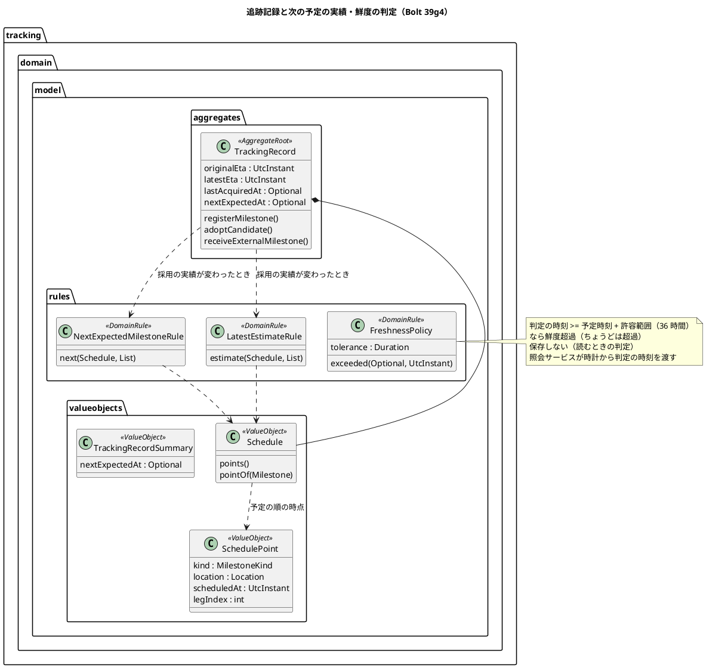
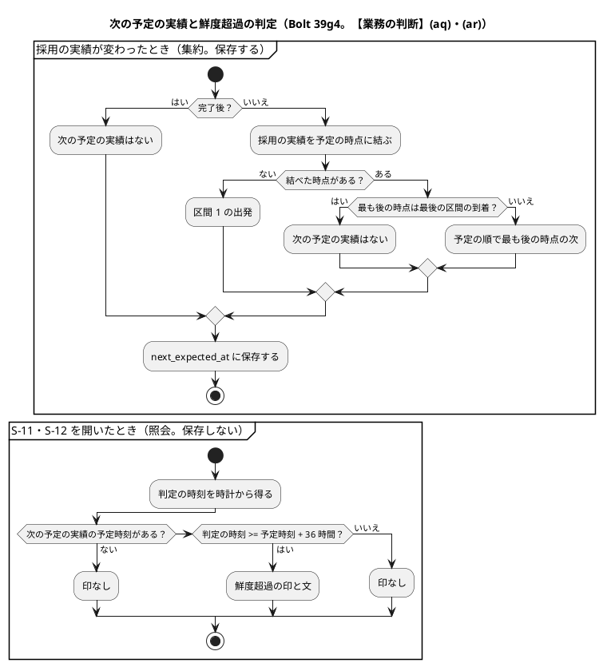
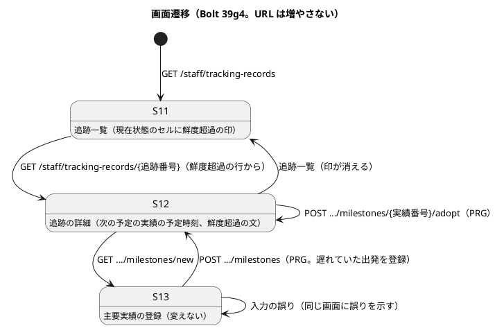
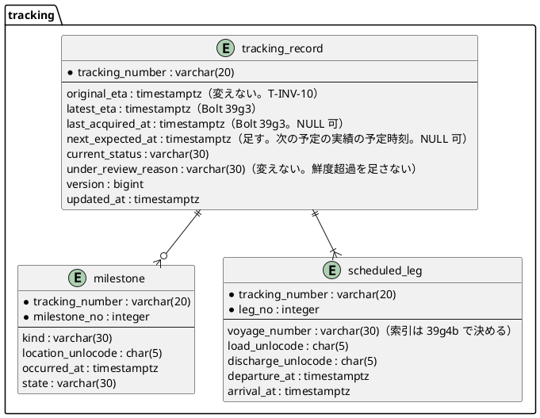

# Bolt 39g4 計画 - 次の予定の実績が届かない追跡を鮮度超過として示す

## 基本情報

| 項目 | 内容 |
| :--- | :--- |
| Bolt | 第 39g4 回（W7 の 32 本目。release_plan :980 の 39g4 の行） |
| 状態 | 計画（承認済み。2026-11-12 に確認ポイント 1〜8 を推奨のとおり承認。human:kakimomokuri。2026-11-12 に開始準備。2 つの整合性検証（`validating-iteration-plan`・`validating-design`）の指摘を反映した。下の「整合性検証の結果」） |
| 予定 | W7（2026-11-16 の週。前倒しで着手できる）。Bolt 39g3 の終了報告の承認（2026-11-12）の後に着手する。約 3 時間 50 分（約 230 分）の見込み（下の「ステップ計画」）。`check`・`uiTest`・`manualScreenshots`・SonarQube・CI と承認の待ちを除く |
| アプローチ | アウトサイドイン（release_plan :980「既存の追跡記録を広げる」。development_strategy :350 の W7 の追跡の残りは中盤の例外でアウトサイドイン。状態の組み合わせの表を先に書く。T-182）。受入シナリオ（出発の予定時刻から 36 時間を過ぎても出発の実績が届かない追跡が S-11 で鮮度超過と分かる）を先に Red にし、内側（予定の時点 → 次の予定の実績の規則と鮮度の判定 → 追跡記録の集約 → 保存と照会 → 画面）に入る |
| 対象 | (1) 次の予定の実績の予定時刻（`next_expected_at`）を採用の実績から導く規則、(2) 鮮度の判定（`FreshnessPolicy`。NFR-FRESH-01 の FRS-02、許容範囲の設定）、(3) 列の追加（スキーマ）と保存・照会、(4) S-11 の鮮度超過の印、S-12 の次の予定の実績の予定時刻と鮮度超過の文、(5) マニュアル 9 章・用語集 |
| トレース | FRS-02・FRS-03（non_functional :124・:125）、OBS-07（non_functional :267）、運用 :74（S-11 で確認中・鮮度超過の追跡を確かめる）、`Freshness`・`FreshnessPolicy`（domain_model :207・:1422）、S-11 の目的「確認中・鮮度超過・訂正承認待ちの追跡を一覧する」（ui_design :135）、[Bolt 39g3 計画](bolt_39g3_plan.md) の決定 (1)・申し送り、[Bolt 39g3 終了報告](bolt_39g3_report.md) の既知の課題 :117（本計画の確認ポイントは「本計画 CP-n」、W7 の確認ポイントは「W7 CPn」と書き分ける） |
| GitHub | この Bolt の Issue はない（US を数えない技術の Bolt。release_plan :980 の SP は 0） |
| SP | 0 |
| 承認ゲート | **計画と終了報告で止める**（release_plan :980「計画と終了報告」）。確認必須のもの（範囲の分割、業務の規則、前の決定の変更（(19)〜(21)）、画面の項目、**スキーマの変更**、既存データを補正しない判断、新しいファイル）は本計画の確認ポイントにまとめ、計画の承認に含める（前例 bolt_39g3_plan.md）。**データベースの承認ゲートに当たる**（`tracking.tracking_record` に列を 1 つ足すマイグレーション。下の決定 (6)）。認可は変えない（新しい URL を足さない）。外部連携は足さない。`/goal` の下でも、この計画は承認を受けてから実行する |

## Bolt ゴール

追跡管理者は、次に届くはずの実績（出発・積替・到着）の予定時刻から 36 時間を過ぎても採用の実績が届いていない追跡を、S-11 の一覧で「鮮度超過」の印で見つけられ、S-12 で次の予定の実績の予定時刻と鮮度超過の文を見られる（FRS-02。運用 :74）。鮮度超過は読むときの判定で示し、追跡の現在状態は変えない（確認中にしない）。次の予定の実績が採用されれば、印は次に開いたときに消える。荷主の C-10 は変えない（FRS-03 の「最新性を保証しない旨」は W9）。

## 状態の組み合わせ（行ごとにテストを 1 本。T-182）

行の番号はこの計画で 1 から振る。見本の予定は 2 区間（区間 1: JPTYO から KRPUS、出発予定 D1・到着予定 A1。区間 2: KRPUS から USLAX、出発予定 D2・到着予定 A2）。許容範囲は 36 時間。「予定の時点」は予定区間の出発予定・到着予定に、実績の種類と場所を添えたもの（予定の順に D1 の出発・JPTYO、A1 の積替・KRPUS、D2 の出発・KRPUS、A2 の到着・USLAX）。テストは新しいクラスは決定 (9)、既存のクラスは `@Nested class Bolt39g4_…`。

| 行 | 状況 | 期待 | 確かめ方 |
| :--- | :--- | :--- | :--- |
| 1 | 予定の時点の列（パラメーター。入力と期待の組まで縛る。T-244）: (a) 2 区間、(b) 1 区間、(c) 3 区間、(d) 2 区間で積替予定 A1 と区間 2 の出発予定 D2 が同じ時刻（`Schedule` は「次の出発が前の到着より前でない」だけを守るので作れる） | (a) 上の 4 つの時点の順、(b) 出発・積地、到着・揚地の 2 つ、(c) 出発・積替を交互にして最後が到着の 6 つ、(d) 4 つの時点の順（同じ時刻でも積替が先） | 単体（`ScheduleTest` に足す） |
| 2 | 予定の時点への対応づけ（39g3 の `LatestEstimateRuleTest` 行 1 の組をそのまま流す）と、A1 = D2 の予定で積替・KRPUS（6 時間遅れ）と区間 2 の出発・KRPUS（2 時間遅れ）を採用した組 | 39g3 と同じ（リファクタリングで振る舞いを変えない）。同じ予定時刻の組は 39g3 のとおり予定時刻の値で比べ、同じなら発生時刻の遅い方（区間 2 の出発。当初 + 2 時間） | 単体（`LatestEstimateRuleTest` の既存は直さずに流し、同時刻の組を Red の前に足して今のコードで緑を確かめる） |
| 3 | 次の予定の実績（パラメーター。組まで縛る）: 採用の実績が (a) なし、(b) 出発・JPTYO、(c) 出発・JPTYO と積替・KRPUS、(d) (c) に区間 2 の出発・KRPUS を足す、(e) (d) に到着・USLAX を足す、(f) 集荷・搬入だけ、(g) 区間 2 の出発・KRPUS だけ（区間 1 の実績が抜けている）、(h) 出発・JPTYO（発生が遅い）と積替・KRPUS（登録が先）、(i) A1 = D2 の予定で積替・KRPUS だけ | (a) D1、(b) A1、(c) D2、(d) A2、(e) なし、(f) D1（集荷・搬入は予定に時刻がない）、(g) A2（結べた実績のうち予定の順で最も後のものの次）、(h) D2（登録の順・発生時刻の順でなく予定の順）、(i) D2（時点の列の位置で次を決める。同じ時刻でも積替の次は区間 2 の出発） | 単体（`NextExpectedMilestoneRuleTest`） |
| 4 | 使う実績の状態（パラメーター）: 出発・JPTYO が 確認中・下書き・保持のみ | D1 のまま（採用だけを使う。T-INV-08 と同じ） | 単体 |
| 5 | 結ばない実績（パラメーター）: 区間にない場所（出発・CNSHA）、種類と区間の位置が合わない（到着・KRPUS、積替・USLAX）、同じ港を 2 度使う予定（区間 1 JPTYO→KRPUS、区間 2 KRPUS→JPTYO、区間 3 JPTYO→USLAX）の出発・JPTYO | D1 のまま（同じ場所が 2 つ以上の区間に当たる実績は結ばない。39g3 の決定 (3)） | 単体 |
| 6 | 完了後（パラメーター）: (a) 引渡しを採用（到着なし）、(b) 確認中の間に引渡しを採用（採用済みから導いた状態が引渡し済み。【前の決定の変更】(14)） | なし（T-INV-05 の完了後の判定 `isCompleted` と同じ。【業務の判断】(aq)）。完了後を除くのは導出のとき（NULL を保存する）だけで、照会では見ない（決定 (2)） | 単体（`TrackingRecordTest`。集約が完了後を見る） |
| 7 | 鮮度の判定の境界（パラメーター）: 判定時刻が (a) 予定時刻より前、(b) 予定時刻 + 35 時間 59 分 59 秒、(c) 予定時刻 + 36 時間ちょうど、(d) 予定時刻 + 48 時間、(e) 次の予定の実績がない | (a)(b) 超えない、(c)(d) 鮮度超過（FRS-02 の「36 時間以上」。ちょうどは超過。経路設計の `InfoFreshnessPolicy` の「同時刻は足りる」と逆なので行で縛る）、(e) 判定しない（超えない） | 単体（`FreshnessPolicyTest`） |
| 8 | 許容範囲の設定 | `cargotracker.tracking.freshness-tolerance=PT36H` を読む。0 以下の値は組み立てで拒む | 単体（`FreshnessPolicyTest`）、統合（`TrackingFreshnessSettingIntegrationTest`。前例 `InfoFreshnessSettingIntegrationTest`） |
| 9 | 追跡の開始 | 次の予定の実績の予定時刻は D1 | 単体（既存の開始のテストに足す） |
| 10 | 手入力の登録（パラメーター: 登録の結果 採用・確認中・保持のみ・拒否・同じ出典） | 採用だけが次の予定の実績を進める（区間 1 の出発の採用で A1） | 単体（`TrackingRecordMilestoneTest`） |
| 11 | 下書きの採用（パラメーター: 採用・確認中に移る・拒否・判断済みと同じ値） | 採用に移ったときだけ進む | 単体（`TrackingRecordCandidateAdoptionTest`） |
| 12 | DE-13 の受け取り（下書き・保持のみ・拒否） | 保存した値のまま（導出し直さない経路。39g3 の議題 1 の形） | 単体（`TrackingRecordExternalMilestoneTest`） |
| 13 | 確認中の追跡に時系列どおりの区間 1 の出発を採用する | 次の予定の実績は A1 に進む。現在状態は確認中のまま | 単体 |
| 14 | 保存（INSERT と UPDATE） | 開始の INSERT と主要実績の UPDATE が `next_expected_at`（なければ NULL）を書く。`original_eta`・経路版・予定区間は書かない。版が違えば今のとおり競合 | 統合（`MyBatisTrackingRecordRepositoryIntegrationTest`。H2 と PostgreSQL） |
| 15 | 読み込みと往復、要約 | 組み立てと一覧の要約（S-11 の `findRecentSummaries` と、同じ resultMap を使う C-10 の `findRecentSummariesByShipper` の両方。C-10 は表示しない）で `next_expected_at` を読む（NULL は空）。保存した値が読み直しても同じ。一覧の並び・上限・荷主企業と担当企業の絞りは変えない | 統合、`InMemoryTrackingRecordRepository` |
| 16 | マイグレーション | `tracking.tracking_record` に `next_expected_at`（NULL 可）が H2 と PostgreSQL にでき、既存の行は NULL。列のコメントは用語集の名「次の予定の実績の予定時刻」。列の対応は行 14・15 の統合テストと Flyway の適用で確かめ、マッパーが自分のスキーマだけを参照すること（AT-04）は既存の検査が見る | 統合（Flyway の適用、`SchemaCommentIntegrationTest`（PostgreSQL）、`MapperSchemaArchitectureTest`） |
| 17 | S-11 の判定（照会が判定時刻を時計から得る。パラメーター）: (a) 予定時刻 + 37 時間で次の予定の実績がない、(b) 予定時刻 + 1 時間、(c) 次の予定の実績がない（到着済み）、(d) 確認中で (a) と同じ時刻 | (a) 現在状態のセルに「鮮度超過」の印、(b)(c) 印なし、(d) 確認中の印と鮮度超過の印の両方 | 照会サービスの単体（`TrackingRecordQueryServiceTest`）、コントローラーの単体（`TrackingRecordControllerTest`） |
| 18 | S-12 の判定と定義リスト（パラメーター: 鮮度超過・超えない・次の予定の実績がない・許容範囲を 48 時間にして予定時刻 + 40 時間） | 照会サービスが判定を返す（決定 (9)）。最終取得時刻の次に「次の予定の実績の予定時刻」（なければ「なし」）。鮮度超過なら警告の文「次の予定の実績が予定時刻から 36 時間を過ぎても届いていません。」（「36 時間」は判定の許容範囲から作る。直書きしない。48 時間の組は超えず、文の時間も 48 時間になる） | 照会サービスの単体（`TrackingRecordQueryServiceTest`）、コントローラーの単体 |
| 19 | C-10 は変えない（T-INV-09） | 荷主の一覧と照会の結果に鮮度超過の印・次の予定の実績を出さない（回帰） | `CustomerTrackingControllerTest` |
| 20 | 受入シナリオ（業務ルール層） | 区間 1 の出発予定から 37 時間たっても出発の実績がない追跡は鮮度超過と判定される。区間 1 の出発を採用すると次の予定の実績は区間 1 の積替になり、鮮度超過でなくなる。確認中・下書きの出発では鮮度超過のまま | `features/tracking/freshness_overdue.feature`（`@FRS-02`） |
| 21 | UI（追跡管理者が S-11 で鮮度超過の印を見て S-12 を開き、文と予定時刻を見る。S-13 で区間 1 の出発を登録すると印が消える） | 文字で示す（印は文字とアイコン。色だけで示さない）。axe の違反 0。幅 320 px（S-11 は今の横スクロールの囲み）。前提で予定の最初の区間の出発予定と `next_expected_at` を今の 37 時間前にずらす（テストの準備だけ。39g3 の議題 2 の形） | `features/ui/freshness_overdue_ui.feature`、タグ `@demo-bolt-39g4/freshness-overdue` |
| 22 | 認可は変えない | S-11・S-12・S-13 は追跡管理者（担当企業の範囲。Bolt 38g）、C-10 は荷主担当者の自社だけ（回帰） | 既存の `@WebMvcTest`・`TrackingAssignedScopeSecurityIntegrationTest` |
| 23 | 層の規則と用語の検査 | 規則は `tracking.domain.model.rules`（`@DomainRule`）。`LivingGlossaryConsistencyTest` が用語の行と Javadoc の最初の語を確かめる | `LayerArchitectureTest`・`DddAnnotationArchitectureTest`・`LivingGlossaryConsistencyTest`（既存） |
| 24 | マニュアル | 9 章（S-11 の鮮度超過の印、S-12 の次の予定の実績の予定時刻と文、鮮度超過の決まり）・用語集が実装と一致する | ステップの突き合わせの記録（T-197・T-251） |
| 25 | 今の振る舞い | 下の「守る既存のテスト」が通る | 既存 |

### 守る既存のテスト（Red のテストを書く前に流すテストの一覧。T-217、Bolt 39g2 の Try）

- 追跡: `ScheduleTest`、`LatestEstimateRuleTest`、`TrackingRecordTest`、`TrackingRecordMilestoneTest`、`TrackingRecordCandidateAdoptionTest`、`TrackingRecordExternalMilestoneTest`、`TrackingRecordCustomerViewTest`、`TrackingRecordCommandServiceTest`、`TrackingRecordQueryServiceTest`、`CustomerTrackingQueryServiceTest`、`TrackingRecordControllerTest`、`CustomerTrackingControllerTest`、`MilestoneRegistrationControllerTest`、`MyBatisTrackingRecordRepositoryIntegrationTest`、`MyBatisTrackingRecordRepositoryUniqueKeyTest`、`MyBatisTrackingRecordLockIntegrationTest`、`TrackingAssignedScopeSecurityIntegrationTest`、`features/tracking/register_milestone.feature`・`query_tracking.feature`・`latest_estimate.feature`、`features/ui/register_milestone_ui.feature`・`query_tracking_ui.feature`・`under_review_milestone_ui.feature`・`adopted_milestone_reflected_ui.feature`・`transport_phase_from_tracking_ui.feature`・`restrict_routing_and_tracking_by_assigned_companies_ui.feature`・`latest_estimate_ui.feature`（画面の層は `uiTest` がシナリオを選べないので Green の後の全件で流す。39g3 の「計画から変えたこと」）
- 横断: `LayerArchitectureTest`、`DddAnnotationArchitectureTest`、`LivingGlossaryConsistencyTest`、`MapperSchemaArchitectureTest`、`SchemaCommentIntegrationTest`

## 開始準備の決定（推奨を 1 つに決めて書いた。承認済み）

(1) **範囲と見積り**（本計画 CP-1、【前の決定の変更】(19)）: release_plan :980 の 39g4 の行は、鮮度超過の判定（FRS-02 の読み方、確認中にするか読むときに示すか、S-11 の示し方とスキーマ、許容範囲）と、航海の採用値（DE-12）で動く見込みと採用の実績との優先、見込みの根拠の表示の 2 つ。コードで確かめると、航海の採用値の分は次が要り、鮮度超過とは触る場所が重ならない: (a) 追跡に DE-12 の listener（`externaldata :: events` は Bolt 39g で許してあるので依存は増えない）、(b) 航海番号で追跡記録を引く照会と `tracking.scheduled_leg.voyage_number` の索引（今は索引がない。スキーマ）、(c) 航海の採用値の到着予定を追跡のどこに持つか（予定区間の列か別の表。スキーマ）、(d) 同じ航海の DE-12 の順の規則（D-105 の公開した時刻の順）を追跡に写すか共有するか（前例 39gb の順の規則の置き場所）、(e) DE-12 と主要実績の登録が同じ追跡記録に同時に来るときの直列（PERF-06 の行のロック）。2 つを入れると目安（T-250 の 4 時間 05 分）を大きく超え、スキーマの判断が 2 つ積まれる。そこで **39g4 は鮮度超過の判定と示し方にし、航海の採用値で動く見込みと見込みの根拠の表示を 39g4b に分け、39g4 の直後（39h の前）に置く**。2 つがそろったときの優先は業務の規則なので本計画で仮に決め（決定 (5)、【業務の判断】(at)）、39g4b はその実装と技術の判断 (a)〜(e) から入る。分けても見えない状態の Bolt はできない（39g4 は S-11 の印で見え、39g4b は航海の到着予定の変更で S-11・S-12・C-10 の見込みが動くことで見える）。39g4 は約 230 分。超えそうなときは 行 21 の動画（−5 分）、行 17 (d) の確認中と鮮度超過の重なりのコントローラーの単体（−5 分。照会サービスの単体は残す）の順に後へ送る。マニュアルは後に送らない。
- 比べた案: (i) **39g4b に分ける（推奨）**。(ii) 39g4 に全部入れる（目安を超え、スキーマの判断が 2 つ開始準備に積まれる）。(iii) 航海の採用値で動く見込みを W9 の US-09 AC2・AC3 と一緒にする（優先の決まりだけ先に決まり、実装が 2 週ずれる。航海の遅れの知らせが入っても S-11 の見込みが動かない期間がパイロットの前まで残る）

(2) **FRS-02 の読み**（本計画 CP-2、【業務の判断】(aq)、台帳 D-133（仮）、【前の決定の変更】(21)）: FRS-02 の条件の「最後に取り込んだファイルの取得時刻が予定時刻から 36 時間以上」を判定の時刻に置き換えるのは、読み方の範囲を超えて条件を変える。non_functional :128 の理由（取込の待ちだけで確認中が乱発しないように 1 日の取込の周期に余裕を足した。レビュー R-12）とは、取込が止まったときの振る舞いが逆になる（36 時間の余裕は残るので、毎日の取込が届く限り乱発はしない）。domain_model の「鮮度」（:207。最終取得時刻からの経過）と `FreshnessPolicy`（:1422。最終取得時刻と許容範囲）の定義も変える（39g3 の決定 (4) は保留だったが、定義の文は Bolt 37b2 からあるので変更として記録する）。FRS-02 の状態は「提案」のまま（決定者は追跡責任者）:
- 次の予定の実績: 予定の時点（区間ごとの出発予定と到着予定。積替・到着）のうち、採用の実績を結んだ時点の中で予定の順で最も後の時点の次（結んだ時点がなければ最初の時点 = 区間 1 の出発）。結び方は 39g3 の `LatestEstimateRule` と同じ（【業務の判断】(ao)。下の決定 (8) で 1 か所にする）。最後の区間の到着を結んだら次はない。集荷・搬入・引渡しは予定に時刻がないので次の予定の実績にならない
- 予定時刻は予定区間の時刻のまま使う（遅れで送らない。FRS-02 の「予定時刻」のとおり。遅れた出発の後の積替は余裕が遅れの分だけ短くなる）
- 基準の時刻は **判定の時刻**（画面を開いた時刻）で、「最後に取り込んだファイルの取得時刻」は使わない。判定の時刻が予定時刻 + 36 時間以上なら鮮度超過（ちょうど 36 時間は超過）
- 完了後（予約状態が完了か、採用済みの実績から導いた状態が引渡し済み。T-INV-05、D-117）は判定しない。除くのは導出のとき（`next_expected_at` に NULL を保存する）だけで、照会の判定は保存した値だけを見る（判定の知識を 1 か所にする）。導出を通らずに完了後・取消済みになる経路（予約状態の完了の写し、取消しの写し。今は追跡に書く経路がない。【前の決定の変更】(17)、W11）を作るときは、その経路で `next_expected_at` を空にする（申し送り）
- 受け入れること: 取込が止まると、次の予定の実績の予定時刻から 36 時間で鮮度超過になる（届いていない情報は実際に古い。取込が止まったことは FRS-04 の通知で別に知らせる）。手入力の運用でも同じ規則で判定される
- 比べた案: (i) **判定の時刻を基準にする（推奨）**。(ii) 外部データの最後の取込の取得時刻を基準にする（追跡が外部データの公開 API（新しい `externaldata :: api`）を一覧のたびに呼ぶ。どの情報源がどの航海を運ぶかを追跡は知らないので全情報源の最新になり、取込が止まると鮮度超過が出なくなる。手入力の実績とも合わない）。(iii) 予定時刻を遅れで送る（見込みとそろうが FRS-02 の文と違い、遅れが大きいほど鮮度超過が出にくくなる）

(3) **確定した状態にするか、読むときに示すか**（本計画 CP-3、【業務の判断】(ar)、台帳 D-134（仮）、【前の決定の変更】(20)）: **読むときの判定で示し、現在状態は変えない**（確認中の理由に鮮度超過を足さない）。FRS-02 の「追跡を「確認中」（鮮度超過）にし」、domain_model :205 の確認中の定義「順序逆転・矛盾・鮮度超過」、:198 と `UnderReviewReason` の Javadoc の「鮮度超過は判定を作る Bolt で足す」、`TrackingStatus` の Javadoc（:26「確認中（順序逆転・矛盾・鮮度超過）」）、domain_model の集約の図の現在状態の「鮮度 : Freshness」（:1289）、ui_design のメタファーの表「照合中の札 = 確認中」（:54）、運用 :52（FRS-02 の確認中を有人窓口で説明する）を読み替える。要件定義の状態モデル（requirements_definition :687-689「→ 確認中: 鮮度超過・矛盾検知」）は RDRA の成果物なので図を書き換えず、注を足す。BR-06（:727）は順序逆転・矛盾だけなので変えない。
- 理由: 確認中から出る道は US-13 の補正の承認だけ（D-124）なので、遅れて実績が届いても確認中が残る。時刻の経過で状態を変えるには定期の処理（スケジューラーと、止まっていたときの取りこぼし）が要る。前例は Bolt 39f2 の古くなった候補（【業務の判断】(w)。状態を持たず、元に戻れば表示も消える）
- 受け入れること: 鮮度超過は状態の履歴にもイベントにも残らない（DE-18 は出ない）。OBS-07 の件数と業務ホーム（S-01）の未処理は W10 で照会から数える（決定 (6) の列で数えられる）
- 比べた案: (i) **読むときに示す（推奨）**。(ii) 定期の処理で確認中（理由 鮮度超過）にする（新しい区分値と CHECK の変更、スケジューラー、出る道が US-13 だけという矛盾を W12 まで抱える）。(iii) 実績の登録のときだけ判定して確認中にする（実績が来ないことが問題なのに、来ないと判定が走らない）

(4) **画面に出すもの**（本計画 CP-4、【業務の判断】(as)、台帳 D-135（仮）。画面の項目）:
- S-11: 現在状態のセルに「鮮度超過」の印（確認中と同じ警告の印。文字とアイコン。確認中なら 2 つ並ぶ）。列・並び・上限（50 件）・絞り込みは変えない
- S-12: 定義リストの最終取得時刻の次に「次の予定の実績の予定時刻」（なければ「なし」）。鮮度超過なら定義リストの上に警告の文「次の予定の実績が予定時刻から 36 時間を過ぎても届いていません。」（「36 時間」は判定の許容範囲から作る。前例 Bolt 33c のロックの方針の値）。どの時点か（区間 n の出発など）は示さない（下の予定区間の一覧の時刻と並べて分かる。示すなら列が 1 つ増えるか、読むたびに導いて保存した値と正が 2 つになる）
- C-10 は変えない（荷主への「最新性を保証しない旨」・次回更新日時・担当窓口は FRS-03・US-09 AC3・W9）
- 受け入れること: S-11 の上限の 50 件より古い追跡が鮮度超過でも一覧に出ない（パイロットの件数では 50 件に収まる見込み。鮮度超過だけを引く一覧と絞り込みは W10 の業務ホーム・OBS-07 で、決定 (6) の列を基準の時刻と比べる照会で作れる）
- 比べた案: (i) **S-11 の印と S-12 の 1 行と文（推奨）**。(ii) S-11 に鮮度の列を足す（7 列になり幅 320 px の横スクロールが延びる。印で足りる）。(iii) S-11 で鮮度超過を先頭に並べる（並びの決まり「追跡の開始の新しい順」を変え、上限の扱いも変わる。W10 で絞り込みと一緒に決める）

(5) **実績の遅れと航海の新しい到着予定の優先**（本計画 CP-5、【業務の判断】(at)、台帳 D-136（仮）。実装は 39g4b）: 最新の到着見込みは、最後の区間の揚地の到着の採用の実績があればその時刻（39g3 のまま）。なければ「採用の実績の遅れで送った見込み（39g3 の規則）」と「最後の区間の航海の採用値の、最後の揚地への到着予定」の **遅い方**。中間の区間の航海の採用値は使わない（その区間の出発・積替の実績が届いたときに遅れとして効く）。航海の到着予定が早まっても当初の到着予定より早めない（遅い方なので、当初 + 正の遅れ 以上になる）。
- 受け入れること: 中継の航海の遅れの知らせだけでは見込みは動かず、積替の実績で動く。船社が早着を知らせても見込みは当初のまま（荷主に早い見込みを示して外さない。【業務の判断】(ao) の早い出発と同じ考え）
- 比べた案: (i) **到着の実績 > 遅れの見込みと航海の到着予定の遅い方（推奨）**。(ii) 航海の採用値を常に優先する（積替港で遅れを取り戻した実績が届いても、航海の知らせが古いままなら見込みが戻らない）。(iii) 取得時刻の新しい方の情報を使う（実績と航海の知らせが届く順で見込みが行き来する）
- 見込みの根拠の表示（どの実績・どの航海の到着予定で決まったか）は 39g4b の開始準備で、この優先と一緒に決める

(6) **保存とスキーマ、既存のデータ**（本計画 CP-6。**データベース**）: `tracking.tracking_record` に列 `next_expected_at`（`TIMESTAMP WITH TIME ZONE`、NULL 可。次の予定の実績の予定時刻。完了後と次がないときは NULL）を足す。マイグレーションは `V20261113100000__add_tracking_record_next_expected_at.sql`（仮。ステップ 1 で最後の版 `V20261112100000` より後であることを確かめる。H2 と PostgreSQL の共通の構文。ADR-007）。索引は足さない（S-11 は追跡の開始の順の上限 50 件で引き、この列で絞らない。W10 で絞るときに足す）。集約は 39g3 の最新の到着見込みと同じく **保存した値を読み、採用の実績が変わったときだけ導出し直す**（`TrackingRecord.derivedWith`。追跡の開始でも導く）。開始の INSERT と主要実績の UPDATE（`updateTrackingRecord`）が書く。組み立ての行の型 `TrackingRecordRow`・要約の行の型 `TrackingRecordSummaryRow`（S-11 と C-10 の要約の照会が同じ resultMap を使うので両方の SELECT に列を足す）・要約 `TrackingRecordSummary`・`reconstitute` に足す。列のコメントは用語集の名で `COMMENT ON COLUMN tracking.tracking_record.next_expected_at IS '次の予定の実績の予定時刻'`（H2 と PostgreSQL の共通の構文。`SchemaCommentIntegrationTest` が見る。data_model :1241）。判定（`FreshnessPolicy`）は保存しない（読むときの判定。決定 (3)）。
- 既存のデータ: 39g4 の前に開始した追跡記録は、次に採用の実績が変わるまで `next_expected_at` が NULL で、鮮度超過と判定されない（S-12 は「なし」）。補正のマイグレーションは作らない（Release 1.0 のパイロットの前で業務のデータはない。前例 Bolt 39g2 の決定 (9)、Bolt 39g3 の決定 (6)）。配備の前にステージング・本番で、完了後でなく `next_expected_at` が NULL の追跡記録の数を確かめ、あれば人が判断する（申し送り。照会は運用手順書のタスクで行う）
- 比べた案: (i) **列を足し、保存した値で S-11 を判定する（推奨）**。(ii) スキーマを変えず、S-11 の照会で 50 件分の予定区間と採用の実績を IN で引いて読むたびに導く（照会が 3 回になり、一覧は集約を組み立てない（Bolt 26）の決まりを崩す。W10 の鮮度超過だけの一覧を SQL で作れない。既存の行もすぐ判定できるのは利点）。(iii) 列を足し、Java のマイグレーションで既存の行を補正する（業務のデータがない今は作るだけの手間）

(7) **許容範囲の設定**（本計画 CP-7）: 設定 `cargotracker.tracking.freshness-tolerance=PT36H`（application.properties。経路設計の `cargotracker.routing.info-freshness-tolerance=PT24H` と並べる。値は共有しない。domain_model :207）。`FreshnessPolicy` が許容範囲を持ち、0 以下は組み立てで拒む。境界は「36 時間以上」で、ちょうど 36 時間は鮮度超過（`InfoFreshnessPolicy` の「同時刻は足りる」と逆。FRS-02 の文のとおり。行 7 (c)）。判定の時刻は照会サービスが `Clock` から得る（集約は時計を持たない）。

(8) **リファクタリングを先に分ける**（帽子の切り替え）: 39g3 の `LatestEstimateRule` の中の対応づけ（実績の種類と場所から予定区間の時刻へ。`scheduledAt`・`onlyLeg`）を、予定 `Schedule` の振る舞い（予定の時点の列と、実績を結ぶ時点）に出してから、次の予定の実績の規則を足す。リファクタリングは Red のテストを書く前に行う（ない型を参照する Red のテストがあるとテストのソース全体がコンパイルできず、`LatestEstimateRuleTest` を流して確かめられないため。ステップ 2）。リファクタリングでは `LatestEstimateRuleTest` を直さずに通し、見込みの比べ方（予定時刻の値で比べ、同じなら発生時刻の遅い方）を変えない。同時刻の予定（A1 = D2）の組を先に足し、今のコードで緑を確かめてから出す（行 2）。行 1 の `Schedule` の時点の列のテストは、出した振る舞いを縛るテストとしてこのステップで書く（Red にならない）。次の予定の実績は時点の列の位置で次を決める（行 3 (i)）。見込みと鮮度で対応づけが 2 つに分かれると、片方だけ直したときに「見込みは動いたのに次の予定の実績が進まない」がおきる。

(9) **層と新しい型の名前**（第 3 章、CLAUDE.md。T-246。`apps/cargo-tracker/src` で `FreshnessPolicy`・`NextExpectedMilestoneRule`・`SchedulePoint`・`next_expected_at`・`nextExpectedAt`・`Bolt39g4`・`demo-bolt-39g4`・`freshness_overdue` を単語で検索し、ないことを確かめた。`freshness-tolerance` は経路設計の設定 `info-freshness-tolerance` の中にだけ現れる）:
- 値: `tracking.domain.model.valueobjects.SchedulePoint`（`@ValueObject`。予定の時点: 実績の種類・場所・予定時刻・区間の位置。Javadoc の最初の語は「予定の時点」）
- 規則: `tracking.domain.model.rules.NextExpectedMilestoneRule`（`@DomainRule`。予定と実績の列から次の予定の時点を返す純粋な関数。Javadoc の最初の語は「次の予定の実績の規則」）、`tracking.domain.model.rules.FreshnessPolicy`（`@DomainRule`。許容範囲を持ち、次の予定の実績の予定時刻と判定の時刻から鮮度超過かを返す。時計とリポジトリを持たない。前例 `InfoFreshnessPolicy`。Javadoc の最初の語は「鮮度の判定」）。domain_model の用語集に「予定の時点 | SchedulePoint」「次の予定の実績 | nextExpectedAt」（前例「最終取得時刻 | lastAcquiredAt」）「次の予定の実績の規則 | NextExpectedMilestoneRule」「鮮度の判定 | FreshnessPolicy」「鮮度超過」の行を足し（`LivingGlossaryConsistencyTest` が英語名の列と Javadoc の最初の語を見る）、ドメインルール・サービスの表に行を足し、:1422 の `FreshnessPolicy` の行を直す
- 判定の出どころ: 照会サービス `TrackingRecordQueryService` が `Clock` と `FreshnessPolicy` を受け、S-11 は `RecentTrackingRecords` の行ごとの判定、S-12 は詳細と判定の組（新しい型。名前はステップ 7 で検索して決める）で返す。コントローラーは判定の結果を受け取るだけで、`FreshnessPolicy` を呼ばない
- 直すもの: `Schedule`（時点の列）、`LatestEstimateRule`（時点を使う）、`TrackingRecord`（`start`・`derivedWith`・`withMilestones`・`reconstitute`・`nextExpectedAt()`）、`TrackingRecordSummary`、`TrackingRecordRepository` の Javadoc、`MyBatisTrackingRecordRepository`、`TrackingRecordRow`・`TrackingRecordSummaryRow`、`TrackingRecordMapper`（Java と XML）、`InMemoryTrackingRecordRepository`（テスト）、`TrackingRecordQueryService`（`Clock` と `FreshnessPolicy` を受け、行ごとの判定を返す）、`RecentTrackingRecords`（判定を持つ）、`TrackingConfiguration`（`FreshnessPolicy` の組み立て）、`TrackingRecordViews`（`Row`・`DetailView`）、テンプレート（S-11・S-12）、application.properties、マニュアル 9 章・用語集
- 新しいファイル: マイグレーション 1 つ、`SchedulePoint`・`NextExpectedMilestoneRule`・`FreshnessPolicy` と各テスト、`TrackingFreshnessSettingIntegrationTest`、受入シナリオ `features/tracking/freshness_overdue.feature`・`features/ui/freshness_overdue_ui.feature`、タグ `@demo-bolt-39g4/freshness-overdue`、本計画と終了報告、動画
- 判定は照会サービスで行い、画面の部品（`TrackingRecordViews`）は判定の結果を示すだけにする（前例 Bolt 39f2 の決定: 画面の部品に規則の知識を写さない）
- 新しいコンテキスト間の依存はない。共有カーネルは変えない。**規則の例外は要らない見込み**で、当たったら置き場所を動かさず止めて諮る（T-125）。外部の技術のポートは足さない

(10) **認可・外部連携・イベント・ナビゲーションは変えない**: 新しい URL を足さない。新しい画面・実画面にする画面がないので、navbar・ダッシュボードとナビの表示のテストは要らない。C-10 に何も足さないので開示の範囲は変わらない（T-INV-09）。鮮度超過のイベント・通知は作らない（OBS-07 のメールは W10）。セキュリティの承認ゲートには当たらない。

### 前の Bolt から引き継いだもの

| 出典 | 内容 | この計画 |
| :--- | :--- | :--- |
| release_plan :980、Bolt 39g3 計画の決定 (1)・申し送り | 鮮度超過の判定（FRS-02 の読み方、確認中にするか読むときに示すか、S-11 の示し方とスキーマ、許容範囲）、航海の採用値で動く見込みと実績との優先、見込みの根拠の表示 | 決定 (1)〜(7)。航海の採用値と根拠の表示は 39g4b（決定 (1)）、優先は決定 (5) で仮に決める。39g3 計画が送った「S-11 の印と絞り込み」のうち絞り込みは W10 に送り直す（決定 (4) の比べた案 (iii)） |
| Bolt 39g3 終了報告 :117、議題 1 | 導出し直す場所は `derivedWith`（DE-13 の下書きと保持のみは保存した値のまま） | 決定 (6)、行 12 |
| Bolt 39g3 計画の決定 (4) | 鮮度超過の判定が最終取得時刻を使うかは 39g4 で決める | 使わない（決定 (2)。FRS-02 は次の予定の実績の予定時刻で決まる）。domain_model :207・:211 の「鮮度」「最終取得時刻」の行を直す |
| Bolt 39gc 計画、D-124 | 確認中から出る道は US-13（W12）の補正の承認だけ | 鮮度超過を確認中にしない理由（決定 (3)） |
| Bolt 39f2 計画、【業務の判断】(w) | 古くなった候補は読むときの判定で示し、状態を持たない | 決定 (3) の前例 |
| Bolt 39g3 終了報告の Try | 変異の一覧を書くときに、変異が効く層とそこを通るテストの組を 1 行ずつ確かめる。導出しない経路があるときは導出が走る手順を組に入れる | 下の「変異と落ちる見込みのテスト」の層の列、行 12 |
| Bolt 39g3 終了報告の Try、議題 4 | `python` に `-` を付けない。標準入力につなぐコマンドを使わない | ファイルは Write・Edit、コミットは `-m` を複数回 |

### 開始準備で確かめたこと（作業ツリーの `apps/cargo-tracker/src` で読んだ）

- **対応づけは規則の中に閉じている**: 実績を予定区間の時刻に結ぶのは `LatestEstimateRule` の private の `scheduledAt`・`onlyLeg`（LatestEstimateRule.java :66-93）だけで、ほかから使えない。決定 (8) で `Schedule` に出す
- **導出の 1 か所**: `derivedWith`（TrackingRecord.java :485-491）が現在状態・見込み・最終取得時刻を導き、DE-13 の下書きと保持のみは `withMilestones(…, DerivedStatus)`（:508-510）で保存した値のまま持つ。完了後の判定は `isCompleted`（:421-423。予約状態が完了か、採用済みから導いた状態が引渡し済み）
- **追跡の開始**: `start`（:135-160）は見込みに当初の到着予定、最終取得時刻に空を入れる。次の予定の実績もここで導く
- **一覧は集約を組み立てない**: S-11 の要約は `findRecentSummaries` の 1 回の照会（TrackingRecordMapper.xml :167-173）で、予定区間と実績を引かない。要約の型 `TrackingRecordSummary` は現在状態・当初の到着予定・最新の到着見込み・最終取得時刻・開始時刻だけ
- **照会は時計を持たない**: `TrackingRecordQueryService`（:23-41）は `Clock` を受けない。上限は 50 件
- **確認中の印**: S-11 の現在状態のセルは確認中のとき `badge text-bg-warning` と「⚠」（aria-hidden）と状態名（templates/tracking/staff/tracking-records/list.html :35-36）。鮮度超過の印は同じ形にする
- **確認中の理由**: `UnderReviewReason` は `OUT_OF_SEQUENCE` だけで、CHECK も同じ（V20261112100000）。決定 (3) で鮮度超過を足さないので変えない
- **索引**: `tracking.scheduled_leg` に `voyage_number` の索引はない（V20261009130000 :57-70）。39g4b の (b)
- **依存**: 追跡の `allowedDependencies` に `externaldata :: events` がある（tracking/package-info.java :9-16）。39g4b の DE-12 の listener で依存は増えない
- **設定の前例**: 経路設計は `@Value("${cargotracker.routing.info-freshness-tolerance}") Duration` で `InfoFreshnessPolicy` を組み立てる（RoutingConfiguration.java :86-90）
- **予約状態の写し**: 主要実績の UPDATE は `booking_status` を書かない（Bolt 39g2 の【前の決定の変更】(17)）。取消しの写しは W11

## 業務の判断の記録（本計画 CP-2〜CP-5。仮。パイロットの前に (aq)〜(as) は追跡責任者（FRS-02 の決定者）、(at) は業務責任者に確かめる）

| 判断 | 推奨 | 理由 |
| :--- | :--- | :--- |
| (aq) FRS-02 をどう読むか | 次の予定の実績は、採用の実績を結んだ予定の時点のうち予定の順で最も後のものの次（なければ区間 1 の出発）。予定時刻は予定区間のまま。判定の時刻が予定時刻 + 36 時間以上なら鮮度超過。完了後は判定しない | 追跡は取込の時刻を持たない。判定の時刻を基準にすると手入力の運用でも同じ規則になり、取込が止まったときも古さが見える（取込の止まりは FRS-04） |
| (ar) 鮮度超過を状態にするか | 読むときの判定で示し、現在状態を確認中にしない | 確認中から出る道は US-13 の補正の承認だけ。時刻で変わる状態は定期の処理が要る。前例 39f2 の古くなった候補 |
| (as) どこに示すか | S-11 の現在状態のセルに「鮮度超過」の印、S-12 に次の予定の実績の予定時刻と警告の文。C-10 は変えない | 追跡管理者が一覧で見つけ（運用 :74）、詳細で何が遅れているかを予定区間と並べて分かる。荷主への表示は W9 で「最新性を保証しない旨」と一緒に決める |
| (at) 実績の遅れと航海の新しい到着予定のどちらを使うか（実装は 39g4b） | 到着の実績があれば実績。なければ遅れで送った見込みと最後の区間の航海の到着予定の遅い方。早めない | 遅い方を示せば荷主に早すぎる見込みを示さない。積替港で取り戻した遅れも、航海の知らせの遅れも反映される |

## スコープ

### 入れるもの

- 行 1〜25。決定 (2)〜(4)・(6)〜(10) の実装と文書
- マニュアル 9 章（S-11 の鮮度超過の印、S-12 の次の予定の実績の予定時刻と文、鮮度超過の決まり）・用語集（鮮度超過、次の予定の実績）、キャプチャ（S-11・S-12）、動画 `@demo-bolt-39g4/freshness-overdue`
- 台帳 D-133〜D-136（仮。台帳の行は本計画の開始準備で足した。D-136 の実装は 39g4b）、D-130 の注（優先は (at)・D-136 で決めた）

### 入れないもの

- 航海の採用値（DE-12）で動く見込みと見込みの根拠の表示（39g4b。決定 (1)・(5)）
- 鮮度超過だけを引く一覧・絞り込み・並び替え、業務ホーム（S-01）の未処理、OBS-07 の件数とメール（W10）
- 荷主への「最新性を保証しない旨」・次回更新日時・担当窓口（FRS-03、US-09 AC3・W9）
- 取消しのときに次の予定の実績を空にすること（取消しの写しは W11）
- 当日の取込がないときの通知（FRS-04）

### 申し送り

| 送り先 | 課題 |
| :--- | :--- |
| 39g4b | 航海の採用値で動く見込み（【業務の判断】(at) の実装）。開始準備で決めること: DE-12 の listener と順の規則（D-105）の置き場所、航海番号で追跡記録を引く照会と `scheduled_leg.voyage_number` の索引（スキーマ）、航海の到着予定を持つ場所（スキーマ）、主要実績の登録との直列（PERF-06）、対象の追跡（完了後を除く）、見込みの根拠の表示 |
| W9 | FRS-03 の「最新性を保証しない旨」・次回更新日時・担当窓口（荷主の一覧と照会の結果。鮮度超過の判定は本計画の `FreshnessPolicy` を使う） |
| W10 | 鮮度超過だけの一覧・絞り込み（`next_expected_at` を基準の時刻と比べ、そのときに索引を足す）、OBS-07、業務ホームの未処理 |
| W11 | 取消しの写し・予約状態の完了の写しを書くときに `next_expected_at` を空にする（導出を通らずに完了後・取消済みになる経路。決定 (2)） |
| 配備の前 | ステージング・本番で、完了後でなく `next_expected_at` が NULL の追跡記録の数を確かめる（決定 (6)）。39g3 の `last_acquired_at` の件数と一緒に行う |
| Release 1.0 のパイロットの前 | 業務の判断 (aq)〜(as) を追跡責任者に、(at) を業務責任者に確かめる（台帳 D-133〜D-136） |

### 設計文書に直す箇所（ステップ 1。「鮮度」「FRS-02」「FreshnessPolicy」「確認中」「next_expected」「39g4」で検索して確かめる）

- domain_model:
  - 用語の表: 「鮮度」（:207。最終取得時刻からの経過でなく、次の予定の実績の予定時刻からの経過。【業務の判断】(aq)、【前の決定の変更】(21)）、「最終取得時刻」（:211。鮮度超過の判定には使わない）、「確認中の理由」（:198）と「確認中」（:205）の注（鮮度超過は確認中にしない。【前の決定の変更】(20)）。行を足す: 「予定の時点 | SchedulePoint」「次の予定の実績 | nextExpectedAt」「次の予定の実績の規則 | NextExpectedMilestoneRule」「鮮度の判定 | FreshnessPolicy」「鮮度超過」（読むときの判定で、状態ではない）。:209 の `LatestEstimate` の「Bolt 39g4」を「Bolt 39g4b」に
  - 追跡記録の集約の図: :1245 の次に「次の予定の実績の予定時刻 : UtcInstant（なければ空。Bolt 39g4）」、:1289 の現在状態の「鮮度 : Freshness（Bolt 39g4）」を消し、鮮度超過は読むときの判定（`FreshnessPolicy`）と注する
  - :1370 の「矛盾・鮮度超過は判定を作る Bolt で足す」の注、ドメインルール・サービスの表に `NextExpectedMilestoneRule` を足し `FreshnessPolicy`（:1422）を直す、リポジトリの表（:1973。保存が次の予定の実績の予定時刻も書く）
  - 「Bolt 39g4 で決めたこと」の節（39g3 の節の最後 :1231 の後）、:1221 の分割の注（39g4b を足す）。39g3 の節の :1225・:1226・:1230 の「39g4」は決定の記録として残し「（Bolt 39g4 の開始準備で 39g4b に分けた）」の注を足す。:1229 の「（`withMilestones`）」を 39g3 の議題 1 のとおり `derivedWith` に直す（前からのずれ）
- data_model: `tracking_record` の論理モデルの図（:626）と注（:794）に `next_expected_at`、Bolt 39g4 で変える列の節（:818 の節の形。列のコメント）、索引の表の `tracking.tracking_record` の行（:1261。`next_expected_at` の索引は W10 の鮮度超過だけの一覧で決める）
- ui_design: メタファーの表の「照合中の札 = 確認中」（:54。鮮度超過は確認中に含めず印で示す）、S-11（:177。現在状態の列に鮮度超過の印。「絞り込み（確認中・鮮度超過・訂正承認待ち）は W7 以後」を W10 に）、S-12（:178 と画面イメージ :1729 の次に次の予定の実績の予定時刻、上に警告の文）、:1689 の「当初の予定と最新の見込み」の注（39g4 → 39g4b）。S-11 は画面イメージがないので仕様の行だけ直す
- non_functional: FRS-02（:124）の条件と対応の列を読み替えた後の文（判定の時刻 >= 次の予定の実績の予定時刻 + 36 時間。S-11・S-12 に印、確認中にしない。許容範囲は設定）に書き換え、元の文と D-133・D-134・【前の決定の変更】(20)・(21) を注に残す。状態は「提案」のまま。:128 の R-12 の説明に「Bolt 39g4 から判定の時刻を基準にし、取込が止まると鮮度超過になる」の注。FRS-03（:125）の「FRS-02 を超えたときの表示は Bolt 39g4・W9」を「W9」に。OBS-07（:267）に「W10 で `next_expected_at` から数える」の注
- requirements_definition: 状態モデル（:687-689）に「Bolt 39g4: 鮮度超過は確認中にせず読むときに示す（D-134）」の注（図は書き換えない）
- operation: :52 を「FRS-02 の鮮度超過（S-11 の印）を有人窓口で説明する」に直す。:74 は変えない（S-11 で確かめる運用のまま）
- test_strategy: :332（鮮度超過を「時刻に依存する定期処理」に挙げる）に FRS-02 は定期処理でなく読むときの判定と注す、:418（Clock を固定した境界）に Bolt 39g4 の確かめ方（単体の境界と照会の Clock の固定）の注、受入シナリオのタグ（`@FRS-02`）
- release_plan: 39g4 の行（計画へのリンク・見積り・決めたこと）、39g4b の行を足す（航海の採用値で動く見込みと根拠の表示）、順序の行（本数の見込みも引き直す）、チェックの行、台帳 D-133〜D-136（仮。本計画の開始準備で足した）、D-130 の注（優先は (at)・D-136）、【前の決定の変更】(19)〜(21)
- development_strategy: W7 の行（:350。アウトサイドインの括弧の列挙に 39g4・39g4b を足し、39g4 の説明を「鮮度超過の判定と示し方」、39g4b を「航海の採用値で動く見込みと根拠の表示（Bolt 39g4 の開始準備で分けた）」に）
- コードの Javadoc: `UnderReviewReason`（鮮度超過は足さない）、`TrackingStatus`（:26 の確認中から鮮度超過を外す）、`LatestEstimateRule`（:27 の「Bolt 39g4」を「Bolt 39g4b」に）
- マニュアル（ステップ 9）: 9 章 :42（② 現在状態に鮮度超過の印）・:43-45（S-11 の列の説明）・:73-75（S-12）・:107-115（見込みの節の次に鮮度超過の節）、用語集

## 設計（この Bolt の範囲）

状態遷移図は載せない（追跡状態は変えない。鮮度超過は状態ではなく読むときの判定。決定 (3)）。

### ドメインモデル図（追跡記録の集約の変わる部分）

### 判定の流れ（次の予定の実績と鮮度超過）

### 画面遷移図

### ER 図（この Bolt で足す列。スキーマを変える）

## ステップ計画（ゲートは各ステップに書く）

| # | ステップ | ゲート | 分 |
| :--- | :--- | :--- | ---: |
| 1 | 設計文書を直す（上の一覧）、release_plan の 39g4 の行と 39g4b の行、マイグレーションの版と日付の確認 | 既定 | 25 |
| 2 | 守る既存のテストの一覧を流す（Red を書く前。T-217）。リファクタリング: 同時刻の予定の組（行 2）を足して今のコードで緑を確かめ、予定の時点を `Schedule` に出し、`LatestEstimateRule` が使う。`LatestEstimateRuleTest` は直さずに通し、出した振る舞いを縛る行 1 のテストを書く。機能を混ぜない（Red のテストはまだ書かない。決定 (8)） | 既定 | 20 |
| 3 | Red: 受入シナリオ（行 20・21）と状態の組み合わせの単体（行 3〜13・17〜19）を同じ段で書いて流し、落ちる理由を記録する | 既定 | 20 |
| 4 | 規則 `NextExpectedMilestoneRule` と `FreshnessPolicy`、設定（行 3〜5・7・8）。Green → Refactor | **本計画 CP-2・CP-7 で計画の承認に含む** | 20 |
| 5 | 追跡記録の集約（行 6・9〜13。開始と `derivedWith` で導出、`reconstitute`） | **本計画 CP-2・CP-3 で計画の承認に含む** | 15 |
| 6 | マイグレーションと保存・照会（行 14〜16。INSERT・UPDATE、行の型、要約、メモリの実装。H2 と PostgreSQL） | **本計画 CP-6 で計画の承認に含む（データベース）** | 25 |
| 7 | 照会の判定と画面（行 17〜19・22。照会サービスの時計と判定、S-11 の印、S-12 の行と文、テンプレート、コントローラーの単体） | **本計画 CP-4 で計画の承認に含む** | 25 |
| 8 | 画面の層のシナリオ（行 21）、動画 | 既定 | 15 |
| 9 | マニュアル 9 章・用語集とキャプチャ（行 24） | 既定 | 15 |
| 10 | 品質ゲート（`check`・`uiTest`・`manualScreenshots`・SonarQube・CI）、変異、文書の突き合わせ。`spotbugsMain`・`checkstyleMain`・`uiTest` は最後の直しの後にも流す | 既定 | 40 |
| 11 | 終了報告 | **終了報告で止める** | 10 |
| | 合計 | | 230 |

時間の配分と打ち切り: 超えそうなときは決定 (1) の順（動画 → 行 17 (d) のコントローラーの単体）に送る。

## 確認ポイント（計画の承認の場でまとめて確認する。Try T-6）

| # | 確認すること | 推奨 |
| :--- | :--- | :--- |
| 1 | 範囲: 航海の採用値で動く見込みと見込みの根拠の表示を 39g4b に分け、39g4 の直後（39h の前）に置く（【前の決定の変更】(19)。release_plan :980 の範囲の読み替え） | 分ける（触る場所が重ならず、スキーマの判断が 2 つ積まれる。入れると目安を大きく超える） |
| 2 | FRS-02 の読み（【業務の判断】(aq)、【前の決定の変更】(21)。FRS-02 の条件と domain_model の「鮮度」の定義を変える。non_functional :128 の R-12 の理由と、取込が止まったときの振る舞いが逆になる） | 次の予定の実績は採用の実績を結んだ最も後の予定の時点の次。予定時刻は予定区間のまま。判定の時刻 >= 予定時刻 + 36 時間で鮮度超過。完了後は判定しない（導出で空にする）。最後の取込の取得時刻は使わない。FRS-02 の状態は「提案」のまま |
| 3 | 状態にするか読むときに示すか（【業務の判断】(ar)、【前の決定の変更】(20)） | 読むときに示し、確認中にしない（確認中の理由に鮮度超過を足さない） |
| 4 | 画面の項目（【業務の判断】(as)） | S-11 の現在状態のセルに「鮮度超過」の印。S-12 に「次の予定の実績の予定時刻」（なければ「なし」）と警告の文。C-10・S-11 の列・並び・上限は変えない |
| 5 | 実績の遅れと航海の新しい到着予定の優先（【業務の判断】(at)。実装は 39g4b） | 到着の実績があれば実績。なければ遅れで送った見込みと最後の区間の航海の到着予定の遅い方。当初より早めない |
| 6 | スキーマと既存のデータ（**データベースの判断**） | `tracking_record.next_expected_at`（NULL 可、コメント「次の予定の実績の予定時刻」）を足すマイグレーション。索引は足さない。保存した値を読む。既存の行は補正せず、配備の前に件数を確かめる |
| 7 | 許容範囲の設定と境界 | 設定 `cargotracker.tracking.freshness-tolerance=PT36H`。ちょうど 36 時間は鮮度超過 |
| 8 | 新しいファイル（マイグレーション、`SchedulePoint`・`NextExpectedMilestoneRule`・`FreshnessPolicy` と各テスト、`TrackingFreshnessSettingIntegrationTest`、2 つの feature、`bolt_39g4_plan.md`・終了報告、動画） | 作る |

### 変異と落ちる見込みのテスト（変異が効く層と、そこを通るテストの組を 1 行ずつ確かめた。39g3 の Try）

| # | 変異 | 効く層 | 落ちる見込みのテスト（行） |
| :--- | :--- | :--- | :--- |
| M1 | ちょうど 36 時間を超えないにする（`>=` を `>` に） | 規則 | `FreshnessPolicyTest` 行 7 (c) |
| M2 | 許容範囲を足さずに予定時刻を過ぎたら鮮度超過にする | 規則 | 行 7 (b)、行 17 (b)（照会サービスの単体は実の `FreshnessPolicy` を使う） |
| M3 | 次の予定の実績に確認中・下書き・保持のみの実績も使う | 規則 | 行 4、受入シナリオ（行 20 の確認中・下書き） |
| M4 | 予定の順で最も後でなく最初に結べた時点の次にする | 規則 | 行 3 (c)・(h) |
| M5 | 予定の順でなく発生時刻の最も新しい実績の時点の次にする | 規則 | 行 3 (h) |
| M6 | 最後の区間の到着の後も次を返す（区間 1 の出発に戻る） | 規則 | 行 3 (e) |
| M7 | 完了後も次の予定の実績を返す | 集約 | 行 6 の 2 本 |
| M8 | DE-13 の下書きの受け取りでも導出し直す | 集約 | 行 12（導出しない経路の後に採用を足す組で確かめる。39g3 の M6 の学び） |
| M9 | 開始で次の予定の実績を空にする | 集約 | 行 9、受入シナリオ（行 20） |
| M10 | 保存の UPDATE が `next_expected_at` を書かない | 保存 | 行 14・15（統合。受入シナリオはメモリのリポジトリなので落ちない。39g3 の M9 の学び） |
| M11 | 開始の INSERT が `next_expected_at` を書かない | 保存 | 行 14・15 |
| M12 | S-11・S-12 の判定に判定の時刻でなく開始時刻を使う | 照会 | 行 17 (a)、行 18（照会サービスの単体） |
| M15 | リファクタリングで見込みの比べ方を時点の列の位置に変える | 規則 | 行 2 の同時刻の組 |
| M13 | C-10 にも鮮度超過の印を出す | 画面 | 行 19 |
| M14 | S-12 の文の「36 時間」を直書きにし、許容範囲を変えても変わらない | 画面 | 行 18（許容範囲を 48 時間にした組で確かめる） |

## 完了条件

- 行 1〜25 のテストが通り、`check`・`uiTest`・CI が緑。SonarQube の品質ゲートが通る
- 変異が上の見込みどおりに落ちる
- **マニュアルに影響する**: 9 章（S-11 の鮮度超過の印、S-12 の次の予定の実績の予定時刻と警告の文、鮮度超過の決まり（次の予定の実績・36 時間・ちょうどは超過・完了後は判定しない・採用されれば印が消える・状態は変わらない））、用語集（鮮度超過、次の予定の実績）が実装と一致する。S-11・S-12 のキャプチャを撮り直す。5 章（C-10）は変えない
- 動画 `@demo-bolt-39g4/freshness-overdue` を撮った（S-11 の鮮度超過の印から S-12 を開き、S-13 で出発を登録すると印が消える）
- マイグレーションが H2 と PostgreSQL で適用される
- `npx gulp okf:check` が ERROR 0
- 終了報告を作り、人が承認した

## ふりかえりと前の Bolt からの引き継ぎ

| 出典 | 内容 | この Bolt での扱い |
| :--- | :--- | :--- |
| Bolt 39g3 の Problem・Try、議題 4 | 標準入力につなぐコマンド（`python -`）を使わない。Bash のコマンドは必要な部分だけを打つ | ファイルは Write・Edit、コミットは `-m` を複数回。T-247 は W7 の締めで諮る |
| Bolt 39g3 の Try | 変異の一覧を書くときに、変異が効く層とそこを通るテストの組を 1 行ずつ確かめる | 上の変異の表の「効く層」の列 |
| Bolt 39g3 の学び（議題 2） | 画面の層の航海は 2099 年なので、前提で予定をずらす | 行 21。保存した `next_expected_at` も一緒にずらす（予定だけずらすと判定が動かない） |
| Bolt 39g3 の学び | 導出しない経路があるときは、その経路の後に導出が走る手順を組に入れる | 行 12、M8 |
| Bolt 39g2 の Try、議題 6 | 守る既存のテストは Red のテストを書く前に流す | ステップ 2 の最初 |
| Bolt 39g2 の Try | 変異のスクリプトは落ちたテストの名前がない exit 1 を「落ちた」にしない | ステップ 10 |
| Bolt 39gc の Try | 受入シナリオは単体の Red と同じ段で書いて Red を流す | ステップ 3 |
| Bolt 39gc の学び | 既存の画面のステップが「一覧の先頭」を前提にすると新しい項目を見落とす | 行 21 のステップは行を追跡番号で引く |
| Bolt 39gb の Try | PRG で同じ画面に戻る操作の待ちは、URL でなく応答で書く | 行 21 |
| W6 の Try T-182・T-211・T-216、T-244・T-245・T-246 | 状態の組み合わせに重複・出口・誤った入力の行、パラメーターは組まで縛る、型の名前は検索する | 上の表（行 1・3〜7・10〜12・17・18）、決定 (9) |
| W6 の Try T-217、T-219 | 本体を直す前に Red を流し直すテストの一覧を添える、変異は単体・統合 | 「守る既存のテスト」、ステップ 2・3・10 |
| Bolt 39d3 の T-250・T-251 | 見積りは 4 時間 05 分まで、マニュアルの文は決定の文から写す | 決定 (1)、ステップ 9 |
| memory の manual-in-bolt-done-criteria | 振る舞いが変わる Bolt はマニュアルを完了条件に入れる | 完了条件 |

## 更新履歴

| 日付 | 更新内容 | 更新者 |
| :--- | :--- | :--- |
| 2026-11-12 | 初版作成。2 つの整合性検証の指摘（中 17 件・軽 24 件）を反映した（下の「整合性検証の結果」） | anthropic/claude-opus-5-5 |
| 2026-11-12 | 確認ポイント 1〜8 を推奨のとおり承認として記録した（以降は推奨で進める指示による。human:kakimomokuri） | anthropic/claude-sonnet-5-5、承認 human:kakimomokuri |

## 整合性検証の結果（開始準備のステップ 3・4）

| 検証 | 指摘 | 扱い |
| :--- | :--- | :--- |
| `validating-iteration-plan`（要件・非機能） | 中: 判定の時刻への置き換えは FRS-02 の条件そのものを変え、non_functional :128 の R-12 の理由と逆の振る舞いを受け入れるのに【前の決定の変更】として記録していない。中: 要件定義の状態モデル（:687-689）と運用 :52 も確認中に鮮度超過を含む | 【前の決定の変更】(21) を起こし（domain_model の「鮮度」の定義の変更も含める）、CP-2 に書いた。(20) の読み替えの対象に要件定義（注だけ）・運用 :52 を足し、直す箇所に :128・:52 を足した |
| `validating-iteration-plan`（設計文書） | 中: domain_model :1289 の現在状態の「鮮度 : Freshness」、ui_design :54 のメタファーの表が決定 (3) と矛盾する。中: 列のコメントと `SchemaCommentIntegrationTest` がない。軽: ui_design :1689・:177、data_model :1261、test_strategy :332・:418、domain_model :1225-1231 の置き場所、マニュアル 9 章 :42 | 直す箇所の一覧に足し、決定 (6)・行 16 に列のコメントと検査を書いた |
| `validating-iteration-plan`（組み合わせ） | 中: 積替予定 A1 と出発予定 D2 が同じ時刻の予定で、リファクタリングが見込みの比べ方を変えるおそれ。中: 完了後を除くのが導出だけで、導出を通らない完了の経路で残った値が判定される。行 6 (b) は公開の操作で作れない。中: S-12 の判定の出どころがない。中: `MapperSchemaArchitectureTest` は列の対応を見ない。軽: 行 15 の C-10 の要約、行 18 の 48 時間の組、行 3 (d) の書き方、行 5 の同じ港を 2 度使う予定、守る画面のシナリオ 3 本 | 行 1・2・3 に同時刻の組と M15 を足し、決定 (8) に比べ方を変えないと書いた。決定 (2) に「除くのは導出だけ、導出を通らない経路は W11 で空にする」と書き、行 6 (b) を確認中の間の引渡しの採用にした。決定 (9) に S-12 の判定の組を書き、行 18 と M12 に照会サービスを足した。行 16 の文を直した。軽の指摘はすべて反映した |
| `validating-iteration-plan`（体裁・台帳） | 軽: 確かめる相手は (aq)〜(as) が追跡責任者、(at) が業務責任者。`generated` がない。整合性検証の結果が空 | 見出しと申し送りを分けた。`generated` は apply-okf で付けた。この表を書いた |
| `validating-design` 軸 A | 中: ステップ 2 で行 1 の Red を書いてからステップ 3 でリファクタリングすると、Red のテストがコンパイルを止めて `LatestEstimateRuleTest` を流せず、帽子の切り替えが成り立たない。軽: development_strategy :350 の括弧の列挙、release_plan の順序の本数の見込み | リファクタリングを Red の前（ステップ 2）に移し、Red をステップ 3 にした（合計は 230 分のまま）。行 1 は出した振る舞いを縛るテストにした。development_strategy の直しを具体化し、順序の本数を引き直した |
| `validating-design` 軸 B | 中: 用語集の英語名（`SchedulePoint`・`nextExpectedAt`）と規則の行（`NextExpectedMilestoneRule`・`FreshnessPolicy`）がなく、`documentationTest` が落ちる。中: 用語「鮮度超過」が domain_model にない。中: FRS-02 は注だけでは条件の列が字面のまま残る。中: `TrackingStatus` の Javadoc :26。軽: :1229 の `withMilestones`、ナビゲーションの 1 文、図の区間の位置 | 決定 (9) と直す箇所に用語集の 5 行と Javadoc の最初の語を書いた。FRS-02 は条件と対応の列を書き換え、元の文を注に残すにした。`TrackingStatus` を Javadoc の直しに足した。決定 (10) にナビゲーションを変えないと書き、図に `legIndex` を足した |
| `validating-design` 軸 C | 中: domain_model の「鮮度」「FreshnessPolicy」の定義の変更に前の決定の変更の番号がない。軽: D-136 の書き方、39g3 が送った絞り込みの送り直しと D-130 の注、`DddAnnotationArchitectureTest`、列のコメント。番号の連続（(19)〜、(aq)〜、D-133〜）と導出・読むときの判定・補正しない形の前例、BC 独立性は指摘なし | (21) に含めた。スコープと引き継ぎの表を直し、D-130 に注を足した。守る既存のテストと行 23 に足した |

## 関連ドキュメント

- [Bolt 39g3 計画](bolt_39g3_plan.md)、[Bolt 39g3 終了報告](bolt_39g3_report.md)、[Bolt 39gc 計画](bolt_39gc_plan.md)、[Bolt 39f2 計画](bolt_39f2_plan.md)
- [リリース計画](release_plan.md)
- [ドメインモデル](../../design/cargo-tracker/domain_model.md)、[データモデル](../../design/cargo-tracker/data_model.md)、[UI 設計](../../design/cargo-tracker/ui_design.md)、[非機能要件](../../design/cargo-tracker/non_functional.md)
