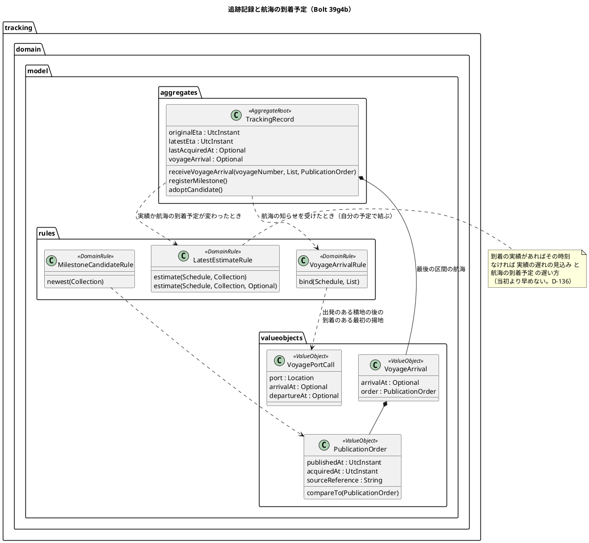
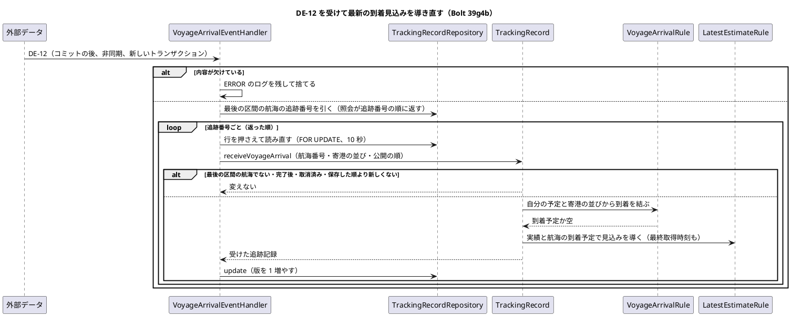
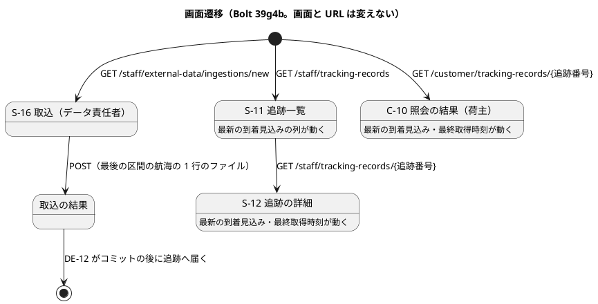
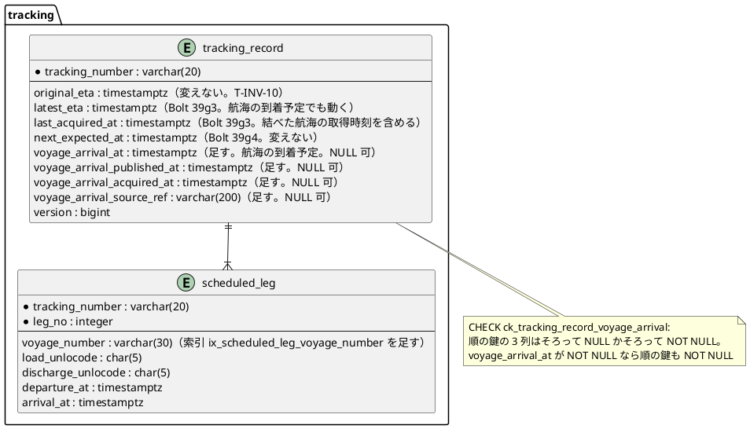

# Bolt 39g4b 計画 - 最後の区間の航海の到着予定で最新の到着見込みを動かす

## 基本情報

| 項目 | 内容 |
| :--- | :--- |
| Bolt | 第 39g4b 回（W7 の 33 本目。release_plan :981 の 39g4b の行） |
| 状態 | 計画（**承認済み**。2026-11-12 に確認ポイント 1〜9 を推奨のとおり承認。human:kakimomokuri。2026-11-12 に開始準備。2 つの整合性検証（`validating-iteration-plan`・`validating-design`）の指摘を反映した。下の「整合性検証の結果」） |
| 予定 | W7（2026-11-16 の週。前倒しで着手できる）。Bolt 39g4 の終了報告の承認（2026-11-12）の後に着手する。約 3 時間 45 分（約 225 分）の見込み（下の「ステップ計画」）。`check`・`uiTest`・`manualScreenshots`・SonarQube・CI と承認の待ちを除く |
| アプローチ | アウトサイドイン（release_plan :981「既存の追跡記録を広げる」。development_strategy :350 の W7 の追跡の残りは中盤の例外でアウトサイドイン。状態の組み合わせの表を先に書く。T-182）。受入シナリオ（データ責任者が最後の区間の航海を遅れた到着予定で取り込むと、S-12・S-11・C-10 の最新の到着見込みがその到着予定になる）を先に Red にし、内側（航海の到着予定の結び方 → 最新の到着見込みの規則 → 追跡記録の集約 → 保存と照会 → DE-12 の listener）に入る。公開の順と押さえて読む操作の名前は、Red の前にリファクタリングで先に出す（ステップ 2） |
| 対象 | (1) 追跡の DE-12 の listener（`externaldata :: events` は Bolt 39g で許してあるので依存は増えない）、(2) 最後の区間の航海の採用値から「航海の到着予定」を結ぶ規則（【業務の判断】(au)）、(3) 最新の到着見込みの規則に航海の到着予定を足す（【業務の判断】(at)、台帳 D-136 の実装）、(4) 同じ航海の DE-12 の順の規則（D-105 の公開した時刻の順）の追跡の中の置き場所、(5) 列と索引の追加（**スキーマ**）と保存・照会、(6) 主要実績の登録・DE-13 の受け取りとの直列（行のロック）、(7) 最終取得時刻に航海の到着予定の取得時刻を含める（【業務の判断】(av)）、(8) マニュアル 9 章・5 章・12 章・用語集 |
| トレース | T-INV-10（domain_model :1430）、DE-12（domain_model :1907）、US-09 AC2（当初の予定と最新の見込みを分けて持ち、一方で上書きしない）、US-14 AC1（採用値の保存）、ADR-004（採用値を各コンテキストが受ける）、`LatestEstimate`・`LatestEstimateRule`（domain_model :214・:215・:1441）、S-11・S-12（ui_design :177・:178）・C-10（ui_design :165）、ui_design :1689「航海の採用値で動く分と見込みの根拠は Bolt 39g4b」、PERF-06（non_functional :62）、台帳 D-105・D-130〜D-132・D-136、[Bolt 39g4 計画](bolt_39g4_plan.md) の決定 (1)・(5)・申し送り、[Bolt 39g4 終了報告](bolt_39g4_report.md) の既知の課題 :123（本計画の確認ポイントは「本計画 CP-n」、W7 の確認ポイントは「W7 CPn」と書き分ける） |
| GitHub | この Bolt の Issue はない（US を数えない技術の Bolt。release_plan :981 の SP は 0） |
| SP | 0 |
| 承認ゲート | **計画と終了報告で止める**（release_plan :981「計画と終了報告（スキーマ）」）。確認必須のもの（範囲の分割、業務の規則、前の決定の変更（(22)・(23)）、**スキーマの変更**、既存データを補正しない判断、新しいファイル）は本計画の確認ポイントにまとめ、計画の承認に含める（前例 bolt_39g4_plan.md）。**データベースの承認ゲートに当たる**（`tracking.tracking_record` に列を 4 つと CHECK を 1 つ、`tracking.scheduled_leg` に索引を 1 つ足すマイグレーション。下の決定 (6)）。認可は変えない（新しい URL を足さない）。外部連携は足さない。新しいコンテキスト間の依存は足さない。`/goal` の下でも、この計画は承認を受けてから実行する |

## Bolt ゴール

データ責任者が、追跡中の貨物の最後の区間を運ぶ航海の採用値（DE-12）を、最後の揚地への到着が遅れた到着予定で取り込むか採用すると、追跡記録の最新の到着見込みが、採用の実績の遅れで送った見込みとその到着予定の遅い方になり、追跡管理者は S-12・S-11 で、荷主担当者は C-10 で、動いた見込みを見られる（T-INV-10、【業務の判断】(at)、台帳 D-136）。到着の実績があれば見込みは実績のまま。航海の到着予定が早まっても当初の到着予定より早めない。当初の到着予定は変えない。見込みの根拠の表示は Bolt 39g4c に分ける（決定 (1)）。

## 状態の組み合わせ（行ごとにテストを 1 本。T-182）

行の番号はこの計画で 1 から振る。見本の予定は 2 区間（区間 1: 航海 V100 で JPTYO から KRPUS、出発予定 D1・到着予定 A1。区間 2: 航海 V200 で KRPUS から USLAX、出発予定 D2・到着予定 A2）。当初の到着予定は A2。「航海の到着予定」は最後の区間の航海（V200）の採用値の寄港の並びから、決定 (3) の結び方で決める最後の揚地（USLAX）への到着。DE-12 の順の鍵は「公開した時刻 → 取得時刻 → 受信記録 ID（文字列の順）」（D-105）。テストは新しいクラスは決定 (9)、既存のクラスは `@Nested class Bolt39g4b_…`。期待値は、Red を書く前に決定の文から導けることを 1 行ずつ確かめた（Bolt 39g4 の Try）。

| 行 | 状況 | 期待 | 確かめ方 |
| :--- | :--- | :--- | :--- |
| 1 | 公開の順（パラメーター。リファクタリングで出す。入力と期待の組まで縛る。T-244）: (a) 公開した時刻が新しい、(b) 公開した時刻が同じで取得時刻が新しい、(c) 両方同じで受信記録 ID が文字列の順で大きい（`"rr-10"` と `"rr-9"` は `"rr-9"` が大きい）、(d) 3 つとも同じ、(e) 公開した時刻が古く取得時刻が新しい | (a)(b)(c) 新しい、(d) 同じ（新しくない）、(e) 古い（公開した時刻が先に決まる） | 単体（`PublicationOrderTest`。値を出してから書くので Red にはならない（出した振る舞いを縛るテスト））。既存の `MilestoneCandidateRuleTest` は直さずに通す |
| 2 | 航海の到着予定の結び方（パラメーター。V200 の寄港の並び。「出発」「到着」は寄港が持つ時刻。積地は出発のある寄港、揚地は到着のある寄港として読む。決定 (3)）: (a) KRPUS（出発）→ USLAX（到着 A2 + 10 時間）、(b) KRPUS（出発）→ CNSHA（到着・出発）→ USLAX（到着 A2 + 10 時間）、(c) KRPUS（出発）→ CNSHA（到着）（USLAX がない）、(d) USLAX（到着 A2 − 20 時間・出発）→ KRPUS（到着・出発）（積地の後に揚地がない）、(e) KRPUS（出発）→ USLAX（到着 A2 + 10 時間・出発）→ KRPUS（到着・出発）→ USLAX（到着 A2 + 30 時間）（出発のある積地が 2 つ。周回の航路）、(f) KRPUS（出発）→ USLAX（到着 A2 + 10 時間・出発）→ JPTYO（到着・出発）→ USLAX（到着 A2 + 40 時間）（積地 1 つの後に揚地が 2 つ）、(g) KRPUS（出発）→ USLAX（到着なし）、(h) KRPUS（出発）→ USLAX（到着なし・出発）→ USLAX（到着 A2 + 12 時間）（最初の USLAX に到着がない）、(i) KRPUS（到着だけ）→ USLAX（到着 A2 + 10 時間）（積地に出発がない）、(j) CNSHA（出発）→ USLAX（到着 A2 + 10 時間）（積地がない）、(k) 1 区間の予定（V100 で JPTYO から KRPUS）に V100 の JPTYO（出発）→ KRPUS（到着 A1 + 5 時間） | (a)(b) A2 + 10 時間、(c)(d)(e)(g)(i)(j) 結べない（空）、(f) A2 + 10 時間（積地の後で最初の揚地）、(h) A2 + 12 時間（到着のない寄港は揚地にしない。経路設計の `Voyage.callPairs` と同じ読み方）、(k) A1 + 5 時間 | 単体（`VoyageArrivalRuleTest`） |
| 3 | 最新の到着見込み（パラメーター。採用の実績と航海の到着予定の組）: (a) 航海の到着予定なし（39g3 の `LatestEstimateRuleTest` の既存の組をそのまま流す）、(b) 実績なし・航海 A2 + 10 時間、(c) 実績なし・航海 A2 − 5 時間（早着の知らせ）、(d) 区間 1 の出発 D1 + 6 時間・航海 A2 + 3 時間、(e) 区間 1 の出発 D1 + 6 時間・航海 A2 + 8 時間、(f) 到着・USLAX の実績 A2 + 1 時間・航海 A2 + 10 時間、(g) 確認中の到着・USLAX A2 + 1 時間・航海 A2 + 10 時間、(h) 区間 1 の出発 D1 + 6 時間・航海 A2 + 6 時間（同じ時刻） | (a) 39g3 と同じ、(b) A2 + 10 時間、(c) A2（当初より早めない）、(d) A2 + 6 時間（遅い方は実績の遅れ）、(e) A2 + 8 時間（遅い方は航海）、(f) A2 + 1 時間（到着の実績が勝つ）、(g) A2 + 10 時間（確認中は使わない）、(h) A2 + 6 時間。中間の区間の航海は規則に渡らない（行 4 (c)・行 5 (i)） | 単体（`LatestEstimateRuleTest`。既存の組は 2 引数の形のまま直さずに通す。決定 (4)） |
| 4 | 対象の追跡の照会（パラメーター。航海番号で追跡記録を引く）: (a) 1 区間の予定の V100、(b) 2 区間の予定の V200（最後の区間）、(c) 2 区間の予定の V100（最後の区間でない）、(d) V200 を最後の区間に持つ追跡が 2 件（追跡番号の逆の順に作る）、(e) どの予定にもない航海、(f) V200 が追跡 X では区間 1（中間）、追跡 Y では最後の区間、(g) 1 つの追跡の 3 区間の予定で V200 が区間 1 と区間 3（最後）に出る | (a) その追跡、(b) その追跡、(c) なし、(d) 2 件を追跡番号の順に（並べるのは照会の責任）、(e) なし、(f) Y だけ、(g) その追跡を 1 回だけ。完了後・取消済みは照会では除かず集約が決める（行 5 (f1)(f2)(g)） | 統合（`MyBatisTrackingRecordRepositoryIntegrationTest`。H2 と PostgreSQL）、`InMemoryTrackingRecordRepository` |
| 5 | 航海の到着予定の受け取り（集約。パラメーター）: (a) 初めて、(b) 保存した順より厳密に新しい、(c) 保存した順と同じ（再配信）、(d) 保存した順より古い、(e) 航海の到着予定 A2 + 10 時間を受けた後に、新しいが結べない知らせ（行 2 (c)）、(f1) 引渡しを採用した追跡（採用済みから導いた状態が引渡し済み）、(f2) 予約状態が完了の追跡、(g) 取消済み、(h) 確認中の追跡、(i) 最後の区間でない航海（V100）の知らせを渡す | (a)(b) 集約が自分の予定で結び（`VoyageArrivalRule`）、航海の到着予定と順の鍵を書き、見込みと最終取得時刻だけを導き直す（現在状態・次の予定の実績は導き直さない。決定 (9)）、(c)(d) 変えない（保存しない）、(e) 航海の到着予定を空にし順の鍵は書く（見込みは A2 + 10 時間から実績だけで決まる A2 に戻る）、(f1)(f2)(g)(i) 変えない、(h) (a) と同じで現在状態は確認中のまま | 単体（`TrackingRecordVoyageArrivalTest`） |
| 6 | 実績が変わったときに保存した航海の到着予定を使う（パラメーター）: 航海の到着予定 A2 + 10 時間を受けた後に (a) 区間 1 の出発 D1 + 6 時間を登録、(b) 到着・USLAX A2 + 1 時間を採用、(c) DE-13 の下書きを受ける、(d) 確認中の実績を登録 | (a) A2 + 10 時間のまま、(b) A2 + 1 時間、(c)(d) 保存した見込みのまま（導出し直さない経路と確認中は 39g3・39gc のまま） | 単体（`TrackingRecordMilestoneTest`・`TrackingRecordCandidateAdoptionTest`・`TrackingRecordExternalMilestoneTest`） |
| 7 | 最終取得時刻（パラメーター）: (a) 実績なし・航海を結べた（取得時刻 G1）、(b) 採用の実績の取得時刻 G2 > G1、(c) G1 > G2、(d) 採用の実績 G2 の後に結べない航海の知らせ（取得時刻 G3 > G2）を受けた、(e) G1 で結べた後に G3（> G1 > G2）の結べない知らせを受けた、(f) 下書きの実績の取得時刻だけ、(g) 古い順で受けなかった知らせ（取得時刻 G4 > G1） | (a) G1、(b) G2、(c) G1、(d) G3（受けた最後の区間の航海の知らせの取得時刻は、結べなくても使う。決定 (8)）、(e) G3（戻らない）、(f) 空（39g3 のまま）、(g) G1（受けなかった知らせは使わない） | 単体（`TrackingRecordVoyageArrivalTest`） |
| 8 | 次の予定の実績と鮮度は変えない（回帰） | 航海の到着予定を受けても `next_expected_at` は変わらない（予定時刻は予定区間のまま。D-133） | 単体（`TrackingRecordVoyageArrivalTest`） |
| 9 | 追跡の開始 | 航海の到着予定と順の鍵は空。見込みは当初の到着予定（39g3 のまま） | 単体（既存の開始のテストに足す） |
| 10 | 保存（UPDATE と INSERT） | 主要実績の UPDATE が航海の到着予定と順の鍵の 4 列を書く（なければ NULL）。開始の INSERT は 4 列を NULL にする。`original_eta`・予定区間は書かない。版が違えば今のとおり競合 | 統合（`MyBatisTrackingRecordRepositoryIntegrationTest`。H2 と PostgreSQL） |
| 11 | 読み込みと往復 | 組み立てで 4 列を読む（NULL は空）。保存した値が読み直しても同じ。要約（S-11・C-10）は 4 列を読まない（見込みは `latest_eta` を読む） | 統合、`InMemoryTrackingRecordRepository` |
| 12 | マイグレーション | `tracking.tracking_record` に 4 列（NULL 可）と CHECK ができ、既存の行は NULL。順の鍵の一部だけを書く UPDATE と、航海の到着予定に値があり順の鍵が NULL の UPDATE は CHECK で拒まれる。`tracking.scheduled_leg` に索引 `ix_scheduled_leg_voyage` ができる。列のコメントは用語集の名 | 統合（Flyway の適用、`SchemaCommentIntegrationTest`（PostgreSQL）、CHECK の統合テスト、`MapperSchemaArchitectureTest`） |
| 13 | listener（パラメーター）: (a) DE-12 を受けて対象の追跡が 2 件、(b) 対象がない、(c) 内容の欠けた DE-12（パラメーター: 航海番号が空、寄港の並びが null か 2 つ未満、寄港の港が null、出典が null、出典の参照が空、取得時刻が null、公開した時刻が null）、(d) ロックの待ちの上限を超える | (a) 照会が返した順（追跡番号の順）に、それぞれ行を押さえてから読み直して受け、更新する（押さえる前に読んだ値を使わない。listener は並べ直さない）、(b) 何もしない、(c) ERROR のログを残して捨てる（再配信しても直らない。前例 `VoyageUpdateEventHandler`）、(d) 例外を上げて発行記録を未完了に残す | 単体（`VoyageArrivalEventHandlerTest`。押さえる順と読む順を順序つきで確かめる） |
| 14 | 配信（統合） | 航海のファイルの取込で採用した DE-12 が、経路設計・監査・追跡の 3 つの購読に配られ、すべての発行記録が完了する。追跡記録の見込みが動く | 統合（`VoyageArrivalDeliveryIntegrationTest`。前例 `ExternalMilestoneDeliveryIntegrationTest`） |
| 15 | 直列（PostgreSQL）: 同じ追跡記録に DE-12 の受け取りと DE-13 の受け取りが同時に来る。画面の登録と下書きの採用が、DE-12 の受け取りの前に S-12・S-13 で読んだ版で保存する | 2 つの受け取りは行のロックで直列になり、両方の結果（航海の到着予定と下書きの実績）が残る（失われる更新がない）。画面の登録と下書きの採用は今のとおり競合（`Conflict`。決定 (7) の受け入れること） | 統合（`MyBatisTrackingRecordLockIntegrationTest` に足す） |
| 16 | 受入シナリオ（業務ルール層） | 区間 1 の出発が 6 時間遅れの追跡に、V200 の到着予定 A2 + 8 時間の DE-12 が届くと見込みは A2 + 8 時間。A2 + 3 時間なら A2 + 6 時間。到着の実績の後は動かない。V100（中間の区間）の DE-12 では動かない | `features/tracking/voyage_arrival_estimate.feature`（`@T-INV-10`） |
| 17 | UI（データ責任者が承認済みの航海の情報源で、確定した経路の最後の区間の航海を到着の遅れた 1 行のファイルで取り込む。追跡管理者が S-12・S-11 を開き、荷主担当者が C-10 を開く） | S-12・S-11・C-10 の最新の到着見込みが取り込んだ到着予定になり、当初の到着予定は変わらない。axe の違反 0。幅 320 px | `features/ui/voyage_arrival_estimate_ui.feature`、タグ `@demo-bolt-39g4b/voyage-arrival-estimate` |
| 18 | 認可は変えない | S-11・S-12・S-13 は追跡管理者（担当企業の範囲。Bolt 38g）、C-10 は荷主担当者の自社だけ、取込はデータ責任者（回帰） | 既存の `@WebMvcTest`・`TrackingAssignedScopeSecurityIntegrationTest` |
| 19 | 層の規則・モジュールの依存・用語の検査 | 規則は `tracking.domain.model.rules`（`@DomainRule`）、値は `tracking.domain.model.valueobjects`（`@ValueObject`）、listener は `tracking.application.internal.eventhandlers`。追跡の `allowedDependencies` は変えない。`LivingGlossaryConsistencyTest` は値の 3 つ（`@ValueObject`）の用語の行と Javadoc の最初の「。」までを確かめる（規則と listener は検査の対象の外なので、用語集の行は文書の突き合わせで確かめる）。追跡のドメインが DE-12 の型に依存しないことは機械では確かめない（`DomainArchitectureTest` は `..domain..` を許す）ので、イベントの型は listener だけが読み、内容の欠けの例外は値の側に置く（前例 `ExternalMilestone.InvalidEventValueException`） | `LayerArchitectureTest`・`DddAnnotationArchitectureTest`・`LivingGlossaryConsistencyTest`・Modulith の検証（既存） |
| 20 | PERF-06（参考の値） | 航海 1 万行の取込で DE-12 の購読が 1 つ増える（DE-12 ごとに索引で 1 回の照会）。判定（取込のコミットまで）は配信の外なので変わらない見込み。参考の配信の完了の値を測り直して記録する | `ExternalDataIngestionPerformanceTest`（人の側の CI の手動のジョブ `performance`。前例 Bolt 39e・39f・39g） |
| 21 | マニュアル | 9 章（最新の到着見込みと最終取得時刻の節に航海の到着予定の決まり）・5 章（C-10 の見込みと最終取得時刻の説明）・12 章（航海の採用値の使われ方）・用語集（最新の到着見込み・最終取得時刻・航海の到着予定）が実装と一致する | ステップの突き合わせの記録（T-197・T-251） |
| 22 | 今の振る舞い | 下の「守る既存のテスト」が通る | 既存 |

### 守る既存のテスト（Red のテストを書く前に流すテストの一覧。T-217、Bolt 39g2 の Try）

- 追跡: `ScheduleTest`、`LatestEstimateRuleTest`、`NextExpectedMilestoneRuleTest`、`FreshnessPolicyTest`、`MilestoneCandidateRuleTest`、`TrackingRecordTest`、`TrackingRecordMilestoneTest`、`TrackingRecordCandidateAdoptionTest`、`TrackingRecordExternalMilestoneTest`、`TrackingRecordCustomerViewTest`、`TrackingRecordCommandServiceTest`、`TrackingRecordQueryServiceTest`、`CustomerTrackingQueryServiceTest`、`ExternalMilestoneEventHandlerTest`、`TrackingRecordControllerTest`、`CustomerTrackingControllerTest`、`MyBatisTrackingRecordRepositoryIntegrationTest`、`MyBatisTrackingRecordRepositoryUniqueKeyTest`、`MyBatisTrackingRecordLockIntegrationTest`、`H2TrackingRecordLockTest`、`TrackingAssignedScopeSecurityIntegrationTest`、`features/tracking/latest_estimate.feature`・`freshness_overdue.feature`・`register_milestone.feature`・`query_tracking.feature`、`features/ui/latest_estimate_ui.feature`・`freshness_overdue_ui.feature`・`query_tracking_ui.feature`・`adopted_voyage_reflected_ui.feature`・`ingest_external_data_ui.feature`（画面の層は `uiTest` がシナリオを選べないので Green の後の全件で流す。39g3・39g4 の「計画から変えたこと」）
- 経路設計と配信: `VoyageUpdateEventHandlerTest`、`VoyageUpdateDeliveryIntegrationTest`、`ExternalMilestoneDeliveryIntegrationTest`、`ExternalRecordAuditDeliveryIntegrationTest`、`H2EventPublicationCapacityTest`、`DomainEventSerializationContractTest`（DE-12 の購読が 3 つになる。発行記録の数や完了を数えるテストが購読の数を前提にしていないかを、ステップ 2 で読んで確かめる）
- 横断: `LayerArchitectureTest`、`DddAnnotationArchitectureTest`、`LivingGlossaryConsistencyTest`、`MapperSchemaArchitectureTest`、`SchemaCommentIntegrationTest`、Modulith の検証

## 開始準備の決定（推奨を 1 つに決めて書いた。承認済み）

(1) **範囲と見積り**（本計画 CP-1、【前の決定の変更】(22)）: release_plan :981 の 39g4b の行は、航海の採用値で動く見込み（D-136 の実装）と見込みの根拠の表示の 2 つ。コードで確かめると、航海の採用値の分だけで listener・結び方・順の規則・スキーマ（列 4 つと CHECK・索引）・直列・配信の統合テストが要り、約 225 分になる。見込みの根拠の表示を入れると、根拠の種類と根拠の実績の保存（現在状態の根拠の実績番号 `status_basis_milestone_no` と同じ形にするなら列が 2 つと CHECK・外部キー。読むたびに導くなら保存した見込みと正が 2 つになる。Bolt 39g4 の決定 (4) で示し方を退けた理由と同じ）と S-12 の表示・マニュアルが足され、約 265 分で目安（T-250 の 4 時間 05 分）を超え、スキーマの判断が 2 つ積まれる。そこで **39g4b は航海の採用値で動く見込みにし、見込みの根拠の表示を 39g4c に分け、39g4b の直後（39h の前）に置く**。根拠に何を示すかは業務の規則なので本計画で仮に決め（決定 (8)、【業務の判断】(aw)）、39g4c はその実装と保存の判断から入る。分けても見えない状態の Bolt はできない（39g4b は航海の取込で S-11・S-12・C-10 の見込みが動くことで見え、39g4c は S-12 の根拠の行で見える）。超えそうなときは 行 17 の動画（−5 分）、行 20 の参考の値の測り直し（人の側の CI の手動のジョブなので W7 の締めへ送る）の順に後へ送る。マニュアルは後に送らない。
- 比べた案: (i) **39g4c に分ける（推奨）**。(ii) 39g4b に全部入れる（目安を超え、スキーマの判断が 2 つ開始準備に積まれる）。(iii) 根拠の表示を W9 の US-09 AC3・FRS-03（荷主への「最新性を保証しない旨」）と一緒にする（社内の S-12 で航海の知らせで動いた見込みの理由が W9 まで分からない。追跡管理者が荷主に説明できない期間がパイロットの前まで残る）

(2) **listener と依存**（本計画 CP-2）: 追跡は DE-12（`VoyageAdoptedValueUpdated`）を `@ApplicationModuleListener` で受ける（`tracking.application.internal.eventhandlers.VoyageArrivalEventHandler`。前例 `ExternalMilestoneEventHandler`・経路設計の `VoyageUpdateEventHandler`）。追跡の `allowedDependencies` の `externaldata :: events` で足り、依存は増えない。イベントの型を追跡のドメインに持ち込まず、listener が追跡の値（`VoyagePortCall` の列、公開の順）に写す。
- 比べた案: (i) **DE-12 を直接受ける（推奨）**。(ii) 経路設計の DE-30（`VoyageUpdated`）を受けて、経路設計の公開 API で航海の寄港を読む（順の規則を写さずに済むが、`routing :: events` への新しい依存と公開 API の追加、DE-30 の「購読は経路設計の中だけ」の契約の変更が要る。DE-30 は初めての航海では出ないので、追跡の開始の後に初めて取り込まれた航海を取りこぼす。ADR-004 の「採用値を各コンテキストが受ける」形とも違う）。(iii) S-12・S-11 を開くたびに経路設計の公開 API で航海を読む（一覧は集約を組み立てない決まり（Bolt 26）を崩し、C-10 の要約にも照会が増える）

(3) **航海の到着予定の結び方**（本計画 CP-3、【業務の判断】(au)、台帳 D-137（仮））: 最後の区間の航海番号と同じ航海の DE-12 だけを使う（中間の区間の航海は使わない。D-136）。寄港の並び（運航の順）を、積地は「最後の区間の積地の港で **出発のある** 寄港」、揚地は「最後の区間の揚地の港で **到着のある** 寄港」として読む。積地の寄港が **ちょうど 1 つ** あり、その後ろで **最初の** 揚地の寄港の到着を航海の到着予定にする（到着のない同じ港の寄港は飛ばす。行 2 (h)）。積地の寄港がない・2 つ以上（周回の航路）、積地の後に揚地がないときは結べない。結べない新しい DE-12 を受けたら航海の到着予定を **空にする**（順の鍵は書く。古い DE-12 で戻さない）。
- 理由: 積地と揚地の読み方（出発のある寄港を積地、到着のある寄港を揚地にし、積地の後ろの揚地と組む）は経路設計の `Voyage.callPairs`（routing/domain/model/aggregates/Voyage.java :158-175）と同じにする。経路設計は組が 2 つ以上のとき予定区間の時刻と確定の寄港の位置で選ぶ（:145-156、D-108）が、追跡は新しい時刻を知りたいので予定区間の時刻との一致は使えず、寄港の位置も持たない。そこで組が 2 つ以上になる周回の航路（積地が 2 つ）は結ばない（39g3 の決定 (3) の「同じ場所が 2 つ以上の区間に当たる実績は結ばない」と同じ考え）。積地 1 つの後の揚地が 2 つ（行 2 (f)）は、経路設計の組では 2 つになるが、貨物は最初の揚地で降りる予定なので最初を使う（ここが経路設計と違う点）
- 受け入れること: 航海の寄港の並びから揚地が消えると、見込みは採用の実績だけで決まる（経路設計は DE-30 で確定した経路を評価し、再設計要にする。見込みは古い航海の知らせを残さない）。周回の航路の最後の区間では航海の知らせで見込みが動かない
- 比べた案: (i) **積地が 1 つ、その後ろの最初の揚地（推奨）**。(ii) 揚地の寄港の到着のうち予定区間の到着予定に最も近いもの（周回でも結べるが、遅れが大きいと次の周回に結ぶおそれがある）。(iii) 結べないときは前の航海の到着予定を残す（新しい知らせが「その港に寄らない」と言っていても古い到着予定で見込みが遅いまま残る）

(4) **見込みの規則**（本計画 CP-4、【業務の判断】(at)、台帳 D-136 の実装）: `LatestEstimateRule.estimate` に航海の到着予定（なければ空）を足す。最後の区間の揚地の到着の採用の実績があればその時刻（39g3 のまま）。なければ「採用の実績の遅れで送った見込み（39g3 の規則。当初以上）」と「航海の到着予定」の遅い方。遅れで送った見込みは当初の到着予定以上なので、航海の到着予定が早まっても当初より早めない。確認中・下書き・保持のみは使わない（39g3 のまま）。同じ時刻ならどちらでも同じ値。
- 規則は純粋な関数のまま（集約が保存した航海の到着予定を渡す）。3 引数の `estimate(Schedule, Collection<Milestone>, Optional<UtcInstant>)` を足し、今の 2 引数の形は航海の到着予定を空にして 3 引数の形に委ねる形で残す（前例 39g4 の `reconstitute` の受けない形。bolt_39g4_report.md :96）。39g3 の既存の組は 2 引数の形のまま直さずに通す（行 3 (a)）

(5) **順の規則（D-105）の置き場所と、受け取りの冪等**（本計画 CP-5）: 公開の順（公開した時刻 → 取得時刻 → 受信記録 ID（文字列の順））を追跡の値 `tracking.domain.model.valueobjects.PublicationOrder`（`@ValueObject`、`Comparable`）に出し、候補の規則（`MilestoneCandidateRule`）と航海の到着予定の両方が使う。**リファクタリングを Red の前に行う**（帽子の切り替え。ステップ 2。`MilestoneCandidateRuleTest` を直さずに通す）。共有カーネルには上げない。Bolt 39gb の確認ポイント 2 が上げなかった理由（(a) 主要実績は削除・上書きしない別の性質で経路設計の `Voyage` と共有する理由がない、(b) 書くときには比べず読むときに組から決める）は、航海の到着予定には当たらない（上書きで、書くときに厳密に新しいかを比べる。経路設計の `Voyage.apply` と同じ性質）。それでも上げない理由は、共有カーネルの変更は経路設計・外部データ・追跡に及ぶ構造の変更（確認必須）で、この Bolt の目安に収まらず、並びの定め（D-105）は 1 つなので写しのずれは比べ方の 3 項目に限られるから。経路設計の `Voyage` の写しと 2 つになることを技術的負債として記録し、3 つ目のコンテキストが要るときに共有カーネルへ上げるかを諮る。追跡の中で比べ方の使い方が 2 つ（主要実績は読むときに組から決める、航海の到着予定は書くときに比べる）になることを `PublicationOrder` の Javadoc に書き、`MilestoneCandidateRule` の Javadoc の理由（:12-13）を書き直す。集約は保存した順より **厳密に新しい** DE-12 だけを受ける（同じ順は再配信、古い順は遅れて届いた配信。どちらも保存しない）。前例は経路設計の `Voyage.apply`。
- 比べた案: (i) **追跡の値に出して 2 つの規則で使う（推奨）**。(ii) 航海の到着予定の中に順を写す（追跡の中に同じ並びが 2 つになる）。(iii) 共有カーネルに上げて経路設計も使う（共有カーネルの変更は 3 つのコンテキストの構造変更で、39gb の決定の変更になる。この Bolt の目安に収まらない）

(6) **保存とスキーマ、既存のデータ**（本計画 CP-6。**データベース**）: `tracking.tracking_record` に 4 列を足す。`voyage_arrival_at`（`TIMESTAMP WITH TIME ZONE`、NULL 可。航海の到着予定。結べないときと受けていないときは NULL）、`voyage_arrival_published_at`（同。公開した時刻）、`voyage_arrival_acquired_at`（同。取得時刻）、`voyage_arrival_source_ref`（`VARCHAR(200)`、NULL 可。出典の参照（受信記録 ID）。`tracking.milestone.source_ref` と同じ幅）。CHECK `ck_tracking_record_voyage_arrival`（順の鍵の 3 列はそろって NULL かそろって NOT NULL。`voyage_arrival_at` が NOT NULL なら順の鍵も NOT NULL）。`tracking.scheduled_leg` に索引 `ix_scheduled_leg_voyage`（`voyage_number`）を足す（DE-12 ごとに航海番号で予定区間を引く。今は索引がない。V20261009130000 :57-70。名前は同じ形の前例 `ix_candidate_leg_voyage`（V20261110100000 :11）にそろえる）。マイグレーションは `V20261114100000__add_tracking_record_voyage_arrival.sql`（仮。ステップ 1 で最後の版 `V20261113100000` より後であることを確かめる。H2 と PostgreSQL の共通の構文。ADR-007）。列のコメントは用語集の名（「航海の到着予定」「航海の到着予定の公開した時刻」「航海の到着予定の取得時刻」「航海の到着予定の出典の参照」。`SchemaCommentIntegrationTest` が見る）。主要実績の UPDATE（`updateTrackingRecord`）が 4 列を書き、開始の INSERT は NULL を書く。組み立ての行の型 `TrackingRecordRow`・`reconstitute` に足す。要約（S-11・C-10）は `latest_eta` を読むので変えない。
- 置き場所の理由: D-136 は最後の区間の航海だけを使うので、追跡記録 1 件に値は 1 つ。集約の版は `tracking_record` が持ち、予定区間の行は追加だけで更新しない（UPDATE の経路を 1 つの表に保つ）
- 照会: 航海番号で、その航海が **最後の区間**（その追跡番号の最大の区間番号）の追跡番号を追跡番号の順に引く（`findTrackingNumbersByFinalLegVoyage`。新しい照会）。完了後・取消済みは照会で除かず、集約が決める（判定の知識を 1 か所にする。39g4 の決定 (2) と同じ考え）
- 既存のデータ: 39g4b の前に開始した追跡記録は、次の DE-12 を受けるまで航海の到着予定が NULL（見込みは採用の実績だけで決まる。今と同じ）。補正のマイグレーションは作らない（Release 1.0 のパイロットの前で業務のデータはない。前例 Bolt 39g3・39g4 の決定 (6)）。**追跡の開始より前に採用された航海の値は、次の DE-12 まで見込みに効かない**（受け入れる。DE-12 は取込のたびに出るので、毎日の取込で航海の値が届く限り 1 日で効く）
- 比べた案: (i) **`tracking_record` に 4 列と CHECK、`scheduled_leg` に索引（推奨）**。(ii) 予定区間（`scheduled_leg`）の行ごとに航海の到着予定を持つ（中間の区間の航海も持てるが D-136 は使わない。予定区間の行を UPDATE する経路が増え、版を `tracking_record` と別に考える）。(iii) 追跡に航海の写しの表（航海番号ごとの寄港の並び）を持つ（追跡番号をまたいで 1 回で書けるが、見込みの導出が集約の外の値を読み、集約の不変条件が表をまたぐ）

(7) **直列とトランザクション、失敗の扱い**（本計画 CP-7。PERF-06、リスク台帳の「版の競合が連鎖する」）: listener は 1 つのトランザクションで、対象の追跡番号を **追跡番号の順に** 1 件ずつ行のロックで押さえてから読み直し、受け、更新する（DE-13 の受け取り・下書きの採用と同じく押さえてから読み直す。複数の行を同じ順で 1 つのトランザクションで押さえてデッドロックを避ける前例は bolt_39d2b_report.md :74。`TrackingRecordRepository.findByTrackingNumberForExternalMilestone`。待ちの上限は 10 秒）。追跡記録の最後の区間の航海は 1 つなので、別々の航海の DE-12 が同じ追跡記録を押さえることはなく、同じ航海の DE-12 どうしは同じ順で押さえるのでデッドロックしない。DE-13 の受け取りと下書きの採用は追跡記録 1 件だけを押さえる。画面の登録と下書きの採用（画面を開いたときの版と比べる。domain_model :1198）は今のまま楽観ロックで、DE-12 の受け取りに負けたら `Conflict`（行 15）。受け入れること: DE-12 を受けるたびに、その航海を最後の区間に持つ追跡記録の版が上がるので、S-12・S-13 を開いた後の登録・採用が `Conflict` になることがある（開き直せば通る。航海の取込は 1 日 1 回の想定）。
- 名前: 押さえて読む操作は DE-13・下書きの採用・DE-12 の 3 つの目的に使うので、リファクタリングで `findByTrackingNumberForUpdate` に名前を変える（ステップ 2。振る舞いは変えない。呼び手 9 ファイル）
- 失敗: 内容の欠けた DE-12 は ERROR のログを残して捨てる（前例 `VoyageUpdateEventHandler`。欠けの範囲は航海番号が空、寄港の並びが null か 2 つ未満（経路設計の `Voyage.MIN_PORT_CALLS`・外部データの `VoyageValues.MIN_PORT_CALLS` と同じ。外部データは 2 つ未満を出さないので届くのは誤り）、寄港の港が null、出典が null・参照が空・取得時刻が null、公開した時刻が null。行 13 (c)。欠けの例外は値の側に置く）。DB の失敗とロックの待ちの上限は例外を上げ、発行記録を未完了に残す（再配信は順の鍵で冪等）。1 つの追跡記録の失敗で同じ DE-12 のほかの追跡記録も戻る（1 つのトランザクション。再配信でまとめて受け直す）
- PERF-06: DE-12 ごとに索引で予定区間を 1 回引く（性能のテストのデータには追跡記録がないので、増えるのは照会 1 回）。判定（取込のコミットまで）は配信の外なので変わらない見込み。参考の配信の完了の値を人の側の CI の手動のジョブ `performance` で測り直して記録する（前例 Bolt 39e・39f・39g。push しないときは W7 の締めへ送る）
- 比べた案: (i) **1 つのトランザクションで追跡番号の順に押さえる（推奨）**。(ii) 追跡記録ごとに別のトランザクション（押さえる時間は短いが、途中で失敗すると一部だけ受けた状態が残り、再配信で残りを受ける手順が要る）。(iii) 押さえずに楽観ロックと読み直し（DE-13 の受け取りと同じ追跡記録で競合が連鎖する。39g の決定 (4) で退けた形）

(8) **最終取得時刻と見込みの根拠の表示**（本計画 CP-8、【業務の判断】(av)・(aw)、台帳 D-138・D-139（仮）、【前の決定の変更】(23)）:
- 最終取得時刻（(av)、D-138、D-132 と Bolt 39g3 の決定 (4) の変更）: 採用の実績の出典の取得時刻と、**受けた**（保存した順の鍵の）最後の区間の航海の知らせの取得時刻のうち最も新しいもの（なければ空）。結べなかった知らせも受けたなら含める（順の鍵は厳密に新しいときだけ進むので、最終取得時刻は戻らない。行 7 (d)(e)）。受けなかった古い知らせ・中間の区間の航海・下書き・確認中・保持のみの取得時刻は使わない。理由: 航海の知らせで見込みが動いた（または空に戻った）のに最終取得時刻が古いままだと、荷主が C-10 で見込みの新しさを読み違える（FRS-03 の「鮮度」）。航海の到着予定が見込みに勝たなくても、その時刻までの情報で見込みを確かめたことになるので含める。
- 開示（T-INV-09）: 39g3 の決定 (4)（bolt_39g3_plan.md :84-85）は「C-10 は採用の実績だけを示すので、示していない実績の時刻を出さない」とし、`CustomerTrackingView` の Javadoc（:18-19）も「荷主に見せている実績の取得時刻の最大なので開示の範囲は広がらない」を根拠にしている。これを変える（【前の決定の変更】(23) に含める）。開示が広がらない理由: C-10 はすでに予定区間（航海番号を含む）と、航海の知らせで動いた最新の到着見込みを示す（39g4b から）。航海の知らせの取得時刻は、示している見込みの情報の新しさで、荷主の貨物を運ぶ最後の区間の航海の情報だけ（他社の貨物の情報も、出典の参照（受信記録 ID）も示さない）
- 比べた案: (i) **受けた最後の区間の航海の知らせを含める（推奨）**、(ii) D-132 のまま採用の実績だけ（見込みと最終取得時刻の情報源がずれる）、(iii) 結べた知らせだけ（結べない新しい知らせで航海の到着予定を空にすると、最終取得時刻が採用の実績の時刻に戻る）、(iv) 見込みを決めた方の取得時刻だけ（勝ち負けで最終取得時刻が戻る）
- 見込みの根拠の表示（(aw)、D-139。実装は 39g4c）: S-12 の定義リストの最新の到着見込みの次に「見込みの根拠」の 1 行を示す。値は「当初の到着予定」「区間 n の出発（または積替）の実績（場所、遅れ m 時間）」「到着の実績（場所）」「航海 V の到着予定（取得 日時）」のどれか。S-11 の列・C-10 には出さない（C-10 は W9 の FRS-03 の「最新性を保証しない旨」と一緒に決める）。理由: 追跡管理者が荷主に見込みの理由を説明できる（運用の有人窓口）。荷主への開示は FRS-03 の表示と一緒に決める方が文の重複がない。比べた案: (i) **S-12 だけに 1 行（推奨）**、(ii) S-12 と C-10（荷主に社内の航海番号・情報の出どころを開示する範囲の判断が要る。T-INV-09）、(iii) 示さない（39g4 の決定 (5) の申し送りを果たさない）
- 根拠の保存（技術の判断。39g4c の開始準備で諮る申し送り）: 現在状態の根拠の実績番号と同じく、根拠の種類と根拠の実績番号を保存する形を推奨の第一候補にする（読むたびに導くと保存した見込みと正が 2 つになる。39g4 の決定 (4)）

(9) **層と新しい型の名前**（第 3 章、CLAUDE.md。T-246。`apps/cargo-tracker/src` で `VoyageArrival`・`VoyageArrivalRule`・`VoyagePortCall`・`PublicationOrder`・`VoyageArrivalEventHandler`・`voyage_arrival_at`・`voyageArrival`・`findByTrackingNumberForUpdate`・`findTrackingNumbersByFinalLegVoyage`・`ix_scheduled_leg_voyage`・`Bolt39g4b`・`demo-bolt-39g4b` を単語で検索し、ないことを確かめた。近い名前に経路設計の行の型 `routing/infrastructure/persistence/VoyagePortCallRow.java` がある（単純名が違うので衝突しない））:
- 値: `tracking.domain.model.valueobjects.PublicationOrder`（`@ValueObject`。公開の順: 公開した時刻・取得時刻・受信記録 ID。Javadoc の最初の語は「公開の順」）、`VoyagePortCall`（`@ValueObject`。航海の寄港: 港・到着（なければ空）・出発（なければ空）。経路設計の `PortCall`・外部データの `AdoptedPortCall` と同じ単純名にしない。Bolt 39b2b の確認ポイント 1。Javadoc の最初の語は「航海の寄港」）、`VoyageArrival`（`@ValueObject`。航海の到着予定: 到着予定（結べなければ空）・公開の順（取得時刻は公開の順が持つ）。Javadoc の最初の語は「航海の到着予定」）
- 規則: `tracking.domain.model.rules.VoyageArrivalRule`（`@DomainRule`。予定と航海の寄港の並びから最後の揚地への到着を結ぶ純粋な関数。Javadoc の最初の語は「航海の到着予定の規則」）。`LatestEstimateRule` は航海の到着予定を受ける形に直す（行 3）
- 集約: `TrackingRecord.receiveVoyageArrival(String voyageNumber, List<VoyagePortCall> portCalls, PublicationOrder order)`。**集約が自分の予定で `VoyageArrivalRule` を呼ぶ**（listener は結ばない。最後の区間の航海でない知らせ・完了後・取消済み・新しくない順は集約が変えない。不変条件を集約が守る。39g3・39g4 の「集約が規則を呼ぶ」形）。結果は「受けた追跡記録」か「変えない」で、新しい sealed の結果の型は作らず `Optional<TrackingRecord>` で返す。受けたときは **見込みと最終取得時刻だけ** を導き直し、現在状態・次の予定の実績は保存した値のまま（`derivedWith` は通らない。39g4 の前の行の `next_expected_at` が NULL のまま変わらない。39gc の「導出し直さない経路」に航海の到着予定の受け取りを足す）。`derivedWith` は保存した航海の到着予定を見込みの規則に渡し、受けた知らせの取得時刻を最終取得時刻に含める
- listener: `tracking.application.internal.eventhandlers.VoyageArrivalEventHandler`（Javadoc の最初の語は「航海の到着予定のイベントハンドラー」。`TrackingConfiguration` が組み立てる）
- domain_model の用語集に「公開の順 | PublicationOrder」「航海の寄港 | VoyagePortCall」「航海の到着予定 | VoyageArrival」「航海の到着予定の規則 | VoyageArrivalRule」「航海の到着予定のイベントハンドラー | VoyageArrivalEventHandler」の行を足し（`LivingGlossaryConsistencyTest` が英語名の列と Javadoc の最初の語を見る）、ドメインルール・サービスの表に `VoyageArrivalRule` を足し、`LatestEstimate`・`LatestEstimateRule`（:214・:215・:1441）、`MilestoneCandidateRule`（候補の規則）の行を直す
- 直すもの: `MilestoneCandidateRule`（公開の順を使う）、`LatestEstimateRule`、`TrackingRecord`（`start`・`derivedWith`・`withMilestones`・`reconstitute`・`receiveVoyageArrival`・`voyageArrival()`）、`TrackingRecordRepository`（名前の変更、新しい照会、Javadoc）、`MyBatisTrackingRecordRepository`、`TrackingRecordRow`、`TrackingRecordMapper`（Java と XML）、`InMemoryTrackingRecordRepository`（テスト）、`TrackingRecordCommandService`・`ExternalMilestoneEventHandler`（名前の変更）、`TrackingConfiguration`（listener の組み立て）、マニュアル 9 章・5 章・12 章・用語集
- 新しいファイル: マイグレーション 1 つ、`PublicationOrder`・`VoyagePortCall`・`VoyageArrival`・`VoyageArrivalRule`・`VoyageArrivalEventHandler` と各テスト、`TrackingRecordVoyageArrivalTest`、`VoyageArrivalDeliveryIntegrationTest`、受入シナリオ `features/tracking/voyage_arrival_estimate.feature`・`features/ui/voyage_arrival_estimate_ui.feature`、タグ `@demo-bolt-39g4b/voyage-arrival-estimate`、本計画と終了報告、動画
- 新しいコンテキスト間の依存はない。共有カーネルは変えない。**規則の例外は要らない見込み**で、当たったら置き場所を動かさず止めて諮る（T-125）。外部の技術のポートは足さない

(10) **画面・認可・外部連携・イベント・ナビゲーションは変えない**: S-11・S-12・C-10 の項目と文は変えない（保存した見込みの値が変わるだけ）。新しい URL・画面を足さないので、navbar・ダッシュボードとナビの表示のテストは要らない。見込みが変わったことのイベント・通知は作らない（US-22・W9）。DE-12 の型と発行元は変えない。セキュリティの承認ゲートには当たらない。

### 前の Bolt から引き継いだもの

| 出典 | 内容 | この計画 |
| :--- | :--- | :--- |
| release_plan :981、Bolt 39g4 計画の決定 (1)・(5)・申し送り | 航海の採用値で動く見込み（(at) の実装）。DE-12 の listener と順の規則（D-105）の置き場所、航海番号で追跡記録を引く照会と `scheduled_leg.voyage_number` の索引、航海の到着予定を持つ場所、主要実績の登録との直列（PERF-06）、対象の追跡（完了後を除く）、見込みの根拠の表示 | 決定 (2)〜(7)。見込みの根拠の表示は 39g4c（決定 (1)）、何を示すかは決定 (8) で仮に決める |
| Bolt 39g4 計画の決定 (4) | S-12 に「どの時点か」を示さない理由（列が 1 つ増えるか、読むたびに導いて正が 2 つになる） | 見込みの根拠の保存の申し送り（決定 (8)） |
| Bolt 39g4 終了報告の既知の課題 | 配備の前の件数の確認（`next_expected_at`・`last_acquired_at`） | 4 列は NULL のまま補正しない（決定 (6)）。配備の前の確かめは今の申し送りに含まれる（W7 の締め） |
| Bolt 39gb 計画の確認ポイント 2 | 順の規則は共有カーネルに上げず追跡のドメインに置く（理由は主要実績が削除・上書きしないこと、読むときに組から決めること） | 決定 (5)。理由は航海の到着予定に当たらないので、上げない理由を書き直した（共有カーネルの変更は構造の変更で目安に収まらない）。追跡の中で比べ方の値を 1 つにする |
| Bolt 39g3 計画の決定 (4) | C-10 の最終取得時刻は示している採用の実績の取得時刻だけ（T-INV-09） | 決定 (8) で変える（【前の決定の変更】(23)）。開示が広がらない理由を書いた |
| Bolt 39g 計画の決定 (4)、Bolt 39gb の決定 (5a) | 同じ追跡番号への集中は行のロックで直列にする | 決定 (7) |
| Bolt 39g3 計画の決定 (3) | 同じ場所が 2 つ以上の区間に当たる実績は結ばない | 決定 (3) の周回の航路 |
| Bolt 39g4 終了報告の Try | 状態の組み合わせの表で、期待値が規則の文から導けるかを開始準備の検証の観点に足す | 上の表の前書きと、整合性検証の観点 |
| Bolt 39g4 終了報告の Try、議題 5 | コマンドを打つ前に、標準入力・`cat >`・`/tmp` を使っていないかを見る | ファイルは Write・Edit、コミットは `-m` を複数回 |

### 開始準備で確かめたこと（作業ツリーの `apps/cargo-tracker/src` で読んだ）

- **DE-12 の型**: `VoyageAdoptedValueUpdated`（externaldata/domain/events）は航海番号・寄港の並び（入れ子の `AdoptedPortCall`: 港・到着・出発。空は null）・出典（参照は受信記録 ID、取得時刻）・公開した時刻を持つ。発行元の集約の版は持たない
- **経路設計の順と冪等**: `Voyage.apply`（routing/domain/model/aggregates/Voyage.java :30-32・:103-118）が公開した時刻 → 取得時刻 → 受信記録 ID で厳密に新しいときだけ適用する。listener は楽観ロックで 3 回まで読み直す（VoyageUpdateEventHandler.java）
- **追跡の順の規則**: `MilestoneCandidateRule`（tracking/domain/model/rules）が同じ並びの比べ方を private の `Comparator` で持つ。決定 (5) で値に出す
- **依存**: 追跡の `allowedDependencies` に `externaldata :: events` がある（tracking/package-info.java）。DE-30 は `routing.domain.events` で、追跡からは使えない（決定 (2) の比べた案 (ii)）
- **見込みの規則**: `LatestEstimateRule.estimate(Schedule, Collection<Milestone>)`（:32-48）は到着の実績ならその時刻、出発・積替なら当初 + 正の遅れ、なければ当初を返す。航海の到着予定はない（Javadoc :20「Bolt 39g4b」）
- **導出の 1 か所**: `derivedWith`（TrackingRecord.java :541-548）が現在状態・見込み・最終取得時刻・次の予定の実績を導く。DE-13 の下書きと保持のみは `withMilestones(…, DerivedStatus)`（:573-575）で保存した値のまま。完了後の判定は `isCompleted`（:471-479）
- **行のロック**: `findByTrackingNumberForExternalMilestone`（TrackingRecordRepository.java :36-41、`lockByTrackingNumber` は TrackingRecordMapper.xml :149-152 の `FOR UPDATE`、`timeout="10"`）。呼び手は main 4・test 5 のファイル
- **索引**: `tracking.scheduled_leg` に `voyage_number` の索引はない（V20261009130000 :57-70）。最後のマイグレーションは `V20261113100000`
- **経路設計の寄港の組**: `Voyage.callPairs`（Voyage.java :158-175）は出発のある寄港を積地、到着のある寄港を揚地にして積地の後ろの揚地と組み、組が 2 つ以上なら予定と確定の寄港の位置で選ぶ（:145-156）。決定 (3) の読み方の前例
- **予定区間**: `ScheduledLeg` は区間番号を持たず列の順で決まる（ScheduledLeg.java）。最後の区間は `legs` の最後で、表では `leg_no` の最大
- **取消済み**: `TrackedBookingStatus` に `CANCELLED` があるが、追跡に書く経路はまだない（W11）。DE-13 の受け取りは取消済みを拒否の記録にする。DE-12 は拒否の記録を作らず変えない（決定 (6) の照会と行 5 (g)）
- **画面の層**: 航海の取込の画面の層のシナリオ（`adopted_voyage_reflected_ui.feature`）と見込みの画面の層のシナリオ（`latest_estimate_ui.feature`）がある。取込で経路設計の航海が変わると DE-30 で確定した経路が評価され、再設計要になりうる（見積りが購読する。追跡は購読しない）。行 17 は確定の後の取込なので、見積りの画面の文が変わっても追跡の画面には効かない

## 業務の判断の記録（本計画 CP-3・CP-8。仮。パイロットの前に (au)・(av) は業務責任者とデータ責任者、(aw) は業務責任者と追跡責任者に確かめる）

| 判断 | 推奨 | 理由 |
| :--- | :--- | :--- |
| (au) 航海の採用値のどの寄港を見込みに使うか | 最後の区間の航海だけ。出発のある積地の寄港がちょうど 1 つで、その後ろの到着のある最初の揚地の寄港の到着。結べない新しい知らせを受けたら航海の到着予定を空にする | 積地・揚地の読み方は経路設計の `Voyage.callPairs` と同じ。周回の航路は時刻なしでどの周回か決められない。古い知らせを残さない |
| (av) 最終取得時刻に航海の知らせを含めるか | 受けた最後の区間の航海の知らせの取得時刻を含める（結べなくても。採用の実績の取得時刻との新しい方）。D-132 と 39g3 の決定 (4) を変える | 見込みを動かしうる情報の新しさと最終取得時刻をそろえ（FRS-03）、最終取得時刻を戻さない。C-10 はすでに航海で動いた見込みを示すので開示は広がらない |
| (aw) 見込みの根拠を何で示すか（実装は 39g4c） | S-12 の定義リストに「見込みの根拠」の 1 行（当初の到着予定・実績の遅れ・到着の実績・航海の到着予定のどれか）。S-11・C-10 には出さない | 追跡管理者が理由を説明できる。荷主への開示は W9 の FRS-03 と一緒に決める |

## スコープ

### 入れるもの

- 行 1〜22。決定 (2)〜(7)・(8) の最終取得時刻・(9)・(10) の実装と文書
- マニュアル 9 章（最新の到着見込みと最終取得時刻の節に航海の到着予定の決まり）・5 章（C-10 の最新の到着見込みと最終取得時刻の説明）・12 章（航海の採用値は追跡の見込みにも使われる）・用語集（最新の到着見込み、最終取得時刻、航海の到着予定）、動画 `@demo-bolt-39g4b/voyage-arrival-estimate`。画面の項目は変えないのでキャプチャの撮り直しは要らない見込み（`manualScreenshots` は流し、差分を確かめる）
- 台帳 D-137〜D-139（仮。台帳の行は本計画の開始準備で足した）、D-132 の注（【前の決定の変更】(23)）、D-136 の状態（39g4b で作る）

### 入れないもの

- 見込みの根拠の表示（39g4c。決定 (1)・(8)）
- 中間の区間の航海の採用値を見込みに使うこと（D-136）
- 見込みが変わったことの通知（US-22・W9）
- 荷主への「最新性を保証しない旨」・次回更新日時（FRS-03、US-09 AC3・W9）
- 予定の差し替え（再設計で確定した経路版が変わったとき）に航海の到着予定を空にすること（予定を差し替える経路はまだない。作るときの申し送り）
- 順の規則を共有カーネルに上げること（決定 (5) の比べた案 (iii)）

### 申し送り

| 送り先 | 課題 |
| :--- | :--- |
| 39g4c | 見込みの根拠の表示（【業務の判断】(aw) の実装）。開始準備で決めること: 根拠の保存（根拠の種類と根拠の実績番号の列。推奨の第一候補）か読むたびに導くか（**スキーマ**）、文の形（遅れの時間の書き方、航海番号・取得時刻の書式）、既存の行の扱い |
| W7 の締め | PERF-06 の参考の値（DE-12 の購読が 3 つになった後の配信の完了）を CI の手動のジョブで測り直す（push しないとき）。配備の前の件数の確かめに 4 列は含めない（NULL が今と同じ振る舞い） |
| W9 | C-10 の見込みの根拠と FRS-03 の「最新性を保証しない旨」 |
| W11 | 予定を差し替える経路（再設計で確定した経路版が変わる）を作るときに、航海の到着予定と順の鍵を空にする。取消しの写しは航海の到着予定を変えない（完了後・取消済みは受けない） |
| 共有カーネル | 公開の順が経路設計（`Voyage`）と追跡（`PublicationOrder`）の 2 か所にある（技術的負債）。3 つ目が要るときに上げるかを諮る |
| Release 1.0 のパイロットの前 | 業務の判断 (au)・(av) を業務責任者とデータ責任者に、(aw) を業務責任者と追跡責任者に確かめる（台帳 D-137〜D-139） |

### 設計文書に直す箇所（ステップ 1。「到着見込み」「DE-12」「最終取得」「39g4b」「LatestEstimate」「scheduled_leg」で検索して確かめる）

- domain_model:
  - 用語の表: 「最新の到着見込み | LatestEstimate」（:214。航海の到着予定との遅い方）、「最新の到着見込みの規則 | LatestEstimateRule」（:215）、「最終取得時刻」（受けた最後の区間の航海の知らせの取得時刻を含める。【業務の判断】(av)）、候補の規則（公開の順を使う）。行を足す: 「公開の順 | PublicationOrder」「航海の寄港 | VoyagePortCall」「航海の到着予定 | VoyageArrival」「航海の到着予定の規則 | VoyageArrivalRule」「航海の到着予定のイベントハンドラー | VoyageArrivalEventHandler」
  - 追跡記録の集約の図（:1259 の近く）に「航海の到着予定 : VoyageArrival（なければ空。Bolt 39g4b）」、:1261 の最終取得時刻（「採用の実績の取得時刻の最大」に航海の知らせを足す）、T-INV-10（:1430。航海の到着予定でも動き、当初の到着予定は動かない）、ドメインルール・サービスの表（:1441 の `LatestEstimateRule` を直し `VoyageArrivalRule` を足す）、押さえて読む操作の古い名前（:1185・:1198）と新しい照会
  - イベント一覧の DE-12 の購読者（:1907）に「追跡: 最後の区間の航海の到着予定を受け、最新の到着見込みと最終取得時刻を導き直す（Bolt 39g4b。`VoyageArrivalEventHandler`）」
  - 「Bolt 39g4b で決めたこと」の節（39g4 の節の後）、「見込みの根拠は 39g4b」とする 39g3・39g4 の節の文（:1226・:1235・:1240）に「（Bolt 39g4b の開始準備で 39g4c に分けた）」の注
- data_model: `tracking_record` の論理モデルの図（:642 の近く）と注（:795。4 列と `last_acquired_at` の説明の変更）、Bolt 39g4b で足す列の節（:824 の節の形。列のコメントと CHECK）、索引の表に `tracking.scheduled_leg` の行（`ix_scheduled_leg_voyage`。DE-12 で最後の区間の航海の追跡記録を引く。:1267 の近く）
- ui_design: :1689 の「航海の採用値で動く分と見込みの根拠は Bolt 39g4b」を「航海の採用値で動く分は Bolt 39g4b、見込みの根拠は Bolt 39g4c」に、:53 のメタファーの表は変えない（「実績と採用値から見込む」のまま）、S-11（:177）・S-12（:178）・C-10（:165）の最新の到着見込みの説明に「最後の区間の航海の到着予定でも動く（Bolt 39g4b）」の注、S-12（:178）の最終取得時刻の定義（「採用の実績の取得時刻のうち最も新しいもの」に航海の知らせを足す）
- non_functional: PERF-06（:62）に「Bolt 39g4b（追跡の DE-12 の listener が増えた後）」の測り直しの値の置き場所（値はステップ 10 か W7 の締め）、FRS-03（:125）の最終取得時刻の文
- ADR-004: 「Bolt 39g4b の項」（追跡も DE-12 を受け、最後の区間の航海の到着予定だけを写す。前例 Bolt 39g の項）
- release_plan の D-105 の注: 順の規則を追跡の航海の到着予定にも使う（範囲が広がる）
- release_plan: 39g4b の行（計画へのリンク・見積り・決めたこと）、39g4c の行を足す（見込みの根拠の表示）、順序の行（39g4b → 39g4c → 39h。本数の見込みも引き直す）、チェックの行、台帳 D-137〜D-139（仮。本計画の開始準備で足した）、D-132 の注（【前の決定の変更】(23)）、D-136 の状態、【前の決定の変更】(22)・(23)
- development_strategy: W7 の行（:350。アウトサイドインの括弧の列挙に 39g4・39g4b・39g4c を足し（39g4 の分は 39g4 の計画 :193 で直すとした残り）、39g4b を「航海の採用値で動く見込み」、39g4c を「見込みの根拠の表示（Bolt 39g4b の開始準備で分けた）」に）
- test_strategy: T-INV-08〜10 の行（:262）に Bolt 39g4b の確かめ方（規則の単体、listener の単体、配信と直列の統合）の注
- コードの Javadoc とコメント: `LatestEstimateRule`（:20 の「Bolt 39g4b」を実装の文に）、`TrackingRecord`（:59-61 の見込みの段落）、`MilestoneCandidateRule`（公開の順を使う。:12-13 の共有カーネルに上げない理由を書き直す）、`CustomerTrackingView`（:18-19 の最終取得時刻の開示の理由）、`VoyageAdoptedValueUpdated`（:12-13 の購読者に追跡を足す。型は変えない）、templates/tracking/staff/tracking-records/list.html :40 のコメント（最終取得時刻）、追跡の `package-info.java`（DE-12 を受けることを依存の説明に足す。依存の宣言は変えない）
- マニュアル（ステップ 9）: 9 章 :44（④ の説明）・:45（⑤ 最終取得時刻）・:107-115（見込みの節に航海の到着予定の決まり）、5 章 :111（② の見込みと最終取得時刻の説明）、12 章 :450（航海の採用値の使われ方に追跡の見込み）、用語集 :66（最新の到着見込み）・:67（最終取得時刻）と「航海の到着予定」

## 設計（この Bolt の範囲）

状態遷移図は載せない（追跡状態は変えない。航海の到着予定は見込みだけに効く）。画面遷移図は載せるが、画面と URL は変えない。

### ドメインモデル図（追跡記録の集約の変わる部分）

### 受け取りの流れ（DE-12 から最新の到着見込みまで）

### 画面遷移図

### ER 図（この Bolt で足す列と索引。スキーマを変える）

## ステップ計画（ゲートは各ステップに書く）

| # | ステップ | ゲート | 分 |
| :--- | :--- | :--- | ---: |
| 1 | 設計文書を直す（上の一覧）、release_plan の 39g4b の行と 39g4c の行、マイグレーションの版と日付の確認 | 既定 | 25 |
| 2 | 守る既存のテストの一覧を流す（Red を書く前。T-217）。DE-12 の購読の数を前提にするテストがないかを読む。リファクタリング: 公開の順を `PublicationOrder` に出して `MilestoneCandidateRule` が使い（出してから行 1 のテストを書く。出した振る舞いを縛るテストで Red にならない）、`MilestoneCandidateRuleTest` は直さずに通す。押さえて読む操作の名前を `findByTrackingNumberForUpdate` に変え、呼び手 9 ファイル（main の `TrackingRecordRepository`・`MyBatisTrackingRecordRepository`・`TrackingRecordCommandService`・`ExternalMilestoneEventHandler`、test の `ExternalMilestoneEventHandlerTest`・`TrackingRecordQueryServiceTest`・`H2TrackingRecordLockTest`・`MyBatisTrackingRecordLockIntegrationTest`・`InMemoryTrackingRecordRepository`）は名前の追従だけにする。機能を混ぜない（決定 (5)・(7)） | 既定 | 20 |
| 3 | Red: 受入シナリオ（行 16・17）と状態の組み合わせの単体・統合（行 2〜15）を同じ段で書いて流し、落ちる理由を記録する | 既定 | 20 |
| 4 | 規則 `VoyageArrivalRule` と `LatestEstimateRule` の航海の到着予定（行 2・3）。Green → Refactor | **本計画 CP-3・CP-4 で計画の承認に含む** | 20 |
| 5 | 追跡記録の集約（行 5〜9。`receiveVoyageArrival`、`derivedWith` の見込みと最終取得時刻、`reconstitute`） | **本計画 CP-5・CP-8 で計画の承認に含む** | 15 |
| 6 | マイグレーションと保存・照会（行 4・10〜12。4 列・CHECK・索引、UPDATE・INSERT、行の型、新しい照会、メモリの実装。H2 と PostgreSQL） | **本計画 CP-6 で計画の承認に含む（データベース）** | 25 |
| 7 | listener と配信・直列（行 13〜15。組み立て、配信の統合テスト、ロックの統合テスト） | **本計画 CP-2・CP-7 で計画の承認に含む** | 25 |
| 8 | 画面の層のシナリオ（行 17）、動画。開発データの直行の航海番号と承認済みの航海の情報源をステップの最初に確かめる | 既定 | 15 |
| 9 | マニュアル 9 章・5 章・12 章・用語集（行 21） | 既定 | 10 |
| 10 | 品質ゲート（`check`・`uiTest`・`manualScreenshots`・SonarQube・CI）、変異、文書の突き合わせ、PERF-06 の参考の値（行 20。人の側の CI の手動のジョブ）。`spotbugsMain`・`checkstyleMain`・`uiTest` は最後の直しの後にも流す | 既定 | 40 |
| 11 | 終了報告 | **終了報告で止める** | 10 |
| | 合計 | | 225 |

時間の配分と打ち切り: 超えそうなときは決定 (1) の順（動画 → PERF-06 の参考の値を W7 の締めへ）に送る。

## 確認ポイント（計画の承認の場でまとめて確認する。Try T-6）

| # | 確認すること | 推奨 |
| :--- | :--- | :--- |
| 1 | 範囲: 見込みの根拠の表示を 39g4c に分け、39g4b の直後（39h の前）に置く（【前の決定の変更】(22)。release_plan :981 の範囲の読み替え） | 分ける（根拠の保存でスキーマの判断がもう 1 つ積まれ、入れると約 265 分で目安を超える） |
| 2 | listener と依存: 追跡が DE-12 を直接受ける（`VoyageArrivalEventHandler`）。依存は増やさない | DE-12 を直接受ける（DE-30 と経路設計の公開 API は新しい依存と契約の変更が要り、初めての航海を取りこぼす） |
| 3 | 結び方（【業務の判断】(au)、台帳 D-137） | 最後の区間の航海だけ。出発のある積地の寄港がちょうど 1 つで、その後ろの到着のある最初の揚地の到着（積地・揚地の読み方は経路設計の `Voyage.callPairs` と同じ）。結べない新しい知らせなら航海の到着予定を空にする。結ぶのは集約（自分の予定で `VoyageArrivalRule` を呼ぶ） |
| 4 | 見込みの規則（【業務の判断】(at)・D-136 の実装） | 到着の実績があれば実績。なければ実績の遅れの見込みと航海の到着予定の遅い方。当初より早めない |
| 5 | 順の規則の置き場所と冪等 | 公開の順を追跡の値 `PublicationOrder` に出し、候補の規則と航海の到着予定で使う（リファクタリングを Red の前に）。共有カーネルには上げない。厳密に新しい DE-12 だけを受ける |
| 6 | スキーマと既存のデータ（**データベースの判断**） | `tracking_record` に 4 列（`voyage_arrival_at`・`voyage_arrival_published_at`・`voyage_arrival_acquired_at`・`voyage_arrival_source_ref`。NULL 可。コメントは用語集の名）と CHECK `ck_tracking_record_voyage_arrival`、`scheduled_leg` に索引 `ix_scheduled_leg_voyage`。既存の行は補正しない |
| 7 | 直列と失敗の扱い | 1 つのトランザクションで追跡番号の順に行を押さえて読み直す。押さえて読む操作を `findByTrackingNumberForUpdate` に名前を変える。内容の欠けた DE-12 は捨て、DB の失敗は再配信に任せる。DE-12 の後に S-12・S-13 を開いていた登録・採用が `Conflict` になることを受け入れる |
| 8 | 最終取得時刻と見込みの根拠（【業務の判断】(av)・(aw)、台帳 D-138・D-139、【前の決定の変更】(23)） | 最終取得時刻に、受けた最後の区間の航海の知らせの取得時刻を含める（結べなくても。D-132 と 39g3 の決定 (4) を変える。C-10 はすでに航海で動いた見込みを示すので開示は広がらない）。根拠は S-12 の 1 行で、S-11・C-10 には出さない（実装は 39g4c） |
| 9 | 新しいファイル（マイグレーション、`PublicationOrder`・`VoyagePortCall`・`VoyageArrival`・`VoyageArrivalRule`・`VoyageArrivalEventHandler` と各テスト、`TrackingRecordVoyageArrivalTest`、`VoyageArrivalDeliveryIntegrationTest`、2 つの feature、`bolt_39g4b_plan.md`・終了報告、動画） | 作る |

### 変異と落ちる見込みのテスト（変異が効く層と、そこを通るテストの組を 1 行ずつ確かめた。39g3 の Try）

| # | 変異 | 効く層 | 落ちる見込みのテスト（行） |
| :--- | :--- | :--- | :--- |
| M1 | 見込みに航海の到着予定を使わない（実績の遅れだけ） | 規則 | 行 3 (b)・(e)、受入シナリオ（行 16） |
| M2 | 航海の到着予定を常に優先する（遅い方でなく航海） | 規則 | 行 3 (d) |
| M3 | 到着の実績より航海の到着予定を優先する | 規則 | 行 3 (f) |
| M4 | 当初の到着予定で抑えない（早着の知らせで早める） | 規則 | 行 3 (c) |
| M5 | 結び方で積地の後ろでなく揚地の最初の寄港を使う | 規則 | 行 2 (d)（USLAX に到着 A2 − 20 時間を持たせてある） |
| M6 | 積地の寄港が 2 つでも最初の積地で結ぶ | 規則 | 行 2 (e)（2 つの USLAX に到着の時刻を持たせてある） |
| M19 | 到着のない揚地の寄港でも揚地にする（結べないにする） | 規則 | 行 2 (h) |
| M20 | 出発のない寄港も積地にする | 規則 | 行 2 (i) |
| M7 | 公開の順の比べ方を公開した時刻だけにする | 値 | 行 1 (b)・(c)、行 5 は落ちない（同じ公開した時刻の組を行 1 で縛る） |
| M8 | 同じ順（再配信）でも受ける | 集約 | 行 5 (c)（保存しないことを結果の空で確かめる） |
| M9 | 古い順でも受ける | 集約 | 行 5 (d) |
| M10 | 結べない新しい知らせで前の到着予定を残す | 集約 | 行 5 (e)（前に A2 + 10 時間を受けてある） |
| M11 | 完了後でも受ける | 集約 | 行 5 (f1)・(f2) |
| M21 | 最後の区間でない航海の知らせも受ける | 集約 | 行 5 (i) |
| M12 | 実績が変わったとき保存した航海の到着予定を規則に渡さない | 集約 | 行 6 (a) |
| M13 | 最終取得時刻に航海の取得時刻を含めない | 集約 | 行 7 (a)・(c) |
| M22 | 最終取得時刻に結べた知らせの取得時刻だけを含める | 集約 | 行 7 (d)・(e) |
| M14 | 航海の到着予定で次の予定の実績を導き直す（予定時刻を動かす） | 集約 | 行 8 |
| M15 | 照会が最後の区間でなくすべての区間の航海で引く | 保存 | 行 4 (c)（統合。受入シナリオはメモリのリポジトリなので、メモリの実装の行 4 も同じ組で縛る） |
| M16 | UPDATE が 4 列を書かない | 保存 | 行 10・11（統合。受入シナリオはメモリのリポジトリなので落ちない。39g3 の M9 の学び） |
| M17 | listener が行を押さえずに読む | listener | 行 13 (a)（押さえる順と読む順）、行 15（PostgreSQL の直列） |
| M18 | 照会が追跡番号の順に並べない（並べるのは照会の責任。決定 (6)） | 保存 | 行 4 (d)（逆の順に作った 2 件。統合とメモリの実装） |

## 完了条件

- 行 1〜22 のテストが通り、`check`・`uiTest`・CI が緑。SonarQube の品質ゲートが通る
- 変異が上の見込みどおりに落ちる
- **マニュアルに影響する**: 9 章（最新の到着見込みの節に「最後の区間の航海の到着予定が届くと、実績の遅れの見込みとの遅い方になる。到着の実績があれば実績。当初より早めない。中間の区間の航海の知らせでは動かない」、最終取得時刻（9 章 :45 の ⑤）に受けた航海の知らせを含めること）、5 章（C-10 の最新の到着見込みと最終取得時刻の説明）、12 章（航海の採用値は追跡の見込みにも使われ、反映は採用の後に少し遅れる）、用語集（最新の到着見込み、最終取得時刻、航海の到着予定）が実装と一致する。画面の項目は変えないので、キャプチャは `manualScreenshots` の差分を確かめて要る分だけ残す
- 動画 `@demo-bolt-39g4b/voyage-arrival-estimate` を撮った（データ責任者が最後の区間の航海を取り込み、S-12・S-11・C-10 の見込みが動く）か、決定 (1) の打ち切りで送ったことを終了報告に書いた
- マイグレーションが H2 と PostgreSQL で適用される
- PERF-06 の参考の値を記録したか、W7 の締めへ送ったことを終了報告に書いた
- `npx gulp okf:check` が ERROR 0
- 終了報告を作り、人が承認した

## ふりかえりと前の Bolt からの引き継ぎ

| 出典 | 内容 | この Bolt での扱い |
| :--- | :--- | :--- |
| Bolt 39g4 の Problem・Try、議題 5 | 標準入力につなぐコマンドと `cat >`・`/tmp` を使わない | ファイルは Write・Edit、コミットは `-m` を複数回。T-247 は W7 の締めで諮る |
| Bolt 39g4 の Try | 状態の組み合わせの表で、期待値が規則の文から導けるかを開始準備の検証の観点に足す | 表の前書き、整合性検証の観点（下の結果） |
| Bolt 39g4 の Keep | リファクタリングを Red の前に分け、元のコードと出した後のコードの両方で同じテストを流す | ステップ 2（公開の順、名前の変更） |
| Bolt 39g4 の学び | Mockito の既定の応答を置いたメソッドは `willReturn(...).given(mock).m(...)` で差し替える。SonarQube は `this` 経由の `@Transactional` の呼び出しを違反にする | listener の単体（行 13）、listener は 1 つの `@ApplicationModuleListener` のメソッドの中で押さえて読む |
| Bolt 39g3 の Try | 変異の一覧を書くときに、変異が効く層とそこを通るテストの組を 1 行ずつ確かめる。導出しない経路があるときは導出が走る手順を組に入れる | 上の変異の表の「効く層」の列、行 6 (c) |
| Bolt 39g3 の学び（議題 2） | 画面の層の航海は 2099 年 | 行 17 は取り込む航海の到着予定を 2099 年の予定より後にする（未来の時刻の拒否は実績だけで、採用値には掛からない） |
| Bolt 39g2 の Try、議題 6 | 守る既存のテストは Red のテストを書く前に流す | ステップ 2 の最初 |
| Bolt 39g2 の Try | 変異のスクリプトは落ちたテストの名前がない exit 1 を「落ちた」にしない | ステップ 10 |
| Bolt 39gc の Try | 受入シナリオは単体の Red と同じ段で書いて Red を流す | ステップ 3 |
| Bolt 39gc の学び | 既存の画面のステップが「一覧の先頭」を前提にすると新しい項目を見落とす | 行 17 のステップは行を追跡番号で引く |
| W6 の Try T-182・T-211・T-216、T-244・T-245・T-246 | 状態の組み合わせに重複・出口・誤った入力の行、パラメーターは組まで縛る、型の名前は検索する | 上の表（行 1〜5・7・13）、決定 (9) |
| W6 の Try T-217、T-219 | 本体を直す前に Red を流し直すテストの一覧を添える、変異は単体・統合 | 「守る既存のテスト」、ステップ 2・3・10 |
| Bolt 39d3 の T-250・T-251 | 見積りは 4 時間 05 分まで、マニュアルの文は決定の文から写す | 決定 (1)、ステップ 9 |
| memory の manual-in-bolt-done-criteria | 振る舞いが変わる Bolt はマニュアルを完了条件に入れる | 完了条件 |

## 更新履歴

| 日付 | 更新内容 | 更新者 |
| :--- | :--- | :--- |
| 2026-11-12 | 初版作成。2 つの整合性検証の指摘（中 8 件・軽 34 件。重なりを除く）を反映した（下の「整合性検証の結果」） | anthropic/claude-opus-5-5 |
| 2026-11-12 | 確認ポイント 1〜9 を推奨のとおり承認として記録した（以降は推奨で進める指示による。human:kakimomokuri） | anthropic/claude-sonnet-5-5、承認 human:kakimomokuri |

## 整合性検証の結果（開始準備のステップ 3・4）

| 検証 | 指摘 | 扱い |
| :--- | :--- | :--- |
| `validating-iteration-plan`（設計文書） | 中: (av) で最終取得時刻の定義が変わるのに、ui_design :178、non_functional :125、data_model :795、domain_model :1261、マニュアル 9 章 :45、用語集 :67 が直す一覧になく、完了条件の用語集にもない。軽: domain_model :1226・:1235・:1185・:1198、ui_design :177、`VoyageAdoptedValueUpdated` と `MilestoneCandidateRule` の Javadoc、トレースの AC と行番号 | 直す一覧と完了条件・行 21 に足した。トレースを US-09 AC2・ADR-004 に直し、`LatestEstimateRule` の行番号を :20 にした |
| `validating-iteration-plan`（業務の規則） | 中: 決定 (3) の「経路設計と同じ読み方」は事実と違う（`Voyage.callPairs` は出発のある寄港を積地、到着のある寄港を揚地にし、到着のない揚地を飛ばす）。中: 推奨の (av) でも、結べた知らせの後に結べない知らせが来ると最終取得時刻が戻る | 結び方を `callPairs` と同じ読み方（出発のある積地・到着のある揚地）にそろえ、組が 2 つ以上のときの選び方だけが違うと書いた。`VoyagePortCall` に出発を足し、行 2 (h)〜(j) と M19・M20 を足した。(av) を「受けた最後の区間の航海の知らせの取得時刻（結べなくても）」に変え、行 7 (d)(e)(g) と M22 を足した。D-137・D-138 を直した |
| `validating-iteration-plan`（組み合わせと変異） | 中: M5 は行 2 (f) で落ちず、(d) に時刻がない。中: M10 は行 5 (e) に前の状態がないと落ちない。軽: M6・行 2 (e) の時刻、M18 の並べる責任、行 7 (d) の大小、行 3 (i) の期待、行 5 (f) の 2 条件、行 13 (c) の欠けの範囲、行 2 の誤った入力、行 4 の中間と最後が混ざる組、行 12 の CHECK のもう一方、行 1 の Red の書き方、`estimate` の引数、名前の変更の呼び手、下書きの採用の `Conflict`、動画の完了条件、索引名の前例 | 行 2 (d)(e) に時刻を書き、M5 を (d) に結んだ。行 5 (e) を「A2 + 10 時間を受けた後」にした。並べるのは照会の責任にし M18 を行 4 (d) に移した。行 3 (i) を消し、行 5 を (f1)(f2) に分け、行 4 (f)(g)・行 12 の CHECK・行 13 (c) のパラメーターを足した。`estimate` は 2 引数の形を残すと決定 (4) に書いた。ステップ 2 に呼び手 9 ファイルを書き 20 分にした（合計 225 分）。下書きの採用の `Conflict` を決定 (7) の受け入れることと行 15 に足した。動画の完了条件に「送った」を足した。索引名を前例の `ix_candidate_leg_voyage` にそろえて `ix_scheduled_leg_voyage` にした |
| `validating-design` 軸 A | 中: release_plan の行と台帳が直っていない（検証の時点では同期の前だった）。軽: アプローチの「公開の順」の並び、development_strategy の 39g4・39g4b の残り、39g4c の見積り、ステップ 2 の文と見積り、`estimate` の引数 | 同期で release_plan の 39g4b・39g4c の行、順序、チェックの行、D-137〜D-139、D-132・D-136 の注を足した（39g4c は約 2 時間の参考）。アプローチの文を直し、development_strategy の直しに 39g4・39g4b を足した。ステップ 2 と決定 (4) は上のとおり |
| `validating-design` 軸 B | 中: (av) は C-10 に出す最終取得時刻を変え、39g3 の決定 (4) と `CustomerTrackingView` の開示の根拠（T-INV-09）を崩すのに、開示に触れていない。中: listener が結んだ値を集約に渡すと、集約が「最後の区間の航海の値か」を守れない（39g3・39g4 の集約が規則を呼ぶ形と違う）。軽: `receiveVoyageArrival` が `derivedWith` を通るか、`LivingGlossaryConsistencyTest` の対象、DE-12 の Javadoc・ADR-004・D-105 の注、`VoyageArrival` の項目の重なり、行 3 (i)・M5、BC 独立性の機械の検査 | 決定 (8) に開示が広がらない理由を書き、【前の決定の変更】(23) に 39g3 の決定 (4) を含めた。集約が `receiveVoyageArrival(航海番号, 寄港の並び, 公開の順)` を受けて自分の予定で `VoyageArrivalRule` を呼ぶ形にし、行 5 (i) と M21 を足し、図を直した。受け取りは見込みと最終取得時刻だけを導き直し `derivedWith` を通らないと書いた。行 19 に検査の対象と BC 独立性の守り方を書いた。直す一覧に DE-12 の Javadoc・ADR-004・D-105 の注を足した。`VoyageArrival` の項目を到着予定と公開の順にした |
| `validating-design` 軸 C | 中: 39gb の確認ポイント 2 の理由（削除・上書きしない、読むときに決める）は航海の到着予定に当たらないのに「踏襲」と書いた。軽: 「2 段のロック」の言い方、`VoyagePortCallRow` の近い名前。番号の連続・39g3 の決定 (3)・39g4 の決定 (4) の申し送り・デッドロックの分析は指摘なし | 決定 (5) と引き継ぎの表に、理由が当たらないことと、それでも上げない理由（共有カーネルの変更は構造の変更で目安に収まらない）を書き、`MilestoneCandidateRule` の Javadoc を直すものに足した。ロックの文を直し 39d2b の前例を引いた。検索の記録に `VoyagePortCallRow` を足した |

## 関連ドキュメント

- [Bolt 39g4 計画](bolt_39g4_plan.md)、[Bolt 39g4 終了報告](bolt_39g4_report.md)、[Bolt 39g3 計画](bolt_39g3_plan.md)、[Bolt 39gb 計画](bolt_39gb_plan.md)、[Bolt 39g 計画](bolt_39g_plan.md)
- [リリース計画](release_plan.md)
- [ドメインモデル](../../design/cargo-tracker/domain_model.md)、[データモデル](../../design/cargo-tracker/data_model.md)、[UI 設計](../../design/cargo-tracker/ui_design.md)、[非機能要件](../../design/cargo-tracker/non_functional.md)
