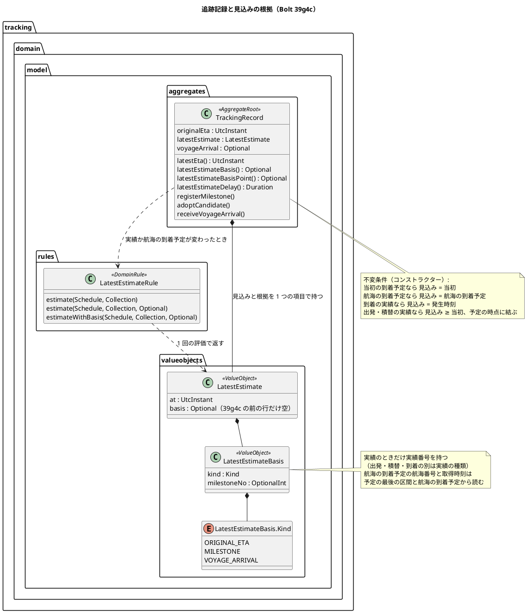
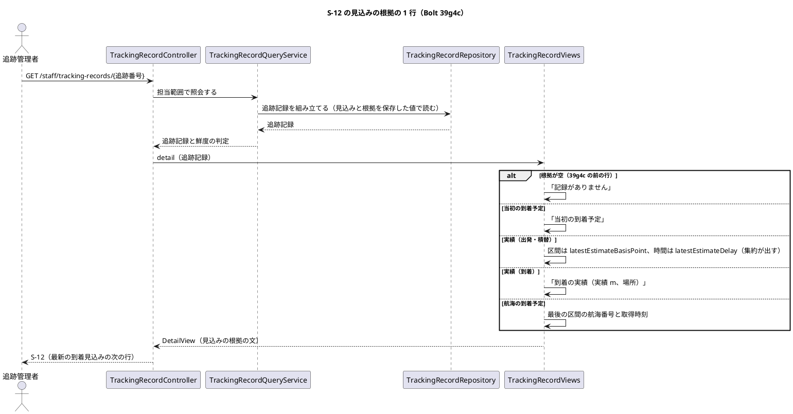
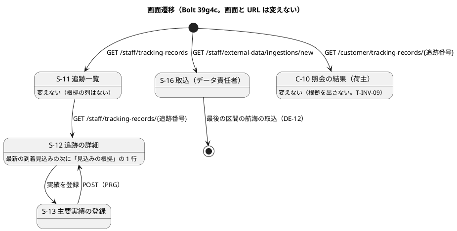
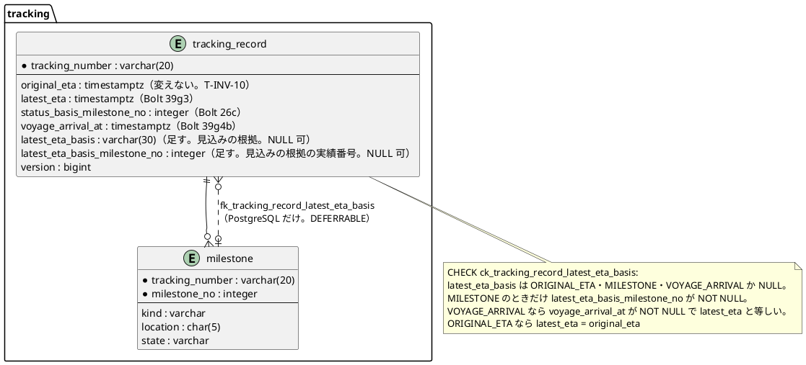

# Bolt 39g4c 計画 - 最新の到着見込みの根拠を S-12 に 1 行で示す

## 基本情報

| 項目 | 内容 |
| :--- | :--- |
| Bolt | 第 39g4c 回（W7 の 34 本目。release_plan :982 の 39g4c の行） |
| 状態 | 計画（**承認済み**。2026-11-12 に確認ポイント CP-1〜CP-8 を推奨のとおり承認。human:kakimomokuri。2026-11-12 に開始準備。2 つの整合性検証（`validating-iteration-plan`・`validating-design`）の指摘を反映した。下の「整合性検証の結果」） |
| 予定 | W7（2026-11-16 の週。前倒しで着手できる）。Bolt 39g4b の終了報告の承認（2026-11-12）の後に着手する。約 3 時間 10 分（約 190 分）の見込み（下の「ステップ計画」。release_plan の参考の約 2 時間から引き直した。決定 (1)）。`check`・`uiTest`・`manualScreenshots`・SonarQube・CI と承認の待ちを除く |
| アプローチ | アウトサイドイン（release_plan :982「既存の追跡記録を広げる」。development_strategy :350 の W7 の追跡の残りは中盤の例外でアウトサイドイン。状態の組み合わせの表を先に書く。T-182）。最初に Bolt 39g4b の終了報告の議題 3 のテストを足し、届かない分岐を消すリファクタリングを Red の前に行う（ステップ 2。決定 (2)）。受入シナリオ（遅れた出発を登録すると S-12 の見込みの根拠がその実績になり、遅い航海の到着予定が届くと航海の到着予定になる）を先に Red にし、内側（見込みの根拠の値 → 最新の到着見込みの規則 → 追跡記録の集約 → 保存と読み込み → S-12 の表示）に入る |
| 対象 | (1) 議題 3 の返済（`VoyageArrival.orderOf` の分岐、メモリの実装の最後の区間の絞り込み、行 7 (f) の補強）、(2) 見込みの根拠の値（`LatestEstimateBasis`）と、規則が見込みと根拠を 1 回の評価で返す形（`LatestEstimate`）、(3) 追跡記録が見込みと根拠を同じ結果から持つ、(4) 列 2 つと CHECK・外部キーの追加（**スキーマ**）と保存・読み込み、(5) S-12 の定義リストの「見込みの根拠」の 1 行（【業務の判断】(aw)、台帳 D-139 の実装。文の形は【業務の判断】(ax)、台帳 D-140（仮））、(6) マニュアル 9 章・用語集と S-12 のキャプチャ |
| トレース | T-INV-10（domain_model :1451）、T-INV-09（S-11・C-10 に出さない）、US-09 AC2（当初の予定と最新の見込みを分けて持つ）、`LatestEstimate`・`LatestEstimateRule`（domain_model :215 と規則の表）、S-12（ui_design :178）、ui_design :1689「見込みの根拠は Bolt 39g4c」、台帳 D-130・D-136〜D-139、[Bolt 39g4b 計画](bolt_39g4b_plan.md) の決定 (1)・(8)・申し送り、[Bolt 39g4b 終了報告](bolt_39g4b_report.md) の議題 3、[Bolt 39g4 計画](bolt_39g4_plan.md) の決定 (4)（本計画の確認ポイントは「本計画 CP-n」、W7 の確認ポイントは「W7 CPn」と書き分ける） |
| GitHub | この Bolt の Issue はない（US を数えない技術の Bolt。release_plan :982 の SP は 0） |
| SP | 0 |
| 承認ゲート | **計画と終了報告で止める**（release_plan :982「計画と終了報告（スキーマ）」）。確認必須のもの（見積りの引き直し、前の決定の変更（(24)）、業務の文の形、**スキーマの変更**、既存データを補正しない判断、新しいファイル）は本計画の確認ポイントにまとめ、計画の承認に含める（前例 bolt_39g4b_plan.md）。**データベースの承認ゲートに当たる**（`tracking.tracking_record` に列を 2 つと CHECK を 1 つ足す共通のマイグレーションと、PostgreSQL だけの外部キーのマイグレーション。下の決定 (3)）。認可は変えない（新しい URL を足さない）。外部連携は足さない。新しいコンテキスト間の依存は足さない。`/goal` の下でも、この計画は承認を受けてから実行する |

## Bolt ゴール

追跡管理者が S-12 を開くと、定義リストの最新の到着見込みの次に「見込みの根拠」の 1 行が出て、見込みが当初の到着予定のままか、どの出発・積替の実績の遅れで動いたか、到着の実績か、最後の区間の航海の到着予定（いつ取得した知らせか）かが分かり、荷主に見込みの理由を説明できる（【業務の判断】(aw)、台帳 D-139）。根拠は見込みと同じ規則の 1 回の評価で決まり、見込みと一緒に保存する（読むたびに導かない）。S-11 の列と C-10 には出さない。

## 状態の組み合わせ（行ごとにテストを 1 本。T-182）

行の番号はこの計画で 1 から振る。見本の予定は 39g4b と同じ 2 区間（区間 1: 航海 V100 で JPTYO から KRPUS、出発予定 D1・到着予定 A1。区間 2: 航海 V200 で KRPUS から USLAX、出発予定 D2・到着予定 A2）。当初の到着予定は A2。見込みの根拠の種類は「当初の到着予定」（`ORIGINAL_ETA`）・「実績」（`MILESTONE`。出発・積替・到着の別は実績の種類で決まる）・「航海の到着予定」（`VOYAGE_ARRIVAL`）の 3 つ（決定 (3)）。テストは新しいクラスは決定 (8)、既存のクラスは `@Nested class Bolt39g4c_…`。期待値は、Red を書く前に決定の文から導けることを 1 行ずつ確かめた（Bolt 39g4 の Try）。どの入力も今の型で作れることを確かめた（Bolt 39g4b の Try。作れない入力は行 1 (c) のとおり分岐を消す）。

| 行 | 状況 | 期待 | 確かめ方 |
| :--- | :--- | :--- | :--- |
| 1 | Bolt 39g4b の議題 3 の返済（本体を変える前に書く。今のコードを縛るテストで Red にはならない）: (a) `VoyageArrival.orderOf` に公開した時刻が null、(b) 出典が null、(c) 出典の参照が空・取得時刻が null の分岐（共有カーネルの `Source` の作り方が拒むので届かない。決定 (2)）、(d) メモリの実装の照会を直接呼ぶ: 2 区間の予定の追跡に V100（中間の区間）、V200 が追跡 X では区間 1・追跡 Y では最後の区間（集約の判定が変異を隠さないよう、listener を通さず照会の戻り値を見る）、(e) 行 7 (f) の補強（最終取得時刻を導き直す経路を通す）: DE-13 の下書き（取得時刻 G5）を受けた後に航海の知らせ（取得時刻 G1 < G5）を受ける、下書き（G5）を受けた後に採用の実績（取得時刻 G2 < G5）を登録する | (a)(b) `InvalidEventValueException`（欠けの名前 `publishedAt`・`source`。listener の側の ERROR のログは既存の `VoyageArrivalEventHandlerTest` の行 13 (c)（:155-156）が確かめ、ここでは値の側の欠けの名前を足す）、(c) 分岐を消す（リファクタリング。`Source` の作り方の拒否は共有カーネルの既存の `SourceTest` が縛る）、(d) V100 は空、V200 は Y だけ、(e) G1・G2（下書きの取得時刻は導き直しても使わない） | 単体（`VoyageArrivalTest`（新規）、`VoyageArrivalEventHandlerTest` の `@Nested`（メモリのリポジトリの照会を直接呼ぶ）、`TrackingRecordVoyageArrivalTest`） |
| 2 | 見込みの根拠の値（パラメーター）: (a) 当初の到着予定で実績番号なし、(b) 実績で実績番号 3、(c) 実績で実績番号なし、(d) 当初の到着予定・航海の到着予定で実績番号あり、(e) 実績で実績番号 0 | (a)(b) 作れる、(c)(d)(e) 拒む（`IllegalArgumentException`） | 単体（`LatestEstimateBasisTest`） |
| 3 | 規則の根拠（パラメーター。採用の実績と航海の到着予定の組。実績番号は登録の順）: (a) 実績なし・航海なし、(b) 区間 1 の出発 D1 + 6 時間（実績 1）、(c) 区間 1 の出発 D1 − 1 時間（早い出発。実績 1）、(d) 到着・USLAX A2 + 1 時間（実績 1）、(e) 実績なし・航海 A2 + 10 時間、(f) 実績なし・航海 A2 − 5 時間（早着の知らせ）、(g) 区間 1 の出発 D1 + 6 時間・航海 A2 + 3 時間、(h) 区間 1 の出発 D1 + 6 時間・航海 A2 + 8 時間、(i) 区間 1 の出発 D1 + 6 時間・航海 A2 + 6 時間（同じ時刻）、(j) 到着・USLAX A2 + 1 時間・航海 A2 + 10 時間、(k) 確認中の出発 D1 + 6 時間だけ、(l) 区間 1 の出発 D1 + 6 時間（実績 1）・区間 2 の出発 D2（定刻。実績 2）、(m) 区間 1 の積替・KRPUS A1 + 3 時間（実績 1）、(n) 集荷の実績だけ（予定の時点に結ばない）、(o) 実績なし・航海の到着予定がちょうど A2（(i) と対） | 見込みは 39g3・39g4b の `LatestEstimateRuleTest` の同じ組と同じ値。根拠は (a) 当初の到着予定、(b) 実績 1、(c) 実績 1（見込みは当初のまま。遅れのない実績も根拠にする。決定 (5)）、(d) 実績 1、(e) 航海の到着予定、(f) 当初の到着予定（早まった知らせは見込みに効かない）、(g) 実績 1、(h) 航海の到着予定、(i) 実績 1（同じ時刻は実績。規則は航海の到着予定が厳密に遅いときだけ使う）、(j) 実績 1（到着の実績が勝つ）、(k) 当初の到着予定（確認中は使わない）、(l) 実績 2（予定の順で最も後の実績）、(m) 実績 1、(n)(o) 当初の到着予定 | 単体（`LatestEstimateRuleTest` の `@Nested class Bolt39g4c_…`。今の `estimate` の 2 つの形の組は直さずに通す。決定 (4)） |
| 4 | 集約が見込みと根拠を同じ結果から持つ（パラメーター）: (a) 追跡の開始、(b) 遅れた出発を登録して採用、(c) 下書きの採用、(d) (b) の後に航海の到着予定 A2 + 8 時間を受ける、(e) (d) の後に新しいが結べない航海の知らせを受ける、(f) Bolt 39g4c の前の形で組み立てた（根拠なし）区間 1 の出発の遅れを持つ追跡記録が DE-13 の下書きを受ける、(g) Bolt 39g4c の前の形で組み立てた（根拠なし）完了後の追跡記録に保持のみの実績を登録、(h) (b) の後に時系列に反する実績を登録（確認中）、(i) Bolt 39g4c の前の形で組み立てる（根拠なし） | (a) 当初の到着予定（見込みの遅れ 0）、(b) その実績（`latestEstimateBasisPoint()` は区間 1 の出発、`latestEstimateDelay()` は 6 時間）、(c) 採用した実績、(d) 航海の到着予定、(e) (b) の実績に戻る、(f)(g) 根拠は空のまま（導出し直さない経路。導き直せば実績になる組にして、導き直す変異が落ちるようにした）、(h) (b) の実績のまま（確認中は使わない）、(i) 根拠は空で見込みは保存した値 | 単体（`TrackingRecordLatestEstimateBasisTest`（新規）） |
| 5 | 集約の不変条件（private のコンストラクターで確かめるので、組み立て・開始・導出のどの経路にも効く。前例 実績番号の連番の検査 :140-144。パラメーター）: (a) 根拠が実績で、その実績番号の実績がない、(b) 根拠が実績で、その実績が採用でない（下書き）、(c) 根拠が実績で、その実績が予定の時点に結ばない（集荷）、(d) 根拠が航海の到着予定で、航海の到着予定がない（受けていないか結べない）、(e) 根拠が航海の到着予定で、見込みが航海の到着予定と違う、(f) 根拠が当初の到着予定で、見込みが当初の到着予定と違う、(g) 根拠が到着の実績で、見込みがその発生時刻と違う、(h) 根拠が出発の実績で、見込みが当初の到着予定より前、(i) 根拠が空（Bolt 39g4c の前の行） | (a)〜(h) 拒む（`IllegalArgumentException`）。(a) は PostgreSQL では外部キー、(d)(e)(f) は表の CHECK も拒む（H2 では外部キーがないので集約が守る）。(b)(c)(g)(h) は集約だけの規則（表は実績の状態と予定の時点を見ない）。(i) 組み立てられる | 単体（`TrackingRecordLatestEstimateBasisTest`） |
| 6 | S-12 の 1 行（パラメーター。「見込みの根拠」の `dt` は「最新の到着見込み」の `dd` の次。文は決定 (5)）: (a) 当初の到着予定、(b) 区間 1 の出発の実績 2・JPTYO・遅れ 6 時間、(c) 区間 1 の積替の実績 3・KRPUS・遅れ 1 時間 30 分、(d) 区間 2 の出発の実績 4・KRPUS・遅れ 45 分、(e) 区間 1 の早い出発の実績 2（D1 − 1 時間。見込みは当初のまま）、(f) 区間 1 の出発の実績 2・遅れ 30 秒（分未満）、(g) 到着の実績 5・USLAX、(h) 航海 V200 の到着予定（取得 G1）、(i) 根拠なし（Bolt 39g4c の前の行） | (a)「当初の到着予定」、(b)「区間 1 の出発の実績（実績 2、JPTYO、当初より 6 時間遅れ）」、(c)「区間 1 の積替の実績（実績 3、KRPUS、当初より 1 時間 30 分遅れ）」、(d)「区間 2 の出発の実績（実績 4、KRPUS、当初より 45 分遅れ）」、(e)(f)「区間 1 の出発の実績（実績 2、JPTYO、当初の到着予定どおり）」、(g)「到着の実績（実績 5、USLAX）」、(h)「航海 V200 の到着予定（取得 G1 の社内の日時表示）」、(i)「記録がありません」 | `@WebMvcTest`（`TrackingRecordControllerTest` の `@Nested class Bolt39g4c_…`） |
| 7 | 開示（T-INV-09）と一覧（回帰）: 航海の到着予定が根拠の追跡記録で、荷主担当者が C-10 を開く、追跡管理者が S-11 を開く | C-10 の本文に「見込みの根拠」と根拠の文（「航海 V200 の到着予定」）が出ない。S-11 の列は変わらない。`CustomerTrackingView`・`TrackingRecordSummary` は根拠を持たない | `CustomerTrackingControllerTest`・`TrackingRecordControllerTest` |
| 8 | 保存（INSERT と UPDATE） | 開始の INSERT が根拠の種類 `ORIGINAL_ETA`・実績番号 NULL を書く。主要実績の UPDATE が 2 列を書く（見込みと同じ文で）。版が違えば今のとおり競合。根拠の実績番号の実績が表になければ、根拠の実績番号（P-5）と同じく先に確かめて競合にする（遅延の外部キーの違反がコミットのときに 500 になるのを先に拾う。決定 (3)） | 統合（`MyBatisTrackingRecordRepositoryIntegrationTest`。H2 と PostgreSQL） |
| 9 | 読み込みと往復 | 組み立てで 2 列を読む（NULL は根拠なし）。保存した値が読み直しても同じ。要約（S-11・C-10）は 2 列を読まない | 統合、`InMemoryTrackingRecordRepository` |
| 10 | マイグレーション | `tracking.tracking_record` に 2 列（NULL 可）と CHECK ができ、既存の行は NULL。CHECK は、種類の値の外・実績で実績番号が NULL・実績でないのに実績番号がある・種類が NULL で実績番号がある・航海の到着予定なのに `voyage_arrival_at` が NULL か `latest_eta` と違う・当初の到着予定なのに `latest_eta` が `original_eta` と違う UPDATE を拒む。PostgreSQL ではない実績番号を指す UPDATE がコミットで外部キーに拒まれる。列のコメントは用語集の名 | 統合（Flyway の適用、`SchemaCommentIntegrationTest`（PostgreSQL）、CHECK と外部キーの統合テスト、`MapperSchemaArchitectureTest`） |
| 11 | 受入シナリオ（業務ルール層） | 実績のない追跡の根拠は当初の到着予定。区間 1 の出発が 6 時間遅れると根拠はその実績。V200 の到着予定 A2 + 8 時間の DE-12 が届くと根拠は航海の到着予定。A2 + 3 時間なら実績のまま。到着の実績の後は到着の実績 | `features/tracking/latest_estimate_basis.feature`（`@T-INV-10`） |
| 12 | UI（追跡管理者が S-13 で区間 1 の出発を 6 時間遅れで登録し S-12 を見る。データ責任者が最後の区間の航海を到着予定 A2 + 8 時間（実績の遅れの見込み A2 + 6 時間より厳密に遅い。行 11 とそろえる）の 1 行のファイルで取り込み、追跡管理者が S-12 を開き直す。荷主担当者が C-10 を開く） | S-12 の見込みの根拠が「区間 1 の出発の実績（…、当初より 6 時間遅れ）」になり、取込の後は「航海 … の到着予定（取得 …）」になる。C-10 に見込みの根拠は出ない。axe の違反 0。幅 320 px | `features/ui/latest_estimate_basis_ui.feature`、タグ `@demo-bolt-39g4c/latest-estimate-basis` |
| 13 | 認可は変えない | S-11・S-12・S-13 は追跡管理者（担当企業の範囲。Bolt 38g）、C-10 は荷主担当者の自社だけ（回帰） | 既存の `@WebMvcTest`・`TrackingAssignedScopeSecurityIntegrationTest` |
| 14 | 層の規則・用語の検査 | 値は `tracking.domain.model.valueobjects`（`@ValueObject`）。`LivingGlossaryConsistencyTest` は `LatestEstimate`（既存の用語の行「最新の到着見込み」）・`LatestEstimateBasis`（足す行「見込みの根拠」）の英語名と Javadoc の最初の語を確かめる。追跡の `allowedDependencies` は変えない | `LayerArchitectureTest`・`DddAnnotationArchitectureTest`・`LivingGlossaryConsistencyTest`・Modulith の検証（既存） |
| 15 | マニュアル | 9 章（S-12 の ② の説明、「最新の到着見込みと最終取得時刻」の節に根拠の 1 行の読み方）・用語集（見込みの根拠を足し、最新の到着見込みの項に根拠の 1 行を足す）と S-12 のキャプチャ 5 枚（マニュアルが参照する 4 枚と、`manual_screenshots.feature` :101 が撮る参照されない `09-tracking-detail`）が実装と一致する | ステップの突き合わせの記録（T-197・T-251）、`manualScreenshots` |
| 16 | 今の振る舞い | 下の「守る既存のテスト」が通る | 既存 |

### 守る既存のテスト（Red のテストを書く前に流すテストの一覧。T-217、Bolt 39g2 の Try）

- 追跡: `ScheduleTest`、`PublicationOrderTest`、`VoyageArrivalRuleTest`、`LatestEstimateRuleTest`、`NextExpectedMilestoneRuleTest`、`FreshnessPolicyTest`、`MilestoneCandidateRuleTest`、`TrackingRecordTest`、`TrackingRecordMilestoneTest`、`TrackingRecordCandidateAdoptionTest`、`TrackingRecordExternalMilestoneTest`、`TrackingRecordVoyageArrivalTest`、`TrackingRecordCustomerViewTest`、`TrackingRecordCommandServiceTest`、`TrackingRecordQueryServiceTest`、`CustomerTrackingQueryServiceTest`、`ExternalMilestoneEventHandlerTest`、`VoyageArrivalEventHandlerTest`、`TrackingRecordControllerTest`、`MilestoneRegistrationControllerTest`、`CustomerTrackingControllerTest`、`MyBatisTrackingRecordRepositoryIntegrationTest`、`MyBatisTrackingRecordRepositoryUniqueKeyTest`、`MyBatisTrackingRecordLockIntegrationTest`、`H2TrackingRecordLockTest`、`TrackingAssignedScopeSecurityIntegrationTest`、`VoyageArrivalDeliveryIntegrationTest`、`features/tracking/latest_estimate.feature`・`voyage_arrival_estimate.feature`・`register_milestone.feature`・`query_tracking.feature`、`features/ui/latest_estimate_ui.feature`・`voyage_arrival_estimate_ui.feature`・`query_tracking_ui.feature`（画面の層は `uiTest` がシナリオを選べないので Green の後の全件で流す。39g3〜39g4b の「計画から変えたこと」）
- 横断: `SourceTest`（共有カーネル。参照の null・空・空白と取得時刻の null を拒む組がすでにあり（:38-52）、行 1 (c) で消す分岐の代わりに縛る）、`LayerArchitectureTest`、`DddAnnotationArchitectureTest`、`LivingGlossaryConsistencyTest`、`MapperSchemaArchitectureTest`、`SchemaCommentIntegrationTest`、Modulith の検証

## 開始準備の決定（推奨を 1 つに決めて書いた。承認済み）

(1) **範囲と見積り**（本計画 CP-1）: release_plan :982 の 39g4c の行は、S-12 の根拠の 1 行と、根拠の保存か読むたびに導くか・文の形・既存の行の扱いの判断。Bolt 39g4b の終了報告の議題 3（承認済み）で、議題 3 のテストを 39g4c の最初に足す。コードで確かめると、根拠を保存する形（決定 (3)）では、共通のマイグレーション（列 2 つと CHECK）と PostgreSQL の外部キーのマイグレーション、規則と集約の書き手 4 つ（開始・`derivedWith`・`receiveVoyageArrival`・導出し直さない経路）と見込みと根拠の一致の不変条件、行の型とマッパーと根拠の実績番号の先の確かめ（P-5）、S-12 の表示と文、S-12 のキャプチャ 5 枚（`09-tracking-detail`・`-registered`・`-draft`・`-candidate`・`-under-review`。定義リストに 1 行増える）の撮り直しが要り、約 190 分になる（参考の約 2 時間は根拠の表示だけを見た値で、スキーマの 2 つのマイグレーションとキャプチャを含んでいなかった）。目安（T-250 の 4 時間 05 分）に収まるので **分けない**。分けると、根拠を保存するが画面に出ない Bolt（見えない状態）ができる。超えそうなときは 行 12 の動画（−5 分）を後へ送る。マニュアルとキャプチャは後に送らない。
- 比べた案: (i) **約 190 分で 1 本（推奨）**。(ii) 根拠の保存（スキーマ）と S-12 の表示に分ける（見えない状態の Bolt ができる）。(iii) 議題 3 の返済を別の Bolt にする（数分の作業で、承認済みの「39g4c の最初に」と違う）

(2) **議題 3 の返済の形**（本計画 CP-2、【前の決定の変更】(24)）: Bolt 39g4b の終了報告の議題 3 は「`VoyageArrival.orderOf` の 2 つの分岐（出典の参照が空・取得時刻が null）とメモリの実装の行 4 (c) を単体で足す（本体は変えない）」として承認された。コードで確かめると、2 つの分岐は **どの入力でも通らない**。共有カーネルの `Source` の作り方（shared/domain/Source.java）が参照の null・空と取得時刻の null を拒むので、`Source` の値は必ず参照と取得時刻を持つ。DE-12 は発行記録から読み直すときも同じ作り方を通る。そこで、本体を変えずにテストを足すことはできない（Mockito で `Source` を差し替えれば流せるが、作れない状態を作るテストになる）。**2 つの分岐を消すリファクタリングを Red の前に行い**（帽子の切り替え。振る舞いは変えない）、残る 2 つの分岐（公開した時刻が null・出典が null）を `VoyageArrivalTest` で縛る（行 1 (a)(b)）。メモリの実装の最後の区間の絞り込みは、照会を直接呼んで戻り値で縛る（行 1 (d)。変異 M15 のメモリの側。listener を通すと、集約が最後の区間でない知らせを受けないので変異が隠れる）。39g4b の報告が「弱い」とした行 7 (f)（下書きの取得時刻だけ）は、下書きの受け取りが最終取得時刻を導き直さない経路なので、下書きを受けた後に導き直す経路（航海の知らせの受け取り・採用の実績の登録）を通す組にする（行 1 (e)。議題 3 の文の外だが、同じ欠けの返済なので含める）。
- 比べた案: (i) **届かない 2 つの分岐を消し、残りを縛る（推奨）**。(ii) Mockito で `Source` を差し替えて 2 つの分岐を流す（作れない状態を縛るテストが残り、`Source` の不変条件を変えたときに誤って緑になる）。(iii) テストを足さずに残す（議題 3 を果たさず、カバレッジに届かない分岐が残る）

(3) **根拠の保存とスキーマ、既存のデータ**（本計画 CP-3・CP-6。**データベース**）: 根拠は **保存する**（Bolt 39g4b の決定 (8) の申し送りの推奨の第一候補）。`tracking.tracking_record` に 2 列を足す。`latest_eta_basis`（`VARCHAR(30)`、NULL 可。区分値の列 `current_status`・`under_review_reason` と同じ幅。見込みの根拠の種類 `ORIGINAL_ETA`・`MILESTONE`・`VOYAGE_ARRIVAL`）、`latest_eta_basis_milestone_no`（`INTEGER`、NULL 可。見込みの根拠の実績番号）。CHECK `ck_tracking_record_latest_eta_basis`（種類は 3 つの値か NULL。種類が `MILESTONE` のときだけ実績番号が NOT NULL。種類が `VOYAGE_ARRIVAL` なら `voyage_arrival_at` が NOT NULL で `latest_eta` と等しい。種類が `ORIGINAL_ETA` なら `latest_eta` が `original_eta` と等しい。同じ行の列どうしで、見込みと根拠の食い違いを H2 と PostgreSQL の両方で拒む）。主要実績の UPDATE は、根拠の実績番号（P-5）と同じく、根拠の実績番号の実績が表にあることを `countMilestone` で先に確かめ、なければ競合にする（行 8）。PostgreSQL だけに外部キー `fk_tracking_record_latest_eta_basis`（`tracking_number`・`latest_eta_basis_milestone_no` から `tracking.milestone`。DEFERRABLE INITIALLY DEFERRED。前例 `fk_tracking_record_status_basis`（V20261010120100）。UPDATE を INSERT より先に行うため。H2 では集約の不変条件で守る。行 5）。マイグレーションは `V20261115100000__add_tracking_record_latest_eta_basis.sql`（common）と `V20261115100100__add_tracking_record_latest_eta_basis_fk.sql`（postgresql）（仮。ステップ 1 で最後の版 `V20261114100000` より後であることを確かめる。ADR-007）。列のコメントは用語集の名（「見込みの根拠」「見込みの根拠の実績番号」。`SchemaCommentIntegrationTest` が見る）。開始の INSERT は `ORIGINAL_ETA` と NULL を書き、主要実績の UPDATE（`updateTrackingRecord`）が 2 列を書く。組み立ての行の型 `TrackingRecordRow`・`reconstitute` に足す。要約（S-11・C-10）は読まない。
- 種類を 3 つにする理由: 出発・積替・到着の別は根拠の実績の種類が持つので、種類の列に写すと 2 か所で食い違いうる（重複がない）。航海の到着予定の航海番号は予定の最後の区間、取得時刻は `voyage_arrival_acquired_at` から読めるので保存しない（予定を差し替える経路は W11 で、そのとき航海の到着予定と一緒に根拠も導き直す申し送りに足す）
- 保存する理由: 保存した見込み（`latest_eta`）と根拠を同じ規則の 1 回の評価から書けば、見込みと根拠が食い違わない。読むたびに導くと、39g3 の前の行（`latest_eta` が当初のまま補正していない）や規則を変えた後の行で、示している見込みと導いた根拠がずれ、正が 2 つになる（Bolt 39g4 の決定 (4) で示し方を退けた理由と同じ）
- 既存のデータ: 39g4c の前に開始した追跡記録は、次に見込みを導き直すまで（採用の実績が変わるか、最後の区間の航海の知らせを受けるまで）根拠が NULL で、S-12 は「記録がありません」と示す（行 6 (i)。決定 (5)）。補正のマイグレーションは作らない（Release 1.0 のパイロットの前で業務のデータはない。SQL では予定の時点への結び方を写せない。前例 Bolt 39g3・39g4・39g4b の決定 (6)）
- 比べた案: (i) **種類と実績番号の 2 列と CHECK、PostgreSQL の外部キー（推奨）**。(ii) 読むたびに集約が規則を呼び直して導く（スキーマは変えないが、保存した見込みと導いた根拠で正が 2 つになる）。(iii) 根拠の文を保存する（表示の文が DB に入り、文を変えると既存の行が古い文のまま残る）。(iv) 見込みも保存せず読むたびに導く（S-11・C-10 の要約は集約を組み立てない決まり（Bolt 26）で、`latest_eta` を SQL で読む。構造の変更になる）

(4) **規則と集約の形**（本計画 CP-4）: 規則は見込みと根拠を **1 回の評価で返す**。値 `LatestEstimate`（`@ValueObject`。最新の到着見込み: 時刻と根拠）を足し、`LatestEstimateRule` に `estimateWithBasis(Schedule, Collection<Milestone>, Optional<UtcInstant>)` を足す。今の `estimate` の 2 つの形は `estimateWithBasis(...).at()` に委ねる形で残す（39g3・39g4b の組を直さずに通す。前例 39g4b の決定 (4)）。根拠の決め方は規則の今の分岐に 1 対 1 で対応させる: 到着の実績で返すときはその実績、実績の遅れで送った見込み（遅れが正でなくても）を使うときはその実績、結んだ実績がなく航海の到着予定を使わないときは当初の到着予定、航海の到着予定が厳密に遅いときは航海の到着予定。集約は見込みと根拠を **1 つの項目 `latestEstimate`（`LatestEstimate`）で持ち、受け渡す**（private のコンストラクターと `withMilestones` の引数も `LatestEstimate` 1 つにし、片方だけ差し替える誤りを型で防ぐ。前例 現在状態と根拠の実績番号と理由を `DerivedStatus` 1 つで受け渡す形 :113・:129-131・:621-623）。取り出し口は `latestEta()`（今のまま。呼び手は変えない）と `latestEstimateBasis()`（`Optional<LatestEstimateBasis>`。39g4c の前の行は空）を分けて持つ。そこで `LatestEstimate` の根拠は値の中の `Optional`（`DerivedStatus` の `OptionalInt` と同じ）で、規則が返す値は必ず根拠を持つ。書き手は開始・`derivedWith`・`receiveVoyageArrival` で、導出し直さない経路（DE-13 の下書き・保持のみ）は保存した値のまま持つ。組み立ては根拠を受ける形を足し、今の形は根拠を空にして委ねる（前例 39g4b の `reconstitute`）。
- 不変条件（行 5）は **private のコンストラクター** で確かめる（組み立て・開始・導出のすべての経路に効く。前例 実績番号の連番の検査 :140-144）: 根拠が実績ならその実績番号の採用の実績があり、予定の時点に結び（`Schedule.pointOf`）、到着なら見込みがその発生時刻、出発・積替なら見込みが当初以上。根拠が当初の到着予定なら見込みが当初の到着予定。根拠が航海の到着予定なら航海の到着予定があり、見込みがそれと等しい。保存の理由（正を 1 つにする）を、規則を変えて片方だけ書く誤りに対しても集約と表の CHECK で守る
- 表示の材料（決定 (5)）は集約が出す: `latestEstimateBasisPoint()`（根拠の実績を結んだ予定の時点。規則と同じ `Schedule.pointOf`）と `latestEstimateDelay()`（当初からの見込みの遅れ = 最新の到着見込み − 当初の到着予定。0 以上）。画面は書式にするだけで、規則の加算の形を写さない
- `reconstitute` の形は今、最新の形と、39gc・39g3 の前・39g4 の前・39g4b の前の 3 つの古い形の 4 つで、39g4c の前の形を足すと 5 つになる。この Bolt では前例どおり足す。古い形を残すと、最新の形で写し直す呼び手（`MyBatisTrackingRecordRepository`・`InMemoryTrackingRecordRepository`）を直し忘れてもコンパイルが通り、根拠が黙って空になる（行 9 の往復で落ちる）。形を減らす（呼び手 12 ファイル（main 1・test 11）を最新の形にそろえるか、組み立ての値をまとめる）のは技術的負債として申し送る。`estimate` の 2 つの形も、39g4c の後はテストだけが呼ぶ公開の形になるので、同じ申し送りに入れる（下の「申し送り」）
- 比べた案: (i) **規則が見込みと根拠を 1 つの値で返し、集約も 1 つの項目で持つ（取り出し口は分ける）（推奨）**。(ii) 根拠だけを返す別の規則を足す（見込みと根拠の決め方が 2 か所になり、片方だけ変える誤りを型で防げない）。(iii) 集約の項目を `latestEta` と `latestEstimateBasis` の 2 つに分ける（コンストラクターと `withMilestones` が別々の引数で受け、片方だけ差し替える誤りを型で防げない。(ii) を退けた理由と同じ）

(5) **文の形と既存の行の示し方**（本計画 CP-5、【業務の判断】(ax)、台帳 D-140（仮））: S-12 の定義リストの「最新の到着見込み」の次に `dt`「見込みの根拠」、`dd` に次のどれかを示す（D-139 の 4 つの値を具体の文にした）。
- 当初の到着予定: 「当初の到着予定」
- 出発・積替の実績: 「区間 n の出発の実績（実績 m、場所、当初より … 遅れ）」「区間 n の積替の実績（…）」。区間 n は集約の `latestEstimateBasisPoint()` の区間（`SchedulePoint.legIndex` + 1）。場所は UN/LOCODE（S-12 の主要実績・予定区間と同じ）。実績 m は主要実績の一覧の「実績 m」と同じ番号で、一覧を探せる（確認中の理由の文と同じ形）。括弧の中の時間は **実績の遅れではなく見込みの遅れ**（集約の `latestEstimateDelay()` = 最新の到着見込み − 当初の到着予定。上の 2 行の差を説明する）で、「当初より 6 時間遅れ」「当初より 1 時間 30 分遅れ」「当初より 45 分遅れ」と示し（分未満は切り捨て）、0 分なら「当初の到着予定どおり」（早い出発で見込みを早めないので負は出ない）。「当初より」と書くので、規則が実績の遅れを見込みにどう写すかを変えても文は誤らない
- 到着の実績: 「到着の実績（実績 m、場所）」
- 航海の到着予定: 「航海 V の到着予定（取得 日時）」。V は最後の区間の航海番号、日時は航海の到着予定の取得時刻を S-12 の社内の日時表示（主要実績の「（取得 …）」と同じ書式）で示す
- 根拠のない行（39g4c の前の行）: 「記録がありません」（既存の空の文「まだありません」「なし」と違えるのは、届くのを待っている値ではなく、39g4c の前に見込みを決めたので根拠を記録していないため。次に見込みを導き直すと示す）
- 理由: 追跡管理者が荷主に「なぜその見込みか」を、画面の上の行（当初の到着予定と最新の到着見込み）と主要実績の一覧につないで説明できる。時間は集約が出す見込みの遅れを書式にするだけなので、実績の発生時刻から計算し直さず（規則の知識を画面に写さない）、文と見込みが食い違わない。遅れのない実績を根拠にするのは、積替港で遅れを取り戻して見込みが当初に戻ったことを示すため（マニュアル 9 章 :111 の「積替港で遅れを取り戻すと見込みも戻ります」）
- 比べた案: (i) **上の文（推奨）**。(ii) 遅れのない実績の根拠を「当初の到着予定」にする（遅れを取り戻したことが分からない）。(iii) 実績番号を出さず D-139 の「（場所、遅れ）」のまま（同じ場所の実績が複数あると一覧で探しにくい）。(iv) 遅れを実績の発生時刻と予定時刻の差で示す（早い出発で負の遅れが出て、見込みとの関係が読めない）。(v) 「遅れ 6 時間」と書く（規則が実績の遅れを見込みにそのまま足す今の形のときだけ正しく、規則を変えると括弧の中が実績の遅れでなくなる）
- D-139 との差（D-140 の行に書く）: 実績番号を足す、時間を見込みの遅れとして「当初より … 遅れ」「当初の到着予定どおり」で書く、遅れのない実績も根拠にする、5 つ目の値「記録がありません」を足す。D-139 の示す場所と 4 つの種類は変えないので、前の決定の変更ではなく具体化として D-140 に置く

(6) **画面・認可・外部連携・イベント・ナビゲーションと開示**（本計画 CP-7）: 画面と URL は増やさない。S-12 の定義リストに 1 行足すだけで、navbar・ダッシュボードとナビの表示のテストは要らない。S-11 の列と C-10 には出さない（【業務の判断】(aw)。C-10 の根拠は W9 の FRS-03 の「最新性を保証しない旨」と一緒に決める）。`CustomerTrackingView`・`TrackingRecordSummary` に根拠を持たせない（荷主の照会の値に社内の航海番号・実績番号を入れる経路を作らない。T-INV-09。行 7）。根拠が変わったことのイベント・通知は作らない。セキュリティの承認ゲートには当たらない。

(7) **層と依存**: 新しい値は `tracking.domain.model.valueobjects`、表示の文は `tracking.interfaces.web.TrackingRecordViews`（文はインターフェース層。ドメインは種類と実績番号だけを持つ）。新しいコンテキスト間の依存はない。共有カーネルは変えない。**規則の例外は要らない見込み**で、当たったら置き場所を動かさず止めて諮る（T-125）。

(8) **新しい型の名前**（第 3 章、CLAUDE.md。T-246。`apps/cargo-tracker/src` で `LatestEstimateBasis`・`LatestEstimate`（単語）・`estimateWithBasis`・`latest_eta_basis`・`latestEstimateBasis`・`fk_tracking_record_latest_eta_basis`・`ck_tracking_record_latest_eta_basis`・`Bolt39g4c`・`demo-bolt-39g4c`・`見込みの根拠` を検索し、ないことを確かめた）:
- 値: `tracking.domain.model.valueobjects.LatestEstimate`（`@ValueObject`。最新の到着見込み: 時刻・根拠（`Optional`。規則が返す値は必ず持ち、39g4c の前の行だけ空）。Javadoc は「最新の到着見込み。」で始める（`LivingGlossaryConsistencyTest` は最初の「。」までを読む）。domain_model の既存の用語の行「最新の到着見込み | LatestEstimate」に結ぶ）、`LatestEstimateBasis`（`@ValueObject`。見込みの根拠: 種類（入れ子の enum `Kind`: `ORIGINAL_ETA`・`MILESTONE`・`VOYAGE_ARRIVAL`）・実績番号（`OptionalInt`。種類が実績のときだけ）。Javadoc の最初の語は「見込みの根拠」）
- domain_model の用語集に「見込みの根拠 | LatestEstimateBasis」の行を足し（`LivingGlossaryConsistencyTest` が英語名の列と Javadoc の最初の語を見る）、「最新の到着見込み」「最新の到着見込みの規則」の行と規則の表を直す
- 直すもの: `VoyageArrival`（届かない 2 つの分岐を消す）、`LatestEstimateRule`、`TrackingRecord`（項目 `latestEstimate`、コンストラクター・`start`・`derivedWith`・`receiveVoyageArrival`・`withMilestones`・`reconstitute`・`latestEstimateBasis()`・`latestEstimateBasisPoint()`・`latestEstimateDelay()`・不変条件）、`MyBatisTrackingRecordRepository`（`update` の 2 列と根拠の実績番号の先の確かめ、組み立て）、`TrackingRecordRow`、`TrackingRecordMapper`（Java と XML）、`InMemoryTrackingRecordRepository`（テストのダブル。`update` :47-66 が最新の形の `reconstitute` で組み立て直すので、根拠を写す形に直す）、`TrackingRecordViews`（`DetailView` と文）、templates/tracking/staff/tracking-records/show.html、マニュアル 9 章・用語集とキャプチャ
- 新しいファイル: マイグレーション 2 つ、`LatestEstimate`・`LatestEstimateBasis` と `LatestEstimateBasisTest`、`VoyageArrivalTest`、`TrackingRecordLatestEstimateBasisTest`、受入シナリオ `features/tracking/latest_estimate_basis.feature`・`features/ui/latest_estimate_basis_ui.feature`、タグ `@demo-bolt-39g4c/latest-estimate-basis`、本計画と終了報告、動画

### 前の Bolt から引き継いだもの

| 出典 | 内容 | この計画 |
| :--- | :--- | :--- |
| release_plan :982、Bolt 39g4b 計画の決定 (1)・(8)・申し送り | 見込みの根拠の表示（(aw) の実装）。根拠の保存か読むたびに導くか（スキーマ）、文の形、既存の行の扱い | 決定 (3)・(5) |
| Bolt 39g4b 終了報告の議題 3（承認済み） | `VoyageArrival.orderOf` の 2 つの分岐とメモリの実装の行 4 (c) を 39g4c の最初に単体で足す（本体は変えない）。行 7 (f) が弱い | 決定 (2)（分岐は届かないので消す。【前の決定の変更】(24)）、行 1 |
| Bolt 39g4 計画の決定 (4) | 読むたびに導くと保存した見込みと正が 2 つになる | 決定 (3) の保存する理由 |
| Bolt 26c（`fk_tracking_record_status_basis`） | 根拠の実績番号の外部キーは PostgreSQL だけに DEFERRABLE で張り、H2 は集約の不変条件で守る | 決定 (3)、行 5・10 |
| Bolt 39g4b 終了報告の Try | 計画の状態の組み合わせの表に、その入力が型で作れるかを開始準備の検証の観点に足す | 表の前書き、行 1 (c)、整合性検証の観点 |
| Bolt 39g4b 終了報告の Try、議題 1 | コマンドは 1 つの目的だけを書き、末尾に別のコマンドを足さない。標準入力・ヒアドキュメント・スクラッチパッドの外への書き込みを使わない | ファイルは Write・Edit かスクラッチパッドの `.py`、コミットは `-m` を複数回。T-247 は W7 の締めで諮る |
| Bolt 39g4b の学び | 共有の DB を使う統合テストでは照会の鍵をテストごとに作る。変異のスクリプトは対象のファイルの改行（CRLF）に合わせる | 行 8〜10 の統合テストの追跡番号、ステップ 10 |

### 開始準備で確かめたこと（作業ツリーの `apps/cargo-tracker/src` で読んだ）

- **届かない分岐**: `VoyageArrival.orderOf`（tracking/domain/model/valueobjects/VoyageArrival.java :49-63）は公開した時刻・出典・出典の参照の空・取得時刻の null を確かめる。`Source`（shared/domain/Source.java）の作り方は参照の null・空と取得時刻の null を拒むので、後ろの 2 つは届かない
- **メモリの実装**: `InMemoryTrackingRecordRepository.findTrackingNumbersByFinalLegVoyage`（test/…/tracking/acceptance :89-96）は最後の区間の航海で絞り、追跡番号の順に並べる。最後の区間でない航海で絞らないことを縛るテストはない（39g4b の M15 は SQL の側だけ）
- **見込みの規則**: `LatestEstimateRule.estimate`（:49-71）は、採用の実績を予定の時点に結び、予定時刻の最も後（同じなら発生時刻の遅い方）を選ぶ。到着ならその発生時刻、出発・積替なら当初 + 正の遅れ、なければ当初。航海の到着予定は見込みより **厳密に遅い** ときだけ使う（同じ時刻は実績の側）。根拠はこの分岐から決まる
- **予定の時点**: `SchedulePoint` は区間の位置 `legIndex`（0 から）を持つ。到着の時点は最後の区間だけで、中間の揚地は積替（Schedule.java の `points`）
- **集約の書き手**: 見込みを書くのは `start`（:158-185）、`derivedWith`（:629-637）、`receiveVoyageArrival`（:450-467）。DE-13 の下書きと保持のみは `withMilestones(…, DerivedStatus)`（:674-676）で保存した値のまま
- **根拠の実績番号の前例**: `status_basis_milestone_no`（V20261009130000 :16）と PostgreSQL だけの外部キー `fk_tracking_record_status_basis`（postgresql/V20261010120100）
- **S-12**: 定義リストは追跡番号・現在状態・当初の到着予定・最新の到着見込み・最終取得時刻・次の予定の実績の予定時刻・経路（show.html :21-42）。`DetailView`（TrackingRecordViews.java :181-194）。主要実績の出典は「（取得 社内の日時表示）」（:382-385）、場所は UN/LOCODE、実績の種類の表示名は `kind`（:88）
- **キャプチャ**: S-12 を撮るキャプチャは 5 枚。マニュアル 9 章が参照する `09-tracking-detail-registered`・`-draft`・`-candidate`・`-under-review`（9 章 :70・:81・:90・:99）と、`manual_screenshots.feature` :101 が撮りマニュアルは参照しない `09-tracking-detail`
- **P-5 の先の確かめ**: `MyBatisTrackingRecordRepository.update`（:149-151）は、根拠の実績番号の実績が表になければ `countMilestone` で先に拾って競合にする（遅延の外部キーの違反がコミットのときに 500 になるのを避ける）
- **メモリの実装の更新**: `InMemoryTrackingRecordRepository.update`（:47-66）は最新の形の `reconstitute` で組み立て直す。`reconstitute` の呼び手は main 1・test 11 の 12 ファイル
- **開発データ**: 開発データのマイグレーションは `tracking_record` に INSERT しない（行は画面の手順で作る）ので、キャプチャが「記録がありません」になるおそれはない
- **最後のマイグレーション**: `V20261114100000__add_tracking_record_voyage_arrival.sql`

## 業務の判断の記録（本計画 CP-5。仮。パイロットの前に業務責任者と追跡責任者に確かめる）

| 判断 | 推奨 | 理由 |
| :--- | :--- | :--- |
| (ax) 見込みの根拠の文の形 | 「当初の到着予定」「区間 n の出発（積替）の実績（実績 m、場所、当初より … 遅れ）」「到着の実績（実績 m、場所）」「航海 V の到着予定（取得 日時）」。時間は見込みの遅れ（最新の到着見込み − 当初の到着予定）を時間と分で（分未満は切り捨て。0 分は「当初の到着予定どおり」）。遅れのない実績も根拠にする。39g4c の前の行は「記録がありません」 | 画面の上の 2 行の差と主要実績の一覧につないで説明できる。積替港で遅れを取り戻したことが分かる。規則の知識を画面に写さない |

## スコープ

### 入れるもの

- 行 1〜16。決定 (2)〜(8) の実装と文書
- マニュアル 9 章（S-12 の ② の説明（:75）、「最新の到着見込みと最終取得時刻」の節（:107-115）に「見込みの根拠」の読み方）・用語集（見込みの根拠を足し、最新の到着見込みの項に根拠の 1 行を足す）、S-12 のキャプチャ 5 枚の撮り直し（`manualScreenshots`）、動画 `@demo-bolt-39g4c/latest-estimate-basis`
- 台帳 D-140（仮。本計画の開始準備で足した）、D-139 の状態（39g4c で作る）

### 入れないもの

- C-10 と S-11 の根拠（W9 の FRS-03・US-09 AC3 と一緒に決める）
- 根拠が変わったことの通知（US-22・W9）
- 既存の行の根拠の補正（決定 (3)）
- `reconstitute` の形を減らすこと（決定 (4)。申し送り）

### 申し送り

| 送り先 | 課題 |
| :--- | :--- |
| W9 | C-10 の見込みの根拠と FRS-03 の「最新性を保証しない旨」（Bolt 39g4b から続く） |
| W11 | 予定を差し替える経路を作るときに、航海の到着予定と順の鍵を空にし、見込みと根拠を導き直す（Bolt 39g4b の申し送りに根拠を足す） |
| 技術的負債 | `TrackingRecord.reconstitute` の形が 5 つ（最新の形と 4 つの古い形）。古い形が残ると最新の形の呼び手の直し忘れがコンパイルで見つからず、値が黙って空になる。テストだけが呼ぶ `LatestEstimateRule.estimate` の 2 つの形も同じ。呼び手 12 ファイルを最新の形にそろえるか組み立ての値をまとめるか（古い形を `@Deprecated` にして警告を出すのが安い一歩）を、W7 の締めで返済の候補として諮る |
| 配備の前 | 39g4c の前に開始した追跡記録は根拠が NULL（「記録がありません」）。39g3〜39g4b の件数の確かめと一緒に数える |
| Release 1.0 のパイロットの前 | 業務の判断 (aw)・(ax) を業務責任者と追跡責任者に確かめる（台帳 D-139・D-140） |

### 設計文書に直す箇所（ステップ 1。「到着見込み」「見込みの根拠」「39g4c」「LatestEstimate」「status_basis」で検索して確かめる）

- domain_model:
  - 用語の表: 「最新の到着見込み | LatestEstimate」（:215。値 `LatestEstimate` は時刻と根拠を持つ。「見込みの根拠の表示は Bolt 39g4c」を実装の文に）、「最新の到着見込みの規則」（根拠も返す）。行を足す: 「見込みの根拠 | LatestEstimateBasis」
  - 追跡記録の集約の図（:1278 の近く）に「見込みの根拠 : LatestEstimateBasis（なければ空。Bolt 39g4c）」、T-INV-10（:1451。見込みは根拠と一緒に持つ）、ドメインルール・サービスの表の `LatestEstimateRule`
  - 「Bolt 39g4c で決めたこと」の節（39g4b の節の後）、39g4b の節の見込みの根拠の行（:1265）に「（Bolt 39g4c で作った。根拠は保存する）」の注
- data_model: `tracking_record` の論理モデルの図（:626 の近く）と注（:799。2 列と CHECK・外部キー）、Bolt 39g4c で足す列の節（:835 の節の形。列のコメント・CHECK・外部キー）
- ui_design: S-12（:178）の定義リストに「見込みの根拠」（決定 (5) の文）、S-12 の salt のワイヤーフレーム（:1717-1731）の「最新の到着見込み」の次に「見込みの根拠 | 区間 1 の出発の実績（実績 2、JPTYO、当初より 6 時間遅れ）」の 1 行、C-10・C-11 の表の行（:1689）の「見込みの根拠は Bolt 39g4c」を「見込みの根拠は S-12 だけ（Bolt 39g4c）。C-10 には出さない（W9 の FRS-03 と一緒に決める）」に
- test_strategy: T-INV-08〜10 の行（:262）に Bolt 39g4c の確かめ方（規則の根拠、集約の書き手と不変条件、S-12 の文、C-10 に出ないこと、2 列の往復と CHECK・外部キー）
- release_plan: 39g4c の行（決めたこと）、D-139 の状態、D-140（仮。本計画の開始準備で足した）、【前の決定の変更】(24)
- コードの Javadoc とコメント: `LatestEstimateRule`（根拠）、`TrackingRecord`（:63-65 の見込みの段落と :71-74 の DE-12 の段落に根拠）、`MyBatisTrackingRecordRepository.update` の Javadoc（:108-116。2 列と根拠の実績番号の先の確かめ）、`VoyageArrival`（:15-16 の内容の欠けの列挙。消した 2 つの分岐は `Source` が守る）、show.html のコメント
- マニュアル（ステップ 9）: 9 章 :75（② に見込みの根拠）・:107-115（根拠の 1 行の読み方。決定 (5) の文から写す）、用語集（見込みの根拠を足し、:66 の最新の到着見込みの項に「追跡の詳細に見込みの根拠を示します」を足す）

## 設計（この Bolt の範囲）

状態遷移図は載せない（追跡状態は変えない。根拠は見込みと一緒に動くだけ）。画面遷移図は載せるが、画面と URL は変えない。

### ドメインモデル図（追跡記録の集約の変わる部分）

### S-12 を開いたときの流れ（根拠の文まで）

### 画面遷移図

### ER 図（この Bolt で足す列と制約。スキーマを変える）

## ステップ計画（ゲートは各ステップに書く）

| # | ステップ | ゲート | 分 |
| :--- | :--- | :--- | ---: |
| 1 | 設計文書を直す（上の一覧）、release_plan の 39g4c の行・D-139・D-140、マイグレーションの版と日付の確認 | 既定 | 15 |
| 2 | 守る既存のテストの一覧を流す（Red を書く前。T-217）。`SourceTest` の拒否の組を確かめる。議題 3 の返済: 行 1 (a)(b)(d)(e) のテストを書いて今のコードで通し、`VoyageArrival.orderOf` の届かない 2 つの分岐を消すリファクタリング（行 1 (c)。消した後も同じテストを流す）。機能を混ぜない（決定 (2)） | **本計画 CP-2 で計画の承認に含む** | 15 |
| 3 | Red: 受入シナリオ（行 11・12）と状態の組み合わせの単体・統合（行 2〜10）を同じ段で書いて流し、落ちる理由を記録する | 既定 | 15 |
| 4 | 値 `LatestEstimateBasis`・`LatestEstimate` と規則の根拠（行 2・3）。Green → Refactor | **本計画 CP-4 で計画の承認に含む** | 15 |
| 5 | 追跡記録の集約（行 4・5。項目 `latestEstimate`、書き手 3 つ、導出し直さない経路、組み立て、コンストラクターの不変条件、表示の材料の 2 つの取り出し口） | **本計画 CP-4 で計画の承認に含む** | 20 |
| 6 | マイグレーション 2 つと保存・読み込み（行 8〜10。2 列・CHECK・外部キー、INSERT・UPDATE と根拠の実績番号の先の確かめ、行の型、メモリの実装の `update`。H2 と PostgreSQL） | **本計画 CP-3・CP-6 で計画の承認に含む（データベース）** | 25 |
| 7 | S-12 の表示と文（行 6・7。`DetailView`、show.html、C-10・S-11 に出ないこと） | **本計画 CP-5・CP-7 で計画の承認に含む** | 15 |
| 8 | 画面の層のシナリオ（行 12）、動画。開発データの直行の航海番号と承認済みの航海の情報源をステップの最初に確かめる（前例 39g4b の行 17） | 既定 | 15 |
| 9 | マニュアル 9 章・用語集（行 15）、S-12 のキャプチャ 5 枚（`manualScreenshots` の差分を確かめ、変わった 5 枚だけを残す） | 既定 | 10 |
| 10 | 品質ゲート（`check`・`uiTest`・`manualScreenshots`・SonarQube・CI）、変異、文書の突き合わせ。`spotbugsMain`・`checkstyleMain`・`uiTest` は最後の直しの後にも流す | 既定 | 35 |
| 11 | 終了報告 | **終了報告で止める** | 10 |
| | 合計 | | 190 |

時間の配分と打ち切り: 超えそうなときは決定 (1) の順（動画）に送る。マニュアルとキャプチャは送らない。

## 確認ポイント（計画の承認の場でまとめて確認する。Try T-6）

| # | 確認すること | 推奨 |
| :--- | :--- | :--- |
| 1 | 範囲と見積り: 約 190 分（release_plan の参考の約 2 時間から引き直した。スキーマの 2 つのマイグレーション、見込みと根拠の一致の不変条件、S-12 のキャプチャ 5 枚の分）。分けない | 1 本で進める（目安の 4 時間 05 分に収まり、分けると見えない状態の Bolt ができる） |
| 2 | 議題 3 の返済の形（【前の決定の変更】(24)。Bolt 39g4b の終了報告の議題 3 の「本体は変えない」を変える） | `VoyageArrival.orderOf` の届かない 2 つの分岐（出典の参照が空・取得時刻が null。`Source` が拒む）をリファクタリングで消し、残る 2 つの分岐とメモリの実装の最後の区間の絞り込みと行 7 (f) の補強をテストで縛る |
| 3 | 根拠の保存（**データベースの判断**） | 保存する。`tracking_record` に `latest_eta_basis`（`VARCHAR(30)`、NULL 可。`ORIGINAL_ETA`・`MILESTONE`・`VOYAGE_ARRIVAL`）・`latest_eta_basis_milestone_no`（`INTEGER`、NULL 可）と CHECK `ck_tracking_record_latest_eta_basis`（値の範囲、実績のときだけ実績番号、航海の到着予定なら `latest_eta = voyage_arrival_at`、当初なら `latest_eta = original_eta`）、UPDATE で根拠の実績番号の実績を先に確かめる（P-5 と同じ）、PostgreSQL だけに外部キー `fk_tracking_record_latest_eta_basis`（DEFERRABLE INITIALLY DEFERRED）。マイグレーションは `V20261115100000__add_tracking_record_latest_eta_basis.sql`（common）と `V20261115100100__add_tracking_record_latest_eta_basis_fk.sql`（postgresql）。列のコメントは用語集の名 |
| 4 | 規則と集約の形 | 規則が見込みと根拠を 1 回の評価で `LatestEstimate` として返し（`estimateWithBasis`。今の `estimate` の 2 つの形は委ねて残す）、集約も 1 つの項目 `latestEstimate` で持って受け渡す（取り出し口 `latestEta()`・`latestEstimateBasis()` は分ける）。導出し直さない経路は保存した値のまま。private のコンストラクターで見込みと根拠の一致の不変条件を確かめる。表示の材料（予定の時点と見込みの遅れ）は集約が出す。`reconstitute` の形は前例どおり足し、減らすのは申し送る |
| 5 | 文の形と既存の行（【業務の判断】(ax)、台帳 D-140（仮）） | 「当初の到着予定」「区間 n の出発（積替）の実績（実績 m、場所、当初より … 遅れ）」「到着の実績（実績 m、場所）」「航海 V の到着予定（取得 日時）」。時間は見込みの遅れ（最新の到着見込み − 当初の到着予定）を時間と分で（分未満は切り捨て、0 分は「当初の到着予定どおり」）。遅れのない実績も根拠にする。39g4c の前の行は「記録がありません」。D-139 の具体化として D-140 に置く |
| 6 | 既存のデータ | 補正しない。次に見込みを導き直すまで根拠は NULL で「記録がありません」。配備の前の件数の確かめに足す |
| 7 | 開示と画面 | S-12 の 1 行だけ。S-11 の列・C-10 には出さず、`CustomerTrackingView`・`TrackingRecordSummary` に根拠を持たせない（T-INV-09）。画面と URL は増やさない |
| 8 | 新しいファイル（マイグレーション 2 つ、`LatestEstimate`・`LatestEstimateBasis`・`LatestEstimateBasisTest`、`VoyageArrivalTest`、`TrackingRecordLatestEstimateBasisTest`、2 つの feature、`bolt_39g4c_plan.md`・終了報告、動画） | 作る |

### 変異と落ちる見込みのテスト（変異が効く層と、そこを通るテストの組を 1 行ずつ確かめた。39g3 の Try）

| # | 変異 | 効く層 | 落ちる見込みのテスト（行） |
| :--- | :--- | :--- | :--- |
| M1 | 遅れのない出発の実績で根拠を当初の到着予定にする | 規則 | 行 3 (c)・(l) |
| M2 | 同じ時刻の航海の到着予定を根拠にする（遅い方の比べ方を「以上」にする） | 規則 | 行 3 (i) |
| M3 | 見込みに効かない早まった航海の到着予定を根拠にする | 規則 | 行 3 (f) |
| M4 | 予定の順で最も前の実績を根拠にする | 規則 | 行 3 (l)（実績 1 と実績 2 で期待が違う） |
| M5 | 確認中の実績も根拠にする | 規則 | 行 3 (k) |
| M6 | 到着の実績より航海の到着予定を根拠にする | 規則 | 行 3 (j) |
| M7 | 航海の到着予定を受けたとき根拠を書き直さない | 集約 | 行 4 (d) |
| M8 | 結べない新しい知らせの後も根拠を航海の到着予定のままにする | 集約 | 行 4 (e)、行 5 (d) の不変条件（コンストラクター）でも落ちる |
| M9 | DE-13 の下書きの受け取り・保持のみの登録で見込みと根拠を導き直す | 集約 | 行 4 (f)・(g)（根拠が空の行から始め、導き直すと実績になる組） |
| M20 | 根拠が航海の到着予定でも見込みを実績から書く（見込みと根拠の片方だけを変える） | 集約・スキーマ | 行 5 (e)、行 10（CHECK） |
| M10 | 追跡の開始で根拠を空にする | 集約・保存 | 行 4 (a)、行 8 |
| M11 | 組み立てで航海の到着予定のない航海の根拠を通す | 集約 | 行 5 (d) |
| M12 | UPDATE が 2 列を書かない | 保存 | 行 8・9（統合。受入シナリオはメモリのリポジトリなので落ちない。39g3 の M9 の学び） |
| M13 | CHECK が実績のときの実績番号の NOT NULL を確かめない | スキーマ | 行 10（統合。PostgreSQL と H2） |
| M14 | 遅れの文で分を落とす（時間だけ） | 表示 | 行 6 (c)・(d) |
| M15 | 0 分の見込みの遅れを「当初より 0 分遅れ」にする | 表示 | 行 6 (e)・(f) |
| M16 | `latestEstimateDelay()` を実績の発生時刻 − 予定時刻にする | 集約 | 行 6 (e)（早い出発で負になる組を (e) に置く）、行 4 の見込みの遅れの確かめ |
| M17 | C-10 にも根拠の行を出す | 表示 | 行 7 |
| M18 | メモリの実装の照会がすべての区間の航海で引く | テストのダブル | 行 1 (d)（照会の戻り値を直接見る。39g4b の M15 のメモリの側） |
| M19 | 最終取得時刻に下書きの取得時刻を含める（`lastAcquiredOf` の採用の絞り込みを緩める） | 集約 | 行 1 (e)（下書きの後に導き直す経路を通す組） |
| M21 | UPDATE で根拠の実績番号の先の確かめをしない | 保存 | 行 8（統合。PostgreSQL では競合でなく 500 になる） |

## 完了条件

- 行 1〜16 のテストが通り、`check`・`uiTest`・CI が緑。SonarQube の品質ゲートが通る
- 変異が上の見込みどおりに落ちる
- **マニュアルに影響する**: 9 章（S-12 の ② に「見込みの根拠」、「最新の到着見込みと最終取得時刻」の節に根拠の 1 行の読み方（当初の到着予定・出発と積替の実績と遅れ・到着の実績・航海の到着予定と取得時刻・記録がありません。S-11 と荷主の照会には出ないこと））、用語集（見込みの根拠、最新の到着見込みの項）が実装と一致する。S-12 のキャプチャ 5 枚（`09-tracking-detail`・`-registered`・`-draft`・`-candidate`・`-under-review`）を撮り直した
- 設計文書（domain_model・data_model・ui_design（ワイヤーフレームを含む）・test_strategy）と release_plan の 39g4c の行・D-139・D-140 を直し、index.md・docs/log.md を同期した
- 動画 `@demo-bolt-39g4c/latest-estimate-basis` を撮った（追跡管理者が遅れた出発を登録して S-12 の根拠を見て、データ責任者が最後の区間の航海を取り込んだ後に根拠が航海の到着予定になる）か、決定 (1) の打ち切りで送ったことを終了報告に書いた
- マイグレーションが H2 と PostgreSQL で適用される
- `npx gulp okf:check` が ERROR 0
- 終了報告を作り、人が承認した

## ふりかえりと前の Bolt からの引き継ぎ

| 出典 | 内容 | この Bolt での扱い |
| :--- | :--- | :--- |
| Bolt 39g4b の議題 3 | テストで直接確かめていない分岐を 39g4c の最初に足す | ステップ 2、行 1、決定 (2) |
| Bolt 39g4b の Try | 状態の組み合わせの表に、その入力が型で作れるかを開始準備の検証の観点に足す | 表の前書き、行 1 (c)、整合性検証の観点（下の結果） |
| Bolt 39g4b の Problem・Try、議題 1 | 標準入力・ヒアドキュメント・スクラッチパッドの外への書き込みを使わない。コマンドは 1 つの目的だけ | ファイルは Write・Edit かスクラッチパッドの `.py`、コミットは `-m` を複数回。T-247 は W7 の締めで諮る |
| Bolt 39g4b の Keep | リファクタリングを Red の前に分け、元のコードと出した後のコードの両方で同じテストを流す。設計の文書の直しをサブエージェントに並行して任せるときは、文書と実装の名前を先に渡す | ステップ 2、ステップ 1（名前は決定 (8)） |
| Bolt 39g4b の学び | 共有の DB を使う統合テストは照会の鍵をテストごとに作る。変異のスクリプトは CRLF に合わせる | 行 8〜10、ステップ 10 |
| Bolt 39g4 の Try | 期待値が規則の文から導けるかを開始準備の検証の観点に足す | 表の前書き |
| Bolt 39g3 の Try | 変異の一覧を書くときに、変異が効く層とそこを通るテストの組を 1 行ずつ確かめる。導出しない経路があるときは導出が走る手順を組に入れる | 変異の表の「効く層」の列、行 4 (f)(g) |
| Bolt 39g2 の Try、議題 6 | 守る既存のテストは Red のテストを書く前に流す。変異のスクリプトは落ちたテストの名前がない exit 1 を「落ちた」にしない | ステップ 2 の最初、ステップ 10 |
| Bolt 39gc の Try | 受入シナリオは単体の Red と同じ段で書いて Red を流す | ステップ 3 |
| Bolt 39gc の学び | 既存の画面のステップが「一覧の先頭」を前提にすると新しい項目を見落とす | 行 12 のステップは定義リストを `dt` の名前で引く |
| W6 の Try T-182・T-211・T-216、T-244・T-245・T-246 | 状態の組み合わせに重複・出口・誤った入力の行、パラメーターは組まで縛る、型の名前は検索する | 上の表（行 2〜6）、決定 (8) |
| W6 の Try T-217、T-219 | 本体を直す前に Red を流し直すテストの一覧を添える、変異は単体・統合 | 「守る既存のテスト」、ステップ 2・3・10 |
| Bolt 39d3 の T-250・T-251 | 見積りは 4 時間 05 分まで、マニュアルの文は決定の文から写す | 決定 (1)、ステップ 9 |
| memory の manual-in-bolt-done-criteria | 振る舞いが変わる Bolt はマニュアルを完了条件に入れる | 完了条件（キャプチャを含む） |

## 更新履歴

| 日付 | 更新内容 | 更新者 |
| :--- | :--- | :--- |
| 2026-11-12 | 初版作成。2 つの整合性検証の指摘（重 2 件・中 11 件・軽 15 件。重なりを除く）を反映した（下の「整合性検証の結果」） | anthropic/claude-opus-5-5 |
| 2026-11-12 | 確認ポイント CP-1〜CP-8 を推奨のとおり承認として記録した（以降は推奨で進める指示による。human:kakimomokuri） | anthropic/claude-sonnet-5-5、承認 human:kakimomokuri |

## 整合性検証の結果（開始準備のステップ 3・4）

| 検証 | 指摘 | 扱い |
| :--- | :--- | :--- |
| `validating-iteration-plan`（議題 3 の返済） | 重: 行 1 (e) の 2 つの組は下書きの受け取り（`withMilestones(…, current())`。最終取得時刻を導き直さない）だけを通るので、M19 が落ちない。重: 行 1 (d) は listener を通すと集約が最後の区間でない知らせを受けないので、M18 が隠れる | 行 1 (e) を下書きの後に航海の知らせの受け取り・採用の実績の登録（導き直す経路）を通す組にした。行 1 (d) をメモリの実装の照会を直接呼んで戻り値を見る形にした。M18・M19 を直した |
| `validating-iteration-plan`（組み合わせと変異） | 中: M9 と行 4 (f)(g) は導き直しても同じ根拠になる組で同値の変異。中: 行 12 の航海の到着予定の値がない（A2 + 6 時間より遅くないと根拠が変わらない）。中: 新しい外部キーに P-5 の先の確かめがない。軽: 行 1 (a)(b) は既存の listener のテスト（:155-156）と重なる、行 3 の「39g4b と同じ値」は 39g3 の組を含む、行 6 の「実績 n」、ちょうど A2 の航海の組、不変条件の置き場所と「表と同じ規則」の言い方 | 行 4 (f)(g) を 39g4c の前の形（根拠なし）から始める組にし M9 を直した。行 12 を A2 + 8 時間にした。決定 (3)・行 8 に `countMilestone` の先の確かめを足し M21 を足した。行 1 の期待に重なりと足す分（欠けの名前）を書いた。行 3 を「39g3・39g4b」にし (o) を足した。行 6 の番号を書いた。不変条件を private のコンストラクターに置き、DB で守る規則と集約だけの規則を分けて書いた |
| `validating-iteration-plan`（文書と事実） | 中: 直すものにメモリの実装の `update`（:47-66）がない、`reconstitute` の呼び手は 12 ファイル。中: S-12 のキャプチャは `09-tracking-detail` を含む 5 枚。軽: TrackingRecordViews・TrackingRecord の行番号、完了条件に設計文書と同期がない、用語集の最新の到着見込みの項、「記録がありません」と既存の空の文の違い、区分値の列の幅（`VARCHAR(30)`） | 直すものにメモリの実装を足し 12 ファイルに直した。キャプチャを 5 枚にし、見積りに入れた。行番号を直し、完了条件・用語集を足した。「記録がありません」を違える理由を決定 (5) に書いた。列を `VARCHAR(30)` にした |
| `validating-design` 軸 A | 軽: 状態と更新履歴が検証の反映を先に書いていた。軽: release_plan :992 のデモ項目に 39g3〜39g4c がない。同期で直すもの（39g4c の行・D-140・D-139 の注・更新履歴・index・log） | この節を書いた。同期で release_plan の 39g4c の行・D-139 の注・D-140・更新履歴・:992 のデモ項目、index・mkdocs・log を直した |
| `validating-design` 軸 B | 中: ui_design の S-12 のワイヤーフレーム（:1717-1731）が直す一覧にない。軽: メモリの実装が直すものにない、:1689 は C-10・C-11 の表の行 | 直す一覧にワイヤーフレームを足し、:1689 の直し方を書いた。メモリの実装は上のとおり |
| `validating-design` 軸 C | 軽: (ax) は D-139 に実績番号・分・「記録がありません」を足すので、D-139 との関係を書く。軽: `reconstitute` の形の数え方 | 決定 (5) に D-139 との差と「具体化として D-140 に置く」を書いた。決定 (4) の数え方を直した |
| `validating-design`（設計判断の弱点） | 中: 不変条件が参照の存在だけで、見込みと根拠の値の一致を縛らない。中: 見込みと根拠を 2 つの項目で持つと、コンストラクターと `withMilestones` が片方だけ差し替える誤りを型で防げない（前例 `DerivedStatus`）。中: 遅れを「見込み − 当初」で画面に作ると、規則の加算の形を画面に写し、規則を変えると「遅れ」の文が誤る。区間 n の引き方が書いていない。軽: 古い `reconstitute` の形が残ると直し忘れがコンパイルで見つからない、`estimate` の 2 つの形がテストだけの公開の形になる | 行 5 に値の一致（当初・航海・到着・出発の 4 つ）を足し、CHECK に `latest_eta` と当初・航海の到着予定の等しさを足し、M20 を足した。集約の項目を `latestEstimate` 1 つにし、取り出し口を分けた（決定 (4)。比べた案 (iii) を入れ替えた）。見込みの遅れと予定の時点を集約の取り出し口に出し、文を「当初より … 遅れ」「当初の到着予定どおり」にした（決定 (5)・(ax)）。申し送りの技術的負債に直し忘れの危うさと `estimate` の形、`@Deprecated` の案を足した |

## 関連ドキュメント

- [Bolt 39g4b 計画](bolt_39g4b_plan.md)、[Bolt 39g4b 終了報告](bolt_39g4b_report.md)、[Bolt 39g4 計画](bolt_39g4_plan.md)、[Bolt 39g3 計画](bolt_39g3_plan.md)
- [リリース計画](release_plan.md)
- [ドメインモデル](../../design/cargo-tracker/domain_model.md)、[データモデル](../../design/cargo-tracker/data_model.md)、[UI 設計](../../design/cargo-tracker/ui_design.md)
