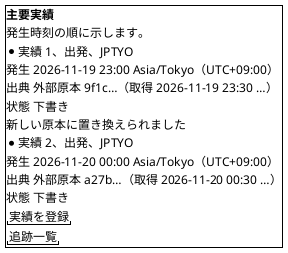
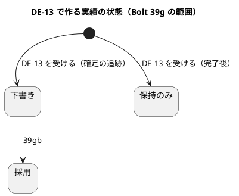
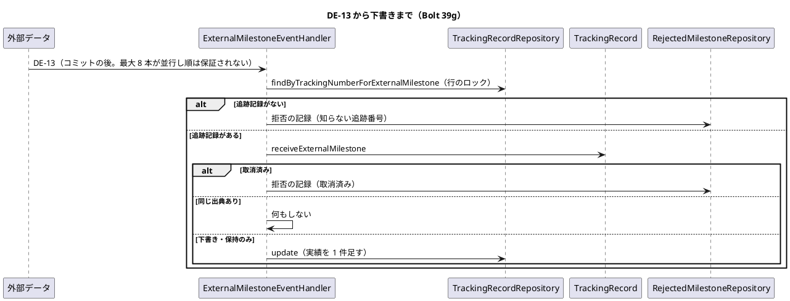
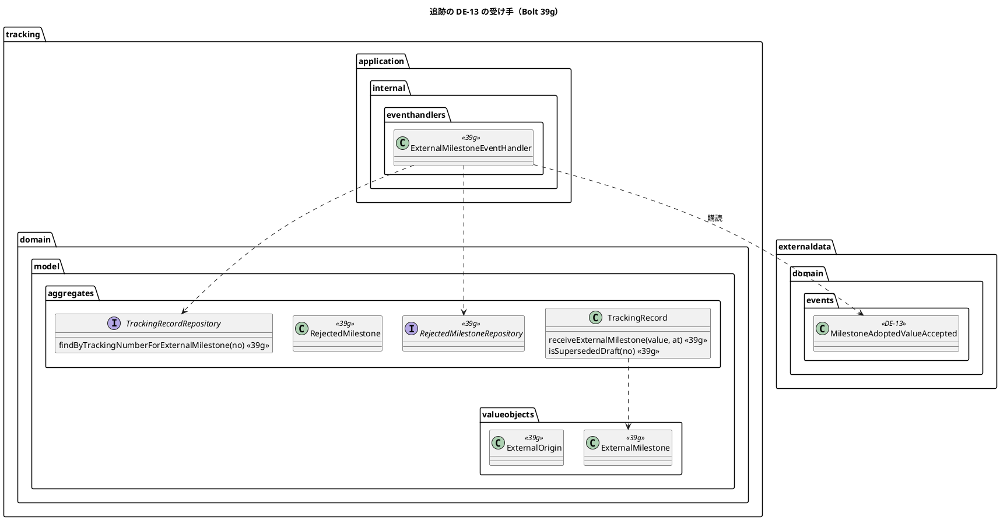
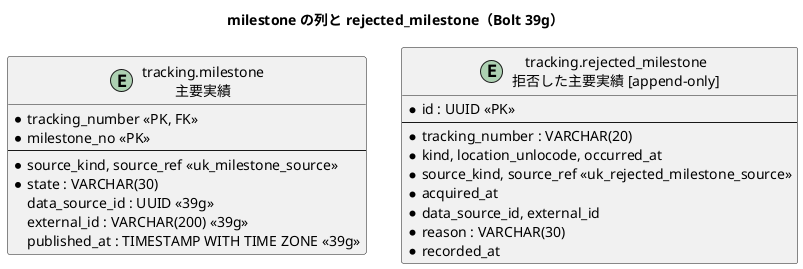

# Bolt 39g 計画 - 採用した主要実績を追跡の下書きとして受け、順の規則と取消済み・完了後を決める

## 基本情報

| 項目 | 内容 |
| :--- | :--- |
| Bolt | 第 39g 回（W7 の 27 本目。release_plan :975 の 39g の行） |
| 状態 | draft（人の承認待ち）。2 つの整合性検証（`validating-iteration-plan`・`validating-design`）はこの初稿の後 |
| 予定 | W7（2026-11-16 の週。前倒しで着手できる）。Bolt 39f2 の完了の後に着手する（release_plan :980）。作業は約 3 時間 56 分（236 分。決定 (1)）。分ける 39gb は約 3 時間 50 分の見込み（参考）。行番号の基準のコミットは `fb1964df9` で、39f2 が同じ文書を直すのでステップ 1 で確かめ直す。下の「時間の配分と打ち切り」。`check`・`uiTest`・`manualScreenshots`・SonarQube・CI と承認の待ちを除く |
| アプローチ | アウトサイドイン（状態の組み合わせの表を先に書く。release_plan :975、:893、T-182）。受入条件の中心は「データ責任者が採用した主要実績が、追跡管理者の S-12 に下書きとして届き、現在状態には効かない」こと。ステップ 2 で受入シナリオを先に Red にし、内側に入る |
| 対象 | (1) DE-13 を受けて追跡の下書きを作る listener（`externaldata :: events` への依存の宣言）、(2) 同じ主要実績の DE-13 の順の規則（【業務の判断】(aa)、【前の決定の変更】(12)）、(3) 実績に外部の識別の 3 列を足す、(4) 追跡番号が違う組・知らない追跡番号・取消済み・完了後の受け方（US-12 AC4・AC5 の取り込みの分。【業務の判断】(ab)〜(ad)）、(5) 同じ追跡番号への集中を追跡記録の行のロックで直列にする（PERF-06 のリスク台帳の行）、(6) 配信までの統合テスト（T-184）、(7) S-12 の下書きの表示、(8) P-7、(9) マニュアル 9 章と 12 章 :450 の文、動画。採用の操作・確認中と DE-18・手入力の規則・P-5・P-6 は 39gb に分ける（決定 (1)、【前の決定の変更】(11)） |
| トレース | US-12 AC1・AC2・AC4・AC5（user_story :529-533。AC4 は取り込みの分）、US-14 AC1、UC-10 2a（system_usecase :510）、T-INV-01・02・04・05・08（domain_model :1288-1292・:1295）、BR-16、DE-13（domain_model :1776 と :1751 の注）、ADR-004 :43、W7 の設計の決定（release_plan :905）、確認ポイント 4・7・9・23・24（:916・:919・:921・:935・:936）、リスク台帳の PERF-06 の行（:1113）、台帳 D-97・D-100・D-101・D-105・D-107、[Bolt 39e 終了報告](bolt_39e_report.md) :110 と [Bolt 39d4 終了報告](bolt_39d4_report.md) :109 の既知の課題、[Bolt 39d3b 計画](bolt_39d3b_plan.md) :270・:271 の申し送り |
| GitHub | [#19](https://github.com/k2works/practical-domain-driven-design-in-enterpris-application/issues/19)（US-12。クローズは 39gb）、#50（P-7 を返す） |
| SP | 0（US-12 の残り 2 SP は 39gb で数える。決定 (1)） |
| 承認ゲート | **計画と終了報告で止める**（release_plan :895 の既定、:975 の「計画と終了報告（スキーマ）」）。確認必須のものは確認ポイントにして計画の承認に含める（前例 bolt_37d2_plan.md :22）: データベース（確認ポイント 2）、構造（確認ポイント 3）、新しいファイル（確認ポイント 9）。各ステップは「ゲート: 既定（確認ポイント N で計画の承認に含む）」と書く。新しいセキュリティの判断と本番の操作はない |
| 開始準備で決めたこと | 下の (1)〜(13)（推奨を 1 つに決めて書いた。承認待ち）。【業務の判断】(aa)〜(af) を新しく記録する。【前の決定の変更】(11)・(12) |

## Bolt ゴール

データ責任者が採用した主要実績が、追跡管理者の S-12 に状態「下書き」で届く。下書きは現在状態を変えず、荷主の画面にも出ない。同じ主要実績の値が後から直されたときは、届いた順によらず、最後に公開した値の下書きが残りの下書きを置き換えたと S-12 で分かる。同じ DE-13 が 2 度届いても実績は増えない。完了後の追跡には「保持のみ」で残し、取消済みの予約と知らない追跡番号は実績を作らず拒否の記録に残す。1 つのファイルの多くの行が同じ追跡番号に集中しても、実績は欠けず、イベント発行記録がすべて完了する。マニュアル 9 章と 12 章が実装と合う。

## 状態の組み合わせ（行ごとにテストを 1 本。T-182）

配信 → 実績 → 表示まで。行の番号はこの計画で 1 から振る。「組」は同じ追跡番号・同じ情報源・同じ外部 ID の DE-13 の実績（決定 (2)）。「候補」は組の中で順の規則が最も新しいとする下書き（39gb で採用できるもの）。A・B は値の違う DE-13。テストは新しいクラスは決定 (13)、既存のクラスは `@Nested class Bolt39g_…`。

| 行 | 状況 | 期待 | 確かめ方 |
| :--- | :--- | :--- | :--- |
| 1 | 確定の追跡に DE-13 を受ける | 実績が 1 件増える。状態は下書き、実績番号は次の番号、種類・場所・発生時刻、出典（`EXTERNAL_RECORD`、受信記録 ID、取得時刻）、情報源 ID・外部 ID・公開した時刻、登録者は DE-13 の操作者、登録時刻は Clock | 単体（`TrackingRecordExternalMilestoneTest`） |
| 2 | 下書きを受けても現在状態と根拠の実績番号は変わらない（T-INV-08）。すでに採用した実績があっても同じ | 現在状態・根拠の実績番号が受ける前と同じ | 単体 |
| 3 | 重複配信: 同じ受信記録 ID の DE-13 がもう 1 度届く（T-INV-02） | 実績は増えない。既存の実績を返す | 単体 |
| 4 | 同じ受信記録 ID で取得時刻か値だけ違う DE-13（再配信で起きないが、出典の識別子の定め） | 実績は増えず、既存の実績の値を変えない（T-INV-01。取得時刻は識別子に含めない。TrackingRecord.java :240-246） | 単体（パラメーター） |
| 5 | 順の規則（【業務の判断】(aa)）: 公開した時刻が新しい／同じで取得時刻が新しい／両方同じで受信記録 ID が大きい | それぞれ新しい方が候補。比べる受信記録 ID は文字列の順（Voyage.java :124-127 と同じ） | 単体（パラメーターは入力と期待の組まで縛る。T-244） |
| 6 | 後着: 新しい DE-13 の後に古い DE-13 が届く（T-245: 実績の並びを逆にした組も置く） | 古い DE-13 も実績に残る（実績番号は後）。候補は公開した時刻の新しい方。届いた順で結果が変わらない | 単体 |
| 7 | 同じ情報版で値の違う組（A を取り込み、B の隔離を採用する） | 2 件とも下書き。候補は公開した時刻の新しい B | 単体 |
| 8 | 同じ情報版で同じ値の組（書き方か取得時刻だけ違う原本の採用） | 2 件とも下書き。候補は公開した時刻の新しい方（値は比べない） | 単体 |
| 9 | 外部版をまたぐ: V1 の後に V2（誤った採用を新しい外部版で直す基本の道。【業務の判断】(t)） | V2 が候補 | 単体 |
| 10 | 外部版をまたぐ: V2 の取込の後に V1 の隔離を採用（外部版の順を比べない。D-105 と同じ） | 公開した時刻の新しい V1 が候補 | 単体 |
| 11 | 誤った採用の後に元の原本を同じ外部版のまま送り直して採用（D-107 の新しい外部版を出してもらえないときの道） | 最後に公開した元の値が候補 | 単体 |
| 12 | 情報源が違うと、同じ追跡番号・同じ外部 ID でも別の組 | それぞれが候補（決定 (2)） | 単体 |
| 13 | 追跡番号が違う組（【業務の判断】(ab)）: V1 が追跡番号 P、V2 が追跡番号 Q | P の下書きは変わらず候補のまま。Q に新しい下書き | 配信の統合（`ExternalMilestoneDeliveryIntegrationTest`） |
| 14 | 同じ外部版で追跡番号が違う隔離（【業務の判断】(m)） | 外部データが採用を出さず DE-13 もない。追跡の実績は増えない（`NotAdoptableReason` の回帰） | 既存（Bolt 39d3b2 の統合）に DE-13 の件数の確かめを足す |
| 15 | 手入力の実績は組に入らない（外部の 3 列がない） | 同じ種類・場所の手入力の実績があっても候補の計算に入らず、別の実績のまま | 単体 |
| 16 | 発生時刻が受けた時刻より後の DE-13（【業務の判断】(ae)。T-INV-13 は手入力の拒否） | 下書きで受ける（拒否しない） | 単体 |
| 17 | 取消済みの予約（AC4。T-INV-04、確認ポイント 9） | 実績を作らない。拒否の記録に残す（理由 `BOOKING_CANCELLED`）。版は上がらない。例外にしない | 単体（listener の分） |
| 18 | 完了後（AC5。T-INV-05）（【業務の判断】(ad)。パラメーター: 現在状態が引渡し済み、予約状態が完了） | 状態「保持のみ」の実績を作る。現在状態と根拠の実績番号は変わらない | 単体 |
| 19 | 取消済みかつ引渡し済み | 取消済みが先で、実績を作らず拒否の記録に残す | 単体 |
| 20 | 知らない追跡番号（【業務の判断】(ac)） | 実績を作らない。拒否の記録に残す（理由 `UNKNOWN_TRACKING_NUMBER`。追跡番号はそのまま写す）。WARN のログ。例外にしない | 単体（`ExternalMilestoneEventHandlerTest`） |
| 21 | 内容の欠けた DE-13（パラメーター: 知らない種類、形の違う追跡番号、出典・操作者・公開した時刻の欠け） | ERROR のログを残して捨てる。何も書かない（再配信しても直らない。前例 VoyageUpdateEventHandler.java :49-58） | 単体 |
| 22 | DB の失敗（ロックの待ちの上限 10 秒を含む） | 例外を上げてイベント発行記録を未完了に残す（再起動の再配信。application.properties :54） | 単体 |
| 23 | listener はロックして読む（呼び出しの記録。T-236） | `findByTrackingNumberForExternalMilestone` を呼び、`findByTrackingNumber` を呼ばない | 単体 |
| 24 | 情報源を停止した後に届く DE-13（【業務の判断】(n)・(af)） | 下書きで受ける（外部データの判断の時点で採用済み。追跡は情報源の状態を見ない） | 配信の統合 |
| 25 | 保存と読み直し | 外部の 3 列が往復する。手入力の実績は 3 列とも NULL | 統合（`MyBatisTrackingRecordRepositoryIntegrationTest`） |
| 26 | スキーマ（決定 (3)。パラメーター） | `EXTERNAL_RECORD` の行は 3 列そろって値を持ち、ほかの出典の行は 3 列とも NULL（CHECK）。`rejected_milestone` の（出典の種類、参照）の一意制約と理由の CHECK、列のコメント | 統合（`SchemaCommentIntegrationTest` と CHECK の確かめ） |
| 27 | 拒否の記録は追記専用で冪等 | 同じ出典の 2 度目は増えない。アプリケーション利用者に UPDATE・DELETE の権限がない | 統合（`AppendOnlyGrantIntegrationTest` に足す） |
| 28 | 行のロック（決定 (4)） | `findByTrackingNumberForExternalMilestone` は呼び手のトランザクションが終わるまで行を押さえる。ない追跡番号は空 | 統合（`MyBatisTrackingRecordLockIntegrationTest`。前例 `MyBatisRoutingCaseLockIntegrationTest`） |
| 29 | 配信: 取込 → DE-13 → 下書き（T-184） | `tracking.milestone` に 1 件、この listener の発行記録が完了（受け手で絞る。bolt_39b3b_report.md :99）。監査の発行記録も完了 | 配信の統合（PostgreSQL） |
| 30 | 配信: 隔離の採用（同じ情報版で値が違う）の DE-13 | 2 件目の下書き。候補は採用した値 | 配信の統合 |
| 31 | 配信: 同じ原本の再送（重複） | DE-13 は出ない。実績は増えない | 配信の統合 |
| 32 | 配信: 同じイベントの再配信（発行記録を未完了に戻す。T-184 の冪等） | 実績は増えない。発行記録が完了 | 配信の統合 |
| 33 | 配信: 知らない追跡番号 | `rejected_milestone` に 1 件、発行記録が完了 | 配信の統合 |
| 34 | 配信: 取消済み（`jdbc` で予約状態を変えたテストデータ。確認ポイント 9） | 実績は 0 件、`rejected_milestone` に 1 件、発行記録が完了 | 配信の統合 |
| 35 | 配信: 完了後（引渡しの実績を登録した追跡） | 保持のみの実績、現在状態は引渡し済みのまま、発行記録が完了 | 配信の統合 |
| 36 | 後着: DE-13 が届いた後に追跡記録ができる（【業務の判断】(ac)） | 拒否の記録のままで、実績にはならない。同じ主要実績の新しい外部版が届けば下書きになる | 配信の統合 |
| 37 | 同時: 同じ追跡番号の 2 つの DE-13 をラッチで重ねる（決定 (4)） | 待った側がロックの後に読み直して、実績番号 1・2、版は 2 増える。例外なし。発行記録が両方完了 | 統合（H2 と PostgreSQL。前例 `MyBatisVoyageConcurrentUpdateIntegrationTest.java` :312-315） |
| 38 | 同時: 同じ DE-13 の配信が 2 本重なる | 実績は 1 件（ロックの後に T-INV-02 で既存を返す）。発行記録が両方完了 | 統合（H2 と PostgreSQL） |
| 39 | 同時: 追跡管理者の登録と DE-13 が重なる | DE-13 の下書きは必ず残る。登録は版の不一致で `Conflict`（今の文を示す。TrackingRecordController.java :54） | 統合（H2 と PostgreSQL） |
| 40 | 別の追跡番号はロックを待たない | 追跡番号 P の行を押さえている間に Q の DE-13 が完了する | 統合（PostgreSQL） |
| 41 | 集中: 1 つのファイルの 200 行が同じ追跡番号（確認ポイント 4、:1113） | 下書き 200 件、実績番号は 1 から 200 まで連続、発行記録がすべて完了。かかった時間をログに出す（T-241） | 配信の統合（PostgreSQL。待ちの上限は 60 秒） |
| 42 | S-12 の下書き（決定 (8)） | 状態「下書き」、出典「外部原本 受信記録 ID（取得 …）」。現在状態は変わらない | コントローラーの単体 |
| 43 | S-12 の置き換えられた下書き | 候補でない下書きに「新しい原本に置き換えられました」を示す。保持のみと採用には示さない。元の値に戻ると表示が変わる（状態を持たない） | コントローラーの単体 |
| 44 | C-10 に下書き・保持のみが出ない（T-INV-09） | 採用済みだけ（TrackingRecord.java :227-238 の回帰） | 既存の単体に保持のみの組を足す |
| 45 | UI（データ責任者が主要実績を取り込み、追跡管理者が S-12 を開く） | 状態「下書き」で示され、現在状態は「集荷予定」のまま。axe の違反 0。幅 320 px | `adopted_milestone_reflected_ui.feature` |
| 46 | 受入シナリオ: AC4（取り込みの分）・AC5 | `@US-12-AC4`・`@US-12-AC5` のシナリオが通る | `register_milestone.feature`（`MilestoneSteps`） |
| 47 | 層の規則 | 追跡は `externaldata :: events` を宣言し、それ以外の外部データを参照しない | `ModularityTest`（前例 :85-97） |
| 48 | マニュアル | 9 章、12 章 :450 の文が実装と一致する | ステップ 7 の突き合わせの記録 |
| 49 | 今の振る舞い | `register_milestone.feature`・`register_milestone_ui.feature`・`query_tracking_ui.feature` と外部データの受入シナリオ | 既存のシナリオとテスト |

39gb に写す行（【前の決定の変更】(11)。39gb の計画で番号を振り直す）: 下書きの採用と候補だけが採用できること、候補と同じ値を採用済みの組、採用済みと値の違う候補（申し送りの表）、未来の発生時刻の下書きの採用、AC3 の確認中（採用のときと手入力のとき）と DE-18、取消済みの手入力の拒否と完了後の手入力、確認中の S-11・S-12 の表示。

## 開始準備の決定

(1) **範囲と見積り**: release_plan :975 の 39g の行をコードで確かめて引き直すと、下書きの受け取り（約 236 分）と、採用の操作・確認中・DE-18・手入力（約 230 分）を合わせて約 7 時間 46 分（466 分）になり、目安（CLAUDE.md の「半日を超える Bolt は分割する」の 4 時間に誤差の 5 分を含めた 4 時間 05 分まで。T-250）を大きく超える。release_plan :980 も「半日を超えそうな Bolt（39・39b・39f・39g）は開始準備で分ける」としている。**39g（DE-13 を受けて下書きにする縦。236 分）と 39gb（追跡管理者の採用と確認中の縦。約 230 分）に分ける**（推奨。確認ポイント 1、【前の決定の変更】(11)。39g の余りは 9 分）。分け目は「取込の経路（システムが受ける）」と「人の操作（採用と手入力）」で、39d（一覧）→ 39d2（却下）→ 39d3b（採用）と同じく、見えるようにしてから操作を足す。39gb が 4 時間 05 分を超えるなら、39gb の開始準備で確認中と DE-18 を分ける。超えそうなときは **行 40（−3 分）、行 41 の時間の記録と配信の参考の値の測り直し（−3 分）の順に 39gb へ送る**。マニュアルは後に送らない。

| 内訳 | 分 |
| :--- | ---: |
| 分けて増えない土台（設計の文書 20、Red 15、品質ゲート 30、終了報告 10、キャプチャと文の突き合わせ 10、UI の流し直しと動画 10。bolt_39f_plan.md :86 の形） | 95 |
| マイグレーションと `MilestoneRow`・マッパー（列 3 つ、CHECK、`rejected_milestone`、コメント、一覧。行 25〜27） | 10 |
| `ExternalMilestone`・`Milestone`・受け取り・P-7（行 1〜4・15〜19） | 15 |
| 順の規則（行 5〜12） | 6 |
| リポジトリ（ロック、拒否の記録のポート。行 25・27・28） | 12 |
| listener と組み立て、`package-info`、`ModularityTest`（行 20〜24・47） | 8 |
| 配信の統合（行 13・24・29〜36。取込から追跡記録を作る土台を含む） | 20 |
| 同時と集中（行 37〜41。H2 と PostgreSQL） | 15 |
| 配信の参考の値の測り直し（bolt_39b4_plan.md :136。人の側の CI の手動のジョブ） | 3 |
| S-12（行 42〜44） | 10 |
| 受入シナリオの例と Steps（行 45・46） | 10 |
| マニュアル 9 章・12 章と新しいキャプチャ 1 枚の Steps（行 48） | 12 |
| 既存のテストへの影響（`Milestone` の生成 4 クラス、発行記録を数えるテスト。下の T-217 の一覧） | 6 |
| 変異 | 12 |
| 文書のステップの行の一覧の突き合わせ（T-197） | 2 |
| **合計（39g）** | **236（約 3 時間 56 分）** |

比べた案: (i) そのまま 1 本（約 466 分。T-250 を大きく超える）。(ii) **39g と 39gb に分ける（推奨）**。(iii) 39g を受け取りと採用までにする（粗い見積りで約 300 分になり、まだ超える）。(iv) 確認中と DE-18 を W10 に送る（US-12 AC3 は MVP で、確認ポイント 10 が W7 と決めている）。

(2) **組と順の規則**（【業務の判断】(aa)、【前の決定の変更】(12)、台帳 D-114（仮））: DE-13 の出典の参照は受信記録 ID（AdoptionFactory.java :62-63）で、T-INV-02 の出典の識別子はこの参照と種類なので（`uk_milestone_source`。V20261010090000 :21）、同じ外部 ID の隔離の採用は別の受信記録 ID の別の行になる。経路設計の航海は 1 行を置き換えるが（Voyage.java :100-116）、主要実績は削除・上書きしない（T-INV-01）。そこで、

- DE-13 ごとに実績を 1 行残す。**順は書くときに比べず、読むときに実績の組から決める**。組は追跡番号・情報源 ID・外部 ID（外部 ID は提供元の中でだけ一意で、`uk_external_record_idempotency_key` は（提供元、原本種別、外部 ID、外部版）なので、情報源を外すと別の提供元の同じ外部 ID が混ざる。V20261103100000 :62）
- 候補は組の下書きのうち、公開した時刻 → 取得時刻 → 受信記録 ID（文字列の順）で最も新しいもの（【業務の判断】(r) の順。`Voyage.BY_FRESHNESS` は private で共有カーネルに上げる根拠が 2 か所ではまだ弱いので、`TrackingRecord` の中に同じ順を書き、テストで守る）
- 外部版は比べない（順の定めのない文字列。D-105 と同じ）。listener は 8 本まで並行し順は保証されない（決定 (4)）ので、書くときに比べると届いた順で結果が変わる。読むときに決めれば、届いた順によらず同じ結果になる（行 6）
- 比べた案は下の「業務の判断の記録」の (aa)

(3) **スキーマ**（確認ポイント 2）: 共通のマイグレーション `V20261110150000__add_tracking_milestone_external_origin_and_rejected_milestone.sql` 1 つ（版は 39f の `V20261110100000` より新しくする。39f2 は足さない計画）。

- `tracking.milestone` に `data_source_id`（UUID）・`external_id`（VARCHAR(200)。external_data の列と同じ。V20261103100000 :56）・`published_at`（TIMESTAMP WITH TIME ZONE）を足す。すべて NULL を許す。CHECK `ck_milestone_external_origin`（`source_kind = 'EXTERNAL_RECORD'` なら 3 列とも値を持ち、それ以外は 3 列とも NULL）。`EXTERNAL_RECORD` の行は今ない（画面で選べない。MilestoneFormConverter.java :34-35。開発データにも `tracking.milestone` の行はない）ので埋め直さない。情報版の列は持たない（順に使わず、受信記録 ID から外部データの原本にたどれる）
- `tracking.rejected_milestone`（追記専用 `[append-only]`）を作る。`id`（UUID、PK）、`tracking_number`（VARCHAR(20)。外部キーなし。知らない追跡番号を残すため）、`kind`、`location_unlocode`、`occurred_at`、`source_kind`、`source_ref`、`acquired_at`、`data_source_id`、`external_id`、`reason`（`UNKNOWN_TRACKING_NUMBER`・`BOOKING_CANCELLED`）、`recorded_at`。一意制約 `uk_rejected_milestone_source`（`source_kind`、`source_ref`）。`AppendOnlyGrantIntegrationTest.java` :35 の一覧と data_model の一覧に足す。冪等は読んでなければ書き、同時の負けは `NESTED` と `DuplicateKeyException` で既存とみなす（前例 MyBatisTrackingRecordRepository.java :91-92・:117）
- `revised_by`・`revised_at`（data_model :776）は採用の操作を作る 39gb で決める。`under_review_reason` も 39gb

(4) **同じ追跡番号への集中は行のロックで直列にする**（リスク台帳 :1113「版の競合が連鎖する」）: `@ApplicationModuleListener` は `@Async` と `REQUIRES_NEW` で、Spring Boot の `applicationTaskExecutor` はコア 8・キュー無制限で上書きがなく、最大 8 本が並行し、順は保証されない（bolt_39f_plan.md :125、39f の検証で確かめた事実）。実績番号は `milestones.size() + 1` で振るので（TrackingRecord.java :193-194）、同じ追跡番号の DE-13 が重なると版か PK でぶつかる。`VoyageUpdateEventHandler` の 3 回の読み直しでは、8 本のうち 4 本以上が重なると 3 回で勝てないイベントが残りうる。残ると発行記録が未完了になり、再起動まで配られない。

- **DE-13 の listener は追跡記録の行をロックしてから読む**（`TrackingRecordRepository.findByTrackingNumberForExternalMilestone`。名前は目的の名前にそろえる。RoutingCaseRepository.java :42-46。`SELECT … FOR UPDATE`、`timeout="10"`。前例 RoutingCaseMapper.xml :202-203、QuotationRouteAssignmentEventHandler.java :47-50）。待ちの列はスレッド数（8）で頭打ちで、ファイルの行数では伸びない。ロックの後は競合しないので読み直しの繰り返しは作らない（行 37）
- ロックは画面の登録にはかけない。画面は今のまま楽観ロックで、DE-13 に負けたら `Conflict`（行 39）
- 読むときの実績は全件で、1 件あたり O(実績の数)。1 つの追跡番号の実績は数十件の想定で、200 件で確かめる（行 41）。上限の 1 万行すべてが同じ追跡番号の組は業務で起きない想定で、W10 の負荷テストで見る
- 比べた案: (i) 行のロック（推奨）、(ii) 読み直し 3 回（前例だが、集中で未完了が残る）、(iii) 読み直しの回数を増やす（待ち時間と DB の読みが無駄に増え、上限の根拠がない）、(iv) 実績番号を DB の連番にする（`milestone_no` は 1 からの連番の不変条件。TrackingRecord.java :88-92）

(5) **listener**（`tracking.application.internal.eventhandlers.ExternalMilestoneEventHandler`。前例 VoyageUpdateEventHandler）: 値の型 `ExternalMilestone` に変換できなければ ERROR のログで捨てる（行 21）。追跡記録がなければ拒否の記録（行 20）。あれば `TrackingRecord.receiveExternalMilestone` を呼び、結果の下書き・保持のみは `update`、拒否は拒否の記録に書く。監査は今の `ExternalRecordAuditEventHandler` が DE-13 で書くので足さない。ドメインイベントは発行しない（DE-18 は 39gb、DE-09 は 39g2）。

(6) **追跡番号が違う組と知らない追跡番号**（【業務の判断】(ab)・(ac)、release_plan :975・:977 の「キーが変わる原本の扱いを 39g と決める」）: 組は追跡番号の中で作るので、追跡番号が違う DE-13 は別の組で、元の追跡番号の実績には触らない（行 13）。別の追跡記録を同じトランザクションで書かない（集約の境界）。知らない追跡番号は実績を作らず拒否の記録に残す（行 20）。文は下の「業務の判断の記録」。

(7) **取消済みと完了後**（確認ポイント 9、:905、【業務の判断】(ad)）: 順は取消済み → 完了後 → 通常（行 17〜19）。取消済みの判定は予約状態 `CANCELLED`、完了後は予約状態 `COMPLETED` か現在状態 `DELIVERED`。HEAD で予約状態を書く経路は `CONFIRMED` だけで（TrackingRecord.java :119）、`DE-08`（W11）と DE-10 の作り直し（39g2）の前は、取消済み・完了の予約状態はテストデータだけで起きる（確認ポイント 9）。引渡し済みは今も画面の登録で起きる（CurrentStatusDeriver.java :31）。有人例外案件の起票は W8（確認ポイント 9）で拒否の記録を受ける。

(8) **S-12**（ui_design :1744、確認ポイント 23）: 主要実績の一覧の形は変えない（`TrackingRecordViews.milestone`。今の「状態 下書き」の文はある。:63-67）。候補でない下書きにだけ 1 文「新しい原本に置き換えられました」を足す（`MilestoneView` に項目を 1 つ）。S-13 と URL は変えない。候補かどうかは `TrackingRecord.isSupersededDraft(milestoneNo)`（読み取りの判定。状態を持たない。【業務の判断】(w) と同じ考え方）。C-10 は変えない（TrackingRecord.java :227-235 が採用だけを見る）。

(9) **受入シナリオ**: 新しい `features/ui/adopted_milestone_reflected_ui.feature` に行 45 を書く（タグ `@US-12-AC1 @US-14-AC1 @demo @demo-bolt-39g/external-milestone-draft`）。背景は `register_milestone_ui.feature` :11-28 と同じで、本予約の後の追跡番号を読み、データ責任者がその追跡番号の主要実績のファイルを取り込む（`ExternalDataIngestionUiSteps.milestoneLine` :538-544 に追跡番号を渡す形）。配信の待ちは `jdbc` で実績の行を待つ（前例 RoutingUiSteps.java の `awaitVoyageCondition`。40 回 × 250 ms）。測っていないので、ステップ 6 で足りなければ回数を増やして記録する。業務ルール層の AC4・AC5 は `register_milestone.feature` に足す（行 46。`MilestoneSteps` は `InMemoryTrackingRecordRepository` と listener を直接呼ぶ）。

(10) **マニュアルと動画**（T-251。用語は下の「業務の判断の記録」の文から写す）: 09-追跡管理.md の 9.2 の ④（状態「下書き」「保持のみ」の説明）と :87 の「現在状態は、採用した主要実績から決まります」に、取り込んだ実績は下書きで届き現在状態を変えないこと、置き換えられた下書きの文を足す。「採用」の手順はこの Bolt では書かない（39gb）。12-外部データ.md :450 の「主要実績の採用値は、まだ追跡の画面には反映されません…」を、追跡の画面に下書きとして届くことと、追跡番号が見つからない・取消済みの実績は下書きにならないことに直す。:343 の「誤って採用したとき」に、主要実績は新しい外部版の下書きが元の下書きを置き換えることを足す（【業務の判断】(aa)・(t)）。キャプチャは `09-tracking-detail-draft`（下書きと置き換えられた下書き）を 1 枚足す（`manual_screenshots.feature` :105 の後。追跡管理者が初めて見る状態のため）。動画は `@demo-bolt-39g/external-milestone-draft` を撮る（release_plan :986）。

(11) **層の規則とガイドライン**（第 3 章、ADR-017、CLAUDE.md）: listener は `application.internal.eventhandlers`（名前が `…EventHandler` で `@Service`。LayerArchitectureTest.java :278-284）、`RejectedMilestone`（集約）と `RejectedMilestoneRepository`（ポート）は `domain.model.aggregates`、`ExternalMilestone` は `domain.model.valueobjects`、実装は `infrastructure`。新しいコンテキスト間の依存は `tracking` → `externaldata :: events`（`package-info` の `allowedDependencies`。確認ポイント 3。:902「各 listener を作る Bolt で足す」）で、ModularityTest に経路設計の前例（:85-97）と同じ規則を足す。公開 API は足さない（下流から上流の通知ではないので ADR-014 の形は要らない）。ACL も足さない（値はイベントの共有カーネルの型）。**規則の例外は要らない見込み**で、当たったら置き場所を動かさず止めて諮る（T-125）。

(12) **変えないもの**: `CurrentStatusDeriver`（採用だけを見る。確認中は 39gb）、手入力の `registerMilestone` と S-13（39gb）、外部データの採用と DE-13 の形、`TrackingRecordRepository.update`（まだ表にない実績だけ INSERT する。:108-116。状態の UPDATE は 39gb）、C-10、追跡の開始（DE-07）。

(13) **新しい型の名前**（T-246。`apps/cargo-tracker/src` で `Bolt39g`・`ExternalMilestone`・`RejectedMilestone`・`ExternalOrigin`・`rejected_milestone`・`adopted_milestone`・`lockByTrackingNumber`・`@demo-bolt-39g` を検索し、ないことを確かめた）: `ExternalMilestoneEventHandler`、`ExternalMilestone`（値。`InvalidEventValueException` を持つ）、`ExternalOrigin`（実績の外部の識別。`Milestone` の項目）、`ExternalMilestoneReceipt`（受け取りの結果）、`RejectedMilestone`・`RejectedMilestoneRepository`・`RejectedMilestoneReason`、`TrackingRecordRepository.findByTrackingNumberForExternalMilestone`、`TrackingRecord.receiveExternalMilestone`・`isSupersededDraft`、統合テスト `ExternalMilestoneDeliveryIntegrationTest`・`MyBatisTrackingRecordLockIntegrationTest`、単体テスト `TrackingRecordExternalMilestoneTest`・`ExternalMilestoneEventHandlerTest`、受入シナリオ `adopted_milestone_reflected_ui.feature`、タグ `@demo-bolt-39g/external-milestone-draft`。

【前の決定の変更】(11)（決定 (1)。Bolt 39f の (5)〜(7)、39f2 の (8)〜(10) に続ける）: release_plan :975 の 39g の範囲を、39g（DE-13 を受けて下書きにする）と 39gb（下書きの採用、AC3 の確認中と DE-18、手入力の規則と AC4 の手入力の分、P-5・P-6、#19 のクローズと US-12 の 2 SP）に分ける。確認ポイント 10（DE-18 は 39g）と 24（P-5・P-6・P-7 は 39g の Refactor）の 39g のうち、DE-18 と P-5・P-6 を 39gb に読み替える（P-7 は 39g）。順序は 39f2 → 39g → 39gb → 39g2 → 39h（確認ポイント 7 の「39g の後に 39h」は 39gb の後に読む）。

【前の決定の変更】(12)（決定 (2)、【業務の判断】(aa)。Bolt 39e の (2) の残り）: Bolt 39d の決定 (13)（bolt_39d_plan.md :64）と台帳 D-97 の注の「対象のキーで業務（経路設計・追跡）に効くのは新しい外部版の採用値」を、追跡の主要実績についても「最後に公開した採用値」に改める。domain_model :1751 の「DE-13 は情報版で代える」も「公開した時刻の順で代える」に直す。D-97 の定め（内容の違う原本と比べる相手）は変えない。

直す既存のテスト（T-217。ステップ 2 で一覧を確かめる）: `Milestone` の生成は 8 引数のコンストラクタを残して直さない見込み（前例 RouteVersion.java :79-106。HEAD で `new Milestone(` は main 2 クラス、テスト 4 クラス）。DE-13 の発行記録を受け手で絞らずに数えるテストの見込み: `ExternalDataIngestionIntegrationTest.java` :701 の照会の呼び手、`ExternalDataIngestionSecurityIntegrationTest.java` :975・:1226・:1357（listener が 1 つ増えて行が増える。Bolt 39e で経路設計の listener を足したときの直し方を見る）。`ExternalDataIngestionConnectionTest`・`ExternalDataIngestionPerformanceTest` は取込の配信が追跡へ増える（行数ぶん `rejected_milestone` と WARN が増える。参考の値はステップ 8）。

新しいファイル: 共通のマイグレーション 1 つ、`ExternalMilestoneEventHandler`、`ExternalMilestone`、`ExternalOrigin`、`ExternalMilestoneReceipt`、`RejectedMilestone`、`RejectedMilestoneRepository`、`RejectedMilestoneReason`、その MyBatis の実装、マッパー（.java・.xml）と行の型、上の単体・統合テスト、`adopted_milestone_reflected_ui.feature`、キャプチャ 1 枚と動画。直すもの: `TrackingRecord`、`Milestone`、`TrackingRecordRepository`、`MyBatisTrackingRecordRepository`、`TrackingRecordMapper`（.java・.xml）、`MilestoneRow`、`TrackingConfiguration`、`tracking/package-info.java`、`TrackingRecordViews`、`show.html`、`InMemoryTrackingRecordRepository`、`ModularityTest`、`AppendOnlyGrantIntegrationTest`、`SchemaCommentIntegrationTest` の一覧（要れば）、`MilestoneSteps`、`ExternalDataIngestionUiSteps`、`register_milestone.feature`、`manual_screenshots.feature`、マニュアル 9 章・12 章。

### 前の Bolt から引き継いだもの

| 出典 | 内容 | この計画 |
| :--- | :--- | :--- |
| release_plan :975、:905 | DE-13 で下書きを作る、取消済みの拒否の記録、完了後の原本だけ | 決定 (5)・(7)、行 1・17・18 |
| bolt_39d3b_plan.md :270、39d4 の行 2 (c)、bolt_39d4_plan.md :274 | 同じ情報版で値の違う DE-13、同じ外部版の採用し直し、同じ値の組 | 行 7・8・11、【業務の判断】(aa) |
| bolt_39d3b_plan.md :271、release_plan :977、D-100 | キーが変わる原本（追跡番号が違う）の扱い | 決定 (6)、行 13・14、【業務の判断】(ab) |
| Bolt 39e の【前の決定の変更】(2)、bolt_39e_report.md :110、D-97 | DE-13 の順の規則は (r) を参考に決める | 決定 (2)、【前の決定の変更】(12) |
| Bolt 39d4 の終了報告の議題 4（:22） | 誤って採用したときの道の位置づけ | 行 9・11、決定 (10)。新しい外部版が基本の道のまま |
| 確認ポイント 4、リスク台帳 :1113 | 同じ追跡番号への集中の統合テスト | 決定 (4)、行 37・41 |
| bolt_39b3_plan.md :152 | DE-13 の出典を `source_kind`・`source_ref` に写し、再配信で重ねない | 行 3・32 |
| bolt_39b3b_report.md :99 | 発行記録は受け手ごとにできるので、件数は受け手で絞る | 行 29 |
| bolt_39b4_plan.md :136 | listener が増えたら配信の参考の値を測り直す | ステップ 8 |
| 確認ポイント 24（:936）、bolt_26b_report.md :95 | P-7（13 引数の写し） | ステップ 3（P-5・P-6 は 39gb） |
| manual 12 章 :450、bolt_39e_report.md :110 | 主要実績の「まだ反映されません」の文を外す | 決定 (10) |

### 開始準備で確かめたこと（`git show HEAD:` で読んだ）

- **追跡に DE-13 の受け手はない**: `tracking/package-info.java` :9 に `externaldata :: events` がない。DE-13 の購読者は監査だけ（ExternalRecordAuditEventHandler.java :74）
- **DE-13 の属性**: MilestoneAdoptedValueAccepted.java :32-45（情報源 ID・出典・追跡番号・種類（文字列）・場所・発生時刻・外部 ID・情報版・操作者・公開した時刻）。出典の参照は受信記録 ID（AdoptionFactory.java :62-63）
- **`registerMilestone` は採用だけを作る**: TrackingRecord.java :178-220、`MilestoneState.ADOPTED`（:199）。同じ出典は先に返す（:185-188）。下書きを作る経路はない
- **導出は採用だけを見る**: CurrentStatusDeriver.java :36。C-10 も採用だけ（TrackingRecord.java :229）
- **保存**: `update` は版の条件で UPDATE した後、まだ表にない実績番号だけ INSERT する（MyBatisTrackingRecordRepository.java :93-121）。`findByTrackingNumber` にロックはない（:194-196）
- **表**: `tracking.milestone` に外部の列はない（V20261010090000 :5-29）。`uk_milestone_source`（:21）。根拠の実績番号の外部キーは DEFERRABLE（V20261010120100）
- **順の前例**: Voyage.java :30-31・:103-114・:124-127（公開した時刻 → 取得時刻 → 受信記録 ID の文字列）
- **行のロックの前例**: RoutingCaseMapper.xml :202-203、MyBatisRoutingCaseRepository.java :136、QuotationRouteAssignmentEventHandler.java :47-50
- **再配信**: application.properties :54（起動のときだけ）。定期の再配信は W10
- **予約状態を書く経路**: `CONFIRMED` だけ（TrackingRecord.java :119）。`CANCELLED`・`COMPLETED` の書き手はまだない
- **S-12**: show.html :45-52、`TrackingRecordViews` :211-219。下書き・保持のみの表示名はある（:63-67）
- **性能テスト**: `ExternalDataIngestionPerformanceTest.java` :197-211 の主要実績 1 万行は追跡番号がそれぞれ違い、追跡記録はない

## 設計の決定

| 項目 | 決定 | 根拠 |
| :--- | :--- | :--- |
| 範囲と見積り | 決定 (1)、【前の決定の変更】(11)。39g と 39gb に分ける（236 分） | CLAUDE.md、T-250、release_plan :980 |
| 順の規則 | 決定 (2)、【業務の判断】(aa)、【前の決定の変更】(12)。読むときに組から決める | T-INV-01、D-105 |
| スキーマ | 決定 (3)。`milestone` に 3 列、`rejected_milestone` | data_model :656、:776 |
| 同じ追跡番号の同時 | 決定 (4)。行のロック | リスク台帳 :1113、RoutingCaseMapper.xml :202 |
| 取消済み・完了後 | 決定 (7)、【業務の判断】(ad) | US-12 AC4・AC5、確認ポイント 9 |
| 追跡番号が違う・知らない | 決定 (6)、【業務の判断】(ab)・(ac) | D-100、release_plan :975 |
| S-12 | 決定 (8)。状態を持たない 1 文 | ui_design :1744、【業務の判断】(w) |
| 型の名前 | 決定 (13)（T-246 で検索した） | — |

## ふりかえりと前の Bolt からの引き継ぎ

Bolt 39f2 の終了報告はまだない（別の担当が実装中）。終了報告の Try は 39g の開始のときに足す。

| 出典 | 内容 | この Bolt での扱い |
| :--- | :--- | :--- |
| W6 の Try T-204・T-212、Bolt 39f の Problem（標準入力の禁止を 4 回破った） | サブエージェントへの指示の最初に heredoc と標準入力を待つコマンドを使わないと書く | 任せるときの指示の最初に書く。ファイルは Write・Edit、検索は Grep |
| Bolt 39d の T-247 | 決まりを仕組みで守らせる（フック） | W7 の締めで最初に諮る。Gradle と git を人の側の 1 か所に残す。触らないもの（`.claude/agent-memory`・`.run/`・`apps/cargo-tracker/.claude/`）を名前で書く |
| Bolt 39d の T-248 | `git add` はディレクトリか `git add -u` | 各ステップのコミット |
| Bolt 39d2b の T-249 | 担当への指示に書く私の言葉に出典を付ける | 初稿は人の承認として書かない |
| Bolt 39d3 の T-250 | 見積りは 4 時間 05 分まで | 決定 (1) |
| Bolt 39d3 の T-251 | マニュアルの担当に用語を【業務の判断】の文から写させる | 決定 (10) |
| Bolt 39d3c の T-252 | ゲートが落ちたら先に中身を一覧する | ステップ 8 |
| Bolt 39d3b の T-254 | 途中で止めるときはコンパイルの通らない変更を develop にコミットしない | ステップ 2。骨組みでコンパイルを通し、Red の行は `wip/` か stash に置き、develop に積まない |
| Bolt 39d3b2 の T-255 | 「報告を待っています」のときに記録の更新時刻を確かめる | 任せたステップで待つとき |
| W6 の Try T-182・T-211・T-216 | 状態の組み合わせに重複・出口・誤った入力の行を置く | 上の表（行 3・4・21・31・32） |
| W6 の Try T-184 | listener は配信まで確かめる | 行 29〜36 |
| W6 の Try T-217 | 本体を直す前に Red を流し、直すテストの一覧を添える | ステップ 2、決定 (13) の後の一覧 |
| W6 の Try T-219、T-225・T-213 | 変異の対象に単体・統合、push の前に `check` | ステップ 8 |
| Bolt 39a2 の T-229 | 時刻の出どころと同時の書き込みの行を置く | 登録時刻は Clock、公開した時刻はイベント。同時は行 37〜40 |
| Bolt 39a3 の T-230 | 入ることを確かめるデータはドメインの規則に合う組み合わせにする | 行 45 は本予約の後の追跡番号 |
| Bolt 39b の T-232・39b2 の T-234・39b3 の T-237 | 本体を直したステップは承認の前に `spotbugsMain`・`checkstyleMain`・`sonar-local:check` | ステップ 3〜5 の完了の判定 |
| Bolt 39b2b の T-236 | 「起きないこと」は呼び出しの記録で確かめる | 行 23 |
| Bolt 39b3 の T-238・39b3b の T-239 | 任せるときは決定の番号を指す、諮る主張の前提はコードで確かめる | 開始準備の決定に出典を添えた |
| Bolt 39b4 の T-241・T-242 | 性能の目標を外れたら区切って測る | 行 41、ステップ 8 |
| Bolt 39c2 の T-244、39c3 の T-245、39c4 の T-246 | パラメーターは組まで縛る、並びの規則は逆順のデータ、型の名前は検索する | 行 5・6、決定 (13) |
| Bolt 39f の学び | listener のスレッドの前提は計画の時点で設定から確定する。反応を足す Bolt では前の Bolt の「直し方」がまだ通じるかを確かめる | 決定 (4)、行 9・11 |
| memory の manual-in-bolt-done-criteria、Bolt 37f2 の T-197 | 振る舞いが変わる Bolt はマニュアルを完了条件に入れ、文を実装と突き合わせる | 完了条件、行 48 |

## スコープ

### 入れるもの

- 行 1〜49（行 14・44・49 は既存のテストに足すか既存のテストで確かめる）。決定 (2)〜(10) の実装と文書
- マニュアル 9 章・12 章（決定 (10)）、キャプチャ 1 枚、動画 `@demo-bolt-39g/external-milestone-draft`
- P-7（#50）
- 文書: 下の「設計文書に直す箇所」（ステップ 1）

### 入れないもの

- 下書きの採用の操作、候補だけが採用できること（39gb）
- AC3 の確認中、DE-18、手入力の確認中と AC4・AC5 の手入力の分（39gb）
- P-5・P-6（39gb。確認ポイント 24 の読み替え）
- 有人例外案件の起票（W8）、DE-09・DE-10（39g2）、下書きの修正（US-13。W12）
- 拒否の記録を見る画面（W8 の有人案件、W10 の OBS）

### 申し送り（既知の課題・入れないもの）

| 送り先 | 課題 | 扱い |
| :--- | :--- | :--- |
| 39gb | 上の「39gb に写す行」。採用済みの実績と値の違う候補は、採用すると T-INV-06（採用済みの訂正は二者確認）を素通りするので、採用を出さず「採用済みの実績と値が違います」を示す案を推奨として開始準備で諮る（US-13 は W12）。候補と同じ値を採用済みなら採用は要らない | release_plan の 39gb の行に足す |
| 39g2 | DE-10 の作り直しで予約状態 `COMPLETED` の書き手を見直すとき、行 18 の完了後の判定が通ること | release_plan の 39g2 の行に足す |
| 39h | 古い外部版の後着を差異にするか（【業務の判断】(aa) の行 10）。差異にすると DE-13 が出ず、追跡には届かない。追跡番号が違う組（行 13）も差異にするかを決める | release_plan の 39h の行のまま |
| W8 | `rejected_milestone` の行から有人例外案件を起票する（US-20。確認ポイント 9） | release_plan の W8 の行に足す |
| W10 | 拒否の記録と未完了の DE-13 に気づく手段（OBS）、同じ追跡番号に 1 万行の集中の負荷テスト | release_plan の W10 の行に足す |
| Release 1.0 のパイロットの前 | 【業務の判断】(aa)〜(af) を業務責任者とデータ責任者に確かめる | 台帳 |

### 設計文書に直す箇所（ステップ 1）

ステップ 1 の開始で `docs/design`・`docs/requirements`・`docs/adr`・`docs/operation`・`docs/manual`・`docs/development/cargo-tracker`（release_plan・development_strategy）と `apps/cargo-tracker/src` を「39g」「DE-13」「W7」の追跡の分で検索し、39g の予定を書いた場所を作ったことに直す（ほかの 39gb の分は 39gb に読み替える）。

- domain_model: :968・:1594 の 39g の文、:1144（下書きの経路）、:1148（DE-18 は 39gb）、実績の属性（:1173-1181 の図と用語の表 :184）に外部の識別、T-INV-05 の「完了済み」の判定、:1311 の注、節の後に「Bolt 39g で決めたこと」（組、順、受け方、行のロック）、:1751 の注（【前の決定の変更】(12)）、:1776 の DE-13 の反応、`RejectedMilestone` の用語
- data_model: `milestone` の ER（:656）と制約の表（:776）、`rejected_milestone` の ER と表、追記専用の一覧（:178 の周り）
- ui_design: S-12 の注（:1744）と画面イメージ（:1717）、:1980 の 39g の文
- user_story: US-12 の決定の注
- system_usecase: UC-10 2a の注（取り込みの分）
- test_strategy: :260 の行、受入条件の照合の表（:566-567 に AC4・AC5）
- architecture_backend: :132 の依存、:169 の DE-13
- release_plan: 39g の行に計画へのリンク・見積り・決めたこと、39gb の行を足す（SP 2 を移す）、順の行（:980）、デモ項目（:986）に 39gb、進捗のチェックの行（:993）、確認ポイント 10・23・24 の読み替え、台帳 D-114〜D-119（仮）、D-97・D-100 の注、W8・W10 の行、更新履歴
- development_strategy: W7 の行（:350）に 39gb を足す
- ADR-004: Bolt 39g の項（組と順、行のロック、拒否の記録）、:146・:156 の 39g の文

## 設計（この Bolt の範囲）

### 画面遷移図

画面と URL は増やさない。S-12 の中に 1 文を足すだけなので図を省く。

### 画面イメージ

### 状態遷移図

実績の状態（この Bolt で入口を作るもの）。追跡の現在状態は変えない（T-INV-08）。

### 配信の流れ

### クラスと依存

### ER 図（この Bolt で変える表）

## ステップ計画（ゲートは下の各ステップに書く）

- [ ] **1. 設計の文書**: 上の「設計文書に直す箇所」。【業務の判断】(aa)〜(af)、【前の決定の変更】(11)・(12) を反映する。始めに検索する（完了の判定: 文書の差分と検索の記録。ゲート: 既定（確認ポイント 2〜6 で計画の承認に含む））
- [ ] **2. 受入シナリオとテストの Red**: 外から入る。まず `adopted_milestone_reflected_ui.feature` に行 45 を書いて Red を記録する（データ責任者の取込の後、S-12 に下書きが出ない）。続いて行 1〜13・15〜43・46・47（行 14・44 は回帰の守りで最初から緑の見込み）。骨組み（`findByTrackingNumberForExternalMilestone` は読むだけ、`receiveExternalMilestone` は既存を返す、`ExternalMilestone` の型、listener の中身なし）でコンパイルを通す（T-254）。直す既存のテストを一覧にする（T-217）（完了の判定: 期待した理由で落ちる記録。Red の行は `wip/` か stash に置き、develop に落ちるテストを積まない。ゲート: 既定）
- [ ] **3. スキーマと実績の受け取り**: マイグレーション、`MilestoneRow`・マッパー、`ExternalMilestone`・`ExternalOrigin`・`Milestone`、`receiveExternalMilestone`、順の規則、`isSupersededDraft`、P-7（13 引数の写しを `withMilestones` にまとめる）、拒否の記録のポートと実装。行 1〜12・15〜19・25〜28 が緑、`test` 全体で既存のテストの影響を確かめる、`spotbugsMain`・`checkstyleMain`・`sonar-local:check`（完了の判定: 緑と影響の一覧。ゲート: 既定（確認ポイント 2 で計画の承認に含む））
- [ ] **4. listener と組み立て**: `ExternalMilestoneEventHandler`、`TrackingConfiguration`、`package-info` の `allowedDependencies`、`ModularityTest`。行 20〜23・47 が緑。`ModularityTest`・`LayerArchitectureTest` を流す（当たったら止めて諮る）。`spotbugsMain`・`checkstyleMain`・`sonar-local:check`（完了の判定: 緑。ゲート: 既定（確認ポイント 3 で計画の承認に含む））
- [ ] **5. 配信までの統合と同時と集中**: 行 13・14・24・29〜41 が緑。行 37〜39 は H2 と PostgreSQL の両方（完了の判定: 緑。発行記録の完了まで待って確かめる。T-184。行 41 の時間を記録する。ゲート: 既定）
- [ ] **6. S-12 と受入シナリオの緑と動画**: `TrackingRecordViews`・`show.html`。行 42〜46・49 が緑、axe 違反 0、幅 320 px、`@demo-bolt-39g/external-milestone-draft` を撮る（完了の判定: `uiTest` の該当の feature と動画。ゲート: 既定）
- [ ] **7. マニュアルとキャプチャ**: 09-追跡管理.md（9.2 の ④・:87）、12-外部データ.md（:343・:450）、`manual_screenshots.feature` に `09-tracking-detail-draft`（決定 (10)）。文を実装と【業務の判断】(aa)〜(ad) の文に一字ずつ突き合わせる（T-197・T-251）（完了の判定: 突き合わせの記録と行 48、撮ったキャプチャ。ゲート: 既定）
- [ ] **8. 品質ゲートと開発レビュー**: 変異（下の表）、`check`・`uiTest`、その後に SonarQube（落ちたら先に中身を一覧する。T-252）、人の側の `performanceTest` で配信の参考の値を測り直す、開発レビューとその直し。文書のステップの行を一覧で突き合わせる（T-197）（完了の判定: 緑と指摘の扱いと突き合わせの記録。ゲート: 既定）
- [ ] **9. 終了報告**: push して CI とデモ環境の配備を確かめる。release_plan（39g の行の計画と終了報告のリンク）・開発の索引・mkdocs を直す。【業務の判断】(aa)〜(af) と【前の決定の変更】(11)・(12) を議題の先頭に置き、既知の課題に申し送りの表を書く（完了の判定: 報告の承認。**承認ゲート**（終了報告））

### 時間の配分と打ち切り

| # | 目安 | 打ち切り |
| :--- | :--- | :--- |
| 1 | 20 分 | — |
| 2 | 63 分（Red の 15 分、テストを書く 48 分） | テストを書く時間が 63 分を超えそうなら、書いた分で Red を記録して止めて諮る |
| 3 | 27 分（マイグレーション 8、受け取りと順と P-7 13、リポジトリ 6） | `Milestone` の 8 引数を残せず直す既存のテストが 6 本を超えるなら止めて諮る（決定 (13) の後の一覧の見込みが外れている） |
| 4 | 11 分（listener 5、既存の影響 6） | 層の規則に当たったら止めて諮る（T-125） |
| 5 | 18 分（配信 8、同時と集中 7、参考の値 3。テストを書く時間はステップ 2） | 発行記録が完了しないなら、原因を確かめて止めて諮る。行 37 の H2 がロックで詰まるなら PostgreSQL だけにして記録する |
| 6 | 21 分（S-12 6、Steps の残り 5、流し直しと動画 10） | 既存の Steps を変える必要が大きいときは止めて諮る |
| 7 | 22 分（文 12、キャプチャと突き合わせ 10） | — |
| 8 | 44 分（待ちを除く。品質ゲート 30、変異 12、文書の行 2） | — |
| 9 | 10 分（CI の待ちを除く） | — |

合計 236 分（約 3 時間 56 分）。目安（4 時間 05 分。T-250）に 9 分の余りがある。実装の中で超えそうなときは、**行 40（−3 分）、行 41 の時間の記録と配信の参考の値の測り直し（−3 分）の順に 39gb へ送る**。それでも超えるなら止めて諮る。マニュアルは後に送らない。

## 確認ポイント（計画の承認の場でまとめて確認する。Try T-6）

| # | 確認すること | 場所 | 推奨 |
| :--- | :--- | :--- | :--- |
| 1 | **範囲と見積り**（【前の決定の変更】(11)） | 決定 (1) | 39g と 39gb に分ける（39g は約 3 時間 56 分）。超えそうなら行 40、参考の値の順に 39gb へ |
| 2 | **スキーマ** | 決定 (3) | `tracking.milestone` に 3 列（NULL 可）と CHECK、`tracking.rejected_milestone`（追記専用）を作る |
| 3 | **構造** | 決定 (11) | `tracking` の `allowedDependencies` に `externaldata :: events` を足す。規則の例外は要らない見込み |
| 4 | **順の規則**（【業務の判断】(aa)、【前の決定の変更】(12)） | 決定 (2) | DE-13 ごとに 1 行残し、最後に公開したものを候補に、古い下書きを置き換えられたと示す |
| 5 | **追跡番号が違う・知らない・未来・停止**（【業務の判断】(ab)・(ac)・(ae)・(af)） | 決定 (6)、行 13・16・20・24 | 下の記録 |
| 6 | **完了の判定**（【業務の判断】(ad)） | 決定 (7) | 予約状態が完了か、現在状態が引渡し済み |
| 7 | **行のロック** | 決定 (4) | DE-13 の listener は `SELECT … FOR UPDATE` で直列にする。読み直しの繰り返しは作らない |
| 8 | **DE-18 と P-5・P-6 を 39gb に**（【前の決定の変更】(11)） | 決定 (1) | 確認ポイント 10・24 を読み替える |
| 9 | **新しいファイルと型の名前** | 決定 (13) の後の一覧 | 上の一覧 |
| 10 | **変異** | ステップ 8 | 下の表 |

### 人に諮ること

推奨を 1 つに決められない判断はない。業務の意味を含む (aa)〜(af) は推奨を 1 つに決め、下の「業務の判断の記録」に置く。新しい本番・セキュリティの判断はない: マイグレーションは列の追加と表の作成で、ステージング・本番に `EXTERNAL_RECORD` の実績の行はない（画面で選べない）。打ち切りの 4 つ（Red の時間、既存のテストの影響、層の規則、発行記録が完了しない）に当たったときは、そのステップで止めて諮る。

### 業務の判断の記録

終了報告の議題の先頭に置き、人が後から見直せるようにする。台帳の番号は仮。

1. 【業務の判断】(aa) **同じ主要実績（同じ追跡番号・情報源・外部 ID）の DE-13 は、DE-13 ごとに実績を残し、公開した時刻 → 取得時刻 → 受信記録 ID の順で最も新しい下書きだけを採用の候補にする。古い下書きは消さず「新しい原本に置き換えられました」と示す。外部版は比べない**（決定 (2)、行 5〜11。台帳 D-114（仮））: 受け入れること: V2 の後に V1 の隔離を採用すると V1 の値が候補になる（(r) の D-105 と同じ。39h で差異にするかを決める）。同じ値の組も 2 行になる。同じ取込・同じ取得時刻の組は業務の順を持たない（D-105）。受入条件との突き合わせ: US-14 AC3「採用値を重複生成せず」は外部データの採用値の話で、追跡は下書きの行で、T-INV-02 の重複は出典（受信記録）で判定するので矛盾しない。比べた案: 書くときに比べて古いものを捨てる（Voyage の形。届く順で結果が変わり、原本の保持の AC に反する）、下書きを UPDATE で置き換える（T-INV-07 は人の修正の規則で、履歴が消える）、情報版で比べる（順の定めがない）
2. 【業務の判断】(ab) **追跡番号が違う DE-13 は別の主要実績として受け、元の追跡番号の下書きと実績は変えない**（決定 (6)、行 13。台帳 D-115（仮））: 【業務の判断】(m) で同じ外部版の追跡番号違いは採用を出さない。新しい外部版で追跡番号が変わった組がこの判断に当たる。受け入れること: 誤った追跡番号の下書きが元の追跡に残る（採用しなければ現在状態に効かない）。元の実績を自動で消さない。採用済みの訂正は US-13（W12）。比べた案: 元の追跡番号の下書きを置き換えられたと示す（別の追跡記録を同じトランザクションで書く。元の番号が正しいときに壊す）
3. 【業務の判断】(ac) **知らない追跡番号の DE-13 は実績を作らず、拒否の記録に理由つきで残し、WARN のログを出す。後から追跡記録ができても実績にしない。新しい外部版で送り直してもらうと下書きになる**（決定 (6)、行 20・33・36。台帳 D-116（仮））: 受け入れること: データ責任者には S-16・S-17 で「採用」と示され、追跡に届かなかったことは拒否の記録とログにしか残らない（W8 の有人案件・W10 の OBS でつなぐ。それまで気づく手段がない）。パイロットの前に業務責任者に確かめる。比べた案: 例外にして再配信に任せる（直らないイベントが発行記録に残り続ける）、捨てる（発生事実が追跡から消える）、拒否の記録から追跡の開始で取り込み直す（追跡の開始の listener が増え、順の扱いが増える）
4. 【業務の判断】(ad) **完了後は、予約状態が完了か現在状態が引渡し済みのとき。取消済みの判定はそれより先**（決定 (7)、行 17〜19。台帳 D-117（仮））: T-INV-05 の「完了済み（引渡し済み）」を両方と読む。受け入れること: 引渡しの実績を手入力で登録した追跡は、DE-10（39g2）を待たずに完了後として扱う
5. 【業務の判断】(ae) **発生時刻が受けた時刻より後の DE-13 も下書きで受ける**（行 16。台帳 D-118（仮））: T-INV-13 は追跡管理者の登録の規則で、提供元の事実は保持する（AC の「原本は保持」）。現在状態には効かない。採用のときの扱いは 39gb
6. 【業務の判断】(af) **情報源が停止された後に届いた DE-13 も下書きで受ける**（行 24。台帳 D-119（仮））: 【業務の判断】(n)・(o) は採用の判断の時点の定めで、発行されたイベントは採用済みの値。追跡は情報源の状態を持たず参照もしない（`externaldata :: events` だけ）

### 変異と落ちる見込みのテスト

| # | 変異 | 落ちる見込み |
| :--- | :--- | :--- |
| V1 | 受け取りで状態を採用にする | 行 1・2・42 |
| V2 | 下書きを受けて現在状態を導出し直す（採用だけを見ない） | 行 2 |
| V3 | 同じ出典の判定を外す | 行 3・32・38 |
| V4 | 順の規則で取得時刻を比べない | 行 5 |
| V5 | 順の規則で公開した時刻より受信記録 ID を先に比べる | 行 5・10 |
| V6 | 候補を実績番号の最大で決める（届いた順） | 行 6・10 |
| V7 | 組に情報源を入れない | 行 12 |
| V8 | 組に手入力の実績を入れる | 行 15 |
| V9 | 取消済みの判定を完了後の後にする | 行 19 |
| V10 | 完了後の判定で現在状態を見ない | 行 18（パラメーターの引渡し済みの組） |
| V11 | 知らない追跡番号で例外を上げる | 行 20・33 |
| V12 | listener が `findByTrackingNumber`（ロックなし）を呼ぶ | 行 23・37 |
| V13 | CHECK を外す | 行 26 |
| V14 | 置き換えられた下書きの文を候補にも出す | 行 43 |

## 完了条件

- [ ] 上のステップ 1〜9 の完了の判定を満たす（ゲートのあるステップは承認を受ける）
- [ ] 行 1〜13・15〜43・45〜48 に、それを名乗るテストか確かめの記録がある（行 14・44・49 は既存のテストで確かめる）
- [ ] データ責任者が採用した主要実績が S-12 に下書きとして示され、現在状態を変えず、荷主の画面に出ない。配信まで確かめた（T-184）
- [ ] 同じ主要実績の DE-13 は届いた順によらず、最後に公開した下書きが候補になる
- [ ] 同じ追跡番号の集中で実績が欠けず、発行記録がすべて完了する（行 37・41）
- [ ] 取消済み・知らない追跡番号は拒否の記録に、完了後は保持のみに残る
- [ ] マニュアル 9 章と 12 章 :343・:450 の文が実装と合う。`09-tracking-detail-draft` と動画 `@demo-bolt-39g/external-milestone-draft` がある
- [ ] `check`・`uiTest` が緑、axe の違反 0、SonarQube が PASS、CI が緑、デモ環境が新しい版で動く
- [ ] 【業務の判断】(aa)〜(af) と【前の決定の変更】(11)・(12) が終了報告の議題の先頭にある。台帳 D-114〜D-119（仮）が作られている
- [ ] 39gb の行が release_plan にあり、確認ポイント 10・23・24 と順の行が読み替えられている
- [ ] docs と `apps/cargo-tracker/src` に 39g の予定のままの記述が残っていない（ステップ 1 の検索）
- [ ] 終了報告が承認されている

## 更新履歴

| 日付 | 更新内容 | 更新者 |
| :--- | :--- | :--- |
| 2026-11-10 | 初版作成（承認待ち）。開始準備の決定: 約 3 時間 56 分で 39gb に分ける（【前の決定の変更】(11)）、順の規則（【業務の判断】(aa)、【前の決定の変更】(12)）、追跡番号が違う組・知らない追跡番号・完了の判定・未来の時刻・情報源の停止（【業務の判断】(ab)〜(af)）、DE-13 の listener を行のロックで直列にする。2 つの整合性検証はこの後 | anthropic/claude-opus-5-5 |

## 関連ドキュメント

- [リリース計画](release_plan.md)（W7 の節の 39g・39g2・39h の行、確認ポイント 4・7・9・10・23・24、台帳 D-97・D-100・D-101・D-105・D-107、リスク台帳の PERF-06 の行）
- [Bolt 39f 計画](bolt_39f_plan.md)（手本）・[Bolt 39f 終了報告](bolt_39f_report.md)・[Bolt 39e 計画](bolt_39e_plan.md)・[Bolt 39e 終了報告](bolt_39e_report.md)（既知の課題）・[Bolt 39d3b2 計画](bolt_39d3b2_plan.md)・[Bolt 39d4 終了報告](bolt_39d4_report.md)
- [Bolt 26b 終了報告](bolt_26b_report.md)・[Bolt 26c 終了報告](bolt_26c_report.md)（P-5〜P-7）
- [ドメインモデル](../../design/cargo-tracker/domain_model.md)（追跡のコンテキスト、DE-13）、[データモデル](../../design/cargo-tracker/data_model.md)、[UI 設計](../../design/cargo-tracker/ui_design.md)（S-12）、[ユーザーストーリー](../../requirements/cargo-tracker/user_story.md)（US-12・US-14）、[システムユースケース](../../requirements/cargo-tracker/system_usecase.md)（UC-10）、[ADR-004](../../adr/cargo-tracker/004-external-data-ingestion.md)、[ADR-014](../../adr/cargo-tracker/014-downstream-to-upstream-notification.md)、[ユーザーマニュアル 9 章](../../manual/09-追跡管理.md)、[12 章](../../manual/12-外部データ.md)、[第 3 章 Spring Platform × モジュラーモノリス](../../article/03-spring-modular-monolith.md)
