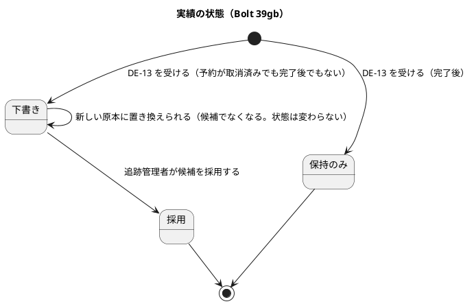
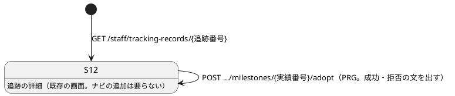
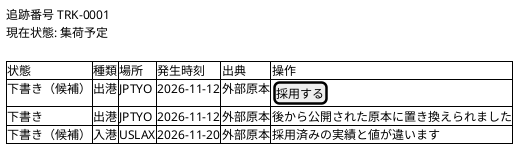
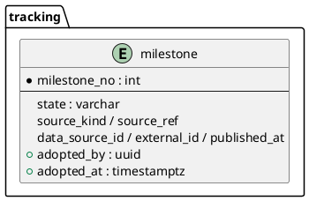

# Bolt 39gb 計画 - 下書きの候補を判定して示し、追跡管理者が候補を採用する

## 基本情報

| 項目 | 内容 |
| :--- | :--- |
| Bolt | 第 39gb 回（W7 の 28 本目。release_plan :976 の 39gb の行） |
| 状態 | 承認済み（2026-11-11。推奨のとおり。Recommend 承認の指示による。2 つの整合性検証（`validating-iteration-plan`・`validating-design`）の指摘を反映した） |
| 予定 | W7（2026-11-16 の週。前倒しで着手できる）。Bolt 39g の終了報告の承認（2026-11-10）の後に着手する。約 2 時間 55 分（約 175 分）の見込み（下の「時間の配分」）。`check`・`uiTest`・`manualScreenshots`・SonarQube・CI と承認の待ちを除く |
| アプローチ | アウトサイドイン（状態の組み合わせの表を先に書く。T-182）。受入シナリオを先に Red にし、内側（候補の判定 → 採用の操作）に入る |
| 対象 | (1) 同じ主要実績の組から候補を決める順の規則、(2) S-12 の置き換えられた下書きの文、(3) 追跡管理者が候補を採用する操作（候補だけが採用できる）、(4) 採用できない組の示し方、(5) 採用した人と時刻の持ち方（スキーマ）、(6) P-5・P-6（#50）、(7) マニュアル 9 章の採用の手順、動画 |
| トレース | US-12 AC1・AC2、T-INV-01・02・04・05・06・08・13、BR-05、DE-13（US-14 AC1 は DE-13 の入力としてだけ。BR-16 は T-INV-04 の補足）（[Bolt 39g 計画](bolt_39g_plan.md) の決定 (2)、【業務の判断】(aa)〜(af)、「39gb に写す行」）、W7 CP7・CP23・CP24（W7 の確認ポイント。release_plan :919・:935・:936。本計画の確認ポイントは「本計画 CP-n」と書き分ける）、[Bolt 39g 終了報告](bolt_39g_report.md) の既知の課題 |
| GitHub | #19（US-12。クローズは 39gc）、#50（P-5・P-6 を返す） |
| SP | 0（US-12 の残り 2 SP は 39gc で数える） |
| 承認ゲート | **計画と終了報告で止める**（release_plan :976）。確認必須のもの（スキーマ＝本計画 CP-3、認可＝本計画 CP-7、新規ファイル＝本計画 CP-8。release_plan :976 の「スキーマ」に認可を足す）は計画の承認に含める（前例 bolt_37d2_plan.md）。`/goal` の下でも、この計画は承認を受けてから実行する |

## Bolt ゴール

データ責任者が同じ主要実績の値を直して送り直したとき、追跡管理者の S-12 は最新の公開に当たる下書きだけを「候補」として示し、古い下書きには「後から公開された原本に置き換えられました」と示す。追跡管理者は候補を採用して現在状態に効かせられる。採用済みの実績と値が違う候補・完了後・取消済み・未来の発生時刻は採用を出さず、理由を示す。届いた順によらず候補は同じになる。

## 状態の組み合わせ（行ごとにテストを 1 本。T-182）

「組」は同じ追跡番号・同じ情報源・同じ外部 ID の DE-13 の実績（Bolt 39g 決定 (2)）。「候補」は組の下書きのうち順の規則が最も新しいもの。番号は 39g の「39gb に写す行」の行 5〜12・15・43 を引き継ぎ、新しい行に枝番を振る。

| 行 | 状況 | 期待 | 確かめ方 |
| :--- | :--- | :--- | :--- |
| 5 | 順の規則: 公開した時刻が新しい／同じで取得時刻が新しい／両方同じで受信記録 ID が大きい（文字列の順） | それぞれ新しい方が候補（入力と期待の組まで縛る。T-244） | 単体（パラメーター） |
| 6 | 後着: 新しい DE-13 の後に古い DE-13（並びを逆にした組も置く。T-245） | 古い DE-13 も実績に残る。候補は公開した時刻の新しい方。届いた順で結果が変わらない | 単体 |
| 7 | 同じ情報版で値の違う組 | 候補は公開した時刻の新しい方 | 単体 |
| 8 | 同じ情報版で同じ値の組 | 候補は公開した時刻の新しい方（値は比べない） | 単体 |
| 9 | 外部版をまたぐ: V1 の後に V2 | V2 が候補 | 単体 |
| 10 | 外部版をまたぐ（パラメーター）: V2 の後に V1 の隔離を採用／V1 を取り込む | どちらも公開した時刻の新しい V1 が候補（外部版の順は比べない。D-105） | 単体 |
| 11 | 誤った採用の後に元の原本を同じ外部版で送り直して採用 | 最後に公開した元の値が候補 | 単体 |
| 12 | 情報源が違えば別の組 | それぞれが候補 | 単体 |
| 15 | 手入力の実績・保持のみは組に入らない | 別の実績のまま | 単体 |
| 43 | S-12 の置き換えられた下書き | 候補でない下書きに「後から公開された原本に置き換えられました」。保持のみと採用には示さない。元の値に戻ると表示が変わる（状態を持たない） | コントローラーの単体 |
| 50 | 候補を採用する（追跡管理者） | 実績が採用になり現在状態と根拠の実績番号が導出し直される。採用した人と時刻が残る。版が 1 つ上がる。実績は消えず増えない | 単体、統合 |
| 51 | 候補でない下書きを採用する | 拒否（`NOT_CANDIDATE`）。画面には採用を出さない | 単体、コントローラーの単体 |
| 52 | 採用済みの実績と値が違う候補（確認ポイント 1） | 採用を出さず「採用済みの実績と値が違います」。POST は拒否（`CONFLICTS_WITH_ADOPTED`）。T-INV-06 を素通りさせない | 単体 |
| 53 | 候補と同じ値を採用済みの組 | 採用は要らない。「採用済みの実績と同じ値です」。POST は何もせず既存を返す | 単体 |
| 54 | 取消済み・完了後の追跡の下書き（確認ポイント 4） | 採用を出さず、POST は拒否（`BOOKING_CANCELLED`・`TRACKING_COMPLETED`）。保持のみは採用の対象外 | 単体 |
| 55 | 未来の発生時刻の下書き（確認ポイント 5） | 採用時刻より後なら採用できない（`OCCURRED_IN_FUTURE`）。同時刻は採用できる | 単体（境界） |
| 56 | 元の追跡番号の下書き（V1 が追跡番号 P、V2 が Q。確認ポイント 6） | P の S-12 では P の組として候補を決め、採用できる。Q とは混ざらない | 単体、配信の統合 |
| 57 | 同時: 同じ候補の採用が 2 つ重なる／採用と DE-13 の到着が重なる | 版の不一致で片方が `Conflict`。採用後に新しい DE-13 が届いたら、その採用は古くなっている（候補が変わった）ので拒否し、画面は読み直しを促す | 統合（H2 と PostgreSQL） |
| 58 | 認可（確認ポイント 7） | 追跡管理者だけが採用できる。荷主・他の役割は 403。C-10 に下書きは出ない（T-INV-09 の回帰） | `@WebMvcTest` と受入 |
| 59 | スキーマ（確認ポイント 3） | 採用した人・時刻の列とその CHECK（外部由来の採用済み・確認中は両方持つ、下書き・保持のみは両方 NULL）、列のコメント | 統合（`SchemaCommentIntegrationTest` と CHECK） |
| 60 | P-5: 遅延の外部キーの違反 | 500 にならず、ドメインの競合（再読み込みの案内）として返す | 統合 |
| 61 | P-6: 一意制約の違反 | 制約の名前で分け、出典の重複だけ冪等として扱い、ほかは例外のまま上げる | 単体、統合 |
| 62 | UI（データ責任者が値を直して再送し、追跡管理者が S-12 で候補を採用） | 古い下書きは置き換えの文、候補に採用ボタン、採用後に現在状態が変わる。axe の違反 0。幅 320 px | `adopted_milestone_reflected_ui.feature` |
| 63 | 受入シナリオ US-12 AC1・AC2 の外部の分 | 通る | `register_milestone.feature` |
| 64 | 層の規則 | 順の規則はドメイン層に置き、共有カーネルを変えない | `ModularityTest`・`LayerArchitectureTest` |
| 65 | マニュアル | 9 章の採用の手順・置き換えの文・採用できない理由が実装と一致する | ステップの突き合わせの記録 |
| 66 | 今の振る舞い | 39g までのテスト（下書きが届く・現在状態は変わらない）と手入力の登録・照会 | 既存 |

## 開始準備の決定（推奨を 1 つに決めて書いた。承認待ち）

(1) **範囲と見積り**: release_plan :976 の 39gb の行を、Bolt 39g の計画（決定 (1)）の内訳で約 175 分に引き直した。T-250 の目安（4 時間 05 分）に収まる。超えそうなときは 行 57 の PostgreSQL の同時の確かめ（−8 分）、動画（−5 分）の順に 39gc へ送る。マニュアルは後に送らない。

(2) **順の規則の置き場所**（確認ポイント 2）: **`tracking.domain.model.valueobjects.MilestoneGroup`（組。新規の値オブジェクト）に `candidate()` を持たせ、順の比較は `tracking.domain.model.rules` の `@DomainRule` クラス `MilestoneCandidateRule`（純粋な関数。前例 `CurrentStatusDeriver`）に置く**（共有カーネルに上げない。`Milestone` は `entities`）。用語集に「組（`MilestoneGroup`）」「候補の規則（`MilestoneCandidateRule`）」「採用の拒否の理由（`AdoptionRejectionReason`）」の行を足す（`LivingGlossaryConsistencyTest`。Javadoc の最初の語を日本語名に合わせる）。`Voyage.BY_FRESHNESS` は経路設計の集約の private の規則で、主要実績は削除・上書きしない（T-INV-01）別の性質なので共有する理由がない。共有カーネルを変えると構造の変更（確認必須）になり、他のコンテキストへ影響する。順は 39g の決定 (2) のとおり、公開した時刻 → 取得時刻 → 受信記録 ID（文字列の順）。**書くときには比べず、読むときに組から決める**（39g の学び）。

(3) **スキーマ**（確認ポイント 3）: `tracking.milestone` に `adopted_by`（UUID）・`adopted_at`（TIMESTAMP WITH TIME ZONE）を足す。NULL を許す。CHECK `ck_milestone_adoption`: `source_kind = 'EXTERNAL_RECORD'` かつ `state IN ('ADOPTED', 'UNDER_REVIEW')` なら両方に値（39gc が採用のときに確認中にしても人と時刻を残せるようにする。C-4）、そうでなければ両方 NULL。手入力の採用は登録者と登録時刻が採用者と採用時刻を兼ねるので埋めない。マイグレーションは `V20261111100000__add_tracking_milestone_adoption.sql` の 1 つ。`EXTERNAL_RECORD` の採用済みの行は今ない（採用の操作がない）ので埋め直さない。

(4) **採用の操作**: S-12 の候補に採用ボタンを出す。`POST /staff/tracking-records/{追跡番号}/milestones/{実績番号}/adopt`（PRG。S-13 の `POST /staff/tracking-records/{追跡番号}/milestones` と同じ前置き。`SecurityConfiguration` の `/staff/tracking-records/**` の matcher（`TRACKING_MANAGER`）に掛かるので matcher は足さない。ui_design の画面一覧に採用の行を足す）。画面を開いたときの版を期待版として渡し、一致しなければ `Conflict`（再読み込みの案内）。採用すると実績の状態が `ADOPTED` になり、現在状態と根拠の実績番号を導出し直す。BR-05 の二者確認は訂正（T-INV-06）にかかり、初めての採用にはかからない。

(5) **採用済みの実績と値が違う候補**（確認ポイント 1。推奨）: 採用を出さず「採用済みの実績と値が違います」を示す。採用すると T-INV-06 を素通りするので、値を直す道は US-13（W12）に送る。候補と同じ値を採用済みなら採用は要らない。
- 比べた案: (i) **採用を出さない（推奨）**。(ii) 採用を出して二者確認を求める（US-13 を先取りし、W12 の設計を決めてしまう）。(iii) 採用して上書きする（T-INV-01・06 に反する）。

(5a) **同時の守り**（検証の指摘 C-5）: 採用はコマンドサービスで `findByTrackingNumberForExternalMilestone`（行のロック。39g の行 28）で読み直してから期待版を比べる。DE-13 の受け取りは保存で集約の版を上げる（39g の行 37 の「版は 2 増える」）ので、採用後に新しい DE-13 が届けば期待版が古くなり検出できる。ステップ 2 で行 57 の Red として確かめる。採用の監査は、ステップ 6 で既存の `AuditAction` の前例を確かめ、無ければ本計画 CP-7 の追加の確認として諮る。

(5b) **採用の拒否の型**（検証の指摘 3）: 採用の拒否は永続化しないので、`rejected_milestone.reason` の CHECK に入る `MilestoneRejectionReason` には足さず、別の enum `AdoptionRejectionReason`（`NOT_CANDIDATE`・`CONFLICTS_WITH_ADOPTED`・`BOOKING_CANCELLED`・`TRACKING_COMPLETED`・`OCCURRED_IN_FUTURE`）にする。`TRACKING_COMPLETED` は予約状態の完了か現在状態が引渡し済み（`TrackedBookingStatus.COMPLETED` と区別する）。`CONFLICTS_WITH_ADOPTED` は拒否の記録ではなく採用操作の結果。用語の表に `AdoptionRejectionReason` を足す（`LivingGlossaryConsistencyTest`）。

(5c) **T-INV-13 の読み替え**: 39g の【業務の判断】(ae)（下書きには掛けない）は変えず、採用のときだけ掛けると domain_model :1340 と US-12 の決定の注に足す。

(6) **P-5・P-6**: #50 の課題を [Bolt 26b](bolt_26b_report.md)・[Bolt 26c](bolt_26c_report.md) の既知の課題から読み直し、ステップ 2 で行 60・61 に落とす（P-5＝遅延の外部キーの違反を競合として返す、P-6＝一意制約の違反を制約の名前で分ける）。

## 業務の判断の記録（確認ポイント 1・4・5・6。仮。パイロットの前に業務責任者に確かめる）

| 判断 | 推奨 | 理由 |
| :--- | :--- | :--- |
| (ab) 元の追跡番号の下書き | 追跡番号ごとに組を作り、元の追跡番号の S-12 で採用できる（誤って付けた P の下書きは P の画面に残り、Q の候補と混ざらない） | 追跡の集約は追跡番号ごとで、跨いで更新できない。P の下書きを採用しなくてもよく、採用しなければ現在状態に効かない |
| 完了後・取消済みの下書き | 採用を出さない（POST も拒否） | T-INV-05（完了後は保持のみ）、BR-16。時系列の判定は 39gc |
| (ae) 未来の発生時刻 | 採用のときは採用時刻より後なら採用できない。同時刻は可 | 採用すると現在状態に効くので T-INV-13 と同じ守りを掛ける。下書きでは受ける（39g の決定のまま） |

## スコープ

### 入れるもの

- 行 5〜12・15・43・50〜66。決定 (2)〜(6) の実装と文書
- マニュアル 9 章（採用の手順、置き換えの文、採用できない理由）、必要なら 12 章・用語集、動画 `@demo-bolt-39gb/adopt-candidate`
- P-5・P-6（#50）

### 入れないもの

- AC3 の確認中、DE-18、手入力の確認中と AC4・AC5 の手入力の分（39gc）
- DE-09・DE-10（39g2）、下書きの修正と二者確認（US-13。W12）
- 有人例外案件の起票（W8）、拒否の記録を見る画面（W8・W10）

### 申し送り

| 送り先 | 課題 |
| :--- | :--- |
| 39gc | 時系列に反する実績を採用のときに確認中にする。ここで作る採用の操作に確認中の判定を足す |
| 39g2 | 採用の経路にも DE-09・DE-10 が掛かる（予約状態の書き手） |
| 39h | 古い外部版の後着を差異にするか |
| W12 | 採用済みと値の違う候補を二者確認で直す（US-13） |
| Release 1.0 のパイロットの前 | 業務の判断の記録を業務責任者とデータ責任者に確かめる |

### 設計文書に直す箇所（ステップ 1。「39gb」「候補」で検索して確かめる）

- ui_design: 画面一覧に採用の行（S-12 の採用）
- domain_model: 実績の状態遷移（下書き → 採用）、組と候補の用語、採用の操作、拒否の理由の値、T-INV-06 の範囲の注、T-INV-13 の採用の分、「Bolt 39gb で決めたこと」の節
- data_model: `milestone` の ER と制約の表（`adopted_by`・`adopted_at`・CHECK）
- ui_design: S-12 の候補・置き換え・採用できない理由・採用ボタン
- user_story: US-12 の決定の注、test_strategy: 受入条件の照合の表
- release_plan: 39gb の行（計画へのリンク・見積り・決めたこと）、39gc の送り、台帳 D-120（仮）以降
- development_strategy: W7 の行、ADR-004: Bolt 39gb の項

## 設計（この Bolt の範囲）

### 状態遷移図



### 画面遷移図



状態遷移図の破線の遷移（確認中＝39gc）は、次の図に足さず 39gc で足す。採用できない条件（取消済み・完了後・未来の発生時刻・値違い）は拒否で、状態は変わらない。

### 画面イメージ（S-12）



### 依存

```plantuml
@startuml
package tracking.domain.model.aggregates { class TrackingRecord { adoptCandidate() ; groupsOf() } }
package tracking.domain.model.entities { class Milestone }
package tracking.domain.model.rules { class MilestoneCandidateRule <<DomainRule>> }
package tracking.domain.model.valueobjects { class MilestoneGroup { candidate() } ; class AdoptionRejectionReason }
package tracking.application.internal.commandservices { class TrackingRecordCommandService }
package tracking.interfaces.web { class TrackingRecordController }
TrackingRecordController --> TrackingRecordCommandService
TrackingRecordCommandService --> TrackingRecord
TrackingRecord --> MilestoneGroup
MilestoneGroup --> MilestoneCandidateRule
MilestoneGroup --> Milestone
@enduml
```

### ER 図（この Bolt で変える表）



## ステップ計画（ゲートは各ステップに書く）

| # | ステップ | ゲート | 分 |
| :--- | :--- | :--- | ---: |
| 1 | 設計文書を直す（上の一覧）、release_plan の 39gb の行、日付の確認 | 既定 | 20 |
| 2 | Red: 受入シナリオ（行 62・63）と状態の組み合わせの単体（行 5〜12・15・50〜55・56）を先に落とす。P-5・P-6 の再現（行 60・61） | 既定 | 25 |
| 3 | 候補の判定と順の規則（行 5〜12・15）。Green → Refactor | 既定 | 10 |
| 4 | S-12 の置き換えの文と採用できない理由の表示（行 43・51〜55） | 既定 | 15 |
| 5 | スキーマ（行 59）: マイグレーション、`MilestoneRow`・マッパー。`updateMilestoneAdoption`（`state`・`adopted_by`・`adopted_at` だけを変える。`WHERE state = 'DRAFT'` と版の条件。data_model :178 の「状態と下書き内容の UPDATE」の注に採用の分を足す） | **確認ポイント 3 で計画の承認に含む** | 10 |
| 6 | 採用の操作: ドメイン、コマンドサービス、リポジトリ、認可、POST（行 50・57・58） | **確認ポイント 7 で計画の承認に含む** | 25 |
| 7 | P-5・P-6（行 60・61） | 既定 | 8 |
| 8 | マニュアル 9 章・用語集・キャプチャ（行 65）、動画 | 既定 | 8 |
| 9 | 品質ゲート（`check`・`uiTest`・`manualScreenshots`・SonarQube・CI）、変異、文書の突き合わせ | 既定 | 44 |
| 10 | 終了報告 | **終了報告で止める** | 10 |
| | 合計 | | 175 |

時間の配分と打ち切り: 超えそうなときは決定 (1) の順に 39gc へ送る。

## 確認ポイント（計画の承認の場でまとめて確認する。Try T-6）

| # | 確認すること | 推奨 |
| :--- | :--- | :--- |
| 1 | 採用済みの実績と値が違う候補（T-INV-06 の素通り） | 採用を出さず「採用済みの実績と値が違います」を示す。値を直す道は US-13（W12）。候補と同じ値の採用済みは採用不要 |
| 2 | 順の規則の置き場所 | `tracking` のドメイン層に置く。共有カーネルは変えない |
| 3 | スキーマ: `adopted_by`・`adopted_at` と CHECK（データベースの承認ゲート） | 足す。手入力の採用は兼用で埋めない |
| 4 | 完了後・取消済みの下書きの採用 | 採用を出さず POST も拒否 |
| 5 | 未来の発生時刻の下書きの採用（【業務の判断】(ae)） | 採用時刻より後なら採用できない。同時刻は可 |
| 6 | 元の追跡番号の下書き（【業務の判断】(ab)） | 追跡番号ごとの組。元の追跡番号の S-12 で採用できる |
| 7 | 認可: 採用できるのは追跡管理者だけ（セキュリティの承認ゲート） | 既存の追跡管理者の役割に限り、荷主・他の役割は 403。監査の記録は既存の操作の前例に合わせる |
| 8 | 新しいファイル（マイグレーション、Steps、`bolt_39gb_plan.md`・終了報告、キャプチャ） | 作る |

### 変異と落ちる見込みのテスト

- 順の規則の比較の向きを逆にする → 行 5 が落ちる
- 組のキーから情報源 ID を外す → 行 12 が落ちる
- 候補でない下書きにも採用を出す → 行 51 が落ちる
- 採用済みと値の違う候補の拒否を外す → 行 52 が落ちる
- 期待版の比較を外す → 行 57 が落ちる
- 置き換えの文を候補にも出す → 行 43 が落ちる
- 取得時刻を比べない／受信記録 ID を先に比べる → 行 5・10 が落ちる
- 実績番号の最大で候補を決める → 行 6・10 が落ちる
- 組に情報源を入れない → 行 12 が落ちる
- 組に手入力を入れる → 行 15 が落ちる

## 完了条件

- 行 5〜66 のテストが通り、`check`・`uiTest`・CI が緑。SonarQube の品質ゲートが通る
- 変異が上の見込みどおりに落ちる
- マニュアル 9 章が実装と一致し、キャプチャを撮り直した
- #50 の P-5・P-6 を返した
- 終了報告を作り、人が承認した

## 更新履歴

| 日付 | 更新内容 | 更新者 |
| :--- | :--- | :--- |
| 2026-11-11 | 初版作成。2 つの整合性検証の指摘（重大 1・中 8・軽）を反映した | anthropic/claude-sonnet-5-5 |
| 2026-11-11 | 推奨のとおり承認として記録した（確認ポイント 1〜8。Recommend 承認の指示による。human:kakimomokuri） | anthropic/claude-sonnet-5-5、承認 human:kakimomokuri |

## 関連ドキュメント

- [Bolt 39g 計画](bolt_39g_plan.md)、[Bolt 39g 終了報告](bolt_39g_report.md)
- [リリース計画](release_plan.md)
