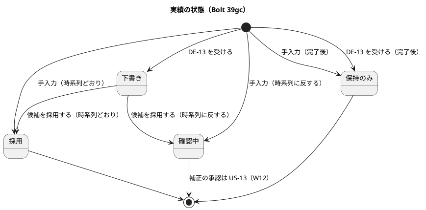
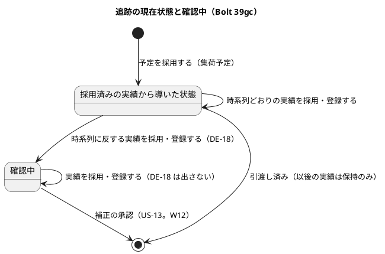
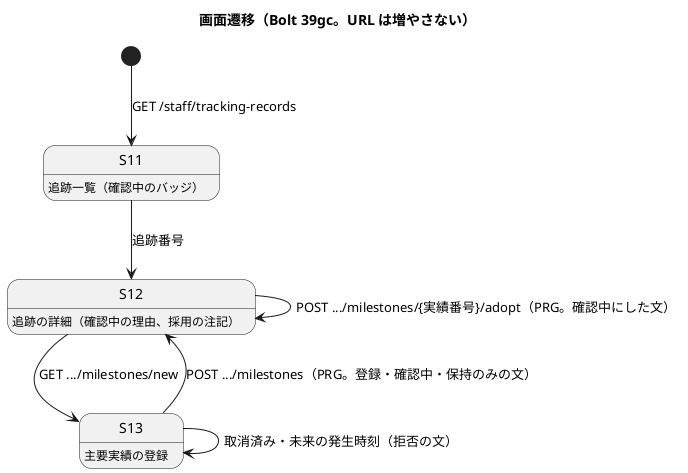
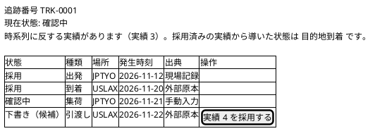
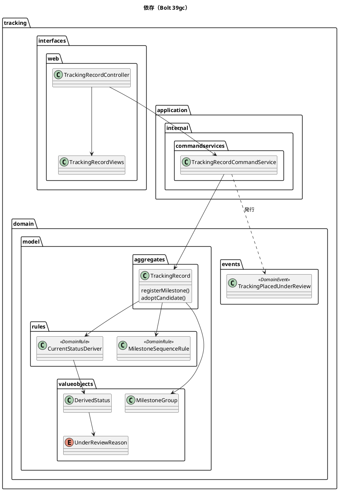
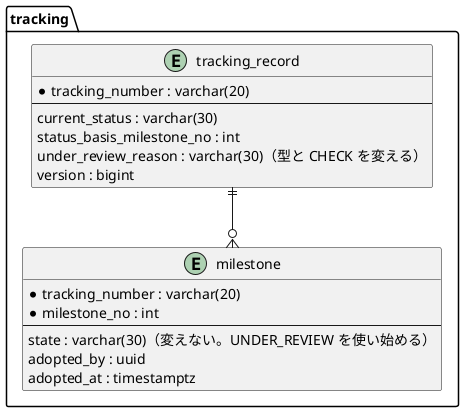

# Bolt 39gc 計画 - 時系列に反する実績を確認中にし、DE-18 を出し、手入力の取消済み・完了後を決める

## 基本情報

| 項目 | 内容 |
| :--- | :--- |
| Bolt | 第 39gc 回（W7 の 29 本目。release_plan :977 の 39gc の行） |
| 状態 | 計画（承認待ち。2 つの整合性検証（`validating-iteration-plan`・`validating-design`）の指摘を反映した） |
| 予定 | W7（2026-11-16 の週。前倒しで着手できる）。Bolt 39gb の終了報告の承認（2026-11-11）の後に着手する。約 3 時間（約 180 分）の見込み（下の「時間の配分」）。`check`・`uiTest`・`manualScreenshots`・SonarQube・CI と承認の待ちを除く |
| アプローチ | アウトサイドイン（状態の組み合わせの表を先に書く。T-182）。受入シナリオを先に Red にし、内側（時系列の規則 → 確認中の導出 → 採用・手入力の経路 → 保存 → 画面）に入る |
| 対象 | (1) 時系列に反する実績の判定の規則、(2) 確認中の導出（現在状態・根拠の実績番号・確認中の理由）、(3) 採用のときの確認中（39gb の `TrackingRecord.adoptCandidate` に判定を足す）、(4) 手入力のときの確認中・取消済みの拒否・完了後の保持のみ（AC3〜AC5 の手入力の分）、(5) DE-18 の発行、(6) `under_review_reason` の値の決め方（スキーマ）、(7) S-11・S-12・S-13 の確認中の表示、(8) マニュアル 9 章の確認中、動画、(9) #19 のクローズと US-12 の 2 SP |
| トレース | US-12 AC3・AC4・AC5（手入力の分と採用の分）、T-INV-03・04・05・06・08・09・13、BR-05・BR-06・BR-16、UC-10 2b、DE-18（[Bolt 39g 計画](bolt_39g_plan.md) の「39gb に写す行」の後の注、決定 (1)・(5)・(12)、:140、:269、:279）、W7 CP7・CP8・CP10・CP23（W7 の確認ポイント。release_plan :919・:920・:922・:935。本計画の確認ポイントは「本計画 CP-n」と書き分ける）、[Bolt 39gb 終了報告](bolt_39gb_report.md) の既知の課題・次の Bolt |
| GitHub | #19（US-12。この Bolt の終了報告の承認でクローズする） |
| SP | 2（US-12 の残り。この Bolt で数える） |
| 承認ゲート | **計画と終了報告で止める**（release_plan :977）。確認必須のもの（スキーマ＝本計画 CP-3、新規ファイル＝本計画 CP-10）は計画の承認に含める（前例 bolt_37d2_plan.md、bolt_39gb_plan.md）。認可は変えない（下の決定 (9)）。`/goal` の下でも、この計画は承認を受けてから実行する |

## Bolt ゴール

追跡管理者が手入力で登録した実績や、候補を採用した実績が、すでに採用した実績と時系列に反するとき、実績は消えずに状態「確認中」で残り、追跡の現在状態は「確認中」になって理由が S-11・S-12 に示される。荷主の画面には確認中の実績は出ず、現在状態だけが「確認中」になる。確認中になったときに DE-18 が 1 度だけ出る。取消済みの予約への手入力は拒否され、完了した追跡への手入力は保持のみで残って現在状態を変えない。US-12 の受入条件 AC1〜AC5 がすべて通り、#19 を閉じられる。

## 状態の組み合わせ（行ごとにテストを 1 本。T-182）

行の番号はこの計画で 1 から振る。「採用済み」は状態が採用の実績（手入力と外部原本の両方。出典をまたぐ。W7 CP7）。「段」は決定 (2) の実績の種類の進みの段。テストは新しいクラスは決定 (13)、既存のクラスは `@Nested class Bolt39gc_…`。

| 行 | 状況 | 期待 | 確かめ方 |
| :--- | :--- | :--- | :--- |
| 1 | 時系列の規則（パラメーター。入力と期待の組まで縛る。T-244）: 採用済みの実績 A に対し、新しい実績 B が (a) 段が後で発生が前、(b) 段が前で発生が後、(c) 段が後で発生が後、(d) 段が前で発生が前（遅れて届いた順どおりの実績）、(e) 発生が同じ時刻、(f) 出発と積替（同じ段） | (a)(b) は反する。(c)〜(f) は反しない | 単体（`MilestoneSequenceRuleTest`） |
| 2 | 比べる相手 | 採用済みだけと比べる（下書き・保持のみ・確認中とは比べない）。出典をまたぐ（手入力と外部原本の採用済み） | 単体（パラメーター） |
| 3 | 確認中の導出 | 確認中の実績が 1 件でもあれば現在状態は確認中、根拠の実績番号は最初に確認中になった実績（実績番号の最も小さい確認中）、確認中の理由は `OUT_OF_SEQUENCE`。確認中の実績がなければ今の導出のまま（回帰） | 単体（`CurrentStatusDeriverTest`） |
| 4 | 確認中の後に時系列どおりの実績を登録・採用する | 実績は採用、現在状態は確認中のまま、根拠と理由は変わらない。DE-18 は出ない | 単体 |
| 5 | AC3 の手入力: 時系列に反する実績を登録する | 実績は確認中で残る（原本を保持。T-INV-01）。現在状態は確認中、理由が残る。DE-18 が 1 件 | 単体、コマンドサービスの単体 |
| 6 | AC3 の採用: 時系列に反する候補を採用する | 実績は確認中に移り、採用者・採用時刻を持つ（`ck_milestone_adoption`）。現在状態は確認中。DE-18 が 1 件 | 単体、コマンドサービスの単体 |
| 7 | 採用の判定の順（パラメーター。2 つの条件が重なる組を置く） | 候補でない → 取消済み → 完了後 → 判断済みと同じ値 → 判断済みと値が違う → 未来の発生時刻 → 時系列に反する（確認中） → 採用（決定 (4)） | 単体 |
| 8 | 手入力の判定の順（パラメーター） | 同じ出典 → 取消済み → 未来の発生時刻 → 完了後（保持のみ） → 時系列に反する（確認中） → 採用（決定 (5)） | 単体 |
| 9 | AC4 の手入力: 取消済みの予約に登録する（本計画 CP-4） | 拒否（`BOOKING_CANCELLED`）。実績を作らず、版は上がらない。S-13 に理由の文。拒否の記録（`rejected_milestone`）は書かない | 単体、コントローラーの単体 |
| 10 | AC5 の手入力: 完了後（パラメーター: 予約状態が完了、採用済みから導いた状態が引渡し済み）に登録する（本計画 CP-5） | 保持のみで残る。現在状態と根拠の実績番号は変わらない。確認中にしない。S-13 の結果の文 | 単体、コントローラーの単体 |
| 11 | 完了後の判定は確認中に隠れない（決定 (6)、【前の決定の変更】(14)） | 確認中の間に引渡しを採用した追跡では、以後の手入力は保持のみ、採用は `TRACKING_COMPLETED`、DE-13 は保持のみ | 単体（3 つの経路） |
| 12 | 組に確認中を入れる（決定 (7)） | 確認中の外部原本の実績が組で最も新しいとき候補はない（古い下書きが候補に戻らない）。置き換えの文の判定も同じ組で行う | 単体（`MilestoneGroupTest`） |
| 13 | 確認中の実績と値が違う新しい下書き（本計画 CP-6） | 採用を出さず「確認中の実績と値が違います」。POST は `CONFLICTS_WITH_ADOPTED` で拒否 | 単体、コントローラーの単体 |
| 14 | 確認中の実績と同じ値の新しい下書き | 採用は要らない。「確認中の実績と同じ値です」。POST は何もしない | 単体、コントローラーの単体 |
| 15 | S-12 の採用の注記（本計画 CP-7） | 採用すると確認中になる候補にも採用のボタンを出し、「採用すると、時系列に反するため確認中になります」を添える。判定は POST と同じドメインの操作（39gb の議題 2） | コントローラーの単体 |
| 16 | DE-18 の属性と回数（本計画 CP-8） | 追跡番号・予約 ID・確認中の理由（文字列）・確認中にした実績番号・確認中にした時刻・集約の版。確認中に入るときだけ出す（すでに確認中なら出さない）。同じ出典の二重送信・`SameAsAdopted`・拒否では出ない | 単体（集約の結果とコマンドサービスの発行の記録。T-236） |
| 17 | DE-18 は保存と同じトランザクションで発行する | 保存が版の不一致で `Conflict` なら DE-18 は出ない。受け手はまだない（W9。W7 CP10） | コマンドサービスの単体、統合（H2） |
| 18 | スキーマ（本計画 CP-3） | `under_review_reason` は `VARCHAR(30)`、値は `OUT_OF_SEQUENCE` だけ（CHECK）。現在状態が確認中のときだけ値を持つ（CHECK）。列のコメント | 統合（`SchemaCommentIntegrationTest` と CHECK の確かめ） |
| 19 | 保存と読み直し | 確認中の現在状態・根拠・理由、手入力の確認中・保持のみ、外部原本の確認中（採用者・採用時刻）が往復する | 統合（`MyBatisTrackingRecordRepositoryIntegrationTest`） |
| 20 | 採用で確認中にする保存 | `state = 'DRAFT'` の行だけを `UNDER_REVIEW` と採用者・採用時刻に書き換える。追跡記録の行は版の条件で `current_status`・`status_basis_milestone_no`・`under_review_reason` を書く。表の行がもう下書きでなければ競合 | 統合（H2 と PostgreSQL） |
| 21 | 同時: 同じ候補の採用 2 本を PostgreSQL でラッチで重ねる（39gb の行 57 の持ち越し。39gb 終了報告の既知の課題） | 片方が採用（または確認中）、もう片方は `Conflict`。DE-18 は 1 件まで | 統合（PostgreSQL） |
| 22 | S-11 | 確認中の追跡の現在状態に状態バッジ（文字 + アイコン。色だけで示さない。BR-13）。絞り込みは足さない | コントローラーの単体 |
| 23 | S-12 | 現在状態「確認中」と理由の文「時系列に反する実績があります（実績 N）。採用済みの実績から導いた状態は M です。」、確認中の実績の状態「確認中」 | コントローラーの単体 |
| 24 | S-13 の結果の文 | 確認中・保持のみの登録、取消済みの拒否の文（決定 (8) の文） | コントローラーの単体 |
| 25 | C-10（T-INV-09） | 現在状態「確認中」を示し、確認中の実績は示さない（採用済みだけ）。確認中の説明は US-09 AC2（W9） | 単体（`TrackingRecordCustomerViewTest`）と既存 |
| 26 | DE-13 の受け取りは変えない | 確認中の追跡にも下書きで届き、現在状態は確認中のまま | 単体 1 本と既存 |
| 27 | 認可は変えない | S-13 の POST と採用の POST は追跡管理者だけ。荷主・他の役割は 403（回帰） | 既存の `@WebMvcTest` |
| 28 | UI（追跡管理者が時系列に反する実績を手入力し、S-12 で確認中と理由を見て、S-11 でバッジを見る） | axe の違反 0。幅 320 px。PRG で同じ画面に戻る操作は応答で待つ（39gb の Try） | `under_review_milestone_ui.feature` |
| 29 | 受入シナリオ | `@US-12-AC3`（手入力と採用）、`@US-12-AC4`・`@US-12-AC5` の手入力の分が通る | `register_milestone.feature` |
| 30 | 層の規則 | 時系列の規則はドメイン層（`rules`）、DE-18 は `tracking.domain.events`（名前付きインターフェースは受け手を作る W9 で足す）。共有カーネルを変えない | `ModularityTest`・`LayerArchitectureTest` |
| 31 | 用語の検査 | `UnderReviewReason`（`@ValueObject`）の用語の行と Javadoc の最初の語 | `LivingGlossaryConsistencyTest` |
| 32 | マニュアル | 9 章の確認中・保持のみ・取消済みの文と、採用の注記が実装と一致する | ステップの突き合わせの記録（T-197・T-251） |
| 33 | 今の振る舞い | 39gb までのテスト（下書き、候補、採用、拒否の記録、手入力の登録・照会） | 既存 |

## 開始準備の決定（推奨を 1 つに決めて書いた。承認待ち）

(1) **範囲と見積り**: release_plan :977 の 39gc の行（約 170 分。bolt_39g_plan.md :125 の内訳: 土台 95、確認中の判定 20、DE-18 8、手入力の AC3〜AC5 15、S-11・S-12 の確認中 8、マニュアル 8、変異と突き合わせ 16）をコードで確かめて引き直し、約 180 分にした。増えたのは、組に確認中を入れる直し（行 12〜14。+5）、完了後の判定の直し（行 11。+3）、`under_review_reason` の CHECK（行 18。+2）と、39gb から持ち越した PostgreSQL の同時の採用（行 21。+8）で、S-13 の文をまとめて −8 した。T-250 の目安（4 時間 05 分）に収まる。**超えそうなときは 行 21（−8 分）、動画（−5 分）の順に後へ送る**（行 21 は W7 の締めの返済に、動画は 39g2 に）。マニュアルは後に送らない。分けない（分けると土台の 95 分が 2 度かかり、確認中の判定と表示が別の Bolt に割れて見えない状態の Bolt ができる）。

(2) **時系列に反するの定義**（本計画 CP-1、【業務の判断】(ag)、台帳 D-123（仮））: 実績の種類に進みの段を置き、**集荷 1、搬入 2、出発と積替 3、到着 4、引渡し 5** とする。新しい実績と採用済みの実績の 1 つでも、**段の向きと発生時刻の向きが逆**（段が後なのに発生が前、または段が前なのに発生が後）なら時系列に反する。同じ時刻と同じ段は反しない（出発と積替は積替港で繰り返すので同じ段にする）。比べるのは採用済みの実績だけで、出典をまたぐ（手入力と外部原本。W7 CP7）。下書き・保持のみ・確認中とは比べない（現在状態に効かない実績）。
- 純粋な関数 `MilestoneSequenceRule`（`tracking.domain.model.rules`、`@DomainRule`。前例 `CurrentStatusDeriver`・`MilestoneCandidateRule`）に置く。段の表は規則の中に持ち、`MilestoneKind` に足さない（段は判定のための並びで、種類の意味ではない）
- 受け入れること: 積替が最初の出発より前に来る組は同じ段なので反しない。同じ種類が 2 度ある組も反しない（導出は発生時刻の最も新しい採用済みを取る）。場所の矛盾（同じ種類で場所が違う）は判定しない（W7 CP7 の「時系列だけ」）。予定との比べは US-09 AC2（W9）の範囲
- 比べた案: (i) **段と発生時刻の向き（推奨）**。(ii) 発生時刻が現在状態の根拠の実績より前なら反する（遅れて届いた順どおりの実績まで確認中になり、確認中が増えすぎる）。(iii) 現在状態が後退するときだけ反する（到着より前の出発のような矛盾を見逃す）

(3) **確認中の導出**（本計画 CP-2、【業務の判断】(ah)、台帳 D-124（仮））: 確認中の実績が 1 件でもあれば、現在状態は確認中（`TrackingStatus.UNDER_REVIEW`）、根拠の実績番号は最初に確認中になった実績（実績番号の最も小さい確認中）、確認中の理由は `UnderReviewReason.OUT_OF_SEQUENCE`。確認中の実績がなければ今の導出（採用済みの実績のうち発生時刻の最も新しいもの）のまま。`CurrentStatusDeriver.derive` を直し、`DerivedStatus` に確認中の理由（`Optional`）を足す。`TrackingRecord` は確認中の理由を持ち、`reconstitute` で受ける。
- **確認中から出る道（補正の承認）は US-13（W12）で作り、39gc では作らない**。そのため Release 1.0 の間（W8〜W10）は、確認中になった追跡は確認中のまま残る。受け入れること: 荷主の C-10 は現在状態「確認中」を示し続ける（説明は US-09 AC2・W9）。確認中の追跡に後から時系列どおりの実績が届いても、現在状態は確認中のまま（行 4）。**Release 1.0 のパイロットの前に出る道が要るかを W7 の締めで諮る**（台帳 D-124 の注、申し送り）
- 比べた案: (i) **現在状態を確認中にし、出る道は US-13（推奨）**。(ii) 39gc で追跡管理者が確認中を解く最小の操作を作る（約 +40 分で T-250 を超えて分割が要り、BR-05 の二者確認の設計を W12 より先に決めてしまう）。(iii) 現在状態は変えず実績だけを確認中にする（DE-18「追跡が確認中になった」、domain_model の追跡の状態遷移図、`TrackingStatus.UNDER_REVIEW` と合わない）

(4) **採用の経路**（39gb の `TrackingRecord.adoptCandidate`。TrackingRecord.java :288-321）: 判定の順は 39gb のまま、未来の発生時刻の後に時系列の判定を足す（候補でない → 取消済み → 完了後 → 判断済みと同じ値 → 判断済みと値が違う → 未来の発生時刻 → 時系列に反する → 採用）。時系列に反するときは拒否ではなく、実績を確認中に移して採用者・採用時刻を残す（`Milestone.adopt` と同じ形の `Milestone.adoptUnderReview` を足す。Milestone.java :58-63 の不変条件は確認中にも採用者・採用時刻を求めるので、そのまま通る）。結果の型 `MilestoneAdoption` に確認中の結果を足すか、`Adopted` に実績の状態で表すかはステップ 4 の Refactor で決める（前例 `ExternalMilestoneReceipt`。外から見える違いは DE-18 の有無と画面の文で、行 6・15・16 が縛る）。

(5) **手入力の経路**（`TrackingRecord.registerMilestone`。TrackingRecord.java :184-212、W7 CP8【前の決定の変更】）: 判定の順は **同じ出典 → 取消済み → 未来の発生時刻 → 完了後（保持のみ） → 時系列に反する（確認中） → 採用**。拒否を先に、状態の選び分けを後にする（完了後の未来の発生時刻は保持のみにせず拒否する。T-INV-13）。採用の順（決定 (4)）と取消済み → 完了後の並びは同じ。同じ出典を先に見るのは 39g・26b のまま（二重送信に既存の実績を返す）。domain_model :1154 の「追跡管理者が登録した実績は採用」を「時系列に反すれば確認中、完了後は保持のみ」に改める（W7 CP8）。

(6) **完了後の判定**（【前の決定の変更】(14)、台帳 D-117 の注）: `TrackingRecord.isCompleted`（:324-326）の「現在状態が引渡し済み」を「**採用済みの実績から導いた状態が引渡し済み**」に読み替える（確認中は現在状態を確認中にするので、現在状態を見ると、確認中の間に引渡しを採用した追跡が完了後にならず、T-INV-05 が効かなくなる。行 11）。予約状態が完了の判定は変えない。DE-13 の受け取り・採用・手入力の 3 つの経路が同じ判定を使う。

(7) **組に確認中を入れる**（本計画 CP-6、【業務の判断】(ai)、台帳 D-125（仮））: 39gb の組は下書きと採用だけを入れる（TrackingRecord.java :254、MilestoneGroup.java :33）。採用で確認中に移した外部原本の実績が組から抜けると、同じ組の古い下書きが候補に戻る（行 12）。そこで組に確認中を入れ、**確認中も「判断済み」として採用済みと同じに扱う**（`MilestoneGroup.adopted()` を判断済み（採用・確認中）の最も新しい実績に広げる。最も新しい実績が判断済みなら候補はない）。確認中の実績と値が違う新しい下書きは採用を出さず「確認中の実績と値が違います」と示し、POST は `CONFLICTS_WITH_ADOPTED` で拒否する（採用すると確認中の判断を黙って上書きするのと同じで、直す道は US-13）。同じ値なら採用は要らない（「確認中の実績と同じ値です」）。理由の値は足さず、文だけを判断済みの実績の状態で分ける（`AdoptionRejectionReason` は永続化しない。39gb の決定 (5b)）。

(8) **画面の文**（T-251。マニュアルはこの文から写す）:
- S-12 の現在状態の後: 「時系列に反する実績があります（実績 N）。採用済みの実績から導いた状態は M です。」（M は導出の結果の表示名。UI 設計の原則「確認中のときは何が分かっていて何が分かっていないかを分けて示す」。ui_design :58）
- S-12 の採用の注記（本計画 CP-7）: 「採用すると、時系列に反するため確認中になります」
- S-12 の採用の結果: 「実績 N を採用しました。時系列に反するため確認中にしました。」
- S-13 の結果（確認中）: 「実績 N を登録しました。時系列に反するため確認中にしました。」
- S-13 の結果（保持のみ）: 「実績 N を保持のみで登録しました。完了した追跡の現在状態は変わりません。」
- S-13 の拒否（取消済み）: 「取消済みの予約には主要実績を登録できません。」（`TrackingRecordController.rejection` :203-208 の `BOOKING_CANCELLED` の腕を、例外から文に直す。`UNKNOWN_TRACKING_NUMBER` は画面で起きないので例外のまま）
- S-12 の採用できない理由（決定 (7)）: 「確認中の実績と値が違います」「確認中の実績と同じ値です」
- S-11: 現在状態の「確認中」に状態バッジ（文字とアイコン。ui_design :2241）

(9) **認可は変えない**: 新しい URL を足さない。S-13 の POST（`POST /staff/tracking-records/{追跡番号}/milestones`）と採用の POST（`.../milestones/{実績番号}/adopt`）は `/staff/tracking-records/**` の matcher（追跡管理者）のまま。セキュリティの承認ゲートには当たらない（行 27 で回帰を確かめる）。監査は主要実績の登録・採用の前例に合わせて足さない（DE-18 の監査（US-17）は W11。domain_model :1804）。

(10) **DE-18**（本計画 CP-8、W7 CP10）: `tracking.domain.events.TrackingPlacedUnderReview`（`@DomainEvent`。前例 `TrackingStarted`。型を移動しない）。属性は domain_model :1824 の追跡番号・予約 ID・確認中の理由（文字列）に、**確認中にした実績番号・確認中にした時刻（登録時刻か採用時刻）・発行元の集約の版**（B-INV-12。前例 DE-22）を足す。集約が結果に載せ、コマンドサービスが保存の後に同じトランザクションで発行する（前例 TrackingStartEventHandler.java :92）。確認中に入るときだけ出す。受け手（通知 `TRACKING_UNDER_REVIEW`。V20261015100000 の `kind`）は W9 なので、W7 の時点では listener がなく、イベント発行記録も作られない。T-184（配信まで確かめる）は W9 で受け手を作るときに当てる。`tracking.domain.events` の名前付きインターフェースは W9 で足す（今は DE-22 を追跡の中だけで購読する。package-info）。

(11) **スキーマ**（本計画 CP-3）: `tracking.tracking_record.under_review_reason` は Bolt 25 で `VARCHAR(1000)`・NULL 可で作ってあり（V20261009130000 :17）、どの経路も書いていない（TrackingRecordMapper.xml :89-97 の UPDATE とマッパーの INSERT に列がない）。区分値の規約（data_model :153）に合わせ、マイグレーション `V20261112100000__change_tracking_record_under_review_reason.sql` の 1 つで、型を `VARCHAR(30)` に変え（H2 と PostgreSQL の共通の `ALTER COLUMN … SET DATA TYPE` の見込み。ADR-007。ステップ 6 で両方の統合テストで確かめ、通らなければ型は変えず CHECK だけにして記録する）、CHECK `ck_tracking_record_under_review_reason`（値は `OUT_OF_SEQUENCE`）と、CHECK `ck_tracking_record_under_review`（`current_status = 'UNDER_REVIEW'` なら理由に値、そうでなければ NULL）を足し、列のコメントを「確認中の理由（区分値）」に直す。`current_status = 'UNDER_REVIEW'` の行と理由に値のある行は、書く経路がないので今はない（配備の前にステージング・本番で確かめる。申し送り）。`milestone` は変えない（`state` の CHECK に `UNDER_REVIEW` があり、`ck_milestone_adoption` は 39gb で確認中にも採用者・採用時刻を求めている）。保存は `updateTrackingRecord` に `under_review_reason` を足し、`MyBatisTrackingRecordRepository.isAdoption`（:157。採用だけを見る）を確認中にも広げ、`updateMilestoneAdoption`（:110-118）の `state` に確認中を渡す。
- 比べた案: (i) **型を変え CHECK を足す（推奨）**。(ii) 列をそのまま使い CHECK を足さない（規約から外れ、自由な文が入りうる）。(iii) 理由を `milestone` に持つ（確認中の理由は追跡の現在状態の値。domain_model の `CurrentStatus`）

(12) **層とガイドライン**（第 3 章、ADR-017、CLAUDE.md）: `MilestoneSequenceRule` は `domain.model.rules`、`UnderReviewReason` は `domain.model.valueobjects`（`@ValueObject`、用語の表に足す。`LivingGlossaryConsistencyTest`）、`TrackingPlacedUnderReview` は `domain.events`。新しいコンテキスト間の依存はない。共有カーネルは変えない。**規則の例外は要らない見込み**で、当たったら置き場所を動かさず止めて諮る（T-125）。

(13) **新しい型の名前**（T-246。`apps/cargo-tracker/src` で `MilestoneSequenceRule`・`UnderReviewReason`・`TrackingPlacedUnderReview`・`ck_tracking_record_under_review`・`under_review_milestone`・`Bolt39gc`・`demo-bolt-39gc` を検索し、ないことを確かめた）: `MilestoneSequenceRule`、`UnderReviewReason`、`TrackingPlacedUnderReview`、単体テスト `MilestoneSequenceRuleTest`、受入シナリオ `features/ui/under_review_milestone_ui.feature`、タグ `@demo-bolt-39gc/under-review`。直すもの: `CurrentStatusDeriver`、`DerivedStatus`、`TrackingRecord`、`Milestone`、`MilestoneGroup`、`MilestoneAdoption`（要れば）、`MilestoneRegistration`（DE-18 を載せる）、`MilestoneRejectionReason`（Javadoc の「39gc で足す」）、`TrackingRecordCommandService`、`MilestoneRegistrationOutcome`・`MilestoneAdoptionOutcome`、`TrackingRecordController`、`TrackingRecordViews`、`show.html`・`list.html`、`MyBatisTrackingRecordRepository`、`TrackingRecordMapper`（.java・.xml）、行の型、`InMemoryTrackingRecordRepository`、`MilestoneSteps`、`register_milestone.feature`、`manual_screenshots.feature`、マニュアル 9 章・用語集。

### 前の Bolt から引き継いだもの

| 出典 | 内容 | この計画 |
| :--- | :--- | :--- |
| release_plan :977、bolt_39g_plan.md :99・:279 | AC3 の確認中（採用のときと手入力のとき）と DE-18、取消済みの手入力の拒否と完了後の手入力、確認中の S-11・S-12 の表示、#19 のクローズと 2 SP | 決定 (2)〜(10)、行 1〜29 |
| bolt_39g_plan.md :125 | 39gc の参考の内訳（約 170 分） | 決定 (1) |
| bolt_39g_plan.md :140、data_model :811 | `under_review_reason` は 39gc で決める | 決定 (11)、行 18 |
| bolt_39g_plan.md 決定 (12) | `CurrentStatusDeriver` の確認中は 39gc | 決定 (3) |
| bolt_39g_plan.md 決定 (5) | DE-18 は 39gc | 決定 (10) |
| bolt_39gb_report.md の既知の課題・次の Bolt | 採用のときの時系列の確認中（39gb の `adoptCandidate` に判定を足す） | 決定 (4)、行 6・7 |
| bolt_39gb_report.md の既知の課題、計画から変えたこと | PostgreSQL でラッチで重ねる同時の採用のテスト | 行 21（打ち切りの最初） |
| bolt_39gb_plan.md 決定 (3)、data_model :815 | `ck_milestone_adoption` は確認中にも採用者・採用時刻を求める | 決定 (4)・(11) |
| W7 CP7（release_plan :919） | 追跡の確認中は実績の時系列（出典をまたぐ）だけを判定し、境界を domain_model の外部データの節と追跡の節に書く | 決定 (2)、設計文書の直し |
| W7 CP8（:920） | 手入力も時系列に反すれば確認中（domain_model の「追跡管理者が登録した実績は採用」を変える） | 決定 (5) |
| W7 CP10（:922） | DE-18 は 39gc で発行し、受け手は W9。T-184 は W9 | 決定 (10) |
| W7 CP23（:935） | 確認中は 39gc で 9 章に足す | ステップ 10、行 32 |

### 開始準備で確かめたこと（作業ツリーの `apps/cargo-tracker/src` で読んだ）

- **確認中の値はある**: `MilestoneState.UNDER_REVIEW`・`TrackingStatus.UNDER_REVIEW` と画面の表示名「確認中」（TrackingRecordViews.java :47・:69）、表の CHECK（`ck_tracking_record_current_status`、`ck_milestone_state`）
- **確認中を作る経路はない**: `CurrentStatusDeriver.derive` は採用だけを見る（:36 の周り）。`registerMilestone` は採用だけを作る（TrackingRecord.java :205）。`adoptCandidate` は採用だけを作る（:314）
- **`under_review_reason` は誰も書かない**: 列は V20261009130000 :17（`VARCHAR(1000)`）。`updateTrackingRecord`（TrackingRecordMapper.xml :89-97）と INSERT に列がない。集約に確認中の理由の項目がない
- **保存の採用の判定**: `isAdoption`（MyBatisTrackingRecordRepository.java :157）は採用だけを見る。`updateMilestoneAdoption`（TrackingRecordMapper.xml :110-118）は `state = 'DRAFT'` の行だけを書き換える
- **組**: 下書きと採用だけ（TrackingRecord.java :254、MilestoneGroup.java :33・:48）
- **完了後**: `isCompleted` は予約状態が完了か現在状態が引渡し済み（TrackingRecord.java :324-326）
- **手入力の取消済みの拒否はない**: `TrackingRecordController.rejection`（:203-208）は `BOOKING_CANCELLED` を例外にしている
- **DE-18 の型はない**: `tracking.domain.events` は `TrackingStarted` だけ。package-info に名前付きインターフェースはない
- **受入シナリオ**: `register_milestone.feature` に `@US-12-AC4`（:29）・`@US-12-AC5`（:36）の取り込みの分。`@US-12-AC3` はない

## 業務の判断の記録（本計画 CP-1・CP-2・CP-4・CP-5・CP-6。仮。パイロットの前に業務責任者に確かめる）

| 判断 | 推奨 | 理由 |
| :--- | :--- | :--- |
| (ag) 時系列に反するとは | 実績の種類の段（集荷・搬入・出発と積替・到着・引渡し）と発生時刻の向きが、採用済みの実績の 1 つと逆。同じ時刻・同じ段は反しない。出典をまたぐ | 現在状態の後退（到着の後に集荷）と、順の矛盾（出発より前の到着）の両方を拾い、遅れて届いた順どおりの実績は確認中にしない（BR-06、UC-10 2b） |
| (ah) 確認中のときの現在状態と出る道 | 現在状態を確認中にし理由を示す。出る道は US-13（W12）の補正の承認。それまで確認中のまま | 確認中を解くことは「どちらの実績が正しいか」の判断で、訂正（BR-05・T-INV-06）に当たる。Release 1.0 の間に残る確認中は W7 の締めで諮る |
| (ai) 確認中の外部原本の組 | 確認中も判断済みとして組に入れ、値の違う新しい下書きは採用しない | 採用で確認中にした判断を、新しい下書きの採用で黙って置き換えない（T-INV-06 と同じ考え） |
| (aj) 取消済みの予約への手入力 | 拒否して文を示す。拒否の記録は書かない | 追跡管理者が目の前で拒否を見るので、有人例外案件の起票（W8、US-20）は本人が行える。`rejected_milestone` は外部の識別を必須にしている（data_model） |
| (ak) 完了した追跡への手入力 | 保持のみで登録する（拒否しない） | AC5「原本は保持される」。DE-13 の受け取り（39g）と同じ扱い。T-INV-05 |

## スコープ

### 入れるもの

- 行 1〜33。決定 (2)〜(13) の実装と文書
- マニュアル 9 章（確認中の読み方、保持のみ、取消済みの拒否、採用の注記）、用語集、キャプチャ、動画 `@demo-bolt-39gc/under-review`
- #19 のクローズ（終了報告の承認の後）と US-12 の 2 SP

### 入れないもの

- 確認中から出る道（補正の承認。US-13・W12）
- 確認中の説明・判明している事実・次の行動（C-10。US-09 AC2・W9）、DE-18 の受け手（通知。W9）
- S-11 の絞り込み（確認中・鮮度超過・訂正承認待ち。絞り込みを作る Bolt で足す）
- 矛盾（場所・値）と鮮度超過による確認中（W7 CP7 の境界の外。差異は 39h、鮮度は NFR-FRESH-01 の Bolt）
- DE-09・DE-10（39g2）、有人例外案件の起票（W8）

### 申し送り

| 送り先 | 課題 |
| :--- | :--- |
| 39g2 | DE-09・DE-10 は手入力と採用の両方の経路に掛かる。確認中になった実績は集荷・引渡しでも DE-09・DE-10 を出さない（採用済みでないため）ことを確かめる。予約状態 `COMPLETED` の書き手を作るとき、決定 (6) の完了後の判定が通ること |
| 39h | 外部データの差異（同じ外部レコードの版の逆転・採用値との矛盾）と追跡の確認中の境界（W7 CP7）。domain_model の 2 つの節に書いた境界に従う |
| W7 の締め | Release 1.0 のパイロットの前に確認中から出る道が要るか（決定 (3)、台帳 D-124 の注）。行 21 を送ったときはその返済 |
| W9 | DE-18 の受け手（通知 `TRACKING_UNDER_REVIEW`）と T-184、`tracking.domain.events` の名前付きインターフェース、C-10 の確認中の説明（US-09 AC2） |
| W12 | 確認中の補正の承認（US-13） |
| 配備の前 | ステージング・本番に `current_status = 'UNDER_REVIEW'` の行と `under_review_reason` に値のある行がないこと（決定 (11) の CHECK） |
| Release 1.0 のパイロットの前 | 業務の判断 (ag)〜(ak) を業務責任者に確かめる（台帳 D-123〜D-127） |

### 設計文書に直す箇所（ステップ 1。「39gc」「確認中」「DE-18」で検索して確かめる）

- domain_model: 用語の表（`UnderReviewReason`・`MilestoneSequenceRule` の行、`MilestoneState` の「確認中は 39gc」、`MilestoneRejectionReason` の「手入力の取消済みの拒否は 39gc」、`MilestoneGroup` に確認中、`AdoptionRejectionReason` の `CONFLICTS_WITH_ADOPTED` に確認中の分）、:1154 の手入力の規則（W7 CP8）、:1158 の DE-18、`CurrentStatusDeriver` の行（:1364）、T-INV-03 の判定の定め、T-INV-05 の完了後の判定（決定 (6)）、追跡の状態遷移図（:1307-1312。確認中に入るのは引渡し済みを除くすべての状態から、出るのは US-13）、集約の図の現在状態の操作、DE-18 の英語名 `TrackingPlacedUnderReview` と属性（:1824。集約の版は :1804 の「イベントは発行元の集約の版を持つ」に合わせる）、「Bolt 39gc で決めたこと」の節、**W7 CP7 の境界を外部データの節と追跡の節に書く**（まだ書かれていない）
- data_model: `tracking_record` の ER（:637 の型）と制約の表（:794。2 つの CHECK）、:811 の文、「Bolt 39gc で変える列」の節
- ui_design: S-11 のバッジ、S-12 の確認中の理由と採用の注記と採用できない理由、S-13 の結果と拒否の文、:1745・:1747 の 39gc の文
- user_story: US-12 の Bolt 39gc の決定の注
- system_usecase: UC-10 2b の注
- test_strategy: :260 の行、受入条件の照合の表（AC3、:597・:598 の手入力の分）
- release_plan: 39gc の行（計画へのリンク・見積り・決めたこと）、W7 CP7・CP8・CP10・CP23 の済み、デモ項目、進捗、台帳 D-123〜D-127（仮）と D-117 の注
- development_strategy: W7 の行（すでに 39gc を含む。直す箇所がなければそう記録する）
- ADR-004: Bolt 39gc の項（外部データの差異と追跡の確認中の境界）

## 設計（この Bolt の範囲）

### 状態遷移図（実績の状態）

### 状態遷移図（追跡の現在状態）

### 画面遷移図

### 画面イメージ（S-12）

### 依存

### ER 図（この Bolt で変える表）

## ステップ計画（ゲートは各ステップに書く）

| # | ステップ | ゲート | 分 |
| :--- | :--- | :--- | ---: |
| 1 | 設計文書を直す（上の一覧）、release_plan の 39gc の行、日付の確認 | 既定 | 20 |
| 2 | Red: 受入シナリオ（行 28・29）と状態の組み合わせの単体（行 1〜16）を先に落とす。直す既存のテストの一覧を添える（T-217） | 既定 | 20 |
| 3 | 時系列の規則と確認中の導出（行 1〜4。`MilestoneSequenceRule`・`UnderReviewReason`・`DerivedStatus`・`CurrentStatusDeriver`）。Green → Refactor | 既定 | 15 |
| 4 | 採用の経路（行 6・7・11〜15）: `adoptCandidate` の判定、組に確認中、完了後の判定、S-12 の注記と理由 | 既定 | 15 |
| 5 | 手入力の経路（行 5・8〜10・24）: `registerMilestone` の判定の順、取消済みの拒否、保持のみ、S-13 の文 | 既定 | 15 |
| 6 | スキーマと保存（行 18〜20）: マイグレーション、行の型・マッパー、`isAdoption` を確認中に、`updateTrackingRecord` に理由 | **本計画 CP-3 で計画の承認に含む** | 10 |
| 7 | DE-18（行 16・17）: イベント、集約の結果、コマンドサービスの発行 | 既定 | 8 |
| 8 | S-11・S-12 の確認中の表示（行 22・23・25・26） | 既定 | 8 |
| 9 | PostgreSQL の同時の採用（行 21。39gb の持ち越し） | 既定 | 8 |
| 10 | マニュアル 9 章・用語集・キャプチャ（行 32）、動画 | 既定 | 10 |
| 11 | 品質ゲート（`check`・`uiTest`・`manualScreenshots`・SonarQube・CI）、変異、文書の突き合わせ。`spotbugsMain`・`checkstyleMain` は最後の直しの後にも流す（39gb の品質ゲートの注） | 既定 | 40 |
| 12 | 終了報告、#19 のクローズの準備、US-12 の 2 SP | **終了報告で止める** | 10 |
| | 合計 | | 179 |

時間の配分と打ち切り: 超えそうなときは決定 (1) の順（行 21 → 動画）に送る。

## 確認ポイント（計画の承認の場でまとめて確認する。Try T-6）

| # | 確認すること | 推奨 |
| :--- | :--- | :--- |
| 1 | 時系列に反するの定義（【業務の判断】(ag)） | 種類の段（集荷・搬入・出発と積替・到着・引渡し）と発生時刻の向きが採用済みの実績と逆なら反する。同じ時刻・同じ段は反しない。出典をまたぐ |
| 2 | 確認中のときの現在状態と出る道（【業務の判断】(ah)） | 現在状態を確認中にし理由を示す。出る道は US-13（W12）。Release 1.0 の間に残る確認中は W7 の締めで諮る |
| 3 | スキーマ: `under_review_reason` を `VARCHAR(30)` の区分値にし、2 つの CHECK を足す（データベースの承認ゲート） | 足す。マイグレーション 1 つ。今は値のある行がない |
| 4 | 取消済みの予約への手入力（【業務の判断】(aj)） | 拒否して文を示す。拒否の記録は書かない |
| 5 | 完了した追跡への手入力（【業務の判断】(ak)） | 保持のみで登録する |
| 6 | 確認中の外部原本の組（【業務の判断】(ai)） | 判断済みとして組に入れる。値の違う新しい下書きは採用しない |
| 7 | 採用すると確認中になる候補の S-12 | 採用のボタンを出し、「採用すると、時系列に反するため確認中になります」を添える（出さないと採用の経路の AC3 を満たせない） |
| 8 | DE-18 の属性と回数 | 実績番号・確認中にした時刻・集約の版を足す。確認中に入るときだけ出す。受け手は W9 |
| 9 | 完了後の判定を採用済みから導いた状態で見る（【前の決定の変更】(14)） | 読み替える（確認中に隠れて T-INV-05 が効かなくならないように） |
| 10 | 新しいファイル（マイグレーション、`MilestoneSequenceRule`・`UnderReviewReason`・`TrackingPlacedUnderReview`、テスト、`under_review_milestone_ui.feature`、`bolt_39gc_plan.md`・終了報告、キャプチャ、動画） | 作る |

### 変異と落ちる見込みのテスト

- 段の比べの向きを逆にする → 行 1 が落ちる
- 同じ時刻も反するにする → 行 1 (e) が落ちる
- 出発と積替を別の段にする → 行 1 (f) が落ちる
- 下書き・保持のみとも比べる → 行 2 が落ちる
- 確認中の実績があっても採用済みから導く → 行 3・5・6 が落ちる
- 確認中の根拠を最も新しい確認中にする → 行 3 が落ちる
- 手入力の取消済みの判定を外す → 行 9 が落ちる
- 完了後を現在状態で判定する → 行 11 が落ちる
- 組から確認中を外す → 行 12 が落ちる
- すでに確認中でも DE-18 を出す → 行 4・16 が落ちる
- 保存で理由を書かない → 行 19 が落ちる

## 完了条件

- 行 1〜33 のテストが通り、`check`・`uiTest`・CI が緑。SonarQube の品質ゲートが通る
- 変異が上の見込みどおりに落ちる
- マニュアル 9 章（確認中の読み方、保持のみ、取消済みの拒否、採用の注記）と用語集が実装と一致し、キャプチャを撮り直した
- 動画 `@demo-bolt-39gc/under-review` を撮った（時系列に反する実績を登録すると、S-12 が確認中と理由を示す）
- `npx gulp okf:check` が ERROR 0
- US-12 の受入条件 AC1〜AC5 がすべて受入シナリオで通り、終了報告に 2 SP を数えた
- 終了報告を作り、人が承認した。承認の後に #19 をクローズする

## ふりかえりと前の Bolt からの引き継ぎ

| 出典 | 内容 | この Bolt での扱い |
| :--- | :--- | :--- |
| Bolt 39gb の Problem・Try、議題 6 | 標準入力に関わるコマンドを使わない（`python -`、`git commit -F -` の heredoc）。T-247（拒むフック）に足す | ファイルは Write・Edit、コミットは `-m` か一時ファイルの `-F`。T-247 は W7 の締めで諮る |
| Bolt 39gb の Try | PRG で同じ画面に戻る操作の待ちは、URL でなく応答で書く | 行 28 |
| Bolt 39gb の既知の課題 | PostgreSQL でラッチで重ねる同時の採用のテスト | 行 21（打ち切りの最初） |
| Bolt 39gb の品質ゲートの注 | 最後の直しの後に `spotbugsMain`・`uiTest` を流し直していない | ステップ 11 で最後の直しの後に流す |
| Bolt 39gb の議題 7 | コミットの末尾の行は、その時点のシステムの帰属の指示にそろえる | 各ステップのコミット |
| Bolt 39gb の学び | 画面のボタンと POST が同じ純粋なドメインの操作を呼ぶ | 行 15（注記も同じ操作の結果から出す） |
| Bolt 39gb の学び | 状態だけを比べて書き換えを決めると、別の人が同じ遷移を先に書いた場合を見落とす | 行 20（確認中への書き換えも採用者・採用時刻まで比べる） |
| W6 の Try T-182・T-211・T-216、T-244・T-245・T-246 | 状態の組み合わせに重複・出口・誤った入力の行、パラメーターは組まで縛る、型の名前は検索する | 上の表（行 1・7・8）、決定 (13) |
| W6 の Try T-217、T-219 | 本体を直す前に Red を流し直すテストの一覧を添える、変異は単体・統合 | ステップ 2・11 |
| Bolt 39d3 の T-250・T-251 | 見積りは 4 時間 05 分まで、マニュアルの文は決定の文から写す | 決定 (1)・(8) |
| memory の manual-in-bolt-done-criteria | 振る舞いが変わる Bolt はマニュアルを完了条件に入れる | 完了条件 |

## 更新履歴

| 日付 | 更新内容 | 更新者 |
| :--- | :--- | :--- |
| 2026-11-11 | 初版作成。2 つの整合性検証の指摘（重大 2: 組から確認中が抜けて古い下書きが候補に戻る、完了後の判定が確認中に隠れる。中 5: W7 CP7 の境界が domain_model にない、追跡の状態遷移図が集荷予定・輸送中からだけ、`under_review_reason` が区分値の規約から外れる、DE-18 の英語名と集約の版がない、test_strategy の照合の表に AC3 がない。軽: S-11 の絞り込みは範囲の外と明記）を反映した | anthropic/claude-opus-5-5 |

## 関連ドキュメント

- [Bolt 39gb 計画](bolt_39gb_plan.md)、[Bolt 39gb 終了報告](bolt_39gb_report.md)、[Bolt 39g 計画](bolt_39g_plan.md)
- [リリース計画](release_plan.md)
- [ドメインモデル](../../design/cargo-tracker/domain_model.md)、[データモデル](../../design/cargo-tracker/data_model.md)、[UI 設計](../../design/cargo-tracker/ui_design.md)
