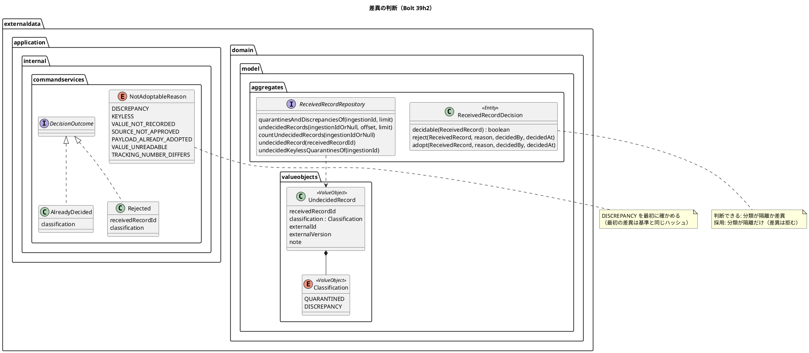
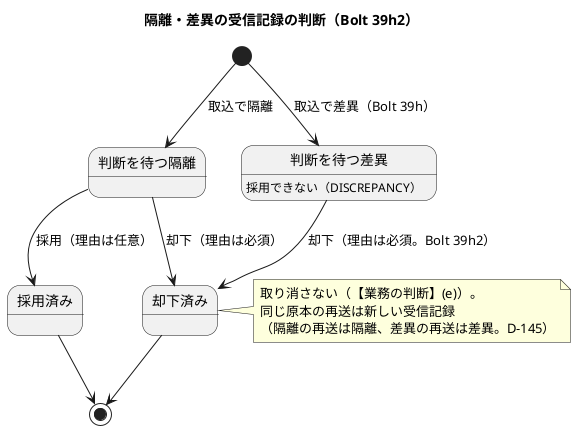
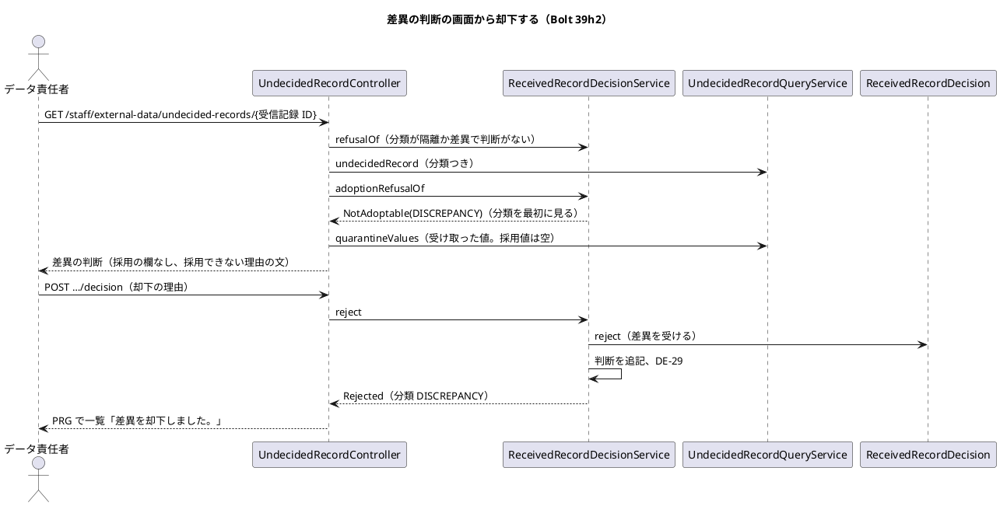
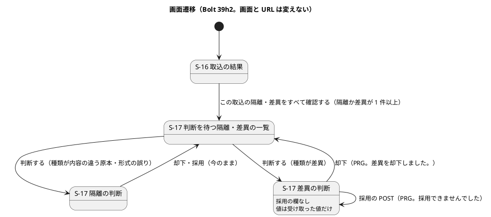
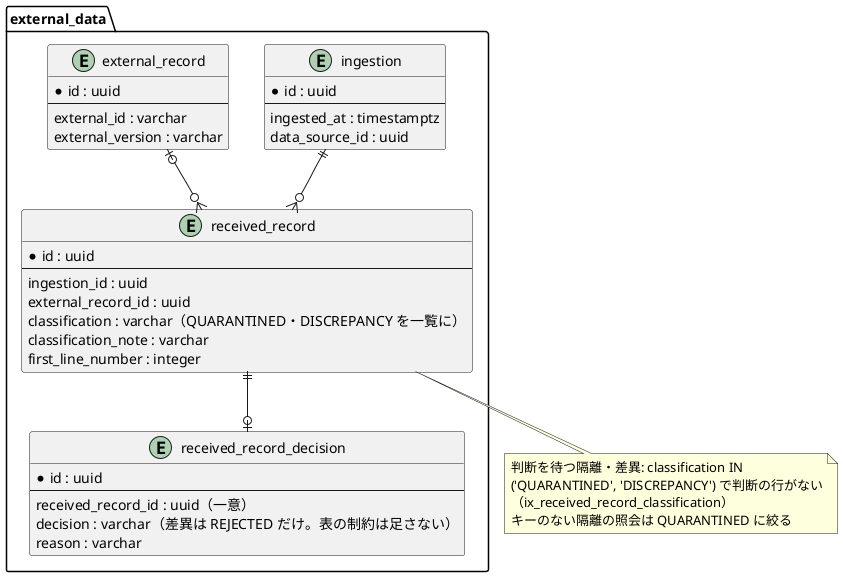

# Bolt 39h2 計画 - S-17 で差異を一覧に出して却下する

## 基本情報

| 項目 | 内容 |
| :--- | :--- |
| Bolt | 第 39h2 回（W7 の 36 本目。release_plan :984 の 39h2 の行。行の内容を正とする） |
| 状態 | 計画（**承認済み**。2026-11-12 に確認ポイント 1〜9 を推奨のとおり承認（【前の決定の変更】(28) を含む）。human:kakimomokuri。2026-11-12 に開始準備。2 つの整合性検証（`validating-iteration-plan`・`validating-design`）の指摘を反映した。下の「整合性検証の結果」） |
| 予定 | W7（2026-11-16 の週。前倒しで着手できる）。Bolt 39h の終了報告の承認（2026-11-12）の後に着手する。約 4 時間 05 分（約 245 分。目安の上限 T-250）の見込み（下の「ステップ計画」）。release_plan :984 の参考の 3 時間 30 分から、名前の見直しの範囲（下の決定 (2)）と、リンクと件数の文を見る既存のテスト（画面の層の 10 本の feature とステップ、コントローラーのテスト）の直しを数えて引き直した。`check`・`uiTest`・`manualScreenshots`・SonarQube・CI と承認の待ちを除く |
| アプローチ | **アウトサイドイン（S-17 から）**（release_plan :984・:893、development_strategy :350。前例 Bolt 39d2・39d3b）。状態の組み合わせの表を先に書く（T-182）。名前の見直しは振る舞いを変えない準備のリファクタリングとして Red の前に済ませ、コミットを分ける（帽子をかぶり分ける）。その後、画面の層のシナリオ → S-17 の画面（controller・テンプレート）→ 判断のサービスと結果の型 → 判断を待つ一覧の照会の順に内へ広げる |
| 対象 | (1) 判断を待つ一覧と件数に差異を足す（一覧の record・行の型・`Item`・SQL に分類を通す）、(2) `UndecidedQuarantine` の名前を「判断を待つ隔離・差異」に合わせて見直す（範囲は決定 (2)。Bolt 39h の終了報告の議題 4 の `quarantinedOf` を含む）、(3) 判断のファクトリーが差異を受け、採用は拒む（採用できない理由 `DISCREPANCY`）、(4) 判断の画面の見出し「差異の判断」・採用できない理由の文・却下の完了と判断済みの文（結果の型に分類を持たせる）、(5) 差異の判断の画面の受け取った値の示し方、(6) S-16 のリンク「この取込の隔離・差異をすべて確認する」、(7) マニュアル 12 章（12.2 と 12.1 のリンク）・用語集とキャプチャ |
| トレース | US-14 AC4・AC5、UC-15 5・3b（system_usecase :408・:527）、ED-INV-02・ED-INV-03（domain_model :1748）、W7 CP2（release_plan :914。【前の決定の変更】(27)）、台帳 D-144・D-145・D-146、S-16・S-17（ui_design :193〜:199・:1990〜:2253）、ADR-004（:134・:182）、[Bolt 39h 計画](bolt_39h_plan.md) の決定 (1)・(5)〜(7) と申し送り、[Bolt 39h 終了報告](bolt_39h_report.md) の議題 4・既知の課題・Try、[Bolt 39d 計画](bolt_39d_plan.md) の開始準備の決定 (4)・(5)（名前）（本計画の確認ポイントは「本計画 CP-n」、W7 の確認ポイントは「W7 CPn」と書き分ける） |
| GitHub | [#18](https://github.com/k2works/practical-domain-driven-design-in-enterpris-application/issues/18)（US-14。クローズは 39h4） |
| SP | 0（US-14 の 8 SP は #18 をクローズする 39h4 で数える。release_plan :984） |
| 承認ゲート | **ステップごとに止める**（release_plan :895「外部原本の取込（39〜39d4・39h〜39h3）は ステップごとに止める」。`/goal` の下でもステップのゲートを外さない）。確認必須のもの（業務の判断、前の決定の変更 (28)、名前の変更、新しいファイル）は本計画の確認ポイントにまとめ、計画の承認に含める。**データベースの承認ゲートには当たらない**（スキーマを変えない。決定 (7)）。認可は変えない（URL を足さない。判断の画面・却下・採用の URL と CSRF のフォームは今のまま）。外部連携は足さない。新しいドメインイベントは足さない（差異の却下も DE-29。決定 (6)）。新しいコンテキスト間の依存は足さない |

## Bolt ゴール

データ責任者が、取込で差異になった原本を S-17 の判断を待つ隔離・差異の一覧で隔離と並べて確かめ、判断の画面「差異の判断」で差異の理由の全文と受け取った値を読んで、理由を書いて却下できる（US-14 AC5 の確認、UC-15 5。【前の決定の変更】(27) のとおり差異は却下だけで、採用の欄は出ず、採用できない理由と次の道が示される）。S-16 の取込の結果からは「この取込の隔離・差異をすべて確認する」で、差異だけの取込でもその取込の判断を待つ隔離・差異を開ける。却下した差異は一覧から消え、同じ原本の再送は再び差異として一覧に戻る（D-145）。

## 状態の組み合わせ（行ごとにテストを 1 本。T-182）

行の番号はこの計画で 1 から振る。見本は、主要実績の情報源（提供元「運送会社A」）の外部 ID `MS-0001`、外部版「1」「2」、取得時刻 G1 < G2、追跡番号 CTA・CTB と、航海の情報源の外部 ID（= 航海番号）`V100`。差異は Bolt 39h の取込で作る（V2・G2 を採用した後の V1・G1 は版の逆転、V1・CTA を採用した後の V2・G2・CTB は既存の採用値との矛盾）。テストは新しいクラスは決定 (9)、既存のクラスは `@Nested class Bolt39h2_…`。期待値は、Red を書く前に決定の文から導けることを 1 行ずつ確かめた（Bolt 39g4 の Try）。どの入力も今の型で作れることを確かめた（Bolt 39g4b の Try。差異の受信記録は Bolt 39h の取込のサービスか、契約のテストの準備のメソッドで分類 `DISCREPANCY` を渡して作れる）。

| 行 | 状況 | 期待 | 確かめ方 |
| :--- | :--- | :--- | :--- |
| 1 | 判断できる受信記録と判断のファクトリー（パラメーター。分類 4 つ × 却下・採用）: (a) 採用、(b) 重複、(c) 隔離、(d) 差異 | 判断できるのは (c)(d)。却下は (c)(d) で作れる。採用は (c) だけで、(d) の採用は `IllegalArgumentException`（差異は採用しない。ファクトリーが守る。決定 (3)）。(a)(b) は却下も採用も拒む（今のまま） | `ReceivedRecordDecisionTest`（:74-90 の `@EnumSource` の期待が変わる）と `@Nested class Bolt39h2_…` |
| 2 | 採用できない理由の順（判断のサービスの `adoptionRefusalOf` と `adopt`）: (a) 最初の差異（受信記録のハッシュが外部原本の基準と同じ）、(b) 差異の再送（基準と違うハッシュ）、(c) 情報源が停止された差異、(d) 隔離の今の 6 つの理由（回帰） | (a)(b)(c) どれも `NotAdoptable(DISCREPANCY)`（分類を最初に見る。(a) を `PAYLOAD_ALREADY_ADOPTED` にしない。(c) を `SOURCE_NOT_APPROVED` にしない。決定 (3)）。`adopt` は判断も採用値もイベントも作らない。(d) は今のまま | `ReceivedRecordDecisionServiceTest` の `@Nested` |
| 3 | 差異の却下（判断のサービス）: (a) 判断を待つ差異を却下、(b) 判断済みの差異を却下、(c) 隔離を却下（回帰）、(d) 同時の却下に負けた差異 | (a) 判断 `REJECTED` を 1 つ、DE-29 を 1 つ（`decision` は `REJECTED`。DE-29 の形は変えない。決定 (6)）、結果は `Rejected`（受信記録 ID と分類 `DISCREPANCY`）。(b)(d) `AlreadyDecided`（分類 `DISCREPANCY`）。(c) `Rejected`（分類 `QUARANTINED`） | `ReceivedRecordDecisionServiceTest` の `@Nested` |
| 4 | 判断を待つ隔離・差異の一覧の照会（契約のテスト。メモリ・H2・PostgreSQL）: (a) 1 つの取込に隔離（4 行目）・差異（6 行目）・採用・重複、(b) (a) の差異を却下した後、(c) (b) の差異の原本を送り直した差異（D-145）、(d) 取込で絞る・絞らない、(e) 受信記録 ID で 1 件引く（差異・判断済みの差異・採用）、(f) 件数 | (a) 隔離と差異の 2 件を行の順に（並びは今の定めのまま。分類で分けない。決定 (4)）。行は分類（`QUARANTINED`・`DISCREPANCY`）を持つ。(b) 差異は出ない。(c) 送り直した差異だけが出る。(d) 今の絞り込みのまま。(e) 差異は分類 `DISCREPANCY` で返す。判断済みと採用は空。(f) 一覧と同じ定めで数える（差異を含む） | `ExternalDataRecordRepositoriesContract` の `@Nested`（`InMemory…`・`H2…`・PostgreSQL の実装のテスト） |
| 5 | キーのない隔離のまとめての却下の対象（回帰）: 取込に形式の誤り 2 件・内容の違う原本 1 件・差異 1 件 | 対象と件数は形式の誤りの 2 件だけ（差異は外部原本を持つので入らない。SQL は分類を隔離に絞ったまま。決定 (4)） | `ExternalDataRecordRepositoriesContract`（既存の組に差異の行を足す） |
| 6 | 一覧の行の不変条件（`UndecidedRecord`、旧 `UndecidedQuarantine`）: (a) 分類が採用・重複、(b) 差異で外部 ID・外部版がない、(c) 隔離で外部 ID・外部版がない（キーのない隔離）、(d) 外部 ID だけがある | (a) 拒む、(b) 拒む（差異は外部原本を持つ）、(c) 作れる（今のまま）、(d) 拒む（今のまま） | `UndecidedRecordTest`（新規。決定 (9)） |
| 7 | S-17 の一覧（コントローラー）: (a) 隔離と差異が 1 件ずつ、(b) 取込で絞る、(c) 0 件（絞らない・絞る）、(d) 差異の行の読み上げ | (a) 件数の文「判断を待つ隔離・差異 2 件（1〜2 件目を示しています）」、表の caption と領域の名前「判断を待つ隔離・差異」、列の見出し「隔離・差異の理由」、種類は差異が「差異」・隔離は今のまま。(b)「この取込の判断を待つ隔離・差異 2 件（…）」と「すべての取込の隔離・差異を見る」。(c)「判断を待つ隔離・差異はありません。」「この取込に判断を待つ隔離・差異はありません。」。ページ送りの `nav` の名前「判断を待つ隔離・差異のページ」。(d)「判断する（6 行目、MS-0001・1）」（今の形のまま） | `UndecidedRecordControllerTest` の `@Nested`（期待が変わる既存の組を直す） |
| 8 | 差異の判断の画面（GET）: (a) 版の逆転の差異（航海）、(b) 矛盾の差異（主要実績）、(c) 受け取った値を読めない差異、(d) 隔離の判断の画面（回帰） | (a)(b) 見出しと `title`「差異の判断」、種類「差異」、`dt`「差異の理由」と注記の全文、却下の欄（今の文・欄の id のまま）、採用の欄なし、採用できない理由の文（決定 (5) の `DISCREPANCY` の文）、値の領域は「受け取った値」だけ（「この外部版の採用値」の領域と同じ値の文を出さない。決定 (5)）。(c)「受け取った値」の領域に「値を読めませんでした。」（500 にしない）。(d) 見出し「隔離の判断」と `dt`「隔離の理由」と 2 つの値の領域のまま | `UndecidedRecordControllerTest`、`UndecidedRecordQueryServiceTest`（差異の受け取った値。採用値は空） |
| 9 | 判断の後の行き先と知らせ（POST）: (a) 差異を却下、(b) 判断済みの差異を却下、(c) 差異に採用を POST、(d) 差異に 1000 文字を超える採用の理由を POST、(e) 理由が空の却下、(f) 判断の画面を開いた後にほかの人が差異を却下（GET の着地） | (a) PRG で元の一覧に戻り「差異を却下しました。」。(b)(f)「この差異は判断済みです。」。(c)(d) 採用せず PRG で判断の画面に戻り、エラー要約「採用できませんでした」に `DISCREPANCY` の文（`#adoption-refusal` へのリンク。今の `NotAdoptable` の行き先のまま）。(e) 判断の画面に戻り「却下の理由を書いてください。」（今のまま）。隔離の知らせは「隔離を却下しました。」「この隔離は判断済みです。」のまま（回帰） | `UndecidedRecordControllerTest` の `@Nested` |
| 10 | S-16 の取込の結果のリンク: (a) 隔離 1 件・差異 1 件、(b) 差異だけ 1 件、(c) 隔離だけ 1 件、(d) 隔離・差異 0 件 | (a)(b)(c) 理由の領域の最後に「この取込の隔離・差異をすべて確認する」（`?ingestion=<取込 ID>`）。(b) は Bolt 39h では出なかった。(d) 領域もリンクも出ない | `ExternalDataIngestionControllerTest` の `@Nested`（期待が変わる既存の組を直す） |
| 11 | 監査（回帰）: 差異の却下がコミットした | 監査記録 `EXTERNAL_RECORD_DECIDED`（`decision=REJECTED`）を 1 件（対象は受信記録。差異であることは同じ受信記録の `EXTERNAL_RECORD_DISCREPANCY_FOUND` で読む。DE-29 の直列化の契約は変えない。決定 (6)） | `ExternalRecordAuditDeliveryIntegrationTest` の `@Nested`（配信まで。T-184） |
| 12 | 誤った入力と出口（回帰）: (a) UUID でない ID、(b) 採用・重複の受信記録の判断の画面、(c) 取込のない受信記録 | (a)(b)(c) 404（今のまま。差異は判断できる側に移るだけ） | `UndecidedRecordControllerTest`・`ReceivedRecordDecisionServiceTest` の既存の組（:297・:993 の「隔離でない受信記録」の見本が差異でないことを確かめる） |
| 13 | UI（データ責任者が航海 V100 の外部版 2（G2）を取り込んだ後に外部版 1（G1）のファイルを取り込み、取込の結果の「この取込の隔離・差異をすべて確認する」から S-17 を開き、差異の行の「判断する」から「差異の判断」を開いて、採用の欄がないことを確かめ、理由を書いて却下する） | 一覧に種類「差異」の行、判断の画面の見出し「差異の判断」と採用できない理由の文、却下の後に「差異を却下しました。」と「この取込に判断を待つ隔離・差異はありません。」。axe の違反 0。幅 320 px | `features/ui/reject_discrepancy_ui.feature`（新規）、タグ `@demo-bolt-39h2/reject-discrepancy` |
| 14 | 層の規則・用語の検査 | 名前を変えた型は今の層のまま（`UndecidedRecord` は `externaldata.domain.model.valueobjects` の `@ValueObject`）。`LivingGlossaryConsistencyTest` は `UndecidedRecord`・`UndecidedRecordPage`・`UndecidedRecordQueryService` の英語名と Javadoc の最初の語（「判断を待つ隔離・差異」…）を確かめる。`allowedDependencies` は変えない | `LayerArchitectureTest`・`DddAnnotationArchitectureTest`・`LivingGlossaryConsistencyTest`・`MapperSchemaArchitectureTest`・Modulith の検証（既存） |
| 15 | マニュアル | 12 章（12.2 と 12.1 のリンク。下の「入れるもの」）・付録 B・用語集と、第 12 章の変わったキャプチャが実装と一致する | ステップの突き合わせの記録（T-197・T-251）、`manualScreenshots` |
| 16 | 今の振る舞い | 下の「守る既存のテスト」が通る | 既存 |

### 守る既存のテスト（Red のテストを書く前に流すテストの一覧。T-217、Bolt 39g2 の Try）

- 外部データ: `ReceivedRecordDecisionTest`、`ReceivedRecordDecisionServiceTest`、`UndecidedRecordQueryServiceTest`、`UndecidedRecordControllerTest`、`ExternalDataIngestionControllerTest`、`IngestionSummaryQueryServiceTest`、`IngestionServiceTest`、`ClassificationTest`、`DiscrepancyRuleTest`、`ExternalDataRecordRepositoriesContract`・`AdoptedValueRepositoryContract` の実装のテスト（メモリ・H2・PostgreSQL）、`ExternalDataIngestionSecurityIntegrationTest`、`features/external_data/classify_discrepancies.feature`・`ingest_external_records.feature`・`quarantine_malformed_records.feature`、`features/ui/review_undecided_records_ui.feature`・`reject_quarantine_ui.feature`・`reject_keyless_quarantines_ui.feature`・`adopt_quarantine_ui.feature`・`compare_quarantine_values_ui.feature`・`resend_after_decision_ui.feature`・`adopted_voyage_reflected_ui.feature`・`adopted_milestone_reflected_ui.feature`・`discrepancy_ui.feature`（画面の層は Green の後の全件で流す。`uiTest` はシナリオを選んで流せない。39g3〜39h と同じ）
- 受け側と監査: `ExternalRecordAuditEventHandlerTest`・`AuditRecordTest`・`ExternalRecordAuditDeliveryIntegrationTest`・`DomainEventSerializationContractTest`
- 横断: `LayerArchitectureTest`、`DddAnnotationArchitectureTest`、`LivingGlossaryConsistencyTest`、`MapperSchemaArchitectureTest`、Modulith の検証
- **期待が変わる既存のテスト**（ステップ 2 で数えて記録する。行の期待として直し、「計画から変えたこと」にしない）: 結果の型 `Rejected`・`AlreadyDecided` の生成と比較（コンパイルで落ちる。`ReceivedRecordDecisionServiceTest` 7 か所・`UndecidedRecordControllerTest` 10 か所・`IngestionServiceTest`・`MyBatisConcurrentAdoptionIntegrationTest`・`MyBatisExternalDataRecordRepositoriesIntegrationTest`・`ExternalRecordAuditDeliveryIntegrationTest` 各 1 か所）、S-16 のリンクの文「この取込の隔離をすべて確認する」（テストの側で 46 か所。`ExternalDataIngestionControllerTest`・`UndecidedRecordUiSteps` と画面の層の feature 8 本・`manual_screenshots.feature`）、S-17 の件数・0 件・絞らない一覧へのリンクの文（`UndecidedRecordControllerTest`・`UndecidedRecordUiSteps`・`RejectQuarantineUiSteps` と feature。「判断を待つ隔離」はテストの側で 120 か所あり、名前・コメントと文の期待が混ざるので、ステップ 2 で文の期待だけを数える）、まとめての却下の画面の「内容の違う原本は含みません。」（`UndecidedRecordControllerTest`・`RejectKeylessQuarantinesUiSteps`）、`ReceivedRecordDecisionTest` :74-90（`@EnumSource` で差異が判断できる側に移る）。`ReceivedRecordDecisionServiceTest` :297・:993 の「隔離でない受信記録」は見本の分類が採用か重複かを確かめ、差異なら見本を直す

## 開始準備の決定（推奨を 1 つに決めて書いた。承認済み）

(1) **範囲と見積り**（本計画 CP-1）: release_plan :984 の 39h2 の行（判断を待つ一覧と件数に差異、一覧の record・行の型・照会に分類、`UndecidedQuarantine` の名前の見直し、判断の画面の見出し・採用できない理由 `DISCREPANCY`・却下の完了と判断済みの文、受け取った値の示し方、S-16 のリンク、マニュアル 12.2）をすべて入れ、分けない。コードで確かめると、名前の見直し（決定 (2)。型・照会・SQL の id で約 190 か所（40+5+36+33+45+26+6）。IDE の rename で機械的に直す）、判断の規則と結果の型（3 ファイル）、照会（SQL の断片・行の型・record・`Item`・メモリの実装・契約のテスト）、画面（controller・テンプレート 4 つ）、リンクと件数の文を見る既存のテスト（feature 10 本・ステップ 3 つ・コントローラーのテスト 2 つ）、マニュアル 12 章の約 20 か所と用語集・キャプチャ 5 枚が要り、約 245 分になる（目安の上限 T-250）。
- 分けない理由: どの部分も「差異を一覧に出して却下する」の 1 つの縦の流れに要る（一覧だけでは却下できず、却下だけでは差異に届かない）。名前の見直しは振る舞いを変えないので、ステップ 3 で先に済ませてコミットを分ける
- 超えそうなときは、行 13 の動画（−5 分）を 39h3 に送る。マニュアルとキャプチャは送らない
- 比べた案: (i) **分けない（推奨）**。(ii) 名前の見直しを別の Bolt（39h2a）に分ける（39h2 は約 220 分で余裕ができるが、新しい語の一覧に古い名前の型が残る Bolt ができる。名前は IDE で機械的に直せるので、分ける利得が小さい）。(iii) S-16 のリンクの文を 39h3 に送る（差異だけの取込で S-17 への入口がない状態が続く。行 10 (b)）
- **ほかへ送るもの**: 判断の画面に「この外部 ID の採用値」を示すこと・古い外部版の隔離の採用の警告・S-17 の絞らない一覧から取込で絞る入口は 39h3（release_plan :985）。判断の画面の値の型 `QuarantineValues`・`QuarantineValueViews`・フラグメント `quarantine-values` の名前は 39h3 で値の領域を組み直すときに一緒に見直す（決定 (2)）。性能テストの複数の外部版の組は 39h4 か W7 の締め（Bolt 39h の終了報告の議題 2）

(2) **名前の見直しの範囲**（本計画 CP-2、【前の決定の変更】(28)）: 意味が「判断を待つ隔離・差異」に広がる一覧の読みの型と照会だけを、既にある `UndecidedRecordController`・`UndecidedRecordQueryService`・`UndecidedRecordPage`・URL `undecided-records` の語にそろえる。
- 型と照会: `UndecidedQuarantine` → `UndecidedRecord`（判断を待つ隔離・差異）、`ReceivedRecordMapper.UndecidedQuarantineRow` → `UndecidedRecordRow`、ポートの `undecidedQuarantines` → `undecidedRecords`、`countUndecidedQuarantines` → `countUndecidedRecords`、`undecidedQuarantine(id)` → `undecidedRecord(id)`、照会のサービスの `undecidedQuarantine(id)` → `undecidedRecord(id)`、SQL の id と断片（`undecidedQuarantineRow`・`undecidedQuarantineSource`・`undecidedQuarantines`・`countUndecidedQuarantines`・`undecidedQuarantine`）も同じ語に
- 取込の隔離と差異を読む照会（Bolt 39h の終了報告の議題 4）: `quarantinedOf` → `quarantinesAndDiscrepanciesOf`（S-16 の「隔離・差異の理由」。差異も返すのに隔離の名前のまま）
- 変えないもの: キーのない隔離だけを読む `undecidedKeylessQuarantinesOf`・`countUndecidedKeylessQuarantines`（意味は隔離のまま）。判断の画面の値の `QuarantineValues`・`QuarantineValueViews`・`quarantineValues(item)`・フラグメント `quarantine-values`（約 120 か所。39h3 で値の領域に「この外部 ID の採用値」を足して組み直すので、そのときに 1 度で見直す。39h2 では Javadoc に「隔離・差異の判断の画面の値」と書く）
- テストのクラス名・`@Nested` の名前・契約のテストのメソッド名も同じ語に直す。英語名は用語集（domain_model :381・:382・:385）と Javadoc の最初の語と一緒に直す（`LivingGlossaryConsistencyTest`）
- **【前の決定の変更】(28)**: Bolt 39d の開始準備の決定 (4)・(5)（照会専用の record を `UndecidedQuarantine` とし、「Review」を使わない）の名前を `UndecidedRecord` に改める（「Review」を使わない決まりは変えない）。差異を同じ一覧に出すので、隔離の名前の型に差異が入る
- 比べた案: (i) **一覧の読みの型と照会だけ（推奨）**。(ii) 判断の画面の値の型まで含めて全部（約 300 か所。39h3 で組み直す値の型を 2 度直す）。(iii) 名前を変えず Javadoc だけ直す（型の名前と用語集の語が食い違い、Bolt 39h の終了報告の議題 4 が残る）。英語名の比べた案: (a) **`UndecidedRecord`（推奨。既にある画面・照会のサービス・URL の語）**、(b) `UndecidedQuarantineOrDiscrepancy`（長く、ほかの型の語とそろわない）、(c) `PendingReceivedRecord`（「Pending」は Bolt 33 以降の通知の PENDING と読み違える）

(3) **差異は判断できるが採用できない**（本計画 CP-3、台帳 D-144（仮）の実装）: 判断できる受信記録（`ReceivedRecordDecision.decidable`）を「分類が隔離か差異」に広げ、却下のファクトリーは差異を受ける。採用のファクトリーは分類が隔離でなければ拒む（差異は採用しない規則をドメインに置く。判断のサービスの定めを通らずに呼ばれても採用値を作らない）。判断のサービスの採用できる隔離の定め（`adoptionCheckOf`）は、**分類を最初に見て** 差異なら `NotAdoptableReason.DISCREPANCY` を返す。
- 最初に見る理由: 最初に差異にした原本は外部原本の基準と同じハッシュなので、今の順（キーのない隔離 → 値の列 → 情報源 → 同じ原本 → 読めない値 → 追跡番号）だと `PAYLOAD_ALREADY_ADOPTED`（「同じ原本がすでに採用されている」。差異の原本は採用されていない）になり、情報源が停止されていれば `SOURCE_NOT_APPROVED`（承認し直せば採用できると読める）になる。差異はどの状態でも採用できないので、分類の理由を先に出す（行 2）
- 比べた案: (i) **分類を最初に見る（推奨）**。(ii) 今の順の最後に足す（最初の差異が誤った理由になる）。(iii) 判断の画面で差異のときだけ定めを呼ばない（GET と POST の定めが 2 つになる。Bolt 39d3b の開始準備の決定 (8) に反する）

(4) **一覧の並びと絞り込み**（本計画 CP-4、【業務の判断】(be)、台帳 D-147（仮））: 判断を待つ隔離・差異は、分類が隔離か差異で、受信記録の判断の行がない取込の受信記録。並びは今の定め（取込の新しい順、同じ時刻は取込 ID の順、同じ取込はファイルの誤りを先に行の範囲の始まりの順、受信記録 ID の順）のまま、隔離と差異を混ぜて行の順に並べる（S-16 の「隔離・差異の理由」と同じ順。取込のファイルを行の順に読み合わせられる）。件数も同じ定めで数える。種類の列は差異を「差異」とし、理由（版の逆転・既存の採用値との矛盾）は「隔離・差異の理由」の列の注記で示す。分類で絞る操作は足さない（39h3 の取込で絞る入口と合わせて要るかを確かめる）。
- SQL: 判断を待つ一覧の断片（ReceivedRecordMapper.xml :72-81）の分類の条件を `IN ('QUARANTINED', 'DISCREPANCY')` にし、行に分類の列を足す。キーのない隔離の 2 つの照会（:116-129）はこの断片を使っているので、分類を隔離に絞る条件を照会の側に足す（差異は外部原本を持つので今でも入らないが、意味を SQL に書く。行 5）。索引は `ix_received_record_classification`（分類の 1 列）と `ix_received_record_ingestion` のまま
- 比べた案: (i) **混ぜて行の順（推奨）**。(ii) 差異を隔離の後にまとめる（同じ取込の行の順が 2 つに割れ、S-16 の理由の順と食い違う）。(iii) 差異を別の一覧の画面にする（画面と URL が増え、S-17 の「隔離・差異の確認」の名前とずれる）

(5) **文と、差異の判断の画面の受け取った値の示し方**（本計画 CP-5、【業務の判断】(bf)、台帳 D-148（仮））:
- S-17 の一覧: 件数「判断を待つ隔離・差異 N 件（M〜L 件目を示しています）」、取込で絞ると「この取込の判断を待つ隔離・差異 N 件（…）」、0 件は「判断を待つ隔離・差異はありません。」「この取込に判断を待つ隔離・差異はありません。」、絞らない一覧へのリンク「すべての取込の隔離・差異を見る」、表の caption・領域の名前「判断を待つ隔離・差異」、列の見出し「隔離・差異の理由」、ページ送りの名前「判断を待つ隔離・差異のページ」、種類「差異」。まとめての却下の画面の「内容の違う原本は含みません。一覧で 1 件ずつ判断してください。」は「内容の違う原本と差異は含みません。一覧で 1 件ずつ判断してください。」に
- 判断の画面: 見出しと `title` は隔離が「隔離の判断」、差異が「差異の判断」（エラー要約のときの `title` も「却下できませんでした - 差異の判断 - cargo-tracker」「採用できませんでした - 差異の判断 - cargo-tracker」）、`dt` は隔離が「隔離の理由」、差異が「差異の理由」
- 採用できない理由 `DISCREPANCY` の文（固定の文。取込ファイルから来た値を含まない）: 「差異は採用できません。正しい値を使うときは、提供元に後で取得した新しい外部版で送り直してもらってください（追跡番号の違う実績は、追跡管理者に正しい追跡記録へ手入力してもらってください）。」（D-144 の次の道。版の逆転と矛盾で文を分けない。理由は「差異の理由」の注記で読める）
- 却下の完了「差異を却下しました。」、判断済み「この差異は判断済みです。」（隔離は今の「隔離を却下しました。」「この隔離は判断済みです。」）。却下の欄の「却下すると取り消せません。誤って却下したときは、提供元に同じ原本を送り直してもらってください。」は差異でもそのまま（同じ原本の再送は再び差異で一覧に戻る。D-145）
- S-16 のリンク「この取込の隔離・差異をすべて確認する」（隔離か差異が 1 件以上のとき。D-146 の残り）
- **受け取った値の示し方**: 差異の判断の画面には「受け取った値」の領域だけを示し、「この外部版の採用値」の領域と同じ値の文を出さない。差異の外部原本（その外部版）は採用値を持たない（Bolt 39h の決定 (6)。差異で作った外部原本の基準は採用されていない payload）ので、「この外部版の採用値はありません。」が必ず出て、比べる相手がないと読める。比べた相手の外部版は差異の理由の注記にある。この外部 ID の採用値を値で並べるのは 39h3
- 比べた案（値）: (i) **受け取った値だけ（推奨）**。(ii) 今の 2 つの領域のまま（「この外部版の採用値はありません。」で比べる相手がないと読み違える）。(iii) 39h2 でこの外部 ID の採用値を示す（39h3 の範囲。比べ方と警告を一緒に決める）
- 比べた案（採用できない理由の文）: (i) **1 つの文（推奨）**。(ii) 逆転と矛盾で文を分ける（採用できない理由の型に差異の理由を持たせることになり、注記と二重になる）

(6) **結果の型と監査**（本計画 CP-6）: 却下の結果 `DecisionOutcome.Rejected` と判断済み `DecisionOutcome.AlreadyDecided` に受信記録の分類を持たせ、画面の層が分類で文を選ぶ（文は画面の層の定数。分類のすべてに文がある `switch`。T-240）。判断済みは、判断のサービスが受信記録を読んだ後に返すので分類が分かる（`AlreadyDecided` を作る箇所は判断のサービスの 3 か所 — `adopt` と `reject` の判断の追記に負けたとき（:130・:242）と判断できる受信記録の定め `refusalOf(ReceivedRecord)`（:319）— と controller の 1 か所（:383）。4 か所すべてに分類を渡す。作る箇所が 1 つでも残るとコンパイルで落ちる）。判断の画面の GET で行き先を決めた後に判断されたとき（UndecidedRecordController.java :380-384。今は分類を知らずに `AlreadyDecided` を作る）は、判断のサービスの `refusalOf` を読み直してその結果（`AlreadyDecided` と分類）で戻る（届かない分岐を作らない。読み直して空のときは起きないので `orElseThrow`。Bolt 39g4b の議題 3）。DE-29（`ReceivedRecordDecided`）には分類を足さない（v1 の直列化の契約を変えない。差異の却下かは、同じ受信記録の DE-31 の監査 `EXTERNAL_RECORD_DISCREPANCY_FOUND` で読める。Bolt 39d2b の決定と同じ考え方）。
- 比べた案: (i) **結果の型に分類を持たせ、DE-29 は変えない（推奨）**。(ii) DE-29 に分類を足す（直列化の契約の版が上がり、監査の要約も変わる。監査で差異の却下を数える要件はない）。(iii) 文を「隔離・差異を却下しました。」の 1 つにする（どちらを却下したか読めない。release_plan :984 の「却下の完了と判断済みの文（結果の型に分類を持たせる）」に反する）

(7) **スキーマを変えない**（本計画 CP-7。データベースの承認ゲートに当たらない理由）: 分類の CHECK は Bolt 39a3 から `DISCREPANCY` を受け、差異の受信記録は Bolt 39h で書いている。受信記録の判断の表（`received_record_decision`）は分類を持たず、判断と分類の整合を表の制約で守らない（data_model :1229。アプリケーションで判定する）ので、差異の判断の行もそのまま書ける。判断を待つ一覧の照会は分類の 1 列の索引 `ix_received_record_classification`（V20261103100000 :94）と取込の索引で、`IN` の 2 つの値でも今の形で引ける。マイグレーションを足さない。

(8) **差異のまとめての却下は作らない**（本計画 CP-8、【業務の判断】(bg)、台帳 D-149（仮））: 古いファイルを丸ごと送り直されると、差異が 1 つの取込で数千件になりうる（1 万件の取込のすべてが版の逆転）。39h2 では 1 件ずつの却下だけを作り、差異のまとめての却下（キーのない隔離の 39d2b と同じ形）は作らない。業務で起きる頻度を Release 1.0 のパイロットの前に業務責任者とデータ責任者に確かめ、要るなら W7 の締めか Release 1.1 の Bolt で足す。
- 理由: 見積りが上限に近く、頻度が分からない。差異は業務で使う値を変えないので、一覧に残っても経路設計と追跡は誤らない（一覧の件数が増えるだけ）
- 比べた案: (i) **作らず、パイロットの前に確かめる（推奨）**。(ii) 39h2 で作る（約 60 分増えて半日を超える）。(iii) 39h2 から分けて 39h2b を足す（頻度が分からないうちに Bolt を増やす）

(9) **名前と層、新しいファイル**（第 3 章、CLAUDE.md。T-246。`apps/cargo-tracker/src` で `UndecidedRecord`（`UndecidedRecordPage`・`UndecidedRecordController`・`UndecidedRecordQueryService`・`UndecidedRecordUiSteps` の部分を除く）・`UndecidedRecordRow`・`undecidedRecords`・`countUndecidedRecords`・`quarantinesAndDiscrepanciesOf`・`NotAdoptableReason.DISCREPANCY`・`Bolt39h2`・`demo-bolt-39h2` を検索し、ないことを確かめた）:
- 名前を変えるもの: 決定 (2)
- 直すもの: `ReceivedRecordDecision`（`decidable`、採用のファクトリー）、`DecisionOutcome`（`Rejected`・`AlreadyDecided` の分類、`NotAdoptableReason.DISCREPANCY`、`NotDecidable` の Javadoc）、`ReceivedRecordDecisionService`（`adoptionCheckOf` の最初、`refusalOf`、結果に分類）、`UndecidedRecord`（分類の項目と不変条件）、`ReceivedRecordRepository` と MyBatis（`ReceivedRecordMapper` の Java と XML :50・:57-129）・メモリの実装、`UndecidedRecordPage.Item`（分類）、`UndecidedRecordQueryService`（`quarantineValues` の分類の絞り :78 に差異）、`UndecidedRecordController`（文・種類・見出し・知らせ・採用できない理由・GET の着地）、テンプレート `externaldata/undecided-records/index.html`・`decision.html`・`keyless-rejection.html` と `externaldata/ingestions/result.html`（:68 のリンクの文と条件）、`ExternalDataIngestionController`（リンクの条件を画面に渡すなら）、`ExternalDataRecordRepositoriesContract` の準備のメソッド、画面の層のステップ（`UndecidedRecordUiSteps`・`RejectQuarantineUiSteps`・`RejectKeylessQuarantinesUiSteps`）、`manual_screenshots.feature`
- 新しいファイル: `UndecidedRecordTest`（行 6）、受入シナリオ `features/ui/reject_discrepancy_ui.feature`（行 13）、タグ `@demo-bolt-39h2/reject-discrepancy`、キャプチャ `12-undecided-record-discrepancy`（差異の判断の画面）、本計画と終了報告、動画。`UndecidedQuarantine.java` は `UndecidedRecord.java` に名前を変える（ファイルの移動）
- 層: 新しいコンテキスト間の依存はない。共有カーネルは変えない。**規則の例外は要らない見込み**で、当たったら置き場所を動かさず止めて諮る（T-125）

### 前の Bolt から引き継いだもの

| 出典 | 内容 | この計画 |
| :--- | :--- | :--- |
| release_plan :984（39h2 の行） | 判断を待つ一覧と件数に差異、分類を通す、名前の見直し、判断の画面の見出し・採用できない理由・却下の完了と判断済みの文、受け取った値の示し方、S-16 のリンク、マニュアル 12.2 | 決定 (1)〜(6)、行 1〜15 |
| [Bolt 39h 計画](bolt_39h_plan.md) の申し送り（39h2） | 一覧の record・行の型・`Item`・SQL :75 に分類、判断のファクトリー、`UndecidedRecordController` :58・:62・:77 の文、`ReceivedRecordDecisionTest` :74-90・`ReceivedRecordDecisionServiceTest` :287 の期待、マニュアル 12.2・:444 | 決定 (2)〜(5)、行 1〜9、守る既存のテストの「期待が変わる」 |
| [Bolt 39h 終了報告](bolt_39h_report.md) の議題 4 | `quarantinedOf` が差異も返すが名前を変えていない | 決定 (2)（`quarantinesAndDiscrepanciesOf`） |
| Bolt 39h の決定 (5)・(6)、【前の決定の変更】(27)、台帳 D-144・D-145 | 差異は却下だけ、差異の再送は再び差異 | 決定 (3)、行 1〜4 (c) |
| 台帳 D-146 | S-16 のリンクの文は 39h2 で直す | 決定 (5)、行 10 |
| Bolt 39d の決定 (4)・(5) | 照会専用の record の名前 `UndecidedQuarantine`、「Review」を使わない | 決定 (2)、【前の決定の変更】(28) |
| Bolt 39d3b の決定 (8)、Bolt 39d3b2 の決定 (5) | 採用の欄は判断のサービスの定めだけで決める。採用できない理由は画面の層の定数の文 | 決定 (3)・(5) |
| Bolt 39d2b の決定 | DE-29 の直列化の契約を変えない | 決定 (6) |
| Bolt 39h の Try | 確かめのつもりのコマンドも標準入力につながる形でないかを見る。変異のスクリプトは本番の前に 1 つだけ流して起動を確かめる。見出しや語を変えるときは、その語を参照する文を検索して決定の一覧と突き合わせる | 規律、ステップ 10、ステップ 1・3（「判断を待つ隔離」「この取込の隔離をすべて確認する」「隔離の理由」「隔離の判断」を検索する） |
| Bolt 39h の Keep | ステップ 1 を先にコミットしてからステップ 2 に入る。設計の文書とマニュアルの直しをサブエージェントに任せるときは名前と実装の文を先に渡す | ステップ 1、ステップ 9（決定 (2)・(5) の名前と文を渡す） |
| Bolt 39g4b の議題 3 | 届かない分岐を作らない | 決定 (6)（GET の着地は読み直して `orElseThrow`） |

### 開始準備で確かめたこと（作業ツリーの `apps/cargo-tracker/src` で読んだ）

- **判断の規則**: `ReceivedRecordDecision.decidable`（:48-49）は隔離だけ。却下と採用のファクトリーは同じ `decide`（:80-94）で `decidable` を確かめる
- **採用できる隔離の定め**: `ReceivedRecordDecisionService.adoptionCheckOf`（:157-184）はキーのない隔離 → 値の列 → 情報源 → 同じ原本（:173。基準のハッシュと同じ）→ 読めない値 → 追跡番号の順。最初に差異にした原本は外部原本の基準と同じハッシュ（Bolt 39h の決定 (5)）なので、今の順では `PAYLOAD_ALREADY_ADOPTED` になる
- **結果の型**: `DecisionOutcome.Rejected`（:17）は受信記録 ID だけ、`AlreadyDecided`（:81）は項目を持たない。`NotAdoptableReason`（:56-69）は 6 つ。controller の知らせは固定の文（UndecidedRecordController.java :77-80・:442-449）、GET の着地は分類を知らずに `AlreadyDecided` を作る（:380-384）
- **一覧の照会**: 判断を待つ一覧の断片（ReceivedRecordMapper.xml :72-81）は `r.classification = 'QUARANTINED'`。キーのない隔離の 2 つの照会（:116-129）も同じ断片に `external_record_id IS NULL` を足して使う。行の型（:57-70）と `UndecidedQuarantine`（:23-31）・`UndecidedRecordPage.Item` は分類を持たない。種類は `keyless` だけで決める（UndecidedRecordController.java :403・:472）
- **受け取った値**: `UndecidedRecordQueryService.quarantineValues`（:71-80）は分類が隔離の受信記録だけに値を返す。判断の画面は値があれば 2 つの領域を出す（decision.html の `th:block th:if="${receivedValues}"`）
- **S-16 のリンク**: `result.html` :68 は `summary.quarantinedCount() > 0` のときだけ「この取込の隔離をすべて確認する」。理由の領域は隔離と差異の合計で出る（:61）
- **画面の文**: S-17 の一覧の見出しと `title` は既に「隔離・差異の確認」。caption「判断を待つ隔離」、列「隔離の理由」、`nav` の名前「判断を待つ隔離のページ」、判断の画面の見出し「隔離の判断」、`dt`「隔離の理由」
- **監査**: DE-29 の監査（ExternalRecordAuditEventHandler.java :151-167）は分類を読まない。差異の却下も `EXTERNAL_RECORD_DECIDED`
- **スキーマ**: `ix_received_record_classification` は分類の 1 列（V20261103100000 :94）。受信記録の判断の表は分類を持たない
- **名前の数**: `UndecidedQuarantine` 40 か所（7 ファイル）、`UndecidedQuarantineRow` 5、`undecidedQuarantines` 36、`countUndecidedQuarantines` 33、`undecidedQuarantine` 45、`quarantinedOf` 26、`undecidedQuarantineSource` 6。`QuarantineValues` 93・`quarantineValues` 22・`QuarantineValueViews` 8（39h3 へ）
- **テストの側の文**: 「この取込の隔離をすべて確認する」46 か所、「判断を待つ隔離」120 か所、「すべての取込の隔離を見る」9、「隔離を却下しました」9、「この隔離は判断済みです」4、「内容の違う原本は含みません」2
- **キャプチャ**: 第 12 章の 8 枚のうち、変わるのは `12-ingestion-result`・`12-ingestion-review`（リンクの文）、`12-undecided-records`（件数の文・caption・列の見出し）、`12-undecided-records-keyless-rejection`（含まないものの文）の 4 枚。差異の判断の画面の 1 枚を足す

## 業務の判断の記録（本計画 CP-4・CP-5・CP-8。仮。パイロットの前に業務責任者とデータ責任者に確かめる）

| 判断 | 推奨 | 理由 |
| :--- | :--- | :--- |
| (be) 判断を待つ隔離・差異の一覧 | 隔離と差異を混ぜて今の並び（取込の新しい順・ファイルの行の順）に出し、同じ定めで数える。種類は「差異」、理由は注記。分類で絞る操作は足さない | S-16 の「隔離・差異の理由」と同じ順で、取込のファイルと読み合わせられる |
| (bf) 差異の判断の画面 | 見出し「差異の判断」、`dt`「差異の理由」、採用の欄なし、採用できない理由の 1 つの文、値の領域は「受け取った値」だけ。却下・判断済みの文は「差異を却下しました。」「この差異は判断済みです。」 | 差異の外部版は採用値を持たないので、「この外部版の採用値はありません。」は比べる相手がないと読み違える。この外部 ID の採用値は 39h3 |
| (bg) 差異のまとめての却下 | Release 1.0 の 39h2 では作らない。古いファイルを丸ごと送り直されたときの頻度を確かめ、要るなら後で足す | 差異は業務で使う値を変えない。頻度が分からない |

## スコープ

### 入れるもの

- 行 1〜16。決定 (2)〜(7)・(9) の実装と文書
- マニュアル 12 章: 冒頭の説明と画面の一覧（:4・:14・:20・:21・:24「差異は今は隔離・差異の確認の一覧に出ません」を消す）、12.1 のリンク（:90 の ⑧ の文と「差異だけの取込では示されません」を消す、:100 の分類の表の差異の「どうすればよいか」、:118 の要確認の ⑤、:153 の残りの差異の理由を一覧で確かめられること）、12.2（:206〜:477。この画面でできること・画面の開き方・画面の説明の ①〜⑥ と図の説明・操作手順・一覧の読み方に種類「差異」・判断を待つ隔離・差異がないとき・差異を却下する手順（新しい小節「差異を却下する」。差異の判断の画面の図と ① 〜の説明、採用の欄が出ないこと、採用できない理由の文、正しい値の次の道）・「採用の欄が出ない隔離」に差異・まとめての却下の :422「一覧には内容の違う原本と差異が残り」・直して送り直すときの表に「却下した差異の原本を送り直した行は再び差異」・注意・補足の :461・:472・:474）。付録 B（差異の判断の画面の採用できない理由の文）。用語集（「判断を待つ隔離」（:83）を「判断を待つ隔離・差異」に、「却下（隔離）」（:86）に差異、「差異の判断」）。第 12 章のキャプチャ（変わる 4 枚と足す 1 枚。`manualScreenshots` の差分を確かめ、変わった分だけ残す）、動画 `@demo-bolt-39h2/reject-discrepancy`
- 台帳 D-147〜D-149（仮。本計画の開始準備で足す）、D-144・D-146 の注、【前の決定の変更】(28)

### 入れないもの

- 判断の画面で外部版をまたいで値を比べること（この外部 ID の採用値）と、古い外部版の隔離の採用の警告、S-17 の絞らない一覧から取込で絞る入口（39h3）
- 判断の画面の値の型（`QuarantineValues`・`QuarantineValueViews`・フラグメント）の名前の見直し（39h3。決定 (2)）
- 差異の採用（決定 (3)。Release 1.0 では作らない）、差異のまとめての却下（決定 (8)）、分類で絞る操作（決定 (4)）
- G-06、受入条件の照合の表、W7 のデモの動画、#18 のクローズ、性能テストの複数の外部版の組（39h4・W7 の締め）
- DE-29 の契約の変更（決定 (6)）

### 申し送り

| 送り先 | 課題 |
| :--- | :--- |
| 39h3 | 判断の画面に「この外部 ID の採用値」（外部版・取得時刻・値）を示し、差異の判断の画面にも同じ領域を出すか（決定 (5) の受け取った値だけの画面に足す）。古い外部版の隔離の採用の警告。S-17 の絞らない一覧から取込で絞る入口（分類で絞る操作が要るかも合わせて確かめる。決定 (4)）。`QuarantineValues`・`QuarantineValueViews`・フラグメント `quarantine-values` の名前 |
| W7 の締め・Release 1.0 のパイロットの前 | 差異のまとめての却下の要否（台帳 D-149）。業務の判断 (be)〜(bg) を業務責任者とデータ責任者に確かめる（台帳 D-147〜D-149） |
| 39h4 | 受入条件の照合の表で、US-14 AC5 の「差異と採否を確認する」（UC-15 5）を 39h2 の却下だけで照合する（【前の決定の変更】(27)） |

### 設計文書に直す箇所（ステップ 1。「判断を待つ隔離」「UndecidedQuarantine」「quarantinedOf」「39h2」「この取込の隔離をすべて確認する」「隔離の判断」「隔離の理由」で検索して確かめる）

- domain_model:
  - 用語の表: 「受信記録の判断」（:358。差異を却下のファクトリーに足し、採用のファクトリーは差異を拒むことを「作った」に）、「受信記録のリポジトリ」（:368。名前の変わった照会）、「判断を待つ隔離」（:381）を「判断を待つ隔離・差異 | UndecidedRecord」に（分類の項目、【前の決定の変更】(28)）、「判断を待つ隔離の照会」（:382）・「判断を待つ隔離の一覧の頁」（:385）を「判断を待つ隔離・差異の…」に、`Item` の分類
  - 集約の表の受信記録の判断（:1753）、受信記録の判断の節（:1764）、「Bolt 39h で決めたこと」（:1776）の「39h2」を作ったことに、受信記録の判断の状態遷移図（:1778-1790）に差異の遷移（取込で差異 → 判断を待つ隔離・差異 → 却下済み。差異から採用済みへの遷移はない）
- data_model: :1229 の「判断は隔離・差異の受信記録だけに付く」に「差異は却下だけ（Bolt 39h2）」
- ui_design: 画面一覧の S-16・S-17（:141・:142）、URL の表の S-16 の結果（:193 のリンクの文と条件）、S-17 の一覧（:194）・判断の画面（:195。見出し・`dt`・採用できない理由 `DISCREPANCY`・値の領域）・却下（:196。知らせ）・採用（:197。差異は `NotAdoptable`）・まとめての却下の画面（:198。含まないものの文）、:74・:1819・:1992 の「39h2」、S-17 のワイヤーフレーム（:2008 の一覧に差異の行、差異の判断の画面を 1 枚足す）、画面遷移図（:519〜:522）
- test_strategy: US-14 の行（:603）に 39h2 の確かめ方（判断の規則・判断のサービス・照会の契約・画面・画面の層のシナリオ・監査）
- ADR-004: :134 の「差異は 39h で足す」と :182 の「39h2 で作る」を作ったことに、「2026-11-12（W7、Bolt 39h2）」の改訂の経緯（判断を待つ隔離・差異の照会の名前 `UndecidedRecord`、差異は判断できるが採用できない）。:129 の `UndecidedQuarantine` は経緯なので残し、名前を変えたことを足す。決定は変えない
- system_usecase :408（UC-15 5。差異は S-17 で却下だけ。Bolt 39h2）・:527 の S-17 の一覧の種類に「差異」
- user_story: US-14 の AC5 の注（:614）に「差異は S-17 で却下だけ（Bolt 39h2）」
- release_plan: 39h2 の行（決めたこと、引き直した見積り、計画へのリンク）、D-147〜D-149（仮）、D-144・D-146 の注、【前の決定の変更】(28)
- コードの Javadoc とコメント: `ReceivedRecordDecision`（:13-17・:47 の「差異は 39h で足す」）、`DecisionOutcome`（:77 の `NotDecidable`）、`ReceivedRecordRepository`（:22-50）、`UndecidedRecordQueryService`（:25-33・:59-69）、`UndecidedRecordPage`、`UndecidedRecordController`（:34-47）、テンプレートのコメント（index.html の「差異の行は 39h で足す」、result.html :14-16）、`QuarantineValues` の Javadoc（隔離・差異の判断の画面の値）
- マニュアル（ステップ 9）: 上の「入れるもの」の箇所

## 設計（この Bolt の範囲）

画面と URL は増やさない（S-17 の一覧・判断の画面の文と中身、S-16 のリンクの文と条件が変わるだけ）。データモデルは変えない（ER 図は使う表と照会の条件を示す）。

### ドメインモデル図（外部データの変わる部分）

### 受信記録の判断の状態遷移図

### 差異を却下する流れ

### 画面遷移図

### ER 図（使う表。スキーマは変えない）

## ステップ計画（各ステップの後に止める。release_plan :895）

| # | ステップ | ゲート | 分 |
| :--- | :--- | :--- | ---: |
| 1 | 設計文書を直す（上の一覧）、release_plan の 39h2 の行・D-147〜D-149・D-144・D-146 の注・【前の決定の変更】(28)。先にコミットしてからステップ 2 に入る | ステップごと | 20 |
| 2 | 守る既存のテストを流す（T-217）。期待が変わる既存のテストの文の期待を数えて記録する（名前・コメントと分ける） | ステップごと | 10 |
| 3 | 準備のリファクタリング: 決定 (2) の名前の見直し（IDE の rename。型・ファイル・メソッド・SQL の id と断片・テストのクラスと `@Nested` の名前・Javadoc の最初の語・用語集の英語名）。振る舞いを変えないので `check` を流して緑のままコミットする（帽子をかぶり分ける） | ステップごと（**本計画 CP-2 で計画の承認に含む**） | 25 |
| 4 | Red: 画面の層のシナリオ（行 13）と、状態の組み合わせのコントローラー・サービス・契約・単体（行 1〜12）を同じ段で書いて流し、落ちる理由を記録する。期待が変わる既存の組の期待を直す | ステップごと | 25 |
| 5 | S-17 の画面と S-16 のリンク（行 7〜10。controller の文・種類・見出し・知らせ・GET の着地、テンプレート 4 つ） | ステップごと（**本計画 CP-5 で計画の承認に含む**） | 30 |
| 6 | 判断の規則と判断のサービス・結果の型（行 1〜3・11・12。`decidable`・採用のファクトリー・`adoptionCheckOf` の最初・`Rejected`・`AlreadyDecided`・`NotAdoptableReason.DISCREPANCY`） | ステップごと（**本計画 CP-3・CP-6 で計画の承認に含む**） | 20 |
| 7 | 判断を待つ隔離・差異の照会（行 4〜6・8 の受け取った値。SQL の断片・行の型・`UndecidedRecord`・`Item`・メモリの実装・契約のテストの準備のメソッド・`quarantineValues`。H2 と PostgreSQL） | ステップごと（**本計画 CP-4・CP-7 で計画の承認に含む**） | 30 |
| 8 | 画面の層のシナリオの Green（行 13）、動画。開発データの承認済みの航海の情報源をステップの最初に確かめる | ステップごと | 15 |
| 9 | マニュアル 12 章・付録 B・用語集（行 15）、第 12 章のキャプチャ（変わる 4 枚の差分を確かめ、足す 1 枚を撮る） | ステップごと | 25 |
| 10 | 品質ゲート（`check`・`uiTest`・`manualScreenshots`・SonarQube・CI）、変異（スクリプトは本番の前に 1 つだけ流して起動を確かめる。Bolt 39h の Try）、文書の突き合わせ。`spotbugsMain`・`checkstyleMain`・`uiTest` は最後の直しの後にも流す | ステップごと | 40 |
| 11 | 終了報告 | **終了報告で止める** | 5 |
| | 合計 | | 245 |

時間の配分と打ち切り: 超えそうなときは決定 (1) の順（行 13 の動画を 39h3 へ）に送る。マニュアルとキャプチャは送らない。PERF-06 は照会の形が変わらない（分類の条件が 2 つの値になるだけ）ので流さない（取込の経路は変えない）。

## 確認ポイント（計画の承認の場でまとめて確認する。Try T-6）

| # | 確認すること | 推奨 |
| :--- | :--- | :--- |
| 1 | 範囲と見積り: release_plan :984 の 39h2 の行をすべて入れ、分けない。約 245 分（参考の 3 時間 30 分から、名前の見直しの範囲と、リンクと件数の文を見る既存のテストの直しを数えて引き直した）。超えそうなら動画を 39h3 へ | 分けない（名前の見直しは振る舞いを変えない準備のリファクタリングとして先にコミットする） |
| 2 | 名前の見直しの範囲と英語名（【前の決定の変更】(28)） | 一覧の読みの型と照会だけを `UndecidedRecord`・`undecidedRecords`・`countUndecidedRecords`・`undecidedRecord`・`UndecidedRecordRow` に、`quarantinedOf` を `quarantinesAndDiscrepanciesOf` に。キーのない隔離の照会は変えない。判断の画面の値の型（`QuarantineValues` ほか）は 39h3。Bolt 39d の決定 (4) の名前を改め、「Review」を使わない決まりは残す |
| 3 | 差異は判断できるが採用できない（台帳 D-144 の実装） | 判断できる受信記録を隔離と差異に広げ、採用のファクトリーは差異を拒む。採用できる隔離の定めは分類を最初に見て `DISCREPANCY` を返す（最初の差異を `PAYLOAD_ALREADY_ADOPTED` にしない） |
| 4 | 一覧の並びと絞り込み（【業務の判断】(be)、台帳 D-147（仮）） | 隔離と差異を混ぜて今の並びに出し、同じ定めで数える。種類「差異」、理由は注記。分類で絞る操作は足さない。キーのない隔離の照会は SQL で隔離に絞る |
| 5 | 文と受け取った値の示し方（【業務の判断】(bf)、台帳 D-148（仮）） | 決定 (5) の文。判断の画面は見出し「差異の判断」・`dt`「差異の理由」・採用できない理由の 1 つの文・「受け取った値」の領域だけ。S-16 のリンクは「この取込の隔離・差異をすべて確認する」で隔離か差異が 1 件以上のとき |
| 6 | 結果の型と監査 | `Rejected`・`AlreadyDecided` に分類を持たせて画面の層が文を選ぶ。GET の着地は `refusalOf` を読み直す。DE-29 は変えない（差異の却下かは DE-31 の監査で読む） |
| 7 | スキーマを変えない（データベースの承認ゲートに当たらない） | 変えない。分類の CHECK は `DISCREPANCY` を受け、判断の表は分類を持たず、分類の索引で引ける |
| 8 | 差異のまとめての却下（【業務の判断】(bg)、台帳 D-149（仮）） | 39h2 では作らず、パイロットの前に頻度を確かめる |
| 9 | 新しいファイル（`UndecidedRecordTest`、`reject_discrepancy_ui.feature`、キャプチャ `12-undecided-record-discrepancy`、`bolt_39h2_plan.md`・終了報告、動画）と、`UndecidedQuarantine.java` から `UndecidedRecord.java` への名前の変更 | 作る |

### 変異と落ちる見込みのテスト（変異が効く層と、そこを通るテストの組を 1 行ずつ確かめた。39g3 の Try）

| # | 変異 | 効く層 | 落ちる見込みのテスト（行） |
| :--- | :--- | :--- | :--- |
| M1 | 判断できる受信記録を隔離だけに戻す | 判断の規則 | 行 1 (d)、行 3 (a)、行 13 |
| M2 | 採用のファクトリーが差異を受ける | 判断の規則 | 行 1 (d)（ファクトリーの層で縛る） |
| M3 | `DISCREPANCY` を採用できる隔離の定めの最後に確かめる | 判断のサービス | 行 2 (a)(c) |
| M4 | 差異で `NotAdoptable` を返さない（定めから外す） | 判断のサービス | 行 2 (a)(b)、行 8 (a)（採用の欄が出る）、行 9 (c) |
| M5 | 一覧の SQL を隔離だけに戻す（H2・PostgreSQL） | 照会 | 行 4 (a)(c)(e)(f)（契約のテスト） |
| M6 | メモリの実装の一覧を隔離だけに戻す | 照会 | 行 4 (a)(c)(e)(f)（メモリの契約のテスト。39g3 の M9 の学び） |
| M7 | 件数の SQL だけ隔離に戻す | 照会 | 行 4 (f) |
| M8 | 行の型が分類を読まない（いつも隔離） | 照会・表示 | 行 4 (a)(e)（分類の項目）、行 7 (a)（種類）、行 8 (a)（見出し） |
| M9 | S-16 のリンクの条件を隔離だけに戻す | 表示 | 行 10 (b) |
| M10 | 却下の知らせが分類を見ない | 表示 | 行 9 (a) |
| M11 | 判断済みの知らせが分類を見ない（GET の着地を含む） | 表示 | 行 9 (b)(f) |
| M12 | 差異の判断の画面に「この外部版の採用値」の領域を出す | 表示 | 行 8 (a)(b) |
| M13 | `quarantineValues` が差異に値を返さない | 照会 | 行 8 (a)（`UndecidedRecordQueryServiceTest` で受け取った値を縛る） |
| M14 | 一覧の行の不変条件で差異の外部 ID なしを許す | 値 | 行 6 (b) |

キーのない隔離の照会を差異に広げる変異は落ちない（差異は外部原本を持つので `external_record_id IS NULL` で入らない）。行 5 は意味を SQL に書いたことの回帰として残し、変異の表に入れない（届かない差を変異で縛らない）。

## 完了条件

- 行 1〜16 のテストが通り、`check`・`uiTest`・CI が緑。SonarQube の品質ゲートが通る
- 変異が上の見込みどおりに落ちる
- **マニュアルに影響する**: 12 章（冒頭の説明・12.1 のリンクの文と差異の「どうすればよいか」・12.2 の一覧の文と種類「差異」・差異を却下する小節と差異の判断の画面・採用の欄が出ない理由・送り直すときの表）、付録 B（差異の採用できない理由の文）、用語集（判断を待つ隔離・差異、却下、差異の判断）が実装と一致する。第 12 章の変わったキャプチャ 4 枚を撮り直し、差異の判断の画面の 1 枚を足した
- 設計文書（domain_model（状態遷移図を含む）・data_model・ui_design（ワイヤーフレームを含む）・test_strategy・ADR-004・user_story・system_usecase）と release_plan の 39h2 の行・D-147〜D-149・D-144・D-146 の注・【前の決定の変更】(28) を直し、index.md・docs/log.md を同期した
- 動画 `@demo-bolt-39h2/reject-discrepancy` を撮った（データ責任者が新しい航海の後に前に取得した外部版の航海を取り込み、S-16 のリンクから S-17 を開いて、差異の判断の画面で採用できないことを確かめ、却下する）か、決定 (1) の打ち切りで送ったことを終了報告に書いた
- `npx gulp okf:check` が ERROR 0
- 各ステップの後に人が確かめた（ステップごとのゲート）。終了報告を作り、人が承認した

## ふりかえりと前の Bolt からの引き継ぎ

| 出典 | 内容 | この Bolt での扱い |
| :--- | :--- | :--- |
| Bolt 39h の議題 4 | `quarantinedOf` の名前 | 決定 (2) |
| Bolt 39h の Try | 確かめのつもりのコマンドも標準入力につながる形でないかを見る | 規律（`python -`・`cat >`・ヒアドキュメント・`git commit -F -` を使わない。ファイルは Write・Edit かスクラッチパッドの `.py`、コミットは `-m` を複数回） |
| Bolt 39h の Try | 変異のスクリプトは本番の前に 1 つだけ流して起動を確かめる | ステップ 10 |
| Bolt 39h の Try、判断と学び | 見出しや語を変えるときは、その語を参照する文を検索して決定の一覧と突き合わせる | ステップ 1・3 の検索の語、決定 (5) の文の一覧（まとめての却下の画面の「内容の違う原本は含みません」、エラー要約の `title` を拾った） |
| Bolt 39h の Keep | ステップ 1 を先にコミットする。サブエージェントに任せるときは名前と実装の文を先に渡す | ステップ 1、ステップ 3・9 |
| Bolt 39h の Problem | 画面の層のステップで AssertJ と Playwright の `assertThat` を取り違えた | ステップ 4・8（画面の層のステップは Playwright の `assertThat` を使い、既存のステップの import を写す） |
| Bolt 39g4c の Try | 落ちる見込みのテストが書式や丸めの後ろにあるときは手前の層の値も縛る | 変異の表の M2（ファクトリーの層）、M13（照会の層） |
| Bolt 39g4b の議題 3 | 届かない分岐を作らない | 決定 (6)、変異の表の後の注（行 5） |
| Bolt 39g4b の Try | 状態の組み合わせの表の入力が型で作れるかを確かめる | 表の前書き |
| Bolt 39g3 の Try | 変異が効く層とそこを通るテストの組を 1 行ずつ確かめる | 変異の表の「効く層」 |
| Bolt 39g2 の Try、議題 6 | 守る既存のテストは Red の前に流す。変異のスクリプトは落ちたテストの名前で判定する | ステップ 2、ステップ 10 |
| Bolt 39gc の Try | 受入シナリオは単体の Red と同じ段で書く | ステップ 4 |
| W6 の Try T-182・T-211・T-216、T-244〜T-246 | 状態の組み合わせに出口・誤った入力の行、パラメーターは組まで縛る、型の名前は検索する | 行 1・2・9・12、決定 (9) |
| W6 の Try T-184、T-217、T-219、T-240 | listener は配信まで、Red の前に流すテストの一覧、変異は単体・統合・契約、結果のすべてに行き先と文 | 行 11、「守る既存のテスト」、変異の表、決定 (6) |
| Bolt 39d3 の T-250・T-251 | 見積りは 4 時間 05 分まで、マニュアルの文は決定の文から写す | 決定 (1)、ステップ 9 |
| memory の manual-in-bolt-done-criteria | 振る舞いが変わる Bolt はマニュアルを完了条件に入れる | 完了条件（キャプチャを含む） |

## 更新履歴

| 日付 | 更新内容 | 更新者 |
| :--- | :--- | :--- |
| 2026-11-12 | 初版作成。2 つの整合性検証の指摘を反映した（下の「整合性検証の結果」） | anthropic/claude-opus-5-5 |
| 2026-11-12 | 確認ポイント 1〜9 を推奨のとおり承認として記録した（【前の決定の変更】(28) を含む。以降は推奨で進める指示による。human:kakimomokuri） | anthropic/claude-sonnet-5-5、承認 human:kakimomokuri |

## 整合性検証の結果（開始準備のステップ 3・4）

作業ツリーの `apps/cargo-tracker/src` と設計文書を読んで突き合わせた（`validating-iteration-plan` の観点 = 型と見積り・組み合わせと変異・文書と事実、`validating-design` の軸 A（開発戦略）・B（設計文書）・C（過去の計画）。指摘は重 0 件・中 3 件・軽 3 件）。

| 検証 | 指摘 | 扱い |
| :--- | :--- | :--- |
| 型と見積り | 中: `AlreadyDecided` を作る箇所は判断のサービスの 3 か所と controller の 1 か所（:130・:242・:319・:383）。決定 (6) が「判断のサービスが読んだ後」としか書かず、controller の着地の 1 か所だけを挙げていた | 決定 (6) に 4 か所を書いた。作り残しはコンパイルで落ちる |
| 型と見積り | 軽: 名前の数「約 185」は内訳の和が 191 | 決定 (1) を「約 190（40+5+36+33+45+26+6）」に直した。見積りは変えない（機械的な rename） |
| 型と見積り | 事実の確認: 見積りの合計（20+10+25+25+30+20+30+15+25+40+5 = 245）は T-250 の上限内。判断の規則・採用できる隔離の定め・SQL の断片と並び（`first_line_number NULLS FIRST` は取込のファイルの誤りで、差異は行番号を持つので並びは S-16 の行の順と同じ）・result.html :68 のリンクの条件・`quarantineValues` の分類の絞りの行番号と文が実装と一致する。DE-29 の購読者はアクセス・監査だけ（分類を読まない）で、`ReceivedRecordDecided` を変えない決定 (6) と矛盾しない。`UndecidedRecord`・`quarantinesAndDiscrepanciesOf`・`NotAdoptableReason.DISCREPANCY` は `apps/cargo-tracker/src` にまだない（名前の衝突なし） | 直しなし |
| 組み合わせと変異 | 中: 結果の型に項目を足すと、`Rejected`・`AlreadyDecided` を作る・比べるテスト（`ReceivedRecordDecisionServiceTest` 7・`UndecidedRecordControllerTest` 10 ほか計 21 か所）がコンパイルで落ちるのに、「期待が変わる既存のテスト」にない | 「守る既存のテスト」の期待が変わる一覧の先頭に足した（ステップ 2 で数えて記録する） |
| 組み合わせと変異 | 事実の確認: 変異 M1〜M14 の「効く層」と落ちる見込みの行は、行 1〜13 の期待から 1 行ずつ導けた（M2 は採用のファクトリーの層、M13 は照会のサービスの層で縛る。行 5 のキーのない隔離の照会は届かない差なので変異に入れない） | 直しなし |
| 文書と事実 | 中: SQL のコメント（ReceivedRecordMapper.xml :116 の `quarantinedOf`）も名前の見直しの対象 | 決定 (9) の直すもの（Javadoc とコメント）に含まれる。ステップ 3 で `quarantinedOf` を検索して拾う |
| 文書と事実 | 軽: 設計文書（ui_design・domain_model・data_model・test_strategy・ADR-004・user_story・system_usecase・development_strategy）の 39h2 への言及は、Bolt 39h のステップ 1 で書いた文と本計画の決定が食い違わない（domain_model :381 は用語を「判断を待つ隔離・差異」にすると既に書いている） | 直しなし。ステップ 1 で「作った」に改める |
| `validating-design` 軸 A | 軽: development_strategy :350 の 39h2・39h3 はアウトサイドイン（S-17 から）と書かれ、本計画のアプローチと一致する。承認ゲート（ステップごと）も release_plan :895 と一致する | 直しなし |
| `validating-design` 軸 C | 軽: 【前の決定の変更】(28) は Bolt 39d の決定 (4)・(5) の名前だけを改める（「Review」を使わない決まり、DE-29 の契約、D-144〜D-146 は変えない）。(25)〜(27) と衝突しない。台帳の番号 D-147〜D-149 と【業務の判断】(be)〜(bg) は release_plan にまだなく、連番が続く | release_plan に仮（承認待ち）で足した |

## 関連ドキュメント

- [Bolt 39h 計画](bolt_39h_plan.md)、[Bolt 39h 終了報告](bolt_39h_report.md)、[Bolt 39d 計画](bolt_39d_plan.md)、[Bolt 39d2 計画](bolt_39d2_plan.md)、[Bolt 39d3b 計画](bolt_39d3b_plan.md)、[Bolt 39d3b2 計画](bolt_39d3b2_plan.md)
- [リリース計画](release_plan.md)
- [ドメインモデル](../../design/cargo-tracker/domain_model.md)、[データモデル](../../design/cargo-tracker/data_model.md)、[UI 設計](../../design/cargo-tracker/ui_design.md)、[ADR-004](../../adr/cargo-tracker/004-external-data-ingestion.md)
