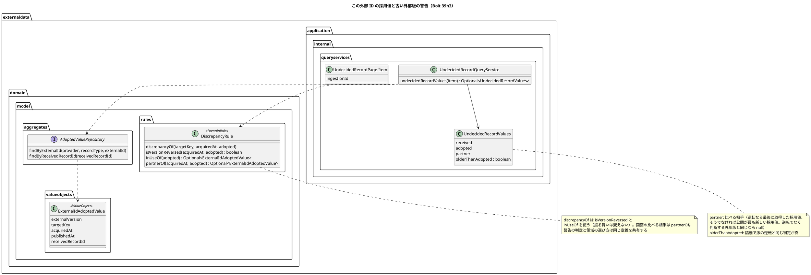
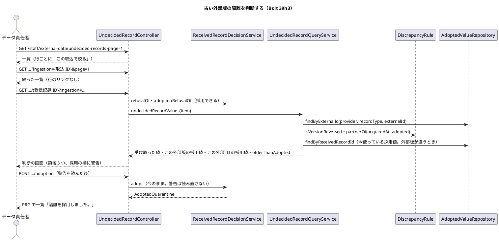
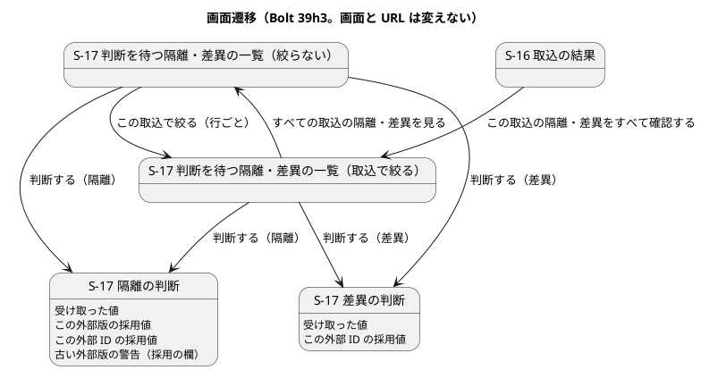
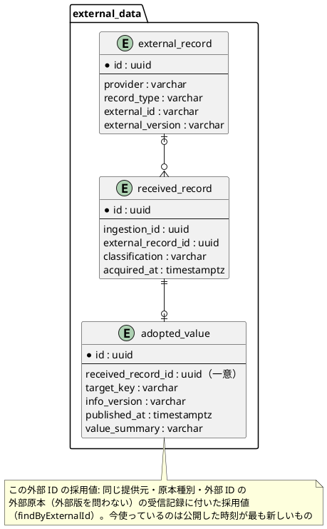

# Bolt 39h3 計画 - 判断の画面で外部版をまたいで比べ、古い外部版の隔離の採用を警告する

## 基本情報

| 項目 | 内容 |
| :--- | :--- |
| Bolt | 第 39h3 回（W7 の 37 本目。release_plan :985 の 39h3 の行。行の内容を正とする） |
| 状態 | 計画（**承認済み**。2026-11-13 に確認ポイント CP-1〜CP-8 を推奨のとおり承認（【前の決定の変更】(29)(30) を含む）。human:kakimomokuri。2026-11-13 に開始準備。確認ポイント CP-1〜CP-8 は推奨を 1 つに決めて書いた。2 つの整合性検証（`validating-iteration-plan`・`validating-design`）は別のエージェントとして流し、指摘を反映した。下の「整合性検証の結果」） |
| 予定 | W7（2026-11-16 の週。前倒しで着手できる）。Bolt 39h2 の終了報告の承認（2026-11-12）の後に着手する。約 3 時間 30 分（約 210 分。目安の上限 T-250 の内）の見込み（下の「ステップ計画」）。release_plan :985 の参考の約 3 時間から、判断の画面の値の型の名前の見直し（39h2 から送られた分）と、一覧の行の型の変更に伴う既存のテストの直しを数えて引き直した。`check`・`uiTest`・`manualScreenshots`・SonarQube・CI と承認の待ちを除く |
| アプローチ | **アウトサイドイン（S-17 から）**（release_plan :985・:893、development_strategy :350。前例 Bolt 39h2）。状態の組み合わせの表を先に書く（T-182）。名前の見直しと規則の取り出しは振る舞いを変えない準備のリファクタリングとして Red の前に済ませ、コミットを分ける（帽子をかぶり分ける）。その後、画面の層のシナリオ → S-17 の一覧の入口 → 判断の画面と照会 → 規則の順に内へ広げる |
| 対象 | (1) 判断の画面に「この外部 ID の採用値」の領域を足す（隔離・差異の両方。外部版・取得時刻・公開した時刻・値）、(2) 古い外部版の隔離を採用すると経路設計の航海や追跡の候補が古い値に戻ることを採用の欄で警告する（警告は採用を止めない）、(3) 絞らない一覧の各行に「この取込で絞る」を足す（分類で絞る操作は足さない）、(4) 判断の画面の値の型の名前の見直し（`QuarantineValues` ほか。39h2 の決定 (2) から送られた分）、(5) 版の逆転の判定と今使っている採用値の選び方を差異の規則から取り出して共有する、(6) マニュアル 12 章・用語集とキャプチャ |
| トレース | US-14 AC4・AC5、UC-15 3b・5（system_usecase :408・:527）、ED-INV-02・ED-INV-03（domain_model :1748）、台帳 D-105・D-141・D-142・D-144・D-147、S-17（ui_design :194〜:199・:2008〜:2253）、ADR-004、[Bolt 39e 計画](bolt_39e_plan.md) の行 46（V2 の取込の後の V1 の隔離の採用）と開発レビュー、[Bolt 39h 計画](bolt_39h_plan.md) の決定 (1)・(6)、[Bolt 39h2 計画](bolt_39h2_plan.md) の決定 (2)・(4)・(5) と申し送り、[Bolt 39h2 終了報告](bolt_39h2_report.md) の既知の課題、[Bolt 39d2b 終了報告](bolt_39d2b_report.md) の議題 2（本計画の確認ポイントは「本計画 CP-n」、W7 の確認ポイントは「W7 CPn」と書き分ける） |
| GitHub | [#18](https://github.com/k2works/practical-domain-driven-design-in-enterpris-application/issues/18)（US-14。クローズは 39h4） |
| SP | 0（US-14 の 8 SP は #18 をクローズする 39h4 で数える。release_plan :985） |
| 承認ゲート | **ステップごとに止める**（release_plan :895「外部原本の取込（39〜39d4・39h〜39h3）は ステップごとに止める」。`/goal` の下でもステップのゲートを外さない）。確認必須のもの（業務の判断、前の決定の変更 (29)・(30)、名前の変更、新しいファイル）は本計画の確認ポイントにまとめ、計画の承認に含める。**データベースの承認ゲートには当たらない**（スキーマを変えない。決定 (7)）。認可は変えない（URL を足さない。絞り込みは今の `?ingestion=<取込 ID>` を使う。CSRF のフォームは今のまま）。外部連携は足さない。新しいドメインイベントは足さない。新しいコンテキスト間の依存は足さない |

## Bolt ゴール

データ責任者が、S-17 の判断の画面で、判断する隔離・差異と並べて「この外部 ID の採用値」（今、経路設計と追跡が使っている値）を読め、古い外部版の隔離（V2 の取込の後の V1 の隔離）を採用しようとすると「採用すると航海が古い値に戻る」警告が採用の欄に出て、それを読んだうえで採用するかを決められる。絞らない一覧では、行の「この取込で絞る」から元の取込の判断を待つ隔離・差異に着ける（直したファイルを取り込み直した後の片付けで、元の取込の結果の画面に戻らずに済む）。

## 状態の組み合わせ（行ごとにテストを 1 本。T-182）

行の番号はこの計画で 1 から振る。見本は、航海の情報源の外部 ID（= 航海番号）`V100`（提供元「開発海運（架空）」）、外部版「1」「2」、取得時刻 G1 < G1′ < G2、公開した時刻 P1 < P2 < P3（採用の判断の時刻は後ほど新しい）。見本の状況: 外部版「1」を G1 に取り込んで採用（P1）→ 外部版「1」の内容の違う原本 V1′ を G1′ に取り込んで隔離（V1′）→ 外部版「2」を G2 に取り込んで採用（P2）→ データ責任者が V1′ の判断の画面を開く（V2 の取込の後の V1 の隔離。Bolt 39e の行 46）。差異の見本は、一度も取り込んでいない外部版「0」を G0 < G2 で取り込む組（外部版が採用済みでない外部原本が古い取得時刻で届くと版の逆転で差異になる。`Classification.classify`。外部版「1」の送り直しは重複か隔離で、差異にならない）。期待値は、Red を書く前に決定の文から導けることを 1 行ずつ確かめた（Bolt 39g4 の Try）。どの入力も今の型で作れることを確かめた（Bolt 39g4b の Try。採用値は `AdoptedValueRepository` の契約のテストの準備のメソッドで、隔離・差異の受信記録は 39h2 の準備のメソッドで作れる。採用の判断の時刻は判断のサービスのテストの時計で進められる）。

| 行 | 状況 | 期待 | 確かめ方 |
| :--- | :--- | :--- | :--- |
| 1 | 版の逆転の判定（差異の規則から取り出す `DiscrepancyRule.isVersionReversed(acquiredAt, adopted)`）: (a) 採用値なし、(b) 今の取得時刻が最後に取得した採用値より厳密に前、(c) 同じ時刻、(d) 後、(e) 複数の外部版の採用値（最後に取得したものと比べる）、(f) 前だが最後に取得した採用値が同じ外部版 | (a) 偽、(b) 真、(c) 偽（D-142。同じ時刻は逆転でない）、(d) 偽、(e) 最後に取得した採用値と比べて決まる（外部版の文字列は比べない）、(f) 真（外部版を問わない。D-142 の定義のまま） | `DiscrepancyRuleTest` の `@Nested class Bolt39h3_…`。**取り出しは振る舞いを変えない**ので、`discrepancyOf` の既存の組（版の逆転・矛盾・逆転を先に見る）が緑のままであることをステップ 3 で確かめる |
| 2 | 今使っている採用値（`DiscrepancyRule.inUseOf(adopted)`。矛盾の相手の選び方と同じ順）と、画面に示す比べる相手（`DiscrepancyRule.partnerOf(acquiredAt, adopted)`）: (a) 空の一覧、(b) 公開した時刻が最も新しいもの、(c) 公開した時刻が同じなら取得時刻の新しいもの、(d) さらに同じなら受信記録 ID の文字列の最後、(e) 版の逆転のとき（`isVersionReversed` が真）の比べる相手、(f) 逆転でないときの比べる相手、(g) V2 の取込の後に V1′ を採用した後（公開は V1′、最後に取得したのは V2）で逆転のとき | (a) 空、(b)(c)(d) 順の最後（D-105 と同じ順。`discrepancyOf` の矛盾の相手と同じ値になることを 1 組のテストで縛る）、(e) 最後に取得した採用値（`discrepancyOf` が逆転の注記に書く相手と同じ）、(f) `inUseOf` と同じ、(g) V2（最後に取得した採用値。`inUseOf` の V1′ とは別）。警告が指す「後に取得した外部版」を領域が必ず示す | `DiscrepancyRuleTest` の `@Nested` |
| 3 | 判断の画面の値の照会（`UndecidedRecordQueryService.undecidedRecordValues`。見本の組）: (a) V1′（隔離）と、採用値 V1（P1・G1）・V2（P2・G2）、(b) V1′ の取得時刻が V2 の取得時刻より後（G2′ > G2）の隔離、(c) 採用値が V1 だけ（今使っている採用値が同じ外部版）、(d) 採用値なし（キーのある隔離で外部 ID の採用値がない）、(e) 差異（外部版「0」・G0 の取込。採用値 V1・V2）、(f) キーのない隔離、(g) 比べる相手の値を読めない、(h) 同じ外部 ID の別の提供元の採用値がある、(i) 警告あり・今使っている採用値が同じ外部版の例（V1′ を採用した後の V1″。G1′ < G1″ < G2。外部版「1」）、(j) 同じ外部版で取得時刻が前（外部版「1」だけ採用済みで、隔離の取得時刻が G1 より前）| (a) 「この外部 ID の採用値」は V2（最後に取得した採用値。外部版「2」・G2・P2・値）、古い外部版の隔離は真。(b) 比べる相手は公開した時刻が最も新しい採用値（V2）、古い外部版の隔離は偽（G2′ は G2 より後）。(c) 領域なし（空）、偽（この外部版の採用値の領域が同じ値を示す）。(d) 領域なし、偽。(e) 領域あり（逆転なので最後に取得した V2）、古い外部版の隔離は偽（差異は採用できず、警告しない。決定 (3)）。(f) 空（値も領域も）。(g) 値は読めない印（500 にしない。WARN のログに ID・原本種別・例外の型だけ）、外部版・時刻は示す。(h) 別の提供元は拾わない（V100 の提供元の採用値だけ）。(i) 警告は真で、領域は V2（最後に取得した採用値）。外部版が V1″ と同じ V1′ が今使っている採用値でも、逆転のときは領域を出す（警告が指す相手を必ず示す）。(j) 警告は真、領域は V1（逆転なので出す。警告と領域の出し方が独立していることを縛る）。引く回数は、採用値の一覧 1 回（`findByExternalId`）と、比べる相手の採用値 `AdoptedValue` の受信記録 ID の照会 1 回（`findByReceivedRecordId`。外部版が違うか逆転のときだけ。取得時刻は `ExternalIdAdoptedValue` が持つので受信記録は引かない）。隔離の「この外部版の採用値」は今の `currentOf` と受信記録の照会のまま。**一覧の照会は値も採用値も引かない（今のまま）** | `UndecidedRecordQueryServiceTest` の `@Nested`（Mockito のリポジトリの呼び出しの記録で縛る。メモリ実装の `@Nested` にも同じ組）、`AdoptedValueRepositoryContract`（別の外部 ID の採用値を拾わない行だけ足す。別の提供元・別の原本種別を拾わない行は Bolt 39h の既存の契約 :275-283） |
| 4 | 判断の画面（GET。`UndecidedRecordControllerTest`）: (a) 古い外部版の航海の隔離（行 3 (a)）、(b) 古い外部版の主要実績の隔離、(c) 古くない隔離（行 3 (b)）、(d) 古い外部版だが採用できない隔離（情報源が承認されていない）、(e) 差異、(f) 今使っている採用値が同じ外部版（行 3 (c)）、(g) 隔離の今の判断の画面（回帰）、(h) 今使っている採用値を読めない | (a) 採用の欄の見出しの後に警告の文（決定 (3)。航海）、「この外部 ID の採用値」の見出しと領域（外部版・取得した日時・公開した日時・値）、採用の欄は今のまま（採用できる）。(b) 警告の文（主要実績）。(c)(f) 警告なし。(c) の領域はあり、(f) は領域なし。(d) 採用の欄がなく警告も出ない（採用できない理由の文だけ）。領域は出る。(e) 領域あり、採用の欄なし、警告なし。(g) 今のまま（受け取った値・この外部版の採用値の 2 つの領域）。(h) 領域に「値を読めませんでした。」。警告の文は固定の文（取込ファイルから来た値を含まない）。領域の値は `th:text` | `UndecidedRecordControllerTest` の `@Nested` |
| 5 | 古い外部版の隔離の採用（POST。警告は採用を止めない）: (a) 行 3 (a) の隔離を採用、(b) 理由が 1000 文字を超える採用、(c) 開いた後に V2 の採用が加わって古くなった隔離を採用 | (a) 採用でき、採用値は公開した時刻が最も新しくなる（P3）。DE-12 を 1 つ出す（Bolt 39e の行 46 の「V1 の値が航海になる」を判断のサービスの層で縛る）。PRG で一覧に戻り「隔離を採用しました。」（知らせは今のまま）。(b) 採用せず判断の画面に戻る（今のまま）。(c) (a) と同じ（警告は表示だけ。採用の判断は読み直さない） | `ReceivedRecordDecisionServiceTest` の `@Nested`、`UndecidedRecordControllerTest` |
| 6 | S-17 の一覧の取込で絞る入口（`UndecidedRecordControllerTest`）: (a) 2 つの取込に隔離・差異があり絞らない、(b) 取込で絞った一覧、(c) 0 件（絞らない・絞る）、(d) 絞らない一覧の 2 頁目、(e) 行の読み上げ | (a) 各行に「この取込で絞る」（href は `?ingestion=<その行の取込 ID>&page=1`。行ごとに自分の取込 ID）。(b) 行のリンクは出さない（全行が同じ取込。「すべての取込の隔離・差異を見る」は今のまま）。(c) 行がないのでリンクもない。(d) 2 頁目の行にも出る（href の頁は 1）。(e) 読み上げに取り込んだ日時と情報源を足す（「この取込で絞る（2026-11-16 10:05 …、開発海運（架空）（航海））」）。リンク先の件数の文は今の「この取込の判断を待つ隔離・差異 N 件（…）」 | `UndecidedRecordControllerTest` の `@Nested`、`UndecidedRecordQueryServiceTest`（`Item` が取込 ID を持つ） |
| 7 | 一覧の行の型（`UndecidedRecordPage.Item`）: (a) 取込 ID が null | (a) 拒む（`NullPointerException`。一覧の行はいつも取込を持つ） | `UndecidedRecordPageTest`（新規。既存のテストはない。`Item` に compact constructor の `requireNonNull` を足す） |
| 8 | 層の規則・用語の検査 | 名前を変えた型は今の層のまま（`UndecidedRecordValues` は `externaldata.application.internal.queryservices`、`UndecidedRecordValueViews` は `externaldata.interfaces.web`）。`LivingGlossaryConsistencyTest` は `@AggregateRoot`・`@Entity`・`@ValueObject` の付いたクラスだけを見るので、アノテーションのない `UndecidedRecordValues` の用語集と Javadoc の語はこのテストでは縛れない（ステップ 3・9 の検索で確かめる）。`allowedDependencies` は変えない。クエリサービスが `domain.model.rules` を読むことは他のコンテキストにも前例がある | `LayerArchitectureTest`・`DddAnnotationArchitectureTest`・`LivingGlossaryConsistencyTest`・Modulith の検証（既存） |
| 9 | UI（データ責任者が V100 の外部版 1（G1）を取り込んで採用し、外部版 1 の内容の違う原本を取り込んで隔離し、外部版 2（G2）を取り込んだ後に、絞らない一覧を開き、隔離の行の「この取込で絞る」でその取込に絞り、「判断する」から判断の画面を開いて、「この外部 ID の採用値」と古い外部版の警告を読み、採用する） | 一覧の行に「この取込で絞る」、絞った一覧の件数の文、判断の画面の領域と警告、採用の後に「隔離を採用しました。」と航海が V1 の値に戻る（S-07 または経路設計の画面で確かめる）。axe の違反 0。幅 320 px | `features/ui/adopt_old_version_quarantine_ui.feature`（新規）、`review_undecided_records_ui.feature`（取込で絞る入口のシナリオを足す）、タグ `@demo-bolt-39h3/old-version-warning` |
| 10 | マニュアル | 12 章（12.2 の画面の説明・一覧の読み方・採用する・差異の判断の画面）・12.1 の差異の理由・付録 B（変わらなければ省く）・用語集が実装と一致する。第 12 章の変わったキャプチャが実装と一致する | ステップの突き合わせの記録（T-197・T-251）、`manualScreenshots` |
| 11 | 今の振る舞い | 下の「守る既存のテスト」が通る | 既存 |

### 守る既存のテスト（Red のテストを書く前に流すテストの一覧。T-217、Bolt 39g2 の Try）

- 外部データ: `DiscrepancyRuleTest`、`IngestionServiceTest`、`ReceivedRecordDecisionServiceTest`、`UndecidedRecordQueryServiceTest`、`UndecidedRecordControllerTest`、`ExternalDataIngestionControllerTest`、`ExternalDataRecordRepositoriesContract`・`AdoptedValueRepositoryContract` の実装のテスト（メモリ・H2・PostgreSQL）、`features/external_data/classify_discrepancies.feature`、`features/ui/review_undecided_records_ui.feature`・`reject_quarantine_ui.feature`・`reject_discrepancy_ui.feature`・`adopt_quarantine_ui.feature`・`compare_quarantine_values_ui.feature`・`adopted_voyage_reflected_ui.feature`・`adopted_milestone_reflected_ui.feature`・`discrepancy_ui.feature`（画面の層は Green の後の全件で流す。`uiTest` はシナリオを選んで流せない。39g3〜39h2 と同じ）
- 経路設計・追跡の受け側: 採用した航海・主要実績が反映される既存のテスト（`VoyageTest` の外部版をまたいだ採用の組（Bolt 39e の行 46）ほか。ステップ 2 で数える）
- 横断: `LayerArchitectureTest`、`DddAnnotationArchitectureTest`、`LivingGlossaryConsistencyTest`、`MapperSchemaArchitectureTest`、Modulith の検証
- **期待が変わる既存のテスト**（ステップ 2 で数えて記録する。行の期待として直し、「計画から変えたこと」にしない）: `UndecidedRecordPage.Item` のコンストラクターに取込 ID を足すので、`Item` を作るテスト（`UndecidedRecordControllerTest`・`UndecidedRecordQueryServiceTest`・画面の層のステップ。39h2 で `classification` を足したときは 24 か所だった。コンパイルで落ちる）、`QuarantineValues`・`QuarantineValueViews`・`quarantineValues`・フラグメント `quarantine-values` の名前を参照するテスト（`UndecidedRecordQueryServiceTest`・`UndecidedRecordControllerTest`・`IngestionServiceTest`・`AdoptQuarantineUiSteps`・`CompareQuarantineValuesUiSteps`。名前を直すだけで文の期待は変わらない）。判断の画面の既存の組は、領域が増えても今の 2 つの領域の文を縛るだけなので期待は変わらない

## 開始準備の決定（推奨を 1 つに決めて書いた。承認済み）

(1) **範囲と見積り**（本計画 CP-1）: release_plan :985 の 39h3 の行（判断の画面に「この外部 ID の採用値」、古い外部版の隔離の採用の警告、S-17 の絞らない一覧から取込で絞る入口）に、39h2 から送られた名前の見直し（判断の画面の値の型）と、差異の規則から版の逆転の判定を取り出す準備のリファクタリングを足し、すべて入れ、分けない。約 210 分（3 時間 30 分。目安の上限 T-250 の内）。
- 分けない理由: 警告は「この外部 ID の採用値」の領域と同じ照会（この外部 ID の採用値の一覧）から導くので、領域だけの Bolt は警告の根拠を画面に出すだけで、警告の Bolt は領域を使う（縦に分けると同じ画面を 2 度組み直す）。取込で絞る入口は一覧の独立した小さな縦で約 15 分
- 超えそうなときは、行 9 の動画（−5 分）を 39h4 に送る。マニュアルとキャプチャは送らない
- 比べた案: (i) **分けない（推奨）**。(ii) 領域と警告を 39h3、取込で絞る入口と名前の見直しを 39h3b に分ける（39h3 が約 150 分に、39h3b が約 60 分になるが、Bolt が 1 本増え、39h4 が遅れる。分ける利得が小さい）。(iii) 警告を 39h4 に送る（`release_plan` の 39h3 の行に反し、古い外部版の隔離の採用の警告が Release 1.0 の締めの前に出ない）

(2) **名前の見直しと規則の取り出し**（本計画 CP-2、【前の決定の変更】(29)）:
- 名前（39h2 の決定 (2) が 39h3 に送った分）: `QuarantineValues` → `UndecidedRecordValues`（判断を待つ隔離・差異の判断の画面の値）、`QuarantineValueViews` → `UndecidedRecordValueViews`、`UndecidedRecordQueryService.quarantineValues(item)` → `undecidedRecordValues(item)`、フラグメント `externaldata/fragments/quarantine-values.html` → `undecided-record-values.html`（`values` の名前は変えない）、テンプレートのコメントと Javadoc の語。範囲は約 120 か所（`QuarantineValues` 93・`quarantineValues` 22・`QuarantineValueViews` 8 のうち名前と Javadoc。IDE の rename で機械的に直す）。**ステップ 3 の最初のコミット**にし、`check` を緑のままにする
- 規則の取り出し: `DiscrepancyRule` に `isVersionReversed(acquiredAt, adopted)`・`inUseOf(adopted)`・`partnerOf(acquiredAt, adopted)`（逆転なら最後に取得した採用値、そうでなければ `inUseOf`）を公開し、`discrepancyOf` が使う（振る舞いを変えない）。警告の判定と領域の採用値の選び方が差異の規則と同じ定義（D-142・D-105）を共有し、**3 つ目の写しを作らない**（警告の判定を画面の層や照会のサービスに別に書くと、取得時刻の「厳密に前」と公開した時刻の順が食い違う余地ができる）。**ステップ 3 の 2 つ目のコミット**で、`DiscrepancyRuleTest` の既存の組が緑のまま
- 【前の決定の変更】(29): Bolt 39d3 の開始準備の決定 (10)（新しい型の名前。判断の画面の値の型 `QuarantineValues`。照会の足し方の決定 (6) はそのまま）を、判断を待つ隔離・差異の値に合わせて `UndecidedRecordValues` に改める（Bolt 39h2 の【前の決定の変更】(28) の続き。「Review」を使わない決まりは変えない）
- 比べた案: (i) **値の型・変換・照会のメソッド・フラグメントまで一覧の読みの型の語にそろえる（推奨）**。(ii) 名前を変えず Javadoc だけ直す（差異の判断の画面に「Quarantine」の値が出る状態が残る。39h2 の決定 (2) が送った分が残る）。(iii) `DecisionScreenValues` にする（`UndecidedRecord*` の語の族からそれる）。規則の取り出しの比べた案: (a) **`DiscrepancyRule` に公開して共有（推奨）**、(b) 警告専用の規則を新しいクラスに置く（取得時刻の比べ方が 2 か所になる）、(c) 照会のサービスに書く（規則が画面の読みの層に写る）

(3) **古い外部版の隔離の採用の警告**（本計画 CP-4、【業務の判断】(bi)、台帳 D-151（仮））:
- **何を警告するか**: 採用できる隔離（判断のサービスの定めで採用の欄が出るもの）の取得時刻（受信記録の取得時刻）が、この外部 ID の最後に取得した採用値の取得時刻より厳密に前（版の逆転の定義。D-142。`isVersionReversed`）。採用値の公開した時刻は採用の判断の時刻なので、この隔離を採用すると最後に公開した採用値になり、経路設計の航海や追跡の候補が古い値に置き換わる（domain_model :1001 の「最後に公開した採用値」、Bolt 39e の行 46）
- **警告は採用を止めない**: 採用の欄に文を足すだけで、採用の判断・採用できる隔離の定め・採用の POST は変えない（古い外部版の隔離の採用は業務上ありうる。V2 が誤りで V1′ が正しいとき）。確認のチェックボックスも足さない（採用の欄に既に「採用すると取り消せません」がある。チェックは読んだだけで押せて、判断を重くしない割に守りが増えない）
- **警告の文**（固定の文。取込ファイルから来た値を含まない。値の型で選ぶ）:
  - 航海: 「この外部 ID は、この隔離を受け取った時刻より後に取得した外部版を採用しています。この隔離を採用すると、経路設計の航海がこの古い値に置き換わります（算出済みの候補の確定は拒否されることがあります）。「この外部 ID の採用値」と比べてから採用してください。」
  - 主要実績: 「この外部 ID は、この隔離を受け取った時刻より後に取得した外部版を採用しています。この隔離を採用すると、追跡のまだ採用していない下書きの候補がこの古い値に置き換わります。「この外部 ID の採用値」と比べてから採用してください。」（文は S-12 の下書きの置き換えの振る舞い（Bolt 39g・39gb の行 43）に突き合わせて、ステップ 1 で確かめる）
- **出す場所と出す条件**: 判断の画面の「採用する」の見出しの後、採用の理由の欄の前に `role="note"` の段落として出す。判断のサービスの定めで採用できる隔離で、古い外部版のときだけ。差異（採用しない）と採用できない隔離には出さない。採用のボタンは `aria-describedby` に警告の段落の id も指す
- **判定は画面を開いたときの一度**: POST では読み直さない（採用の判断は今の採用値を見て公開した時刻を付けるだけで、警告は表示。開いた後に V2 が採用されたら、採用は成功する）
- 比べた案: (i) **警告の文だけ（推奨）**。(ii) 確認のチェックボックスを必須にする（フォームと CSRF の入力が増え、POST の検証が増える。守りは増えない）。(iii) 古い外部版の隔離は採用できない理由にする（V2 が誤りのとき訂正の道が閉じる。D-144 の「差異は採用しない」と違い、隔離は内容の違う原本の正誤を人が決める場で、決めた「差異は却下だけ」の前提（採用すると逆転が戻る）とは別の問題）。(iv) 採用の監査記録に「古い外部版だった」を足す（DE-29 や監査の直列化の契約が変わる。要件がない）

(4) **「この外部 ID の採用値」の領域**（本計画 CP-3、【業務の判断】(bh)、台帳 D-150（仮））:
- **何を示すか**: 差異の規則が比べる相手（`DiscrepancyRule.partnerOf`）。版の逆転のとき（`isVersionReversed` が真。差異の逆転と、古い外部版の隔離）はこの外部 ID の最後に取得した採用値、そうでないときは公開した時刻が最も新しい採用値（`inUseOf`。矛盾の相手の選び方と同じ。経路設計の航海はこの値）。外部版・取得した日時・公開した日時・値を、「この外部版の採用値」の領域と同じ部品（フラグメント）で示す。見出しは「この外部 ID の採用値」、見出しの後に 1 文（逆転のとき「取得した日時が最も新しい採用値です。」、そうでないとき「公開した日時が最も新しい採用値です。」）。警告が指す「後に取得した外部版」と版の逆転の差異の注記が名指す相手を、領域が必ず示す（検証の指摘: 警告の根拠と領域の選び方がずれ、V1′ を採用した後に警告あり・領域なしになる組を作らない）
- **【前の決定の変更】(30)**: 台帳 D-146 の書き分け（比べる相手は隔離が「この外部版の採用値」、差異が「この外部 ID の採用値」）を、注記と S-16 の文に限る。判断の画面は隔離にも「この外部 ID の採用値」を示す（古い外部版の隔離の警告が指す相手を見せるため）。台帳 D-148 の「値の領域は『受け取った値』だけ」（差異）を、受け取った値に加えて「この外部 ID の採用値」を示すに改める（39h2 の決定 (5) が 39h3 に送った分の実行）。「この外部 ID の採用値」の定義は、差異の規則が比べる相手に定める（domain_model :404・用語集 :81 を直す）
- **隔離と差異の両方に出す**: 差異の判断の画面は、これまで「受け取った値」だけで、比べる相手を外部版の文字列（注記）でしか読めなかった。39h2 の決定 (5) が 39h3 に送った分で、受け取った値と並べて読めるようにする。隔離の判断の画面は、今の 2 つの領域に足す
- **同じ外部版の採用値と重ならない**: 比べる相手が逆転でなく、その外部版が判断する受信記録の外部版と同じときだけ、領域を出さない（「この外部版の採用値」の領域が同じ値を示す）。逆転のときは相手の外部版にかかわらず領域を出す。差異は外部版の採用値を持たないので、いつも別の外部版（採用値があれば領域が出る）
- **注記との一致**: 版の逆転の差異の注記が名指す相手は「最後に取得した採用値」で、領域も逆転のときは同じ値（`partnerOf`）。矛盾の差異は公開した時刻が最も新しい採用値で、注記の相手（`discrepancyOf` の矛盾の相手）と同じ
- 比べた案: (i) **差異の規則が比べる相手 1 つ（推奨）**。(i′) 公開した時刻が最も新しい採用値 1 つだけ（逆転のとき警告が指す相手が出ない組ができる）。(ii) 採用値の一覧をすべて（外部版が多いと長い。判断に要るのは今使っている 1 つ）。(iii) 隔離のときだけ出す（差異の判断の画面で比べる相手が値で読めず、39h2 が送った分が残る）。(iv) 注記が名指す外部版の採用値を出す（注記から外部版を取り出すか、差異に比べた外部版の列が要り、スキーマを変える）

(5) **S-17 の取込で絞る入口**（本計画 CP-5、【業務の判断】(bj)、台帳 D-152（仮））:
- 絞らない一覧の各行の「取り込んだ日時」の欄に「この取込で絞る」を足す（href は今の `?ingestion=<取込 ID>&page=1`。URL・認可は変えない）。絞った一覧には出さない（全行が同じ取込。「すべての取込の隔離・差異を見る」は今のまま）。読み上げに取り込んだ日時と情報源を足す（100 行に同じ文のリンクが並ぶので、スクリーンリーダーの利用者が行を区別できる）
- リンクの href は controller が取込 ID（`UUID`）から組み立てる（受け取った文字列をそのまま URL に入れない。今の `query` と同じ）。これには `UndecidedRecordPage.Item` に取込 ID を足す（`UndecidedRecord` は持っている）
- **分類で絞る操作は足さない**（39h2 の決定 (4) が 39h3 で要るかを確かめるとした分）。取込で絞った一覧の中で隔離と差異は種類の列で読め、差異のまとめての却下（D-149）を作らない間は、差異だけの一覧の用途がない。差異が 1 つの取込で数千件になる頻度は、パイロットの前に確かめる（D-149）
- 比べた案: (i) **行ごとのリンク（推奨）**。(ii) 取込の選択（`select`）を一覧の上に置く（取込の一覧の照会が要る。取込の履歴の一覧は作らない決定（Bolt 39c）に近づく）。(iii) 判断の画面から取込で絞るリンクを足す（判断の画面は一覧に戻るリンクが元の絞り込みを持つ。絞らない一覧から来たときに絞れない。入口は一覧にある方がよい）。(iv) 分類（隔離・差異）で絞る操作も足す（上のとおり用途がない）

(6) **照会と画面の形**（本計画 CP-3 の実装）: `UndecidedRecordQueryService.undecidedRecordValues(item)` が返す `UndecidedRecordValues` に、比べる相手の採用値 `partner`（`Adopted`。ない・逆転でなく同じ外部版のときは `null`）と、古い外部版の隔離か `olderThanAdopted`（隔離で、判定が真のときだけ真。差異・キーのない隔離は偽）を足す。引くのは、採用値の一覧 1 回（`findByExternalId(provider, recordType, externalId)`。一覧の照会は引かない）と、比べる相手の採用値（`AdoptedValue`）の受信記録 ID の照会 1 回（`findByReceivedRecordId`。値の要約は採用値の列。取得時刻・公開した時刻は `ExternalIdAdoptedValue` が持つので受信記録は引かない）。判定と選び方は `DiscrepancyRule`（決定 (2)）。controller は `UndecidedRecordValueViews` で領域を組み、警告の文は画面の層の定数で値の型から選ぶ（値の型のすべてに文がある `switch`。T-240）。警告を出すかは `adoptable` かつ `olderThanAdopted`

(7) **スキーマを変えない**（本計画 CP-7。データベースの承認ゲートに当たらない理由）: 使う照会は `AdoptedValueRepository.findByExternalId`（Bolt 39h で作った。同じ提供元・原本種別・外部 ID の外部原本の受信記録に付いた採用値を引く既存の索引）と `findByReceivedRecordId`（採用値の受信記録 ID の一意。値の要約だけをここで引く。取得時刻・公開した時刻は `ExternalIdAdoptedValue` が持つ）で、新しい列も索引もない。取込の一覧の行に足す取込 ID は受信記録の既存の列を読むだけ。マイグレーションを足さない。

(8) **名前と層、新しいファイル**（本計画 CP-8。第 3 章、CLAUDE.md。T-246。`apps/cargo-tracker/src` で `UndecidedRecordValues`・`UndecidedRecordValueViews`・`undecidedRecordValues`・`undecided-record-values`・`isVersionReversed`・`inUseOf`・`partnerOf`・`olderThanAdopted`・`Bolt39h3`・`demo-bolt-39h3` を検索し、ないことをステップ 1 で確かめる）:
- 名前を変えるもの: 決定 (2)
- 直すもの: `DiscrepancyRule`（取り出し）、`UndecidedRecordValues`（旧 `QuarantineValues`。`partner`・`olderThanAdopted`）、`UndecidedRecordQueryService`（`undecidedRecordValues`）、`UndecidedRecordPage.Item`（取込 ID）、`UndecidedRecordController`（領域・警告・行のリンク・`kindOf` などは変えない）、`UndecidedRecordValueViews`、テンプレート `externaldata/undecided-records/decision.html`・`index.html`、フラグメント、テスト
- 新しいファイル: 受入シナリオ `features/ui/adopt_old_version_quarantine_ui.feature`（行 9）、`UndecidedRecordPageTest`（行 7。既存になければ）、タグ `@demo-bolt-39h3/old-version-warning`、キャプチャ `12-undecided-record-old-version`（古い外部版の隔離の判断の画面。「この外部 ID の採用値」と警告）、本計画と終了報告、動画。`QuarantineValues.java` → `UndecidedRecordValues.java`・`QuarantineValueViews.java` → `UndecidedRecordValueViews.java`・フラグメントはファイルの移動
- 層: 新しいコンテキスト間の依存はない。共有カーネルは変えない。**規則の例外は要らない見込み**（クエリサービスが `externaldata.domain.model.rules` を読むことは、`RoutingCaseQueryService` ほか他のコンテキストに前例がある）。当たったら置き場所を動かさず止めて諮る（T-125）

### 前の Bolt から引き継いだもの

| 出典 | 内容 | この計画 |
| :--- | :--- | :--- |
| release_plan :985（39h3 の行） | この外部 ID の採用値（外部版・取得時刻・値）、古い外部版の隔離の採用の警告、S-17 の絞らない一覧から取込で絞る入口 | 決定 (3)〜(5)、行 3〜9 |
| [Bolt 39h2 終了報告](bolt_39h2_report.md) の既知の課題 | 差異の判断の画面にも同じ領域を出すかを決める、分類で絞る操作が要るか、`QuarantineValues`・`QuarantineValueViews`・フラグメントの名前 | 決定 (4)（出す）、(5)（要らない）、(2) |
| [Bolt 39h2 計画](bolt_39h2_plan.md) の決定 (2)・(5)・申し送り | 判断の画面の値の型の名前は 39h3 で値の領域を組み直すときに 1 度で見直す。この外部 ID の採用値を値で並べるのは 39h3 | 決定 (2)・(4) |
| [Bolt 39h 計画](bolt_39h_plan.md) の決定 (6)、domain_model :1001 | V2 の取込の後に V1 の隔離を採用した組は差異にせず、39h3 で警告する。分類は受け取った時に一度だけ決め、書き換えない | 決定 (3)（警告のみ。分類は変えない） |
| [Bolt 39e 計画](bolt_39e_plan.md) の行 46 と開発レビュー、【業務の判断】(r) | 外部版をまたいだ採用の判断は最後に公開した値が航海になる。古い外部版の隔離の採用で航海が戻ることを判断の画面で警告するか | 決定 (3)、行 5 |
| [Bolt 39d2b 終了報告](bolt_39d2b_report.md) の議題 2 | 絞らない一覧に「この取込で絞る」を足す | 決定 (5) |
| 台帳 D-105・D-141・D-142・D-146 | 公開した時刻の順、比べる相手 2 つ、版の逆転の定義、差異の注記と「この外部 ID の採用値」の書き分け | 決定 (2)〜(4)、行 1・2 |
| Bolt 39h2 の【前の決定の変更】(28) | 一覧の読みの型の名前 `UndecidedRecord` | 決定 (2)、【前の決定の変更】(29) |
| Bolt 39h2 の Try | 確かめのつもりのコマンドも、流す前に引数に `-`・`<<`・`> ファイル` が含まれないかを声に出して確かめる。メソッド名・テスト名に使う語を sed で置換するときは識別子に使えない文字を `void` の行で拾う。置換のスクリプトは main と test で分けて流す | 規律、ステップ 3・9 |
| Bolt 39h2 の Keep | 設計の文書とマニュアルの直しをサブエージェントに任せるときは名前と文を先に渡す。変異のスクリプトは落ちたテストの名前で判定し、本番の前に 1 つだけ流して起動を確かめる | ステップ 1・8・9 |
| Bolt 39g4b の議題 3 | 届かない分岐を作らない | 決定 (6)（`partner` が逆転でなく同じ外部版のとき `null`。差異の `olderThanAdopted` は常に偽で分岐を持たない形にする） |

### 開始準備で確かめたこと（作業ツリーの `apps/cargo-tracker/src` で読んだ）

- **差異の規則**: `DiscrepancyRule.discrepancyOf`（:56-69）は版の逆転（取得時刻の最も遅い採用値より今の取得時刻が厳密に前。`ACQUIRED_ORDER`）を先に、矛盾（`PUBLISHED_ORDER` の最後の採用値の対象のキーが違う）を次に見る。2 つの順は private の `Comparator` で、取り出せる形になっていない
- **この外部 ID の採用値の一覧**: `AdoptedValueRepository.findByExternalId(provider, recordType, externalId)`（:45）が `ExternalIdAdoptedValue`（外部版・対象のキー・取得時刻・公開した時刻・受信記録 ID。**値の要約を持たない**）を返す。値は採用値の受信記録 ID で `findByReceivedRecordId` を引いて得る（`UndecidedRecordQueryService.adoptedOf`、:100-115 と同じ形）
- **判断の画面の値**: `UndecidedRecordQueryService.quarantineValues`（:71-81）は `UndecidedRecordPage.Item` から、隔離か差異で外部原本を持つ受信記録に `QuarantineValues`（受け取った値・この外部版の採用値）を返す。差異では採用値を引かない（:89-95）。controller の `addValues`（:426-437）が差異のとき採用値の領域を出さない。decision.html の領域は `th:block th:if="${receivedValues}"` の中（:69-79）
- **採用の欄**: decision.html :95 の `th:if="${adoptable}"` の `section`（採用の理由の欄・採用のボタン）。採用できる隔離の判断は判断のサービスの `adoptionRefusalOf` だけで決める（controller :400-401）
- **一覧の行**: `UndecidedRecordPage.Item`（:69-78）は取込 ID を持たない。`UndecidedRecord`（:25-34）は `ingestionId` を持つ。index.html の「取り込んだ日時」の欄は `th:text="${row.ingestedAt()}"` だけ。controller の `row`（:495-507）は `query(ingestionFilter, page)` で判断の画面への href を組む。`?ingestion=` で絞る入口は S-16 の結果の画面だけ
- **名前の数**（検証の実測。語境界あり）: `QuarantineValues` 99（main 4 ファイル・テスト 2 ファイル）、`quarantineValues` 25（5 ファイル。メソッドだけ呼ぶのが `IngestionServiceTest`）、`QuarantineValueViews` 8（3 ファイル）の計 132 か所。型を参照するテストは `UndecidedRecordControllerTest`（46）と `UndecidedRecordQueryServiceTest`（37）。`AdoptQuarantineUiSteps` は Javadoc のリンクだけ、`CompareQuarantineValuesUiSteps` はクラス名に部分文字列が入るだけで、型は参照しない（部分文字列の置換で `CompareQuarantineValuesUiSteps`・`compare_quarantine_values_ui.feature` を巻き込まない。IDE の rename か語境界を付ける）。フラグメント `externaldata/fragments/quarantine-values` は decision.html :73・:77 から呼ぶ。設計文書で名前を含むのは domain_model 2・ui_design 2・test_strategy 1 とリリース計画 3（過去の計画・終了報告は履歴なので直さない）
- **スキーマ**: 取込 ID は受信記録の既存の列。マイグレーションなし

## 業務の判断の記録（本計画 CP-3〜CP-5。仮。パイロットの前に業務責任者とデータ責任者に確かめる）

| 判断 | 推奨 | 理由 |
| :--- | :--- | :--- |
| (bh) 「この外部 ID の採用値」の領域 | 公開した日時が最も新しい採用値 1 つを、外部版・取得した日時・公開した日時・値で示す。隔離と差異の両方。今使っている採用値が判断する受信記録と同じ外部版のときは出さない | 経路設計の航海は公開した時刻の順で決まる（D-105）。比べる相手を値で読めるようにする。同じ外部版は「この外部版の採用値」の領域が示す |
| (bi) 古い外部版の隔離の採用 | 採用はできる。採用の欄に警告の文を足す（確認のチェックは足さない）。判定は版の逆転と同じ定義（取得時刻が最後に取得した採用値より厳密に前）で、画面を開いたときの一度 | V2 が誤りで V1′ が正しい場面がある。警告は読んで決めるための情報で、採用を止めると訂正の道が閉じる |
| (bj) 取込で絞る入口 | 絞らない一覧の各行に「この取込で絞る」を足す。分類で絞る操作は足さない | 取り込み直した後の片付けで元の取込に着ける（39d2b の議題 2）。分類で絞る用途は、差異のまとめての却下（D-149）を作らない間はない |

## スコープ

### 入れるもの

- 行 1〜11。決定 (2)〜(8) の実装と文書
- マニュアル 12 章: 12.2 の画面の説明（判断の画面の領域の説明に「この外部 ID の採用値」）、一覧の読み方（絞らない一覧の「この取込で絞る」。:247 の周り）、「隔離を採用する」（古い外部版の隔離を採用するときの警告。新しい小節 `#### 古い外部版の隔離を採用するとき`）、「差異を却下する」の差異の判断の画面（:404〜）に「この外部 ID の採用値」、「直して送り直すとき」（:484）の取込で絞る手順（「元の取込の結果の画面から開くか、URL を控える」を「絞らない一覧の『この取込で絞る』」に直す）、12.1 の差異の理由（:184）の比べる相手の説明。用語集（「この外部 ID の採用値」「版の逆転」の説明に古い外部版の隔離の採用の警告）。第 12 章のキャプチャ（変わる分と足す 1 枚。`manualScreenshots` の差分を確かめ、変わった分だけ残す）、動画 `@demo-bolt-39h3/old-version-warning`
- 台帳 D-150〜D-152（仮。本計画の開始準備で足す）、D-141・D-142・D-147 の注、【前の決定の変更】(29)

### 入れないもの

- 古い外部版の隔離を採用できない理由にすること、確認のチェックを必須にすること、採用の監査に「古い外部版だった」を足すこと（決定 (3)）
- 分類（隔離・差異）で絞る操作（決定 (5)）、差異のまとめての却下（39h2 の決定 (8)・D-149）
- 差異の採用（Release 1.0 では作らない）
- 取込の履歴の一覧（作らない。Bolt 39c）
- G-06、受入条件の照合の表、W7 のデモの動画、#18 のクローズ、性能テストの複数の外部版の組（39h4・W7 の締め）
- DE-29 の契約の変更、新しいイベント、スキーマの変更

### 申し送り

| 送り先 | 課題 |
| :--- | :--- |
| 39h4 | 受入条件の照合の表で、US-14 AC5 の「差異と採否を確認する」（UC-15 5）を 39h2 の却下だけで照合する。W7 のデモの動画に、古い外部版の隔離の採用の警告を含めるか（`@demo-bolt-39h3/old-version-warning` を引くだけで足りるか） |
| W7 の締め・Release 1.0 のパイロットの前 | 業務の判断 (bh)〜(bj) を業務責任者とデータ責任者に確かめる（台帳 D-150〜D-152）。差異のまとめての却下の要否（D-149）と分類で絞る操作の要否 |

### 設計文書に直す箇所（ステップ 1。「この外部 ID の採用値」「39h3」「QuarantineValues」「quarantine-values」「取込で絞る」「古い外部版」で検索して確かめる）

- domain_model:
  - 用語の表: 「判断を待つ隔離・差異の判断の画面の値」を足すか既存の語を直す（:381〜:385 の周り。:382 の `quarantineValues(item)` の説明を `undecidedRecordValues(item)` に、:383 の日本語名の再定義。英語名 `UndecidedRecordValues` ほか）、「差異の規則」（版の逆転の判定・今使っている採用値・比べる相手の取り出し）、**:384・:404 の「隔離の比べる相手は『この外部版の採用値』、差異の比べる相手は『この外部 ID の採用値』と書き分ける（D-146）」**（【前の決定の変更】(30)）と「この外部 ID の採用値」の定義（:404。領域に示すのは差異の規則の比べる相手で、逆転なら最後に取得したもの、そうでなければ公開が最も新しいもの）
  - :1001 の「39h3 で判断の画面に警告する」を作ったことに、「Bolt 39h3 で決めたこと」を節に足す（:1776〜:1778 の周り。領域・警告・取込で絞る入口・取り出し）、受信記録の判断の状態遷移図は変わらない（警告は表示）
- data_model: 変えない（スキーマを変えない）。データモデルの文書に変更がないことを検証の結果に書く
- ui_design: 画面一覧の S-17（:74・:142 の「判断の画面で外部版をまたいで比べるのは 39h3」を作ったことに）、URL の表の S-17 の一覧（:194。行の「この取込で絞る」）・判断の画面（:195。「この外部 ID の採用値」の領域・警告の文・採用の欄の警告）、S-17 のワイヤーフレーム（:2008〜の一覧に「この取込で絞る」、判断の画面に領域と警告を 1 枚足す）、:2009 の `quarantine-values.html`・`QuarantineValues` の名前、:195 の D-148 の「値の領域は『受け取った値』だけ」（差異にも「この外部 ID の採用値」を足す）、:2017 の「39h3」、**画面遷移図（:505〜:545 の周り。変わる）**: 隔離差異に「この取込で絞る」の自己遷移、隔離の判断・差異の判断の説明に領域と警告（:519〜:522）
- test_strategy: US-14 の行（:603 の周り。39h3 の確かめ方 = 規則・照会・画面・画面の層のシナリオ）、:348 の `QuarantineValues`・`QuarantineValueViews` の名前、:328 の「この外部 ID の採用値」の文
- ADR-004: 「2026-11-13（W7、Bolt 39h3）」の改訂の経緯（判断の画面の値の名前 `UndecidedRecordValues`、この外部 ID の採用値、古い外部版の隔離の採用の警告。決定は変えない）。:129 の経緯は残す
- system_usecase :408（UC-15 3b・5。採用の前に「この外部 ID の採用値」を読む、古い外部版は警告）・:527
- user_story: US-14 の AC4 の注（採用の前に比べる）
- release_plan: 39h3 の行（決めたこと、引き直した見積り、計画へのリンク。開始準備で足した）、D-150〜D-152（仮。開始準備で足した）、D-141・D-142・D-146・D-147・D-148 の注（D-146・D-148 は【前の決定の変更】(30)）、【前の決定の変更】(29)・(30)、39h4 の行（古い外部版の警告の動画を W7 のデモの動画に含めるかの申し送り）
- マニュアル 12 章の「まだ示されない」と書いた箇所: :178・:179（「画面には示されません」）、:419（比べた相手の値は画面に示されない）、:520（ほかの外部版の値と見比べることはまだできない）、用語集 :81（「この外部 ID の採用値のうち最後に取得したもの」を、比べる相手の定義に）
- コードの Javadoc とコメント: `UndecidedRecordQueryService`（:25-33・:59-69。「判断の画面の値」に）、`UndecidedRecordValues`（旧 `QuarantineValues`。Javadoc の「内容の違う原本の判断の画面の値」を「判断を待つ隔離・差異の判断の画面の値」に）、`DiscrepancyRule`（取り出し）、`UndecidedRecordController`（:34-47 と :423-437）、テンプレートのコメント（decision.html :14-19・:66-68、index.html :12-15）
- マニュアル（ステップ 8）: 上の「入れるもの」の箇所

## 設計（この Bolt の範囲）

画面と URL は増やさない（S-17 の一覧に行のリンク、判断の画面に領域と警告が増えるだけ）。データモデルは変えない（ER 図は使う表と照会の条件を示す）。

### ドメインモデル図（外部データの変わる部分）

### 受信記録の判断の状態遷移図

状態は変わらない（隔離・差異の受信記録の判断の状態遷移は Bolt 39h2 のまま。警告は表示で、採用の判断・状態・イベントを変えない）。

### 古い外部版の隔離の判断の画面を開いて採用する流れ

### 画面遷移図

### ER 図（使う表。スキーマは変えない）

## ステップ計画（各ステップの後に止める。release_plan :895）

| # | ステップ | ゲート | 分 |
| :--- | :--- | :--- | ---: |
| 1 | 設計文書を直す（上の一覧）、release_plan の 39h3 の行・D-150〜D-152・D-141・D-142・D-146・D-147・D-148 の注・【前の決定の変更】(29)・(30)。名前（`UndecidedRecordValues` ほか）を検索して衝突しないことを確かめる。先にコミットしてからステップ 2 に入る | ステップごと | 20 |
| 2 | 守る既存のテストを流す（T-217）。期待が変わる既存のテスト（`Item` を作る箇所・名前を参照する箇所）の数を記録する | ステップごと | 10 |
| 3 | 準備のリファクタリング 2 つ（コミットを分ける。どちらも振る舞いを変えないので `check` を緑のままにする）: (a) 決定 (2) の名前の見直し（IDE の rename。型・ファイル・メソッド・フラグメントのファイル・Javadoc の最初の語・用語集の英語名）、(b) `DiscrepancyRule` から `isVersionReversed`・`inUseOf`・`partnerOf` を取り出し、`discrepancyOf` が使う形にする（`DiscrepancyRuleTest` の既存の組が緑のまま） | ステップごと（**本計画 CP-2 で計画の承認に含む**） | 25 |
| 4 | Red: 画面の層のシナリオ（行 9）と、状態の組み合わせの規則・照会・コントローラー・サービス・単体（行 1〜7）を同じ段で書いて流し、落ちる理由を記録する。期待が変わる既存の組の期待を直す | ステップごと | 25 |
| 5 | S-17 の一覧の取込で絞る入口（行 6・7。`Item` に取込 ID、controller の行のリンクと読み上げ、index.html） | ステップごと（**本計画 CP-5 で計画の承認に含む**） | 15 |
| 6 | 判断の画面と照会（行 1〜5。`DiscrepancyRule` の公開、`undecidedRecordValues` の `partner`・`olderThanAdopted`、controller の領域と警告の文と出す条件、decision.html の領域・警告・ボタンの `aria-describedby`。H2 と PostgreSQL の契約の提供元の絞り） | ステップごと（**本計画 CP-3・CP-4 で計画の承認に含む**） | 35 |
| 7 | 画面の層のシナリオの Green（行 9）、動画。開発データの承認済みの航海の情報源をステップの最初に確かめる | ステップごと | 15 |
| 8 | マニュアル 12 章・用語集（行 10）、第 12 章のキャプチャ（変わる分の差分を確かめ、足す 1 枚を撮る）。決定 (3)〜(5) の名前と文を先に渡してサブエージェントに任せる場合は、渡す文を決定の文から写す | ステップごと | 20 |
| 9 | 品質ゲート（`check`・`uiTest`・`manualScreenshots`・SonarQube・CI）、変異（スクリプトは本番の前に 1 つだけ流して起動を確かめる。Bolt 39h の Try）、文書の突き合わせ。`spotbugsMain`・`checkstyleMain`・`uiTest` は最後の直しの後にも流す | ステップごと | 40 |
| 10 | 終了報告 | **終了報告で止める** | 5 |
| | 合計 | | 210 |

時間の配分と打ち切り: 超えそうなときは決定 (1) の順（行 9 の動画を 39h4 へ）に送る。マニュアルとキャプチャは送らない。PERF-06 は流さない（取込の経路は変えない。判断の画面の読みに照会が 2 回増えるだけで、一覧の照会の形は変わらない）。

## 確認ポイント（計画の承認の場でまとめて確認する。Try T-6）

| # | 確認すること | 推奨 |
| :--- | :--- | :--- |
| 1 | 範囲と見積り: release_plan :985 の 39h3 の行をすべて入れ、分けない。約 210 分（参考の約 3 時間から、名前の見直しの範囲と規則の取り出し、`Item` の変更に伴う既存のテストの直しを数えて引き直した）。超えそうなら動画を 39h4 へ | 分けない（領域と警告は同じ照会から導き、分けると同じ画面を 2 度組み直す） |
| 2 | 名前の見直しと規則の取り出し（【前の決定の変更】(29)） | `QuarantineValues` → `UndecidedRecordValues`、`QuarantineValueViews` → `UndecidedRecordValueViews`、`quarantineValues` → `undecidedRecordValues`、フラグメント `undecided-record-values`。`DiscrepancyRule` に `isVersionReversed`・`inUseOf`・`partnerOf` を公開して共有する（警告の判定と領域の選び方を別に書かない）。「Review」を使わない決まりは残す |
| 3 | 「この外部 ID の採用値」の領域（【業務の判断】(bh)、台帳 D-150（仮）） | 差異の規則が比べる相手 1 つを示す（版の逆転なら最後に取得した採用値、そうでなければ公開した日時が最も新しい採用値）。隔離と差異の両方。逆転でなく判断する受信記録と同じ外部版のときだけ出さない。【前の決定の変更】(30): D-146 の書き分けを注記と S-16 の文に限り、D-148 の「受け取った値だけ」に外部 ID の採用値を足す |
| 4 | 古い外部版の隔離の採用の警告（【業務の判断】(bi)、台帳 D-151（仮）） | 採用はできる。採用の欄に固定の警告の文（航海・主要実績）を足す。確認のチェックは足さない。判定は版の逆転と同じ定義で、画面を開いたときの一度。差異・採用できない隔離には出さない |
| 5 | 取込で絞る入口（【業務の判断】(bj)、台帳 D-152（仮）） | 絞らない一覧の各行に「この取込で絞る」を足す。分類で絞る操作は足さない |
| 6 | 警告の文の突き合わせ | 主要実績の文は S-12 の下書きの置き換えの振る舞い（Bolt 39g・39gb）に突き合わせてステップ 1 で確かめる。違えば、文を直して終了報告に書く |
| 7 | スキーマを変えない（データベースの承認ゲートに当たらない） | 変えない。使う照会は Bolt 39h の `findByExternalId` と `findByReceivedRecordId`。取込 ID は受信記録の既存の列 |
| 8 | 新しいファイル（`adopt_old_version_quarantine_ui.feature`、キャプチャ `12-undecided-record-old-version`、`bolt_39h3_plan.md`・終了報告、動画）と、`QuarantineValues.java`・`QuarantineValueViews.java`・フラグメントのファイル名の変更 | 作る |

### 変異と落ちる見込みのテスト（変異が効く層と、そこを通るテストの組を 1 行ずつ確かめた。39g3 の Try）

| # | 変異 | 効く層 | 落ちる見込みのテスト（行） |
| :--- | :--- | :--- | :--- |
| M1 | `isVersionReversed` を「前または同じ」にする | 規則 | 行 1 (c) |
| M2 | `isVersionReversed` が最後に取得した採用値でなく最初の採用値と比べる | 規則 | 行 1 (e) |
| M3 | `inUseOf` の順を取得時刻にする | 規則 | 行 2 (b) |
| M4 | `inUseOf` が公開した時刻が同じとき受信記録 ID を見ない | 規則 | 行 2 (d) |
| M5 | 警告の判定を外部版の文字列の比べにする | 照会 | 行 3 (a)(b) |
| M6 | 差異にも `olderThanAdopted` を真にする | 照会 | 行 3 (e)（`UndecidedRecordQueryServiceTest`。行 4 (e) は固定の値を渡す表示の確かめで、この変異は見えない） |
| M7 | 逆転でなく同じ外部版でも `partner` を返す | 照会 | 行 3 (c) |
| M7b | 逆転のとき同じ外部版の `partner` を返さない（警告あり・領域なし） | 照会 | 行 3 (i)(j) |
| M8 | `findByExternalId` の外部 ID を絞らない（別の外部 ID の採用値を拾う） | 照会（契約） | `AdoptedValueRepositoryContract` に足す行（別の提供元・原本種別は既存の :275-283 が縛る） |
| M8b | `partnerOf` が逆転のときも公開が最も新しい採用値を返す | 規則・照会 | 行 2 (e)(g)、行 3 (a)(i) |
| M9 | 警告を採用できない隔離にも出す（`adoptable` を見ない） | 表示 | 行 4 (d) |
| M10 | 警告の文の値の型を取り違える（航海と主要実績） | 表示 | 行 4 (a)(b) |
| M11 | 一覧の行のリンクがいつも先頭の行の取込 ID を使う | 表示 | 行 6 (a) |
| M12 | 絞った一覧にも行のリンクを出す | 表示 | 行 6 (b) |
| M13 | 今使っている採用値を読めないときに 500 にする（例外を受けない） | 照会 | 行 3 (g)（表示の行 4 (h) は読めない印を渡した表示だけを縛る） |
| M14 | `Item` の取込 ID の null を許す | 値 | 行 7 |

変異 M1〜M4・M8b は規則の層で縛り、M5〜M7b・M13 は照会の層（`UndecidedRecordQueryServiceTest`。コントローラーのテストは `@WebMvcTest` でサービスを差し替えるので照会の変異は見えない）で縛る（落ちる見込みのテストが書式や丸めの後ろにあるときは手前の層の値も縛る。Bolt 39g4c の Try）。

## 完了条件

- 行 1〜11 のテストが通り、`check`・`uiTest`・CI が緑。SonarQube の品質ゲートが通る
- 変異が上の見込みどおりに落ちる
- **マニュアルに影響する**: 12 章（12.2 の画面の説明・一覧の読み方の「この取込で絞る」・隔離を採用する小節の古い外部版の警告・差異の判断の画面の「この外部 ID の採用値」・直して送り直すときの手順、12.1 の差異の理由）と用語集が実装と一致する。第 12 章の変わったキャプチャを撮り直し、古い外部版の隔離の判断の画面の 1 枚を足した
- 設計文書（domain_model・ui_design・test_strategy・ADR-004・system_usecase・user_story）と release_plan の 39h3 の行・D-150〜D-152・D-141・D-142・D-147 の注・【前の決定の変更】(29) を直し、index.md・docs/log.md を同期した。data_model は変えない
- 動画 `@demo-bolt-39h3/old-version-warning` を撮った（データ責任者が新しい航海の後に前に取得した外部版の隔離を採用しようとして警告を読み、絞らない一覧から取込で絞って判断の画面を開く）か、決定 (1) の打ち切りで送ったことを終了報告に書いた
- `npx gulp okf:check` が ERROR 0
- 各ステップの後に人が確かめた（ステップごとのゲート）。終了報告を作り、人が承認した

## ふりかえりと前の Bolt からの引き継ぎ

| 出典 | 内容 | この Bolt での扱い |
| :--- | :--- | :--- |
| Bolt 39h2 の議題 1、Try | 確かめのつもりのコマンドも、流す前に引数に `-`・`<<`・`> ファイル` が含まれないかを声に出して確かめる（2 回続けて破った） | 規律（`python -`・`cat >`・ヒアドキュメント・`<<<`・`git commit -F -` を使わない。ファイルは Write・Edit かスクラッチパッドの `.py`・`.sed`、コミットは `-m` を複数回）。T-247 の手順化の案は W7 の締めへ送られている |
| Bolt 39h2 の Try | 識別子に使えない文字（`・` など）を `void` の行で拾う。置換のスクリプトは main と test で分けて流す | ステップ 3（名前の見直し）・4 |
| Bolt 39h2 の Problem | テストの識別子に `record` を使うと SonarQube の restricted identifier になる | ステップ 4・9 |
| Bolt 39h の Try | 変異のスクリプトは本番の前に 1 つだけ流して起動を確かめる | ステップ 9 |
| Bolt 39h の Try、判断と学び | 見出しや語を変えるときは、その語を参照する文を検索して決定の一覧と突き合わせる | ステップ 1・3 の検索の語（「この外部 ID の採用値」「この外部版の採用値」「QuarantineValues」「取込で絞る」） |
| Bolt 39h の Keep | ステップ 1 を先にコミットする。サブエージェントに任せるときは名前と実装の文を先に渡す | ステップ 1・8 |
| Bolt 39g4c の Try | 落ちる見込みのテストが書式や丸めの後ろにあるときは手前の層の値も縛る | 変異の表（M1〜M7 の層） |
| Bolt 39g4b の議題 3、Try | 届かない分岐を作らない。状態の組み合わせの表の入力が型で作れるかを確かめる | 決定 (6)、表の前書き |
| Bolt 39g3 の Try | 変異が効く層とそこを通るテストの組を 1 行ずつ確かめる | 変異の表の「効く層」 |
| Bolt 39g2 の Try、議題 6 | 守る既存のテストは Red の前に流す。変異のスクリプトは落ちたテストの名前で判定する | ステップ 2・9 |
| Bolt 39gc の Try | 受入シナリオは単体の Red と同じ段で書く | ステップ 4 |
| W6 の Try T-182・T-211・T-216、T-244〜T-246 | 状態の組み合わせに出口・誤った入力の行、パラメーターは組まで縛る、型の名前は検索する | 行 3・4・5・7、決定 (8) |
| W6 の Try T-184、T-217、T-219、T-240 | listener は配信まで、Red の前に流すテストの一覧、変異は単体・統合・契約、結果のすべてに行き先と文 | 「守る既存のテスト」、変異の表、決定 (6)（値の型のすべてに文がある `switch`） |
| Bolt 39d3 の T-250・T-251 | 見積りは 4 時間 05 分まで、マニュアルの文は決定の文から写す | 決定 (1)、ステップ 8 |
| memory の manual-in-bolt-done-criteria | 振る舞いが変わる Bolt はマニュアルを完了条件に入れる | 完了条件（キャプチャを含む） |

## 更新履歴

| 日付 | 更新内容 | 更新者 |
| :--- | :--- | :--- |
| 2026-11-13 | 初版作成（承認待ち） | anthropic/claude-sonnet-5-5 |
| 2026-11-13 | CP-1〜CP-8 を推奨のとおり承認として記録した（【前の決定の変更】(29)(30) を含む。以降は推奨で進める指示による。human:kakimomokuri） | anthropic/claude-sonnet-5-5、承認 human:kakimomokuri |

## 整合性検証の結果（開始準備のステップ 3・4）

2 つの検証は別のエージェントとして流した（`validating-iteration-plan` の観点 = 計画と実装・設計の事実の突き合わせ、`validating-design` の軸 A・B・C。作業ツリーのコードと設計文書を読んだ）。指摘は重 1 件・中 8 件・軽 14 件。

| 検証 | 指摘 | 扱い |
| :--- | :--- | :--- |
| `validating-design` 軸 C | 重: D-146 の書き分け（隔離は「この外部版の採用値」、差異は「この外部 ID の採用値」）と D-148（値の領域は受け取った値だけ）を黙って変えていた。【前の決定の変更】が (29) だけ | 【前の決定の変更】(30) を決定 (4)・CP-3 に立て、domain_model :384・:404 と release_plan の D-146・D-148 の注を直す一覧に足した |
| `validating-iteration-plan` | 中: 警告の根拠（最後に取得した採用値）と領域の選び方（公開が最も新しい採用値）がずれ、V1′ を採用した後に「警告あり・領域なし」の組ができる | 領域は差異の規則が比べる相手（`partnerOf`。逆転なら最後に取得した採用値）にした。行 2 (e)〜(g)・行 3 (i)(j)・変異 M7b・M8b を足した |
| `validating-iteration-plan` | 中: 変異 M6・M7・M13 を行 4（`@WebMvcTest`、サービスは差し替え）では殺せない。M8 の契約は既存の :275-283 と重なる | 変異の表の効く層を「照会」に直し、M8 を別の外部 ID だけにした |
| `validating-iteration-plan` | 中: 差異の見本（外部版「1」の送り直し）が実際の分類では差異にならない（`Classification.classify`） | 見本を未取込の外部版「0」（G0 < G2）に直した |
| `validating-design` 軸 B | 中: 領域の「この外部 ID の採用値」の定義が domain_model :404・用語集 :81 と食い違う | 領域の意味を差異の規則の比べる相手に定め、:404・用語集 :81 を直す一覧に足した |
| `validating-design` 軸 B | 中: 直す箇所の漏れ（test_strategy :328・:348、domain_model :382・:383、ui_design :2009、マニュアル :178・:179・:419・:520、39h4 の行）と、画面遷移図は「変えない」でなく変わる | 直す一覧に足し、画面遷移図を「変わる」に直した |
| `validating-design` 軸 B | 中: release_plan が未更新なのに log.md が更新済みと書いている | release_plan に 39h3 の行の計画へのリンク、D-150〜D-152（仮）、D-146・D-148 などの注、【前の決定の変更】(29)・(30)、更新履歴を足した（開始準備の同期。39h2 と同じ） |
| 両方 | 軽: 参照数（実測は `QuarantineValues` 99・`quarantineValues` 25・`QuarantineValueViews` 8 の 132 か所。型を参照するテストは 2 ファイル）、引く回数（取得時刻は `ExternalIdAdoptedValue` が持つので受信記録は引かない）、`UndecidedRecordPageTest` は新規、CP の番号（決定 (7)=CP-7、(8)=CP-8）、Bolt 39d3 の出典は決定 (10)、`LivingGlossaryConsistencyTest` は `@ValueObject` 等だけを見る、整合性検証の欄が空 | それぞれ直した |
| 両方 | 事実の確認: 判断の時刻が公開した時刻になり（`ReceivedRecordDecisionService.adopt` → `AdoptionFactory`）、V1′ の採用で P3 > P2 になる。航海の順は公開 → 取得 → 受信記録 ID（`Voyage.BY_FRESHNESS`）で domain_model :1001・Bolt 39e の行 46 と矛盾しない。主要実績の候補は公開した時刻の順で、古い下書きは置き換えられる。見積り 210 分は T-250 の内。軸 A（アプローチ・承認ゲート・順序）は一致。新規スキーマ・認可・外部連携なし。クエリサービスが `domain.model.rules` を読む前例あり（`RoutingCaseQueryService` ほか）。新しい名前の衝突なし | 直しなし |

## 関連ドキュメント

- [Bolt 39h 計画](bolt_39h_plan.md)、[Bolt 39h 終了報告](bolt_39h_report.md)、[Bolt 39h2 計画](bolt_39h2_plan.md)、[Bolt 39h2 終了報告](bolt_39h2_report.md)、[Bolt 39e 計画](bolt_39e_plan.md)、[Bolt 39d3 計画](bolt_39d3_plan.md)、[Bolt 39d2b 終了報告](bolt_39d2b_report.md)
- [リリース計画](release_plan.md)
- [ドメインモデル](../../design/cargo-tracker/domain_model.md)、[データモデル](../../design/cargo-tracker/data_model.md)、[UI 設計](../../design/cargo-tracker/ui_design.md)、[ADR-004](../../adr/cargo-tracker/004-external-data-ingestion.md)
