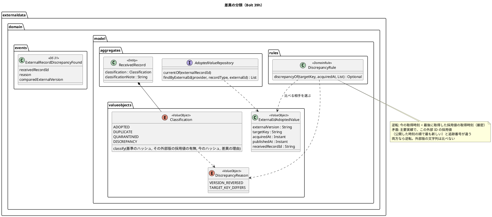
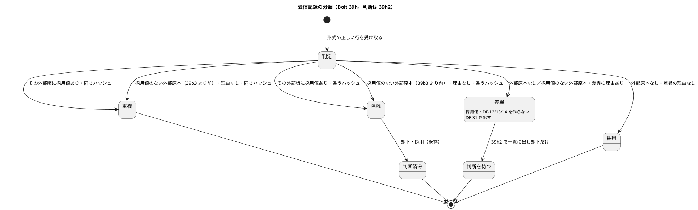
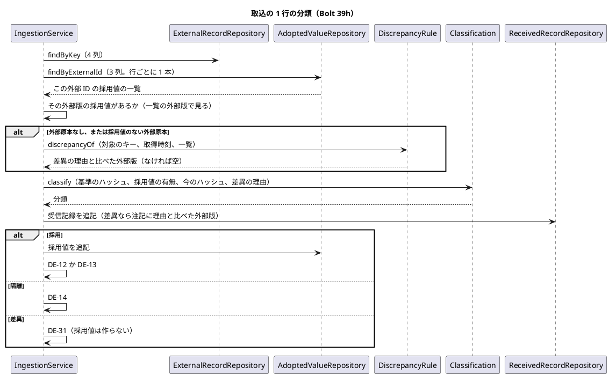
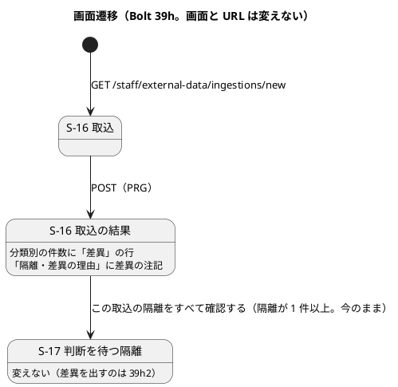
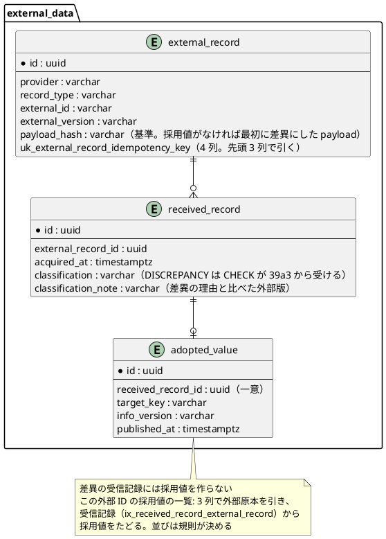

# Bolt 39h 計画 - 版の逆転と既存の採用値との矛盾を取込で差異に分類する

## 基本情報

| 項目 | 内容 |
| :--- | :--- |
| Bolt | 第 39h 回（W7 の 35 本目。release_plan :983 の 39h の行） |
| 状態 | 計画（**承認済み**。2026-11-12 に確認ポイント 1〜9 を推奨のとおり承認（【前の決定の変更】(25)〜(27) を含む）。human:kakimomokuri。2026-11-12 に開始準備。2 つの整合性検証（`validating-iteration-plan`・`validating-design`）の指摘（重 4 件・中 20 件・軽 14 件。重なりを除かない）を反映した。下の「整合性検証の結果」） |
| 予定 | W7（2026-11-16 の週。前倒しで着手できる）。Bolt 39g4c の終了報告の承認（2026-11-12）の後に着手する。約 4 時間 05 分（約 245 分。目安の上限 T-250）の見込み（下の「ステップ計画」）。release_plan :983 の 39h の行の全部は 1 日を超えるので、**39h・39h2・39h3・39h4 の 4 本に縦に分ける提案**（決定 (1)）。`check`・`uiTest`・`manualScreenshots`・SonarQube・CI と承認の待ちを除く |
| アプローチ | **インサイドアウト（分類の規則から）**（development_strategy :350「外部データの骨格と分類（…39h の内側）は インサイドアウト」、前例 Bolt 39d4。release_plan :983 の「アウトサイドイン（受入シナリオから）」は分けた後の 39h4 に残し、39h2・39h3 は画面からのアウトサイドイン。決定 (1)）。状態の組み合わせの表を先に書く（T-182）。差異の規則 → 分類 → この外部 ID の採用値の照会 → 取込のサービスとイベント・監査 → S-16 の順に広げ、受入シナリオは単体の Red と同じ段で書く |
| 対象 | (1) 分類の差異（`DISCREPANCY`）と差異の理由（版の逆転・既存の採用値との矛盾）の規則、(2) 比べる相手を引く照会（この外部 ID の採用値の一覧）、(3) 取込で差異にした原本は採用値も DE-12・DE-13・DE-14 も作らず、新しいドメインイベント（DE-31、外部原本の差異を見つけた）と監査を残す、(4) S-16 の結果の画面の分類別の件数の差異の行と差異の理由、(5) 追跡番号の違う主要実績の隔離の案内の文を直す（【前の決定の変更】(25)）、(6) マニュアル 12 章（12.1 と案内の文）・付録 B・用語集とキャプチャ。S-17 で差異を一覧に出して却下するのは 39h2 |
| トレース | US-14 AC5、ED-INV-02・ED-INV-03（domain_model :1748）、BR-12（requirements_definition :735）、UC-15 5（system_usecase :408）、ARCH-HO-03（architecture_backend）、ADR-004（:95・:156・:172）、W7 CP2・CP7（release_plan :914、domain_model :1217・:1756）、台帳 D-97・D-100・D-105・D-114・D-115・D-120、S-16（ui_design :193・:1944）、[Bolt 39d4 計画](bolt_39d4_plan.md) の決定 (5)・(6) と行 5、[Bolt 39e 計画](bolt_39e_plan.md) の行 46、[Bolt 39g4c 終了報告](bolt_39g4c_report.md) の Try（本計画の確認ポイントは「本計画 CP-n」、W7 の確認ポイントは「W7 CPn」と書き分ける） |
| GitHub | [#18](https://github.com/k2works/practical-domain-driven-design-in-enterpris-application/issues/18)（US-14。クローズは 39h4。決定 (1)） |
| SP | 0（US-14 の 8 SP は #18 をクローズする 39h4 で数える。承認で release_plan の 39h の行の SP を 0 に、39h4 の行を 8 にする。決定 (1)） |
| 承認ゲート | **ステップごとに止める**（release_plan :895「外部原本の取込（39〜39d4・39h）は ステップごとに止める」。`/goal` の下でもステップのゲートを外さない）。確認必須のもの（分けること、業務の判断、前の決定の変更 (25)〜(27)、新しいドメインイベント、新しいファイル）は本計画の確認ポイントにまとめ、計画の承認に含める。**データベースの承認ゲートには当たらない**（スキーマを変えない。決定 (2)）。認可は変えない（URL を足さない）。外部連携は足さない。新しいコンテキスト間の依存は足さない（identity の監査の listener は DE-14 と同じく `externaldata.domain.events` を読む） |

## Bolt ゴール

データ責任者が外部原本を取り込むと、同じ外部 ID で後に取得した外部版をすでに採用しているのに前に取得した外部版が届いたとき（版の逆転）と、主要実績の追跡番号が同じ外部 ID の採用中の値と違うとき（既存の採用値との矛盾）に、その原本は自動で採用されず差異に分類され、取込の結果の画面に件数と理由が示される（US-14 AC5）。差異にした原本は採用値にならないので、経路設計の航海も追跡の主要実績も変わらない。正しい値なら、データ責任者は提供元に後の取得時刻の新しい外部版で送り直してもらう。差異を S-17 で一覧にして却下で片付けるのは 39h2。

## 状態の組み合わせ（行ごとにテストを 1 本。T-182）

行の番号はこの計画で 1 から振る。見本は、主要実績の情報源（提供元「運送会社A」）の外部 ID `MS-0001`、外部版「1」「2」「3」、取得時刻 G1 < G2 < G3（取込の解析がマイクロ秒に切り詰める。IngestFileCommandAssembler.java :322）、追跡番号 CTA・CTB と、航海の情報源の外部 ID（= 航海番号）`V100`。比べる相手は 2 つ（決定 (3)）: 版の逆転は「この外部 ID の最後に取得した採用値」（取得時刻の最も遅いもの）、矛盾は「この外部 ID の採用値」（公開した時刻 → 取得時刻 → 受信記録 ID（文字列の順）で最も新しいもの。D-105 の順）。テストは新しいクラスは決定 (9)、既存のクラスは `@Nested class Bolt39h_…`。期待値は、Red を書く前に決定の文から導けることを 1 行ずつ確かめた（Bolt 39g4 の Try）。どの入力も今の型で作れることを確かめた（Bolt 39g4b の Try。行 3 (k) の人の採用で戻った相手は、採用値をリポジトリに直接置いて作る）。

| 行 | 状況 | 期待 | 確かめ方 |
| :--- | :--- | :--- | :--- |
| 1 | 差異の規則（パラメーター。今受け取った原本の取得時刻と対象のキー、この外部 ID の採用値の一覧）: (a) 一覧が空、(b) G1・CTA の 1 つに G2・CTA、(c) G2・CTA に G2・CTA（同じ取得時刻）、(d) G2・CTA に G1・CTA、(e) G1・CTA に G2・CTB、(f) G2・CTA に G1・CTB（両方）、(g) 航海: G2 に G1、(h) 外部版の文字列の順と取得時刻の順が逆（外部版「9」G1 に外部版「10」G2、外部版「2」G1 に外部版「1」G2）、(i) G2 に 1 マイクロ秒前、(j) 一覧が V1・G1（後に公開）と V3・G3（先に公開）で、G2・CTA | (a)(b)(c) 差異でない、(d) 版の逆転（`VERSION_REVERSED`。比べた外部版「…」）、(e) 既存の採用値との矛盾（`TARGET_KEY_DIFFERS`）、(f) 逆転（理由は 1 つ。逆転を先に見る。決定 (4)）、(g) 逆転、(h) どちらも差異でない（外部版の文字列は比べない。D-105）、(i) 逆転、(j) 逆転（比べた外部版は「3」。公開した時刻の順で最も新しい V1 ではなく、最後に取得した V3 と比べる。決定 (3)） | 単体（`DiscrepancyRuleTest`（新規）） |
| 2 | 分類の決め方（パラメーター。外部原本の基準のハッシュ、その外部版に採用値があるか、差異の理由）: (a) 外部原本なし・理由なし、(b) 外部原本なし・理由あり、(c) 採用値のある外部版・同じハッシュ・理由あり、(d) 採用値のある外部版・違うハッシュ・理由あり、(e) 採用値のない外部版・同じハッシュ・理由あり、(f) 採用値のない外部版・違うハッシュ・理由あり、(g) 採用値のない外部版・同じハッシュ・理由なし、(h) 採用値のない外部版・違うハッシュ・理由なし | (a) 採用、(b) 差異、(c) 重複、(d) 隔離（同じ外部版の中の比べが先）、(e)(f) 差異（差異の再送は再び差異。決定 (6)）、(g) 重複・(h) 隔離（39b3 より前の、採用値を持たない外部原本。今の ED-INV-02 のまま） | 単体（`ClassificationTest` の `@Nested class Bolt39h_…`） |
| 3 | 取込の分類（主要実績と航海。業務ルール層の受入シナリオと取込のサービス）: (a) V1・G1・CTA を取り込み、別の取込で V2・G2・CTA（回帰）、(b) V2・G2 を取り込み、別の取込で V1・G1、(c) 1 つのファイルに V2・G2 の行、V1・G1 の行の順、(d) 1 つのファイルに V1・G1、V2・G2 の順、(e) V1・G1・CTA の後に V2・G2・CTB、(f) V1・G2 の後に V2・G2（同じ取得時刻）、(g) (a) の V2 をもう一度（回帰）、(h) V2・G2 を採用した後に V2・G1 の内容の違う原本（回帰）、(i) (b) の V1 を同じ内容で送り直す、(j) (b) の V1 を内容を変えて（G1 のまま）送り直す、(k) V1・G1 と V3・G3 を採用し、V1 の隔離の採用でこの外部 ID の採用値が V1 に戻った（採用値を直接置く）ところへ V2・G2、(l) 航海 V100 の V2・G2 の後に V1・G1、(m) V1 の行が形式の誤り（キーのない隔離）になった後に V2・G2 を採用し、直した V1・G1 の行を取り込む | (a) 採用。(b)(c) 2 つ目は差異で、外部原本はできる（基準はその原本）が採用値はない。(d) どちらも採用。(e) 差異（矛盾）。(f) 採用（同じ時刻は逆転でない）。(g) 重複。(h) 隔離（差異ではない）。(i)(j) 再び差異（重複・隔離ではない。受信記録が 1 つ増える）。(k) 差異（最後に取得した V3 より前。比べた外部版「3」）。(l) 差異（航海も逆転を見る）。(m) 差異（【業務の判断】(c) の「初めて受け取るときは採用」は、後の取得の外部版を採用していないときだけになる。決定 (6)） | `features/external_data/classify_discrepancies.feature`（新規。`@US-14`）、`IngestionServiceTest` の `@Nested class Bolt39h_…` |
| 4 | 差異の注記（行の範囲と理由。文は決定 (7)）: (a) 逆転、(b) 矛盾 | (a)「2 行目: 同じ外部 ID で後に取得した外部版 "3" を採用しているので、前に取得したこの外部版は採用していません（版の逆転）。」(b)「2 行目: 同じ外部 ID の採用中の外部版 "1" と追跡番号が違うので採用していません（既存の採用値との矛盾）。」（外部版は 100 文字まで（IngestFileCommandAssembler.java :60）なので注記は上限の 1000 文字に収まる） | `IngestionServiceTest`、受入シナリオ |
| 5 | 差異はほかのコンテキストに届かない: (a) 行 3 (b) の差異、(b) 行 3 (e) の差異 | DE-12・DE-13・DE-14 を出さない（採用値がないので経路設計の航海と追跡の主要実績は変わらない。W7 CP7 の境界のとおり追跡の確認中にもつながない）。DE-31（外部原本の差異を見つけた）を 1 つ出す（受信記録 ID・取込 ID・情報源・冪等性キー・差異の理由・比べた外部版・物理行の範囲・操作者） | `IngestionServiceTest`（発行したイベントを数える）、`ExternalRecordIngestionSteps` |
| 6 | 監査: (a) 差異を含む取込がコミットした、(b) 取込が巻き戻った | (a) 監査記録の操作 `EXTERNAL_RECORD_DISCREPANCY_FOUND` を 1 件（コミットの後、別のトランザクション。IA-INV-15。対象と変更後は DE-14 の監査と同じ形で、理由は差異の理由）、(b) 監査記録なし | `ExternalRecordAuditEventHandlerTest`・`AuditRecordTest` の `@Nested`、`ExternalRecordAuditDeliveryIntegrationTest`（配信まで。T-184）、`DomainEventSerializationContractTest`（DE-31 の直列化の契約。DE-14 は :225） |
| 7 | この外部 ID の採用値の一覧の照会（契約のテスト。メモリ・H2・PostgreSQL）: (a) 採用値なし、(b) 取込で採用した V1、(c) V1（取得 G2、先に公開）・V2（取得 G1、後に公開）、(d) 採用の判断の採用値（公開した時刻が判断の時刻）、(e) 別の提供元の同じ外部 ID、(f) 同じ提供元の別の原本種別の同じ外部 ID、(g) 重複・隔離・差異の受信記録（採用値なし） | (a) 空、(b) V1 の 1 つ、(c) 2 つ（外部版・対象のキー・取得時刻・公開した時刻・受信記録 ID がそろう。並びは決めない）、(d) 含める、(e)(f)(g) 含めない。どれを比べる相手にするかは規則が決める（行 1。並びを SQL に頼らないので、メモリ・H2・PostgreSQL の UUID の比べ方の違いに当たらない） | `AdoptedValueRepositoryContract` の `@Nested`（準備のメソッドに提供元・原本種別・取得時刻・分類を足す。メモリの実装は外部原本と受信記録のリポジトリを引く） |
| 8 | S-16 の取込の結果: (a) 差異 1 件・隔離 1 件、(b) 差異 0 件、(c) 差異だけ 1 件、(d) 隔離と差異で 101 件 | (a) 分類別の件数の表に「差異 1」の行（採用・重複・隔離・差異の順）、「隔離・差異の理由」に隔離と差異の注記を行の順に。リンク「この取込の隔離をすべて確認する」は今のとおり隔離が 1 件以上のときだけ（S-17 に差異が出るのは 39h2）。(b)「差異 0」の行（表は 4 行）、理由とリンクは今のとおり。(c) 理由は出て、リンクは出ない。(d) 最初の 100 件と「ほかに 1 件の隔離・差異があります（最初の 100 件だけを示しています）。」 | `ExternalDataIngestionControllerTest`・`IngestionSummaryQueryServiceTest` の `@Nested` |
| 9 | 誤った入力と出口: (a) 取得時刻の列が空・読めない行、(b) 差異の後の再送が形式の誤り | (a)(b) 形式の誤り（キーのない隔離。今のまま。差異の規則に届かない） | `IngestionServiceTest`（既存の組の回帰） |
| 10 | 追跡番号の違う主要実績の隔離の案内（【前の決定の変更】(25)） | 判断の画面の採用できない理由が「追跡番号がこの外部版の採用値と違うので採用できません。追跡番号を直した実績は、追跡管理者に正しい追跡記録へ手入力してもらってください（新しい外部版で送り直しても差異になります）。」 | `UndecidedRecordControllerTest` の既存の組の期待を直す |
| 11 | 追跡の側の守り（D-115。【前の決定の変更】(26)） | 外部版をまたいで追跡番号が変わった DE-13 は別の主要実績として受ける（今の振る舞いのまま）。取込からは届かなくなるので、テストは DE-13 を直接出す形に書き直す | `ExternalMilestoneDeliveryIntegrationTest`（:326 の組） |
| 12 | UI（データ責任者が V2・G2 の航海を取り込んだ後に V1・G1 の航海のファイルを取り込み、取込の結果で差異の行と理由を見る） | S-16 の「差異 1」と「隔離・差異の理由」の差異の注記。経路設計の航海は V2 のまま。axe の違反 0。幅 320 px | `features/ui/discrepancy_ui.feature`（新規）、タグ `@demo-bolt-39h/discrepancy` |
| 13 | 性能（PERF-06。行ごとにこの外部 ID の採用値の一覧の照会が 1 本増え、分類ごとの件数の照会が 3 本から 4 本になる） | 1 万件の航海・主要実績の取込が上限 300 秒に収まる（Bolt 39b4 の Linux の CI の実測は 17.0〜24.3 秒）。性能テストのデータの外部 ID ごとの外部版の数を記録する（1 つだけなら、複数の外部版の組を足すかを終了報告で諮る） | `ExternalDataIngestionPerformanceTest`（`performanceTest`。Linux の CI。Bolt 39b4 の議題 2） |
| 14 | 層の規則・用語の検査 | 規則は `externaldata.domain.model.rules`（`@DomainRule`）、値は `externaldata.domain.model.valueobjects`（`@ValueObject`）、イベントは `externaldata.domain.events`（`LayerArchitectureTest` :400 のイベントの名前の一覧に足す）。`LivingGlossaryConsistencyTest` は `DiscrepancyRule`・`DiscrepancyReason`・`ExternalIdAdoptedValue`・`ExternalRecordDiscrepancyFound` の英語名と Javadoc の最初の語を確かめる。`allowedDependencies` は変えない | `LayerArchitectureTest`・`DddAnnotationArchitectureTest`・`LivingGlossaryConsistencyTest`・Modulith の検証（既存） |
| 15 | マニュアル | 12 章（12.1 と案内の文。下の「入れるもの」）・付録 B・用語集と、第 12 章の変わったキャプチャが実装と一致する | ステップの突き合わせの記録（T-197・T-251）、`manualScreenshots` |
| 16 | 今の振る舞い | 下の「守る既存のテスト」が通る | 既存 |

### 守る既存のテスト（Red のテストを書く前に流すテストの一覧。T-217、Bolt 39g2 の Try）

- 外部データ: `ClassificationTest`、`IdempotencyKeyTest`、`ReceivedRecordDecisionTest`、`IngestionServiceTest`、`ReceivedRecordDecisionServiceTest`、`IngestionSummaryQueryServiceTest`、`UndecidedRecordQueryServiceTest`、`ExternalDataIngestionControllerTest`、`UndecidedRecordControllerTest`、`AdoptedValueRepositoryContract`・`ExternalDataRecordRepositoriesContract` の実装のテスト（メモリ・H2・PostgreSQL）、`ExternalDataSchemaIntegrationTest`、`features/external_data/ingest_external_records.feature`・`quarantine_malformed_records.feature`、`features/ui/ingest_external_data_ui.feature`・`review_undecided_records_ui.feature`・`reject_quarantine_ui.feature`・`reject_keyless_quarantines_ui.feature`・`adopt_quarantine_ui.feature`・`compare_quarantine_values_ui.feature`・`resend_after_decision_ui.feature`・`adopted_voyage_reflected_ui.feature`・`adopted_milestone_reflected_ui.feature`（画面の層は Green の後の全件で流す）
- 受け側と監査: `ExternalRecordAuditEventHandlerTest`・`AuditRecordTest`・`ExternalRecordAuditDeliveryIntegrationTest`・`DomainEventSerializationContractTest`、`VoyageUpdateDeliveryIntegrationTest`・`VoyageArrivalDeliveryIntegrationTest`・`ConfirmedRouteEvaluationDeliveryIntegrationTest`・`ExternalMilestoneDeliveryIntegrationTest`・`ExternalMilestoneEventHandlerTest`、`features/ui/latest_estimate_basis_ui.feature`・`voyage_arrival_estimate_ui.feature`（取込を通る）
- 横断: `LayerArchitectureTest`、`DddAnnotationArchitectureTest`、`LivingGlossaryConsistencyTest`、`MapperSchemaArchitectureTest`、Modulith の検証
- **期待が変わる既存のテスト**（ステップ 2 で数えて記録する。行 3 の期待として直し、「計画から変えたこと」にしない）: 外部版をまたいで前の取得時刻の外部版を後に取り込む組と、外部版をまたいで追跡番号が変わる組。確かめた分は `ExternalMilestoneDeliveryIntegrationTest` :326（V1・CTA の後に V2・CTB。D-115。行 11 で DE-13 を直接出す形に）、`ExternalDataRecordRepositoriesContract` :271・:860・:892、Bolt 39d4 の行 5 (d)（新しい外部版は採用）の名前で縛った組。同じ取得時刻（`2026-11-03T08:30:00Z`）で外部版だけを変える組は採用のまま（行 1 (c)・行 3 (f)）。`ReceivedRecordDecisionTest` :74-90（`@EnumSource` の分類）は `DISCREPANCY` が増えるので組が 1 つ増える（判断できるかは 39h2 で変える。39h では差異は判断できないまま）

## 開始準備の決定（推奨を 1 つに決めて書いた。承認済み）

(1) **範囲と分け方、見積り**（本計画 CP-1）: release_plan :983 の 39h の行は、US-14 AC5 の差異、Golden dataset の G-06、受入条件の照合の表、W7 のデモの動画（`@US-14`）、#18 のクローズと US-14 の 8 SP、S-17 の絞らない一覧から取込で絞る入口、キーが変わる原本の扱い、V2 の取込の後に V1 の隔離を採用した組、古い外部版の隔離の採用の警告、同じ情報版で確定が拒否される流れの動画を含む。コードで確かめると、差異の分類だけで、規則と分類の決め方、照会（3 つの実装と契約のテストの準備）、取込のサービスと新しいイベント・監査（作り方・直列化の契約・層の規則・配信）、S-16 の差異の表示、マニュアル 12 章の約 15 か所とキャプチャが要り、約 245 分になる（初稿の 235 分は、照会の契約のテストの準備・監査の付帯作業・マニュアルの箇所を数え漏らしていた。整合性検証の指摘）。S-17 に差異を出して却下するまで入れると約 5 時間になり目安（T-250 の 4 時間 05 分）を超えるので、**縦に 4 本に分ける**:
- **39h（本計画）**: 取込で差異に分類し、S-16 で件数と理由を示す縦（約 245 分）。ステップごと
- **39h2**: S-17 で差異を一覧に出して却下する縦。判断を待つ一覧と件数に差異を足し、一覧の record・行の型・照会に分類を通し、`UndecidedQuarantine` の名前を「判断を待つ隔離・差異」に合わせて見直す（型は 7 ファイル 39 か所、関連するメソッド・SQL の id まで含めると 13 ファイル 153 か所。どこまで変えるかを 39h2 の開始準備で決める）。判断の画面の見出し「差異の判断」・採用できない理由 `DISCREPANCY`・却下の完了と判断済みの文（結果の型に分類を持たせる）、受け取った値の示し方、S-16 のリンクを「この取込の隔離・差異をすべて確認する」に。マニュアル 12.2。約 3 時間 30 分（参考）。アウトサイドイン（S-17 から）。ステップごと
- **39h3**: 判断の画面で外部版をまたいで比べる縦。隔離・差異の判断の画面に、この外部 ID の採用値（外部版・取得時刻・値）を示し、古い外部版の隔離（V2 の取込の後の V1 の隔離）を採用すると経路設計の航海や追跡の候補が古い値に戻ることを警告する（Bolt 39e の開発レビュー、[Bolt 39e 計画](bolt_39e_plan.md) の行 46）。S-17 の絞らない一覧から取込で絞る入口（Bolt 39d2b の終了報告の議題 2）。約 3 時間（参考）。アウトサイドイン（S-17 から）。ステップごと
- **39h4**: US-14 を締める縦。G-06 の欠落・矛盾の案件、受入条件の照合の表（US-14、US-12 の Release 1.0 の範囲）、W7 のデモの動画（`@US-14`。同じ情報版で確定が拒否される流れ（Bolt 39e2 の申し送り）と再設計要になる流れを含む）、#18 のクローズと US-14 の 8 SP。約 2 時間 30 分（参考）。アウトサイドイン（受入シナリオから）。計画と終了報告（GitHub）で止める
- 順序: 39g4c → 39h → 39h2 → 39h3 → 39h4 → 39i（39h2 は 39h の分類を、39h3 は 39h の照会と 39h2 の判断の画面を使う。39h4 は US-14 のすべての受入条件がそろった後。39i は経路設計の貨物種別で US-14 に依らないので最後のまま）
- 分けた理由: 39h の後に差異は取込の結果で見え、業務で使う値は変わらない（差異を採用値にしない）。却下で片付けられないのは 39h2 までの間だけで、前例の 39c（取込の結果で隔離が見える）→ 39d（S-17 の一覧）→ 39d2（却下）と同じ並び。超えそうなときは行 12 の動画（−5 分）を 39h2 に送る。マニュアルとキャプチャは送らない
- 比べた案: (i) **4 本に分ける（推奨）**。(ii) 3 本（39h に S-17 の却下まで入れる。約 5 時間で目安を超える）。(iii) 39h を分類だけにし、S-16 を 39h2 に送る（差異が分類されても画面に出ない、見えない状態の Bolt ができる）
- **ほかへ送るもの**: BR-12 の独立した照合（取込の `received_count` と受信記録の DB の側での突き合わせ。Bolt 39b2 の既知の課題）と参照されない原本を数える照会（data_model :1234、ADR-004 :95 の「39h で作る」）は、復旧照合（US-15。Release 1.1、W12）の Bolt に送る（照合の入口がないと使い道がない。release_plan の 39h の行に書かれていない）

(2) **スキーマを変えない**（本計画 CP-2。データベースの承認ゲートに当たらない理由）: 分類の列 `received_record.classification` の CHECK は Bolt 39a3 から `DISCREPANCY` を受ける（V20261103100000 :89-90。`ExternalDataSchemaIntegrationTest` :124 が差異の行を書けることを確かめている）。差異の受信記録は外部原本を持つので、キーのない隔離の CHECK（V20261103150000 :11）にも当たらない。照会は、外部原本の一意制約 `uk_external_record_idempotency_key`（provider, record_type, external_id, external_version）の先頭 3 列で外部原本を引き、受信記録の索引 `ix_received_record_external_record`（Bolt 39d3）と採用値の一意制約 `uk_adopted_value_received_record` でたどれる。受信記録の取得時刻 `acquired_at` は NOT NULL。監査の操作の列に CHECK はない（マイグレーションを検索して確かめた）。差異の理由は受信記録の注記に業務の言葉で書き、区分の列を足さない（区分で絞る画面はない。区分は DE-31 と監査に残る。却下した差異を理由別に数えるには監査を見る。台帳 D-144 の「受け入れること」）。
- 比べた案: (i) **列を足さない（推奨）**。(ii) 受信記録に差異の理由の区分の列を足す（区分で絞る画面がなく、注記と二重になる。要るときに足す）。(iii) 比べた外部版の列を足す（注記と DE-31 にあるので二重）
- **同時の取込**（整合性検証の指摘）: 同じ外部 ID の別の外部版を 2 つの取込が並行して扱うと、READ COMMITTED では互いの採用値が見えず、両方が採用されうる（一意制約は 4 列）。ロックを足さず、39h の前と同じ結果（両方が採用）を受け入れる（取込はデータ責任者が情報源ごとに手で行い、並行は稀。採用した値の順は D-105・D-114 の公開した時刻の順で決まる。ロックを足すと取込と採用の判断の「ロックしない」決まり（Bolt 39d4 の決定 (3)）を変える）。台帳 D-141 の「受け入れること」に書く

(3) **比べる相手は 2 つ**（本計画 CP-3、【業務の判断】(ay)、台帳 D-141（仮））: 照会は同じ提供元・原本種別・外部 ID の採用値（外部版を問わない）の一覧（`ExternalIdAdoptedValue`: 外部版・対象のキー・取得時刻・公開した時刻・受信記録 ID）を返し、並びを決めない。比べる相手は規則が選ぶ。
- **版の逆転の相手は「この外部 ID の最後に取得した採用値」**（取得時刻の最も遅いもの。同じなら外部版の文字列の順の最後を注記に書く）。提供元の時計（取得時刻）どうしで比べる。人が古い外部版の隔離を採用して公開した時刻の順が戻っても、提供元がすでに後の取得を出していたことは変わらないので、その後に届いた前の取得の外部版も差異にする（行 1 (j)・行 3 (k)。AC5 の「自動上書きせず」）
- **矛盾の相手は「この外部 ID の採用値」**（公開した時刻 → 取得時刻 → 受信記録 ID（文字列の順）で最も新しいもの。DE-12 の順の規則 D-105 と同じ順・同じ比べ方（Voyage.java :32 の `Freshness`）で、経路設計の航海と追跡の候補が今使っている値。「この外部版の採用値」（D-97）の外部 ID の版）
- その外部版に採用値があるかも同じ一覧から分かる（外部版が今の行と同じ要素があるか）。照会は行ごとに 1 本
- 取得時刻は採用値ではなく受信記録の列なので、採用値の record（`AdoptedValue`）には足さない（出典は受信記録から導く今の決まり）。ポートは `AdoptedValueRepository.findByExternalId(provider, recordType, externalId)`
- 比べた案: (i) **逆転は最後に取得した採用値、矛盾は公開した時刻の順の採用値（推奨）**。(ii) どちらも公開した時刻の順の採用値（初稿の案。人が V1 に戻した後に届いた V2 は、V3 を知っているのに採用になる。システムの時計で選んだ相手と提供元の時計で比べることになる。整合性検証の指摘）。(iii) 外部版の文字列の順（外部版は順の定めのない文字列。D-105・D-114 と矛盾する）

(4) **差異の 2 つの理由**（本計画 CP-4、【業務の判断】(az)・(ba)、台帳 D-142・D-143（仮））。語は既存の「同じ外部レコードの版の逆転」（domain_model :401、BR-12、W7 CP7、release_plan :983）を短くした「版の逆転」と「既存の採用値との矛盾」（US-14 AC5）を使う:
- **版の逆転**（`VERSION_REVERSED`）: 今の外部版の原本の取得時刻が、この外部 ID の最後に取得した採用値の取得時刻より **厳密に前**。同じ取得時刻は逆転でない（どちらが新しいか分からないので、今までどおり採用し、順は D-105 で決める）。外部版の文字列は比べない（D-105）。取得時刻は提供元がファイルの列 `acquired_at` に書いた時刻（CsvFileKind.java :11-20）で、取込の時刻ではない。解析がマイクロ秒に切り詰めるので、DB を往復しても比べ方は変わらない
- **既存の採用値との矛盾**（`TARGET_KEY_DIFFERS`）: 主要実績で、受け取った値の追跡番号（対象のキー）がこの外部 ID の採用値の対象のキーと違う（文字列の完全一致。D-100 と同じ比べ方）。航海は対象のキーが外部 ID（航海番号）なので起きない。主要実績の種類・場所・発生時刻の違いは新しい外部版の正当な直しとして採用する（直しと矛盾を値だけでは見分けられない。追跡の側で時系列に反すれば確認中になる。W7 CP7 の境界）
- 両方に当たるときは逆転を理由にする（理由は 1 つ。逆転なら追跡番号を見る前に古い知らせと分かる）
- 差異にする理由: 逆転を採用すると、公開した時刻の順（D-105・D-114）で古い取得の値が航海や候補に効き、知らせが戻る。矛盾を採用すると、外部版をまたいで追跡番号が変わった DE-13 は別の主要実績として受ける（D-115）ので、元の追跡番号の実績は直らないまま、別の追跡記録に実績が届く。AC5 は自動で上書きしないことを求める（ED-INV-03）
- **受け入れること（後退。【前の決定の変更】(26)）**: 矛盾を差異にすると、D-115・D-120 が前提にした「(m) の案内のとおり新しい外部版で送り直せば、正しい追跡番号の追跡記録に別の主要実績として自動で届く」道が閉じる。Release 1.0 では、正しい追跡記録へは追跡管理者の手入力で届ける。誤った追跡記録に残った実績は 39h の前も後も直らない（US-13、W12）。パイロットの前に業務責任者とデータ責任者に確かめる（台帳 D-143）
- 比べた案（矛盾）: (i) **追跡番号だけを差異にする（推奨）**。(ii) 追跡番号の違いを差異にしない（正しい追跡記録へ自動で届くが、AC5 の「既存値との矛盾」を自動で採用することになり、誤りの原本でも別の追跡記録に実績が増える）。(iii) 主要実績の種類が違うときも矛盾にする（出発を到着に直す正当な直しを差異にし、送り直しの道がない）。(iv) 寄港の並びが違う航海も矛盾にする（抜港の直しを差異にする）

(5) **差異は採用値を作らず、Release 1.0 では却下だけにする**（本計画 CP-5、【業務の判断】(bb)、台帳 D-144（仮）、【前の決定の変更】(27)）: 差異にした原本は外部原本を作り（基準はその原本のハッシュ。AC1 の原本・外部 ID・外部版の関連付けを残す）、受信記録を差異で書くが、採用値も DE-12・DE-13・DE-14 も作らない。DE-31 を出し、監査に残す（決定 (8)）。39h2 で判断の画面に差異を出し、却下できるようにする（DE-29 `REJECTED`）。採用は出さない（採用できない理由 `DISCREPANCY`）。正しい値なら、提供元に後の取得時刻の新しい外部版で送り直してもらう（逆転）か、追跡管理者に正しい追跡記録へ手入力してもらう（矛盾）。
- 理由: 逆転の原本を人が採用すると、今使っている新しい値が古い値に戻る。正しい値なら提供元が後の取得時刻で出し直せる。矛盾の原本を採用しても元の追跡番号の実績は直らない（実績の訂正は US-13、W12）
- **【前の決定の変更】(27)**: W7 CP2（release_plan :914「隔離・差異の判断（S-17 の採用・却下）」）、domain_model :358（「隔離・差異の受信記録に対する…判断（採用・却下）」）、UC-15 5（「差異と採否を確認する」）は、差異も採用・却下できる前提で書かれている。差異は Release 1.0 では却下だけにする（採否のうち採用を出さない）
- 外部原本の基準の意味が広がる: ED-INV-02 と Bolt 39d4 の決定 (5) では、基準は「採用中の payload」。差異で作った外部原本の基準は、採用されていない最初に差異にした payload になる（採用値がないことで見分ける）。domain_model の ED-INV-02 と data_model の `payload_hash` の注に書く
- 比べた案: (i) **却下だけ（推奨）**。(ii) 差異も採用できる（39h3 の比べ方と警告が要り、採用した値で航海が戻る。逆転を採用する業務の場面が見当たらない）。(iii) 逆転だけ採用でき、矛盾は却下だけ（(ii) と同じ）

(6) **差異の外部原本への再送**（本計画 CP-6、【業務の判断】(bc)、台帳 D-145（仮））: 分類は、外部原本の基準のハッシュ・その外部版に採用値があるか・差異の理由の 3 つから決める（`Classification.classify` を広げる。行 2）。外部原本がなければ、理由があれば差異、なければ採用。その外部版に採用値があれば今の ED-INV-02 のまま（同じハッシュは重複、違えば隔離。同じ外部版の中の比べを先にする）。その外部版に採用値がない外部原本（差異で作った外部原本）は、理由があれば **ハッシュによらず差異**（再び差異で、受信記録が 1 つ増え、39h2 の後は判断を待つ一覧に戻る。却下した差異の再送も戻る。却下した隔離の再送と同じ。【業務の判断】(e)）。理由がなければ今の ED-INV-02 のまま（39b3 より前の、採用値を持たない外部原本。行 2 (g)(h)）。
- 差異の外部原本で理由が消えることはない: 逆転の相手（最後に取得した採用値の取得時刻）は採用値が増えるほど遅くなるだけで、矛盾の相手の追跡番号は、追跡番号の違う原本が差異（取込）か採用できない隔離（D-100）になるので、最初に採用した追跡番号から変わらない。そこで「差異でなくなったら採用し、基準を付け替える」枝は作らない（届かない分岐を作らない。Bolt 39g4b の議題 3）
- US-14 AC4（同じキーで違う payload は隔離）の例外になる: 差異で作った外部原本は業務で使っていない（採用値がない）ので、守る採用値がない。user_story の AC4 の注に書く
- 【業務の判断】(c) との関係: 形式の誤りを直して取り込み直した行は「その外部 ID・外部版を初めて受け取るときは採用」だったが、その間に同じ外部 ID の後の取得の外部版を採用していれば差異になる（行 3 (m)）
- 受け入れること: 差異の原本を送り直すたびに差異の受信記録が増え、39h2 の後はどれも判断を待つ一覧に残る（却下で片付ける）
- V2 の取込の後に V1 の隔離（同じ外部版の中の内容の違い）を採用した組（Bolt 39e の行 46）は差異にしない。分類は受け取った時に一度だけ決め、書き換えない（受信記録は追記専用）。採用で航海が戻ることは 39h3 で判断の画面に警告する
- 比べた案: (i) **採用値のない外部原本は差異の規則を先に見る（推奨）**。(ii) 今の規則のまま（同じハッシュは重複、違えば隔離。差異の原本の再送が重複になり、却下の後の再送が一覧に戻らない）。(iii) 差異の原本には外部原本を作らない（受信記録の外部原本は隔離以外 NOT NULL で、AC1 の関連付けが切れる）

(7) **文**（本計画 CP-7、【業務の判断】(bd)、台帳 D-146（仮））:
- 注記（受信記録の `classification_note`。S-16 の理由、39h2 の後は S-17 の理由と判断の画面の全文）: 逆転「n 行目: 同じ外部 ID で後に取得した外部版 "V" を採用しているので、前に取得したこの外部版は採用していません（版の逆転）。」、矛盾「n 行目: 同じ外部 ID の採用中の外部版 "V" と追跡番号が違うので採用していません（既存の採用値との矛盾）。」（V は比べた相手の外部版。今の注記の「n 行目: 理由。」の形。比べる相手は受け取った時に 1 つに決まるので外部版を書ける）
- S-16: 分類別の件数の表の行「差異」、理由の見出し「隔離・差異の理由」、残りの件数「ほかに N 件の隔離・差異があります（最初の 100 件だけを示しています）。」。リンクの文は 39h2 で直す
- 隔離の比べる相手は「この外部版の採用値」（12 章 :175、付録 B :220）、差異の比べる相手は「この外部 ID の採用値」と書き分ける（マニュアルと用語集）
- **【前の決定の変更】(25)**: 追跡番号がこの外部版の採用値と違う主要実績の隔離の案内（UndecidedRecordController.java :108-109「正しい原本を使うときは、提供元に新しい外部版で送り直してもらってください。」。【業務の判断】(m)、台帳 D-100 の次の道）を「追跡番号を直した実績は、追跡管理者に正しい追跡記録へ手入力してもらってください（新しい外部版で送り直しても差異になります）。」に改める。決定 (4) で新しい外部版の追跡番号の違いを差異にするので、今の案内の道は行き止まりになる。D-100 の「採用できない」は変えない
- 「新しい外部版で送り直して」の案内（UndecidedRecordController.java :103・:105、ui_design :195 の採用の取り消せない注意の文、マニュアル 12 章 :285・:343・:356・:359）は、提供元が後の取得時刻で出し直せば今のまま通るので文を変えない。12 章の「新しい外部版は、新しい原本として取込で採用になります」（:362・:433）に「前に取得した外部版と追跡番号の違う外部版は差異になります」を足す

(8) **新しいドメインイベントと監査**（本計画 CP-8）: 差異は隔離（DE-14、外部原本を隔離した）と別の事実なので、DE-14 の理由の区分に足さず、DE-31「外部原本の差異を見つけた」（`ExternalRecordDiscrepancyFound`）を足す（ユビキタス言語の「差異」と「隔離」を分ける。差異の監査を隔離として数えない）。項目は DE-14 と同じ形（受信記録 ID、取込 ID、情報源 ID、提供元、原本種別、外部 ID、外部版、物理行の範囲、操作者、会社、時刻）に、差異の理由（`String`。`VERSION_REVERSED`・`TARGET_KEY_DIFFERS`）と比べた外部版を足す（イベントは Java 標準の型と文字列。DE-14・DE-29 と同じ）。購読するのはアクセス・監査だけ（identity の `ExternalRecordAuditEventHandler` に 1 つ足し、監査記録の作り方（`AuditRecord` :456-495 の DE-14 の形）と監査の操作 `EXTERNAL_RECORD_DISCREPANCY_FOUND`（既存の `EXTERNAL_RECORD_ADOPTED`・`EXTERNAL_RECORD_QUARANTINED` と同じく出来事の過去分詞）。経路設計と追跡は購読しない。番号は domain_model のイベントの表の最後の DE-30 の次（:1943 で確かめた）。
- 比べた案: (i) **DE-31 を足す（推奨）**。(ii) DE-14 の理由の区分に差異の理由を足す（「隔離した」の名前で差異を出し、監査の操作も隔離になる）。(iii) イベントを出さない（取込の監査が差異だけ抜ける。IA-INV-15）

(9) **名前と層**（第 3 章、CLAUDE.md。T-246。`apps/cargo-tracker/src` で `DiscrepancyRule`・`DiscrepancyReason`・`ExternalIdAdoptedValue`・`findByExternalId`（採用値のポート）・`ExternalRecordDiscrepancyFound`・`EXTERNAL_RECORD_DISCREPANCY_FOUND`・`Bolt39h`・`demo-bolt-39h` を検索し、ないことを確かめた。`DISCREPANCY` は `ExternalDataSchemaIntegrationTest` の SQL の文字列だけ）:
- 規則: `externaldata.domain.model.rules.DiscrepancyRule`（`@DomainRule`。差異の規則。`discrepancyOf(targetKey, acquiredAt, List<ExternalIdAdoptedValue>)` が差異の理由と比べた外部版を返す（なければ空））
- 値: `externaldata.domain.model.valueobjects.DiscrepancyReason`（`@ValueObject` の enum。差異の理由: `VERSION_REVERSED`・`TARGET_KEY_DIFFERS`）、`ExternalIdAdoptedValue`（`@ValueObject` の record。この外部 ID の採用値（の 1 つ））。`Classification` に `DISCREPANCY` を足し、`classify` を広げる（決定 (6)）
- イベント: `externaldata.domain.events.ExternalRecordDiscrepancyFound`（DE-31）
- 直すもの: `Classification`、`IngestionService`（分類と注記と DE-31）、`IngestionOutcome`、`AdoptedValueRepository` とメモリ（外部原本と受信記録のリポジトリを引く。コンストラクターの呼び手 6 か所）・MyBatis の実装（`AdoptedValueMapper` の Java と XML）、`ReceivedRecordMapper.xml` :49（結果の理由を隔離と差異に）、`IngestionSummaryQueryService`・`IngestionSummaryView`、`ExternalDataIngestionController`、`UndecidedRecordController` :108-109、テンプレート `externaldata/ingestions/result.html`、identity の `ExternalRecordAuditEventHandler`・`AuditRecord`・`AuditAction`、`LayerArchitectureTest` :400、`DomainEventSerializationContractTest`、`AdoptedValueRepositoryContract` の準備のメソッド、`ExternalRecordIngestionSteps`、`ExternalMilestoneDeliveryIntegrationTest` :326、マニュアル 12 章・付録 B・用語集とキャプチャ
- 新しいファイル: `DiscrepancyRule`・`DiscrepancyReason`・`ExternalIdAdoptedValue`・`ExternalRecordDiscrepancyFound` と `DiscrepancyRuleTest`、受入シナリオ `features/external_data/classify_discrepancies.feature`・`features/ui/discrepancy_ui.feature`、タグ `@demo-bolt-39h/discrepancy`、本計画と終了報告、動画
- 判断のファクトリー（`ReceivedRecordDecision.decidable`）・判断を待つ一覧・`UndecidedQuarantine` の名前は 39h で変えない（39h2）
- 層: 新しいコンテキスト間の依存はない。共有カーネルは変えない。**規則の例外は要らない見込み**で、当たったら置き場所を動かさず止めて諮る（T-125）

### 前の Bolt から引き継いだもの

| 出典 | 内容 | この計画 |
| :--- | :--- | :--- |
| release_plan :983（39h の行） | US-14 AC5 の差異、G-06、照合の表、W7 の動画、#18、取込で絞る入口、キーが変わる原本、V2 の後の V1 の隔離の採用、古い外部版の採用の警告、同じ情報版で確定が拒否される流れの動画 | 決定 (1)（39h・39h2・39h3・39h4 に分ける） |
| domain_model :387・:401・:1748（ED-INV-03）、Bolt 39b の申し送り | 分類に `DISCREPANCY` を足す | 決定 (4)・(6)・(9)、行 1〜3 |
| domain_model :358・:381・:1749、Bolt 39d・39d2 の申し送り | 判断を待つ一覧に差異を足し、判断のファクトリーが差異を受け、用語と名前を見直す | 39h2（決定 (1)）。差異は却下だけ（決定 (5)、【前の決定の変更】(27)） |
| Bolt 39c・39c2・39b4 の申し送り | 取込の結果の差異の行、件数の照会が 4 本になる | 行 8・13 |
| Bolt 39d4 の決定 (5)・(6)・行 5 (d) | 基準は採用中の payload。外部版をまたいで採用中の値と矛盾するときの差異は 39h。今は新しい外部版の採用 | 決定 (4)〜(6)、行 3、守る既存のテストの「期待が変わる」 |
| Bolt 39e・39g の申し送り（D-105・D-114） | 外部版の順序の逆転を差異にするか。V2 の後に V1 の隔離を採用した組 | 決定 (3)・(4)・(6)（逆転は差異。隔離の採用の組は差異にせず 39h3 で警告） |
| Bolt 39d3b2・39g の申し送り（D-100・D-115・D-120） | キーが変わる原本を差異にするか | 決定 (4)・(5)・(7)（差異にし、却下だけ。【前の決定の変更】(25)・(26)） |
| Bolt 39gc（W7 CP7） | 差異と確認中の境界は文書に書き済み | 行 5（差異は DE-13 を出さない） |
| Bolt 39b2 の既知の課題、data_model :1234、ADR-004 :95 | BR-12 の独立した照合、参照されない原本を数える照会 | 決定 (1)（US-15 の Bolt へ送る） |
| Bolt 39g4c の Try | 落ちる見込みのテストが書式や丸めの後ろにあるときは手前の層の値も縛る。CHECK は NULL の列ごとに真理値を確かめる | 変異の表（M4・M10 は規則の層で縛る）。CHECK は足さない |
| Bolt 39g4b の議題 3 | 届かない分岐を作らない | 決定 (6)（差異でなくなったら採用する枝を作らない） |
| Bolt 39g4b の Try、議題 1 | 標準入力・ヒアドキュメント・スクラッチパッドの外への書き込みを使わない。コマンドは 1 つの目的だけ | ファイルは Write・Edit かスクラッチパッドの `.py`、コミットは `-m` を複数回 |

### 開始準備で確かめたこと（作業ツリーの `apps/cargo-tracker/src` で読んだ）

- **分類**: `Classification.classify`（Classification.java :29-33）は外部原本の基準のハッシュだけで決め、外部原本がなければ採用。`IngestionService.classify`（:180-227）は外部原本を引き、なければ作り、受信記録を書き、採用なら採用値と DE-12・DE-13、隔離なら DE-14 を出す
- **取得時刻**: 取込のファイルの列 `acquired_at`（CsvFileKind.java :11-20）。解析でマイクロ秒に切り詰める（IngestFileCommandAssembler.java :322）。受信記録の `acquired_at` は NOT NULL（V20261103100000 :81）。採用値（AdoptedValue.java）は取得時刻を持たない。外部版は 100 文字まで（IngestFileCommandAssembler.java :60）
- **この外部版の採用値**: `AdoptedValueRepository.currentOf(externalRecordId)`（:25-32）は同じ外部原本の採用値のうち公開した時刻の最も新しいもの。外部 ID で引く照会はない。契約のテストの準備のメソッド（AdoptedValueRepositoryContract.java :35-38）は提供元・原本種別・取得時刻・分類を持たない
- **D-105 の順**: `Voyage` の `Freshness`（Voyage.java :32・:124）は公開した時刻 → 取得時刻 → 受信記録 ID（文字列）
- **判断**: `ReceivedRecordDecision.decidable`（:48-49）は隔離だけ。採用できない理由は `KEYLESS`〜`TRACKING_NUMBER_DIFFERS`（DecisionOutcome.java :56-68）。判断を待つ一覧の record（`UndecidedQuarantine.java` :23-31）・行の型・`UndecidedRecordPage.Item` と、却下・判断済みの結果（DecisionOutcome.java :17・:81）は分類を持たず、文は固定（UndecidedRecordController.java :442-449）。判断の画面の受け取った値は隔離だけ（UndecidedRecordQueryService.java :78）。どれも 39h2 で直す
- **照会の絞り込み**: 取込の結果の理由（ReceivedRecordMapper.xml :49）と判断を待つ一覧（:75）は `classification = 'QUARANTINED'`。39h は :49 だけを直す
- **監査**: `AuditAction` に `EXTERNAL_RECORD_ADOPTED`・`EXTERNAL_RECORD_QUARANTINED`（:93・:98）。監査記録の作り方は `AuditRecord` :456-495。監査の操作の列に CHECK はない
- **キャプチャ**: 第 12 章のキャプチャは manual_screenshots.feature :249-286 の 8 枚。39h で変わるのは `12-ingestion-result`・`12-ingestion-review`（分類別の件数の表が 4 行になる）
- **性能**: PERF-06 の Linux の CI の実測は 17.0〜24.3 秒（上限 300 秒。bolt_39b4_report.md :50）
- **期待が変わる既存のテスト**: 上の一覧。受入シナリオの外部版をまたぐ組は同じ取得時刻 `2026-11-03T08:30:00Z` を使う（ingest_external_records.feature）

## 業務の判断の記録（本計画 CP-3〜CP-7。仮。パイロットの前に業務責任者とデータ責任者に確かめる）

| 判断 | 推奨 | 理由 |
| :--- | :--- | :--- |
| (ay) 差異の比べる相手 | 版の逆転は「この外部 ID の最後に取得した採用値」（取得時刻の最も遅いもの）、矛盾は「この外部 ID の採用値」（公開した時刻 → 取得時刻 → 受信記録 ID で最も新しいもの）。同時の取込は互いの採用値を見ないことを受け入れる | 逆転は提供元の時計どうしで比べる。矛盾は経路設計と追跡が今使っている値と比べる（D-105・D-114） |
| (az) 版の逆転 | 今の外部版の取得時刻が比べる相手より厳密に前。同じ時刻は逆転でない。外部版の文字列は比べない | 外部版は順の定めのない文字列。取得時刻は提供元が書いた時刻 |
| (ba) 既存の採用値との矛盾 | 主要実績の追跡番号が比べる相手と違う。種類・場所・時刻の違いは直しとして採用する。両方なら逆転を理由にする。正しい追跡記録へ自動で届く道を失う（手入力で届ける）ことを受け入れる | 採用しても元の追跡番号の実績は直らない（D-115）。AC5 |
| (bb) 差異の扱い | 採用値・DE-12・DE-13 を作らず、Release 1.0 では却下だけ（39h2）。正しい値なら新しい外部版（後の取得時刻）で送り直すか、追跡管理者が手入力する | 逆転を採用すると新しい値が古い値に戻る |
| (bc) 差異の再送 | 採用値のない外部原本は差異の規則を先に見て、理由があればハッシュによらず差異 | 却下した差異の再送が判断を待つ一覧に戻る（(e) と同じ） |
| (bd) 文 | 決定 (7) の注記・S-16 の文、比べる相手の書き分け | 比べた外部版を書き、次の道を示す |

## スコープ

### 入れるもの

- 行 1〜16。決定 (2)〜(9) の実装と文書
- マニュアル 12 章: 冒頭の分類の説明と画面の一覧（:4・:12・:19-21）、12.1 の取込の結果の読み方（:88「3 行です」を 4 行に、:90 の ⑧ と「隔離・差異の理由」、:152 の残りの件数）、分類の表（:99）と理由ごとの「どうすればよいか」（:175）に差異の 2 行、追跡番号の違う隔離の案内（:339・:343 の主要実績の文・:360。【前の決定の変更】(25)）、「新しい外部版は採用」（:362）と直して送り直すときの表（:433・:436）に前に取得した外部版と追跡番号の違う外部版は差異になること、:444 の「一覧に示すのは、分類が隔離の行だけ」に差異は 39h2 までの間は一覧に出ないことを足す。付録 B（:220 の近くに差異の 2 つの注記、:231 の追跡番号の違う隔離の案内）。用語集（差異、差異の理由、この外部 ID の採用値、:80 の隔離の理由を「隔離・差異の理由」に）。第 12 章のキャプチャ（`manualScreenshots` の差分を確かめ、変わった分だけ残す）、動画 `@demo-bolt-39h/discrepancy`
- 台帳 D-141〜D-146（仮。本計画の開始準備で足した）、【前の決定の変更】(25)〜(27)

### 入れないもの

- S-17 の一覧・件数に差異を出すこと、差異の判断の画面と却下、`UndecidedQuarantine` の名前の見直し、S-16 のリンクの文（39h2）
- 判断の画面で外部版をまたいで値を比べることと、古い外部版の隔離の採用の警告、S-17 の絞らない一覧から取込で絞る入口（39h3）
- G-06、受入条件の照合の表、W7 のデモの動画、#18 のクローズ（39h4）
- 差異の採用（決定 (5)。Release 1.0 では作らない）
- BR-12 の独立した照合と参照されない原本を数える照会（US-15、W12）
- 同じ情報源の取込のロック（決定 (2) の同時の取込）

### 申し送り

| 送り先 | 課題 |
| :--- | :--- |
| 39h2 | S-17 の一覧・件数に差異（一覧の record・行の型・`Item`・SQL :75 に分類を通す）、判断のファクトリーが差異を受け採用は拒む、判断の画面の見出し・採用できない理由 `DISCREPANCY`・却下の完了と判断済みの文（結果の型に分類）、受け取った値の示し方（UndecidedRecordQueryService :78）、`UndecidedQuarantine` の名前と範囲、S-16 のリンク、マニュアル 12.2・:444、`UndecidedRecordController` :58・:62・:77 の文。`ReceivedRecordDecisionTest` :74-90・`ReceivedRecordDecisionServiceTest` :287 の期待 |
| 39h3 | 判断の画面に「この外部 ID の採用値」（外部版・取得時刻・値）を示す。古い外部版の隔離を採用すると経路設計の航海や追跡の候補が古い値に戻ることを警告する。S-17 の絞らない一覧から取込で絞る入口 |
| 39h4 | G-06 の欠落・矛盾の案件（差異にした航海は経路設計に効かないことを含めるか）、受入条件の照合の表、W7 のデモの動画（`@US-14`）、#18 のクローズと 8 SP |
| W12（US-15） | BR-12 の独立した照合、参照されない原本を数える照会、復旧照合の分類別件数の差異 |
| 追跡（記録） | D-115・D-120 は、39h の後は取込から届く経路がない（矛盾は差異、隔離は D-100 で採用できない）。追跡の側の守りとして残し、テストは DE-13 を直接出す（行 11）。追跡番号の直しは手入力と US-13（W12）の訂正 |
| 配備の前 | 39b3 より前の、採用値を持たない外部原本の件数を運用手順書のタスクで数える（行 2 (g)(h) の今の規則に入る行。差異の規則とは混ざらないが、件数を記録する） |
| Release 1.0 のパイロットの前 | 業務の判断 (ay)〜(bd) を業務責任者とデータ責任者に確かめる（台帳 D-141〜D-146） |

### 設計文書に直す箇所（ステップ 1。「差異」「DISCREPANCY」「39h」「版の逆転」「判断を待つ隔離」で検索して確かめる）

- domain_model:
  - 用語の表: 「差異 | DISCREPANCY」（:401。2 つの理由と 2 つの比べる相手）、「分類 | Classification」（:387。差異を足した。決め方の 3 つの入力）、「この外部版の採用値」（:384）の「版をまたぐ比べは差異。39h」を実装の文に。行を足す: 「この外部 ID の採用値 | ExternalIdAdoptedValue」「差異の理由 | DiscrepancyReason」「差異の規則 | DiscrepancyRule」「外部原本の差異を見つけた | ExternalRecordDiscrepancyFound」
  - 受信記録の判断（:358・:1749）に「差異は却下だけ（Bolt 39h の決定、39h2 で作る）」（【前の決定の変更】(27)）
  - 集約の表の受信記録（:1748）の ED-INV-02（基準の意味が広がる）と ED-INV-03（2 つの理由と比べる相手）、外部データの節の「Bolt 39h で決めたこと」（:1770 の Bolt 39d4 の段落の後）、:997・:1184・:1919 の「39h で決める」を決めたことに、:1762 の D-100 のキーが変わる原本の「差異にするかは 39h で決める」を決めたことに、:1236・:1246・:1257・:1756 の 39h の記述
  - イベントの表に DE-31（:1943 の DE-30 の後）
- data_model: 受信記録の分類の注（差異の受信記録は外部原本を持ち、採用値を持たない）、外部原本の `payload_hash` の注（採用値がなければ最初に差異にした payload）、:1229 の判断の「差異は 39h」、:1234 の参照されない原本の照会を US-15 へ
- ui_design: S-16（:193。分類別の件数の差異の行、「隔離・差異の理由」）と :1944 の「差異の行は 39h」、S-16 の salt のワイヤーフレーム（:1944 の近く）、:74・:142・:1816 の 39h の記述、:1998 の追跡番号の違う隔離の案内の文
- test_strategy: US-14 の行に AC5 の確かめ方（規則・分類・照会の契約・受入シナリオ・画面・監査・PERF-06）、:230 の G-06 は 39h4 のまま
- ADR-004: 「2026-11-12（W7、Bolt 39h）」の改訂の経緯（2 つの比べる相手、2 つの理由、却下だけ、差異の再送、同時の取込）。:95 の参照されない原本の照会を US-15 へ。決定は変えない
- requirements_definition :735（BR-12）、system_usecase :408（UC-15 5。差異は却下だけの注）、architecture_backend（ARCH-HO-03 の分類とイベントに DE-31）
- user_story: US-14 の「Bolt 39h の決定」の注（AC5。AC4 の注の「新しい外部版は採用」に「前に取得した外部版と追跡番号の違う外部版は差異」、AC4 の例外（差異で作った外部原本への違う payload は差異））
- development_strategy :350（39h は内側でインサイドアウト、39h2・39h3 は画面でアウトサイドイン、39h4 は受入シナリオでアウトサイドイン）
- release_plan: 39h の行（決めたこと、SP を 0 に）、39h2・39h3・39h4 の行（39h4 に 8 SP）、順序（:986）、:892 の W7 の局面とアプローチ、:895 の承認ゲート（39h2・39h3 はステップごと、39h4 は計画と終了報告（GitHub））、:914 の W7 CP2 の注（【前の決定の変更】(27)）、D-141〜D-146（仮）、【前の決定の変更】(25)〜(27)、D-100・D-105・D-114・D-115・D-120 の注
- コードの Javadoc とコメント: `Classification`（:7-9 の「差異は Bolt 39h で足す」）、`IngestionService`（:44-60）、`AdoptedValueRepository`（:6-11）、`ExternalRecordQuarantined`（DE-31 との違い）、テンプレートのコメント
- マニュアル（ステップ 10）: 上の「入れるもの」の箇所

## 設計（この Bolt の範囲）

画面遷移図は載せるが、画面と URL は増やさない（S-16 の結果の画面の表と理由が変わるだけ）。

### ドメインモデル図（外部データの変わる部分）

### 受信記録の分類の状態遷移図

### 取込で差異を判定する流れ

### 画面遷移図

### ER 図（使う表。スキーマは変えない）

## ステップ計画（各ステップの後に止める。release_plan :895）

| # | ステップ | ゲート | 分 |
| :--- | :--- | :--- | ---: |
| 1 | 設計文書を直す（上の一覧）、release_plan の 39h の行・39h2〜39h4 の行・順序・承認ゲート・D-141〜D-146・【前の決定の変更】(25)〜(27)。先にコミットしてからステップ 2 に入る | ステップごと | 20 |
| 2 | 守る既存のテストを流す（Red を書く前。T-217）。期待が変わる既存の組を数えて記録する。性能テストのデータの外部 ID ごとの外部版の数を確かめる | ステップごと | 10 |
| 3 | Red: 受入シナリオ（行 3）と状態の組み合わせの単体・契約（行 1・2・4〜11）を同じ段で書いて流し、落ちる理由を記録する。期待が変わる既存の組の期待を直す | ステップごと | 20 |
| 4 | 差異の規則と分類（行 1・2。`DiscrepancyRule`・`DiscrepancyReason`・`ExternalIdAdoptedValue`・`Classification`）。Green → Refactor | ステップごと（**本計画 CP-3・CP-4・CP-6 で計画の承認に含む**） | 20 |
| 5 | この外部 ID の採用値の一覧の照会（行 7。ポート、メモリ（外部原本と受信記録のリポジトリを引く。呼び手 6 か所）・MyBatis の実装、契約のテストの準備のメソッド。H2 と PostgreSQL） | ステップごと（**本計画 CP-2・CP-3 で計画の承認に含む**） | 35 |
| 6 | 取込のサービス（行 3〜5・9。分類、注記、DE-31）と監査（`ExternalRecordAuditEventHandler`・`AuditRecord`・`AuditAction`、直列化の契約、`LayerArchitectureTest` の一覧、配信まで。行 6） | ステップごと（**本計画 CP-5・CP-6・CP-8 で計画の承認に含む**） | 40 |
| 7 | S-16 の結果（行 8。件数の差異の行、隔離・差異の理由、残りの件数） | ステップごと（**本計画 CP-7**） | 15 |
| 8 | 追跡番号の違う隔離の案内の文（行 10。【前の決定の変更】(25)）と、D-115 のテストを DE-13 を直接出す形に書き直す（行 11） | ステップごと（**本計画 CP-7 で計画の承認に含む**） | 10 |
| 9 | 画面の層のシナリオ（行 12）、動画。開発データの承認済みの航海の情報源をステップの最初に確かめる | ステップごと | 15 |
| 10 | マニュアル 12 章・付録 B・用語集（行 15）、第 12 章のキャプチャ（差分を確かめ、変わった分だけ残す） | ステップごと | 20 |
| 11 | 品質ゲート（`check`・`uiTest`・`manualScreenshots`・SonarQube・CI、PERF-06 は Linux の CI の `performanceTest`）、変異、文書の突き合わせ。`spotbugsMain`・`checkstyleMain`・`uiTest` は最後の直しの後にも流す | ステップごと | 35 |
| 12 | 終了報告 | **終了報告で止める** | 5 |
| | 合計 | | 245 |

時間の配分と打ち切り: 超えそうなときは決定 (1) の順（行 12 の動画を 39h2 へ）に送る。マニュアルとキャプチャは送らない。

## 確認ポイント（計画の承認の場でまとめて確認する。Try T-6）

| # | 確認すること | 推奨 |
| :--- | :--- | :--- |
| 1 | 範囲と分け方、見積り: release_plan :983 の 39h の行を、39h（取込で差異に分類し S-16 で示す。約 245 分）・39h2（S-17 で差異を一覧に出し却下する。約 3 時間 30 分）・39h3（判断の画面で外部版をまたいで比べ、古い外部版の隔離の採用を警告する、取込で絞る入口。約 3 時間）・39h4（G-06・照合の表・W7 の動画・#18 と 8 SP。約 2 時間 30 分）に縦に分ける。順序は 39h → 39h2 → 39h3 → 39h4 → 39i。39h はインサイドアウト、39h2・39h3 はアウトサイドイン（S-17 から）、39h4 はアウトサイドイン（受入シナリオから）。ゲートは 39h〜39h3 がステップごと、39h4 が計画と終了報告（GitHub）。SP は 39h4 で数える。BR-12 の独立した照合と参照されない原本の照会は US-15（W12）へ送る | 4 本に分ける（どの Bolt の後も差異は見え、業務で使う値は変わらない） |
| 2 | スキーマを変えない（データベースの承認ゲートに当たらない）。同時の取込はロックを足さず、互いの採用値を見ないことを受け入れる | 変えない。分類の CHECK は 39a3 から `DISCREPANCY` を受け、比べる相手は既存の一意制約と索引で引ける。差異の理由は注記に書き、区分の列を足さない |
| 3 | 比べる相手（【業務の判断】(ay)、台帳 D-141（仮）） | 版の逆転は「この外部 ID の最後に取得した採用値」、矛盾は「この外部 ID の採用値」（公開した時刻 → 取得時刻 → 受信記録 ID（文字列）で最も新しいもの）。照会は一覧を返し、相手は規則が選ぶ（ポート `findByExternalId`、値 `ExternalIdAdoptedValue`） |
| 4 | 差異の 2 つの理由（【業務の判断】(az)・(ba)、台帳 D-142・D-143（仮））と【前の決定の変更】(26) | 逆転は取得時刻が比べる相手より厳密に前（同じ時刻は逆転でない。外部版の文字列は比べない）。矛盾は主要実績の追跡番号の違いだけ。両方なら逆転。矛盾を差異にすると、D-115・D-120 が前提にした「新しい外部版で送り直せば正しい追跡記録へ自動で届く」道が閉じ、手入力で届けることを受け入れる |
| 5 | 差異の扱い（【業務の判断】(bb)、台帳 D-144（仮））と【前の決定の変更】(27) | 採用値・DE-12・DE-13・DE-14 を作らず、Release 1.0 では却下だけ（39h2 で作る。採用できない理由 `DISCREPANCY`）。W7 CP2・domain_model :358・UC-15 5 の「採用・却下」を差異については却下だけに改める。差異で作った外部原本の基準は、採用されていない最初の payload になる |
| 6 | 差異の再送（【業務の判断】(bc)、台帳 D-145（仮）） | 採用値のない外部原本は差異の規則を先に見て、理由があればハッシュによらず差異（AC4 の例外として注を足す）。差異でなくなる枝は届かないので作らない。直した形の誤りの行も、後の取得の外部版を採用していれば差異。V2 の後に V1 の隔離を採用した組は差異にしない（39h3 で警告） |
| 7 | 文（【業務の判断】(bd)、台帳 D-146（仮））と【前の決定の変更】(25) | 決定 (7) の注記・S-16 の文。比べる相手は隔離が「この外部版の採用値」、差異が「この外部 ID の採用値」と書き分ける。追跡番号の違う主要実績の隔離の案内を「追跡番号を直した実績は、追跡管理者に正しい追跡記録へ手入力してもらってください（新しい外部版で送り直しても差異になります）。」に改める（D-100 の次の道。採用できないことは変えない） |
| 8 | 新しいドメインイベント（DE-31 `ExternalRecordDiscrepancyFound`）と監査の操作 `EXTERNAL_RECORD_DISCREPANCY_FOUND` | 足す（差異を隔離の名前で出さない）。購読はアクセス・監査だけ |
| 9 | 新しいファイル（`DiscrepancyRule`・`DiscrepancyReason`・`ExternalIdAdoptedValue`・`ExternalRecordDiscrepancyFound`・`DiscrepancyRuleTest`、2 つの feature、`bolt_39h_plan.md`・終了報告、動画） | 作る |

### 変異と落ちる見込みのテスト（変異が効く層と、そこを通るテストの組を 1 行ずつ確かめた。39g3 の Try）

| # | 変異 | 効く層 | 落ちる見込みのテスト（行） |
| :--- | :--- | :--- | :--- |
| M1 | 逆転の比べ方を「以前」（同じ時刻も逆転）にする | 規則 | 行 1 (c)、行 3 (f) |
| M2 | 逆転を見ない | 規則 | 行 1 (d)(g)(i)(j)、行 3 (b)(c)(k)(l)(m) |
| M3 | 矛盾を見ない | 規則 | 行 1 (e)、行 3 (e) |
| M4 | 外部版の文字列で順を決める | 規則 | 行 1 (h)（規則の層で縛る。39g4c の Try） |
| M5 | 両方のとき矛盾を理由にする | 規則 | 行 1 (f) |
| M6 | 採用値のない外部原本をハッシュだけで分類する | 分類 | 行 2 (e)(f)、行 3 (i)(j) |
| M7 | その外部版に採用値があっても差異を先に見る | 分類 | 行 2 (c)(d) |
| M8 | 採用値のない外部原本で理由がないときも差異にする | 分類 | 行 2 (g)(h) |
| M9 | 差異でも採用値を作る | 取込 | 行 3 (b)、行 5（DE-12・DE-13 の数） |
| M10 | 逆転の相手を公開した時刻の順の採用値にする | 規則 | 行 1 (j)、行 3 (k)（規則の層で縛る） |
| M11 | 照会が提供元・原本種別で絞らない | 照会 | 行 7 (e)(f)（契約のテスト。メモリ・H2・PostgreSQL） |
| M12 | 照会が判断の採用値を含めない | 照会 | 行 7 (d) |
| M13 | 差異で DE-31 を出さない | 取込 | 行 5、行 6 |
| M14 | S-16 の件数の表から差異の行を落とす（0 件のとき） | 表示 | 行 8 (b) |
| M15 | 理由の残りの件数に差異を数えない（SQL :49 を隔離だけに戻す） | 照会・表示 | 行 8 (d)（H2 の統合で。メモリの実装でも落ちるか確かめる。39g3 の M9 の学び） |

## 完了条件

- 行 1〜16 のテストが通り、`check`・`uiTest`・CI が緑（PERF-06 は Linux の CI の `performanceTest` で上限に収まる）。SonarQube の品質ゲートが通る
- 変異が上の見込みどおりに落ちる
- **マニュアルに影響する**: 12 章（分類の説明・取込の結果の 4 行の表と「隔離・差異の理由」・分類の表と「どうすればよいか」の差異の 2 行・追跡番号の違う隔離の案内・新しい外部版が差異になる場合・差異は 39h2 までは一覧に出ないこと）、付録 B（差異の 2 つの注記、追跡番号の違う隔離の案内）、用語集（差異、差異の理由、この外部 ID の採用値、隔離・差異の理由）が実装と一致する。第 12 章の変わったキャプチャを撮り直した
- 設計文書（domain_model・data_model・ui_design（ワイヤーフレームを含む）・test_strategy・ADR-004・user_story・requirements_definition・system_usecase・architecture_backend・development_strategy）と release_plan の 39h〜39h4 の行・D-141〜D-146・【前の決定の変更】(25)〜(27) を直し、index.md・docs/log.md を同期した
- 動画 `@demo-bolt-39h/discrepancy` を撮った（データ責任者が新しい航海の後に前に取得した外部版の航海を取り込み、取込の結果で差異を見る。経路設計の航海は新しい値のまま）か、決定 (1) の打ち切りで送ったことを終了報告に書いた
- `npx gulp okf:check` が ERROR 0
- 各ステップの後に人が確かめた（ステップごとのゲート）。終了報告を作り、人が承認した

## ふりかえりと前の Bolt からの引き継ぎ

| 出典 | 内容 | この Bolt での扱い |
| :--- | :--- | :--- |
| Bolt 39g4c の Try | 落ちる見込みのテストが書式や丸めの後ろにあるときは手前の層の値も縛る。CHECK は NULL の列ごとに真理値を確かめる | 変異の表の M4・M10（規則の層で縛る）。CHECK は足さない |
| Bolt 39g4c の Keep | 守る既存のテストを Red の前に流す。設計の文書の直しをサブエージェントに任せるときは名前を先に渡す | ステップ 2、ステップ 1（名前は決定 (9)） |
| Bolt 39g4c の議題 5 | 設計の文書の直しを並行して任せると、コミットの順が入れ替わる | ステップ 1 を先にコミットしてからステップ 2 に入る（ステップごとのゲートでもある） |
| Bolt 39g4b の議題 3 | 届かない分岐を作らない | 決定 (6) |
| Bolt 39g4b の Try | 状態の組み合わせの表の入力が型で作れるかを確かめる | 表の前書き、行 3 (k)（採用値を直接置く）、行 4（1000 文字を超える注記は作れないので外した） |
| Bolt 39g4b の Problem・Try、議題 1 | 標準入力・ヒアドキュメント・スクラッチパッドの外への書き込みを使わない。コマンドは 1 つの目的だけ | ファイルは Write・Edit かスクラッチパッドの `.py`、コミットは `-m` を複数回 |
| Bolt 39g4b の学び | 共有の DB を使う統合テストは照会の鍵をテストごとに作る。変異のスクリプトは CRLF に合わせる | 行 7 の契約のテストの外部 ID と提供元、ステップ 11 |
| Bolt 39g4 の Try | 期待値が規則の文から導けるか | 表の前書き |
| Bolt 39g3 の Try | 変異が効く層とそこを通るテストの組を 1 行ずつ確かめる | 変異の表の「効く層」 |
| Bolt 39g2 の Try、議題 6 | 守る既存のテストは Red の前に流す。変異のスクリプトは落ちたテストの名前で判定する | ステップ 2、ステップ 11 |
| Bolt 39gc の Try | 受入シナリオは単体の Red と同じ段で書く | ステップ 3 |
| Bolt 39b4 の議題 2 | PERF-06 は Linux の CI で判定する | 行 13、ステップ 11 |
| W6 の Try T-182・T-211・T-216、T-244〜T-246 | 状態の組み合わせに重複・隔離・差異と順序逆転・出口・誤った入力の行、パラメーターは組まで縛る、型の名前は検索する | 行 1〜3・9、決定 (9) |
| W6 の Try T-184、T-217、T-219 | listener は配信まで、本体を直す前に Red を流し直すテストの一覧、変異は単体・統合・契約 | 行 6、「守る既存のテスト」、変異の表 |
| Bolt 39d3 の T-250・T-251 | 見積りは 4 時間 05 分まで、マニュアルの文は決定の文から写す | 決定 (1)、ステップ 10 |
| memory の manual-in-bolt-done-criteria | 振る舞いが変わる Bolt はマニュアルを完了条件に入れる | 完了条件（キャプチャを含む） |

## 更新履歴

| 日付 | 更新内容 | 更新者 |
| :--- | :--- | :--- |
| 2026-11-12 | 初版作成。2 つの整合性検証の指摘を反映した（下の「整合性検証の結果」） | anthropic/claude-opus-5-5 |
| 2026-11-12 | 確認ポイント 1〜9 を推奨のとおり承認として記録した（【前の決定の変更】(25)〜(27) を含む。以降は推奨で進める指示による。human:kakimomokuri） | anthropic/claude-sonnet-5-5、承認 human:kakimomokuri |

## 整合性検証の結果（開始準備のステップ 3・4）

| 検証 | 指摘 | 扱い |
| :--- | :--- | :--- |
| `validating-iteration-plan`（型と見積り） | 重: S-17 の差異の種類・却下の完了・判断済みの文・差異の受け取った値は、一覧の record・行の型・`Item`・判断の結果の型が分類を持たないので作れない（UndecidedQuarantine.java :23-31、DecisionOutcome.java :17・:81、UndecidedRecordController.java :442-449、UndecidedRecordQueryService.java :78）。重: 235 分は過小（契約のテストの準備、メモリの実装の呼び手、監査の付帯作業、マニュアル約 15 か所の漏れ） | S-17 の差異の一覧と却下を 39h2 に分け、4 本にした（決定 (1)）。39h2 の申し送りに分類を通す型を書いた。漏れを入れて 245 分に引き直した |
| `validating-iteration-plan`（組み合わせと変異） | 中: 期待が変わる既存のテストの漏れ（`ExternalMilestoneDeliveryIntegrationTest` :326、`ReceivedRecordDecisionTest` :74-90、`ReceivedRecordDecisionServiceTest` :287、`ExternalDataRecordRepositoriesContract` :271・:860・:892）。中: 行 4 (c) の 1000 文字を超える注記は作れない（外部版は 100 文字まで）。中: 行 11 (b) を守る層がなく、`ReceivedRecordTest`・`AdoptionFactoryTest` は実在しない。中: M7 の行 3 (g)(h)、M5 の行 4、M10 の行 7 (c)(f) は落ちない。中: 行 2 の組の漏れ。中: 照会が 1 行に 2 本増える経路が図と性能の見込みにない | 一覧に足し、D-115 のテストは DE-13 を直接出す形にした（行 11）。行 4 (c)・行 11 (b) を外し、実在しないテストを一覧から消した。変異の組を直した（M5・M7・M10）。行 2 を 8 組にした。採用値の有無を照会の一覧から読む形にし、照会を行ごとに 1 本にした（決定 (3)） |
| `validating-iteration-plan`（文書と事実） | 中: 監査と DE-31 の付帯作業（`AuditRecord` :456-495・`AuditRecordTest`・`LayerArchitectureTest` :400・`DomainEventSerializationContractTest`・配信の統合テスト）が直すものにない。中: 名前の変更の範囲が未定（13 ファイル 153 か所）。中: 決定 (6) が AC4 と食い違う。中: 設計文書（ADR-004 :95、domain_model :1236・:1246・:1257・:1756、ui_design :74・:142・:1816）とマニュアル（12 章 :4・:12・:19-21・:88・:152・:343・:360・:362・:433・:436・:444、付録 B :231、用語集 :80）の漏れ。軽: 守る既存のテストの漏れ、比べる相手の語の書き分け、「新しい外部版で送り直して」の案内の条件、送り直しの後に残る差異 | 付帯作業をステップ 6 と直すものに足した。名前の変更は 39h2 に送り、範囲を 39h2 の開始準備で決める。AC4 の例外の注を user_story の直す箇所に足した。漏れた箇所を一覧に足した。守る既存のテストを足し、語の書き分けと案内の条件を決定 (7) に、残る差異を決定 (6) の受け入れることに書いた |
| `validating-design` 軸 A | 中: アプローチの食い違いの直す先に development_strategy :350 と :892 がない。中: 分けた後の Bolt の承認ゲートが決まっていない。軽: 39i との順序、39h の SP を 0 にすること | 直す一覧に :350・:892・:895 を足した。39h〜39h3 はステップごと、39h4 は計画と終了報告（GitHub）にした。順序を 39h → 39h2 → 39h3 → 39h4 → 39i にし、SP の移し方を基本情報に書いた |
| `validating-design` 軸 B | 中: 要件の側（requirements_definition :735、system_usecase :408、architecture_backend）が直す一覧にない。中: 外部原本の基準の意味が変わることを文書にしていない。軽: 「外部版の順序の逆転」は既存の「版の逆転」と違う、監査の操作の名前が過去分詞でない、送り直しの後に差異が一覧に残る | 3 つを直す一覧に足した。基準の意味を決定 (5) と ED-INV-02・data_model の直す箇所に書いた。語を「版の逆転」にそろえ、監査の操作を `EXTERNAL_RECORD_DISCREPANCY_FOUND` にした。残る差異は決定 (6) の受け入れることに書いた |
| `validating-design` 軸 C | 重: 追跡番号の違いを差異にすると D-100・D-115・D-120 で作った道が閉じるのに、変更として文の直しだけを記録している。中: 差異を却下だけにするのは W7 CP2・domain_model :358・UC-15 5 の変更に当たる。中: 39d4 の決定 (6)（直した形の誤りの行は初めてなら採用）の期待が変わる組がない。軽: 文の判断が D-145 に相乗りしている | 【前の決定の変更】(26) を起こし、後退を (ba) と D-143 の受け入れることに書いた（決定 (4)）。【前の決定の変更】(27) を起こした（決定 (5)）。行 3 (m) と【業務の判断】(c) との関係を決定 (6) に足した。文を D-146 に分けた |
| `validating-design`（設計判断の弱点） | 重: 比べる相手を公開した時刻（システムの時計）で選び、逆転を取得時刻（提供元の時計）で判定しているので、人が V1 に戻した後の V2 を自動で採用する（AC5 に反する）。中: 同じ外部 ID の取込が並行すると互いの採用値が見えない。中: PERF-06 の見込みと性能テストのデータが増える照会に合っていない。軽: 1 マイクロ秒の判定が DB の往復で崩れうる、既存のデータが差異で作った外部原本と区別できない、区分の列がないので理由別に数えるには監査を見る | 比べる相手を 2 つに分けた（逆転は最後に取得した採用値、矛盾は公開した時刻の順の採用値。決定 (3)、行 1 (j)・行 3 (k)、M10）。同時の取込はロックを足さず受け入れ、D-141 に書いた（決定 (2)）。照会を行ごとに 1 本にし、性能テストのデータの形をステップ 2 で記録する（行 13）。取込の解析がマイクロ秒に切り詰めることを確かめた（:322）。39b3 より前の外部原本は理由がなければ今の規則のままにし（行 2 (g)(h)）、配備の前に件数を数える。理由別の数え方を決定 (2) に書いた |

## 関連ドキュメント

- [Bolt 39g4c 計画](bolt_39g4c_plan.md)、[Bolt 39g4c 終了報告](bolt_39g4c_report.md)、[Bolt 39d4 計画](bolt_39d4_plan.md)、[Bolt 39d3b2 計画](bolt_39d3b2_plan.md)、[Bolt 39e 計画](bolt_39e_plan.md)、[Bolt 39g 計画](bolt_39g_plan.md)
- [リリース計画](release_plan.md)
- [ドメインモデル](../../design/cargo-tracker/domain_model.md)、[データモデル](../../design/cargo-tracker/data_model.md)、[UI 設計](../../design/cargo-tracker/ui_design.md)、[ADR-004](../../adr/cargo-tracker/004-external-data-ingestion.md)
