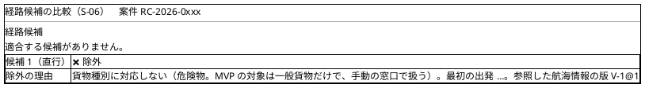
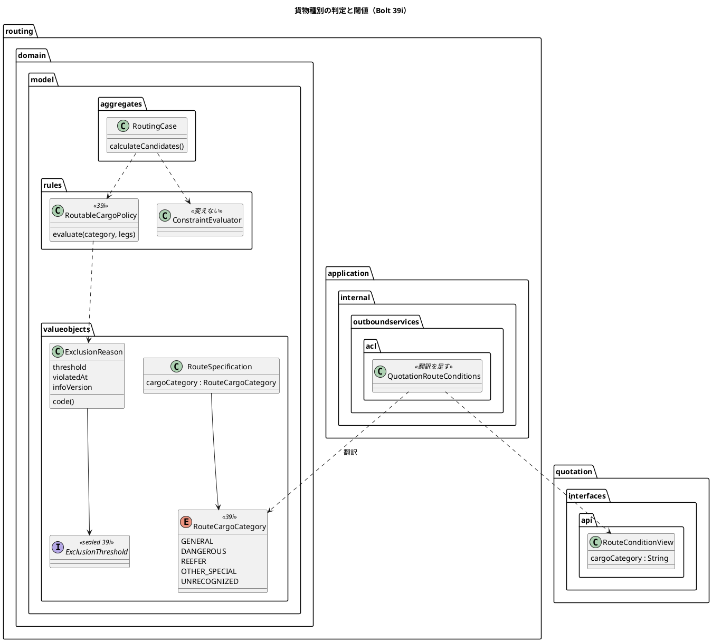
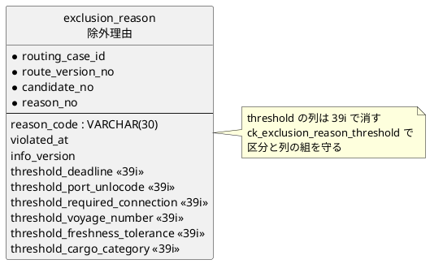

# Bolt 39i 計画 - 経路設計の貨物種別で候補を除外し、除外理由の閾値を区分ごとの型と列にする

## 基本情報

| 項目 | 内容 |
| :--- | :--- |
| Bolt | 第 39i 回（W7 の 39 本目。W7 の最後の Bolt。release_plan :987 の 39i の行。行の内容を正とする） |
| 状態 | 計画（**承認済み**。2026-11-13 に確認ポイント CP-1〜CP-7 を推奨のとおり承認（データベースの変更と【前の決定の変更】(32)〜(34) を含む）。human:kakimomokuri） |
| 予定 | W7（2026-11-16 の週）。順序は 39h4 の後（release_plan :989。39h4 の終了報告は 2026-11-13 に承認済み）。作業は約 3 時間 30 分（210 分。決定 (1)。初稿は 192 分）。行番号の基準は `191290f90`（2026-11-13 の開始準備で引き直した。経路設計と見積りの本体（`routing`・`quotation` の main）は旧い基準 `1a393a2e3` から 39h4 まで 1 行も変わっていないことを `git diff 1a393a2e3..HEAD` で確かめた。設計文書と release_plan の行番号は動いたので引き直した）。ステップ 2 で作業ツリーの行番号をもう一度確かめる。下の「時間の配分と打ち切り」。`check`・`uiTest`・SonarQube・CI と承認の待ちを除く |
| アプローチ | アウトサイドイン（release_plan :987。状態の組み合わせの表を先に書く。T-182）。受入条件の中心は「一般貨物でない案件の候補は、すべて貨物種別の理由で除外され、確定に進めない」こと。ステップ 2 で受入シナリオを先に Red にし、緑にしてから型と列を直す（型と列は振る舞いを変えない整理なので、緑の後に置く。決定 (1)） |
| 対象 | (1) 経路設計の貨物種別の判定 `RoutableCargoPolicy`（`CARGO_NOT_SUPPORTED`。【業務の判断】(bl)）、(2) 貨物種別の ACL と経路設計の型 `RouteCargoCategory`（D-65 の残り）、(3) S-06 の理由の文（【業務の判断】(bm)）、(4) 除外理由の閾値を区分ごとの型 `ExclusionThreshold` にする、(5) **スキーマの変更: `exclusion_reason.threshold` を区分ごとの 6 列に分ける**（確認ポイント 2）、(6) 制約適合判定の値の名前を決める（決定 (6)。改名しない）、(7) マニュアル 8 章・用語集 |
| トレース | BR-02・BR-03（requirements_definition :725・:726）、R-INV-02（domain_model :910）、US-06 AC2（user_story :287）と :295、UC-06 4b（system_usecase :474）、W6 の確認ポイント 11（release_plan :766）、W7 の確認ポイント 16（release_plan :928）、D-65 の残り（release_plan :784）、[Bolt 37c 計画](bolt_37c_plan.md) :174、[Bolt 37b2 終了報告](bolt_37b2_report.md) :97・:131、domain_model :967、data_model :519、test_strategy :232 |
| GitHub | 新しい Issue はない。US-06 の #15 は閉じている（user_story :312）ので開け直さない。#18（US-14）のクローズは 39h4 の終了報告の承認の後で、39i は数えない |
| SP | 0（release_plan :987） |
| 承認ゲート | **計画と終了報告で止める**（release_plan :987 の「計画と終了報告（構造・スキーマ）」、:895 の既定）。確認必須のものは確認ポイントにして計画の承認に含める（前例 bolt_37d2_plan.md :22）: データベース（確認ポイント 2）、構造（確認ポイント 3）、新しいファイル（確認ポイント 7）。認可・外部連携・本番の操作はない。各ステップは「ゲート: 既定」と書く |
| 開始準備で決めたこと | 下の (1)〜(10)（2026-11-13 の開始準備で、2026-11-10 の初稿を 39g〜39h4 の完了の後の状態で引き直した。推奨を 1 つに決めて書いた。承認済み。human:kakimomokuri）。【業務の判断】(bl)・(bm)、【前の決定の変更】(32)〜(34) |
| ラベルと台帳番号 | 前の Bolt（39g〜39h4）が済んだので連番に直した。【業務の判断】(bl)・(bm)（直前は 39h4 の (bk)）、台帳 D-154・D-155（直前は D-153）、【前の決定の変更】(32)〜(34)（直前は 39h4 の (31)）。台帳 D-154・D-155 は release_plan の台帳の表に、計画の承認の後に足す（仮。human の承認の記録は親が行う） |
| 確認ポイントの番号 | 下の表の # を CP-1〜CP-7 と呼ぶ（Bolt 39h3・39h4 の書き方）。本文の「確認ポイント n」は、この計画の表の # n（release_plan の W6・W7 の確認ポイントと区別するため、release_plan のものは「W6 の」「W7 の」と書く） |

## Bolt ゴール

一般貨物でない経路設計案件で候補を算出すると、経路設計者の S-06 に、すべての候補が「貨物種別に対応しない」の理由で除外と示され、確定に進めない（BR-02・BR-03、R-INV-02）。貨物種別の値は経路設計の型に翻訳され（ACL）、見積りの語彙が経路設計のドメインに直接入らない。除外理由の閾値は区分ごとの型と列になり、区切りの文字列を解く処理がなくなる。一般貨物の案件の振る舞いと確定と評価は変わらない。マニュアル 8 章と用語集が同じ語で説明している。

## 状態の組み合わせ（行ごとにテストを 1 本。T-182）

行の番号はこの計画で 1 から振る。テストは既存のクラスの `@Nested class Bolt39i_…`（新しいクラスは決定 (9)）。「種別」は `RouteCargoCategory`、「理由」は `ExclusionReason`。

| 行 | 状況 | 期待 | 確かめ方 |
| :--- | :--- | :--- | :--- |
| 1 | 判定: 一般貨物 | 理由は空 | 単体（`RoutableCargoPolicyTest`） |
| 2 | 判定: 特殊貨物（パラメーター: `DANGEROUS`・`REEFER`・`OTHER_SPECIAL`） | 候補に理由が 1 つ（`CARGO_NOT_SUPPORTED`、閾値はその種別。入力と期待の組まで縛る。T-244） | 単体 |
| 3 | 判定: 知らない値（`UNRECOGNIZED`。【業務の判断】(bl)。B-INV-04 の前例） | 除外（閾値は `UNRECOGNIZED`）。一般貨物として通さない | 単体 |
| 4 | 不適合の時刻と参照情報版（3 区間の候補。区間ごとに出発予定と情報版が違う。【業務の判断】(bm)） | 時刻は最初の区間の出発予定、参照情報版は最初の区間の航海の採用情報版（2 区間目・3 区間目の値でない） | 単体 |
| 5 | 算出: 特殊貨物の案件に候補が 3 つ（直行、積替え 1 回、積替え 2 回） | 3 つとも除外、適合 0 件、`CandidateCalculation` の数えは算出した件数のまま、候補の順は到着予定の早い順（PRESENTATION_ORDER のまま） | 単体（`RoutingCaseTest`） |
| 6 | 理由の順（接続不足・期限超過・情報不足・貨物種別がすべて当たる候補） | 接続 → 期限超過 → 情報不足 → 貨物種別の順で 4 つ（`withAddedReasons` の後ろ。決定 (3)。今の 3 つの順は変えない） | 単体 |
| 7 | 候補が 0 件の算出（特殊貨物） | 候補 0 件のまま（理由を作らない）。**`RoutableCargoPolicy.evaluate(category, List.of())` は空の区間でも例外にせず空を返す**（`ConstraintEvaluator` :32-34 は空の区間を例外にするが、貨物種別の理由は最初の区間の時刻と版を使うので、区間のない候補には理由を作らない） | 単体（`RoutingCaseTest`・`RoutableCargoPolicyTest`） |
| 8 | 再算出（候補提示済みの特殊貨物の案件） | 候補を入れ直し、同じ理由 | 単体 |
| 9 | 一般貨物の今の判定 | 変わらない（理由の順と値が同じ） | 既存の Golden G-01〜03・G-06 |
| 10 | 確定: 貨物種別の理由で除外の候補を選ぶ | `CANDIDATE_EXCLUDED`（今の順のまま） | 単体（`RoutingCaseConfirmationTest`） |
| 11 | 確定: 39i より前に適合で算出した特殊貨物の候補（貨物の再判定なし。決定 (3)） | 今のまま進む（確定のときは貨物種別を判定しない。起きる行がないことは決定 (3)） | 単体（呼び出しの確かめ） |
| 12 | 評価: 確定した経路の案件が特殊貨物 | 例外にならない（貨物種別は `RedesignReasonCode.from` を通らない。domain_model :980 の「鮮度と貨物種別は見ない」のまま） | 単体（`RoutingCaseEvaluationTest`） |
| 13 | `RedesignReasonCode.from(CARGO_NOT_SUPPORTED)` | 例外のまま | 既存（RedesignReasonCodeTest.java :24） |
| 14 | ACL: 見積りの 4 つの名前（パラメーター） | `GENERAL`・`DANGEROUS`・`REEFER`・`OTHER_SPECIAL` がそれぞれ同じ意味の種別に写る（組まで縛る） | 単体（`QuotationRouteConditionsTest`） |
| 15 | ACL: 知らない名前（パラメーター: `GENERAL2`、小文字の `general`、空文字） | `UNRECOGNIZED` に写す。WARN のログを 1 回。例外にしない（案件は作られる） | 単体 |
| 16 | DE-16: 特殊貨物の案件の依頼 | 案件が作られ、種別が写る（止めない。W6 の確認ポイント 11） | 単体（`RoutingCaseOpeningEventHandlerTest`） |
| 17 | 契約: 見積りの `CargoCategory.values()` の名前のすべて | `UNRECOGNIZED` に写らない（見積りに値が増えたら落ちる） | 統合（`com.example.cargotracker.integration`。`CargoCategoryMappingIntegrationTest`） |
| 18 | `cargo_category` の往復（パラメーター: 5 値） | 書いて読み直して同じ種別（列は VARCHAR(30) のまま、CHECK を足さない） | 統合（H2 と PostgreSQL） |
| 19 | 誤った入力: `cargo_category` が種別にない行 | 壊れた行として例外（既定の値で受けない。理由の区分の読み戻しの `ExclusionReasonCode.valueOf`（MyBatisRoutingCaseRepository.java :344）と同じ。`cargo_category` には CHECK がないので、行は jdbc の UPDATE で作る）。**`exclusion_reason` の貨物種別の閾値の列（ステップ 2 の間は今の `threshold`）に種別にない文字列**を入れた行の読み戻しも、同じく例外（決定 (5c) 4・5） | 統合 |
| 20 | `ExclusionThreshold` の 5 区分（パラメーター） | 区分の値と `ExclusionReason.code()` の組が 1 対 1（区分と閾値の不一致が型で作れない） | 単体（`ExclusionThresholdTest`） |
| 21 | 誤った入力: `ExclusionReason` の閾値・時刻・参照情報版の null | 例外（今の 3 つの守りのまま。`ExclusionReason.java` :37-49 の組み合わせの確かめは型に移る） | 単体 |
| 22 | 誤った入力: 閾値の値の null（パラメーター: 期限なし、港なし、接続時間なし、航海番号なし、許容時間なし、種別なし） | 例外 | 単体 |
| 23 | 保存の往復: 5 区分（パラメーター） | 書いて読み直して同じ（H2 と PostgreSQL） | 統合（`MyBatisRoutingRepositoriesIntegrationTest`） |
| 24 | 往復: 情報不足の航海番号に空白を含む（`IT STALE 1`） | 空白を含んだまま読み戻せる。「最後の空白で分ける」処理がなくなる（bolt_37b2_report.md :111） | 統合（:194 の `threshold` の確かめを 2 つの列の確かめに直す） |
| 25 | スキーマ: 誤った組の行（パラメーター: 期限超過に港がある、接続不足に接続時間がない、接続できないに港がない、情報不足に航海番号がない、貨物種別に種別がない、すべて NULL） | CHECK `ck_exclusion_reason_threshold` で拒否 | 統合 |
| 26 | スキーマ: 列と注 | `threshold` がなく 6 列がある。列のコメントがある。Mapper の列と表が合う | 統合（`SchemaCommentIntegrationTest`）・`MapperSchemaArchitectureTest` |
| 27 | 移し替え: 5 区分の既存の行（情報不足は空白を含む航海番号、貨物種別は移し替えの前のステップで保存した形。決定 (5)） | それぞれの列に移り、行数が同じ。**理由が消えて除外の候補が適合に変わらない**（`conforming` は理由が空かで決まる。ConstraintEvaluation.java :29-31） | 統合（H2 と PostgreSQL。新しい `ExclusionReasonThresholdMigrationIntegrationTest`。Flyway の `target` で手前まで流して行を入れ、残りを流す）。**誤った入力の派生（決定 (5c)）**: 閾値が NULL の行、区切りのない接続不足・情報不足の行を入れて流すと、`ck_exclusion_reason_threshold` で失敗し、PostgreSQL では巻き戻って移し替えの前の列と行が残る（既定の値で通さない） |
| 28 | 開発データの見本（`db/dev-data` の案件 `…000942` の候補 3〜5 の除外の 3 行。V20261007120900 :129-131） | 移し替えの後に S-06 の除外の文が今と同じ | `DevSampleDataSmokeTest`（H2）。**今の試験は案件 …000942 の除外理由を見ていない（`oldest_info_acquired_at` の確認だけ）ので、3 候補の理由の文を確かめる確認を新しく足す**。H2 の `CAST('…Z' AS TIMESTAMP WITH TIME ZONE)` を実際に流す場所でもある |
| 29 | 画面: 除外の文（パラメーター: `GENERAL` を除く 4 値。決定 (4)、【業務の判断】(bm)） | 種別ごとの全文が決定 (4) の文と一字ずつ一致する | 単体（`RoutingCaseViewsTest`） |
| 30 | 画面: すべて除外（特殊貨物の案件） | 導入文は決定 (4) の差し替えの文（「適合する候補がありません。この案件の貨物は MVP の対象外のため、手動の窓口で扱ってください。」。データ責任者への依頼の文は出ない）、候補ごとの理由、「この候補で確定へ」は 0 個。理由が貨物種別と別の区分の混在のときは今の導入文のまま | 単体（`RoutingCaseControllerTest`） |
| 31 | 画面: 今の 4 区分の文（`ExclusionThreshold` にした後） | 今の文のまま | 既存（RoutingCaseViewsTest） |
| 32 | 画面: 貨物種別で除外の候補で区間が今の航海と合わない（Bolt 39f2 の【業務の判断】(z)） | 「古くなった候補」と示す（(z) のまま。貨物の判定だけ別扱いにしない。再算出しても除外のままなのは受け入れる（(bl)）） | 単体 |
| 33 | 受入（業務ルール層。`route_candidates.feature`。パラメーター: 危険物・冷凍・その他特殊） | 案件の候補がすべて除外で、理由の区分「貨物種別」、不適合の時刻、閾値（その種別）、参照情報版が示される | 受入シナリオ（タグ `@US-06-AC2 @BR-02 @BR-03 @R-INV-02`） |
| 34 | マニュアル | 8 章 :76 の理由の順、:127 付近の項目、用語集の文が実装と一字ずつ一致する | ステップ 9 の突き合わせの記録（T-197・T-251） |
| 35 | 今の振る舞い | 経路設計の受入シナリオ（`route_candidates.feature` の既存・`compare_route_candidates_ui.feature`・`confirm_route.feature`・`evaluate_confirmed_route.feature`・`special_cargo_golden_v0.feature`）と `DevSampleDataSmokeTest`・`ModularityTest`・`LayerArchitectureTest` | 既存のシナリオとテスト |

## 開始準備の決定

(1) **範囲と見積り**: release_plan :987 の 1 行をコードで確かめて見積もると初稿は 192 分（約 3 時間 12 分）だった。2 つの整合性検証の指摘（ステップ 3 のテストを書く時間と、前例のない Flyway `target` の統合テストが短い）で +18 分して **210 分（約 3 時間 30 分）** にし、目安（4 時間 05 分。T-250）に 35 分の余りがある。**分けない**（推奨。確認ポイント 1）。

| 内訳 | 分 |
| :--- | ---: |
| 分けて増えない土台（設計の文書 20、Red 15、品質ゲート 30、終了報告 10） | 75 |
| 貨物種別の型と ACL（`RouteCargoCategory`、`QuotationRouteConditions`、保存の読み書き。行 14〜19） | 15 |
| 貨物の規則と算出（`RoutableCargoPolicy`、`calculateCandidates` の 1 行、行 1〜13） | 10 |
| 画面の文（行 29〜32） | 6 |
| 受入シナリオの例と Steps（行 33） | 8 |
| 閾値の型（`ExclusionThreshold`、`ExclusionReason` の組み替え。行 20〜22） | 12 |
| 既存のテストの直し（T-217。`new RouteSpecification(` は src に 22 行で、うちテスト 20 行（2026-11-13 に `git grep` で数え直した。初稿の 20・18 から増えた分は、数え方の違いか 39h4 までの追加かをステップ 2 の一覧で確かめる）。`reason.deadline()` などの写し） | 8 |
| マイグレーションと保存（列 6 つ、CHECK、`ExclusionReasonRow`・Mapper・リポジトリ。行 23〜26） | 16 |
| 既存の行の移し替えの統合テスト（行 27。H2 と PostgreSQL。前例のない `target` の形。初稿の 8 から +10） | 18 |
| Red のテストを書く増え（ステップ 3。初稿の 15 から +8） | 8 |
| 開発データの確かめ（行 28） | 2 |
| マニュアル 8 章と用語集（行 34。キャプチャは撮り直さない。決定 (8)） | 6 |
| 文書の増え（設計の文書 20 を超える分。ステップ 1 の一覧） | 8 |
| 変異 19（手本の 1 分/個。初稿の 15 から V16〜V19 の +4 は 35 分の余りで吸収）の一部と文の突き合わせ 3（T-197・T-251） | 18 |
| **合計** | **210（約 3 時間 30 分）** |

比べた案: (i) **このまま 1 本（210 分。推奨）**。(ii) 閾値の型と列を別の Bolt に分ける（39i の残りは約 2 時間、分ける方は約 1 時間 30 分。土台が二重になり W7 の本数が増える）。**超えそうなときの分け方**: ステップ 6（受入シナリオの緑）の終わりで累計が 114 分の見込みに対して 30 分を超えて遅れていたら、ステップ 7・8（行 23〜28。列の分割と移し替え）を **39i2** に縦に分けて止めて諮る。閾値の型はステップ 2 で入るので、そこまでで貨物種別の判定と閾値の型は通しで動き（保存は今の `threshold` の 1 列に、閾値の型ごとの文字列を書く。決定 (5b)）、振る舞いの価値は届く。

(2) **貨物種別の ACL と経路設計の型**（D-65 の残り）: 今は見積りの名前の文字列がそのまま経路設計に入る（`RouteConditionView.java` :16・:24、`QuotationRouteConditions.java` :25-26、`RouteSpecification.java` :14・:18）。経路設計の判定をこの名前に結びつけないよう、経路設計の型 `RouteCargoCategory`（`routing.domain.model.valueobjects`。`GENERAL`・`DANGEROUS`・`REEFER`・`OTHER_SPECIAL`・`UNRECOGNIZED`）を足し、翻訳を ACL の 1 か所（`QuotationRouteConditions.java`。`application.internal.outboundservices.acl`。第 3 章 :140、ADR-017）に置く。

- 公開 API `RouteConditionView.cargoCategory` は文字列のまま（公開 API は共有カーネルの型と文字列だけ。bolt_17_report.md :118）。`routing` の `allowedDependencies` は変えない（`package-info.java` :8-14。`quotation :: api` のまま）
- 知らない名前は `UNRECOGNIZED` に写し WARN を出す（例外にすると DE-16 の listener が失敗して再配信が続く。行 15）。案件は作る（行 16）
- `RouteSpecification.cargoCategory` の型を `RouteCargoCategory` にする。保存の列は `cargo_category` VARCHAR(30) のまま（V20261007100000 :17）で、名前を書き、読むときは `valueOf`（MyBatisRoutingCaseRepository.java :249・:389。行 18・19）
- 比べた案: (i) 型と ACL（推奨。D-65 の「貨物種別の ACL」を片付ける）、(ii) 文字列のまま規則で比べる（`BookableCargoPolicy.java` :13-21 の前例。変更は小さいが、見積りの語彙が経路設計に残り、D-65 が残る）

(3) **判定の置き場所**: 規則 `RoutableCargoPolicy`（`routing.domain.model.rules`、`@DomainRule`、`final`。形は `BookableCargoPolicy`）の `static List<ExclusionReason> evaluate(RouteCargoCategory category, List<Leg> legs)`。`RoutingCase.calculateCandidates`（RoutingCase.java :199-204）で情報鮮度の理由の後ろに `.withAddedReasons(...)` で足す。**`ConstraintEvaluator` には入れない**: 確定（RoutingCase.java :283）と評価（:370）が同じ規則を通るので、入れると評価が `CARGO_NOT_SUPPORTED` を受けて `RedesignReasonCode.from`（RedesignReasonCode.java :27-33）の例外になる。貨物種別は輸送要求版の写しで算出の後に変わらないので、確定と評価で判定し直す理由もない。domain_model :980・:984 の「鮮度と貨物種別は見ない」を守る。

- 確定は変えない: 除外の候補は `CANDIDATE_EXCLUDED` で止まる（行 10）。行 11 の「39i より前に適合で算出した特殊貨物の候補」は、提出で拒むので通常の流れでは作られず（MvpAcceptancePolicy.java :14-15、Q-INV-02）、`db/dev-data` にも `DANGEROUS` などの案件はない（git grep で確かめた）。ステージング・本番の行は確かめられないが、同じ理由で作られない
- 理由の順は今の順の後ろに貨物種別（行 6）。今の順を変えない（マニュアル 8 章 :76 は「接続、期限超過、情報不足の順」）
- `RedesignReasonCode.java` :24-25 の Javadoc「判定するようになったら写しを見直す」は、見直して変えない理由に直す
- 比べた案: (i) 別の規則で算出のときだけ（推奨）、(ii) `ConstraintEvaluator` に入れる（ConstraintEvaluation の説明の「貨物種別」とは合うが、確定と評価の分岐が増える）、(iii) 算出の前に案件を止める（W6 の確認ポイント 11 が「経路設計に止めを足さない」と決めた）

(4) **S-06 の文**（T-251。文は【業務の判断】(bm) の文から写す）: `RoutingCaseViews.reason` の `CARGO_NOT_SUPPORTED`（RoutingCaseViews.java :416）を次にする。種別の名前は ui_design :979 の語（画面の語は「一般」「危険物」「冷凍」「その他特殊」。`CargoDisplayNames` と同じ）。業務の文の「冷凍貨物」「その他特殊貨物」（user_story :63・:249）ではなく、画面の語にそろえる（理由の文の括弧の中は種別の名前だけで、「貨物」を重ねない）。全文は次の 4 行（行 29 の期待とマニュアル・用語集はこの文に一字ずつ合わせる。T-251）:

| 種別 | 文（省略せず全文。「最初の出発 …」「参照した航海情報の版 …」の部分は例の値） |
| :--- | :--- |
| `DANGEROUS` | 「貨物種別に対応しない（危険物。MVP の対象は一般貨物だけで、手動の窓口で扱う）。最初の出発 2026-11-03 21:00 JST。参照した航海情報の版 V-1@1」（「。参照した航海情報の版 」は定数 `INFO_VERSION`（:37）） |
| `REEFER` | 「貨物種別に対応しない（冷凍。MVP の対象は一般貨物だけで、手動の窓口で扱う）。最初の出発 2026-11-03 21:00 JST。参照した航海情報の版 V-1@1」 |
| `OTHER_SPECIAL` | 「貨物種別に対応しない（その他特殊。MVP の対象は一般貨物だけで、手動の窓口で扱う）。最初の出発 2026-11-03 21:00 JST。参照した航海情報の版 V-1@1」 |
| `UNRECOGNIZED` | 「貨物種別に対応しない（不明な貨物種別。MVP の対象は一般貨物だけで、手動の窓口で扱う）。最初の出発 2026-11-03 21:00 JST。参照した航海情報の版 V-1@1」 |

**導入文の差し替え**（検証の指摘。`templates/routing/staff/routing-cases/show.html` :76）: 今の導入文は「適合する候補がありません。除外の理由を確かめ、航海の情報や接続時間規則の確認をデータ責任者に依頼してください。」で、貨物種別の除外では候補ごとの理由（手動の窓口で扱う）と案内が逆になる。**候補のすべての理由が貨物種別だけのときは、導入文を「適合する候補がありません。この案件の貨物は MVP の対象外のため、手動の窓口で扱ってください。」に差し替える**（推奨。比べた案: 直さない = 画面の中で案内が矛盾する。UC-06 3a の理由の表示と引き継ぎは W8 に送ってあるが、その前でも矛盾した案内を出さない）。判定は画面の組み立て（`RoutingCaseViews`）で、候補の理由がすべて `CARGO_NOT_SUPPORTED` かで決める。行 30 の期待に含める。画面イメージは実際の画面に合わせて直した。`RedesignReasonCode` ほかは変えない。再算出を促す「古くなった候補」の案内は特殊貨物では役に立たないが、(bl) の受け入れること（行 32）として残し、マニュアル 8 章 :94 の説明に 1 文を添える（ステップ 9 のマニュアル）。

(5) **スキーマの変更: `threshold` の列を分ける**（データベース。確認ポイント 2。【前の決定の変更】(32)）: 今は `exclusion_reason.threshold` VARCHAR(100) に区分ごとの文字列を詰め（V20261007100000 :90、data_model :519）、読むときに区切りを解く（MyBatisRoutingCaseRepository.java :333-372）。**1 つの共通のマイグレーション `V2026111xxxxxxx__split_routing_exclusion_reason_threshold.sql`（版は着手のときの最新より新しくする）で分ける**。

| 列 | 型 | 値を持つ区分 |
| :--- | :--- | :--- |
| `threshold_deadline` | TIMESTAMP WITH TIME ZONE | 期限超過 |
| `threshold_port_unlocode` | CHAR(5)（`connection_rule.port_unlocode` と同じ。V20261007100000 :128） | 接続不足・接続できない |
| `threshold_required_connection` | VARCHAR(30)（ISO 8601 の期間） | 接続不足 |
| `threshold_voyage_number` | VARCHAR(30)（`voyage.voyage_number` と同じ） | 情報不足 |
| `threshold_freshness_tolerance` | VARCHAR(30)（ISO 8601 の期間） | 情報不足 |
| `threshold_cargo_category` | VARCHAR(30)（`routing_case.cargo_category` と同じ） | 貨物種別 |

```sql
-- 手順（H2 と PostgreSQL の共通の構文。ADR-007）
ALTER TABLE routing.exclusion_reason ADD COLUMN threshold_deadline TIMESTAMP WITH TIME ZONE;
-- ほかの 5 列も同じく足す
UPDATE routing.exclusion_reason SET threshold_deadline = CAST(threshold AS TIMESTAMP WITH TIME ZONE)
  WHERE reason_code = 'DEADLINE_EXCEEDED';
UPDATE routing.exclusion_reason SET threshold_port_unlocode = SUBSTRING(threshold FROM 1 FOR 5),
  threshold_required_connection = SUBSTRING(threshold FROM 7)
  WHERE reason_code = 'CONNECTION_TOO_SHORT' AND POSITION(' ' IN threshold) > 0;
UPDATE routing.exclusion_reason SET threshold_port_unlocode = threshold WHERE reason_code = 'NOT_CONNECTABLE';
-- 航海番号は空白を含み得るので正規表現で最後の空白で分ける（Bolt 37b2）
UPDATE routing.exclusion_reason SET threshold_voyage_number = REGEXP_REPLACE(threshold, ' [^ ]*$', ''),
  threshold_freshness_tolerance = REGEXP_REPLACE(threshold, '^.* ', '')
  WHERE reason_code = 'INFO_INSUFFICIENT' AND POSITION(' ' IN threshold) > 0;
UPDATE routing.exclusion_reason SET threshold_cargo_category = threshold WHERE reason_code = 'CARGO_NOT_SUPPORTED';
ALTER TABLE routing.exclusion_reason ADD CONSTRAINT ck_exclusion_reason_threshold CHECK (
  (reason_code = 'DEADLINE_EXCEEDED' AND threshold_deadline IS NOT NULL AND threshold_port_unlocode IS NULL
     AND threshold_required_connection IS NULL AND threshold_voyage_number IS NULL
     AND threshold_freshness_tolerance IS NULL AND threshold_cargo_category IS NULL)
  OR (reason_code = 'CONNECTION_TOO_SHORT' AND threshold_port_unlocode IS NOT NULL AND threshold_required_connection IS NOT NULL
     AND threshold_deadline IS NULL AND threshold_voyage_number IS NULL
     AND threshold_freshness_tolerance IS NULL AND threshold_cargo_category IS NULL)
  OR (reason_code = 'NOT_CONNECTABLE' AND threshold_port_unlocode IS NOT NULL AND threshold_deadline IS NULL
     AND threshold_required_connection IS NULL AND threshold_voyage_number IS NULL
     AND threshold_freshness_tolerance IS NULL AND threshold_cargo_category IS NULL)
  OR (reason_code = 'INFO_INSUFFICIENT' AND threshold_voyage_number IS NOT NULL AND threshold_freshness_tolerance IS NOT NULL
     AND threshold_deadline IS NULL AND threshold_port_unlocode IS NULL
     AND threshold_required_connection IS NULL AND threshold_cargo_category IS NULL)
  OR (reason_code = 'CARGO_NOT_SUPPORTED' AND threshold_cargo_category IS NOT NULL AND threshold_deadline IS NULL
     AND threshold_port_unlocode IS NULL AND threshold_required_connection IS NULL
     AND threshold_voyage_number IS NULL AND threshold_freshness_tolerance IS NULL));
ALTER TABLE routing.exclusion_reason DROP COLUMN threshold;
-- 列のコメントを足す（SchemaCommentIntegrationTest）
```

- **時間を文字列のままにする理由**: 今の形（`PT8H`・`PT24H`）を SQL で秒に換算すると H2 と PostgreSQL で共通に書けない。データモデルの今の表現（ISO 8601 の期間。data_model :519）を保つ
- **理由の行は消さない**: 候補を残したまま理由を消すと、除外の候補が適合に変わる（ConstraintEvaluation.java :29-31。行 27）
- `db/dev-data` の V20261007120900 は編集しない（Flyway のチェックサムが変わる）。行は移し替えで新しい列に移る（行 28。デモ環境は H2 のインメモリで起動のたびに流し直す。heroku_demo_setup.md :23・:62）
- 期限の `CAST` の H2 と PostgreSQL の受け取り方（`...T...Z` の文字列）と、`REGEXP_REPLACE` の両方の書き方は**確かめていない**。行 27 で確かめ、落ちたら止めて諮る（案: Java のマイグレーション。今の前例はない）
- **後方互換の規約への例外**（検証の指摘。【前の決定の変更】(34)。確認ポイント 2）: data_model :1268 と architecture_infrastructure :148 は「ローリングデプロイのため、列の削除・名前の変更は『追加 → 移行 → 削除』に分ける」と定めている（前例 Bolt 38g は 3 段で入れた）。今回は 1 つのマイグレーションで列を足し、移し、`threshold` を消す。**例外にする根拠**: ステージング・本番の環境は W10 までできない（release_plan :726 の D-85 の配備の時期、:773）。それまでの配備先はデモ環境（H2 のインメモリで、起動のたびに作り直し、旧版のアプリと並走しない）だけで、旧版が `threshold` を読んで落ちる現場がない。前例 `V20261022100000`（`DROP COLUMN confirmed_route_version_no`）は「書くだけで読まれない列」で今回とは違うが、同じく 1 回で足して消した。**W10 の後に同じ変更をするときは 3 段にする**（この例外は繰り返さない）。比べた案: (i) 1 回で足して消す（推奨。例外の根拠が成り立つ間に済ませる）、(ii) 足して移すだけにして、消すのを別の Bolt に送る（`threshold` と 6 列が二重に残り、書き手を 2 か所に持つ期間ができる。W10 の後に回すと 3 段になり W7 の返済が W10 に延びる）。現存する行はデモの H2 の見本だけなので、(5c) の本番・ステージングの件数の心配は、W10 の後に同様の変更をするときの確認になる。戻すときは逆のマイグレーションを書く（前進のみ。`DROP COLUMN` の後は閾値の元の文字列は 6 列から組み直す）
- 比べた案: (i) 列を分ける（推奨。CHECK で区分と値を守り、読むときに解かない）、(ii) `threshold` を 1 列のまま残し型だけ分ける（スキーマの変更なし。W7 の確認ポイント 16 の「列を分けること」が残り、区切りの処理が残る）、(iii) JSON の 1 列（H2 と PostgreSQL の差が増え、CHECK が書けない）

(5b) **閾値の保存の順**（検証の指摘で直した）: 閾値の型 `ExclusionThreshold` はステップ 2 で入れる（種別を運ぶ場所が旧い 8 成分の `ExclusionReason` にないので、貨物種別の判定より先に型を入れる。型を後にすると捨てる暫定の成分と `thresholdFields` が要る）。ステップ 2 の保存は今の `threshold` の 1 列のまま、閾値の型ごとに文字列へ書き（貨物種別は種別の名前）、読むときは閾値の型で分岐する（MyBatisRoutingCaseRepository.java :339・:370 の例外を外す）。ステップ 7 で区分ごとの列に移す。ステップ 7・8 を 39i2 に分けることになっても、貨物種別の判定と閾値の型が単独で動くため。

(5c) **既存の行と NULL の扱い**（スキーマの変更の一部。確認ポイント 2。2026-11-13 に `V20261007100000` :83-97 で確かめた）: 追加する 6 列は **すべて NULL を許す列**として足す（既存の行は足した時点で全列 NULL。NOT NULL にすると既存の行で足せない）。値の持ち主は CHECK `ck_exclusion_reason_threshold` が区分ごとに決める（上の SQL。持つ列は NOT NULL、持たない列は NULL。区分と列の組が 1 対 1）。次の 5 点を決める。

1. **今の `threshold` が NULL の行**: 列は NULL を許し CHECK もないが、`ExclusionReason` は閾値の null を拒む（ExclusionReason.java :37-49。行 21）ので、アプリは NULL の行を作らない。もし NULL の行があれば、移し替えの後は区分の列がすべて NULL になって CHECK に当たり、`ADD CONSTRAINT` が失敗する。**この失敗は止める側に倒す**（既定の値や空文字を詰めて通さない。壊れた行を黙って直さない。読み戻しの行 19 と同じ考え方）。PostgreSQL は DDL もトランザクションなので失敗したマイグレーションは巻き戻り、アプリは起動せず、データは元のまま残る。H2 はデモ環境のインメモリで起動のたびに作り直すので残らない
2. **区切りが壊れた行**（`CONNECTION_TOO_SHORT` の `threshold` に空白がない、`INFO_INSUFFICIENT` に空白がないなど）: 上の 1 と同じく、`SUBSTRING`・`REGEXP_REPLACE` が片方の列を NULL か空にして CHECK に当たる。空文字は NULL でなく CHECK を通ってしまうので、`UPDATE` の `WHERE` に「区切りがあること」（`POSITION(' ' IN threshold) > 0`）を足し、区切りのない行は NULL のままにして CHECK で止める
3. **`violated_at`・`info_version`**: 今も NULL を許す列のまま変えない。`ExclusionReason` が null を拒む（ExclusionReason.java :37-49）ので、これも NULL の行はアプリが作らない。CHECK に足さない（39i の範囲の外。足すと既存の NULL の行で失敗する範囲が広がる）
4. **貨物種別の列の値の範囲**: `threshold_cargo_category` に値の CHECK（`GENERAL` などの列挙）は足さない。`routing_case.cargo_category` に CHECK がない前例（V20261007100000 :17）と、`UNRECOGNIZED` を保存できることを守るため。読み戻しで知らない値を拒む（行 19）。`threshold_cargo_category` の不明な文字列の行の読み戻しも例外とする（行 19 に含める）
5. **空文字と前後の空白**: CHECK は NULL かどうかしか見ないので、`threshold = ''` の `NOT_CONNECTABLE`・`CARGO_NOT_SUPPORTED` や、`'SGSIN '`（接続時間が空）、`' PT24H'`（航海番号が空）は CHECK を通る。アプリが作らない形なので CHECK を重くせず許容し、**読み戻しで値の型の生成（`Location`・`Duration`・航海番号の非空・`RouteCargoCategory.valueOf`）が拒む**ことで止める（行 19・22）

本番・ステージングの行を事前に数える道具は運用手順書にない（`docs/operation` の定義済みのタスクだけを使い、独自のスクリプトは作らない）。上の 1・2 は失敗を止める側に倒すことで受け、デプロイが止まったときの手順は終了報告の議題に書く。**行 27 で確かめる**: NULL の閾値の行・区切りのない行を入れた状態で移し替えが CHECK で失敗する（行 25 の新しい派生として行 27 の中に置く）。

(6) **値の名前**（release_plan :928、bolt_37c_plan.md :174、bolt_37b2_report.md :97）: **`ConstraintEvaluation`（制約適合判定）は改名しない**。説明を「候補の算出のときの判定の結果（期限・接続・情報鮮度・貨物種別の理由）」に直す（ConstraintEvaluation.java :12、domain_model :157）。R-INV-02 は 4 区分を「除外の理由」として同じ列挙に置いており、「制約」は業務の語として情報鮮度と貨物種別を含めて読める。規則 `ConstraintEvaluator` は期限と接続だけのまま（Javadoc を直す）。`ConstraintEvaluation` は src と docs の 15 ファイルにあり、src だけで 39 か所で、改名しても振る舞いの価値がない。比べた案: (i) 改名しない（推奨）、(ii) `CandidateJudgement` などに改名（用語集の整合テストと文書も直す。+約 15 分。意味は変わらない）。

(7) **閾値の型**: `ExclusionThreshold`（`routing.domain.model.valueobjects`、sealed interface）に区分ごとの record 5 つ（`ArrivalDeadline(UtcInstant deadline)`、`MinimumConnection(Location port, Duration required)`、`ConnectionRuleMissing(Location port)`、`StaleVoyageInfo(String voyageNumber, Duration tolerance)`、`UnsupportedCargo(RouteCargoCategory category)`）。名前は検証の指摘で直した: 見積りの `CargoCategory`（用語集 :111）と単純名が衝突しないよう `UnsupportedCargo` にし、用語集が分けている「情報鮮度」の語に近い `InfoFreshness` を避けて `StaleVoyageInfo` にした。**注釈と用語集**（`LivingGlossaryConsistencyTest` は `@ValueObject` を付けた型の単純名を用語集に要求する）: `RouteCargoCategory` と `ExclusionThreshold` には `@ValueObject` を付け、用語集に行を足す（貨物種別（経路設計）／除外の閾値。Javadoc の最初の語を日本語名に合わせる）。入れ子の record 5 つには付けない（`ExclusionThreshold` の Javadoc に区分を書く。`DddAnnotationArchitectureTest` が要求したら止めて諮る）。`RoutableCargoPolicy` は規則なので、用語集ではなく domain_model のドメインルールの表（:921-925）に載せる。`ExclusionReason.infoAcquiredAt()` は `ExclusionReason` に残し、閾値が `StaleVoyageInfo` のときだけ値を返す（不適合の時刻から許容時間を引く今の計算を変えない。使い手 RoutingCaseViews.java :419・RoutingCaseViewsTest・InfoFreshnessPolicyTest は呼びを変えない）。`ExclusionReason` は `(ExclusionThreshold threshold, UtcInstant violatedAt, String infoVersion)` にし、`code()` は閾値から決める（区分と閾値の不一致を作れない。ExclusionReason.java :37-60 の `thresholdFields` の組み合わせの確かめがなくなる。Bolt 37b2 の開発レビューの指摘 1）。ファクトリー（`deadlineExceeded` など）は残す（呼び手を変えない）。`deadline()` などのアクセサーと `deadlineThreshold()`・`portThreshold()`・`requiredConnectionThreshold()` はなくし、読む側（RoutingCaseViews.java :399-422、MyBatisRoutingCaseRepository.java :333-372、RoutingSteps.java :370-375、InfoFreshnessPolicyTest.java :96-100）は閾値の型で分岐する。比べた案: (i) sealed interface（推奨）、(ii) 今の 8 成分の record のまま（組み合わせの確かめが残り、区分が増えるたびに成分が増える）。

(8) **マニュアルとキャプチャ**（T-251。用語は下の「業務の判断の記録」の文から写す）: 08-経路設計.md の :76 の理由の順を「接続、期限超過、情報不足、貨物種別の順」に直し、:127 付近に「貨物種別が一般貨物でない案件は、すべての候補が除外され確定できない。手動の窓口で扱う」の 1 項目を足す。用語集に「貨物種別」の行を足す（今は 03 章 :86 に語があり用語集にない）。**キャプチャは撮り直さない**（通常の流れでは特殊貨物の案件が作られず、開発データの見本にもない。行 3・行 33 は業務ルール層と単体で確かめる。前例 user_story :250 の US-04 AC5）。**動画は撮らない**（release_plan :995 のデモ項目に 39i がない。動画は「画面の振る舞いが変わる Bolt」で、39i の文は通常の流れでは出ない。W7 のデモの動画は 39h）。

(9) **新しい型の名前**（T-246。`apps/cargo-tracker/src` を大文字小文字を区別せず `RouteCargoCategory`・`RoutableCargoPolicy`・`ExclusionThreshold`・`UNRECOGNIZED`・`Bolt39i`・`threshold_port`・`threshold_deadline`・`QuotationRouteConditionsTest`・`CargoCategoryMapping` で検索し、ないことを確かめた。入れ子の record の名前は `UnsupportedCargo`・`StaleVoyageInfo`・`ArrivalDeadline`・`MinimumConnection`・`ConnectionRuleMissing` も同じ検索をステップ 1 で行う。単純名 `CargoCategory` は見積りにあり、衝突を避けて使わない）: `RouteCargoCategory`、`RoutableCargoPolicy`、`ExclusionThreshold` と 5 つの record、`ExclusionReason.cargoNotSupported`、テスト `RoutableCargoPolicyTest`・`QuotationRouteConditionsTest`・`CargoCategoryMappingIntegrationTest`・`ExclusionThresholdTest`・`ExclusionReasonThresholdMigrationIntegrationTest`。

(10) **層の規則とガイドライン**（第 3 章、ADR-017、T-125）: 型は `domain.model.valueobjects`、規則は `domain.model.rules`、ACL は既存の `application.internal.outboundservices.acl`。公開 API の形は変えない（`quotation.interfaces.api`）。新しいコンテキスト間の依存、イベントはない（ADR-014 の通知の方向も変わらない。読むだけ）。**規則の例外は要らない見込み**で、当たったら置き場所を動かさず止めて諮る。列挙型の `switch`（T-175）: `RouteCargoCategory` は ACL の写し（文字列の分岐）と画面の名前の 2 か所。`ExclusionThreshold` は今の `ExclusionReasonCode` の分岐（`RoutingCaseViews`・`MyBatisRoutingCaseRepository` の書く・読む）を置き換えるだけで増えない。循環的複雑度の上限（10）に当たらない見込み。

【前の決定の変更】(32)（確認ポイント 2。決定 (5)）: Bolt 37b2 の決定（`threshold` の 1 列に「港 空白 期間」「航海番号 空白 許容時間」を詰め、最後の空白で分ける。data_model :519、bolt_37b2_plan.md :113）を、区分ごとの列に分ける形に改める。W7 の確認ポイント 16（release_plan :928）と domain_model :967 が「39i で決める」としていたことの決定である。

【前の決定の変更】(33)（確認ポイント 3。決定 (3)）: Bolt 17 の確認ポイント 10（bolt_17_plan.md :435「貨物種別による除外は判定しない」）、US-06 の :295、domain_model :934、`ConstraintEvaluator.java` :25 の「R0.1 では判定しない」を、W6 の確認ポイント 11（release_plan :766）の予定どおり判定する形に改める。ただし評価（確定した経路の評価）が貨物種別を見ないこと（domain_model :980 の「鮮度と貨物種別は見ない」。変えない）と、確定が保存した除外の理由で止まり貨物種別を判定し直さないこと（確定は Bolt 37c で鮮度を見る。貨物種別を見ないのは 39i の新しい決定で、貨物種別は輸送要求版の写しで算出の後に変わらないため）を分けて書く。

【前の決定の変更】(34)（確認ポイント 2。決定 (5)）: data_model :1268・architecture_infrastructure :148 の後方互換の規約（列の削除は「追加 → 移行 → 削除」の 3 段）を、この変更に限って 1 つのマイグレーションにする例外とする。根拠はステージング・本番が W10 までないこと（release_plan :726・:773）。W10 の後は 3 段にする。ADR は作らない（domain_model の「Bolt 39i で決めたこと」と data_model に記録する。前例 Bolt 37b2・37c）。

直す既存のテストと文（T-217。ステップ 2 で一覧を確かめる）: `new RouteSpecification(` のテスト 20 行（`ConfirmedRouteEvaluationDeliveryIntegrationTest`、`RoutingCaseOpeningEventHandlerTest`、`GoldenDatasetCase` :109、`RoutingCaseConfirmationTest`、`RoutingCaseTest`、`VoyageRepositoryContract`、`ConstraintEvaluatorTest`、`RouteCandidateFinderTest`、`MyBatisRoutingCaseLockIntegrationTest`、`MyBatisRoutingRepositoriesIntegrationTest`、`MyBatisVoyageConcurrentUpdateIntegrationTest`、`RoutingAssignedScopeSecurityIntegrationTest`、`RoutingCaseControllerTest`、`StaffAssignedScopeUiSteps`、`UserAdministrationUiSteps`）、`RoutingSteps.java` :131-132・:370-375、`MyBatisRoutingRepositoriesIntegrationTest.java` :194、`InfoFreshnessPolicyTest.java` :96-100 と :113-147（旧 8 成分のコンストラクターで「作れない組み合わせ」を確かめる 3 本。型で作れなくなるので削除するか `ExclusionThresholdTest` に移す）、`RoutingCaseViewsTest`、`DevSampleDataSmokeTest`（確認を足す。行 28）。

### 守る既存のテスト（ステップ 2 の始めに流して緑を記録する。T-217。検証の指摘）

`LivingGlossaryConsistencyTest`（用語集。新しい型の関門）、`LayerArchitectureTest`・`ModularityTest`・`PublicApiArchitectureTest`・`DomainArchitectureTest`・`DddAnnotationArchitectureTest`・`AcceptanceStepArchitectureTest`・`MapperSchemaArchitectureTest`、`SchemaCommentIntegrationTest`、`RedesignReasonCodeTest`（行 13）、`ConstraintEvaluatorTest`・`InfoFreshnessPolicyTest`・`RoutingCaseTest`・`RoutingCaseConfirmationTest`・`RoutingCaseEvaluationTest`、`RoutingCaseGoldenDatasetTest`（G-01〜G-06c）、受入シナリオ（`route_candidates.feature`・`compare_route_candidates_ui.feature`・`confirm_route.feature`・`evaluate_confirmed_route.feature`・`special_cargo_golden_v0.feature`）、`MyBatisRoutingRepositoriesIntegrationTest`、`DevSampleDataSmokeTest`、`documentationTest`（照合の表）。期待が変わるもの: `RoutingCaseViewsTest`・`InfoFreshnessPolicyTest`（上の直し）、`MyBatisRoutingRepositoriesIntegrationTest` :194（`threshold` の確かめをステップ 7 で 2 列の確かめに直す）。

新しいファイル: 上の決定 (9) の本体 3 つ（`RouteCargoCategory`、`RoutableCargoPolicy`、`ExclusionThreshold`）とテスト 5 つ、マイグレーション 1 つ。直すもの: `RouteSpecification`・`QuotationRouteConditions`・`RoutingCase`・`ExclusionReason`・`ExclusionReasonCode`（Javadoc）・`ConstraintEvaluator`（Javadoc）・`ConstraintEvaluation`（Javadoc）・`RedesignReasonCode`（Javadoc）・`InfoFreshnessPolicy`（ファクトリーの呼びは変えない）・`RoutingCaseViews`・`MyBatisRoutingCaseRepository`・`ExclusionReasonRow`・`RoutingCaseMapper.xml`、上のテスト、受入シナリオ `route_candidates.feature`（と `special_cargo_golden_v0.feature` の説明 :8）、マニュアル 8 章と用語集、`show.html`（導入文の差し替え。決定 (4)）。

### 前の Bolt から引き継いだもの

| 出典 | 内容 | この計画 |
| :--- | :--- | :--- |
| release_plan :987、W7 の確認ポイント 16（:928） | 貨物種別の判定、ACL、閾値の型と列、値の名前 | 全体 |
| W6 の確認ポイント 11（:766）、test_strategy :232、special_cargo_golden_v0.feature :8 | 経路設計に止めを足さず、貨物種別の判定は W7 | 決定 (3)、行 16・33 |
| D-65 の残り（:784）、bolt_17_report.md :131 | 貨物種別の ACL | 決定 (2)、行 14〜19 |
| bolt_37b2_report.md :19・:97・:131、bolt_37c_plan.md :174、domain_model :967 | 閾値の型、`threshold` の列、値の名前 | 決定 (5)〜(7)、行 20〜28 |
| Bolt 39f2 の【業務の判断】(z) | 除外の候補の「古くなった候補」 | 行 32。(z) のまま |

### 開始準備で確かめたこと（2026-11-13。行番号の基準のコミットは `191290f90`。`routing`・`quotation` の main と `db/migration` の routing の分は `1a393a2e3`（初稿の基準）から変わっていない。`git diff --stat 1a393a2e3..HEAD` で、main の routing・quotation の差分が 0 件、マイグレーションの差分が tracking の 7 本だけであることを確かめた。最新のマイグレーションの版は `V20261115100100`（common は `V20261115100000`）なので、新しい版はそれより後にする）

- **区分はあるが判定していない**: ExclusionReasonCode.java :12-13、ConstraintEvaluator.java :25（判定しない）、`git grep CARGO_NOT_SUPPORTED` は main の Java 6 か所、SQL の CHECK 1 か所、テスト 1 か所、feature の説明 1 か所だけ
- **保存が例外にしている**: MyBatisRoutingCaseRepository.java :339・:370（貨物種別で例外を投げる）。今は判定がないので到達しない
- **閾値の組み合わせの確かめ**: ExclusionReason.java :37-60（`List<Boolean>` で区分と項目を確かめる）。貨物種別は 5 項目すべて持たない形（:58）
- **評価が理由を写す**: RoutingCase.java :370 → RedesignReasonCode.java :27-33（貨物種別は例外）
- **公開 API**: RouteConditionView.java :16・:24（文字列）、`routing` の依存は package-info.java :8-14
- **見積りの種別**: CargoCategory.java :6-14 の 4 値（`quotation` の enum。経路設計から使えない）
- **経路設計の種別の列**: V20261007100000 :17（CHECK なし）
- **表の形**: V20261007100000 :83-97。`violated_at`・`info_version` は NULL を許す列のまま（変えない）
- **開発データの閾値**: V20261007120900 :129-131（`HKHKG`、`SGSIN PT8H`、期限の ISO 文字列）。H2 だけで流れる
- **データベースの環境**: デモ環境は H2 のインメモリ（heroku_demo_setup.md :23・:62）

## 設計の決定

| 項目 | 決定 | 根拠 |
| :--- | :--- | :--- |
| 範囲と見積り | 決定 (1)。分けない（210 分） | T-250 |
| 貨物種別の除外の範囲 | 【業務の判断】(bl)。一般貨物でない案件の全候補を除外 | BR-02・BR-03 |
| 不適合の時刻・閾値・版・文 | 【業務の判断】(bm) | R-INV-02、US-06 AC2 |
| 判定の置き場所 | 決定 (3)。`RoutableCargoPolicy`、算出のときだけ | domain_model :980 |
| 貨物種別の ACL | 決定 (2)。`RouteCargoCategory`、`UNRECOGNIZED` | D-65 |
| 閾値の型と列 | 決定 (5)・(7)、【前の決定の変更】(32)。sealed interface と 6 列 | W7 の確認ポイント 16 |
| 値の名前 | 決定 (6)。改名しない | bolt_37c_plan.md :174 |
| マニュアルと動画 | 決定 (8)。文だけ、キャプチャと動画はない | release_plan :995 |

## ふりかえりと前の Bolt からの引き継ぎ

Bolt 39g〜39h4 の終了報告は承認済みで、2026-11-13 の開始準備で読んだ。39g〜39g4c の Try は T-247〜T-255 の続き（下の表）と 39h〜39h4 の Try（次の 3 行）に入っている。39g〜39h4 は経路設計の本体を変えていない（`routing` の main に差分がない）ので、貨物種別・閾値の範囲に影響する持ち越しはない。39h4 の終了報告の「W7 の締め」の持ち越し（PERF-06 の測りと判定、絞らない一覧のキャプチャ、T-247、`H2TrackingRecordLockTest`、W7 のデモ項目の一覧の点検）は 39i の範囲の外で、39i の後の W7 の締めで扱う。

| 出典 | 内容 | この Bolt での扱い |
| :--- | :--- | :--- |
| W6 の Try T-204・T-212、Bolt 38h の T-227、Bolt 39b の T-233、Bolt 39f の Problem | サブエージェントへの指示の最初に heredoc と標準入力を待つコマンドを使わないと書く | 任せるときの指示の最初に書く。ファイルは Write・Edit、検索は Grep |
| Bolt 39d の T-247 | 触らないもの（`.claude/agent-memory`・`.run/`・`apps/cargo-tracker/.claude/`）を名前で書く。Gradle と git を人の側の 1 か所に残す | 任せるときの指示 |
| Bolt 39d の T-248 | `git add` はディレクトリか `git add -u` | 各ステップのコミット |
| Bolt 39d2b の T-249 | 担当への指示に書く私の言葉に出典を付ける | 初稿は人の承認として書かない |
| Bolt 39d3 の T-250 | 見積りは 4 時間 05 分まで | 決定 (1) |
| Bolt 39d3 の T-251 | マニュアルの担当に用語を【業務の判断】の文から写させる | 決定 (4)・(8) |
| Bolt 39d3c の T-252 | ゲートが落ちたら先に中身を一覧する | ステップ 10 |
| Bolt 39d3b の T-254 | コンパイルの通らない変更を develop にコミットしない | ステップ 2 の骨組み。Red の行は `wip/` か stash に置く |
| Bolt 39d3b2 の T-255 | 「報告を待っています」のときに記録の更新時刻を確かめる | 任せたステップで待つとき |
| W6 の Try T-182・T-211・T-216 | 状態の組み合わせに誤った入力と境界の行を置く | 行 3・15・19・21・22・25 |
| W6 の Try T-217 | 本体を直す前に Red を流し、直すテストの一覧を添える | ステップ 2 |
| W6 の Try T-219、T-225・T-213 | 変異の対象に単体・統合、push の前に `check` | ステップ 10 |
| Bolt 37c の T-175 | 列挙型を足す Bolt は `switch` を数える | 決定 (10) |
| Bolt 39a3 の T-230 | データはドメインの規則に合う組み合わせに | 行 33 は算出できる航海を使う |
| Bolt 39b の T-232・39b2 の T-234・39b3 の T-237 | 本体を直したステップは承認の前に `spotbugsMain`・`checkstyleMain`・`sonar-local:check` | 本体を直す各ステップの完了の判定 |
| Bolt 39b3b の T-239 | 諮る主張の前提はコードで確かめる | 決定と【業務の判断】の前提に出典の行を添えた（基準のコミット `191290f90`。routing の main は `1a393a2e3` から同じ） |
| Bolt 39c2 の T-244、39c4 の T-246 | パラメーターは組まで縛る、型の名前は検索する | 行 2・14・20、決定 (9) |
| Bolt 39d4 の学び | 業務の判断の推奨は受入条件の文と突き合わせる | 下の「業務の判断の記録」 |
| memory の manual-in-bolt-done-criteria、Bolt 37f2 の T-197 | マニュアルを完了条件に入れ、文を実装と突き合わせる | 完了条件、行 34 |
| Bolt 39h4 の Try | 画面の層以外のテストを書いたら、`check` の前に `spotlessApply` を流す。動画は撮った Bolt の承認の場で再生して確認する | ステップ 10 の `check` の前に `spotlessApply`。動画は 39i では撮らないので後半は当てはまらない（決定 (8)） |
| Bolt 39h4 の Keep | 変異を 1 つ先に流して起動を確かめてから全部を流す。落ちたかどうかは JUnit の XML の名前で確かめる | ステップ 10 の変異 |
| Bolt 39h3 の Try | 標準入力につながる形のコマンドを防ぐ手順（T-247）は W7 の締めで決める。画面の層のステップ定義の正規表現は `PlaywrightText.literal` を使う（`\Q…\E` を使わない）。画面の層のステップを書いたら、先にマニュアルの撮影のシナリオ 1 本を流して表示の形を確かめる | 規律（全ステップ）。S-06 の文を画面の層で確かめるステップを足すときに適用する（行 29〜30 は単体なので、足すのは行 33 の受入が画面の層に及んだときだけ） |
| Bolt 39h2 の Try | 標準入力につながる形を流す前に、引数に `-`・`<<`・`> ファイル` がないかを声に出して確かめる。置換のスクリプトは main と test のディレクトリを分けて流し、識別子に使えない文字（`・` など）を拾う | 規律。ステップ 7 の `ExclusionReason` の呼び手の機械的な直しを `.py` で行うときに適用する |

## スコープ

### 入れるもの

- 行 1〜35（行 9・13・31・35 は既存のテストで確かめる）。決定 (2)〜(8) の実装と文書
- マニュアル 8 章・用語集（文だけ）
- 文書: 下の「設計文書に直す箇所」（ステップ 1）

### 入れないもの

- 特殊貨物を受け付けること（BR-03。OQ-03 の後続の決定まで）
- 航海ごとの貨物の対応（どの航海が危険物を積めるか。航海に属性がない。【業務の判断】(bl)）
- 算出の前に案件を止めること（W6 の確認ポイント 11）
- 確定と評価で貨物種別を判定すること（決定 (3)）
- `ConstraintEvaluation` の改名（決定 (6)）
- Golden dataset に経路設計の貨物種別の案件を足すこと（G-04 は提出の拒否のまま。行 33 が業務ルール層で示す。TST-02 が届いたら差し替えの Bolt で扱う）

### 申し送り（既知の課題・入れないもの）

| 送り先 | 課題 | 扱い |
| :--- | :--- | :--- |
| Release 1.0 のパイロットの前 | 【業務の判断】(bl)・(bm) の業務責任者の確認（D-154・D-155。仮） | 台帳の確かめる項目にする |
| 後続段階（OQ-03） | 特殊貨物の経路判定（航海の対応、専門家の承認） | 今は `RoutableCargoPolicy` を差し替える |

### 設計文書に直す箇所（ステップ 1）

ステップ 1 の開始で `docs/design`・`docs/requirements`・`docs/adr`・`docs/operation`・`docs/manual`・`docs/development/cargo-tracker`（release_plan）と `apps/cargo-tracker/src` を「39i」「貨物種別」「CARGO_NOT_SUPPORTED」「threshold」「W7」で検索し、39i の予定を書いた場所を作ったことに直す。

- domain_model: :152（除外理由）、:157（`ConstraintEvaluation` の説明。決定 (6)）、:910（R-INV-02）、:934（「貨物種別は R0.1 では判定しない」。【前の決定の変更】(33)）、:967（宿題の済み）、「Bolt 39i で決めたこと」（【前の決定の変更】(32)〜(34) を含む）を足す、用語集（`### 用語集`）に `RouteCargoCategory`・`ExclusionThreshold` の行（`LivingGlossaryConsistencyTest`。決定 (7)）、ドメインルールの表（:921-925）に `RoutableCargoPolicy`、R-INV-03（:911）の確定の項に「確定は貨物種別を判定し直さない」の注、クラス図（:811-816・:840-846）に `RouteSpecification` の貨物種別の型と `ExclusionThreshold`。検索語に `RouteSpecification` と「貨物種別」を足す
- data_model: `exclusion_reason` の ER（:444-452）、:507 の区分の後に列の説明、:519 の `threshold` の形を列に直す（【前の決定の変更】(32)）、「Bolt 39i で足す列と消す列」を足す
- user_story: :295、:311・:312（「経路設計の貨物種別の判定は W7」）、US-06 に Bolt 39i の決定（AC2 の不適合の時刻・閾値・参照情報版の表示を貨物種別にも適用すること、タグ `@US-06-AC2` の根拠。専門家承認で通す道は作らないこと）
- system_usecase: UC-06 4b（:474）に貨物種別の注
- ui_design: S-06 の判定の表示（:1191）に貨物種別の文、S-06 の salt 図（:1170-1183）と全候補が貨物種別だけで除外のときの導入文（決定 (4)）
- test_strategy: :232（G-04）、:252（R-INV-01〜02）
- architecture_backend: 経路設計の ACL に種別の翻訳を足す
- release_plan: 39i の行（:987）に計画へのリンク、見積り、決めたこと、確認ポイント 16（:928）の済み、D-65 の残り（:784）の貨物種別の ACL と閾値の済み、台帳 D-154・D-155（仮）、更新履歴

## 設計（この Bolt の範囲）

### 画面遷移図

画面と URL は増やさない。S-06 の理由の文だけが変わるので図を省く。

### 画面イメージ



### 状態遷移図

経路版の状態と遷移は変えない。図を省く。

### クラスと依存



### ER 図（この Bolt で変える表）



## ステップ計画（ゲートは下の各ステップに書く）

- [x] **1. 設計の文書**: 上の「設計文書に直す箇所」。【業務の判断】(bl)・(bm)、【前の決定の変更】(32)〜(34) を反映する。ラベルと台帳番号は連番に直し済み（(bl)・(bm)、D-154・D-155、(32)〜(34)）なので、設計文書と release_plan の台帳に同じ番号で書く。始めに検索する（完了の判定: 文書の差分と検索の記録。ゲート: 既定（確認ポイント 2〜5 で計画の承認に含む））
- [x] **2. 型の準備（振る舞いを変えない）**: 検証の指摘で、閾値の型を貨物種別の判定より前に出した（種別を運ぶ場所が旧い 8 成分の `ExclusionReason` にない。二重作業を避ける。決定 (1)・(5b)）。先にステップ 1 の検索と、作業ツリー（`191290f90` の後）で行番号のずれを確かめ直し、守る既存のテスト（下の節）を流して緑を記録する（T-217）。決定 (2)・(7): `RouteCargoCategory` と `RouteSpecification` の型の変更（呼び手 22 行の機械的な直し）、`QuotationRouteConditions` の翻訳（行 14〜19）、`ExclusionThreshold` と `ExclusionReason` の組み替えと読む側の分岐、保存の書く・読むを閾値の型で分岐（今の `threshold` の 1 列のまま。貨物種別は種別の名前を書く。MyBatisRoutingCaseRepository.java :339・:370 の例外を外す）、既存のテストの直し。行 14〜19・20〜22 と今の振る舞いのテストが緑。`ModularityTest`・`LayerArchitectureTest`・`LivingGlossaryConsistencyTest` を流す（当たったら止めて諮る。T-125）。`spotbugsMain`・`checkstyleMain`（完了の判定: 緑。件数が増えた分だけ変わる。ゲート: 既定（確認ポイント 3 で計画の承認に含む））
- [x] **3. 受入シナリオとテストの Red**: 外から入る。骨組み（`RoutableCargoPolicy.evaluate` は空を返す、`ExclusionReason.cargoNotSupported`）でコンパイルを通し（T-254）、`route_candidates.feature` に行 33 を書いて Red を記録する（特殊貨物の候補が適合のままで落ちる）。続いて行 1〜8・10〜12・29・30・32 を書く（行 9・13・31・35 は既存。行 14〜22 はステップ 2 で緑）（完了の判定: 期待した理由で落ちる記録。Red の行は `wip/` か stash に置き、develop に落ちるテストを積まない。ゲート: 既定）
- [x] **4. 貨物の規則と算出**: 決定 (3)。`RoutableCargoPolicy` と `calculateCandidates` の 1 行。行 1〜8・10〜13 が緑（完了の判定: 緑。ゲート: 既定）
- [x] **5. S-06 の文**: 決定 (4)。行 29〜32 が緑（完了の判定: 緑と文の全文の一致。ゲート: 既定（確認ポイント 4 で計画の承認に含む））
- [x] **6. 受入シナリオの緑**: 行 33 が緑。`route_candidates.feature` の Steps（`RoutingSteps` の案件の貨物種別の前提、理由の閾値の確かめの区分）。行 35 を流す。累計の時間を決定 (1) の見込みと比べ、超えそうなら 39i2 に分けて止めて諮る（完了の判定: 緑と累計の記録。ゲート: 既定）
- [x] **7. `threshold` の列を分ける（スキーマ）**: 決定 (5)・(5c)。マイグレーション（列 6 つ、CHECK、コメント、`threshold` の削除）、`ExclusionReasonRow`・`RoutingCaseMapper.xml`・リポジトリ（閾値の型を列に書く・読む。区切りの文字列を解く処理がなくなる）。行 23〜26 が緑（H2 と PostgreSQL）。`sonar-local:check`（完了の判定: 緑。ゲート: 既定（確認ポイント 2 で計画の承認に含む））
- [x] **8. 既存の行の移し替えと開発データの確かめ**: 行 27（Flyway の `target` で手前まで流して行を入れる統合テスト。前例がない形なので試す時間を取る。H2 は DDL が自動コミットなので、試験ごとに DB を作り直し、失敗の確かめは「失敗すること」だけにする。親の行（`routing_case`→`route_version`→`route_candidate`）を先に入れる）と行 28（`DevSampleDataSmokeTest` に、案件 …000942 の除外の 3 行の文を確かめる確認を**新しく足す**）。行 27 が落ちたら値を記録して止めて諮る（完了の判定: 緑。ゲート: 既定（確認ポイント 2 で計画の承認に含む））
- [x] **9. マニュアルとキャプチャ**: 決定 (8)。08-経路設計.md と用語集を文だけ直し、文を実装と【業務の判断】(bl)・(bm) の文に一字ずつ突き合わせる（T-197・T-251）。キャプチャは撮り直さず、動画も撮らない（行 34）（完了の判定: 突き合わせの記録。ゲート: 既定）
- [x] **10. 品質ゲートと開発レビュー**: 変異（下の表）、`check`・`uiTest`、その後に SonarQube（落ちたら先に中身を一覧する。T-252）、開発レビュー（マニュアルを書く立場の観点を入れる。T-90）とその直し。文書のステップの行を一覧で突き合わせる（T-197）（完了の判定: 緑と指摘の扱いと突き合わせの記録。ゲート: 既定）
- [ ] **11. 終了報告**: push して CI とデモ環境の配備を確かめる。release_plan（39i の行の計画と終了報告のリンク）・開発の索引・mkdocs を直す。【業務の判断】(bl)・(bm)、【前の決定の変更】(32)〜(34)、スキーマの変更を議題の先頭に置き、既知の課題に申し送りの表を書く（完了の判定: 報告の承認。**承認ゲート**（終了報告））

### 時間の配分と打ち切り

| # | 目安 | 打ち切り |
| :--- | :--- | :--- |
| 1 | 28 分（文書 20、増え 8） | — |
| 2 | 28 分（貨物種別の型と ACL 11、閾値の型と既存のテストの直し 17） | 層の規則・用語集の試験に当たったら止めて諮る（T-125） |
| 3 | 38 分（骨組みと Red 15、テストを書く 23） | テストを書く時間が 23 分を超えそうなら、書いた分で Red を記録して止めて諮る |
| 4 | 8 分 | — |
| 5 | 5 分 | — |
| 6 | 7 分 | ここで累計 114 分の見込み。30 分を超えて遅れていたら、ステップ 7・8（列の分割）を 39i2 に分けて止めて諮る（決定 (1)）。そこまでで貨物種別の判定と閾値の型は動き、保存は今の `threshold` の 1 列のまま |
| 7 | 12 分（スキーマと保存） | — |
| 8 | 20 分（移し替えの統合テスト 18、開発データの確かめ 2） | 行 27 の CAST で落ちたら止めて諮る（決定 (5)）。`target` の形が 20 分で組めなければ止めて諮る |
| 9 | 9 分（8 章・用語集 6、突き合わせ 3） | — |
| 10 | 45 分（待ちを除く。品質ゲート 30、変異 15） | — |
| 11 | 10 分（CI の待ちを除く） | — |

合計 210 分（約 3 時間 30 分。検証の指摘で、ステップ 3 のテストを書く時間に +8、行 27 に +10 を足した）。目安（4 時間 05 分。T-250）に 35 分の余りがある。実装の中で 4 時間 05 分を超えそうなときは止めて諮る。マニュアルは後に送らない。39h4 の後に行う。

## 確認ポイント（計画の承認の場でまとめて確認する。Try T-6）

| # | 確認すること | 場所 | 推奨 |
| :--- | :--- | :--- | :--- |
| 1 | **範囲と見積り** | 決定 (1) | 分けない（約 3 時間 30 分。210 分） |
| 2 | **データベース: `threshold` を 6 列に分ける**（【前の決定の変更】(32)）と**後方互換の規約への例外**（(34)） | 決定 (5)・(5c) | 1 つのマイグレーションで足して移して消す（ステージング・本番が W10 までなく、旧版と並走する現場がないため。W10 の後は 3 段）。追加列は NULL 可、CHECK は区分と列の組、NULL・区切りのない行は CHECK で止める。時間は文字列のまま。理由の行は消さない |
| 3 | **構造: 貨物種別の型と ACL、閾値の sealed interface（ステップ 2 で貨物種別の判定より先に入れる）**（【前の決定の変更】(33)） | 決定 (2)・(3)・(5b)・(7) | 上のとおり。確定と評価は変えない。入れ子の record の名前は `UnsupportedCargo`・`StaleVoyageInfo` |
| 4 | **貨物種別で除外する範囲と S-06 の文**（【業務の判断】(bl)・(bm)） | 決定 (3)・(4)、下の記録 | 下の記録のとおり。4 区分の全文と、全候補が貨物種別だけで除外のときの導入文の差し替えを含む |
| 5 | **値の名前** | 決定 (6) | 改名しない |
| 6 | **変異** | ステップ 10 | 下の表 |
| 7 | **新しいファイルと型の名前** | 決定 (9) | 上の一覧 |

### 人に諮ること

推奨を 1 つに決められない判断はない。業務の意味を含む (bl)・(bm) は推奨を 1 つに決め、下の「業務の判断の記録」に置く。データベース（確認ポイント 2）と構造（確認ポイント 3）は計画の承認で諮る。本番・セキュリティの判断はない。打ち切りの 4 つ（Red の時間、層の規則、遅れの 39i2、行 27 の CAST）に当たったときは、そのステップで止めて諮る。

### 業務の判断の記録

終了報告の議題の先頭に置き、人が後から見直せるようにする。台帳の番号 D-154・D-155 は仮（業務責任者に確かめる）。

1. 【業務の判断】(bl)（台帳 D-154。仮）**一般貨物でない案件は、すべての候補を「貨物種別に対応しない」（`CARGO_NOT_SUPPORTED`）で除外する。知らない種別も同じく除外する。候補ごとには見分けない**（決定 (3)、行 1〜8）: 受入条件との突き合わせ: BR-02「貨物種別非対応の候補は原則除外する」、BR-03 の「MVP の経路設計の対象にしない」、R-INV-02。航海に貨物の対応の属性がないので、候補ごとに見分ける材料がなく、案件の種別で全候補を除外する。BR-02 の「例外承認の可否は要確認」（requirements_definition :725）に対しては、**専門家の承認で貨物種別の除外を通す道は作らない**（BR-03 が後続段階の専門家承認条件の確定まで手動窓口へ案内するとしているため。OQ-03 の後続の決定まで）。受け入れること: 保存では知らない種別が `UNRECOGNIZED` になり元の名前は行に残らない（ACL の WARN のログにだけ残る）。通常の流れでは提出で拒むので、この判定は二重の守り（US-04 AC5・B-INV-04 の前例）になる。再算出しても除外のままで、区間が今の航海と合わなくなると Bolt 39f2 の (z) のとおり「古くなった候補」と示される（行 32）。比べた案: (i) 全候補を除外（推奨）、(ii) 算出の前に止める（W6 の確認ポイント 11 が決めたとおり足さない）、(iii) 航海に対応する種別を持たせる（OQ-03 の後続の決定が要る。MVP の外）
2. 【業務の判断】(bm)（台帳 D-155。仮）**貨物種別の除外理由は、不適合の時刻を最初の区間の出発予定、閾値を案件の貨物種別、参照情報版を最初の区間の航海の採用情報版とする。S-06 の文は「貨物種別に対応しない（危険物。MVP の対象は一般貨物だけで、手動の窓口で扱う）。最初の出発 …。参照した航海情報の版 …」とする**（決定 (4)、行 4・29）: 受入条件との突き合わせ: R-INV-02 と US-06 AC2 は「不適合となった時刻、閾値、参照情報版」を求める（AC2 の文は期限と接続の話で貨物種別は書かれていない）。時刻は「貨物を最初に積む出発」と読む。判定時刻にしないのは、再算出で値が変わらないようにし、期限・接続と同じく航海の予定の時刻にそろえるため。手動窓口の案内は BR-03、US-01 AC4、US-04 AC5 の案内と同じ語にする。受け入れること: 画面の語「MVP」は内部の語に寄る（S-09 の文の前例。user_story :249）。比べた案: 時刻を判定時刻にする（再算出のたびに値が変わる）、文に手動の窓口を書かない（BR-03 の案内が S-06 で抜ける）

### 変異と落ちる見込みのテスト

| # | 変異 | 落ちる見込み |
| :--- | :--- | :--- |
| V1 | 一般貨物も除外する | 行 1・9 |
| V2 | `REEFER` を通す | 行 2 |
| V3 | `UNRECOGNIZED` を通す | 行 3 |
| V4 | 不適合の時刻を最後の区間の出発予定にする | 行 4 |
| V5 | 参照情報版を最後の区間の値にする | 行 4 |
| V6 | 貨物種別の理由を先頭に足す | 行 6 |
| V7 | 算出の 1 行を外す | 行 5・33 |
| V8 | `ConstraintEvaluator` にも貨物種別の判定を足す | 行 11・12 |
| V9 | ACL で小文字の `general` を一般にする | 行 15 |
| V10 | ACL で知らない名前を例外にする | 行 15・16 |
| V11 | 読み戻しで知らない文字列を既定の値にする | 行 19 |
| V12 | `threshold_required_connection` と `threshold_freshness_tolerance` を取り違えて書く | 行 23 |
| V13 | CHECK を外す | 行 25 |
| V14 | 移し替えで情報不足の行を飛ばす | 行 27 |
| V15 | S-06 の文で手動の窓口の案内を落とす | 行 29 |
| V16 | `ExclusionReason.code()` を取り違える（期限超過と接続不足の閾値の型で入れ替える） | 行 20・22 |
| V17 | 移し替えで接続不足・情報不足を最初の空白で分ける | 行 24・27 |
| V18 | 全候補が貨物種別だけで除外でも今の導入文を出す | 行 30 |
| V19 | 空の区間で `RoutableCargoPolicy.evaluate` が例外にする | 行 7 |

## 完了条件

- [ ] 上のステップ 1〜11 の完了の判定を満たす（ゲートのあるステップは承認を受ける）
- [ ] 行 1〜8・10〜12・14〜30・32〜34 に、それを名乗るテストか確かめの記録がある（行 9・13・31・35 は既存のテストで確かめる）
- [ ] 一般貨物でない案件の候補がすべて `CARGO_NOT_SUPPORTED` で除外され、S-06 に理由が示され、確定に進めない
- [ ] 貨物種別の名前の翻訳が ACL の 1 か所にあり、知らない名前は一般貨物として通らない。`CargoCategory` の値がすべて写る（行 17）
- [ ] 確定の判定、確定した経路の評価、一般貨物の判定と S-06 の今の 4 区分の文が変わっていない
- [ ] `exclusion_reason.threshold` がなく、6 列と CHECK とコメントがある。既存の行が移り、除外の候補が適合に変わっていない（行 27・28）
- [ ] `ExclusionReason` の区分と閾値が型で一致し、除外理由の閾値の区切りの文字列を解く処理がない（`redesign_reasons` の `VIA_SEPARATOR`・`THRESHOLD_SEPARATOR` の別の用途は残る。定数名は用途に合わせて見直す）
- [ ] `ConstraintEvaluation` の説明が直っている（決定 (6)）
- [ ] マニュアル 8 章と用語集の文が実装と合う（キャプチャと動画は撮らない。決定 (8)）
- [ ] `check`・`uiTest` が緑、axe の違反 0、SonarQube が PASS、CI が緑、デモ環境が新しい版で動く
- [ ] 【業務の判断】(bl)・(bm) と【前の決定の変更】(32)〜(34)、スキーマの変更が終了報告の議題の先頭にある。ラベルと台帳番号が連番になっている
- [ ] 確認ポイント 16 と D-65 の残り（貨物種別の ACL・閾値・値の名前）が済みになっている
- [ ] docs と `apps/cargo-tracker/src` に 39i の予定のままの記述が残っていない（ステップ 1 の検索）
- [ ] 終了報告が承認されている

## 更新履歴

| 日付 | 更新内容 | 更新者 |
| :--- | :--- | :--- |
| 2026-11-10 | 初版作成（承認待ち）。開始準備の決定: 分けない（約 3 時間 12 分）、貨物種別の除外の範囲（【業務の判断】(bl)）、不適合の時刻と文（【業務の判断】(bm)）、`threshold` を区分ごとの列に分ける（【前の決定の変更】(32)）、貨物種別を判定する（【前の決定の変更】(33)）。2 つの整合性検証はこの後 | anthropic/claude-opus-5-5 |
| 2026-11-13 | 2 つの整合性検証（`validating-iteration-plan`・`validating-design`）の指摘を反映した（承認待ち）: 閾値の型をステップ 2 に出して貨物種別の判定の前に置く（種別を運ぶ場所がなく暫定の成分が要るため。ステップ 3 は Red、4 以降を順に、列の分割をステップ 7、移し替えをステップ 8 に分けた）、後方互換の規約への例外を【前の決定の変更】(34) にして根拠（ステージング・本番は W10 まで）を書いた、見積りを 210 分に、入れ子の record の名前（`UnsupportedCargo`・`StaleVoyageInfo`）と注釈・用語集、S-06 の 4 区分の全文と導入文の差し替え、行 7・19・28・30、守る既存のテストの節、変異 V16〜V19、(5c) の空文字、設計文書の追加、BR-02 の専門家承認 | anthropic/claude-sonnet-5-5 |
| 2026-11-13 | 開始準備で引き直した（承認待ち）。Bolt 39g〜39h4 の完了の後の状態で、行番号（release_plan・domain_model・requirements_definition・ui_design・test_strategy）、ラベルと台帳番号（(bl)・(bm)、D-154・D-155、(32)〜(34)）、前の Bolt の Try（39h2〜39h4）を直した。`routing`・`quotation` の main が初稿の基準から変わっていないことを確かめた。決定 (5c) で既存の行と NULL の扱い（追加列は NULL 可、CHECK の全文、NULL・区切りのない行は CHECK で止める）を決め、CHECK の SQL を書いた | anthropic/claude-sonnet-5-5 |
| 2026-11-13 | CP-1〜CP-7 を推奨のとおり承認として記録した（データベースの変更、【前の決定の変更】(32)〜(34) を含む。以降は推奨で進める指示による。human:kakimomokuri） | anthropic/claude-sonnet-5-5、承認 human:kakimomokuri |

## 関連ドキュメント

- [リリース計画](release_plan.md)（W7 の節の 39i の行、確認ポイント 16、D-65 の残り）
- [Bolt 39f2 計画](bolt_39f2_plan.md)（手本、【業務の判断】(z)）・[Bolt 39f 計画](bolt_39f_plan.md)（手本）・[Bolt 39f 終了報告](bolt_39f_report.md)（手本）・[Bolt 37b2 計画](bolt_37b2_plan.md)・[Bolt 37b2 終了報告](bolt_37b2_report.md)・[Bolt 37c 計画](bolt_37c_plan.md)（:174）
- [ドメインモデル](../../design/cargo-tracker/domain_model.md)（R-INV-02、Bolt 37c の宿題）、[データモデル](../../design/cargo-tracker/data_model.md)（`exclusion_reason`）、[UI 設計](../../design/cargo-tracker/ui_design.md)（S-06）、[ユーザーストーリー](../../requirements/cargo-tracker/user_story.md)（US-06）、[システムユースケース](../../requirements/cargo-tracker/system_usecase.md)（UC-06 4b）、[ユーザーマニュアル 8 章](../../manual/08-経路設計.md)、[第 3 章 Spring Platform × モジュラーモノリス](../../article/03-spring-modular-monolith.md)
- [ADR-014](../../adr/cargo-tracker/014-downstream-to-upstream-notification.md)、[ADR-017](../../adr/cargo-tracker/017-notification-module-and-mail.md)
