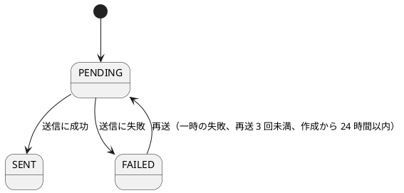
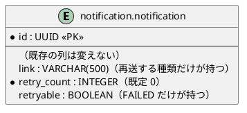

# W10-1 計画 - W10 の持ち越しのうち、実環境なしで進められるコードの返済

## 基本情報

| 項目 | 内容 |
| :--- | :--- |
| 週 | W10 の追加（W10 は一部完了で締めて承認済み。締めの記録は変えない） |
| 状態 | **承認済み（2026-11-27、human:kakimomokuri。「推奨のまま承認」。CP-1〜CP-7）** |
| ゴール | W10 の持ち越し（H-3・H-4・H-6・H-7・H-9）と Bolt 56 の残りのうち、AWS の実環境がなくてもテストか検証で確かめられるものを作る |
| ストーリー | なし（技術。SP 0） |
| 局面とアプローチ | 終盤。振る舞いごとに外側のテストから入り、TDD で進める |
| Bolt の本数 | 8 本 |
| 見積りの合計 | 作業 1,380 分。事務 60 分 × 8 本 = 480 分を足した壁時計で 1,860 分（約 31 時間）。分の値は W10・W11 の草稿からの類推で、実測の根拠はない（仮定） |
| 始めた経緯 | `/goal W10`。範囲は「残りのコードを実装」を human:kakimomokuri が選んだ（2026-11-27）。この計画の承認は別に受ける |

## 前の週の反映

[W10 完了報告書](iteration_report-W10.md)の Try を次のように入れる。

| Try | 扱い |
| :--- | :--- |
| 開始の前に人が用意するものの表を付ける | 下の「人が用意するもの」 |
| 置き場所と、関わる ArchUnit の規則の調査の欄を足す | 下の「確認した前提」 |
| 標準入力の形のコマンドを `PreToolUse` フックで拒む | この計画に入れない（W11 計画の CP-5 のまま） |

## 範囲

### Bolt 一覧

| Bolt | 内容 | 持ち越し | 見積り（分） | 依存 | 承認ゲート |
| :--- | :--- | :--- | ---: | :--- | :--- |
| 57 | Terraform: SNS のトピック（運用・データ・追跡の 3 つ）とメールの購読（宛先は変数）、ログのメトリクスフィルターと警報、OBS-01・02・10 の警報 | H-3 | 180 | なし | 外部連携（CP-2） |
| 57-1 | 運用の警告のログの印をそろえる。毒入りのイベントを捨てた ERROR と、主要実績の拒否に印を付ける | H-3・H-4 | 90 | 57 | 計画・終了報告 |
| 57-2 | 未完了のイベント配信の検知（OBS-03: 発行から 5 分以上。DE-12・DE-13・DE-30 を含む） | H-3 | 200 | 57-1 | 構造（CP-3） |
| 58 | 取込がない日の検知（FRS-04。11:00 JST、ShedLock） | H-3 | 200 | 57-1 | 計画・終了報告（CP-6） |
| 59 | メンテナンス表示: 503 と案内を返すフィルター、`maintenance:on`・`maintenance:off`、時点復旧の手順の差し替え | H-6 | 200 | 57-2（置き場所） | セキュリティ・構造（CP-3・CP-4） |
| 61 | 失敗した荷主への業務の通知の再送（ADR-021 の C-3） | H-7 | 270 | なし | スキーマ（CP-5） |
| 52-2 | Terraform の `fmt`・`validate` を PR で流すワークフロー（`plan` は認証情報が要るので入れない） | H-9 | 60 | 57 | 終了報告 |
| 56-1 | 締め: #50 の仕分け案、Spring Boot 4.2 の公開の有無の確認、レビュー、最終のゲート、持ち越しの表の更新 | H-8・56 | 180 | 全部 | 終了報告。#50 を閉じる操作は人の承認の後 |

順序は 57 → 57-1 → 57-2 → 59 → 58 → 61 → 52-2 → 56-1。

### 範囲に入れないもの

| 項目 | 理由 | 扱い |
| :--- | :--- | :--- |
| `apply`・`plan`、運用タスクの実行、負荷テストの実行、時点復旧の訓練（H-5・H-6・H-9） | 実環境が要る | 環境ができてから |
| ウイルス検査（ADR-022、H-11） | 必要書類の保存はローカルのファイルだけで、S3 のアダプターと AWS SDK がない。検査の結果のタグは実環境でないと確かめられず、ADR は仕様と費用の確認を先に求めている | W11 計画の Bolt 60 のまま |
| 通知の購読の反転（ADR-021 の C-4） | モジュールの依存の反転で、再送の振る舞いに要らない | 別の計画で再承認（ADR-021 のとおり） |
| 業務ホーム S-01 の役割別の一覧（H-3） | 画面の設計が要り、ADR-023 は役割ごとに 1 Bolt とした | Release 1.1 |
| 監査の欠落の照合（AUD-04、OBS-08。H-4） | 照合する対象の定義が提案のまま（US-17） | W11 の US-17 の後 |
| `audit:export:verify`（H-6） | 書き出しの仕様が未設計 | 設計の後 |
| `ConnectionRule` の class 化と港で絞る照会（H-5） | 性能の改善で、効果を確かめる負荷テストを実行できない | 負荷テストと一緒に |
| 大阪への複製、運用の IAM ロール、外向き通信の絞り込み（H-9） | 構成の値と方針が未決 | アカウントの用意の後 |
| C-1・C-2・C-5、#49（H-8） | 業務の判断か、認証の設計の判断が先に要る | 人に諮る議題のまま |
| OBS-04・05・07・09 の警告 | W10 の持ち越しに挙がっていないか、S-01 の一覧が要る | Release 1.1 |

### W11 計画との関係

承認されたら、[W11 計画](iteration_plan-W11.md)（draft）から Bolt 57・58・59・61 を外し、本数と見積りを直す。W11 に残るのは 60 と 62〜69。

## 確認した前提（2026-11-27 にコードで確認）

| Bolt | 前提 | 関わる規則 |
| :--- | :--- | :--- |
| 57 | Terraform に SNS と警報はまだない。アプリのログは `aws_cloudwatch_log_group` に出る | なし |
| 57-1 | `LOG.error` はイベントの受け手（identity・routing・tracking）と定期処理にある。どれが毒入りの破棄かは開始準備で 1 件ずつ確かめる | なし |
| 57-2・59 | `platform` は Spring に依存できない（`platformはコンテキストに依存しない`）。ルートの `@Configuration` は `ClockConfiguration` と `SchedulingConfiguration` だけ。業務のコンテキストの一覧は、モジュールから `shared` と `platform` を除いたものと一致させる規則がある | `LayerArchitectureTest`、`ModularityTest`、`MapperSchemaArchitectureTest` |
| 57-2 | 発行記録は Spring Modulith の `platform.event_publication`。未完了の読み方は Modulith の公開 API で足りると**仮定**する（SQL は書かない）。開始準備で確かめ、足りなければ人に諮る | 同上 |
| 58 | `IngestionRepository` は `add` と `findById` だけ。当日の取込の照会を足す（スキーマは変えない） | 定期処理は `externaldata.interfaces.scheduled`（見積りと同じ形） |
| 59 | 業務のポートの認可は `SecurityConfiguration` のフィルター連鎖、ヘルスチェックは管理用のポート 8081 | CP-4 |
| 61 | `notification.notification` はリンクを保存していない。一意制約（`event_id`、`recipient_user_id`）があるので、再送は同じ行で行う。`notification` は `identity` に依存できない | 定期処理は `notification.interfaces.scheduled` |

## 人が用意するもの

| 項目 | いつ要るか |
| :--- | :--- |
| 運用・データ・追跡の警告のメールの配布先 | `apply` の前（コードは変数で受けるので、この計画では不要） |
| AWS のアカウントと認証情報 | この計画では不要 |

## 設計（この計画のスコープ）

ドメインモデルの図と画面遷移図は省く。ドメインの変更は通知の状態遷移と列だけで、画面はメンテナンスの案内の 1 枚で遷移を持たない。

### 通知の状態遷移（Bolt 61）

### 通知の表の追加の列（Bolt 61）

注（設計への反映）: `data_model.md` の通知の表と `domain_model.md` の通知の節（N-INV-02 は「同じ行の再送は 2 通目に数えない」）を Bolt 61 で直す。

## ドキュメントとマニュアル

| Bolt | 直すもの |
| :--- | :--- |
| 57・57-1・57-2 | `operation.md` の監視の通知先、`operation_tasks.md` |
| 58 | `operation.md`、マニュアル 12 章（取込がない日はメールが届く。実環境の設定の後） |
| 59 | `operation_tasks.md`（時点復旧の手順 1・7、タスクの一覧）、マニュアルの利用者向けの章（メンテナンス中の表示） |
| 61 | `data_model.md`、`domain_model.md`、マニュアル 15 章（自動の再送） |

利用者に見える振る舞いが変わる Bolt（58・59・61）は、その Bolt でマニュアルを直し、`npx gulp manual:build` を通す。

## 完了条件（DoD）

- 各 Bolt で、テストの失敗を確かめてから実装する。各 Bolt の開始時に、この計画の行を詳しくした Bolt 計画を作り、`validating-design` を通す
- コードを変える Bolt は `check`（`checkstyleMain`・`checkstyleTest`・`spotbugsMain` を含む）が成功する
- 56-1 で `check`・`documentationTest`・`uiTest` と SonarQube の Quality Gate が成功する
- Terraform は `fmt`・`validate`（staging・production）、ワークフローは `actionlint` が成功する
- **確かめられないことを完了と書かない。** 警告のメールが届くこと、`maintenance:on/off` の実行は、この計画では未確認として残す（タスクは `--dry-run` とテストまで）
- push はそのつど人の指示を受ける

## リスク

| # | リスク | 対応 |
| :--- | :--- | :--- |
| R-1 | ログの印とメトリクスフィルターの文字列が食い違っても、実環境がないので気づけない | 印を 1 か所の定数にし、Terraform の文字列との一致をテストする |
| R-2 | 新しいモジュールがモジュールの一覧の一致の規則に当たる | 57-2 の最初に規則を読む。規則の例外が要るときは止めて人に諮る |
| R-3 | メンテナンスのフィルターが意図せず有効になると全画面が止まる | 既定は無効。無効のときに素通りすることをテストする |
| R-4 | 再送が二重送信になる（SMTP の応答の時間切れで、実は届いている場合） | 受け入れる（本文は件名と画面への導線だけ。N-INV-01）。上限は 3 回 |
| R-5 | 失敗の後に利用停止になった利用者へ再送する（D-166 は停止中の利用者へ送らないと決めている） | 再送を作成から 24 時間以内に限る。残るリスクは CP-5 で人が受け入れるかを決める |

## 人に諮る議題と推奨

| # | 議題 | 推奨 | ほかの案 |
| :--- | :--- | :--- | :--- |
| CP-1 | 範囲（上の 8 本と、入れないもの）と、W11 計画から 57・58・59・61 を移すこと | このとおり | 61 を外して W11 に残す |
| CP-2 | アプリの運用の警告の送り方（ADR-023 の「同じ SNS とメールの経路」の実現） | アプリは決まった印のログを出すだけにし、CloudWatch のメトリクスフィルター → 警報 → SNS → メールで送る。アプリに AWS のライブラリも宛先も持たせない | アプリが通知のモジュールで設定の宛先へメールを送る（実環境なしで送信まで確かめられるが、宛先と業務でない通知がアプリに入る） |
| CP-3 | 発行記録の監視とメンテナンスのフィルターの置き場所 | 新しいモジュール `operations`（業務のコンテキストではない横断の運用の部品）を作り、層の規則はそのまま守る | ルートのパッケージ（規則の例外が増える）。`identity`（認証と関係ない責務が入る） |
| CP-4 | メンテナンス表示の守り方（セキュリティ） | 認証の連鎖より前で、業務のポートのすべての要求に 503・固定の案内・`Retry-After` を返す。管理用のポートは対象外。既定は無効で、環境変数だけで切り替える。管理者が通り抜ける口は作らない | 静的ファイルとログインは通す |
| CP-5 | 通知の再送（スキーマ・個人情報） | 列を 3 つ足す。再送するのは、リンクにトークンを含まない荷主への業務の通知の 5 種類だけ（招待・password の再設定などは再送しない）。10 分ごとの定期処理で上限 3 回、作成から 24 時間以内。分類できない失敗は再送しない。既存の FAILED は再送しない。R-4・R-5 の残るリスクを受け入れる | 利用停止の確認ができるように、先に C-4 の反転をしてから作る |
| CP-6 | FRS-04 の「当日」 | 毎日（土日・祝日を含む）11:00 JST に、当日 0:00 JST からの取込が 0 件なら警告する。承認済みの情報源が 1 つもなければ警告しない | 営業日だけ警告する |
| CP-7 | 承認の後の進め方 | CP が推奨のとおり承認されたら、`/goal W10` のもとで止めずに進め、各 Bolt の終了報告は 56-1 でまとめて承認を受ける。新しい規則の例外・依存・ライブラリが要るときは止めて人に諮る | Bolt ごとに止める |

## 検証の結果（2026-11-27）

`validating-iteration-plan` と `validating-design` の観点で、承認の前に確認した。関係する節を検索して突き合わせたもので、設計文書の全文は読み直していない。

| 観点 | 結果 |
| :--- | :--- |
| ストーリー | なし（技術）。US-22 AC4（失敗と宛先の記録、通知一覧）は、再送を足しても変えない |
| 設計 | N-INV-02 の一意制約と再送は同じ行で両立する。N-INV-03 は変えない。FRS-04・OBS-03 は `non_functional.md` の行と一致。`maintenance:on/off` は `operation.md` のタスク名と一致 |
| 軸 A（開発戦略） | 終盤。戦略の W10 のデモ項目（ステージングの E2E・性能・時点復旧）は、この計画でも満たさない |
| 軸 B（設計トピック） | 新しいモジュール `operations` は `architecture_backend.md` のモジュールの記述に足す必要がある（57-2） |
| 軸 C（過去計画） | 定期処理は Bolt 53-1 の ShedLock を使う。Bolt の番号は W11 の草稿の 57〜61 を引き継ぎ、52 と 56 の追加は枝番にする |

## 実施の結果（2026-11-27）

8 本を実施した（実環境では何も実行していない。push はしていない）。実装の中で、本体の依存の追加（57-2）とアーキテクチャの規則の例外（58）を、そのつど人に諮って承認を得た。結果と承認の議題は [Bolt 56-1 の報告](bolt_56-1_plan.md)にまとめた（**承認待ち**）。

## 承認の記録

2026-11-27、human:kakimomokuri が CP-1〜CP-7 を推奨のとおり承認した。CP-5 の残るリスク（R-4 の二重送信、R-5 の利用停止者への再送）の受け入れを含む。新しい規則の例外・依存・ライブラリが要るときは止めて諮る。push はそのつど指示を受ける。

## 更新履歴

| 日付 | 更新内容 | 更新者 |
| :--- | :--- | :--- |
| 2026-11-27 | 初版（draft） | anthropic/claude-sonnet-5-5 |
