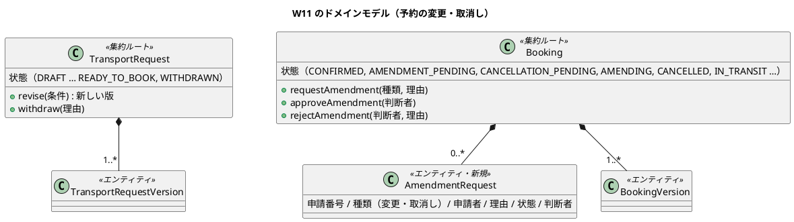
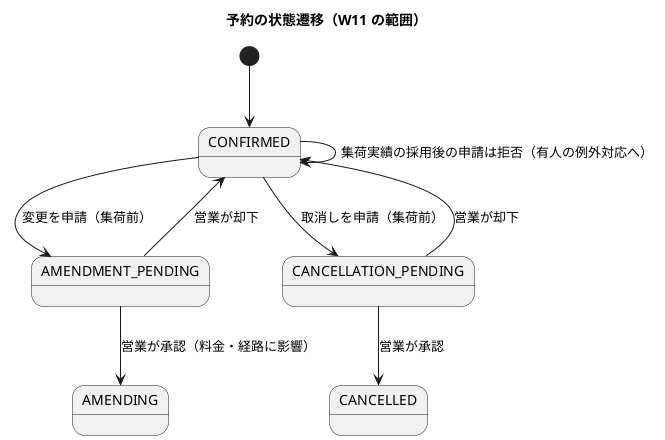
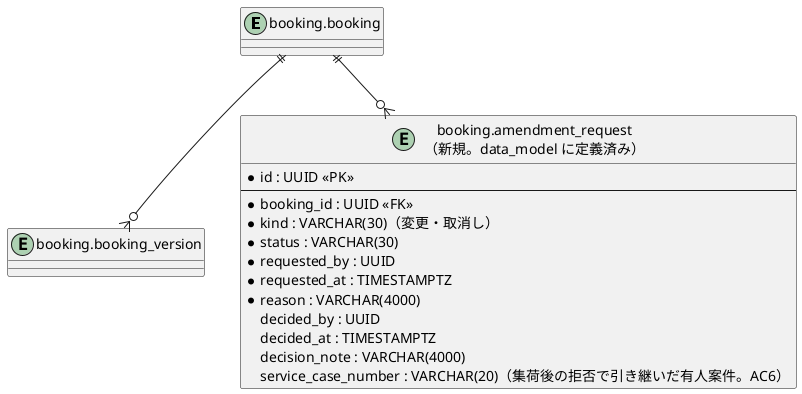
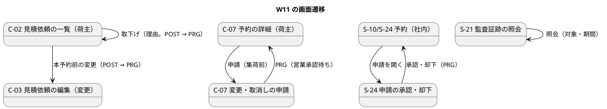

# W11 計画 - 予約の変更・取消しと監査照会

> **改訂（2026-11-28）。** Bolt 57・58・59・61 を [W10-1 計画](iteration_plan-W10-1.md)で終えたこと（2026-11-27 に移し、2026-11-28 に締めの報告を承認）と、[Bolt 56-1](bolt_56-1_plan.md) の議題の #50 の仕分けを終えたことに合わせて、本文を直した。同日、CP-1 を変えて、ウイルス検査の Bolt 60 を W12 へ移した（human:kakimomokuri の指示）。初版からの差は更新履歴にある。

## 基本情報

| 項目 | 内容 |
| :--- | :--- |
| 週 | W11（Release 1.1 の 1 週目）。計画期間は 2026-12-14〜12-18（稼働 5 日） |
| 状態 | **承認済み（2026-11-28、human:kakimomokuri。「推奨のまま承認」）**。CP-1 は指示で変えた内容、CP-2〜CP-7 は推奨のとおり。CP-5 のフックの設定は、入れる前にもう一度人に確かめる |
| ゴール | 荷主が本予約の前後で変更・取消しでき（US-05）、監査担当者が重要操作を時系列で照会できる（US-17） |
| ストーリー | US-05（8 SP）、US-17（3 SP）。合計 **11 SP**（release_plan の W11 の行と一致） |
| 局面とアプローチ | 終盤。**アウトサイドイン**（development_strategy の局面別の定め）。画面と受入シナリオから入り、予約の集約には申請のエンティティを足す |
| Bolt の本数 | 8 本（番号 62〜69）。US-05 6 本、US-17 1 本、締め 1 本。返済の Bolt はない |
| 見積りの合計 | 作業 1,700 分。ゲート・報告・承認待ちの 60 分 × 8 本 = 480 分を足した壁時計で **2,180 分（約 36 時間）** |
| 稼働との比較 | 稼働 5 日・1 日 13.5 時間で 4,050 分の **54%**（仮定 A-1・A-2。見積りに実測の根拠はない） |
| 前の週 | [W10 完了報告書](iteration_report-W10.md)（承認済み。一部完了）、[Release 1.0 リリース完了報告書](release_report-1_0.md)（承認済み）、[W10-1 の締めの報告](bolt_56-1_plan.md)（承認済み） |

### Bolt の番号

機能・技術の単位ごとに整数を採番し、関連は枝番（N-1）、追加は枝番の枝番（N-1-1）。W11 の番号は初版で 57〜69 を取った。そのうち 57〜59・61 は W10-1 で使ったので、残りは 60・62〜69。そのうち 60 は W12 へ移すので、W11 は 62〜69。週の外の技術 Bolt が 70・[71](bolt_71_plan.md) を使った。

| 番号 | 単位 |
| :--- | :--- |
| 62〜64 | 機能: US-05 本予約前の変更・取下げ、本予約後の申請 |
| 65〜67 | 機能: US-05 営業の承認、集荷後の拒否と有人例外、古い版の拒否 |
| 68 | 機能: US-17 監査証跡の照会 |
| 69 | 技術: W11 の締め |

## 前の週の反映（ステップ 1）

W10 の Try と持ち越し、その後の W10-1 と週の外の Bolt の結果を、次のように計画に入れた。

| 入力 | 計画での扱い |
| :--- | :--- |
| Try: 運用準備の Bolt は、開始の前に人が用意するものの表を付ける | W11 に運用準備の Bolt はない。W12 で Bolt 60 を立てるときに付ける（AWS の機能の確認の結果） |
| Try: 計画に「関わる ArchUnit の規則」と「前提とする既存の画面・機能の実在」の確認の欄を足す | 各 Bolt の「確認した前提」の欄（下の表）と、リスク R-2・R-3 |
| Try: 標準入力の形のコマンドを `PreToolUse` フックで拒む（W7 の締めの Try の継続） | **CP-5**（フックの設定の追加は、実際に入れる前に人に確かめる） |
| 持ち越し H-7（ADR-021 の実装） | 再送は W10-1 の Bolt 61 で終えた。購読の反転（C-4 の案 B）は W11 に入れず、W12 以降で計画（モジュールの依存の変更のため） |
| 持ち越し H-3・H-4（運用の通知、FRS-04） | 警告の仕組みと FRS-04 は W10-1 の Bolt 57・58 で作った（実環境では未確認）。残り（業務ホーム S-01 の一覧、メールが届くことの確認、AUD-04 の照合）は W11 に入れない。AUD-04 の照合は US-17 の後 |
| 持ち越し H-6（メンテナンス、時点復旧） | メンテナンス表示は W10-1 の Bolt 59 で終えた。時点復旧の訓練とタスク、`audit:export:verify` は W11 に入れない（訓練は実環境ができてから） |
| 持ち越し H-11（ウイルス検査） | Bolt 60（仕様確認と最初の実装。見積り 240 分）は W12 へ移す（CP-1） |
| 持ち越し H-5・H-9（負荷・apply など） | 実環境ができてから。W11 に入れない（AWS は準備だけ） |
| 持ち越し H-8（C-1・C-2・C-5、#49、#50） | #50 は 2026-11-28 に仕分けて閉じた（#53・#54 と、#29・#33 のコメント）。C-1・C-2・C-5 は人に諮る議題。パイロットの前に要る #53 は CP-7 |
| #29 のコメントの返済（US-05 で触る予約・見積りの 8 件。コードは未確認） | US-05 の Bolt（62〜67）の開始準備で読み、触る箇所のものを一緒に直す（CP-6） |
| W10-1 の後の技術の返済（運用スクリプトのテストを CI で流す。[Bolt 71](bolt_71_plan.md) の議題 2） | W11 の Bolt に入れない。次の運用スクリプトの変更までに、週の外の小さな Bolt で足す |
| Spring Boot 4.2 への追従（[Bolt 70](bolt_70_plan.md) の調査） | W11 に入れない。MyBatis の 4.2 対応を確かめてから、Release 1.1 の中で Bolt を立てる |

## 仮定（仮定は仮定と書く）

| # | 仮定 | 種類 |
| :--- | :--- | :--- |
| A-1 | 1 Bolt の事務（ゲート・報告・承認待ち）は 60 分 | W9・W10 の置き方を踏襲 |
| A-2 | 1 日 13.5 時間の稼働（保守的） | 同上（仮定） |
| A-3 | 見積りの分は、W9・W10 の 1 本の平均（約 185〜190 分）と、US-05 の受入条件 7 件・US-17 の受入条件 3 件の数からの類推（実測なし） | 仮定 |
| A-4 | 変更・取消しの費用と申請期限は OQ-04 の残決定（パイロット開始前に確定）。**W11 では費用と期限を実装せず、申請を受け付けて営業が判断する** | user_story の「要確認」 |
| A-5 | AWS は準備だけ（W10 の決定の継続）。Terraform は `apply` しない | W10 |
| A-6 | 予約の集約の変更・取消申請（`AmendmentRequest`）と `amendment_request` の表は設計済み（domain_model・data_model）で、コードはまだない | 確認した（`Booking.java` に申請の操作がない。状態 `AMENDMENT_PENDING`・`CANCELLATION_PENDING`・`AMENDING`・`CANCELLED` は enum にある） |

## W11 の Bolt 一覧

| Bolt | 内容 | 種別 | 見積り（分） | SP | 壁時計（+60） | 依存 | 承認ゲート |
| :--- | :--- | :--- | ---: | ---: | ---: | :--- | :--- |
| 62 | US-05 AC1: 本予約前の輸送要求の変更（承認不要で旧版を保持した新版） | 機能 | 200 | 0 | 260 | なし | 計画・終了報告 |
| 63 | US-05 AC2: 本予約前の取下げ（理由つきで取消済み） | 機能 | 160 | 0 | 220 | 62 | 計画・終了報告 |
| 64 | US-05 AC3: 本予約後・集荷前の変更・取消しの申請（`AmendmentRequest`。状態は変えず営業承認待ち。B-INV-06） | 機能 | 260 | 0 | 320 | なし | **スキーマ**・計画 |
| 65 | US-05 AC4・AC5: 営業の承認（変更→新しい予約版が変更中、再見積り・再承認の必要性を示す。取消→理由と承認者つきで取消済み） | 機能 | 260 | 0 | 320 | 64 | **認可**・計画 |
| 66 | US-05 AC6: 集荷実績が採用済みの申請の自動拒否と、有人の例外対応への引き継ぎ | 機能 | 200 | 0 | 260 | 64 | 計画・終了報告 |
| 67 | US-05 AC7: 古い版からの変更の拒否（最新版の確認を求める）。US-05 を締める（受入条件の照合の表） | 機能 | 180 | **8**（US-05） | 240 | 62〜66 | 計画・終了報告 |
| 68 | US-17: 監査証跡の照会（S-21。対象と期間、監査担当者だけ、権限外の試行の記録、欠落の異常の表示）。US-17 を締める | 機能 | 280 | **3**（US-17） | 340 | なし | **認可**・計画 |
| 69 | W11 の締め: 週全体のレビュー、最終のゲート、マニュアル・動画、完了報告書 | 技術 | 160 | 0 | 220 | 全部 | 計画・終了報告 |

**合計** 作業 1,700 分（US-05 1,260、US-17 280、締め 160）、壁時計 2,180 分。

### 各 Bolt で確認した前提

| Bolt | 前提とする既存の機能・規則 | 確認の結果 |
| :--- | :--- | :--- |
| 62〜67 | 輸送要求の版（`quotation.transport_request_version`）、予約の版（`booking.booking_version`）、`AmendmentRequest`（設計のみ）、`BookingStatus` の状態の enum | 上の A-6。**予約側のコードはまだ**。輸送要求（`TransportRequest`）には、差し戻し後の再提出（`resubmit`。審査に戻る）と、辞退由来の `markWithdrawn`（見積りの辞退。US-24）しかなく、**荷主が本予約前に承認なしで変更する操作（AC1）と、理由つきで取下げる操作（AC2）はまだない**。取下げは状態 `WITHDRAWN` を使えるが、辞退と取下げの区別（理由・操作者）を Bolt 63 で決める |
| 68 | 監査記録（`identity.audit_record`、追記専用）、S-21 の画面は未実装、権限（監査担当者） | 監査記録の種類は W9・W10 で増えた（`DATA_SOURCE_RESUMED` を含む）。S-21 の URL は設計に未記載（Bolt 68 の開始準備で決める） |

## 設計（W11 のスコープ）

### ドメインモデル（Bolt 62〜67）

注（設計への反映）: `TransportRequest.revise`・`withdraw` と `Booking` の申請の操作を、`domain_model.md` の要素表に足す（現在は `AmendmentRequest` の定義だけがある）。

### 状態遷移（予約。Bolt 64〜66）

注: AC3 は「予約状態を変更せず営業承認待ちとして**記録**」とあり、予約の状態（`CONFIRMED`）は承認まで変えない（B-INV-06）。状態 `AMENDMENT_PENDING`・`CANCELLATION_PENDING` は**申請の状態**として持つのか、予約の状態として持つのかを、Bolt 64 の開始準備で `domain_model.md` と突き合わせて決める（CP-2）。

### ER（Bolt 64）

注: 列は `data_model.md` の `amendment_request` の定義のとおり（横断整合性検証で突き合わせ、`base_version` は定義にないので外した）。AC7 の「古い版からの変更の拒否」は、B-INV-09（期待版が現在版と違う変更は競合として拒否する）のとおり、コマンドが期待版を持ち、予約の版（楽観ロック）と比べる。申請の表に版の列は足さない。DDL（Flyway の移行）は Bolt 64 で作る（スキーマ変更のゲート）。`status` の取りうる値と、予約の不変条件 B-INV-06〜09 との対応は Bolt 64・65・66・67 の開始準備で確かめる。

### 画面遷移（Bolt 62〜68）

注（設計への反映）: S-21 の URL・入力欄・権限（監査担当者だけ）は `ui_design.md` に URL がない。Bolt 68 の開始準備で決めて足す。ナビゲーションに S-21 を監査担当者の表示で足す（ナビ整合性）。

## マニュアルの更新（画面を伴う週）

3 章（見積依頼: 変更・取下げ）、5 章（荷主の予約: 変更・取消しの申請）、7 章（社内の予約: 営業の承認）、監査担当者の章（S-21。10 章の KPI の隣に新しい節）、用語集（変更・取消申請、集荷前）。キャプチャは `manualScreenshots` で撮り直す。見積りは Bolt 67・68 に各 40 分を含めた（上の見積りに入れてある）。

## 完了条件（DoD）

- 各 Bolt で `--continue` 付きのゲートを通す。コードを変える Bolt は `checkstyleMain checkstyleTest spotbugsMain` を push の前に流す
- 受入条件の照合の表（`AcceptanceCriteriaCoverageTest`）に US-05・US-17 の行を足し、緑
- US-05・US-17 の受入条件を通す画面のシナリオ（`@ui`）。axe-core の違反 0
- マニュアルの更新と、画面の動画（`demoVideo`。既存を消さないよう復元する）
- Sonar の Quality Gate PASS（週の締めで）
- 認可・スキーマ・外部連携の変更は、選択肢と推奨を示して人が決める（承認の議題に載せる）

## リスク

| # | リスク | 対応 |
| :--- | :--- | :--- |
| R-1 | 見積りが仮定（A-3）で、稼働に対する 54% は実測の根拠がない | 前倒しを使う。遅れたときの繰り越しの順は CP-4 |
| R-2 | 予約の集約に申請を足すと、`booking` と `quotation` の依存・ArchUnit の規則に当たる（W10 の Bolt 52-1・53-1 で繰り返した） | 各 Bolt の開始準備で、関わる ArchUnit の規則を読む。規則を動かして合わせず、例外が要るときは人に諮る |
| R-3 | S-21 の URL・権限・入力が設計に未記載 | Bolt 68 の開始準備で設計に足す。監査担当者だけ（S-22 と同じ認可の形） |
| R-4 | ウイルス検査（パイロット開始の条件）が W12 より後になる。W12 は US-13・US-15 の 10 SP の週で、Bolt 60 の 240 分が足される | W12 の計画で稼働と比べる。収まらないときは人に諮る。AWS の機能の仕様・費用の確認（ADR-022 の理解と合わなければ案 A のサイドカー。人に諮る）は、Bolt 60 の最初の仕事のままにする |
| R-5 | 変更・取消しの費用と申請期限が未決（OQ-04） | 実装せず、申請を受けて営業が判断する（A-4）。決まったら Release 1.1 の後半で足す |
| R-6 | 認可・スキーマのゲートがある Bolt が 3 本（64・65・68）あり、承認待ちが続く | 計画の承認の場で、一括の推奨の承認を取る（「推奨で一括承認」。W10 の方式）。決められない判断だけ聞く |
| R-7 | デモ環境（Heroku）が 503 で、`apps/cargo-tracker` を変える push の `deploy-demo` が失敗する（2026-11-28 の時点。画面は稼働時間の枠の表示） | Heroku のアカウントの所有者が枠を確かめる。W11 の完了条件はデモ環境に依らない（受入シナリオと動画は手元で確かめる）。直るまで CI 全体は失敗の表示になるので、`check`・`ui` のジョブの結果を読む |

## 検証の結果（2026-11-16）

`validating-iteration-plan` と `validating-design`（開発戦略の「Bolt 計画の検証（必須）」。承認の前に実施）。

| 観点 | 結果 |
| :--- | :--- |
| ストーリーの受入条件との対応 | US-05 の AC1〜AC7 は Bolt 62（AC1）、63（AC2）、64（AC3）、65（AC4・AC5）、66（AC6）、67（AC7）に 1 対 1。US-17 の AC1〜AC3 は Bolt 68。漏れなし。SP は release_plan の W11 の行（US-05 8、US-17 3、計 11）と一致 |
| 設計 | `amendment_request` の列を `data_model.md` と突き合わせ、計画の ER の `base_version` を外した（**修正済み**）。予約の不変条件 B-INV-06〜09 と AC3・AC6・AC4・AC7 の対応を確かめた。C-07・S-10・S-24・S-21・C-03 は `ui_design.md` に画面がある。S-21 の URL・入力・権限は設計に未記載（注に書いた。Bolt 68 の開始準備で足す） |
| 軸 A（開発戦略） | W11 は終盤・アウトサイドイン、対象は US-05・US-17（development_strategy の W11 の行と一致）。Bolt 計画の検証の必須の規則に従った |
| 軸 B（設計トピック） | `TransportRequest.revise`・`withdraw` と予約の申請の操作を `domain_model.md` の要素表に足す注を計画に書いた。ナビゲーションに S-21 を足す注を書いた |
| 軸 C（過去計画） | Bolt の番号は W10 の続き（57〜）。ArchUnit の例外を作らない方針（W10 の学び）。AC1 の「承認を要さず旧版を保持した新版」は、既存の `resubmit`（審査に戻る）と違う操作であることを確かめた |
| 前の週のレビュー | W10 週全体レビューの議題 3 つ（ShedLock の置き場所は決定済み。連絡先と期限の記録は人に諮る議題のまま）、持ち越し H-1〜H-11 の反映先を「前の週の反映」の表に書いた |

### 2026-11-28 の再検証（改訂した範囲）

| 観点 | 結果 |
| :--- | :--- |
| 事実の確認 | `AmendmentRequest` と申請の操作はまだない。`BookingStatus` の状態は変わらない。`TransportRequest` の公開の操作は `resubmit` と `markWithdrawn` で、AC1・AC2 の操作はない。`data_model.md` に `amendment_request` があり、`ui_design.md` に S-21 の画面がある。`PreToolUse` フックは入っていない。Bolt 60 を移した後の合計は、作業 1,700 分、壁時計 2,180 分（62〜69 の各行の和と一致）。Bolt 69 は #50 の仕分けがなくなったが、見積りの根拠がないので 160 分のままにする |
| 軸 A（開発戦略） | 終盤・アウトサイドインと、US-05・US-17 は変えていない |
| 軸 B（設計トピック） | W10-1 の設計の変更（運用の警告、`operations` モジュール、通知の再送）は、予約の集約と S-21 の設計の注を変えない。監査記録の種類と、新しい `operations` モジュールの依存の規則は、Bolt 68・各 Bolt の開始準備で読む |
| 軸 C（過去計画） | W10-1 の番号と重ならない。#50 の仕分けで #29 に移した項目は、#29 が US-05 の完了（Bolt 67）で閉じると見えなくなるので、CP-6 に扱いを書いた |
| 直した箇所 | 先頭の注で本文を読み替える形をやめて本文を直した。CP-4 を、終えた Bolt 61・58 と W12 へ移した Bolt 60 のない形に改めた。R-1 の稼働比と、R-6 のゲートのある本数を直した。R-4 を Bolt 60 を移すリスクに替えた。Bolt 69 から #50 の仕分けを外した。マニュアルの 5 章（荷主の予約）を足した |

## 人に諮る議題と推奨

| # | 議題 | 推奨 |
| :--- | :--- | :--- |
| CP-1 | W11 の範囲（**決定済み**） | **US-05・US-17 と締めの 8 本にする。ウイルス検査の Bolt 60 は W12 へ移す**（2026-11-28、human:kakimomokuri が「Bolt 60 を W12 へ」を選んだ。初版の推奨は同じ週に置く案） |
| CP-2 | 申請の状態の持ち方（`AMENDMENT_PENDING` などを予約の状態にするか、申請の状態にするか） | 推奨: 予約の状態は承認まで変えず（B-INV-06・AC3）、状態は `AmendmentRequest` が持つ。予約の enum の `AMENDMENT_PENDING`・`CANCELLATION_PENDING` は、承認の後に変更中・取消済みへ進む区間にだけ使う。Bolt 64 の開始準備で設計と突き合わせて確定する |
| CP-3 | 変更・取消しの費用と申請期限（OQ-04） | 推奨: W11 では実装しない（A-4）。業務責任者に確認する |
| CP-4 | 遅れたときに W12 へ繰り越す順（改訂。削るのではなく繰り越す。Release 1.1 の条件は Should の全受入条件） | 推奨: ① Bolt 68（US-17。ほかの Bolt に依存しない） ② US-05 の 67 から後ろ向きに 66・65（SP は US-05 を締めた週に数えるので、1 本でも繰り越すと W11 の実績は 8 SP 減る）。締め（69）は繰り越さない |
| CP-5 | `PreToolUse` フックで標準入力の形のコマンドを機械的に拒む設定の追加 | 推奨: 入れる（W7 の締めの Try の継続。W10-1 でも同じ違反が起きた）。**設定の追加は、実際に入れる前に人に確かめる**（W7 の決定のとおり）。W11 の開始の前に人が判断する |
| CP-6 | #29 のコメントの返済 8 件の扱い | 推奨: US-05 の Bolt で触る箇所のものだけを一緒に直し、見積りと完了条件は増やさない。Bolt 67 で #29 を閉じる前に、残りを #54（内部の返済）へ移す。8 件を W11 の完了条件にする案は、コードを確かめておらず見積れないので推奨しない |
| CP-7 | パイロットの前に要る #53（スクリーンリーダーでの確認、監査記録の DB の権限、利用者の行が読めないときの 500）を W11 に入れるか | 推奨: W11 の Bolt に入れない。先に担当と期限を決め、W11 の締めで状況を確かめる。監査記録の DB の権限は US-17 と同じ監査記録を扱うが、受入条件には含まれないので、Bolt 68 に混ぜない |

## 更新履歴

| 日付 | 更新内容 | 更新者 |
| :--- | :--- | :--- |
| 2026-11-16 | 初版（draft） | anthropic/claude-sonnet-5-5 |
| 2026-11-27 | Bolt 57・58・59・61 を W10-1 計画に移し、本数と見積りを直した | anthropic/claude-sonnet-5-5 |
| 2026-11-28 | W10-1 と #50 の仕分けの後の状態に合わせて本文を直し、再検証した。CP-4 を改め、CP-6・CP-7 を足した | anthropic/claude-sonnet-5-5 |
| 2026-11-28 | CP-1 を人の指示で変え、Bolt 60（ウイルス検査）を W12 へ移した。本数・見積り・リスク・CP-4 を直した | anthropic/claude-sonnet-5-5 |
| 2026-11-28 | 人の承認を記録した（CP-1 は変更後の内容、CP-2〜CP-7 は推奨のとおり） | anthropic/claude-sonnet-5-5 |
| 2026-11-28 | CP-5 のフックを入れた（human:kakimomokuri が内容を確認して承認。`.claude/hooks/deny-stdin.mjs` とそのテスト、`.claude/settings.json` の `PreToolUse`（Bash））。拒むのは標準入力からプログラムを読む形（`python -`・`node -`・引数も入力の向け先もない起動）。**ファイル名が空になった `grep` などと、PowerShell のツールは防げない。** ファイルがあることを確かめてから読み、標準入力を `/dev/null` につなぐ運用で補う | anthropic/claude-sonnet-5-5 |
