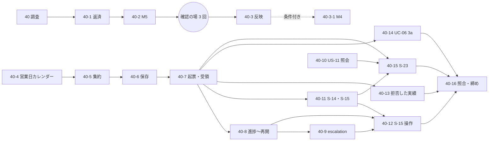

# W8 計画 - 有人対応と問い合わせ（技術 Bolt にも時間の見積りを付ける）

## 基本情報

| 項目 | 内容 |
| :--- | :--- |
| 週 | W8（Release 1.0 パイロット準備完了の 4 週目）。計画期間は 2026-11-23〜11-27。11-23（月）は祝日で、稼働は 11-24〜11-27 の **4 日** |
| 状態 | 計画（**承認済み**。2026-11-13 に確認ポイントを推奨のとおり承認。CP-1 は基準の置き方 B で数え、W8 は 6〜7 日を見込む。human:kakimomokuri） |
| ゴール | カスタマーサポートが顧客と同じ根拠で追跡情報を確認して引き継ぎ（US-11）、引き継いだ照会・業務例外を受領から回答・終結・再開まで、営業日カレンダーと escalation を含めて追跡できる（US-20）。W7 から持ち越した技術の課題を、時間の見積りを付けて同じ表に載せる |
| ストーリー | US-11（3 SP。受入条件 3 つ）、US-20（5 SP。受入条件 8 つ）。合計 8 SP（release_plan の W8 の行と一致） |
| 局面とアプローチ | 中盤。**インサイドアウト**（営業日カレンダーと有人案件のドメインから。development_strategy :190・:351）。画面は後ろに置く |
| Bolt の本数 | 17 本（技術 4、機能 13）。条件付きで 1 本（40-3-1）。番号は 40 系（下の「Bolt の番号」） |
| 見積りの合計 | 作業 2,950 分（約 49 時間）。ゲート・報告・承認待ちの 60 分 × 17 本 = 1,020 分を足した壁時計で **3,970 分（約 66 時間）** |
| 稼働との比較 | 稼働 4 日に対し、保守的な置き方（1 日 13.5 時間）で **123%**。バッファはマイナス 23%。**4 日では収まらない**（下の「週の合計と稼働の比較」。CP-1） |
| 詳細計画 | 最初の Bolt だけ作った: [Bolt 40 計画](bolt_40_plan.md)。ほかは実行の直前に `opening-iteration` で詳細化する |
| 前の週 | [W7 完了報告書](iteration_report-W7.md)（議題 1〜8 は推奨のとおり承認として記録済み。ただし議題 1 のフックの設定の追加は実際に入れる前にユーザー本人に確かめる） |

### Bolt の番号

直近は 39i。W6 の最初の Bolt は 37、W7 の最初は 39（その前に W6 の返済の 38h）で、**週の最初の Bolt に新しい整数を取り、続きは英小文字を足す**のが慣習。W8 は 40 から始め、40-1、40-2 と続ける。慣習から外れない。

## 見積りの根拠

### W7 の実績（実測）

出典は `git log --since=2026-10-30` のコミット時刻（`Bolt 38h`、`Bolt 39*` を含む件名。39 本）。**1 本の所要は「最初のコミットから最後のコミット」で測った概算**で、承認待ちで日をまたいだ 4 本（39a3、39d3b、39g3、39i。716〜5,477 分）は外した。計画書は実績の分を記録していないので、計画の見積りと実績を Bolt ごとに比べられない（これが今回の弱点。CP-2 で直す）。

| 項目 | 値 | 種類 |
| :--- | :--- | :--- |
| Bolt の本数・暦日 | 39 本・12 暦日（11-02〜11-13）。コミットのある日は 9 日 | 実測 |
| 1 日あたり | 暦日で 3.25 本、コミットのある日で 4.3 本 | 実測から計算 |
| Bolt あたりの壁時計 | 約 4.5 時間（約 267 分）。週末の空白を除いた約 174 時間 ÷ 39 本。1 コミットのある日あたり約 19.3 時間 | 概算（最初のコミット時刻の間隔から） |
| 機能 Bolt（US-14・US-12 の受入条件に直結。26 本） | 所要の中央値 156 分、平均 178 分、幅 72〜453 分 | 実測（外れ値を除く） |
| 技術 Bolt（SP 0。9 本） | 中央値 211 分、平均 194 分、幅 114〜320 分 | 実測（外れ値を除く） |
| 技術 Bolt の割合 | 本数で 11/39（28%）。外れ値を除く所要の合計で約 27% | 実測 |
| 計画の見積り（参考） | 39h4 は 225 分、39i は 210 分（作業のみ。`check`・`uiTest`・Sonar・CI・承認の待ちを除く）。39h4 の実績は最初〜最後のコミットで 72 分 | 実測（2 本だけ） |
| 10 SP に対する本数 | 39 本（3.9 本/SP）。W7 の初期の計画は 5 本だった | 実測 |

読み取れること。

1. **技術 Bolt は機能 Bolt より軽くない**（中央値 211 分対 156 分）。SP 0 だったので見積りの枠に出なかったが、週の約 27% を使っていた。W7 が計画の 5 本・5 日から 39 本・12 暦日に膨らんだ主因は、この SP に出ない仕事である。
2. 1 本の所要は 2〜4 時間の目安に収まっている（外れ値を除く 35 本のうち 4 時間 05 分（245 分）を超えたのは 4 本。39f の 254 分、39gc の 259 分、39f2 の 320 分、39g の 453 分）。

### 仮定（仮定は仮定と書く）

| # | 仮定 | 種類 | 根拠・確かめ方 |
| :--- | :--- | :--- | :--- |
| A-1 | 機能 Bolt の見積りは 150〜210 分、技術 Bolt は 90〜210 分。典型は機能 180 分、技術 150〜210 分 | 推測 | 上の実測の平均・中央値。新しいコンテキスト（有人案件）なので機能は平均寄りに置いた |
| A-2 | 個々の Bolt の見積りは、W7 の同種の Bolt の所要を類推して置いた（Bolt の概要の「見積りの組み立て」） | 推測 | 類推元の所要は実測だが、類推が当たるかは分からない |
| A-3 | ゲート・報告・承認待ちは 1 本あたり 60 分 | 推測 | 壁時計 267 分から計画の典型の見積り 210 分を引いた約 57 分。`check documentationTest uiTest` は 39i で 25 分 34 秒（実測） |
| A-4 | 1 稼働日の置き方は 3 通り。**A: 8 時間（持続可能なペース）= 480 分、B: 13.5 時間（3 本 × 4.5 時間。W7 の暦日あたり 3.25 本を切り捨てた保守値）= 810 分、C: 19.3 時間（W7 の実績そのもの）= 1,158 分** | 推測（C だけ実測） | B を基準にする。C は人が続けられるペースとは言えない（持続可能なペース。CP-1） |
| A-5 | バッファの目標は稼働の 20% | 推測 | W7 は 0% で、計画の 5 日が 12 暦日になった。release_plan のバッファ戦略は週ごとの割合を定めていない |
| A-6 | マニュアルの更新、設計文書の直し、サブエージェントへの依頼は各 Bolt の見積りの内側 | 推測 | W7 の Bolt の計画の慣習 |
| A-7 | 積み上げの 17 本は下限。計画の表の漏れを実装の中で見つける傾向がある（W7 のふりかえり Problem 2）ので、本数が増える | 推測 | 上限の目安は W7 の 3.9 本/SP × 8 SP = 31 本。ただし W7 には外部データのコンテキストの新設と SP に出ない技術 Bolt 11 本が含まれる |
| A-8 | 確認の場 3 回（業務・追跡・データの各責任者）は人の時間で、Bolt の枠と別に数える（1 回 60 分の推測。計 180 分） | 推測 | 回答が遅れると 40-3 が待つ（依存） |

## W8 の Bolt 一覧

**採番の規則**（2026-11-13 に人が改めた。W8 から適用する。W7 までの旧表記は変えない）: 週の最初を 40 とし、続きは 40-1、40-2 と採番する。40-1 の詳細が発生するときは 40-1-1 とする。初版で使った英小文字の枝番（40b など）は、40-1 などに置き換えた。

SP は、W7 の慣習（US-14 の 8 SP を 39h4 で、US-12 の 2 SP を 39gc で数えた）に従い、ストーリーを締める Bolt に寄せる。種別は「機能」（US-11・US-20 の受入条件に直結）と「技術」（持ち越しの調査・返済・設計の反映）の 2 つで、SP の有無とは別に持つ。技術 Bolt は SP 0 のまま時間を持つ。

| Bolt | 内容 | 種別 | 見積り（分） | SP | 壁時計（+60） | 依存 | 承認ゲート |
| :--- | :--- | :--- | ---: | ---: | ---: | :--- | :--- |
| 40 | `H2TrackingRecordLockTest` のばらつきと PERF-06 の `Bolt39d2b_行21` の競合の調査と直し | 技術 | 150 | 0 | 210 | なし | 計画・終了報告 |
| 40-1 | W7 週全体レビューの返済: M1（`originalEta` と根拠の実績番号の確認）、M3（DE-12 の入力検証を `application.internal` へ）、M6（CHECK の負例の表）、M7（失敗時の巻き戻しの確認） | 技術 | 210 | 0 | 270 | なし | 計画・終了報告（M3 は構造） |
| 40-2 | M5: DE-29 の要約に `versionReversed` と比べた外部版を足す | 技術 | 100 | 0 | 160 | なし | 計画・終了報告 |
| 40-3 | 確認の場の結果の反映（台帳 D-130〜D-155 の状態、設計文書、必要な補正 Bolt の起票） | 技術 | 90 | 0 | 150 | 確認の場 3 回 | 既定 |
| 40-3-1（条件付き） | M4: 差異の外部原本の送り直しを重複にしない（D-145 の読み方が「意図でない」と答えられたときだけ） | 技術 | 120 | 0 | 180 | 40-3 | 計画・終了報告 |
| 40-4 | 営業日カレンダー（`BusinessCalendar`）と受領・回答期限の計算（SC-INV-04）。表 `business_calendar` | 機能 | 180 | 0 | 240 | なし | **スキーマ** |
| 40-5 | 有人案件の集約（起票の必須項目、状態遷移、復旧照合、再開。SC-INV-01〜03）。ドメインだけ | 機能 | 210 | 0 | 270 | 40-4 | 計画・終了報告 |
| 40-6 | 有人案件の保存（4 表、受付番号の採番、リポジトリ） | 機能 | 200 | 0 | 260 | 40-5 | **スキーマ** |
| 40-7 | 起票と受領のコマンド（US-20 AC1・AC2、UC-20 2a・3a。認可） | 機能 | 200 | 0 | 260 | 40-6 | **認可** |
| 40-8 | 進捗・回答・終結・再開のコマンド（US-20 AC4〜AC7） | 機能 | 200 | 0 | 260 | 40-7 | **認可** |
| 40-9 | escalation（受領期限超過の検知、上位の運用責任者への通知、依頼元への担当未確定の表示。US-20 AC3） | 機能 | 180 | 0 | 240 | 40-8、40-4 | 計画・終了報告 |
| 40-10 | カスタマーサポートの照会（US-11 AC1・AC3）。開示可能な情報と社内の確認状態を区別して示す。代理確定・変更の拒否。S-12 の採用 POST の「同じ値」の結果の文（39gc の議題 3） | 機能 | 170 | 0 | 230 | なし | **認可** |
| 40-11 | 画面 S-14 有人案件一覧と S-15 の表示・受領 | 機能 | 200 | 0 | 260 | 40-7 | 計画・終了報告 |
| 40-12 | 画面 S-15 の進捗・回答・終結・再開の操作、escalation の表示 | 機能 | 200 | 0 | 260 | 40-8、40-9、40-11 | 計画・終了報告 |
| 40-13 | 拒否した主要実績から有人例外案件を起票（Bolt 39g の申し送り。T-INV-04） | 機能 | 150 | 0 | 210 | 40-7 | 計画・終了報告 |
| 40-14 | UC-06 3a: 候補なし・外部データの欠落の理由の表示と有人例外案件への引き継ぎ（Bolt 39h4 の申し送り） | 機能 | 180 | 0 | 240 | 40-7 | **構造**（経路設計から追跡への新しい通知） |
| 40-15 | 画面 S-23 照会の記録と有人案件への引き継ぎ（US-11 AC2）。表 `inquiry_record` | 機能 | 210 | **3**（US-11） | 270 | 40-7、40-10、40-11 | **スキーマ** |
| 40-16 | W8 の受入条件の照合（Release 1.0 の表に US-11・US-20）、マニュアル・動画の総点検、US-20 を締める | 機能 | 120 | **5**（US-20） | 180 | 全部 | 計画・終了報告 |
| **合計（条件付きを除く 17 本）** | | 技術 4・機能 13 | **2,950** | **8** | **3,970** | | |

技術 Bolt の作業は 550 分（19%）。W7 の実績の約 27% より低いので、バッファで受ける（A-7）。

非循環。技術 Bolt（40〜40-3）と機能の鎖（40-4〜）と 40-10 は互いに独立なので、順序は入れ替えられる。推奨の順は 40 → 40-1 → 40-2 →（確認の場）→ 40-3 → 40-4 → … → 40-16（アルファベット順）。

## 週の合計と稼働の比較

W8 の稼働は 4 日（11-24〜11-27）。合計は 3,970 分（作業 2,950 + ゲート 1,020）。

| 稼働の置き方（A-4） | 1 日 | 4 日の容量（分） | 使用率 | バッファ | バッファ 20% を取った必要日数 |
| :--- | ---: | ---: | ---: | ---: | ---: |
| A: 持続可能（8 時間） | 480 分 | 1,920 | 207% | マイナス 107% | 10.3 日 |
| **B: 保守（13.5 時間。基準）** | 810 分 | 3,240 | **123%** | **マイナス 23%** | **6.1 日** |
| C: W7 の実績並み（19.3 時間） | 1,158 分 | 4,632 | 86% | 14% | 4.3 日 |

- 本数で見ると、1 日 3 本 × 4 日 = 12 本の枠に 17 本。5.7 日分で、分で見た 4.9 日（バッファなし）と近い。
- **4 日で収まるのは、W7 の実績そのもの（C）の 19.3 時間/日を続けるときだけ**で、それでもバッファは 14% しかなく、目標の 20% に届かない。
- 4 日の容量（B）に収めるには 730 分（壁時計）減らす必要がある。後ろから削る順（CP-3）で 40-1 の M6/M7（85 分）・40-14（240 分）・40-13（210 分）を送っても 535 分で足りず（40-3-1 は条件付きで 3,970 分に入っていない）、SP の受入条件に直結する Bolt に手を入れることになる。
- W7 の実績（1 コミット日あたり 1.1 SP）に W8 を当てると 8 SP は約 7 日。積み上げ（B で 6.1 日）より長く、A-7 の上限（31 本）に寄ると 10 日を超える。**見積りの幅は 6〜10 日**と読む。
- Release 1.0 の期日 2026-12-11 までの稼働は、11-16 から数えて 19 日。W8 が 6〜7 日なら、W9（15 SP）と W10（運用準備）に 12〜13 日が残る。W7 の SP あたりの日数を W9 に当てると足りない恐れがあるので、W8 の締めで W9・W10 も分で見積り直す（CP-1）。

実行の目安（B。1 日 3 本）:

| 日 | Bolt | 累計の本数 |
| :--- | :--- | ---: |
| 1 日目 | 40、40-1、40-2 | 3 |
| （人の時間） | 確認の場 3 回 | — |
| 2 日目 | 40-3、40-4、40-5 | 6 |
| 3 日目 | 40-6、40-7、40-8 | 9 |
| 4 日目 | 40-9、40-10、40-11 | 12 |
| 5 日目 | 40-12、40-13、40-14 | 15 |
| 6 日目 | 40-15、40-16 と、遅れの吸収 | 17 |

計画期間の 4 日（11-24〜11-27）に 4 日目までの 12 本を置き、1〜2 日目を前倒し（W7 が計画より約 1 週早く進んだ余裕を使う）、5・6 日目は 11-27 の後に伸びるか、前倒しで吸収する。**日付は確約でなく、CP-1 の決定で変わる。**

## 各 Bolt の概要（実行の直前に詳細化する）

見積りの組み立ては W7 の同種の Bolt の所要（実測。最初〜最後のコミット）を類推元にした推測である。

| Bolt | 範囲 | 見積りの組み立て | 開始準備で確かめること |
| :--- | :--- | :--- | :--- |
| 40 | 詳細は [Bolt 40 計画](bolt_40_plan.md)。原因を実測する前に消さない（`@Disabled`・再試行を足さない） | 類推元なし。準備と既存テスト 10 + 10 回の再現 25 + 原因の切り分け 25 + 行 21 の直し 25 + ロックテストの直しか起票 25 + ゲート 30 + 報告 10 = 150（推測） | 計画のとおり |
| 40-1 | M1: `TrackingRecord` のコンストラクターに `originalEta` の一致と根拠の実績番号の存在を足す（40 分）。M3: `VoyageArrival`・`VoyagePortCall` の欠けの検査と変換を `application.internal` へ（60 分）。M6: `ck_exclusion_reason_threshold` の負例を区分 × 列の表で組む（45 分）。M7: 失敗時の巻き戻しを PostgreSQL の `information_schema` と `flyway_schema_history` で確かめる（40 分）。計 185 分 + 準備 25 | 38h（W6 の返済。217 分）を類推元に 210 | M3 で `ExternalMilestone` を同時に直すかは別に諮る（CP-9）。超えそうなら M6・M7 を W10 へ |
| 40-2 | `ReceivedRecordDecision.adopt`・`ExternalRecordAuditEventHandler` が、版の逆転の隔離の採用のとき DE-29 の要約に `versionReversed=true;comparedExternalVersion=…` を残す。理由の必須化は D-151 の確認の場で諮る | 39g4b（123 分）より小さい 100 | 要約の文字列の契約（監査の既存の書式） |
| 40-3 | 確認の場の回答を台帳に書き（回答日・回答者。状態）、答えが「仮」と違った件は影響の大きい順に Bolt を起票する。D-124（確認中の件数の見込み）も聞く | 類推元なし。文書だけ。3 回 × 20 分 + 設計文書 30 = 90（推測） | 回答が出ていない件は「未回答」のまま残し、待たない |
| 40-3-1 | D-145 の読み方が「意図でない」と答えられたとき、「採用値なしで理由なし」の外部原本を採用に倒す。意図ならこの Bolt は作らず、テスト名と ADR-004 に明記する（40-3 の中で 15 分） | 39h2（125 分）を類推元に 120 | 回答次第 |
| 40-4 | `BusinessCalendar`（営業日・営業時間。平日 09:00〜18:00 JST、休業日、12-29〜1-03）と、受領・回答期限の計算（優先度高 1 営業時間/当日中、通常 4 営業時間/2 営業日。SVC-01〜03）。営業時間外は翌営業日の開始から数え、優先度高は翌営業日 10:00 を次回更新日時とする（SVC-05）。デシジョンテーブルのテスト | 39c（176 分）・39b2b（136 分）を類推元に 180 | 期限の値は「提案」（OQ-06）。仮の値で作り、台帳に仮として登録（CP-8）。休業日の出どころ（CP-6） |
| 40-5 | `ServiceCase`（受付済み・上位対応中・対応中・回答済み・終結・重複終了）。種類ごとの必須項目、復旧照合が未完了の終結の拒否、再開で受付番号と回答履歴を保持。ドメインだけ（永続化・画面なし） | 39gc（259 分）と 39g3（状態の組み合わせ）を類推元に 210 | domain_model の状態遷移図と SC-INV-01〜05 の突き合わせ |
| 40-6 | `service_case`・`service_case_source`・`service_case_progress`・`service_case_answer` の 4 表、受付番号の採番（Bolt 4 の採番の REQUIRES_NEW と接続枯渇の前例を見る）、H2 と PostgreSQL | 39a2（1 表。145 分）より大きい。4 表で 200（推測） | スキーマの承認ゲート。`kind`・`status` の CHECK は data_model :812 のとおり |
| 40-7 | 起票（必須項目の不足は引き継がず入力を保持。同じ顧客・予約・照会内容の未終結案件は重複起票せず既存の受付番号を示す）と受領（担当者と時刻。状態を対応中へ）。認可（誰が起票・受領できるか） | 39d2・39gb（150〜157 分）に認可を足して 200 | 認可の範囲（ui_design の権限表）。他社の案件は存在を明かさない |
| 40-8 | 進捗の更新、回答の記録、顧客回答を経た終結、未解決の再開。復旧照合が未完了の終結の拒否と不足する照合結果の表示 | 同上 200 | 回答期限を超える場合の理由・新しい期限の記録（UC-20 6a） |
| 40-9 | 受領期限の超過を、読むときの判定（Bolt 39g4 の鮮度超過と同じ方針）か定期処理かで検出し、上位の運用責任者へ通知（OBS-05）、依頼元に担当未確定と次回更新日時を示す。時計を固定して確かめる | 39g4（121 分）に通知を足して 180 | 判定の方式を決める（推奨は読むときの判定 + 定期処理は W10）。通知の宛先と手段 |
| 40-10 | S-11・S-12 をカスタマーサポートが使うときの、顧客に開示可能な情報（採用済みの実績）と社内だけの確認状態（下書き・確認中・拒否）の区別、予約の代理確定・変更の拒否（認可のテスト）。S-12 の採用 POST の「同じ値」の結果の文。`shown_to_customer` 列が要るかを確かめる（data_model :809 は US-11・US-13 で足すと書いている） | 39gb（150 分）に 20 分 = 170 | 列が要るならスキーマの承認ゲートに上げる（見積りは +30 分） |
| 40-11 | S-14（未受領・期限超過・対応中の絞り込み）、S-15 の表示と受領の操作。アウトサイドイン（受入シナリオ先）、htmx/PRG、マニュアル | 39d3（210 分）・39d3c（200 分）を類推元に 200 | ui_design の S-14・S-15 の画面イメージ |
| 40-12 | S-15 の進捗・回答・終結・再開の操作と、escalation の表示（`aria-live`。architecture_frontend :88） | 39h3（167 分）に操作の数を足して 200 | 二重送信（PRG）、空の入力 |
| 40-13 | `tracking.rejected_milestone` の行（`BOOKING_CANCELLED`）から有人例外案件（`REJECTED_MILESTONE`）を起票。起票の方式（人が起票するか、自動か）と、`UNKNOWN_TRACKING_NUMBER` を対象にするかを決める | 39g2（211 分）より小さい 150（推測） | 方式は開始準備で決める。推奨は `BOOKING_CANCELLED` だけ、発生事実を拾って自動で起票 |
| 40-14 | 経路設計の「候補なし」と外部データの欠落の理由を S-06 に示し、有人例外案件へ引き継ぐ。経路設計から追跡への通知は、新しいコンテキスト間の依存を作らないイベント（ADR-014 の方向）を推奨。`kind` に「候補なし」に当たる値がない（data_model :812 の 7 値）ので、既存の値のどれにするかを決める | 39e2（161 分）・39f（254 分）の間で 180（推測） | CP-7 |
| 40-15 | S-23（電話・メールの照会の記録）、有人案件への引き継ぎ（対象、照会内容、参照した出典、優先度、担当部門、回答期限、次回更新日時を持つ受付番号。US-11 AC2）、`inquiry_record`（IR-INV-01〜02、KPI-02 の分母） | 39d3（210 分）を類推元に 210 | スキーマの承認ゲート。照会記録の範囲は W9 の US-23 との境界 |
| 40-16 | `AcceptanceCriteriaCoverageTest` の照合の表に US-11 AC1〜AC3・US-20 AC1〜AC8 を足し、マニュアルと動画を総点検し、#（US-11・US-20 の Issue）をクローズ | 39h4（計画 225 分、実績 72 分）の小さい側に寄せて 120 | 受入条件にタグのあるシナリオが各 1 つ以上あること |

## 受入条件との対応

| 受入条件 | Bolt |
| :--- | :--- |
| US-11 AC1 開示可能な情報と社内の確認状態の区別 | 40-10 |
| US-11 AC2 引き継ぎで受付番号（対象・照会内容・出典・優先度・担当部門・回答期限・次回更新日時） | 40-7、40-15 |
| US-11 AC3 代理確定・変更の拒否 | 40-10 |
| US-20 AC1 一意な受付番号 | 40-5、40-6、40-7 |
| US-20 AC2 受領で担当者と時刻、対応中 | 40-7、40-11 |
| US-20 AC3 受領期限超過で escalation、担当未確定の表示 | 40-9、40-12 |
| US-20 AC4 進捗の更新 | 40-8、40-12 |
| US-20 AC5 回答と顧客回答履歴を保持して終結 | 40-8、40-12 |
| US-20 AC6 再開で同じ受付番号と履歴を保持 | 40-5、40-8、40-12 |
| US-20 AC7 復旧照合が未完了の終結の拒否 | 40-5、40-8 |
| US-20 AC8 営業時間外の優先度高の即時の受付番号と営業日カレンダー | 40-4、40-7 |
| 持ち越し: 拒否した主要実績の起票（US-12 AC4） | 40-13 |
| 持ち越し: UC-06 3a | 40-14 |

## 人に諮る確認ポイント（推奨を 1 つつけた。2026-11-13 にすべて推奨のとおり承認。human:kakimomokuri）

先頭の 3 件は、人にしか決められないもの（W7 のふりかえり Try 3）。

| # | 確認ポイント | 推奨 | 理由 |
| :--- | :--- | :--- | :--- |
| CP-1 | **稼働の置き方と日程** | **保守（B。1 日 13.5 時間）で数え、前倒しを使って 6〜7 日を見込む。** 4 日（11-24〜11-27）に 4 日目までの 12 本を置き、1〜2 日目を前倒し、5・6 日目を後ろに足す。W8 の締めで W9・W10 も分で見積り直す。8 時間/日（A）の持続可能なペースに戻すかは別に諮る | 4 日では B で 123%。C（19.3 時間/日）は続けられるペースと言えない。SP を削ると Must が落ちる。W7 が計画より約 1 週早く終わった余裕が使える |
| CP-2 | **見積りの運用の規約** | **採用する。** (1) 週の計画の表に「見積り（分）・SP・種別」を持たせ、技術 Bolt（SP 0）も載せる。(2) 週の途中で足す Bolt も表に足し、合計が稼働の 80% を超えたら止めて諮る。(3) 各 Bolt の終了報告に「見積り（分）／実績（最初〜最後のコミット、分）／差」を 1 行書く。(4) 週の 3 日目の終わりに残りを見積り直す。`planning-releases` の `PROJECT.md` に書く | W7 は実績の分を記録せず、計画と実績を比べられなかった。損失関数としての見積りの誤差の記録 |
| CP-3 | **範囲を削るときの順（後ろから）** | ① 40-3-1（条件付き）を作らない ② 40-1 の M6・M7 を W10 へ ③ 40-14 を W9 の頭へ ④ 40-13 を W9 の頭へ。**US-11・US-20 の受入条件に直結する Bolt（40-4〜40-12、40-15、40-16）は削らない** | ②〜④の削減は 535 分（①は条件付きで合計に入っていない）で、B の 4 日の容量に必要な 730 分に届かない（上の比較）。削る前に CP-1 の日程で受ける |
| CP-4 | **AUD-UI-01（監査の一覧の画面 S-21）をどの週で作るか** | **W8 では作らない。W11（US-17 監査証跡の照会）で作る。** それまで外部原本の採否の監査記録を見る手段は、W10 の運用準備に「監査記録の抽出」の運用タスク（`operating-script` で正式なタスクとして追加）を入れて足りる | W8 は B で 123%。S-21 は UC-17 の画面で US-17 の置き場が自然。release_plan の台帳の「未決」を「W11」に更新する（承認の後） |
| CP-5 | **スキーマの変更（確認必須）** | **各 Bolt の計画の承認に含める**: 40-4（`business_calendar`）、40-6（`service_case` ほか 4 表）、40-15（`inquiry_record`）、40-10（`shown_to_customer` が要るとき）。いずれも `exclusion_reason` の列の分割（39i）と違い、新しい表の追加で、旧版と並走する列の削除はない | 週の計画でまとめて告知し、実行は Bolt ごとに止める |
| CP-6 | **営業日カレンダーの休業日の出どころ（外部ライブラリの導入）** | **ライブラリを入れない。** 日本の祝日と 12-29〜1-03 を、2026 年と 2027 年の分だけマイグレーションの見本で入れ、翌年以降の登録は W10 の運用タスク `calendar:register`（operation.md :301）に送る | 外部ライブラリは確認必須。2027 年分は SVC-07（11 月末まで）の期限が W8 に当たる |
| CP-7 | **UC-06 3a の連携と `kind`** | 経路設計が「候補なし」をイベントで通知し、追跡の listener が有人例外案件を起票する（ADR-014 の方向に合い、経路設計が追跡に依存しない）。`kind` は、候補なしを `QUOTATION_CONSULTATION`、外部データの欠落を `EXTERNAL_OUTAGE` とし、**仮の業務判断として台帳に登録**（業務責任者に確かめる） | `kind` の 7 値に「候補なし」が無い。新しい値を足すと CHECK の変更になるので避ける。構造の変更は 40-14 の計画の承認に含める |
| CP-8 | **受領・回答期限の値（SVC-01・02。状態は「提案」）** | **仮の値のまま、規則の値（ポリシー）として 1 か所に置いて作り、台帳に仮として登録する。** 値は OQ-06 の運用測定で確定したら差し替える | 確定を待つと US-20 が止まる。ハードコーディングを避けて 1 か所にする |
| CP-9 | **持ち越しの扱い** | (a) M3 は `VoyageArrival` 側だけを直し、`ExternalMilestone` を同時に直すかは次にそこを触る Bolt で諮る。(b) M2・取得時刻の語の揺れ（議題 8）は W8 に入れない（W10・W9）。(c) 確認の場 3 回は W8 の 1 日目の後に開き、回答は 40-3 で反映する | W7 の議題 1〜8 の推奨のとおり |

### 未決（計画に入れない）

| 項目 | 状態 | 備考 |
| :--- | :--- | :--- |
| T-247（標準入力につながるコマンドを拒む `PreToolUse` フック） | **ユーザー本人の確認待ち** | `.claude/settings.json` の追加はユーザー本人に確かめてから `update-config` で入れる。入れる場合は 40 の前に 15 分程度（推測）を足し、フックが効くか（サブエージェントの呼びにも掛かるか）を禁止の形を 1 回わざと流して確かめる。この計画の見積りには含めていない |
| 動画の再生確認（W7 の動画 11 本の残り） | W10 の運用準備の前にまとめて 1 回（W7 の議題 6） | 人の作業 |
| 配備前の確認表 | W10（W7 の議題 3） | W8 でスキーマを足すので、40-4・40-6・40-15 の確認項目を表に足す |
| 確認中を出る道（D-124） | 40-3 で件数の見込みを聞く | Release 1.0 では作らない（W7 の議題 2） |

## リスク

| リスク | 影響 | 対策 |
| :--- | :--- | :--- |
| 積み上げの本数の過小（A-7） | 6〜10 日の幅。W9 以降が圧迫される | CP-2 の 3 日目の見直し。CP-3 の削る順 |
| 有人案件は新しい集約で、状態遷移・期限・認可が絡む | 40-5〜40-9 が計画の表の漏れで膨らむ | 40-5 の開始準備で状態の組み合わせの表を先に作る。W7 の Try 2 の観点（期待値が規則の文から導けるか、その入力が型で作れるか、CHECK の NULL の枝）で検証する |
| 確認の場の回答が遅れる | 40-3 が待つ。D-145 次第で 40-3-1 が増える | 40-3 は他の Bolt と独立。待たずに先へ進む |
| 定期処理（escalation）を複数インスタンスにする前の二重実行 | 通知の二重 | 読むときの判定を基本にし、定期処理は W10 の複数インスタンスの対策（ShedLock 等。W10 の行）と一緒に |
| 技術 Bolt（40 のばらつき）の原因が製品コードにある | 40 が膨らみ、停止して諮る | 40 の計画の「打ち切り」に書いた |
| 標準入力の違反が続く（W7 で 24 回） | 止まる時間 | フックはユーザー本人の確認待ち。それまでは各 Bolt の依頼の最初に書く |

## 検証の結果（`validating-iteration-plan`・`validating-design` の観点で自己検証した）

詳細整合性（上流設計との突き合わせ）:

- ストーリー ID・SP: US-11 は 3 SP、US-20 は 5 SP。release_plan :174・:175 と一致し、合計 8 SP は W8 の行と一致。受入条件は US-11 が 3 つ、US-20 が 8 つで、すべて上の対応表にある。
- 集約・値の名前: `ServiceCase`（有人案件）、`BusinessCalendar`（営業日カレンダー）は domain_model :226・:227。表 `service_case`・`service_case_source`・`service_case_progress`・`service_case_answer`・`inquiry_record`・`business_calendar` は data_model :721-:794。状態は受付済み・上位対応中・対応中・回答済み・終結・重複終了で、data_model の `status` の 6 値と対応する。
- **不整合（設計の欠落）1**: UC-06 3a の「候補なし」に当たる `kind` が 7 値にない。CP-7 で既存の値に仮に当てる。
- **不整合 2**: data_model :809 は `milestone.shown_to_customer` を US-11・US-13 で足すと書く。US-11 AC1 の区別に列が要るかは 40-10 の開始準備で確かめる（計画は列なしを基本とし、要るなら +30 分とスキーマの承認ゲート）。
- SVC-01・02 は「提案」で、期限の値は OQ-06 で確定する。仮の値で作る（CP-8）。
- 画面: S-14・S-15・S-23 は ui_design :138-:140 にある。C-14・C-15（荷主の問い合わせ画面）は US-23（W9）で、W8 では作らない。
- 営業日カレンダーの 2027 年分は SVC-07 の期限（11 月末）が W8 に当たる（CP-6）。

横断整合性:

- 軸 A（開発戦略）: W8 は中盤のインサイドアウト（:351）。40-4〜40-9 がドメインと保存、40-11・40-12 が画面で、順序が合う。`@US-11`・`@US-20` のタグ（:190）は 40-16 で照合。
- 軸 B（設計トピックのカバレッジ）: 新しい表 6 つと画面 3 つ、イベント 1 つ（40-14。DE の番号は 40-14 の開始準備で domain_model に足す）を各 Bolt の設計文書の直しに入れる。
- 軸 C（過去の計画との連続性）: ADR-014（下流から上流への通知は公開 API。上流から下流は、イベント）、ADR-017（置き場所）、公開 API は `<context>.interfaces.api`、39g4 の読むときの判定の方針、39gc の議題 3（S-12 の文）、39h4 の申し送り、台帳の次番号（D-156 以降。最新は D-155）を反映した。BC 独立性: 40-14 が `routing` から `tracking` への依存を作らない形にした。
- W7 のふりかえり Try: Try 3（人にしか決められない 3 件を先頭に）は CP-1・CP-2・CP-3、Try 2（検証の観点）はリスクの表、Try 5（設計文書はコードの前にコミット）は各 Bolt のステップ 1 に引き継ぐ。Try 1（T-247 のフック）は未決として書いた。
- 数値の自己点検: Bolt の見積りの合計 2,950（技術 550・機能 2,400）、本数 17、壁時計 3,970 を表の再計算で確かめた。

## 更新履歴

| 日付 | 更新内容 | 更新者 |
| :--- | :--- | :--- |
| 2026-11-13 | 初版作成（承認待ち）。技術 Bolt にも時間の見積りを付けた 17 本の計画と、稼働との比較 | anthropic/claude-sonnet-5-5 |
| 2026-11-13 | 採番を 40・40-1・40-2、詳細化は 40-1-1 に改め、W8 から適用する（人の指示）。40b〜40q を 40-1〜40-16 に置き換えた（40d2 は 40-3-1） | anthropic/claude-sonnet-5-5 |
| 2026-11-13 | 確認ポイント CP-1〜CP-9 を推奨のとおり承認として記録した（CP-1 は基準 B で数え W8 は 6〜7 日、CP-5 のスキーマの変更は各 Bolt の計画の承認に含める、を含む。human:kakimomokuri） | anthropic/claude-sonnet-5-5、承認 human:kakimomokuri |

## 関連ドキュメント

- [W7 完了報告書](iteration_report-W7.md)（議題 1〜8、W8 への引き継ぎ、技術的負債）
- [リリース計画](release_plan.md)（W8 の行、引継ぎ ID の台帳 AUD-UI-01）
- [開発戦略](development_strategy.md)
- [Bolt 40 計画](bolt_40_plan.md)
- [Bolt 39i 計画](bolt_39i_plan.md)、[Bolt 39h4 計画](bolt_39h4_plan.md)（直前の計画の体裁）
