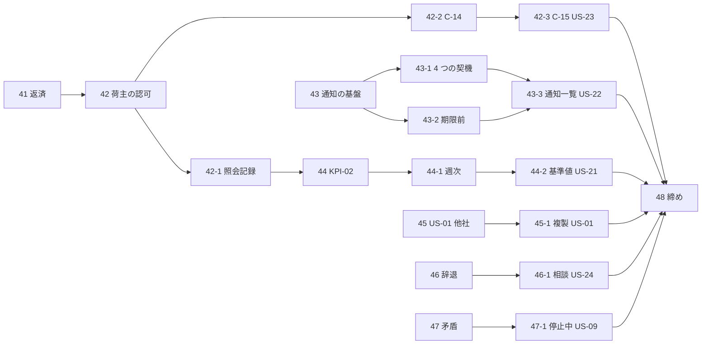

# W9 計画 - 問い合わせの追跡・通知・KPI と残りの受入条件

## 基本情報

| 項目 | 内容 |
| :--- | :--- |
| 週 | W9（Release 1.0 パイロット準備完了の 5 週目）。計画期間は 2026-11-30〜12-04（稼働 5 日） |
| 状態 | 計画（**承認済み**。2026-11-14 に人が確認ポイント CP-1〜CP-6 を推奨のとおり承認した。human:kakimomokuri。CP-4・CP-5 は開始準備で決める） |
| ゴール | 荷主担当者が自分の問い合わせを追跡・再開でき（US-23）、重要な変化をメールで知り（US-22）、KPI-02 と基準値を含めて週次の KPI を監査担当者が確認でき（US-21）、US-01・US-24・US-09 の残りの受入条件が通る |
| ストーリー | US-23（3 SP）、US-22（3 SP）、US-21 残り（3 SP）、US-01 残り（2 SP）、US-24 残り（2 SP）、US-09 残り（2 SP）。合計 **15 SP**（release_plan の W9 の行と一致） |
| 局面とアプローチ | 終盤。**アウトサイドイン**（画面と受入シナリオから。development_strategy の局面別の定め）。通知と KPI は受け手・記録のドメインを先に最小で作る |
| Bolt の本数 | 19 本（条件付きを除く）。技術 1、機能 18。条件付きで 1 本（41-1） |
| 見積りの合計 | 作業 3,490 分（約 58 時間）。ゲート・報告・承認待ちの 60 分 × 19 本 = 1,140 分を足した壁時計で **4,630 分（約 77 時間）** |
| 稼働との比較 | 稼働 5 日・1 日 13.5 時間（W8 と同じ保守的な置き方）で 4,050 分。**114%**。バッファはマイナス 14%（CP-1） |
| 前の週 | [W8 完了報告書](iteration_report-W8.md)（承認済み）。Bolt 40-18 まで終えた |

### Bolt の番号（2026-11-14 に人が改めた。W9 から適用する）

**機能・技術の単位ごとに整数の番号を採番し、それに関連する Bolt には枝番を付ける**（N、N-1、N-2、…）。計画の後で追加の Bolt が必要になったら、**枝番に枝番を付ける**（N-1-1、N-1-2）。W8 は週の最初を 40 とし、全部を 40-x にした。W9 は単位ごとに 41〜48 を取る。W8 までの表記は変えない。

| 番号 | 単位（機能・技術） |
| :--- | :--- |
| 41 | 技術: W8 の持ち越しの返済 |
| 42 | 機能: US-23 自分の問い合わせを追跡する |
| 43 | 機能: US-22 重要な変化を荷主へ通知する |
| 44 | 機能: US-21 パイロットの KPI（KPI-02・週次・基準値） |
| 45 | 機能: US-01 残り（他社・複製） |
| 46 | 機能: US-24 残り（辞退・相談） |
| 47 | 機能: US-09 残り（矛盾・停止中） |
| 48 | 技術: W9 の締め（照合・マニュアル・動画） |

## 見積りの根拠

### W8 の実績（実測）

出典は [W8 完了報告書](iteration_report-W8.md)と各 Bolt の終了報告。W8 の見積りは 17 本で作業 2,950 分、壁時計 3,970 分だった（計画では稼働 4 日の 123%）。実績の分は W8 の終了報告に Bolt ごとに書いてある。Bolt ごとの差の傾向は、この計画では集計していない（仮定 A-7）。

### 仮定（仮定は仮定と書く）

| # | 仮定 | 種類 |
| :--- | :--- | :--- |
| A-1 | 1 Bolt の事務（ゲート・報告・承認待ち）は 60 分 | W8 の置き方を踏襲 |
| A-2 | 1 日 13.5 時間の稼働（保守的） | W8 と同じ置き方（仮定） |
| A-3 | 通知は `notification` モジュール（Bolt 33 で最小に作った）を広げる。新しいモジュールは作らない | 設計文書から |
| A-4 | メールの送信は既存の送信のポートを使い、新しい外部ライブラリは入れない | 設計文書から |
| A-5 | US-23 の荷主向けの画面は C-14・C-15（ui_design に定義済み） | 設計文書から |
| A-6 | 有人案件の集約・認可・照会記録の表は W8 のものをそのまま使う | W8 の成果 |
| A-7 | W8 の Bolt ごとの見積りと実績の差は未集計。見積りは W8 と同じ粒度の置き方で付けた | 仮定 |

## W9 の Bolt 一覧

SP は W8 と同じく、ストーリーを締める Bolt に寄せる。種別は「機能」と「技術」。

| Bolt | 内容 | 種別 | 見積り（分） | SP | 壁時計（+60） | 依存 | 承認ゲート |
| :--- | :--- | :--- | ---: | ---: | ---: | :--- | :--- |
| 41 | W8 の持ち越しの返済: `ServiceCaseActionService.run` の例外の型、W8 の申し送りの残り | 技術 | 120 | 0 | 180 | なし | 計画・終了報告 |
| 41-1（条件付き） | 確認の場の結果の反映（台帳 D-124・D-130〜D-163。人が回答したときだけ） | 技術 | 90 | 0 | 150 | 確認の場 | 既定 |
| 42 | 荷主向けの問い合わせの認可: 荷主担当者の自社の問い合わせだけを読む。他社の試行の記録（US-23 AC3）。`canAccess` の荷主の分 | 機能 | 180 | 0 | 240 | 41 | **認可** |
| 42-1 | 照会記録の自動記録（IR-INV-01。顧客 Web の照会を `inquiry_record` に）と `inquiry_record.case_number` の索引（W8 の持ち越し） | 機能 | 200 | 0 | 260 | 42 | **スキーマ** |
| 42-2 | 画面 C-14 問い合わせ一覧（AC1 一覧・状態・次回更新・最新の回答、AC4 受付時間の表示） | 機能 | 200 | 0 | 260 | 42 | 計画・終了報告 |
| 42-3 | 画面 C-15 詳細と再開の依頼（AC2。履歴を保持）。US-23 を締める | 機能 | 200 | **3**（US-23） | 260 | 42-2 | 計画・終了報告 |
| 43 | 通知の基盤: 荷主担当者への宛先の解決、通知の記録（表）、失敗と宛先の記録（AC3 の内容の制限、AC4 の記録） | 機能 | 200 | 0 | 260 | なし | **スキーマ**・**外部連携** |
| 43-1 | 4 つの契機の通知（AC1: 見積りの提示、経路の承認が必要、本予約の確定、追跡が確認中 DE-18） | 機能 | 220 | 0 | 280 | 43 | 計画・終了報告 |
| 43-2 | 期限 24 時間前の通知（AC2。定期の検出） | 機能 | 180 | 0 | 240 | 43 | 計画・終了報告 |
| 43-3 | 画面の通知一覧（AC4 の「同じ内容を確認できる」）とマニュアル。US-22 を締める | 機能 | 180 | **3**（US-22） | 240 | 43-1、43-2 | 計画・終了報告 |
| 44 | KPI-02 の記録（US-21 AC2: 顧客 Web の照会の経路と、Web で完結したか有人に移ったか。分母に入れる） | 機能 | 180 | 0 | 240 | 42-1 | **スキーマ** |
| 44-1 | 週次の照会（AC4: KPI-01 の中央値・90 パーセンタイルと KPI-02。監査担当者の画面） | 機能 | 200 | 0 | 260 | 44 | **認可** |
| 44-2 | 基準値の登録と並べて示すこと（AC5）、未完了の発行の件数を確かめる手段。US-21 を締める | 機能 | 200 | **3**（US-21） | 260 | 44-1 | **スキーマ** |
| 45 | US-01 AC3: 別企業の荷主情報での提出を拒否する（確定済みは変えない） | 機能 | 120 | 0 | 180 | なし | **認可** |
| 45-1 | US-01 AC5: 過去の輸送要求の複製（希望到着期限と必要書類は再入力）。US-01 を締める | 機能 | 180 | **2**（US-01） | 240 | 45 | 計画・終了報告 |
| 46 | US-24 AC2: 理由を付けた辞退（見積りの失効、理由と回答者の記録）。D-86・ADR-018 の見直し | 機能 | 220 | 0 | 280 | なし | **構造**（ADR の見直し） |
| 46-1 | US-24 AC3: 条件の相談を有人案件で起票する（W8 の有人案件を使う。見積りの状態は変えない）。US-24 を締める | 機能 | 180 | **2**（US-24） | 240 | 46 | 計画・終了報告 |
| 47 | US-09 AC2: 予定と実績の矛盾の表示（判明事実・未確定・確認中・出典・次の行動・次回更新・担当窓口） | 機能 | 200 | 0 | 260 | なし | 計画・終了報告 |
| 47-1 | US-09 AC3: 外部情報源が停止中の表示（最終採用値・取得時刻・最新性を保証しない旨）。US-09 を締める | 機能 | 180 | **2**（US-09） | 240 | 47 | 計画・終了報告 |
| 48 | W9 の受入条件の照合（Release 1.0 の表に反映）、マニュアル・動画の総点検、締め | 技術 | 150 | 0 | 210 | 全部 | 計画・終了報告 |
| **合計（条件付きを除く 19 本）** | | 技術 2・機能 17 | **3,490** | **15** | **4,630** | | |

非循環。42〜42-3、43〜43-3、45〜45-1、46〜46-1、47〜47-1 の 5 本の鎖は互いに独立で、44 は 42-1 の後。推奨の順は 41 → 42 → 42-1 → 42-2 → 42-3 → 43 …（番号順）。

## 週の合計と稼働の比較

| 項目 | 値 |
| :--- | ---: |
| 作業の合計 | 3,490 分（58 時間） |
| 事務（60 分 × 19） | 1,140 分 |
| 壁時計の合計 | 4,630 分（77 時間） |
| 稼働（5 日 × 13.5 時間） | 4,050 分（67.5 時間） |
| 稼働に対する比 | 114% |

W8 は同じ置き方で 123% だった（実績は [W8 完了報告書](iteration_report-W8.md)）。W9 は技術の Bolt が少ない（作業の 8%。41 の 120 分と 48 の 150 分）。ただし、通知（メール、外部連携）と KPI（スキーマ）に新しい要素があり、見積りが超えやすい（リスク R-2）。

## 各 Bolt の概要（実行の直前に詳細化する）

最初の Bolt の詳細計画は、人が本計画を承認した後に作る（`bolt_41_plan.md`）。ほかは実行の直前に `opening-iteration` で詳細化する。

| Bolt | 要点 |
| :--- | :--- |
| 41 | `ServiceCaseActionService.run` が例外の型で失敗を分けるようにする（W8 の持ち越し）。範囲は開始準備で決める |
| 42 | W8 の `ServiceCaseAuthorization` に荷主担当者の自社の分を足す。他社の問い合わせの閲覧の試行を記録する（AC3）。URL の規則（`/shipper/**` 側）との一致の統合テストを足す（W8 の週全体レビュー D と同じ型） |
| 42-1 | `inquiry_record` の `WEB_SELF`・`WEB_INQUIRY` の自動記録。`case_number` の索引。スキーマの確認はこの Bolt でまとめる（人の決定、2026-11-14） |
| 42-2・42-3 | C-14・C-15。受付時間は利用者のタイムゾーンで表示する。再開は W8 の `reopen` を荷主の入口から呼ぶ（回答済みの案件だけ） |
| 43 | 既存の送信のポート（Bolt 33）を使う。通知の記録の表（宛先・種別・状態・失敗の理由）。メールの本文に料金・契約条件・書類・他の予約を含めない（AC3）ことをテストで固定する |
| 43-1 | DE-xx の購読で通知を作る。追跡が確認中は DE-18（W7 で発行済み、受け手は W9。T-184） |
| 43-2 | 期限の 24 時間前を検出する定期の仕組み。二重に送らない（通知の記録で一意） |
| 44〜44-2 | KPI-02 は分母（照会総数）と分子（Web で完結）を記録する。週次は UTC の週。基準値は算出方法と登録者を持つ |
| 46 | 辞退は D-86（再見積りできるか）と ADR-018 の見直しと一緒に決める。人に諮る（CP-4） |
| 47・47-1 | 画面は既存の荷主の照会画面の出し分け（開始準備で画面 ID を確かめる）。文は業務の判定をサービスに寄せ、画面は文にするだけにする（W8 の Keep） |
| 48 | Release 1.0 の受入条件の照合の表に W9 のストーリーを足す。マニュアル 9 章・13 章ほかの総点検 |

## 受入条件との対応

| ストーリー | 受入条件 | Bolt |
| :--- | :--- | :--- |
| US-23 | AC1 一覧、AC2 再開、AC3 他社の拒否、AC4 受付時間 | 42-2、42-3、42、42-2 |
| US-22 | AC1 4 つの契機、AC2 期限前、AC3 内容の制限、AC4 失敗の記録と一覧 | 43-1、43-2、43、43・43-3 |
| US-21 | AC2 KPI-02 の記録、AC3 CS の記録（W8 の S-23 で達成済みを確かめる）、AC4 週次、AC5 基準値 | 44、44（確認）、44-1、44-2 |
| US-01 | AC3 他社、AC5 複製 | 45、45-1 |
| US-24 | AC2 辞退、AC3 相談 | 46、46-1 |
| US-09 | AC2 矛盾、AC3 停止中 | 47、47-1 |

## 人に諮る確認ポイント（推奨を 1 つつけた。まだ承認されていない）

| # | 確認ポイント | 推奨 |
| :--- | :--- | :--- |
| CP-1 | 稼働 114%（バッファはマイナス 14%）。収まらないとき何を送るか | W8 と同じく前倒しを使い 6 日を見込む。収まらなければ 43-2（期限前の通知）、47-1 の順に W10 へ送る |
| CP-2 | Bolt の番号の規則（単位ごとに整数、枝番、枝番に枝番）を上のとおりに適用する | 承認 |
| CP-3 | `inquiry_record.case_number` の索引を 42-1 のスキーマの確認とまとめる（W8 の人の決定どおり） | 承認 |
| CP-4 | US-24 AC2 の辞退（Bolt 46）で D-86・ADR-018 を見直す。辞退した見積りを再見積りできるか | 開始準備で選択肢を示して人が決める（計画の時点では決めない） |
| CP-5 | 通知の本文の内容（件名と画面への導線だけ。AC3）と宛先（荷主担当者全員か、起票者か） | 開始準備（43）で決める。仮に「その企業の荷主担当者全員」とし、台帳に仮で残す |
| CP-6 | W8 の確認の場の回答（D-124・D-130〜D-163）は人の作業。W9 の途中でも回答が来たら 41-1 で反映する | 41-1 は条件付きのまま |

### 未決（計画に入れない）

- 通知の配信設定・静穏時間・代替チャネル（UC-13。第 2 段階）
- escalation の自動の書き込みと OBS-05（W10）
- 営業カレンダーの登録（`calendar:register`）と未登録の方針（W10）

## リスク

| # | リスク | 対応 |
| :--- | :--- | :--- |
| R-1 | 荷主向けの入口を開くので、他社の問い合わせが見える事故が起きると影響が大きい | Bolt 42 を最初に置き、認可の一致の統合テストと他社の閲覧の試行の記録を先に固める |
| R-2 | 通知（メールの外部連携と定期の検出）に新しい要素があり、見積りを超えやすい | 43 を 4 本に分けた。超えたら 43-2 を W10 へ |
| R-3 | KPI-02 は照会の経路の定義（Web で完結とは何か）が業務の判断に依存する | 開始準備（44）で選択肢を示して決める。仮の決定は台帳に残す |
| R-4 | 確認の場の回答が来ず、仮の決定の上に積む | 台帳の「仮」を保ったまま進め、回答で変わるときは補正の Bolt（N-N-1）を起こす |
| R-5 | 「自律実行」の指示で人にしか決められないものを承認として記録してしまう（W8 の Problem 2） | 人にしか決められないものは承認として記録せず確認に分ける（W8 の Try） |

## 検証の結果（`validating-iteration-plan`・`validating-design` の観点で自己検証した）

| 観点 | 結果 |
| :--- | :--- |
| ストーリー ID・SP | release_plan の W9 の行（US-23 3、US-22 3、US-21 3、US-01 2、US-24 2、US-09 2 = 15 SP）と一致。SP は各ストーリーを締める Bolt に 1 回ずつ |
| 受入条件 | user_story の US-01・09・21・22・23・24 の受入条件（残りの分）すべてに Bolt を対応させた |
| 画面 | C-14・C-15 は ui_design に定義済み（US-23）。通知一覧と週次の KPI の画面は ui_design に定義がないので、該当 Bolt（43-3、44-1）で ui_design に追加する（設計への反映が必要な注） |
| 局面（軸 A） | 終盤・アウトサイドイン。development_strategy と矛盾しない |
| BC 独立性（軸 C） | 通知は `notification` モジュールを広げ、他のコンテキストの公開 API だけを呼ぶ（`PublicApiArchitectureTest`）。KPI-02 の記録は追跡の `inquiry_record` を使う |
| 前 IT 引き継ぎ | W8 の持ち越し（`canAccess` の荷主の分、case_number の索引、例外の型）を 41・42・42-1 に入れた。AC1 の同時採番の統合テストは済み（`694cdfadbf`） |
| 注意 | W8 完了報告書の W9 の説明（「US-21・US-22 の照会記録と KPI-02」）は US-22 を照会記録と書いていて、release_plan の US-22（通知）と食い違う。release_plan を正とした |

## 更新履歴

| 日付 | 更新内容 | 更新者 |
| :--- | :--- | :--- |
| 2026-11-14 | 初版（草稿）。Bolt の番号の規則（単位ごとに整数、枝番、枝番に枝番）を人の指示で適用 | anthropic/claude-sonnet-5-5 |
| 2026-11-14 | 人が承認した（「承認」。human:kakimomokuri。CP-1〜CP-6 は推奨のとおり）。GitHub の Issue #22〜#27（US-23・US-22・US-21・US-01・US-24・US-09）が開いていることを確かめた。Project のイテレーションの割当は人の操作に残す。**気づき**: `ServiceCaseActionService.reopen` と `canAccess` は荷主担当者の自社の案件にすでに対応している（W8）。Bolt 42 の範囲は、足りない分（他社の閲覧の試行の記録、URL の規則との一致）に縮める。開始準備で確かめる | anthropic/claude-sonnet-5-5、承認 human:kakimomokuri |

## 関連ドキュメント

- [W8 完了報告書](iteration_report-W8.md)
- [リリース計画](release_plan.md)
- [ユーザーストーリー](../../requirements/cargo-tracker/user_story.md)
- [UI 設計](../../design/cargo-tracker/ui_design.md)
