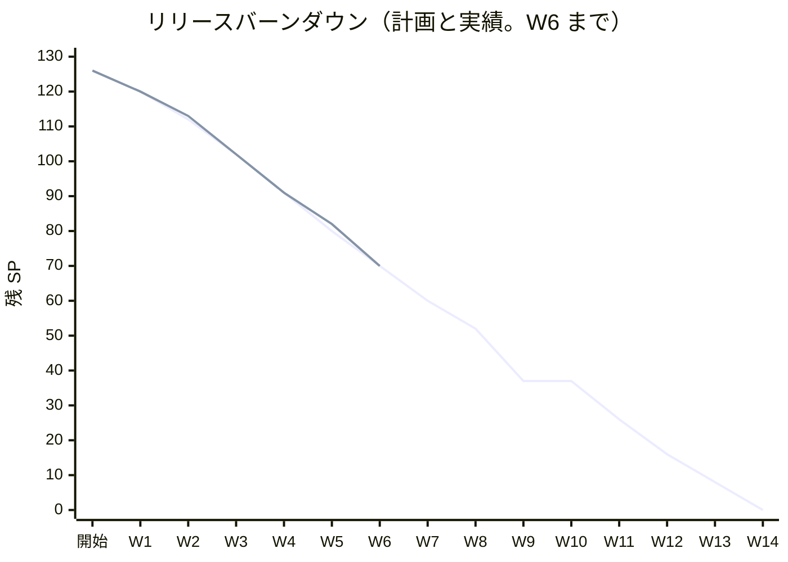
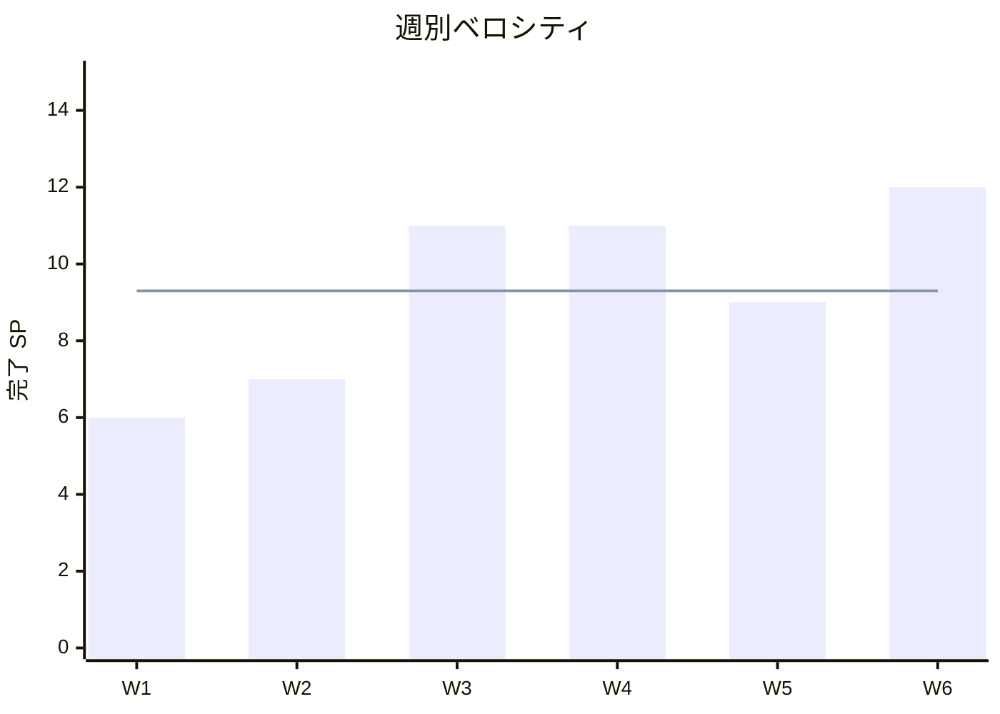

# W6 完了報告書 - cargo-tracker（経路設計の完成と利用者の管理の完成）

## プロジェクト概要

### 日程

| 項目 | 内容 |
| :--- | :--- |
| 週 | W6（Release 1.0 パイロット準備完了の 2 週目） |
| 計画期間 | 2026-11-09 〜 2026-11-13 |
| 実績期間 | 2026-10-20 〜 2026-10-29（計画期間の前に前倒し）。締めは 2026-11-02 |
| 作業日数 | 計画 5 日、実績 10 日（暦日。Bolt は 34 本） |
| ゴール | 経路設計を完成させ（US-06 の残り・US-07 の残り）、利用者の管理を完成させる（US-16 の残り・US-18 AC9 の管理者経路）。CI の画面の層のシナリオの揺らぎの原因を最初に調べる |

### 要員

| 名前 | 予定作業日数 | 実績作業日数 |
| :--- | ---: | ---: |
| 開発者 1 名 + AI（anthropic/claude-opus-5-5） | 5 | 10（暦日） |

承認と判断は human:kakimomokuri。各 Bolt は計画と終了報告で承認ゲートを通した（W5 の締めの決定）。

## 指標

### ベロシティ

| 項目 | 値 |
| :--- | :--- |
| 計画 SP | 12（W5 の締めで 10 から直した） |
| 実績 SP | 12（US-16 5、US-06 5、US-07 2） |
| 達成率 | 100% |
| Bolt の本数 | 34（開始準備の見込みは 20 本超。開始準備で約 8 回分けた） |
| 人の変更依頼 | 1（Bolt 37e。1 回目の終了報告で直してから承認） |

### リリースバーンダウン

上の線が計画、下の線（W6 まで）が実績。W6 の終わりで残り 70 SP は計画と同じだが、実績の日付は計画より約 3 週早い（W6 の計画期間 11-09〜11-13 の前の 10-29 に Bolt を終えた）。

### ベロシティの推移

平均 9.3 SP（56 SP / 6 週）。

## テスト結果

品質ゲートを W6 の締めで develop の最新（`63fd886b1`）に流し直した（2026-11-02 10:22〜10:50）。

| メトリクス | 結果 |
| :--- | :--- |
| `./gradlew check` | BUILD SUCCESSFUL（6 分 19 秒） |
| `test`（単体・統合・アーキテクチャ・業務ルール層の受入シナリオ・Web） | 3552 件、失敗 0 |
| `documentationTest`（用語集の整合など） | 5 件、失敗 0 |
| `./gradlew uiTest`（画面の層の受入シナリオ。Playwright・axe） | 352 件、失敗 0（BUILD SUCCESSFUL、14 分 46 秒。数え方は Bolt 38g の終了報告と同じ） |
| CI（develop） | 最後のコードのコミット `92851c424` と、その後の文書のコミットで緑 |

### テストの増分

| 種類 | W5 の終わり（Bolt 36 の開始） | W6 の終わり | 増分 |
| :--- | ---: | ---: | ---: |
| `test`（W5 までは `check` の件数で数えた） | 2683 | 3552 | +869 |
| `uiTest` | 280 | 352 | +72 |

### テストの累計の推移

| 週 | `test` | `uiTest` | 出典 |
| :--- | ---: | ---: | :--- |
| W4 の終わり | 1608 | 80 本 | W5 の結果（release_plan の W5 の節） |
| W5 の終わり | 2683 | 280 | 同上（Bolt 31 からシナリオを複数の件に数える数え方。W4 とはそのまま比べられない） |
| W6 の終わり | 3552 | 352 | 本報告書の実測 |

## SonarQube Quality Gate

| プロジェクト | 新しいコードのカバレッジ | 新しいコードの重複率 | 新しい違反 | 結果 |
| :--- | ---: | ---: | ---: | :--- |
| cargo-tracker-modular-monolith | 96.0%（閾値 70） | 0.03%（閾値 3） | 0（閾値 0） | PASS |

W6 の Bolt では、流した 33 本すべてが最終的に PASS で終わった（38f2b は本体のコードを変えていないので流していない）。1 回目で PASS しなかったのは 17 本で、W5 の 22 本から減った。最も多かったのはテストのラムダの中の呼び出し（S5778）。

## 実施内容と評価

| ストーリー | 結果 | 予定ポイント | ベロシティ加算ポイント | Issue |
| :--- | :--- | ---: | ---: | :--- |
| US-16 利用者と役割を管理する（残り。W5 の Bolt 34 の 2 SP を含む） | 完了 | 5 | 5 | [#14](https://github.com/k2works/practical-domain-driven-design-in-enterpris-application/issues/14) |
| US-06 経路候補を比較する（残り） | 完了 | 5 | 5 | [#15](https://github.com/k2works/practical-domain-driven-design-in-enterpris-application/issues/15) |
| US-07 経路を確定する（残り） | 完了 | 2 | 2 | [#16](https://github.com/k2works/practical-domain-driven-design-in-enterpris-application/issues/16) |
| US-18 AC9 の管理者経路（技術の分け） | 完了 | 0 | 0 | [#47](https://github.com/k2works/practical-domain-driven-design-in-enterpris-application/issues/47) |
| 合計 | | 12 | 12 | |

### 受入条件の達成状況

- [x] US-06 AC4: 外部情報源の停止中（鮮度 24 時間）の航海を使う候補を情報不足として除外し、最終採用値と取得時刻を示す（Bolt 37b・37b2）
- [x] US-06 の境界と Golden dataset v0（3 区間、1 つだけ不足する接続、規則の有効期間、G-01〜G-04・G-06 の古さ。業務責任者の承認待ち）（Bolt 37・37f・37f2）
- [x] US-07 AC3: 確定の時に航海を読み直し、情報版が違えば確定を拒否して再判断を求める（Bolt 37c）
- [x] US-07 AC4・AC5: 確定した経路版を評価して再設計要にし、旧版の再確定・荷主の承認・本予約を拒否する。出発済みの経路の拒否（D-88）（Bolt 37d〜37e4c）。外部情報の更新からの自動の評価は W7（US-14）
- [x] US-16 AC1〜AC5: 利用者の登録と招待（24 時間）、ロックの解除、担当企業の割り当てと、見積り・予約・経路設計・追跡の担当範囲の判定、範囲外の 404 と試行の記録（ADR-019）、役割の取消し（Bolt 38〜38g）。担当範囲は担当企業で近似し、案件ごとの割り当ては OQ-07 の残り
- [x] US-18 AC9: 管理者による TOTP の解除と本人への通知、解除の後の登録・回復コードの経路の再登録のお知らせ、残りの回復コードの案内（Bolt 38c・38d・38d2）
- [ ] 支援技術による手動確認（S-06・S-07・S-20・A-06）: 記録なしで #14 を閉じ、W10 の運用準備に送った（Bolt 38g の開始準備の決定 (7)）

### 実装内容の要約

- **ドメイン**: 経路設計の制約適合判定に情報不足と規則を選ぶ時刻（D-90）、確定した経路版の評価と再設計要の記録（R-INV-06・07）、見積りの割り当てた経路の再設計要の印と出発済みの判定（Q-INV-10）、利用者の登録の判定と承認の値、招待のトークンの用途、担当範囲（`UserAssignment`）
- **アプリケーション**: 評価の操作 `evaluateConfirmedRoute`（入口は W7）、DE-05・DE-06 の listener と届く順、登録・招待・ロックと TOTP の解除・通知の公開 API、request ごとの確かめで担当企業を `AuthenticatedActor` に載せる（ADR-012 の改訂）
- **インフラ**: 部分一意インデックス（確定は案件に 1 つ）、`FOR UPDATE` の本予約の確定用の照会（ADR-016 の改訂）、通知の種類の CHECK、経路設計の案件の荷主企業の列（3 段のマイグレーション）、範囲外の試行の記録のポート（`shared.domain`）と identity の実装
- **画面**: S-06・S-07 の情報不足・再設計要・出発済みの表示、C-04・C-17・S-02・S-04・S-09 の拒否の文言、S-20 の登録・ログインの資格・担当範囲の領域、A-06 の初回の設定の出し分け、荷主の画面の「区間」を「航海」に
- **文書**: ADR-001・011・012・014・016・018 の改訂と ADR-019、ユーザーマニュアル 2・4〜9・11 章・付録 B・用語集とキャプチャ、デモの動画（37b2・37c・37e3b・37e4b・38b4・38c・38f2b）

## 追加タスク（SP 外）

| タスク | Bolt | 内容 |
| :--- | :--- | :--- |
| CI の画面の層のシナリオの揺らぎ | 36 | CSRF の拒否の 403 の後に控えの印を確かめてから次の画面へ移る（#50） |
| 振る舞いを変えない準備 | 37b・37d・37e3b・37e4b・37f2・38b〜38b3 | テストと開発データの取得時刻、再設計要の記録と保存、見本、受入シナリオの背景の写しの整理、登録の判定とトークンの用途 |
| 語のそろえ | 37f3 | 荷主の画面の「区間」を「航海」に |
| S-20 の前の直し | 38・38c2 | エラー要約の形とフォーカス、停止の理由・停止した人・時刻 |
| CI の `ui` の段の上限 | 37f | 20 分から 30 分に |
| W6 の締めの追加 | — | W6 横断レビュー（[w6_review_20261102](../../review/cargo-tracker/w6_review_20261102.md)）と品質ゲートの流し直し（2026-11-02、human:kakimomokuri の指示） |

## W6 横断レビューの結果

5 視点（プログラマー・テスター・アーキテクト・テクニカルライター・ユーザー代表）で、Bolt をまたぐ重複・一貫性・設計の流れ・残った負債を見た。指摘は高 5・中 18・低 13。詳細は [W6 横断レビュー](../../review/cargo-tracker/w6_review_20261102.md)。

| 重要度 | 主な指摘 | 対応 |
| :--- | :--- | :--- |
| 高 | 再設計要・出発済みの案件を閉じる出口がない。担当企業の付け忘れが見えない。8 章のキャプチャが古い。S-02 だけ空の文の扱いと語が違う。担当範囲の 2 つのテストが見積りにしかない | 返済の Bolt 38h（W7 の Bolt 39 の前）。案件の出口は運用の決まりとマニュアルを先にし、「案件を終える」操作は W9 の荷主の辞退で決める（台帳 D-94） |
| 中 | 担当範囲の判定の置き方が 2 通り、「書き手は 1 か所」の規則の形の不揃い、コンテキストの一覧の写し、監査の書き方の 3 通り、マニュアルの入口と domain_model の追従漏れ | W7 に効く 3 件は Bolt 39、文書は 38h、ほかは #50 |
| 低 | Javadoc と ADR の状態、拒否の型の形、表記の揺れ | 38h と #50 |

## マニュアル

W6 の振る舞いの変わる Bolt は、マニュアルの更新とキャプチャを各 Bolt の完了条件に入れて終えた（2 章・4〜9 章・11 章・付録 B・用語集）。横断レビューで、8 章の候補の画面のキャプチャと入口の文書（00 章・用語集・2.8）の追従漏れが見つかったので、38h で直す。

## 累計進捗

| リリース | 計画 SP | 完了 SP | 進捗 | 期日 |
| :--- | ---: | ---: | ---: | :--- |
| Release 0.1 最初の縦の流れ | 35 | 35 | 100% | 2026-10-30（2026-10-10 に完了） |
| Release 1.0 パイロット準備完了 | 54 | 21 | 39% | 2026-12-11 |
| Release 1.1 本格展開前 | 37 | 0 | 0% | 2027-01-15 |
| 合計 | 126 | 56 | 44% | |

GitHub の Release 1.0 のマイルストーンは open 13・closed 9。

## ふりかえりと W7 への引き継ぎ

ふりかえり（KPT）と W6 の締めの見直しは、[リリース計画](release_plan.md)の W6 の節の「ふりかえり」「W6 の締めの見直し」にある（2026-11-02 に承認）。要点:

- Keep: 開始準備の 2 つの検証で計画の穴を着手の前に見つけ、Bolt を分けた。変異がすべて落ちることを出力で確かめた。状態の組み合わせの表を先に書いた
- Problem: サブエージェントへの指示で heredoc を使わない決まり（T-204）の違反が 8 本で続いた。計画の表の漏れを開発レビューで初めて見つけた。Red を見ずに書いた
- Try: T-204 を `orchestrating-development` の `PROJECT.md` のガードレールにした。W7 に 8 項目を持ち込む（T-217、T-225、T-184 など）
- 引き継ぎ: Bolt 38h（W6 の返済）、W7 の Bolt 39〜39i（[リリース計画](release_plan.md)の W7 の節。2026-11-02 に開始準備を承認）、#50 の返済の候補（W6 の締めで 19 項目を足した）、台帳の未決 D-86・D-91・D-92・D-93・D-94

## 更新履歴

| 日付 | 更新内容 | 更新者 |
| :--- | :--- | :--- |
| 2026-11-02 | 初版作成（承認待ち）。W6 の締めの追加の作業（横断レビューと品質ゲートの流し直し）の結果を含めた | anthropic/claude-opus-5-5 |

## 関連ドキュメント

- [リリース計画](release_plan.md)（W6 の節、進捗状況、W7 の節）
- [W6 横断レビュー](../../review/cargo-tracker/w6_review_20261102.md)
- [開発戦略](development_strategy.md)
- Bolt 36〜38g の計画と終了報告（[開発の索引](index.md)）
