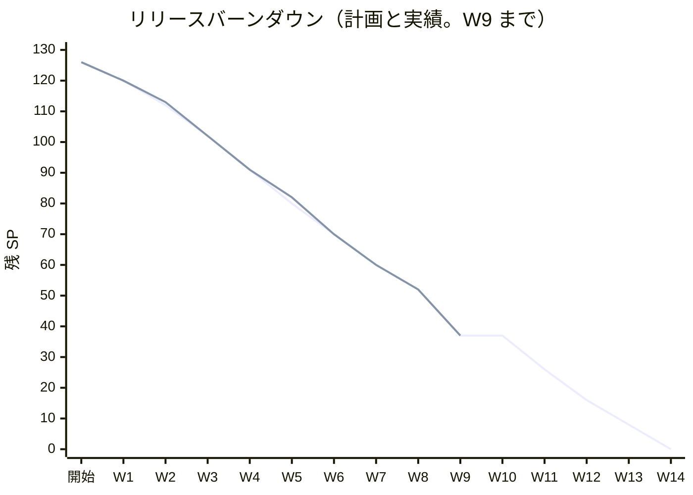
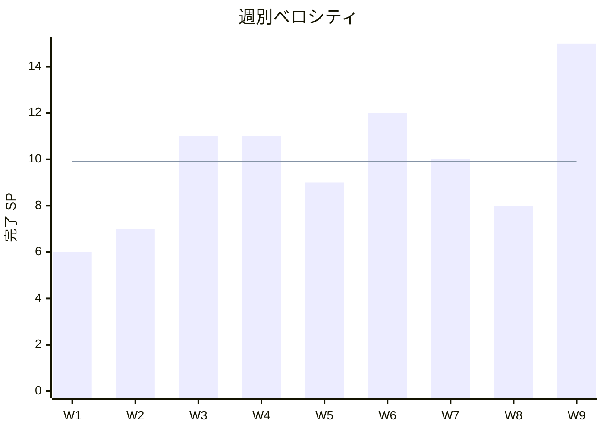

# W9 完了報告書 - cargo-tracker（問い合わせの追跡・通知・パイロットの KPI・見積りの辞退と相談）

## プロジェクト概要

### 日程

| 項目 | 内容 |
| :--- | :--- |
| 週 | W9（Release 1.0 パイロット準備完了の 5 週目。Release 1.0 の最後の週） |
| 計画期間 | 2026-11-30 〜 2026-12-04（稼働 5 日） |
| 実績期間 | 2026-11-14 〜 2026-11-15（計画期間の前に前倒し。W7・W8 と同じ） |
| 作業日数 | 計画 5 日（6 日を見込んだ。W9 計画 CP-1）、実績は暦日 2 日（Bolt は 18 本） |
| ゴール | 荷主担当者が自分の問い合わせを追跡・再開でき（US-23）、重要な変化をメールで知り（US-22）、KPI-02 と基準値を含めて週次の KPI を監査担当者が確認でき（US-21）、US-01・US-24・US-09 の残りの受入条件が通る |

### 要員

| 名前 | 予定作業日数 | 実績作業日数 |
| :--- | ---: | ---: |
| 開発者 1 名 + AI（anthropic/claude-sonnet-5-5） | 5 | 2（暦日） |

承認と判断は human:kakimomokuri。W9 では、人が選んだ判断（Bolt 42-1 のスキーマ、通知の宛先の解決の方式、辞退の扱い、US-21 の計画と S-22 の利用者）は選択肢を示して決めてもらった。それ以外は「以降 Recommended で自律実行して」の指示により、推奨のとおり承認として記録した（台帳の「仮」）。

## 指標

### ベロシティ

| 項目 | 値 |
| :--- | :--- |
| 計画 SP | 15（US-23 の 3、US-22 の 3、US-21 の 3、US-01 の 2、US-24 の 2、US-09 の 2） |
| 実績 SP | 15（各ストーリーを締める Bolt で数えた: 42-3・43-3・44-2・45-1・46-1・47） |
| 達成率 | 100% |
| Bolt の本数 | 19（41、42、42-1〜42-3、43、43-1〜43-3、44、44-1、44-2、45、45-1、46、46-1、47、48、48-1。計画の 19 本のうち 41-1（条件付き）は作らず、47-1 は 47 に統合した） |
| 人の変更依頼 | 週を通して 0 件（人が選んだ判断が 4 回: 42-1 のスキーマ、通知の宛先の解決の方式、辞退の扱い、US-21 の計画） |

### リリースバーンダウン

上の線が計画、下の線（W9 まで）が実績。W9 の終わりで残り 37 SP は計画と同じ。Release 1.0 は **54/54 SP（100%）**（W10 は SP 0 の技術の週、W11 以降は次のリリース）。

### ベロシティの推移

平均 9.9 SP（89 SP / 9 週）。

## テスト結果

W9 の締めに、`--continue spotlessCheck check documentationTest uiTest` を流し直した（Bolt ごとの実績に加えて）。辞退で終了にする Bolt 48-1 のあとの最後のコードで、`uiTest` までを 1 回、直した `checkstyleTest`（購読の分岐の循環的複雑度 11）を含む `check`・`documentationTest` をもう 1 回流した。

| メトリクス | 結果 |
| :--- | :--- |
| `spotlessCheck`・`check`・`documentationTest`・`uiTest` | 1 回目は `checkstyleTest` だけが失敗（`AcceptanceTestConfiguration` の購読の分岐の複雑度 11。ほかのタスクは成功）。直して `check`・`documentationTest` を流し直し、BUILD SUCCESSFUL（10 分） |
| `test`（単体・統合・アーキテクチャ・業務ルール層の受入シナリオ・Web） | 6,485 件、失敗 0（W8 の締めから +195） |
| `documentationTest` | 11 件、失敗 0 |
| `uiTest`（画面の層の受入シナリオ） | 252 シナリオ、失敗 0（JUnit の XML では 504 件、うち 252 件は外枠で skipped。W8 の 237 から +15） |
| SonarQube（W9 の締め） | Quality Gate PASS（下の「SonarQube Quality Gate」） |
| CI（develop。`b45cda2676`・`69149c8f93`） | `check` 成功、MkDocs の配備 成功（Bolt 48-1 の push の結果は下の「CI」に追記する） |
| CI の失敗 | 1 つ前の push（`764ab9d7f5`。Bolt 44 系）の `check` が `H2TrackingRecordLockTest`（行 37・38。配信が重なっても発行記録が両方完了する）で 1 回失敗した。テストのコードは W9 で触っていない。次の push では成功した。**時間待ちの同時実行テストの一過性の失敗**として持ち越しに記録（C-9） |

### テストの増分

W9 で足したもの: 荷主の問い合わせ・通知・KPI（週次・基準値・24 時間の規則）・辞退と相談・確認中と鮮度超過のお知らせ・見積依頼の複製の、集約・サービス・コントローラー・リポジトリの統合・セキュリティの統合、業務ルール層のシナリオ（`decline_quotation.feature`・`consult_quotation.feature` ほか）と画面のシナリオ。

## SonarQube Quality Gate

| プロジェクト | カバレッジ | 重複率 | 新しい違反 | 結果 |
| :--- | ---: | ---: | ---: | :--- |
| cargo-tracker-modular-monolith（W9 の締め。Bolt 48-1 のあと） | 95.7% | 0.1% | 0（Bug 0・Vulnerability 0・Code Smell 0） | PASS |

Bolt ごとの 1 回目で PASS したのは 41・42 系の一部。多くは 1〜2 回で違反 1〜20 件（予約語に近い識別子 `record`、ラムダ内の複数の呼び出し、リテラルの重複、引数の数、`Optional` の比べ方、`@Autowired`、`Optional`/`single()` の null の可能性）を直して PASS にした。

## 実施内容と評価

### 受入条件の達成状況

- [x] US-23 AC1〜AC4: 問い合わせ一覧・詳細・再開の依頼・他社の拒否と試行の記録・受付時間の表示（Bolt 42〜42-3）
- [x] US-22 AC1〜AC4: 4 つの契機の通知・期限前の通知・本文の限定・失敗の記録と一覧（Bolt 43〜43-3）
- [x] US-21 AC2〜AC5: 照会の記録（24 時間の規則・再開の記録）・週次の KPI・基準値の登録と比較・未完了の発行の件数（Bolt 44〜44-2。AC1 は W2、AC3 の電話・メールは W8）
- [x] US-01 AC3・AC5: 他社の荷主情報での提出の拒否、過去の見積依頼の複製（Bolt 45・45-1）
- [x] US-24 AC2・AC3: 理由を付けた辞退（失効として記録・再見積りしない）、条件の相談（有人案件の起票）（Bolt 46・46-1）
- [x] US-09 AC2・AC3: 確認中のお知らせ、最新性のお知らせ（Bolt 47）
- [x] 受入条件の照合の表（Release 1.0）に W9 の行を足し、`AcceptanceCriteriaCoverageTest` が緑

### 実装内容の要約

| Bolt | 内容 |
| :--- | :--- |
| 41 | 有人案件の操作の拒否をドメインの専用の例外で区別する（W8 の持ち越し） |
| 42〜42-3 | 荷主の問い合わせ（認可と試行の記録、顧客 Web の照会の自動記録、C-14 一覧、C-15 詳細・再開） |
| 43〜43-3 | 荷主への通知（公開 API と宛先の解決、4 つの契機、期限前の通知の毎時の検出、C-16 通知一覧） |
| 44〜44-2 | パイロットの KPI（24 時間の規則と再開の記録、週次の KPI-01・KPI-02 と S-22 の監査担当者への変更、基準値・比較・未完了の発行） |
| 45・45-1 | 他社の荷主情報での提出の拒否の照合、見積依頼の複製 |
| 46・46-1 | 辞退（D-86・ADR-018 の見直し。人が選んだ）、相談（DE-33 を追跡が購読して有人案件を起票） |
| 47 | 追跡の照会の確認中・鮮度超過のお知らせ |
| 48 | W9 の締め（週全体レビュー、辞退の確認の追加、マニュアル・動画、ゲート） |
| 48-1 | 辞退した見積りの輸送要求を辞退で終了にする（週全体レビューの高 H-2。人が選んだ。DE-17 を発行し、輸送要求の状態 `WITHDRAWN`・listener を足した） |

### 構造・スキーマ・認可の変更（人の承認を得たもの）

| 変更 | 内容 | 承認 |
| :--- | :--- | :--- |
| スキーマ | 照会記録の索引（42-1・44）、通知の索引、辞退の列 `decline_reason` と CHECK（46）、基準値の表 `identity.kpi_baseline`（44-2） | 人が選んだ（42-1、辞退、US-21 の計画） |
| モジュールの依存 | identity → notification の公開 API、tracking の公開 API `tracking.interfaces.api`、tracking → quotation のイベント | 通知の方式は人が決めた。ほかは推奨のとおり（台帳 D-169・D-171） |
| 認可 | S-22 を監査担当者だけにした（営業担当者は開けない） | 人が選んだ |

## W9 週全体レビューの結果

[W9 週全体レビュー](../../review/cargo-tracker/w9_review_20261115.md)（5 視点）。

| 重大度 | 件数 | 扱い |
| :--- | ---: | :--- |
| 高 | 2 | **2 件とも直した**（辞退の確認、辞退後の輸送要求の行き先。後者は人が選び、Bolt 48-1 で実装した） |
| 中 | 11 | 直したもの 5（二重送信の文言、マニュアル・用語集・データモデル、台帳の追記）、人に諮るもの 2、W10 に送るもの 4 |
| 低 | 6 ほか | 一部を直した、残りは W10 に送った |

## 規律の違反（W9 の 18 本）

| 違反 | 内容 | 扱い |
| :--- | :--- | :--- |
| 標準入力につながる形の実行 | 空の heredoc・`python3 -`・`cat > /dev/null` の入力つきの形を、Bolt 43・43-2・43-3・44・46・46-1 で計 6 回誤って書いた（何も読まず何も変えていない。都度開示した） | 以後は Write と Edit だけを使う（スクリプトはファイルに書いて実行する） |
| 人に諮る判断の確認 | 辞退の扱い（D-86・ADR-018）、US-21 の計画（スキーマ・認可）は、選択肢を示して人に決めてもらった。通知の宛先の解決の方式も同じ | 守れた |
| モジュールの依存の追加（tracking → quotation のイベント） | 相談の購読で足した。既存の購読（経路設計・外部データ）と同じ向きなので推奨のとおり承認として記録した（D-169。仮） | 業務責任者・人の確認を待つ |

## マニュアル

UI・操作の変更があったため更新した。新規: 14 章「問い合わせの追跡」、15 章「通知」。更新: 3 章（見積依頼の複製）、4 章（辞退・相談）、5 章（確認中・最新性のお知らせ）、6・7 章（辞退した見積りは再見積りできない）、10 章（監査担当者の KPI の照会に書き直し）、0・2 章・索引（役割の表）、用語集（辞退・失効）。キャプチャは `manualScreenshots` で再生成した。デモ動画は W9 の 10 本（`bolt-42-3`〜`bolt-47`）を録画した（既存の動画は残した）。

## 累計進捗

| 項目 | 値 |
| :--- | :--- |
| Release 1.0 | **54/54 SP（100%）**。W9 で機能の実装を終えた |
| ストーリー | US-23・US-22・US-21・US-01・US-24・US-09 を閉じた |
| 台帳 | D-164〜D-172 を足した（D-164〜D-167・D-169〜D-172 は仮、D-168 は人が選んだ。D-86 を決着した） |

## ふりかえりと W10 への引き継ぎ

### ふりかえり（KPT）

| 区分 | 内容 |
| :--- | :--- |
| Keep | 構造・スキーマ・認可の変更を、選択肢と推奨を示して人に決めてもらい、台帳に「人が決めた」と「仮」を書き分けた。名前の絞り込みで画面のシナリオを 1 分で回す方法が、大きな UI の追加（通知・KPI・辞退）でも効いた。週全体の 5 視点のレビューで、Bolt ごとのレビューでは見えなかった食い違い（辞退の確認、マニュアル・用語集・データモデルの食い違い）が見つかった。 |
| Problem 1 | ゲートの失敗の原因が 1 回に 1 つしか見えず、流し直しが 3 回続いた Bolt があった（用語集・Checkstyle → セキュリティの統合テスト → SpotBugs。1 回 30 分）。`--continue` を付ける前は最初の失敗で止まっていた。 |
| Problem 2 | Sonar の違反が 1〜2 回の流し直しで 20 件近くになった（予約語に近い識別子、ラムダの複数の呼び出し、リテラルの重複）。同じ種類の指摘が Bolt ごとに繰り返された。 |
| Problem 3 | 認可の変更（S-22 を監査担当者だけに）が、ナビ・ホーム・セキュリティの統合テスト・画面のテストの前提・マニュアルの役割の表に波及した。波及の洗い出しをテストの失敗に頼った。 |
| Problem 4 | CI で時間待ちの同時実行テストが 1 回、一過性で失敗した。標準入力の形の誤りが W9 でも 6 回残った。 |
| Try | ゲートは最初から `--continue` を付けて流す。push の前に `checkstyleMain checkstyleTest spotbugsMain` と、Sonar で繰り返す種類（予約語の識別子、ラムダ内の呼び出し、リテラルの重複）を自分で見る。認可の変更は、先に影響を受ける画面・ナビ・テスト・文書を一覧にしてから始める。 |

### W9 の締めで人に諮る議題と推奨

| # | 議題 | 推奨 |
| :--- | :--- | :--- |
| 1 | 辞退後の輸送要求の行き先（週全体レビューの高 H-2。台帳 D-168） | **決定済み（2026-11-15、human:kakimomokuri）: 「辞退で終了」にする。Bolt 48-1 で実装した（台帳 D-173）。** 業務責任者への確認は未 |
| 2 | GitHub の Issue #22〜#27 のクローズ | **実施済み**（2026-11-15。人の許可を得て、完了コメント付きで 6 件をクローズ） |
| 3 | 確認の場（D-124・D-130〜D-172）の開催。特に D-170（24 時間）・D-171（週の区切り・除外）・D-166（通知の宛先） | Release 1.0 のパイロットの前に開く |
| 4 | W10（SP 0 の技術の週）の範囲 | 下の持ち越し C-1〜C-9 を W10 に載せる |

### W10 への引き継ぎ（持ち越し）

[W9 週全体レビュー](../../review/cargo-tracker/w9_review_20261115.md) の C-1〜C-8 に、次を足す。

| # | 内容 |
| :--- | :--- |
| C-9 | `H2TrackingRecordLockTest` 行 37・38 の一過性の失敗（CI の run 43671271549）。時間待ちの同時実行テストの安定化 |
| C-1〜C-8 | 詳細経路設計の依頼の後の営業の手順（C-1。辞退後の行き先は直した）、辞退済みへの回答・相談の文言、通知の失敗の再送、通知の購読の置き場所、確認の場、重複の返済、テストの待ち方、死んだ `PlaceholderController` の削除・時間ごとのジョブの ShedLock と監視・PV-01 の除外の記録 |

### 技術的負債

- 通知の失敗は記録するが再送しない（C-3）。
- KPI の集計は全件を読んで集める（パイロットの件数では問題ないが、増えたら範囲指定の読みにする。C-6）。
- 24 時間と 30 分、36 時間の定数は仮のまま直書き（確認の場で決まったら設定に出す）。

## 更新履歴

| 日付 | 更新内容 | 更新者 |
| :--- | :--- | :--- |
| 2026-11-15 | 初版 | anthropic/claude-sonnet-5-5 |
