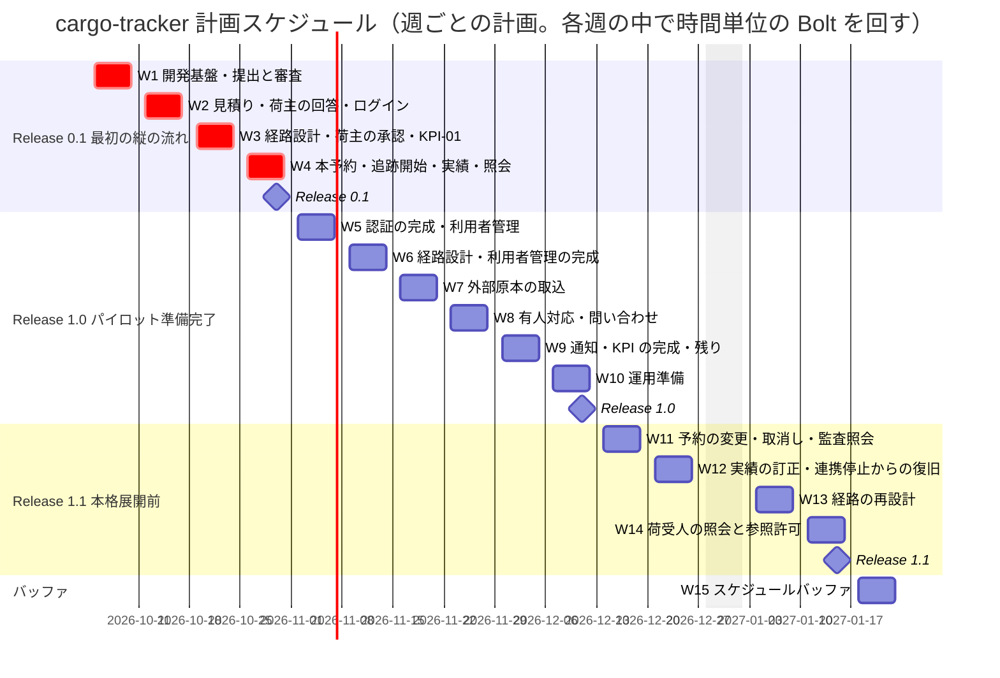
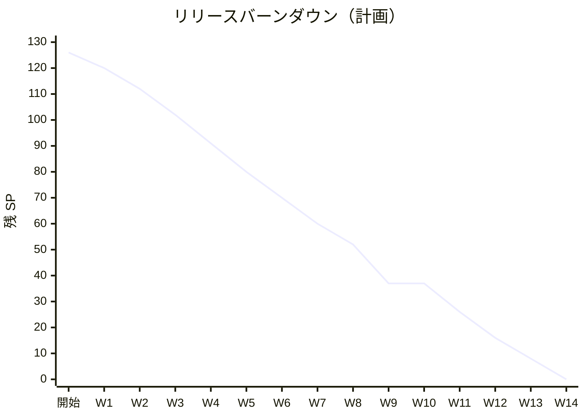

# リリース計画 - cargo-tracker（A 社国際貨物輸送管理システム）

## 概要

本ドキュメントは、cargo-tracker の MVP（予約・経路設計・基本追跡）を、パイロットを開始できる状態まで届けるリリース計画を定義する。計画は [リリース・イテレーション計画ガイド（AI-DLC 版）](../../reference/リリース・イテレーション計画ガイド_AI-DLC版.md) に従い、Intent → Unit → Bolt の単位で組む。

### プロジェクト情報

| 項目 | 内容 |
| :--- | :--- |
| **プロジェクト名** | cargo-tracker（A 社国際貨物輸送管理システム） |
| **Intent** | 荷主の輸送条件の受付から、見積り・経路設計・本予約・基本追跡までを、根拠と監査証跡を失わず一貫して提供する（[Unit 定義](../../requirements/cargo-tracker/units.md)） |
| **対象ユーザー** | 法人荷主の担当者、荷受人、A 社の営業担当者・経路設計者・追跡管理者・カスタマーサポート・データ責任者・システム管理者・監査担当者 |
| **開発体制** | 開発者 1 名 + AI エージェント（2026-10-01 に human:kakimomokuri が決定） |
| **入力** | 要件（user_story.md: 24 ストーリー・受入条件 120 件）、設計書 10 本、ADR-001〜009、[分析成果物レビュー](../../review/cargo-tracker/analysis_review_20261001.md) |

---

## 満足条件

### Intent とビジネス価値

| 項目 | 内容 |
| :--- | :--- |
| ビジネス価値 | 経路提示のリードタイムを短くし（KPI-01）、荷主の自己照会を増やす（KPI-02）。熟練者を例外判断へ集中させる |
| 測定基準 | PV-01: KPI-01 の中央値を基準値から 10% 以上短縮し 90 パーセンタイルを悪化させない。KPI-02 を 10 ポイント以上改善する。権限外開示・外部原本消失・重複予約は各 0 件（[要件定義](../../requirements/cargo-tracker/requirements_definition.md)） |
| 計測の手段 | US-21（KPI の計測）を MVP の Must に含める |

### スコープ

MVP は 3 つのリリースで段階的に届ける。

| リリース | 内容 | ストーリー | SP |
| :--- | :--- | :--- | ---: |
| Release 0.1 最初の縦の流れ | 一般貨物 1 件が、提出から本予約・追跡の照会まで縦に通り、KPI-01 の 2 時刻が記録される（レビュー R-17） | Must の主成功の流れの部分 | 35 |
| Release 1.0 パイロット準備完了 | Must の全受入条件と運用準備。パイロットを開始できる状態 | Must の残り | 54 |
| Release 1.1 本格展開前 | Should と Could | US-05、US-08、US-13、US-15、US-17、US-10、US-19 | 37 |
| **合計** | | **24 ストーリー** | **126** |

第 2 段階（荷役・リアルタイム追跡・通知の拡張・例外対応）と第 3 段階（料金・精算・外部連携強化）は、Release 1.1 の後に別のリリース計画で扱う。

### スケジュール

- **開発期間**: 2026-10-05 〜 2027-01-22（15 週）
- **イテレーション（Bolt）**: 時間単位（目安 2〜4 時間）。計画と見直しの区切りは 1 週間で、14 週 + スケジュールバッファ 1 週
- **リリース**: Release 0.1（2026-10-30）、Release 1.0（2026-12-11）、Release 1.1（2027-01-15）
- **休み**: 2026-12-28 〜 2027-01-01 は作業しない。祝日を含む週（W2、W5、W8、W14）は計画の SP を少なくする

インセプションデッキの仮定（MVP リリース 2027 年 1 月下旬）に対して、Release 1.1 の完了が 2027-01-15 になる。パイロットの開始日は、Release 1.0 の後に「パイロット開始の条件」がそろった時点で業務側が決める。

### リソース

- **開発者**: 1 名（人の検証・判断・承認ゲート）
- **AI エージェント**: 計画・実装・テスト・文書の生成
- **想定稼働**: 週 5 日。Bolt は時間単位（目安 2〜4 時間）で、1 日に 2〜4 Bolt、承認ゲートも 1 日 2〜4 回とみなす（2026-10-01 に human:kakimomokuri が決定）

---

## Unit の評価（実装エントロピー）

AI-DLC 版ガイドのステップ 4 に従い、AI がどれだけ自律的に進められるかを 5 軸で評価する。HIGH が多い Unit ほど承認ゲートを密にする。

| Unit | 意図の曖昧さ | 構造的不確実性 | 検証の不確実性 | リスク | 未解決の仮定 | 承認ゲートの密度 |
| :--- | :---: | :---: | :---: | :---: | :---: | :--- |
| U1 輸送要求・見積り | LOW | MED | LOW | MED | MED | 標準。業務のルール・スキーマ・セキュリティに関わるステップは毎回、それ以外のステップは次の承認ゲートにまとめる（Bolt 1〜5 で人の変更依頼 0 件。2026-10-03 に human:kakimomokuri が決定。Bolt 6 から） |
| U2 経路設計 | MED | MED | **HIGH** | **HIGH** | **HIGH** | 密（Red・Green ごと） |
| U6 予約管理 | LOW | MED | MED | **HIGH** | LOW | 密（確定・冪等・重複防止は Red・Green ごと） |
| U3 基本追跡 | MED | MED | MED | **HIGH** | MED | 密（開示制御は Red・Green ごと） |
| U4 アクセス・監査 | LOW | MED | MED | **HIGH** | MED | 密（認証・認可は Red・Green ごと） |
| U5 外部データ | MED | MED | MED | **HIGH** | **HIGH** | 密 |
| 通知 | LOW | LOW | LOW | MED | LOW | 標準 |

| 評価が HIGH の軸 | 対策 |
| :--- | :--- |
| U2 の検証の不確実性・未解決の仮定 | Golden dataset（TST-02）と必要最小接続時間の値（DM-05）を業務責任者に依頼する。届くまでは仮の案件で進める。W6 の Golden dataset は仮の値の v0 で作り、届いたら差し替えの Bolt を足す（W6 の開始準備の決定。パイロット開始の条件として残す） |
| U5 の未解決の仮定 | 取込ファイルの提供元・形式（OQ-02 の残り）を W7 の前に決めてもらう。決まらなければ仮の形式で作り、差し替えの Bolt を足す |
| U6・U3・U4・U5 のリスク | テスト戦略の Comprehensive の対象。承認ゲートで全行を確認する |

Release 1.0 の承認ゲートの密度は、Release 0.1 の実績で W4 の締めに決め直した（「ベロシティ検証計画」の「W4 の締めの見直し」）。上の表の「密」は、Release 1.0 では計画の承認の場の確認ポイントと終了報告の承認で受け、ステップごとに止めるのは認証の完成（U4、W5）と外部原本の取込（U5、W7）に限る。

### スコープ・深さ・テスト戦略

| 軸 | 選択 | 理由 |
| :--- | :--- | :--- |
| スコープ | 全ステージ（新規開発） | グリーンフィールド |
| 深さ | Standard。PV-01 に直結する領域（予約確定、開示制御、外部原本、認証、訂正の二者確認、制約適合判定）は Comprehensive | [テスト戦略](../../design/cargo-tracker/test_strategy.md) の「テストの深さ」 |
| テスト | 本番機能は Standard 以上。BDD（Cucumber）と TDD の二重ループ（ADR-009） | テスト戦略 |

---

## ユーザーストーリー一覧とストーリーポイント

### ストーリーポイントの付け方

AI-DLC 版ガイドの読み替えに従い、SP は「AI が生成する量」ではなく **人が検証に費やす負荷** の相対値とする（1、2、3、5、8）。受入条件の数、境界値の多さ、Comprehensive の対象かどうかで決める。

### 優先順位マトリックス

4 軸（金銭価値 BV、コスト C、知識習得 KA、リスク軽減 RR）で評価する。Release 0.1 に入る部分は、縦の流れを通すことを最優先にする。

| ID | ユーザーストーリー | Unit | SP | BV | C | KA | RR | 優先度 | リリース |
| :--- | :--- | :--- | ---: | :---: | :---: | :---: | :---: | :--- | :--- |
| US-01 | 輸送条件を提出する | U1 | 5 | 高 | 中 | 中 | 中 | Must | 0.1 / 1.0 |
| US-02 | 輸送条件を審査する | U1 | 3 | 高 | 低 | 低 | 中 | Must | 0.1 |
| US-03 | 根拠付き見積りを提示する | U1 | 5 | 高 | 中 | 中 | 高 | Must | 0.1 |
| US-24 | 見積りと経路に回答・承認する | U1 | 5 | 高 | 中 | 中 | 高 | Must | 0.1 / 1.0 |
| US-06 | 経路候補を比較する | U2 | 8 | 高 | 高 | 高 | 高 | Must | 0.1 / 1.0 |
| US-07 | 専門判断を伴う経路を確定する | U2 | 5 | 高 | 中 | 中 | 高 | Must | 0.1 / 1.0 |
| US-04 | 予約を確定する | U6 | 8 | 高 | 高 | 高 | 高 | Must | 0.1 / 1.0 |
| US-12 | 主要実績を登録する | U3 | 5 | 高 | 中 | 中 | 高 | Must | 0.1 / 1.0 |
| US-09 | 荷主が輸送状態を照会する | U3 | 5 | 高 | 中 | 中 | 高 | Must | 0.1 / 1.0 |
| US-21 | パイロットの KPI を計測する | U4 | 5 | 高 | 中 | 低 | 高 | Must | 0.1 / 1.0 |
| US-18 | 本人として認証される | U4 | 8 | 中 | 高 | 高 | 高 | Must | 0.1 / 1.0 |
| US-16 | 利用者と権限を管理する | U4 | 5 | 中 | 中 | 低 | 高 | Must | 1.0 |
| US-14 | 外部原本を安全に取り込む | U5 | 8 | 高 | 高 | 高 | 高 | Must | 1.0 |
| US-11 | 顧客照会を引き継ぐ | U3 | 3 | 中 | 低 | 低 | 中 | Must | 1.0 |
| US-20 | 照会・業務例外を回答・終結まで追跡する | U3 | 5 | 中 | 中 | 中 | 高 | Must | 1.0 |
| US-22 | 重要な変化を荷主へ通知する | U3（通知） | 3 | 高 | 低 | 中 | 中 | Must | 1.0 |
| US-23 | 自分の問い合わせを追跡する | U3 | 3 | 中 | 低 | 低 | 中 | Must | 1.0 |
| US-05 | 予約を変更・取消しする | U6 | 8 | 中 | 高 | 中 | 高 | Should | 1.1 |
| US-08 | 経路を再設計する | U2 | 8 | 中 | 高 | 高 | 中 | Should | 1.1 |
| US-13 | 主要実績を訂正する | U3 | 5 | 中 | 中 | 中 | 高 | Should | 1.1 |
| US-15 | 外部連携停止から復旧する | U5 | 5 | 中 | 中 | 中 | 高 | Should | 1.1 |
| US-17 | 監査証跡を照会する | U4 | 3 | 中 | 低 | 低 | 中 | Should | 1.1 |
| US-10 | 荷受人が許可範囲を照会する | U3 | 3 | 低 | 低 | 低 | 中 | Could | 1.1 |
| US-19 | 荷受人の参照許可を管理する | U4 | 5 | 低 | 中 | 中 | 中 | Could | 1.1 |
| **合計** | | | **126** | | | | | | |

### Release 0.1 最初の縦の流れの範囲

ストーリーを縦に薄く切り、主成功の流れだけを先に通す（レビュー R-17）。残りの受入条件は Release 1.0 で完成させる。

| ID | Release 0.1 で通す受入条件 | SP | 残り（Release 1.0） |
| :--- | :--- | ---: | ---: |
| US-01 | AC1 提出、AC2 不足項目、AC4 特殊貨物の拒否 | 3 | 2（AC3 他社、AC5 複製） |
| US-02 | 全受入条件 | 3 | 0 |
| US-03 | 全受入条件（BR-10 の境界を含む） | 5 | 0 |
| US-24 | AC1 詳細経路設計へ進む、AC4 承認、AC5 失効時の拒否 | 3 | 2（AC2 辞退、AC3 相談） |
| US-06 | AC1 候補の比較、AC2〜3 の境界（BR-11）。仮の航海データ | 3 | 5（AC4 停止中、Golden dataset、複数接続・規則の有効期間の境界。W6 の Bolt 37〜37f で作り、Bolt 37f で #15 を閉じて数えた。2026-10-24） |
| US-07 | AC1 確定、AC2 根拠・権限の不足 | 3 | 2（AC3 承認中の更新、AC4〜5 再設計要・旧版。W6 の Bolt 37c〜37e4c で作り、Bolt 37e4c で #16 を閉じて数えた。2026-10-24） |
| US-04 | AC1 確定、AC2 失効、AC4 再送（B-INV-03）、B-INV-11 重複確定の防止、予約サガ | 5 | 3（AC3 不足条件、AC5 特殊貨物） |
| US-12 | AC1 登録、AC2 重複 | 3 | 2（AC3〜5 順序逆転・取消済み・完了後） |
| US-09 | AC1 照会（現在状態・予定・主要実績・出典・取得時刻） | 3 | 2（AC2 矛盾、AC3 停止中） |
| US-21 | AC1 KPI-01 の 2 時刻の記録 | 2 | 3（AC2〜5 KPI-02、週次の照会、基準値） |
| US-18 | password によるログインと session（TOTP は後で） | 2 | 6（TOTP、ロック、失効、再設定） |
| **合計** | | **35** | **27** |

TOTP を Release 0.1 から外すのは、レビューの矛盾事項 1 の推奨判断による。パイロットの開始の条件には含める。

### 全体サマリー

| リリース | SP | 週 |
| :--- | ---: | :--- |
| Release 0.1 最初の縦の流れ | 35 | W1〜W4 |
| Release 1.0 パイロット準備完了 | 54 | W5〜W10 |
| Release 1.1 本格展開前 | 37 | W11〜W14 |
| **合計** | **126** | **14 週 + バッファ 1 週** |

---

## ベロシティ見積もり

### 初期ベロシティ推定

| 項目 | 値 |
| :--- | :--- |
| **イテレーション（Bolt）** | 時間単位（目安 2〜4 時間）。計画の区切りは 1 週間 |
| **体制** | 開発者 1 名 + AI |
| **想定ベロシティ** | 10 SP / 週（祝日を含む週は 8 SP）。1 週あたり 10〜20 Bolt |
| **バッファ** | フィーチャバッファ 29%（Should・Could の 37 SP）+ スケジュールバッファ 1 週間 |

初回のベロシティは推測値である。W1〜W3 の実績（完了 SP、承認ゲートの通過数、変更依頼の数、リードタイム）で W4 の開始時に見直す。

### ベロシティ検証計画

- 各 Bolt の終了時に、承認ゲートの通過数・変更依頼の数・リードタイムを Bolt 終了報告に記録する。週次の見直しで、完了 SP とこれらの指標を集計する。
- 最初の Bolt（ウォーキングスケルトン）で AI の出力の品質を確かめて承認ゲートの密度を決め、Release 0.1（W1〜W4）の実績で Release 1.0 の密度を決め直す。
- 3 週後に、Release 1.0 の計画（W5〜W10）をベロシティの実績で引き直す。

**W4 の開始時の見直し**（2026-10-08 に human:kakimomokuri が決定）:

| 指標 | W1〜W3 の実績 |
| :--- | :--- |
| 完了 SP | 24 SP（計画 24 SP。W1 6、W2 7、W3 11） |
| Bolt | 21 本（SP 0 の技術タスクの Bolt 6 本を含む）。暦では 2026-10-01〜10-08 の約 6 営業日 |
| 人の変更依頼 | 1（Bolt 15 のアプリ名）。ほかは判断・追加の依頼として数えた |
| リードタイム | 記録のある Bolt で約 47 分（Bolt 2）〜 4 時間 36 分（Bolt 4。ステップごとの承認ゲートの待ちを含む） |

- ベロシティは 10 SP / 週（祝日を含む週は 8 SP）を維持する。実績は計画どおりで、暦の上の前倒しは週の目標を上げる根拠にしない
- Release 1.0 の引き直し（10 SP を超える W6・W9 の扱い）は、Release 0.1 を終えた W4 の締めで行う
- W4 の承認ゲートの密度: リスク台帳（「Unit の評価」の表）に従う。予約・追跡の Bolt（23〜27）は、U6 の確定・冪等・重複防止と U3 の開示制御を Red・Green ごとに、スキーマと認可をステップごとに止める。`/goal` で止めずに進めるのは Bolt 22（#41）と Bolt 28（`@ui` とデモ）だけ（開始準備の横断検証で、最初の案「US-04 だけステップごと」が台帳と食い違うと分かり、決め直した）

**W4 の締めの見直し**（2026-10-10 に human:kakimomokuri が決定。Release 0.1 の実績による）:

| 指標 | Release 0.1（W1〜W4）の実績 |
| :--- | :--- |
| 完了 SP | 35 SP（計画 35 SP。W1 6、W2 7、W3 11、W4 11） |
| Bolt | 33 本（W1 8、W2 6、W3 7、W4 12。W4 は 23b・25b・26b・26c・27b を分けて半日以内に収めた）。暦では 2026-10-01〜10-10 の 9 稼働日で、計画（W1〜W4 の 19 営業日）より約 2 週早い |
| 人の変更依頼 | 4（W1〜W3 の 1、W4 の 3: 予約サガの置き場所、公開 API の置き場所と見積りへの適用）と範囲の追加 1（Bolt 27b の荷主の予約一覧） |
| 承認ゲート | W4 の 12 本はすべて、`/goal` や人の指示で途中のゲートの全部か一部を止めずに進め、終了報告の承認でまとめて受けた。手順の逸脱（Red を確かめる前の実装、確認必須のゲートの AI の判断での通過）は終了報告と開発レビューで拾え、T-67・T-80 の後は確認必須のゲートを守れた |

- Release 1.0 の計画: 範囲と日付（Release 1.0 は 2026-12-11）は変えない。US-04 の残り（3 SP、#43）を W6 から W5 に前倒しして W6 を 10 SP にする。W5（祝日の週で 11 SP）と W9（15 SP）の超過は、Release 0.1 を計画より約 2 週早く終えた余裕で吸収し、週ごとの見直しで確かめる。吸収できないと見えたら「バッファ消費ルール」に従う
- Release 1.0 の承認ゲートの密度: 既定は計画の承認と終了報告の承認で止める。確認必須（スキーマ・認可・外部連携・セキュリティ）は計画の承認の場で確認ポイントとして判断を受ける（T-80）。ただし、リスクの高い認証の完成（W5、US-18 の残り。セキュリティ）と外部原本の取込（W7、US-14）は、ステップごとに止める
- Release 0.1 の負債: 画面の層のステップ定義のキー操作の部品（#45、T-87）と、マニュアルの作成で見つけた画面の文言と表示の課題（#46）を、W5 の最初の Bolt で返す（ともに SP 0）

---

## 段階的リリース戦略

### リリーススケジュール

#### 計画スケジュール

#### 実績スケジュール

週次の見直しごとに記入する。

| 週 | 実績 |
| :--- | :--- |
| W1 | 2026-10-01 〜 2026-10-03（期間の前に前倒し）。Bolt 1〜8（開発基盤、CI、E2E の基盤、US-01 の提出と必要書類、US-02 の審査と荷主の再提出、UI の骨格と段階入力）。6 SP。ベロシティの見直しは計画どおり W4 で行う |
| W2 | 2026-10-05 〜 2026-10-06（W2 の期間の前に前倒し）。Bolt 9（Bolt 6〜8 レビューの返済。SP 0）、Bolt 10（US-03 の提示 AC1〜AC3）、Bolt 11（US-03 の失効・置換 AC4・AC5 と Bolt 9・10 レビューの返済）、Bolt 12（US-24 AC1 詳細経路設計へ進む）、Bolt 13（TOTP のスパイク TS-01。SP 0）、Bolt 14（US-18 の password によるログインと session）。7 SP（US-03 5、US-18 の一部 2）。US-24 の R0.1 の 3 SP（W2 の計画分は 1）は、#5 をクローズする W3 で数える。業務責任者に確かめる事項の 14 件を仮の決定のとおりに決めた。W1〜W2 の累計は 13 SP（計画は 14 SP） |
| W3 | 2026-10-06 〜 2026-10-08（W3 の期間の前に前倒し）。Bolt 15（dev プロファイルによる Heroku のデモ環境。SP 0、ADR-013）、Bolt 16（デモ環境への CI からの配備。SP 0）、Bolt 17（US-06 AC1〜AC3）、Bolt 18（デモ環境のサンプル。SP 0）、Bolt 19（US-07 AC1・AC2）、Bolt 20（US-24 AC4・AC5、ADR-014）、Bolt 21（US-21 AC1）。11 SP（US-06 3、US-07 3、US-24 3、US-21 2）。W1〜W3 の累計は 24 SP（計画も 24 SP） |
| W4 | 2026-10-08 〜 2026-10-10（W4 の期間の前に前倒し）。Bolt 22（日時表示・期間表示の集約。SP 0）、Bolt 23・23b・24（US-04 の確定・失効・再送・重複確定の防止と画面、ADR-015・ADR-016）、Bolt 25（追跡の開始と予約サガの成功の経路）、Bolt 25b（S-10 予約一覧）、Bolt 26（追跡管理者の入口）、Bolt 26b・26c（US-12 AC1・AC2）、Bolt 27（US-09 AC1）、Bolt 27b（C-06 荷主の予約一覧）、Bolt 28（主成功の流れの `@ui` シナリオと Release 0.1 のデモ）。11 SP（US-04 5、US-12 3、US-09 3）。W1〜W4 の累計は 35 SP（計画も 35 SP）。Release 0.1 を 2026-10-10 に終えた（計画は 10-30）。続けてユーザーマニュアルとウォーキングスケルトンのガイドツアーの記事を作った |

### リリース内容

#### Release 0.1（W4 完了）: 最初の縦の流れ

**目標**: 一般貨物 1 件が、提出 → 審査 → 見積りと経路方針の提示 → 荷主の回答 → 経路確定 → 荷主の承認 → 本予約 → 追跡開始 → 実績の登録 → 照会まで縦に通り、KPI-01 の 2 時刻が記録される。AI の出力品質を確かめ、以降の承認ゲートの密度を決める。

**含まれる機能**:

- 開発基盤（Spring Boot 4.1、Spring Modulith、MyBatis、Flyway、ArchUnit、Cucumber、H2・Testcontainers、CI）
- 見積り・経路設計・予約・追跡・アクセス監査の最小の流れ（上表の Release 0.1 の範囲）
- 予約サガ（本予約 → 追跡開始）と、重複確定の防止（B-INV-11）
- password によるログイン（TOTP は Release 1.0）

**リリース条件**:

- [x] Release 0.1 の範囲の受入シナリオがすべて通る（Bolt 28 で確かめた）
- [x] 主成功の流れの `@ui` シナリオ 1 本が通る（Bolt 28 で確かめた）
- [x] アーキテクチャテスト（AT-01〜06）が通る（Bolt 28 で確かめた）
- [x] H2 で起動でき、PostgreSQL の統合テストが通る（Bolt 28 で確かめた）
- [x] 社内デモで human:kakimomokuri が流れを確認する（2026-10-10、デモ環境。[Bolt 28 終了報告](bolt_28_report.md)）

**完了**: 2026-10-10（計画は 2026-10-30）。35 SP。[Release 0.1 リリース完了報告書](release_report-0_1.md)

#### Release 1.0（W10 完了）: パイロット準備完了

**目標**: Must の 17 ストーリーの全受入条件と運用準備をそろえ、パイロットを開始できる状態にする。

**含まれる機能**:

- 認証の完成（TOTP、ロック、session の失効と警告、password の再設定）と利用者・権限の管理
- 経路設計の完成（Golden dataset、停止中の情報不足）と予約の完成
- 外部原本の取込（重複・隔離・差異）
- 有人対応（引継ぎ、受領・回答・終結・再開、営業日カレンダー）と荷主の問い合わせ
- 荷主へのメール通知と KPI の計測（KPI-02、週次の照会、基準値）
- AWS のステージング・本番環境、CI/CD、監視、運用タスクとランブック、性能テスト

**リリース条件**:

- [ ] Must の全受入条件のシナリオが通る（`@wip` なし）
- [ ] テスト戦略の Comprehensive の対象の統合・Web テストが通る
- [ ] カバレッジの閾値を満たす
- [ ] axe-core の違反 0 件、支援技術による手動確認で重大な問題 0 件
- [ ] 性能テストで PERF-01〜09 を満たす
- [ ] 時点復旧の訓練で RTO 2 時間・RPO 5 分を実測し、照合まで行えた（RCV-08）
- [ ] 本番の脆弱性スキャンで HIGH・CRITICAL 0 件

#### Release 1.1（W14 完了）: 本格展開前

**目標**: Should と Could のストーリーを加え、本格展開の前に必要な変更・取消し・再設計・訂正・復旧・監査照会・荷受人の照会を使えるようにする。

**含まれる機能**:

- 予約の変更・取消し（US-05）、経路の再設計（US-08）
- 実績の訂正と二者確認（US-13）、外部連携停止からの復旧（US-15）
- 監査証跡の照会（US-17）
- 荷受人の照会と参照許可（US-10、US-19。日本語・英語）

**リリース条件**:

- [ ] Should・Could の全受入条件のシナリオが通る
- [ ] Release 1.0 のリリース条件を引き続き満たす

### パイロット開始の条件

Release 1.0 はソフトウェアの準備である。パイロットの開始には、次がそろう必要がある。開発と並行して進め、責任者と期限を決める。

| 条件 | 出典 | 責任者 | 期限 |
| :--- | :--- | :--- | :--- |
| パイロット顧客・航路・案件数の決定 | OQ-01 | 経営・業務改革委員会、営業・運用責任者 | 2026-11-13（基準値の計測期間を確保するため） |
| KPI-01・KPI-02 の基準値（開始前 4 週間）の計測と登録 | PV-01、US-21 | プロダクト責任者 | パイロット開始の前日 |
| Golden dataset の案件と期待結果の承認 | TST-02、要件定義 H-9 | 業務責任者（経路設計者・コンプライアンス担当者） | パイロット開始の前（W6 は仮の値の v0 で進め、届いたら差し替える。W6 の開始準備で直した） |
| 追跡状態の状態名、必要最小接続時間の値 | DM-05 | 業務責任者 | パイロット開始の前（W6 は仮の値で進め、届いたら差し替える。W6 の開始準備で直した） |
| 取込ファイルの提供元・形式・頻度 | OQ-02 の残り、BR-18 | 追跡・データ責任者 | 2026-11-13（W7 の前） |
| 承認済みの情報源 1 件以上 | BR-18、ED-INV-01 | データ責任者 | パイロット開始の前 |
| 十分性認定の適用と保持期間の法務・コンプライアンス確認 | PRV-03、RET | 法務、管理・コンプライアンス責任者 | 2026-12-11 |
| 本予約と船腹確保の扱いの確認 | R-28 | 業務責任者 | 2026-11-27（W9 の前） |
| 外部の侵入テスト | SEC-19 | IT 責任者 | Release 1.0 の後、パイロット開始の前 |
| 必要書類のウイルスの検査が動いていること（動くまでパイロットで書類の添付を使わない） | Bolt 7 終了報告（2026-10-03 に human:kakimomokuri が決定） | IT 責任者 | パイロット開始の前（方式は W10 の運用準備で決める） |
| 書類の添付を使う画面に認証（US-18）が入っていること。認証の前は、社内の画面（`/staff`）の書類の実ファイルをステージングに置かない（置くなら `/staff` を網で制限する） | Bolt 6〜8 レビュー D-27・D-31（2026-10-05 に human:kakimomokuri が決定） | IT 責任者 | パイロット開始の前（ステージングは W10） |
| チャットツール・当番の体制 | OP-05 | 運用責任者 | 2026-12-04（W10 の前） |
| 業務担当者の教育 | インセプションデッキ | 運用責任者 | パイロット開始の前 |

---

## バッファ戦略

### フィーチャバッファ

| リリース | 計画 SP | バッファ | 扱い |
| :--- | ---: | ---: | :--- |
| Release 0.1 | 35 | — | 縦の流れは削らない。遅れたら受入条件の残りを Release 1.0 へ送る |
| Release 1.0 | 54 | — | Must は削らない。遅れたら Release 1.1 の開始を遅らせる |
| Release 1.1 | 37 | 37（29%） | Could（US-10、US-19）、次に Should の順で削る |

### スケジュールバッファ

- **予備の週**: W15（2027-01-18 〜 01-22）
- **全体バッファ**: 15 週のうち 1 週（約 7%）。フィーチャバッファと合わせて約 30%

### バッファ消費ルール

1. Release 0.1 の受入条件の残りを Release 1.0 へ送る（縦の流れは維持する）
2. Release 1.1 の Could、次に Should を後回しにする
3. スケジュールバッファ（W15）は最後の手段とする
4. 遅れの原因が「人が承認ゲートに立ち会えない」ことなら、ストーリーではなく集中時間の確保を見直す（AI-DLC 版ガイド 3.3）

---

## Bolt と週次の計画概要

AI-DLC では **Bolt がイテレーション** である（[AI-DLC 導入ガイド](../../reference/AI-DLC導入ガイド.md)、[用語集](../../reference/AI-DLC用語集.md)）。本計画では Bolt を時間単位（目安 2〜4 時間）で回し、1 週間は計画を見直す区切りとして使う。

| 単位 | 長さ | 中身 | 文書 |
| :--- | :--- | :--- | :--- |
| Bolt（イテレーション） | 2〜4 時間。半日を超えそうなら分割する | Bolt ゴール（確かめたい仮説を含む）→ AI のステップ計画 → 人の承認 → 1 ステップずつ実行し承認ゲート → Bolt 終了報告。ステップは受入シナリオ（Red）→ TDD の内側のループ → シナリオが通る（Green）の順（ADR-009） | Bolt 計画、Bolt 終了報告（AI-DLC 版ガイド 6.2 節） |
| 週（W1〜W15） | 1 週間 | Bolt の束。週の目標 SP と取り組むストーリーを決め、週末にリリース計画の更新・GitHub の同期・ふりかえりを行う | 週次の見直しの記録 |
| リリース | 数週間 | Release 0.1・1.0・1.1 | 本計画、リリース完了報告書 |

**ウォーキングスケルトン** は最初の Bolt とする（用語集）。画面 → application → domain → DB → イベント → 別のコンテキスト → 画面の、すべての統合点を通る最小の縦割り（例: 輸送要求の提出がイベントで別のコンテキストに届き、画面に表示される）を作り、AI の出力品質を確かめて以降の承認ゲートの密度を決める。Release 0.1 は、その骨格に主成功の流れを肉付けする「最初の縦の流れ」である。

### W1（2026-10-05 〜 10-09）

**ゴール**: 開発基盤を作り、輸送要求の提出と審査が縦に通る。

**主なタスク**:

- [x] 最初の Bolt: ウォーキングスケルトン（すべての統合点を通る最小の縦割り）。[Bolt 1 計画](bolt_01_plan.md)、[Bolt 1 終了報告](bolt_01_report.md)
- [x] Bolt 2: CI と品質の安全網。[Bolt 2 計画](bolt_02_plan.md)、[Bolt 2 終了報告](bolt_02_report.md)
- [x] Bolt 3: E2E の基盤と生きたドキュメント（完了、承認済み）。[Bolt 3 計画](bolt_03_plan.md)、[Bolt 3 終了報告](bolt_03_report.md)
- [x] Bolt 4: 業務番号と必須条件の検証（US-01 AC1・AC2・AC4、完了、承認済み。AC2 の必要書類は次の Bolt）。[Bolt 4 計画](bolt_04_plan.md)、[Bolt 4 終了報告](bolt_04_report.md)
- [x] Bolt 5: 輸送条件の審査と差戻し（US-02、完了、承認済み）。[Bolt 5 計画](bolt_05_plan.md)、[Bolt 5 終了報告](bolt_05_report.md)
- [x] Bolt 6: 荷主の再提出の画面（US-02 の差戻しから版 2 まで。C-02 の最小の一覧、C-04、C-03 の編集。完了、承認済み）。[Bolt 6 計画](bolt_06_plan.md)、[Bolt 6 終了報告](bolt_06_report.md)
- [x] 開発基盤（Gradle 9、Spring Boot 4.1、Spring Modulith、MyBatis、Flyway の `common`・`{vendor}`、H2・Testcontainers、ArchUnit・AT-01〜06、Cucumber、CI）。Bolt 1〜3 で完了し、#1 をクローズした
- [x] Bolt 8: UI の骨格と見積依頼の段階入力のプロトタイプ（#36。完了、承認済み）。[Bolt 8 計画](bolt_08_plan.md)、[Bolt 8 終了報告](bolt_08_report.md)
- [x] UI の骨格（Thymeleaf、htmx、Bootstrap、共通レイアウト）。Bolt 8 で完了し、#36 をクローズした
- [x] Bolt 7: 見積依頼の必要書類（US-01 AC2 の残り。D-20 は 2026-10-03 に決定。完了、承認済み）。[Bolt 7 計画](bolt_07_plan.md)、[Bolt 7 終了報告](bolt_07_report.md)
- [x] US-01（AC1、AC2、AC4）。Bolt 4 と Bolt 7 で完了し、#2 をクローズした
- [x] US-02（全受入条件）。Bolt 5 で審査、Bolt 6 で荷主の再提出の画面を完了し、#3 をクローズした
- [x] 見積依頼の段階入力（C-03）のプロトタイプで操作性を確かめる（UI-HO-04）。Bolt 8 で確かめ、段階入力で残すと決めた

**目標 SP**: 6

### W2（2026-10-12 〜 10-16、10-12 は祝日）

**ゴール**: 見積りと経路方針の提示から、荷主の「詳細経路設計へ進む」回答までが通る。

**主なタスク**:

- [x] Bolt 9: Bolt 6〜8 レビューの返済（書類の差し替え R-01 と改善提案。D-25 で W2 の最初の Bolt にした。完了、承認済み。#37 をクローズした）。[Bolt 9 計画](bolt_09_plan.md)、[Bolt 9 終了報告](bolt_09_report.md)、[#37](https://github.com/k2works/practical-domain-driven-design-in-enterpris-application/issues/37)
- [x] US-03（全受入条件、BR-10 の境界）。Bolt 10 で提示（AC1〜AC3）、Bolt 11 で失効・置換（AC4・AC5）に分ける（2026-10-05 に human:kakimomokuri が決定）。[Bolt 10 計画](bolt_10_plan.md)、[Bolt 10 終了報告](bolt_10_report.md)（提示は完了、承認済み。AC4・AC5 は Bolt 11）。[Bolt 11 計画](bolt_11_plan.md)、[Bolt 11 終了報告](bolt_11_report.md)（失効・置換と Bolt 9・10 レビューの中・低の返済。完了、承認済み。#4 をクローズした。AC4・AC5 の予約確定と荷主の承認での利用の拒否は US-04・US-24 の Bolt で確かめる）
- [ ] US-24（AC1 詳細経路設計へ進む）。Bolt 12 で行う（2026-10-06 に human:kakimomokuri が W2 の残りから選んだ。US-18 の一部と TS-01 は後の Bolt）。[Bolt 12 計画](bolt_12_plan.md)、[Bolt 12 終了報告](bolt_12_report.md)（完了、承認済み。#5 は AC1 にチェックを付け、AC4・AC5 の W3 まで開いたまま。W2 の締めで #5 の週を W3 に移した。US-24 の R0.1 の SP 3 は AC4・AC5 の後に W3 で数える）
- [x] US-18 の一部（password によるログインと session）。Bolt 14 で行う（2026-10-06 に human:kakimomokuri が分けずに 1 つの Bolt にすると決めた。AC1 の password の部分・AC4・AC5 を R1.0 の #13 から前倒しする）。[Bolt 14 計画](bolt_14_plan.md)（承認済み）、[Bolt 14 終了報告](bolt_14_report.md)（完了、承認済み。ADR-012 を採用。#6 をクローズし、#13 に前倒しした AC をコメントした）
- [x] TOTP ライブラリのスパイク（TS-01）。Bolt 13 で行う（2026-10-06 に human:kakimomokuri が W2 の残りから選んだ。US-18 の一部は後の Bolt）。[Bolt 13 計画](bolt_13_plan.md)、[Bolt 13 終了報告](bolt_13_report.md)（完了、承認済み。方式は [ADR-011](../../adr/cargo-tracker/011-mfa-totp.md) の案で、採否は W5 の US-18 の計画で決める）

**目標 SP**: 8（US-03 5、US-24 の一部 1、US-18 の一部 2）

**結果**（2026-10-07 に締めた）: 7 SP（US-03 5、US-18 の一部 2）。Bolt 9〜14 を、W2 の期間（10-12〜10-16）の前の 2026-10-05〜10-06 に終えた。US-24 の R0.1 の 3 SP（W2 の計画分は 1）は AC4・AC5 とあわせて W3 で数える。人の変更依頼 0

### W3（2026-10-19 〜 10-23）

**ゴール**: 経路設計者が候補を比較して経路を確定し、荷主が見積りと承認済み経路を承認できる。KPI-01 の 2 時刻が記録される。

**主なタスク**:

- [x] Bolt 15: dev プロファイルによる Heroku のデモ環境（技術タスク、SP 0。2026-10-06 に human:kakimomokuri が W3 の前に置くと決めた）。[Bolt 15 計画](bolt_15_plan.md)（承認済み）、[Bolt 15 終了報告](bolt_15_report.md)（完了、承認済み。ADR-013 を採用。#38 をクローズした。デモ環境 <https://cargo-tracker-mono-demo-883bf0b92807.herokuapp.com/>）、[#38](https://github.com/k2works/practical-domain-driven-design-in-enterpris-application/issues/38)、[ADR-013](../../adr/cargo-tracker/013-heroku-demo-environment.md)（採用）
- [x] Bolt 16: デモ環境への CI からの配備（技術タスク、SP 0。2026-10-07 に human:kakimomokuri が W3 の前に置くと決めた）。[Bolt 16 計画](bolt_16_plan.md)（承認済み）、[Bolt 16 終了報告](bolt_16_report.md)（完了、承認済み。#39 をクローズした。キーの更新は #40）、[#39](https://github.com/k2works/practical-domain-driven-design-in-enterpris-application/issues/39)
- [x] Bolt 17: US-06（AC1〜3、仮の航海データ）。2026-10-07 に human:kakimomokuri が W3 の最初の Bolt の範囲に決めた（AI は AC1 だけの案を推した）。[Bolt 17 計画](bolt_17_plan.md)、[Bolt 17 終了報告](bolt_17_report.md)（完了、2026-10-07 に承認済み。`/goal Bolt17` で承認ゲートを止めずに進め、終了報告の承認でまとめて受けた。#7 をクローズし、#15 にコメントした。SP 3）、[#7](https://github.com/k2works/practical-domain-driven-design-in-enterpris-application/issues/7)
- [x] Bolt 18: デモ環境のサンプルの業務データ（技術タスク、SP 0。2026-10-07 に human:kakimomokuri が範囲と相対の日時を決め、計画を承認した）。見積依頼 5 件（各状態）と経路設計の案件 2 件（算出待ち・算出済み）を `db/dev-data` に入れ、日時を起動した日からの相対にした。終了報告は作らず、計画の結果欄に記録し、Bolt 17 終了報告の議題 7 とあわせて承認した。[Bolt 18 計画](bolt_18_plan.md)
- [x] US-07（AC1、AC2）。Bolt 19 で行う（2026-10-07 に human:kakimomokuri が、D-64 を含めて W3 の次の Bolt の範囲に決め、Try T-52 もこの Bolt で行うと決めた）。[Bolt 19 計画](bolt_19_plan.md)（承認済み）、[Bolt 19 終了報告](bolt_19_report.md)（完了、2026-10-08 に承認済み。`/goal Bolt19` でステップ 2 の Green から後の承認ゲートを止めずに進め、終了報告の承認でまとめて受けた。#8 をクローズし、#16 にコメントした。SP 3。DE-05 の購読は経路設計の中に置き見積りの公開 API を呼ぶ形（D-71）で、US-24 AC4 の前に ADR に書く）、[#8](https://github.com/k2works/practical-domain-driven-design-in-enterpris-application/issues/8)
- [x] US-24（AC4 承認、AC5 失効時の拒否）。Bolt 20 で行う（2026-10-08 に human:kakimomokuri が W3 の次の Bolt の範囲に決めた。D-71 の形で DE-05 を経路設計の listener から見積りの公開 API へ渡す。ADR-014）。[Bolt 20 計画](bolt_20_plan.md)（承認済み）、[Bolt 20 終了報告](bolt_20_report.md)（完了、2026-10-08 に承認済み。`/goal Bolt20` で承認ゲートを止めずに進め、終了報告の承認でまとめて受けた。[ADR-014](../../adr/cargo-tracker/014-downstream-to-upstream-notification.md) を採用。#5 をクローズし、受入動画を添付した。SP 3（US-24 の R0.1 の全体。AC1 は Bolt 12 で作り、#5 のクローズで数えた）。AC5 の再設計要・旧版の経路版の拒否は W6（US-08、DE-06）。デモ環境での確かめと C-17 のスクリーンリーダーによる確認は人が行う）、[#5](https://github.com/k2works/practical-domain-driven-design-in-enterpris-application/issues/5)
- [x] US-21（AC1 KPI-01 の時刻）。Bolt 21 で行う（W3 の残り）。[Bolt 21 計画](bolt_21_plan.md)、[Bolt 21 終了報告](bolt_21_report.md)（完了、2026-10-08 に承認済み。`/goal Bolt21` で承認ゲートを止めずに進め、終了報告の承認でまとめて受けた。D-11 を決めた。#9 をクローズし、受入動画を添付した。SP 2。日時表示・期間表示は次の Bolt の最初に `platform` に集め、未完了の発行の件数の確かめは W9 の前に前倒しする）、[#9](https://github.com/k2works/practical-domain-driven-design-in-enterpris-application/issues/9)
- [x] 経路候補の比較（S-06）のプロトタイプで操作性を確かめる（UI-HO-04）。Bolt 17 で S-06 を作った（別のプロトタイプは作らない。確認ポイント 15）。Bolt 18 のサンプルを入れたデモ環境で人が確かめ、2026-10-07 に Bolt 17 終了報告の議題 7 として承認した

**目標 SP**: 10

**結果**（2026-10-08 に締めた）: 11 SP（US-06 3、US-07 3、US-24 3、US-21 2）。達成率 110%（US-24 の R0.1 の 3 SP のうち W2 の計画分 1 を W3 で数えたため）。Bolt 15〜21 を、W3 の期間（10-19〜10-23）の前の 2026-10-06〜10-08 に終えた。Bolt 17・19・20・21 は `/goal` で承認ゲートを止めずに進め、終了報告の承認でまとめて受けた。人の変更依頼 0。W3 のタスクに残りはない。#5・#7・#8・#9・#38・#39 をクローズした

**ふりかえり**（Bolt 15〜21 の終了報告の KPT をまとめた）:

- Keep
  - 連携の形を ADR（ADR-013・ADR-014）で先に決め、依存の向きを ArchUnit と ApplicationModules で固定してから実装したので、連携の形でやり直しがなかった
  - 開発レビューを各 Bolt の終了報告の前に行い、欠陥（Bolt 20 の偽の警告、Bolt 21 の毒入りのメッセージ）をテストで再現してから直した
  - デモ環境（Bolt 15・16・18）ができ、画面の層のシナリオの動画と合わせて、人が流れを確かめられるようになった
- Problem
  - 計画で決めた規則を、その規則が効く場面で守らなかった（Bolt 19・20 の開発戦略のアプローチの表、Bolt 21 の確認ポイント 7 の「3 つ目で集める」）
  - テストが本物の振る舞いを守っていなかった（Bolt 20 の listener の単体テストがない、Bolt 21 のメモリのリポジトリが実体を返す）
  - 置換のスクリプトを整形の前の文字列に当てて失敗した（Bolt 21。Bolt 19 の T-55 を守らなかった）
  - Windows の作業ツリーで、手順書のタスク（`sonar-local:scan`）と `documentationTest` が動かなかった
- Try（W4 に持ち込む）
  - 開発戦略の表から外れるときは、計画のアプローチの欄に理由を書く（Bolt 21 終了報告の議題 6。開始準備の横断検証で突き合わせる）
  - T-61〜T-63（Bolt 21）: メモリのリポジトリは写しを返す、listener の欠けを「再配信で直るか」で分ける、「N 個目で」の規則は N 個目の計画に入れる
  - T-55 を改めて守る（置換は `spotlessApply` の後のファイルに当てる）
  - W4 の開始時に、W1〜W3 の実績（24 SP、Bolt 21 本、人の変更依頼 0）でベロシティと承認ゲートの密度を見直す（本計画の「ベロシティ検証計画」）

### W4（2026-10-26 〜 10-30）

**ゴール**: 本予約の確定から追跡の開始・実績の登録・荷主の照会までが通り、Release 0.1 の縦の流れが完成する。

**局面とアプローチ**: 序盤（[開発戦略](development_strategy.md)）。開発戦略の「Bolt ごとのアプローチの決め方」の規則を局面の既定より優先する。新しい集約・スキーマを作る Bolt 23（予約）と Bolt 25（追跡）はインサイドアウト、既存の集約に受入条件を足す Bolt 23b・24・25b・26・27・27b と、縦の流れを束ねる Bolt 28 はアウトサイドイン。外れる Bolt は、Bolt 計画のアプローチの欄に理由を書く（W3 の Try）

**設計の決定**（2026-10-08 に human:kakimomokuri が決定。開始準備の整合性検証の指摘による）:

| 事項 | 決定 | 反映 |
| :--- | :--- | :--- |
| 予約サガと追跡の開始の依存の向き | ADR-014 と同じ形にする。追跡の listener が DE-07（予約確定）を購読して追跡を開始し、結果を予約の公開 API へ返す。サガの状態は予約に置く。依存は `tracking → booking` だけで、循環しない | 注（設計への反映が必要）: architecture_backend.md の予約サガの図と表（「追跡開始コマンドを送る」）は、予約から追跡への依存になり、ADR-014 と units.md の U3 → U6 と食い違う。Bolt 23 の最初のステップで ADR を書き、設計文書を直す |
| 予約から見積りの確定可否を確かめる方法（Bolt 11 レビュー R-19） | 予約が確定の時に、見積りの公開 API（`quotation :: api`）へ commit 時刻を渡して判定を受ける。判定の規則（BR-10、B-INV-02）は見積りに 1 か所 | Bolt 23 の最初のステップで ADR を書く |

**Bolt の分け方**（2026-10-08 に human:kakimomokuri が決定。整合性検証の後に、追跡の開始を独立させて 7 Bolt に引き直した。その後に Bolt 23b・25b を分けて 9 Bolt になった）:

| Bolt | 範囲 | SP | アプローチ | 承認ゲート |
| :--- | :--- | ---: | :--- | :--- |
| 22 | 日時表示・期間表示を `platform` の Web の部品に集める（[#41](https://github.com/k2works/practical-domain-driven-design-in-enterpris-application/issues/41)、技術タスク。Bolt 21 終了報告の議題 5）。確認ポイント: 「コンテキストのコードから `platform` を参照しない」の規則（architecture_backend.md）と `allowedDependencies` の改訂、または設定経由（Thymeleaf の式オブジェクトなど）に限る案との比較 | 0 | 検証の手段から | `/goal` |
| 23 | US-04 AC1 確定、AC2 失効（[#10](https://github.com/k2works/practical-domain-driven-design-in-enterpris-application/issues/10)）の業務ルール層まで。ADR-015（予約サガと追跡の開始。ADR-003 の改訂）・ADR-016（予約から見積りの確定可否）と設計文書の修正、`booking` モジュールと貨物予約・`booking_version`（追記専用）、`quotation_id` の UK の前倒し・`booking_saga` の新設、推測されにくい追跡番号の発行、予約サガの骨格（処理中）、確定サービス、見積りの公開 API と DE-07 の listener（輸送要求を予約確定済みにする。ADR-014）。業務番号は貨物予約に写しを持つ（R-31）。[Bolt 23 計画](bolt_23_plan.md) | 0 | インサイドアウト | Red・Green ごと（確定）、スキーマ、モジュールの境界 |
| 23b | US-04 AC1・AC2 の画面。S-09 本予約の確定（確定条件の表と営業担当者の確認）、S-24 予約の詳細の最小の表示（追跡番号・予約版・commit 時刻・予約サガの「処理中」）、D-78 の S-02 の予約の確定待ちの表（承認時刻の列、有効期限の近い順。割当て時刻は経路の確定の時刻で代える）、`@ui` と受入動画（2026-10-08 に human:kakimomokuri が Bolt 23 から分けた） | 0 | アウトサイドイン | Red・Green ごと（確定の画面）、認可 |
| 24 | US-04 AC4 再送（B-INV-03、`processed_command`）、B-INV-11 重複確定の防止（UK は Bolt 23 に前倒しし、開発レビューで貨物予約の `booking.quotation_id` に置いた。重複の確定に既存の追跡番号を返す振る舞い）。D-78 の受入シナリオでの DE-21・DE-04 の再配信。[Bolt 24 計画](bolt_24_plan.md) | 0 | アウトサイドイン | Red・Green ごと（冪等・重複防止）、スキーマ |
| 25 | 追跡の開始。`tracking` モジュールと追跡記録（`tracking_record`・`scheduled_leg`）の新設、DE-07 の購読で経路設計の公開 API（`routing :: api`。新設）から確定した経路版の区間を引いて予定として採用し、DE-22（追跡を開始した）を受けた別のトランザクションで予約の公開 API（`booking :: api`。新設。公開 API は `<コンテキスト>.interfaces.api`）へ結果を返してサガの成功の経路を閉じる（#10 をクローズする）。S-24 の「追跡の開始: 処理中・完了」の表示、AT-04（マッパーの SQL の自スキーマの検査。Bolt 24 の A-10）、`@CoreConcept`（2026-10-09 に human:kakimomokuri が決定）。追跡管理者のナビ・ホーム・認可と開発データは Bolt 26 に移した（Bolt 25 は追跡管理者の画面を作らないため。2026-10-09 に決定）。[Bolt 25 計画](bolt_25_plan.md) | 5 | インサイドアウト | Red・Green ごと、スキーマ、モジュールの境界 |
| 25b | S-10 予約一覧の最小の表示（追跡番号・業務番号・見積り・確定時刻・追跡の開始、新しい順。営業のナビの「予約」を有効にし、確定の後に S-24 へ戻れるようにする。Bolt 23b の U-1。読み取りモデルの置き場所（Bolt 23b の A-低3〜5）を諮る）（2026-10-09 に human:kakimomokuri が Bolt 25 から分けた） | 0 | アウトサイドイン | 画面、Red・Green ごと（照会） |
| 26 | 追跡管理者の入口。開発用の利用者（`db/dev-data`）・認可（`SecurityConfiguration`）・ホーム・ナビの「追跡」（Bolt 25 から移した）と、S-11 追跡一覧・S-12 追跡の詳細の最小の表示（予定と現在状態）。[Bolt 26 計画](bolt_26_plan.md)（開始準備で 26・26b に分ける案。`/goal` で推奨のとおり進めた）、[Bolt 26 終了報告](bolt_26_report.md)（完了、2026-10-09 に承認済み） | 0 | アウトサイドイン | 認可、モジュールの境界、画面、Red・Green ごと（照会） |
| 26b | US-12 AC1 登録・AC2 重複の業務のルールと永続化（[#11](https://github.com/k2works/practical-domain-driven-design-in-enterpris-application/issues/11)）。出典（共有カーネル）、主要実績、現在状態の導出、同じ出典の既存の実績を返す規則、主要実績の表（`tracking.milestone`）。業務のルールの層の受入シナリオ。開始準備で 4 時間を超えると見え、業務のルールと画面で分ける案にした（Bolt 23・23b と同じ）。[Bolt 26b 計画](bolt_26b_plan.md)（`/goal` で進めた。スキーマのゲートは止まって人の判断を受けた）、[Bolt 26b 終了報告](bolt_26b_report.md)（完了、2026-10-10 に承認済み） | 0 | アウトサイドイン | スキーマ、Red・Green ごと（業務のルール） |
| 26c | US-12 の画面。S-13 の登録、S-12 の主要実績の一覧、AC2 の既存の記録の表示、画面の層のシナリオと受入動画、`tracking_record` の NULL 可の列の見直しと根拠の実績番号の外部キー、Bolt 26 の画面の既知の課題（U-4「→」の読み上げ、U-6、予定と実績の並べ方）。#11 を閉じる。[Bolt 26c 計画](bolt_26c_plan.md)（2026-10-10 に承認済み。`/goal` で進めた）、[Bolt 26c 終了報告](bolt_26c_report.md)（完了、2026-10-10 に承認済み。#11 をクローズした） | 3 | アウトサイドイン | 画面、スキーマ、Red・Green ごと（入力の検証） |
| 27 | US-09 AC1 照会（現在状態・予定・主要実績・出典・取得時刻。自社に許可された予約に限る BR-07）（[#12](https://github.com/k2works/practical-domain-driven-design-in-enterpris-application/issues/12)）。[Bolt 27 計画](bolt_27_plan.md)（`/goal` で進めた）、[Bolt 27 終了報告](bolt_27_report.md)（完了、2026-10-10 に承認済み） | 3 | アウトサイドイン | Red・Green ごと（開示制御）、認可、スキーマ（索引） |
| 27b | C-06 予約一覧の最小の表示（荷主。自社の本予約と追跡番号、行から C-10 の照会の結果へ。Bolt 25b の S-10 の前例）。Bolt 27 の終了報告の承認の場で、荷主のナビの「予約」が準備中のままと指摘されて足した（2026-10-10）。[Bolt 27b 計画](bolt_27b_plan.md)（承認済み）、[Bolt 27b 終了報告](bolt_27b_report.md)（完了、2026-10-10 に承認済み） | 0 | アウトサイドイン | 画面、Red・Green ごと（照会と開示制御）、認可 |
| 28 | 主成功の流れの `@ui` シナリオと Release 0.1 のデモ。序盤の完了条件（開発戦略）と Release 0.1 のリリース条件を確かめる。受入条件とシナリオの照合（Bolt 2 レビュー R-17 の持ち越し）を作る。[Bolt 28 計画](bolt_28_plan.md)（承認済み）、[Bolt 28 終了報告](bolt_28_report.md)（完了、2026-10-10 に承認済み。[#44](https://github.com/k2works/practical-domain-driven-design-in-enterpris-application/issues/44)） | 0 | アウトサイドイン | `/goal` |

US-04 の SP 5 は、サガの成功の経路を閉じて #10 をクローズする Bolt 25 で数える（Bolt 23・24・25 の SP の分け方は目安だったので、表は Bolt 25 に 5 を寄せた。2026-10-09）。予約サガの再試行（RTY-02）・有人確認要・有人案件の起票（BR-17）は W4 で作らない。状態の値は Bolt 23 の計画で決め、有人案件の起票は US-20 の W8 に回す

**W3 の Try の持ち込み**: 各 Bolt 計画の確認ポイントに、T-54（コンテキストの間のイベントを足すときは購読する側の依存が循環しないか）、T-55（置換は `spotlessApply` の後のファイルに当てる）、T-57（状態の列挙に値を足すときはその状態を見る判定を洗い出す）、T-58（listener と公開 API には業務の拒否と警告のログの経路の単体テストを Red に入れる）、T-61〜T-63（メモリのリポジトリは写しを返す、listener の欠けを「再配信で直るか」で分ける、「N 個目で」の規則は N 個目の計画に入れる）を入れる。W3 の Problem の Windows で手順書のタスクが動かない件は、`sonar-local:scan` を Bolt 21 で直した。`documentationTest` は、Windows の作業ツリーで作業する Bolt で確かめる

**Living Documentation**（開発戦略の「完了条件への組み込み」）: 新しい `booking`・`tracking` モジュールで、`package-info` の `allowedDependencies`（`booking` → 見積りの `api`（経路版は見積りが割り当てた経路の写しで確かめる。Bolt 23 計画の確認ポイント 7）、`tracking` → 予約の `api`・`events`、経路設計の `api`（Bolt 25）、`platform :: web`（画面の日時表示の部品。Bolt 26 で社内の画面、Bolt 27 で荷主の画面 C-10 でも使う））、ModularityTest のモジュール名、用語集の整合テスト、`DomainEventSerializationContractTest` への DE-07 などの追加、`afterMigrate` の権限と追記専用の印（Bolt 26b で DELETE だけを外す印 `[no-delete]` を足した）、貨物予約・追跡記録の `@CoreConcept` をそろえる

**デモ項目**: 本予約の確定（重複確定の防止を含む）から追跡の開始・実績の登録・荷主の照会まで（Release 0.1 のデモ）。`@US-04`、`@US-12`、`@US-09`、`@ui` の主成功シナリオ

**ユーザーマニュアル**: Bolt 28（主成功の流れの `@ui` シナリオと Release 0.1 のデモ）の次に、`docs/manual` を作る（2026-10-08 に human:kakimomokuri が決定。`creating-manual`。2026-10-10 に human:kakimomokuri が時期を「W4 の完了の後」から「Bolt 28 の次」に改めた。Release 0.1 の縦の流れがそろった時点で画面を撮る）。ユーザーマニュアルの次に、ウォーキングスケルトンのガイドツアーを記事として `docs/article` に足す（2026-10-10 に human:kakimomokuri が決定。`creating-article`）

**主なタスク**:

- [x] Bolt 22: 日時表示・期間表示を `platform` の Web の部品に集める（技術タスク、SP 0。W4 の最初の Bolt）。[Bolt 22 計画](bolt_22_plan.md)（承認済み）、[Bolt 22 終了報告](bolt_22_report.md)（完了、2026-10-08 に承認済み。#41 をクローズした。割り込みで見積りの listener の楽観ロックの競合を直した（#42））、[#41](https://github.com/k2works/practical-domain-driven-design-in-enterpris-application/issues/41)
- [x] Bolt 23・23b・24: US-04（AC1、AC2、AC4、B-INV-03、B-INV-11）と予約サガの骨格、2 つの ADR。画面は Bolt 23b。[Bolt 23 計画](bolt_23_plan.md)（承認済み。`/goal` で進めた）、[Bolt 23 終了報告](bolt_23_report.md)（完了、2026-10-08 に承認済み。スキーマと D-5 の例外を含む。#10 は Bolt 25 まで開いたまま）、[Bolt 23b 計画](bolt_23b_plan.md)（承認済み。`/goal` で進めた）、[Bolt 23b 終了報告](bolt_23b_report.md)（完了、2026-10-08 に承認済み。承認の後に失効した見積りの再見積りの規則は未決）、[Bolt 24 計画](bolt_24_plan.md)（`/goal` で進めた）、[Bolt 24 終了報告](bolt_24_report.md)（完了、2026-10-09 に承認済み。ADR-001 にマイグレーションの埋め込みの例外、RET-06 の削除は運用の DB 利用者、SonarQube の S8445 は品質プロファイルから外した）
- [x] Bolt 25: 追跡の開始とサガの成功の経路。[Bolt 25 計画](bolt_25_plan.md)（`/goal` で進めた）、[Bolt 25 終了報告](bolt_25_report.md)（完了、2026-10-09 に承認済み。公開 API を `<コンテキスト>.interfaces.api` にそろえ、見積りの公開 API も移した。層の規則の例外は腐敗防止層と合成ルート。#10 をクローズし、US-04 の AC3・AC5 は [#43](https://github.com/k2works/practical-domain-driven-design-in-enterpris-application/issues/43)（W6）にした）
- [x] Bolt 25b: S-10 予約一覧の最小の表示（S-24 へ戻る入口）。[Bolt 25b 計画](bolt_25b_plan.md)（承認済み）、[Bolt 25b 終了報告](bolt_25b_report.md)（完了、2026-10-09 に承認済み。幅 320 CSS px の確定時刻の表記は未決）
- [x] Bolt 26: 追跡管理者の入口と S-11・S-12 の最小の表示。[Bolt 26 計画](bolt_26_plan.md)（`/goal` で進めた）、[Bolt 26 終了報告](bolt_26_report.md)（完了、2026-10-09 に承認済み。認可のゲートと `platform :: web` の依存は事後に承認された）
- [x] Bolt 26b・26c: US-12（AC1、AC2）。[Bolt 26c 計画](bolt_26c_plan.md)、[Bolt 26c 終了報告](bolt_26c_report.md)（完了、2026-10-10 に承認済み。#11 をクローズして SP 3 を数えた）。[Bolt 26b 計画](bolt_26b_plan.md)、[Bolt 26b 終了報告](bolt_26b_report.md)（26b は業務のルールと永続化。完了、2026-10-10 に承認済み。26c は画面）
- [x] Bolt 27: US-09（AC1）。[Bolt 27 計画](bolt_27_plan.md)（`/goal` で進めた）、[Bolt 27 終了報告](bolt_27_report.md)（完了、2026-10-10 に承認済み。#12 をクローズして SP 3 を数えた。他社・存在しない追跡番号の 404 は C-10 の案内にし、区切りの付いた追跡番号を受け付ける（開発レビューの判断））
- [x] Bolt 27b: C-06 予約一覧の最小の表示（荷主。Bolt 27 の終了報告の承認の場で足した）。[Bolt 27b 計画](bolt_27b_plan.md)（承認済み）、[Bolt 27b 終了報告](bolt_27b_report.md)（完了、2026-10-10 に承認済み。SP 0。受入動画は #10 に添付した）
- [x] Bolt 28: 主成功の流れの `@ui` シナリオと Release 0.1 のデモ。[Bolt 28 計画](bolt_28_plan.md)、[Bolt 28 終了報告](bolt_28_report.md)（完了、2026-10-10 に承認済み。社内デモで流れを確かめ、Release 0.1 のリリース条件をすべて満たした。受入条件の照合と AT-05 を作った。#44 をクローズ、T-87 は #45）
- [x] ユーザーマニュアル（`docs/manual`）の作成（Bolt 28 の次。2026-10-10 に human:kakimomokuri が決定）。はじめに・業務フロー・2〜10 章・用語集・トラブルシューティングの 14 ページと、`./gradlew manualScreenshots` で撮るキャプチャ 35 枚。HTML は ER 図・JIG と同じく `docs/assets/manual-output/cargo-tracker/` に出してサイトからリンクした（人の指示）。テクニカルライターのレビューの画面側の指摘（本予約の確定の「確定条件（BR-01）」と「GENERAL / PALLET」、KPI 計測記録の「輸送要求ごと」、経路候補の「参照情報版 UI-…@1」、見積りへの回答の案内の重複、追跡の開始の後も荷主の状態が「（追跡の開始の準備中）」のまま、受付一覧などの「入口の一覧へ戻る」がホームに移るだけ）は W4 の締めで扱いを決める。サイト（mkdocs）は日本語の見出しにアンカーを作らないので、マニュアルの節へのリンクはサイトではページの先頭に飛ぶ（HTML 版は節に飛ぶ）
- [x] ウォーキングスケルトンのガイドツアーの記事（`docs/article` に追加。`creating-article`）の作成（ユーザーマニュアルの次。2026-10-10 に human:kakimomokuri が決定）。[ウォーキングスケルトンのガイドツアー](../../article/walking-skeleton-tour.md)（開発ガイドラインとは別の記事。人の指示）。停留所ごとに実際のコードを写し、抜粋の全行がソースに実在することを機械で確かめた
- [x] ベロシティと承認ゲートの密度の見直し（W4 の開始時。「ベロシティ検証計画」）
- [x] W4 の締め: Release 1.0 の計画の引き直し、Release 0.1 の実績による Release 1.0 の承認ゲートの密度の決め直し、Release 0.1 のリリース完了報告書（2026-10-10 に human:kakimomokuri が決定。「ベロシティ検証計画」の「W4 の締めの見直し」、[Release 0.1 リリース完了報告書](release_report-0_1.md)）。マニュアルの画面側の課題は [#46](https://github.com/k2works/practical-domain-driven-design-in-enterpris-application/issues/46) にし、#45 とあわせて W5 の最初の Bolt にした

**目標 SP**: 11

**結果**（2026-10-10 に締めた）: 11 SP（US-04 5、US-12 3、US-09 3）。達成率 100%。Bolt 22〜28（23b・25b・26b・26c・27b を含む 12 本）を、W4 の期間（10-26〜10-30）の前の 2026-10-08〜10-10 に終えた。Release 0.1 の 35 SP をすべて終え、Bolt 28 の社内デモでリリース条件を満たした。人の変更依頼 3 と範囲の追加 1（Bolt 27b）。#10・#11・#12・#41・#44 をクローズし、GitHub の Release 0.1 のマイルストーン（18 件すべてクローズ）を閉じた。開いている持ち越しは #45・#46（技術タスク、W5）と、US-04 の Release 1.0 の範囲の #43（W6 から W5 に前倒し）

**ふりかえり**（Bolt 22〜28 の終了報告の KPT をまとめた）:

- Keep
  - 開始準備の 2 つの検証（計画と設計、横断）で、依存の循環（Bolt 23）、層の規則との衝突（Bolt 24・25）、壊れる既存のテスト（Bolt 26・27b）、範囲の取りこぼし（Bolt 26c）を着手の前に見つけ、Bolt を分けて半日以内に収めた
  - 確認必須のゲート（スキーマ・認可）を、T-67・T-80 で途中で止めるか計画の承認の場で判断を受けるようになり、Bolt 24 から後は守れた
  - Bolt ごとに画面の層のシナリオを先に書いてきたので、主成功の流れをステップ定義を足さずに組めた（Bolt 28）
- Problem
  - Red を確かめる前に実装を書く逸脱が続いた（Bolt 23・24・25b・26c・27）。骨組みが本命のアサーション以外で落ちる、骨組みで最初から通るテストもあった（Bolt 26b・27b）
  - heredoc と置換のスクリプトの失敗が繰り返した（T-55・T-73・T-78 を守らなかった。Bolt 23b〜26b）
  - Bolt 2 から持ち越した 2 つ（R-17 の照合、AT-05）が、移し先を決めたまま 20 以上の Bolt で実装されなかった（Bolt 28）
  - マニュアルを書いて初めて、画面に実装の語や業務ルールの番号が出ていること、状態の表示が実際と食い違うことに気づいた（#46）
- Try（W5 に持ち込む）
  - T-83・T-88: 骨組みや待ち方を直したら骨組みのまま流し、本命のアサーションで落ちることを確かめる。骨組みで最初から通るテストは計画に「見張り」と書く
  - T-89: 後に回したものは Issue にし、週の見直しで開いている持ち越しを数える（W4 の締めの時点で #45・#46 の 2 件）
  - T-90: 画面を作る Bolt の開発レビューに、マニュアルを書く立場の観点（画面に実装の語や業務ルールの番号が出ていないか、状態の表示が実際と合うか）を入れる（AI、W5 から）
  - Release 1.0 の承認ゲートの密度は「W4 の締めの見直し」のとおり（既定は計画と終了報告、認証の完成と外部原本の取込はステップごと）

### W5（2026-11-02 〜 11-06、11-03 は祝日）

**状態**: 完了（2026-10-20 に締め、承認された。2026-10-11 に計画を作り、同日に human:kakimomokuri が承認した。Bolt 29・29b・29c・30 は完了し、Release 0.1 の負債 #45・#46 を返し、ADR-011 を採用して認証の土台を作った。Bolt 31・31b・31c・31d は 2026-10-13 に終え、終了報告を承認した（TOTP の 2 段階のログイン、初回の登録と回復コードの発行、回復コードによるログイン、認証の部品の守りの直し）。Bolt 32 は 2026-10-13 に開始準備で 32 と 32c に分け、計画を承認し、同日に終えた（終了報告は 2026-10-14 に承認済み）。Bolt 32c は 2026-10-14 に開始準備で 32c と 32d に分け、計画を承認し、同日に終えた（終了報告は同日に承認済み）。Bolt 32d は同日に計画を承認して終え、終了報告を承認した。Bolt 32b は同日に開始準備で 32b と 32e に分け、計画を承認して終え、終了報告を承認した。Bolt 32e は同日に開始準備で 32e と 32f に分け、計画を承認して終え、終了報告を承認した。Bolt 32f は同日に計画を承認して終え、終了報告を 2026-10-15 に承認した。Bolt 33 は 2026-10-15 に開始準備で 33 と 33a に分け、計画を承認して終え、終了報告を承認した。Bolt 33a は同日に計画を承認して終え、終了報告を承認した。Bolt 33b は同日に開始準備で 33b と 33c に分け、計画を承認して終え、終了報告を承認した。Bolt 33c は同日に開始準備で 33c と 33d に分け、計画を承認して終え、終了報告を承認した。Bolt 33d は 2026-10-16 に開始準備で 33d と 33e に分け、計画を承認して終え、終了報告を承認した。Bolt 33e は同日に開始準備で 33e と 33f に分け、計画を承認して終え、終了報告を承認した。Bolt 33f は同日に計画を承認して終え、終了報告を承認した。Bolt 34 は同日に開始準備で 34・34b・34c に分け、計画を承認して終え、終了報告を承認した。Bolt 34b は同日に開始準備で 34b と 34d に分け、計画を承認して終え、終了報告を承認した。本番への配備のゲートは 34b で外れた。Bolt 34d は 2026-10-17 に計画を承認して終え、終了報告を承認した。Bolt 34c は同日に開始準備で 34c・34e・34f に分け（34c は認証・監査の経路と文書と見張り、34e は利用者の管理のドメインとサービス、34f は S-20 の画面の構造。この順に進める）、計画を承認した。Bolt 34c を 2026-10-17 に終え、終了報告を承認した。Bolt 34e は 2026-10-18 に終え、終了報告を承認した。Bolt 34f は同日に計画を承認し、2026-10-19 に終え、終了報告を承認した。Bolt 35 は同日に開始準備で 35 と 35b に分け、計画を承認して終え、終了報告を承認した（#43 をクローズ）。Bolt 35b は同日に開始準備で 35b・35b2・35c に分け、計画を承認して終え、終了報告を承認した。Bolt 35b2 は同日に計画を承認して終え、終了報告を承認した（ADR-018 を採用）。Bolt 35c は同日に開始準備で 35c と 35d に分け（35c は社内の画面 S-02・S-04 とマニュアル 6・7 章・付録 B、35d は荷主の画面 C-04・C-17 とマニュアル 4 章、開発データのサンプル、W5 のデモ）、計画を承認して 2026-10-20 に終え、終了報告を承認した。Bolt 35d は同日に開始準備で 35d と 35e に分け（35d は荷主の画面 C-02・C-04・C-17 と S-04 の再承認の案内、マニュアル 4 章、W5 のデモ、35e は開発データのサンプル）、計画を承認して終え、終了報告を承認した。Bolt 35e は同日に計画を作り、承認して終え、終了報告を承認した。2026-10-20 に W5 を締め、承認された。次は W6 の開始準備）

**ゴール**: Release 0.1 の負債（#45・#46）を返し、認証を完成させ（US-18 の残り）、利用者と役割の管理（US-16 の一部）と予約の残り（US-04 AC3・AC5、#43）を作る。

**局面とアプローチ**: 中盤（[開発戦略](development_strategy.md)）。新しい集約とスキーマを作る認証・通知・利用者管理（Bolt 30〜34d）はインサイドアウトで、認証の流れはセキュリティの統合テストで外側から確かめる。既存の集約を広げる Bolt 29b・35 はアウトサイドイン（Bolt 35 は中盤の例外。W4 の締めで W6 から前倒しした）。Bolt 35b・35b2・35c・35d・35e（D-85）は見積りの集約の状態遷移を変えるので中盤の例外の範囲に入らないが、開発戦略 :114 の規則で :119「既存の集約に受入条件を足す」に当たるのでアウトサイドインにする（35b は受入シナリオ → サービス → 集約 → リポジトリ、35b2 は輸送要求の集約を広げる、35c は社内の画面から、35d は荷主の画面から。35e は開発データだけでアプローチの表に当たらない。Bolt 35b・35c・35d の開始準備）。Bolt 29 はテストのリファクタリングで、振る舞いを変えない。Bolt 31d は認証の部品の守りの直しのリファクタリングで、構造の直しは守りのテストを先に足して緑のまま動かし、振る舞いの変わる 2 つ（監査の理由 `TOTP_NOT_ENROLLED`、失敗へ倒す範囲）だけをインサイドアウトの TDD にする。Bolt 32 はスキーマも集約も新しく作らない（ログインの失敗の集約・方針・表は Bolt 30）ので、開発戦略の表ではアウトサイドインに当たるが、不確実性がトランザクションの境界と同時実行（同時の失敗、最初の失敗の作成の競合、ロックの監査を 1 行だけ書くこと）にあるのでインサイドアウトにし、認証の流れはセキュリティの統合テストで外側から確かめる。Bolt 32c も既存の部品（引数の解決・認可）に触るだけだが、request ごとの問い合わせの形を内側から固めるのでインサイドアウトにする。Bolt 32d はテストの整理と Bolt 31 の低の指摘（31d から送った）のリファクタリングで、整理はテストの件数と結果を変えず、振る舞いの変わる Base32 の不正な長さの 1 つだけをインサイドアウトの TDD にする。Bolt 32b・32e もドメインもデータも変えないので、開発戦略の表ではインサイドアウトに当たらない。表から外れる理由: 不確実性と振る舞いの大半がサーバーの認証の入口（32b は認証の入口から画面への値の渡し方、延長の URL、CSRF と失効の経路。32e は失効の経路ごとに要求を覚えるか・持ち越すか）にあり、セキュリティの統合テストから入るほうが早く確かめられる。画面（32b の警告、32e の期限の到来の案内のリンク）は画面の層の受入シナリオで外側から確かめる。Bolt 32f もドメインもデータも変えず、開発戦略の表どおりアウトサイドインにする（新しい集約もスキーマも作らず受入条件を画面に足す Bolt に当たる）。W5 の既定（US-18 はインサイドアウト）と、はじめに 32e に倣うとした行から外れる理由: 振る舞いのほとんどがブラウザの JavaScript（入力の控えを写す・戻す・捨てる）にあり、サーバーの変更は小さい（画面に利用者の ID を渡す、A-03 の文言）。画面の層の受入シナリオの Red から入り、サーバーの小さな変更は統合テストを先に書く。Bolt 33c・33d は、Bolt 33b の開始準備で 33b から分けた振る舞いの変わらない直しで、リファクタリングにする。Bolt 33c の開始準備で 2 つに分けた。33c は置き場所の決定を伴う直し（session・request の属性の名前と A-08・A-03 の URL を application 層の `SessionKeys` に、期間を domain の `SessionPolicy` に、覚えた要求の属性の名前を `SessionKeys` に）と小さな直し（A-01 の「5 回」「15 分」と `LockPolicy` の重複、T-128 の見張り、`tracking` のコメントのテスト、空の復号の境界のテスト）、33d は TOTP の部品の整理（TOTP の定数、SVG の組み立て、回復コードの形の知識と `normalize` の型、A-07 と A-08 の重複）である。Bolt 33d の開始準備で、認証の結果に経路、session の ID の値オブジェクト、期限の境界の判定、テンプレートの期間の数値を 33e に分けた（33d を約 3.5 時間に収め、TOTP と回復コードの部品と、認証の入口・`SessionPolicy`・`SessionKeys` に触る直しを 1 つの差分に重ねないため）。Bolt 33e の開始準備で、テンプレートの期間の数値・回復コードの生成のポートの型・ADR-012 の URL の記述と `SessionKeys` の命名を 33f に分けた（Bolt 33f の開始準備で、期限の時刻 `SessionPolicy.deadline` と期間の汎用の書式も 33f に入れた）（7 項目で約 5.75 時間あり、33e を約 4 時間に収め、認証の入口と session の型の直しと、画面・マニュアルの文言に触る直しを 1 つの差分に重ねないため）。いずれも内側（定数・型・ドメインの規則の置き場所）から直し、既存のテストを緑のまま動かすのでインサイドアウトの順で進める。33b に混ぜると、セキュリティの振る舞いの変更と構造の直しが 1 つの Bolt の差分に重なり、承認ゲートで見分けにくくなるため分けた。33c と 33d を分けたのは、置き場所の決定（層の規則の例外を含む）と TOTP の部品の整理を 1 つの差分に重ねず、33c を約 4.5 時間に収めるためである。Bolt 34c・34e・34f は、Bolt 34 の開始準備で 34 から分けた振る舞いの変わらない直しで、Bolt 34c の開始準備で 3 つに分けた。34c は技術タスクにし、開発戦略の表のとおりテストの入口を検証の手段（ArchUnit の規則とスキーマの統合テスト）に置き、本体の振る舞いを変えない（文書 → 見張りの規則 → 注釈のマイグレーションの順）。34e は内側（利用者の集約とサービスの判定）から直すのでリファクタリング（インサイドアウト）、34f は画面の構造の直しなのでリファクタリング（アウトサイドイン）にし、どちらも既存のテストを緑のまま動かす。3 つに分けたのは、文書と見張り、認可の判定に触れるドメインとサービスの直し、画面の構造の直しを 1 つの差分に重ねず、承認ゲートで見分けやすくするためである。認証の入口と横断の部品だけを変える Bolt（32・32c・32b・32e）を開発戦略の表に足すかと、横断の部品でも振る舞いがブラウザにある Bolt（32f）は表のとおりアウトサイドインにすることを W5 の既定に書くかは、W5 の締めの議題にする

**設計の決定**（2026-10-11 に human:kakimomokuri が決定。W5 の開始準備の質問への回答と、整合性検証の指摘への回答）:

| 事項 | 決定 | 反映 |
| :--- | :--- | :--- |
| D-85 荷主の承認の後に失効した見積りの再見積り | 承認済みの経路版を引き継ぎ、料金と有効期限だけを出し直す。経路設計者の作業は繰り返さない。出し直した見積りには荷主の再承認が要る | Bolt 35b・35b2・35c・35d・35e（Bolt 35 の開始準備で 35b に分け、Bolt 35b の開始準備で 3 つに分け、Bolt 35c の開始準備で 35c・35d に分けた。35b のステップ 1 で domain_model・user_story・data_model・test_strategy に反映した。35b2 のステップ 1 で domain_model（輸送要求の状態遷移・DE-21・DE-04・DE-24）・architecture_backend・data_model・test_strategy・user_story・ADR-018 に反映した。35c のステップ 1 で ui_design（S-02・S-04・社内の画面遷移図）・domain_model（用語・操作・拒否の理由・S-02 の読み取りモデル）・architecture_backend・test_strategy・user_story（US-03・US-24 の決定）に反映した。Bolt 35d の開始準備で 35d・35e に分けた。荷主の画面（C-02・C-04・C-17）は 35d、開発データは 35e。35d のステップ 1 で ui_design（C-02・C-04・C-17・S-04・荷主の画面遷移図・輸送要求の状態と荷主の画面の表示の対応）・domain_model（再承認の見積りの問い合わせ・用語・時刻の順の不変条件・荷主の画面の扱い）・test_strategy・user_story（US-24 の決定）に反映した）。注（設計への反映が必要）: domain_model.md の見積りの状態遷移（承認済みから失効した見積りが終端のまま。再見積りした見積りがどの状態を経て荷主の再承認に至るか）と「再見積りできない」の記述（domain_model.md の :566・:568 と、状態遷移の図の :515・:519。Bolt 35c のステップ 1 で位置を直した）、UI 設計（S-02・S-04 は 35c、C-02・C-04・C-17 は 35d）、US-24 の受入シナリオ。「業務責任者に確かめる事項の台帳」の D-85 |
| メール送信の部品の置き場所 | 設計どおり「通知（Notification）」モジュールを W5 で最小に作り、送信の公開 API を `notification.interfaces.api` に置く。`identity` の `allowedDependencies` に `notification :: api` を足す。W9 の通知（US-22）はこのモジュールを広げる。最初の決定（`platform` に送信のポートを置く）は、横断整合性検証で「コンテキストから `platform` を参照しない」「`platform` は `java..` にだけ依存する」の規則（architecture_backend.md:272、`LayerArchitectureTest`）に反すると分かり、決め直した。新しいモジュール（構造の変更）と外部連携なので、Bolt 33 の計画の承認の場で確認ポイントとして判断を受ける | Bolt 33。tech_stack.md（メール送信の行）、architecture_backend.md（モジュールの一覧の通知の行と `allowedDependencies`）、data_model.md（`notification.kind` の `PASSWORD_RESET`）、ModularityTest |
| ADR-011（多要素認証は Spring Security 7 の要素の権限で組み、TOTP は java-otp で作る）の採否 | Bolt 30 の計画の承認の場で、スキーマとあわせて確認ポイントとして決める（Bolt 13 の決定どおり） | Bolt 30 |
| Bolt 29 の分け方 | #45 と #46 を分ける（Bolt 29b の開始準備で、#46 をさらに 29b（テンプレートの 4 か所）と 29c（S-09・S-06）に分けた）。#46 は画面 6 か所の修正とマニュアル・キャプチャの撮り直しを伴い、合わせると半日を超える見込みのため | Bolt 29・29b |
| US-18 AC9 の管理者経路 | システム管理者の別経路による TOTP の登録の解除と本人への通知を [#47](https://github.com/k2works/practical-domain-driven-design-in-enterpris-application/issues/47)（W6、US-16 の残りとあわせる）に分け、#13 は W5 の範囲でクローズする（US-24・US-04 の前例） | #47。W6 の行 |
| session の失効の警告の範囲 | 失効の 5 分前の警告に加え、延長の操作と失効の時の入力の保持（ACC-06、横断の受入条件、テスト戦略）を W5 で入れる（Bolt 14 レビューの「W5 で必ず入れる」）。Bolt 32b に分ける（Bolt 32b の開始準備で、警告と延長を 32b、入力の保持と開いていた画面への復帰を 32e に分けた。8 時間の上限も 5 分前に警告する。Bolt 32e の開始準備で、GET で開いていた画面への復帰を 32e、送信していない入力の保持と送信の後の失効を 32f に分けた。利用を止められた利用者には復帰しない。2026-10-14、human:kakimomokuri。Bolt 32f の開始準備で、取消しでも入力の控えはそのタブに残るが、戻るのは同じ利用者がログインし直せたときだけ、に変えた。2026-10-14、human:kakimomokuri） | Bolt 32b・32e・32f |

**設計への反映が必要な事項**（詳細整合性検証の指摘。各 Bolt の最初のステップで設計文書を直してから実装する）:

- domain_model.md の `identity` に、TOTP の資格（使った時間の刻みが単調に増える）、回復コード（1 回だけ使える）、ログインの失敗とロック（IA-INV-03）、password の再設定のトークン（1 回だけ・30 分。SEC-08）の概念と不変条件がない（Bolt 30・33）
- data_model.md は `app_user` の列（`totp_secret_encrypted`・`failed_attempts`・`locked_until`）だけで、回復コードの表、再設定のトークンの表、監査記録の action（再設定・解除）がない。ADR-011 の表の分け方（TOTP の資格・回復コード・ログインの失敗・最後に使った時間の刻み）と食い違う。Bolt 30 の確認ポイントでデータモデルを先に直す
- US-16 AC1 の「担当案件の関係と変更履歴」に対し、`user_assignment` はまだなく、`user_role` は主キーが (user_id, role) で履歴を持てない。AC2 の試行の記録には `audit_record` の対象・変更前後の列が要る。履歴の持ち方（監査記録で代えるか）と担当案件の扱いを Bolt 34 の確認ポイントにする

**Bolt の分け方**（2026-10-11 に human:kakimomokuri が承認。整合性検証の指摘で 32b・33b を分けた。Bolt 30 から後は、各 Bolt の開始準備で引き直す）:

| Bolt | 範囲 | SP | アプローチ | 承認ゲート |
| :--- | :--- | ---: | :--- | :--- |
| 29 | 画面の層のステップ定義のキー操作の部品（`tabUntilFocused`。10 クラスに 6 通りの写しがある）を 1 か所に集める。画面の層の後片付けのフックの置き場所の見直し（[#45](https://github.com/k2works/practical-domain-driven-design-in-enterpris-application/issues/45)、T-87） | 0 | リファクタリング（`uiTest` の件数と結果が変わらないことで確かめる） | 計画・終了報告 |
| 29b | マニュアルの作成で見つけた画面の文言と表示の課題（[#46](https://github.com/k2works/practical-domain-driven-design-in-enterpris-application/issues/46)）の前半: S-22 の見出し、C-05 の案内の重複、C-02・S-02 の「入口の一覧へ戻る」、C-04 の予約確定済みの状態と案内（予約一覧へつなぐ。見積りは追跡の開始を知らないまま）。Bolt 28 の SonarQube の Code Smell。マニュアルの該当の節とキャプチャ 6 枚（`creating-manual`）。[Bolt 29b 計画](bolt_29b_plan.md) | 0 | アウトサイドイン | 計画・終了報告 |
| 29c | #46 の後半: S-09 の「確定条件（BR-01）」の見出しと貨物の要約（見積りのドメインの日本語名で「一般 / パレット × …」と要約する。確定済みの予約版は追記専用なので英語のまま残る）、S-06 の参照情報版の語（値は自由な文字列なのでそのまま示し、語だけ直す。開始準備で「参照した航海情報の版」に決めた）。貨物の日本語名は見積りの application 層に置き、要約の数値の不要な 0 も落とす（Bolt 29c の開始準備で human:kakimomokuri が決定）。[Bolt 29c 計画](bolt_29c_plan.md)。S-07 経路の確定の判定の根拠も同じ語になる。重量・容積の書式を 1 か所にまとめ、見積依頼の画面（C-04・S-03・S-04）もそろえる。UI 設計の画面イメージ、マニュアルの 8 章と、変わる画面のキャプチャ。#46 を閉じる（2026-10-11 に human:kakimomokuri が 29b から分けた） | 0 | アウトサイドイン | 計画・終了報告 |
| 30 | ADR-011 の採否。`identity` に TOTP の資格・回復コード・ログインの失敗（連続の回数、ロックの期限）を足す。ドメインモデルとデータモデルを先に直す。開始準備で ADR-011 を案のとおり採用し、表は関心事ごとに 3 つに分け、スパイクは Bolt 31 の後に消し、暗号化の鍵は Bolt 31 の計画で決めると決めた（human:kakimomokuri）。[Bolt 30 計画](bolt_30_plan.md) | 0 | インサイドアウト | ステップごと（スキーマ、セキュリティ） |
| 31 | US-18 AC1 の TOTP（最長 8 時間を TOTP が初めて通った時刻から数える。ADR-011）。TOTP の秘密の暗号化（AES-GCM、鍵の版の接頭辞）、2 段階のログイン（A-02）、ADR-012 の「W5 で見直すこと」の 1・2。開始準備で 31 と 31b に分け、暗号化の方式と鍵、K-02 を受け入れること、`TotpCodeGenerator` が暗号文を受けること、層の規則 D-5 に認証の例外を足すこと、特性テストと見直しの 4 を 31b に送ることを決めた（2026-10-13、human:kakimomokuri）。[Bolt 31 計画](bolt_31_plan.md) | 0 | インサイドアウト | ステップごと（セキュリティ、認可、構造） |
| 31b | 暗号文の AAD（利用者に結び付ける）と、US-18 AC7 初回の TOTP の登録（A-07。秘密の発行、ZXing の QR、最初のコードの確かめ）と回復コードの発行と一度だけの表示（SEC-09）、AC7 の画面の認可、登録の途中だけ password の段の上限を 15 分にする。Bolt 30 の議題 2 の①（初回の登録の分）④。開始準備で 31b と 31c に分け、AAD・QR・主体の型（31c で作る）・登録の途中の上限・回復コードの保存の確認・先取りの登録のリスク・`TotpProvisioning` の置き場所を決めた（2026-10-13、human:kakimomokuri）。[Bolt 31b 計画](bolt_31b_plan.md) | 2 | インサイドアウト | ステップごと（セキュリティ、外部ライブラリ、データベース） |
| 31c | US-18 AC9 のうちログインの分: A-02 の `
` で開く別の欄（`recoveryCode`）で回復コードを受け、同じ `POST /login/totp` で確かめてログインを終える（回復コードによる再登録は 33b）。入力のトークンと provider、結果は TOTP と同じ `TotpAuthenticationToken`（`FACTOR_TOTP`）、拒否の例外と失敗のイベントの対応表、監査 `RECOVERY_CODE_USED`・`INVALID_RECOVERY_CODE`、正規化（`RecoveryCode.normalize`）、照合はトランザクションの外で消費と監査だけを 1 つのトランザクションに、A-01 の誤りの文言、登録の直後の A-02 の案内（Bolt 31b のレビュー 13）。password の段の主体の型 `PasswordVerifiedUser`（`identity.domain.model.valueobjects`）と ADR-012 の「W5 で見直すこと」の 4（引数の解決が `FACTOR_TOTP` を確かめる、`@WithAuthenticatedActor` の要素の権限）。開始準備で 31c と 31d に分け、回復コードの欄・要素と監査・主体の型の置き場所を決めた（2026-10-13、human:kakimomokuri）。[Bolt 31c 計画](bolt_31c_plan.md) | 0 | インサイドアウト | ステップごと（セキュリティ、構造、画面） |
| 31d | 認証の部品の守りの直し: TOTP の照合の結果をドメインの値 `TotpMatch`（一致した刻み・再利用・不一致）にし、確かめのサービスから再利用の回り道（`wasAlreadyUsed`）をなくす（回復コードの `RecoveryCodeVerification` は 2 値のまま。使用済みは未使用の一覧に出ないため）。監査の理由 `TOTP_NOT_ENROLLED`（`REJECTED_NOT_ENROLLED` を `INVALID_TOTP` から分ける）。保存した要素を読めないときだけを拒否に倒す（`UnreadableCredentialException`。ほかの実装の誤りは 500）。暗号の部品を `identity.infrastructure.crypto` に分け、D-5 の認証の例外を入口だけにする。`FACTOR_*` の参照・全 URL・ログの平文の見張り、枠組みの特性テスト（R-16）の 3 つ。スパイクを本体のテストとの対応表で確かめてから消す。振る舞いの変更は監査の理由と失敗へ倒す範囲の 2 つだけ。`FACTOR_TOTP` は改名せず用語集に書く。低の指摘は 32・33b に送る（開始準備の決定。2026-10-13、human:kakimomokuri）。[Bolt 31d 計画](bolt_31d_plan.md) | 0 | リファクタリング | ステップごと（構造、セキュリティ、ファイルの削除） |
| 32 | US-18 AC3 ロック: password・TOTP・回復コードの誤りを合わせて 5 回続いたら 15 分ロックする（IA-INV-03）。数え方と監査記録はアプリケーションのサービス `LoginAttemptService` で 1 つのトランザクションにする（ADR-012 の「W5 で見直すこと」の 5、IA-INV-08）。ロックの判定は 1 か所で、password の段は照合の後の確認、TOTP・回復コードの段は provider が確かめる前に見る。ロック中も誤りと同じ応答と文言にし、A-01 の 2 つの誤りの文言に予告を足す（AC2）。監査 `ACCOUNT_LOCKED` と理由 `LOCKED`・`SERVICE_ERROR`。Bolt 30 の議題 2 の③（最初の失敗の作成の同時の競合）。回復コードの誤りも数え、A-07 の登録の誤りは数えない。31d から送った例外の扱い: `UnreadableCredentialException` を `RuntimeException` に、実装の誤りは 500 の統合テスト、`DataAccessException` の扱い、provider の拒否の 3 値と監査のリスナーの単体テスト、`{bcrypt}` で中身が壊れたハッシュの特性テスト。開始準備で 32 と 32c に分け、S-02 を W10 の WAF に送り、ロック中は誤りと同じ文言で予告だけにし、親の型を `RuntimeException` にすると決めた（2026-10-13、human:kakimomokuri）。[Bolt 32 計画](bolt_32_plan.md) | 2 | インサイドアウト | ステップごと（セキュリティ、データベース、画面） |
| 32c | US-18 AC6 request ごとの利用者の確かめ（利用停止・所属企業の無効化・権限の取消しを既存の session の次の request から反映する。IA-INV-04、SEC-12 の役割と利用状態の分）。ADR-012 の「W5 で見直すこと」の 3（利用者・役割・企業を 1 回の SQL で読み、アプリケーションのサービス `SessionRevalidationService` が判定して主体を作り直す）。止められた利用者の session は捨てて A-03 に送り `SESSION_REVOKED` を書く。取り消した役割の URL は A-04。利用停止・権限の取消しの操作は Bolt 34 で作るので、DB の値を変えて確かめる。ユーザーマニュアルの 2.3・2.4・付録 B の AC6 の分。開始準備で 32c と 32d に分け、Bolt 32 の議題 4・5 は採らないと決めた（2026-10-14、human:kakimomokuri）。[Bolt 32c 計画](bolt_32c_plan.md) | 0 | インサイドアウト | ステップごと（セキュリティ、認可、データベース（読み出しの形）、構造） |
| 32d | Bolt 31 の低の指摘（31d から送った。Base32 の不正な長さは失敗へ倒す、T-100 の待ちを PostgreSQL のロックの待ちで判定、刻みを戻す SQL の重複、dev のテストの刻みの境界、identity の合成ルートの規則と外れた暗号の部品 2 つ）、3 つの統合テストの時計の設定、8 時間の起点の値と監査の順のテスト。Bolt 32・32c の既知の課題のテストの整理（共通の時計の設定と spy の基底で Spring のコンテキストを減らす、Spring Session の表の参照の補助、ロックのシナリオの axe は 1 回目だけ）（Bolt 32c の開始準備で 32c から分けた。開始準備で範囲と方針を決めた。2026-10-14、human:kakimomokuri）。[Bolt 32d 計画](bolt_32d_plan.md) | 0 | リファクタリング | ステップごと（構造、dev だけのセキュリティ） |
| 32b | 横断の受入条件の session の失効の警告と延長（ACC-06、WCAG 2.2.1）: ログインした画面（`layout/customer`・`layout/staff`）で、無操作 30 分の失効の 5 分前に警告し、画面を移らずに延長する（`POST /session/extend`。CSRF のトークン付きで今のフィルターをすべて通し、204 を返す。8 時間の上限は延ばさず、監査記録は書かない）。発行から 8 時間の上限も 5 分前に警告する（延長できない。SEC-03 の必須の制限。8 時間の起点は TOTP または回復コードが初めて通った時刻）。警告の時刻はタブの間でそろえる（`localStorage` に最後の request の時刻だけ）。期限を過ぎたらモーダルでない案内と A-03 へのリンクにする。8 時間の残りは `SessionLifetimeFilter` が request の属性に置き、画面の層の `SessionTimerAdvice` が名前で読む（層の規則に例外を足さない）。警告は `<dialog>` のモーダル（session の警告だけの例外）、延長は htmx でなく `fetch`。画面の層の受入シナリオは Playwright のブラウザの時計で進め、8 時間は session の属性を書き換えて確かめる。ユーザーマニュアルの 2.2・2.4・付録 B（Q1-2）。開始準備で 32b と 32e に分け、8 時間も警告する、警告の時刻をタブの間でそろえる、延長は POST の専用の URL と決めた（2026-10-14、human:kakimomokuri）。[Bolt 32b 計画](bolt_32b_plan.md) | 0 | インサイドアウト（表から外れる理由は計画） | ステップごと（セキュリティ、構造、画面） |
| 32e | 横断の受入条件の「再認証後に再開できる」の画面の分（ACC-06。Bolt 31 のレビュー 5、Bolt 14 のレビューの R-14）: 無操作 30 分と 8 時間の上限で失効した後、もう一度ログインすると、開いていた画面（GET で開いた業務の画面）に `?continue` を付けて戻す。失効の扱いを `invalidSessionUrl` から `invalidSessionStrategy` に替え（CSRF の拒否の失効も同じ扱いを通る）、覚えるかに関わらず新しい session を作ってから A-03 へ移す（A-03 の 302 の繰り返しを防ぐ）。覚えるのは GET で許す一覧（`/customer/**`・`/staff/**`）の画面だけ（`HttpSessionRequestCache` に `RequestMatcher` を渡す。許す一覧は合成ルートが渡す）で、送信（POST）・公開の URL・ログインの手続き・資源・`/`・書類のダウンロードは覚えない（Referer を使わない）。8 時間の上限は `SessionLifetimeFilter` が同じ部品で覚える。認証コード・回復コードの誤りと password の段・登録の途中の失効では、覚えた要求を新しい session に持ち越す。取消し（Bolt 32c）では覚えず、持ち越さない。覚えた要求は利用者に結び付けない（別の利用者は認可で拒まれて A-04）。警告の期限の到来の案内のリンクは、`SessionTimerAdvice` が GET の画面にだけ渡す戻り先（`data-return-path`）があればその画面を開き直す（延長が失効で失敗した後は A-01 へ直接移り、ログインの後に戻る）。A-03 の文言は変えず、戻らない場合（送信の後、利用を止められたとき）をマニュアルで補う。ADR-012 の決定 3（forward headers に頼ること。R-13 の W10 の確かめ）。ユーザーマニュアルの 2.4・2.5・付録 B の Q1-2・Q1-5。デモの動画（失効の後に開いていた画面へ戻る）。開始準備で 32e と 32f に分け、取消しでは戻さないと決めた（2026-10-14、human:kakimomokuri）。[Bolt 32e 計画](bolt_32e_plan.md) | 0 | インサイドアウト（表から外れる理由は計画） | ステップごと（セキュリティ、構造、画面） |
| 32f | 横断の受入条件の失効の時の入力の保持（ACC-06 の残り。「未保存の入力は失われず再認証後に再開できる」）: 警告の期限の到来・「画面を開き直す」・業務の画面の POST の送信の前に、`main` の中の POST のフォームの変えた欄だけを、ブラウザのそのタブ（sessionStorage のキー `cargotracker.session.savedInput`）に「入力の控え」（業務の下書きと区別する語）として写す（戻り先のある画面でだけ。password・hidden（CSRF のトークン）・ファイル・GET のフォームは写さない）。同じ利用者（警告の部分の `data-user`。`UserId` の値）が同じ戻り先（`continue` を除いて正規化）の画面を開いたら自動で戻し、`main` の前の `role="status"` の領域で知らせて「戻した入力を消す」を出す（C-03 は段階 1 から開き、ファイルは段階 3 で選び直す）。送信が拒まれた画面（A-03・CSRF の 403・413。開発レビューで画面ごとの明示に変えた）で拒まれたら公開のレイアウトのスクリプトが控えに印を付け、ログインし直した後の画面に「送信できなかった入力があります。」と「入力していた画面を開く」「入力していた内容を消す」を出す。控えは戻したとき・送信が届いたとき・消すとき・利用者が違うとき・写してから 8 時間・ログアウト・期限の到来の取り消しで捨てる。期限の到来の案内のリンクの語（戻り先があれば「画面を開き直す」）と本文、延長の失敗の文言、A-03 の 2 文目と控えがあるときの一文を保持に合わせる。新しいファイル `/js/session-input.js`（ログインした画面と公開の画面で 1 つ）、`session-timeout.js` の CustomEvent（`cargotracker:session-expired`・`cargotracker:session-unexpired`）。ADR-005 の例外（控えは送信の前の入力の写しで、業務状態の正でない）、ADR-012（利用者の ID を画面に出す理由、捨てる時、送信が届いたかの判定、8 時間のぎわの二重の送信のおそれ、共用のパソコンと閉じたタブの復元、個人情報（PRV-01）と XSS（SEC-17））。ユーザーマニュアルの 2.1・2.4・2.5・3 章・付録 B と知らせのキャプチャ、デモの動画（失効の後に入力が戻る）、人による支援技術の手動確認。開始準備で、送信したら失効していた場合はログインし直した後の画面に案内を出す、写すのは期限の到来・送信の前・画面を開き直す前、捨てるのは戻したら・送信が届いたら・8 時間で、リンクの語は「画面を開き直す」、1 本で作る、取消しでも控えはそのタブに残るが戻るのは同じ利用者がログインし直せたときだけ（Bolt 32e の開始準備の「取消しでは保持しない」を変えた）、ADR-005 に例外を書く、と決めた（2026-10-14、human:kakimomokuri）。[Bolt 32f 計画](bolt_32f_plan.md) | 0 | アウトサイドイン（W5 の既定から外れる理由は計画） | ステップごと（セキュリティ、新しいファイル、ADR-005 の例外） |
| 33 | 通知モジュールの最小の新設（送信の公開 API、送信の記録の表、SMTP の送信アダプターと dev のログに出す送信、統合テストの Mailpit）と US-18 AC8 の前半: A-01 の「password を忘れた場合」から A-05 で依頼すると、1 回だけ使える 30 分の再設定のトークン（ハッシュで保存）を発行してリンクを送る（登録の有無を示さない、繰り返しの依頼を抑える、監査記録。SEC-08）。[Bolt 33 計画](bolt_33_plan.md)、[ADR-017](../../adr/cargo-tracker/017-notification-module-and-mail.md) | 0 | インサイドアウト | ステップごと（セキュリティ、外部連携、モジュールの境界、スキーマ） |
| 33a | US-18 AC8 の後半: リンクから A-06 で新しい password を設定する（SEC-04・SEC-05、トークンを 1 回だけ使う、期限切れ・使用済みの画面、設定の後は A-01 に戻して新しい password と TOTP でログインし直す、監査記録）。マニュアルの A-06 の手順とデモの動画（依頼から設定まで）。[Bolt 33a 計画](bolt_33a_plan.md)、[Bolt 33a 終了報告](bolt_33a_report.md) | 0 | インサイドアウト | ステップごと（セキュリティ。スキーマは変えない） |
| 33b | US-18 AC9 の回復コードによる TOTP の再登録（A-08 認証アプリの再登録。回復コードによるログインは 31c）: 回復コードでログインしたら session に印を置いて A-08 へ導き、「後で登録する」で業務の画面へ進める（印がある間は業務の画面に知らせ。入口はこの流れだけ）。新しいコードを確かめた時点で TOTP の秘密を置き換え、回復コード 10 個を発行し直して 1 回だけ示し、監査 `TOTP_RE_ENROLLED`。コミットの後にその利用者のほかの session を失効させる（今の session は残す）。刻みの使用の条件に照合で読んだ秘密の一致を足し、置き換えでは最後に使った刻みを大きい方にする。それが触る部品: `TotpEnrollmentService` を段に中立な値 `EnrollingUser` で受ける（31c の議題 4）、`instanceof` の `switch` 化、`UserSessionRevoker.revokeOthers`。ユーザーマニュアルの 2.1 を 2 段階のログイン（A-02・A-07・回復コード）に書き直し、ロックされたら 15 分たってからログインし直すこと（Bolt 32 の議題 4）を書く。2.4、2.7 再登録の手順、付録 B、用語集とキャプチャ、デモの動画。#13 をクローズする（管理者経路と本人への通知、残りの回復コードが少ないときの案内は #47）。振る舞いの変わらない直しは 33c に送る（開始準備の決定。2026-10-15、human:kakimomokuri）。[Bolt 33b 計画](bolt_33b_plan.md) | 2 | インサイドアウト | ステップごと（セキュリティ。スキーマは変えない） |
| 33c | 振る舞いの変わらない直しのうち、置き場所の決定を伴うものと小さなもの（Bolt 33b の開始準備で 33b から分け、Bolt 33c の開始準備で 33c と 33d に分けた。[Bolt 33c 計画](bolt_33c_plan.md)）: 層をまたいで共有する session の属性の名前 6 つ（ログインの時刻、password を確かめた時刻、登録を始めた時刻、登録の途中の秘密、回復コードでログインした印の利用者と時刻）・request の属性の名前 2 つ（8 時間の残り、戻り先）・A-08 の URL・A-03 の URL を application 層の `SessionKeys`（`identity.application.internal.session`）に寄せ、テンプレートの直書きをやめる（画面の層の `SessionUrlsAdvice` がモデルで URL を渡す。Thymeleaf のリンク式は静的なクラスを参照できないため。Bolt 31c のレビュー 14、Bolt 32b の確認ポイント 5、Bolt 33b の開発レビュー。範囲は 8 時間の残り・戻り先・A-03 の URL まで広げた）。期間（8 時間、password の段の 5 分、登録の途中の 15 分、印の 15 分、再登録の 15 分）をドメインルール `SessionPolicy`（`identity.domain.model.rules`）に寄せる。認証の入口の層の規則に `application.internal.session` の例外を 1 つ足す（ADR-012 の決定 6）。2 つの定数の一致を守るテスト 4 本を消し、値を固定するテスト `SessionKeysTest` を足す。覚えた要求の属性の名前を `SessionKeys.SAVED_REQUEST` で共有する（計画では `RequestCache` を 1 つの Bean にして 3 つの部品で共有するとしたが、Bean にすると Spring Security が型で見つけて未認証の入口でも使い、覚える範囲が変わるので、実装で Bean を作らず名前だけの共有に改めた。2026-10-15、human:kakimomokuri が決定）。A-01 の「5 回」「15 分」を `LockPolicy` から描く（Bolt 32 の既知の課題）、空の復号の境界のテスト（31d から送った低の指摘）、T-128 の見張り（Playwright の正規表現に渡す文字列の共通の補助と `Pattern.quote` の見張り。テストのクラスを読む ArchUnit の規則にし、対象が空でないことと違反を入れて落ちることを確かめる）、`SchemaCommentIntegrationTest` の `tracking`（Bolt 33a の既知の課題）。TOTP の部品の整理は 33d に、「始めたときの秘密を置き換えの条件にする」（振る舞いが変わる）は #49（W10）に送る | 0 | リファクタリング（インサイドアウト） | 構造 |
| 33d | 振る舞いの変わらない直しのうち、TOTP と回復コードの部品の整理（Bolt 33c の開始準備で 33c から分け、Bolt 33d の開始準備で 33d と 33e に分けた。[Bolt 33d 計画](bolt_33d_plan.md)）: TOTP の桁数を `TotpCredential.DIGITS`、アルゴリズムを `JavaOtpTotpCodeGenerator` の定数にし、A-02・A-07・A-08 のコードの欄の `pattern`・`maxlength` を桁数から描く（文言は残す）。QR コードの SVG の組み立てを `QrCodeSvg` に分ける（ZXing の見張りの対象を付け替える）。回復コードの形の知識を値オブジェクト `NormalizedRecoveryCode` に寄せ、`normalize` の戻り値をそれにし、`matches` はそれだけを受ける。A-07 と A-08 の重複は、回復コード 10 個の発行を `RecoveryCode.issueSet` に、途中の暗号文の扱いを `TotpProvisioningStarter` に切り出し、2 つのサービスは残す（2026-10-16、human:kakimomokuri が決定） | 0 | リファクタリング（インサイドアウト） | 構造 |
| 33e | 振る舞いの変わらない直しのうち、認証の入口と session の型と期限（Bolt 33d の開始準備で 33d から分け、Bolt 33e の開始準備で 33e と 33f に分けた。[Bolt 33e 計画](bolt_33e_plan.md)）: 期限の判定（「ちょうどの時刻は期限切れ」が `SessionLifetimeFilter`・`RecoveryLogin`・`TotpReEnrollmentService`・`TotpReEnrollmentController` の 4 か所）を `SessionPolicy.isExpired` に寄せる（A-08 の画面の分岐は統合テストを先に足す）、`revokeOthers` の残す session の ID を値オブジェクト `SessionId` に、認証の結果のトークンに経路（`SecondFactorPath`。`transient` で session に保存しない）を持たせて request の属性での受け渡しをやめる、画面だけが使う属性の名前 2 つの値のテスト（2026-10-16、human:kakimomokuri が決定） | 0 | リファクタリング（インサイドアウト） | 構造 |
| 33f | 振る舞いの変わらない直しのうち、期間の表示と回復コードの型と session の URL（Bolt 33e の開始準備で 33e から分けた。[Bolt 33f 計画](bolt_33f_plan.md)）: 期限の時刻を `SessionPolicy.deadline` に寄せ、`isExpired` と 3 か所（8 時間の残り、A-07・A-08 の期限の時刻）が使う（共有カーネルの `UtcInstant` は変えない）。`DurationDisplay` に期間の汎用の書式を足す。テンプレートに直書きした「15 分」「8 時間」（A-07・A-08・A-03・印の知らせ・session の警告）を `SessionPolicy` から描く（描く仕組みを外す変異で確かめる。T-136）。`SessionKeys` から URL 2 つを同じパッケージの `SessionPaths` に分け、application 層に置く理由を ADR-012 に書く（Bolt 33c の議題 4 (b) と既知の課題）。回復コードの生成のポートと `RecoveryCode.issueSet` を `NormalizedRecoveryCode` で受ける（画面に渡す結果は文字列のまま。Bolt 33d の議題 4）。約 4.5 時間で、1 本のまま打ち切りの条件で備える（回復コードの型が後に送る候補）。表示は変えないが、マニュアルの文言との一致を完了条件に入れる（2026-10-16、human:kakimomokuri が決定） | 0 | リファクタリング（インサイドアウト） | 構造 |
| 34 | US-16 の一部: S-20 の利用者の一覧・詳細、固定役割（BR-15）の付与と取消しと変更履歴（AC1 の役割の分。監査記録に対象と変更前後を足して代える）、職務分離（AC3）、企業の種類と役割（UC-16 の主シナリオ 4。確認ポイント 5）、自分の役割の変更の拒否、古い版からの更新の拒否（UC-16 の 4b）。置き場所は `identity.domain.model.rules`・`identity.application.internal.commandservices`・`queryservices`・`identity.interfaces.web`（S-20）。マニュアル 11 章。開始準備で 34・34b・34c に分けた（2026-10-16、human:kakimomokuri。8 項目で 4 時間に収まらないため）。[Bolt 34 計画](bolt_34_plan.md) | 2 | インサイドアウト | ステップごと（認可とスキーマを含むため。W4 の締めの決定の「認証の完成」に準じる） |
| 34b | US-16 の一部: システム管理者の管理範囲（`user_assignment` の `COMPANY`。運用の手順で割り当てる）と範囲外の拒否と試行の記録（AC2、IA-INV-08。範囲外は 404 にし、試行を `ADMIN_SCOPE_DENIED` として書く）。照会のサービス（`UserAdministrationQueryService`）で操作者を受けて管理範囲で絞る。この Bolt で全企業の役割を変えられる窓が閉じ、本番への配備のゲート（Bolt 34 の議題 4）が外れる。Bolt 34 の開始準備で 34 から分け、Bolt 34b の開始準備で 34b と 34d に分けた（2026-10-16、human:kakimomokuri。約 5.5 時間あったため）。[Bolt 34b 計画](bolt_34b_plan.md) | 0 | インサイドアウト | ステップごと（認可とスキーマ） |
| 34d | US-16 の一部: 利用停止と再開（AC5 の利用停止の分。Bolt 32c の request ごとの確かめが次の request から反映する。自分と監督の役割を持つ利用者は画面で止めない。再開も画面で扱わない（Bolt 34d の開始準備の決定 (4)、2026-10-17、human:kakimomokuri））、管理者向けのマニュアル（利用停止）、デモの動画（`@US-16`）。Bolt 34b の開始準備で 34b から分けた。[Bolt 34d 計画](bolt_34d_plan.md) | 0 | インサイドアウト | ステップごと（認可。スキーマは変えない。`ck_app_user_status` は `ACTIVE`・`SUSPENDED` を既に持ち、`audit_record.action` に CHECK はない） |
| 34c | 振る舞いの変わらない直し（認証・監査の経路と文書と見張り）: ログインの監査の書き手の経路は今のまま理由と書き手の表を書く（Bolt 32 の議題 5。Bolt 34c の開始準備の決定 2）、`@Service`（JIG の印）と `@Bean`（組み立て）の役割を書き「二重の定義の解消」を課題から外す・SpotBugs の除外をパッケージの指定にまとめる（決定 3）、回復コードのログインの IA-INV-08 の範囲の文書化、ロックと IA-INV-04 の関係の明文化（Bolt 32c の議題 6）、「暗号の部品は crypto にある」の規則を名前ごとに分ける、`@MockitoSpyBean`・`@Configuration` の見張り（Bolt 32d）、`login_failure` の COMMENT のマイグレーション（Bolt 32。決定 4）。[Bolt 34c 計画](bolt_34c_plan.md)。Bolt 34 の開始準備で 34 から分け、Bolt 34c の開始準備で 34c・34e・34f に分けた | 0 | 技術タスク（テストの入口は ArchUnit の規則とスキーマの統合テスト。本体の振る舞いを変えない） | ステップごと（構造とスキーマ） |
| 34e | 振る舞いの変わらない直し（利用者の管理のドメインとサービス）: `User.changeRoles`・`changeStatus` が判定を通さずに呼べること（判定が通ったときに `User` だけが作る承認の値を引数に取る形への直し。Bolt 34e の開始準備の決定 1）と `RoleChangeResult`・`StatusChangeResult` を確かめる呼び出しと変える呼び出しで共用していること（Bolt 34 の既知の課題。Bolt 34d の計画の確認ポイント 8）、利用状態の変更と役割の変更のサービスの判定の前半（システム管理者か → 利用者と企業 → 管理範囲）の写しを部品に抜き出す（照会のサービスは読み出しの順が違うので含めない。決定 3）、セキュリティの統合テストの login の写しの共通化（Bolt 34d の開発レビュー）。結果の型は共通の拒否の型と、確かめる結果・変える結果に分ける（決定 2）。Bolt 34c の開始準備で 34c から分けた。[Bolt 34e 計画](bolt_34e_plan.md)（承認済み） | 0 | リファクタリング（インサイドアウト） | ステップごと（構造。認可の判定に触れる） |
| 34f | 振る舞いの変わらない直し（S-20 の画面の構造）。[Bolt 34f 計画](bolt_34f_plan.md)。Bolt 34f の開始準備の決定（2026-10-18、human:kakimomokuri）: (1) controller は操作ごとに 3 つに分け、詳細の描画と拒否の扱いを部品 1 つに寄せる、(2) 画面の名前は画面の層の部品に寄せる、(3) 役割の領域に h2「役割」の section を付け、legend を「付ける役割」にする。課題: S-20 の詳細の描画を部品にして `UserAdministrationController` を操作ごとに分ける（W6 の 3 つ目の操作の前に）、利用状態の画面の名前（利用中・利用停止）の 3 か所の写し、詳細の役割の領域の見出し（h2。マニュアル 11 章のキャプチャの撮り直し）（Bolt 34d の開発レビュー）。Bolt 34e の開発レビューで送ったもの（2026-10-18）: 各テストのクラスの `PASSWORD`・`TOTP_URL` の写しを `IdentityLogins` に寄せる、controller の WebMvc のテスト（確定の範囲外は記録して 404、確かめる範囲外は記録せず 404、`NotPermitted` は 403）、2 つのサービスの `Judgement` と局所変数への代入の書き方。Bolt 34c の開始準備で 34c から分けた | 0 | リファクタリング（アウトサイドイン。画面の構造） | ステップごと（構造・画面） |
| 35 | US-04 AC3 不足条件・AC5 特殊貨物（[#43](https://github.com/k2works/practical-domain-driven-design-in-enterpris-application/issues/43)）。[Bolt 35 計画](bolt_35_plan.md)。Bolt 35 の開始準備の決定（2026-10-19、human:kakimomokuri）: (1) D-85 を 35b に分ける、(2) AC3 は今の分担のまま（S-09 は不足条件をすべて示し、使えない見積りは S-02 に戻す）、(3) AC5 は予約の判定に B-INV-04 を足して S-09 で示し、画面の層のシナリオは作らない、(4) 特殊貨物の見積りは見積りの側の受入テストのステップで提出の規則を通さずに置く、(5) 2 つ同時の不足は単体と WebMvc で確かめる、(6) 特殊貨物は新しい拒否にし、文言に種別名を出さない、(7) S-09 を開いたときに示し確定のボタンを出さない | 3 | アウトサイドイン | 計画・終了報告 |
| 35b | D-85 の再見積り（ドメインと業務ルール層）: 荷主の承認の後に失効した見積りを再見積りし、新しい見積りは承認済みの経路版・荷主の回答・経路方針を引き継いで、提示で荷主承認待ちに直行する。荷主の再承認で新しい見積りの本予約を確定できる。[Bolt 35b 計画](bolt_35b_plan.md)。Bolt 35 の開始準備で 35 から分け、Bolt 35b の開始準備で 35b・35b2・35c に分けた。Bolt 35b の開始準備の決定（2026-10-19、human:kakimomokuri）: (1) 35b・35b2・35c に分ける、(2) 輸送要求は承認待ちへ戻す（35b2）、(3) 経路を写して荷主承認待ちに直行、(4) 引き継ぎ元の列を足さない、(5) 戻しは DE-24 と順序の守り（35b2）、(6) 荷主の回答を旧版から写す、(7) 画面の出し分けは 35c まで今の判定、(8) 提示の前の再々見積りでも引き継ぐ、(9) 引き継ぎは判定を通った値で渡す、(10) DE-03 に属性を足さない、(11) 予約に使った見積りの隙間は台帳へ（D-87）。レビューの決定（2026-10-19、human:kakimomokuri）: (12) 引き継ぐときは旧版の経路方針で上書きする（入れた経路方針は使わない）、(13) 判定・照合・引き継ぎ・置き換えを旧版の 1 つの操作にまとめる（(9) の引き継ぎの値を外に出さない）、(14) 出航した後の再見積りは台帳へ（D-88）。35b は単独でステージング・本番に出さない（輸送要求が予約待ちのまま残るので、35b2・35c・35d・35e と一緒に出す） | 0 | アウトサイドイン（開発戦略 :119。既存の集約に受入条件を足す） | 計画・終了報告 |
| 35b2 | D-85 の輸送要求の戻し: 再見積りを提示したら DE-24 で輸送要求を予約待ちから荷主承認待ちへ戻す（順序の守りを持つ listener）。Bolt 35b の開始準備で分けた。[Bolt 35b2 計画](bolt_35b2_plan.md)。Bolt 35b2 の開始準備の決定（2026-10-19、human:kakimomokuri）: (1) 順序の守りは DE-04 の listener が進めなくても輸送要求を書く形（楽観ロック。スキーマもロックも足さない）、(2) 置換済み・失効の旧版の DE-21・DE-04 は輸送要求を進めない守りを 35b2 で作る。計画の承認（確認ポイント 3）で DE-24 の listener も届いていても書く。レビューの決定（2026-10-19、human:kakimomokuri）: (3) 順序の守りを PostgreSQL の統合テストでも 1 本確かめる、(4) `TransportRequestProgression` の部品の形（守りの組み合わせを生成メソッドに閉じる）は A-9 のサブパッケージへの移動と一緒に後の Bolt に送る | 0 | アウトサイドイン（輸送要求の集約を広げる） | 計画・終了報告（決定 (1) で楽観ロックを使いスキーマを変えないので、データベースの承認ゲートには当たらない。ADR-018 を作る） |
| 35c | D-85 の社内の画面とマニュアル: S-02 の予約の確定待ちの表（失効した行から再見積り、提示の前の見積り 2 の行）、S-04 の再見積りの GET とボタン（判定をドメインの規則 `RequotePolicy` にまとめる。開始準備では照会のサービスとしたが開発レビューで改めた、経路方針は読み取り専用）、暫定の案内の撤去、マニュアル 6・7 章・付録 B とキャプチャ、提示までの画面の層の受入シナリオ。Bolt 35b の開始準備で分け、Bolt 35c の開始準備で 35c・35d に分けた。[Bolt 35c 計画](bolt_35c_plan.md)。Bolt 35c の開始準備の決定（2026-10-19、human:kakimomokuri）: (1) 社内の画面（35c）と荷主の画面（35d）に分ける、(2) 再見積りのフォームの経路方針は読み取り専用、(3) 提示の前の見積り 2 は確定待ちの表の行に残す、(4) 開発データに承認の後に失効した見積りのサンプルを足す、(5) そのサンプルは 35d で足す、(6) 再見積りできるかの判定は照会のサービスに置く（開発レビューでドメインの規則 `RequotePolicy` に改めた。2026-10-20） | 0 | アウトサイドイン（画面から） | 計画・終了報告 |
| 35d | D-85 の荷主の画面とマニュアル: C-02・C-04・C-17 の再承認の文言と表示（予約待ち・荷主承認待ちの見積依頼の状態と案内を荷主に見える最新の見積りから選ぶ。再承認の見積りかは見積りの集約の問い合わせ）、S-04 の再承認待ちの案内、マニュアル 4 章とキャプチャ、再見積りから本予約までの画面の層の受入シナリオと W5 のデモの動画。Bolt 35c の開始準備で分け、Bolt 35d の開始準備で開発データを 35e に分けた（human:kakimomokuri の決定 (1)〜(6)） | 0 | アウトサイドイン（荷主の画面から） | 計画・終了報告 |
| 35e | D-85 の開発データ: 荷主 A の TR-2026-0908（荷主の承認の後に失効した見積り。dev だけのマイグレーション）、スモークテスト、README・heroku_demo_setup のサンプルの表、デモ環境での確かめ。[Bolt 35e 計画](bolt_35e_plan.md)。Bolt 35d の開始準備で分けた | 0 | — | 計画・終了報告（開発データのマイグレーションでデータベースの承認ゲート。35e の計画の承認で通す） |

US-18 の残りの SP 6 は #13 をクローズする Bolt 33b で数える（表の 33b の行の 2 は Bolt の目安で、33b の終了報告の承認の後に #13 をクローズして 6 を数える。33c・33d・33e・33f は SP 0。2026-10-15、Bolt 33b の開始準備の決定 2 の (8)、33d は Bolt 33c の開始準備で、33e は Bolt 33d の開始準備で、33f は Bolt 33e の開始準備で足した）。US-04 の SP 3 は #43 をクローズする Bolt 35 で数える。US-16 の SP 5 は #14 をクローズする W6 で数えるので、W5 の目標 11 SP のうち W5 で数えられるのは最大 9 SP である（Bolt ごとの SP は目安）。W5 は祝日の週で、上限（8 SP）を超える。Release 0.1 を約 2 週早く終えた余裕で吸収し、W5 の締めで確かめる（W4 の締めの決定）

US-18 の Bolt の順序は 31b → 31c → 31d → 32 → 32c → 32d → 32b → 32e → 32f → 33 → 33a → 33b → 33c → 33d → 33e → 33f とし、32f は #13 をクローズする 33b より前にする（32b → 32e → 32f → 33b）。32 のロックの数え方は、31d で照合の結果をドメインに寄せた後のほうが置きやすい（Bolt 31c の開始準備）。32c の ADR-012 の見直しの 3（request ごとの問い合わせを 1 回に）は、31c の引数の解決（見直しの 4）と同じ部品に触るため。32c は 32 の後にする（32 で認証の入口と統合テストを直した後に、request ごとの確かめを足す）。32d は 32c の後にする（32 で認証の入口と統合テストを直した後に、31d から送った低の指摘を片づける。32b と同じ session の上限の部品のテストに触るので 32d → 32b の順にする）。32e は 32b の後にする（32b の警告の部分と期限の到来の案内に、開いていた画面への復帰を足すため）。32f は 32e の後にする（32e の戻り先と同じ鍵で入力を保持するため）。33b は 32c に依存しない。31c → 33b とする。33b の回復コードによる再登録は、31c の回復コードによるログインを前提にするため（Bolt 31b の開始準備）。33c は 33b の後にする（33b で回復コードでログインした印が属性の名前の 5 組目になり、33b が触る登録と再登録の部品をあわせて直すため。#13 のクローズを構造の直しで遅らせない）。33d は 33c の後にする（33c で session の属性の名前と期間の置き場所を決めた後に、それを参照する TOTP の登録と再登録の部品を整理するため）。33e は 33d の後にする（33d で TOTP と回復コードの部品を整理した後に、認証の入口と `SessionPolicy`・`SessionKeys` に触る直しをまとめて行うため。33d と 33e は互いに依存しないが、同じ再登録のサービスに触るので続けて行う）。33f は 33e の後にする（33e で `SessionPolicy` に期限の判定を足した後に、テンプレートの期間の数値を `SessionPolicy` から描くため）。Bolt 31b の開始準備で 31c を、Bolt 31c の開始準備で 31d を、Bolt 32 の開始準備で 32c を、Bolt 32c の開始準備で 32d を、Bolt 32b の開始準備で 32e を、Bolt 32e の開始準備で 32f を、Bolt 33 の開始準備で 33a を、Bolt 33b の開始準備で 33c を、Bolt 33c の開始準備で 33d を、Bolt 33d の開始準備で 33e を、Bolt 33e の開始準備で 33f を足し、W5 の Bolt は 23 本（29・29b・29c・30・31・31b・31c・31d・32・32c・32d・32b・32e・32f・33・33a・33b・33c・33d・33e・33f・34・35）になった。祝日の週で SP も上限を超えるので、本数と SP の両方を W5 の締めで確かめる

**W4 の Try の持ち込み**: 各 Bolt 計画の確認ポイントに、T-83・T-88（骨組みや待ち方を直したら骨組みのまま流し、本命のアサーションで落ちることを確かめる。最初から通るテストは「見張り」と書く）、T-89（後に回したものは Issue にし、W5 の締めで開いている持ち越しを数える）、T-90（画面を作る Bolt の開発レビューに、マニュアルを書く立場の観点を入れる。Bolt 29b から）を入れる。承認ゲートの密度は「W4 の締めの見直し」のとおり（既定は計画と終了報告で止める。認証の完成はステップごとに止める）

**Bolt 13・14 からの持ち込み**（横断整合性検証の指摘。担当の Bolt の確認ポイントにする）:

| 事項 | 出典 | Bolt |
| :--- | :--- | :--- |
| ADR-012 の「W5 で見直すこと」: 成功のイベントの分け方、`hasRole` と要素の権限、request ごとの DB の問い合わせを 1 回にまとめる、引数の解決で TOTP まで済んでいない主体を渡さない、ロックの数え方を `identity.application` に置く | ADR-012 | 1（成功のイベント）・2（`hasRole`）は 31、4（引数の解決）は 31c、5（ロックの数え方）は 32、3（問い合わせを 1 回に）は 32c（Bolt 31 の計画の承認。4 は Bolt 31b の開始準備で 31b と 31c に分けたときに 31c に、3 は Bolt 32 の開始準備で 32 と 32c に分けたときに 32c に送った） |
| AC2（推測できる詳細を出さない）と 2 段階の画面・ロックの表示の緊張（K-02） | Bolt 13 レビュー、ADR-011 の「W5 で人が決める論点」 | 31・32（Bolt 30 の計画の承認で、画面とロックの表示を扱う Bolt の確認ポイントにした。31 で K-02 を受け入れ、32 でロック中も誤りと同じ文言にし予告だけを足すと決めた） |
| CSRF と `same-site=lax` のつなぎ（S-01）、password spraying と送信元ごとの流量の制限（S-02）、URL ごとに要素を求める案（R-08） | Bolt 13 レビュー、ADR-012 | S-01・R-08 は 31（Spring Security を扱う Bolt の確認ポイント。Bolt 30 の計画の承認）。S-02 は W10 の WAF の送信元ごとの流量の規則（SEC-20。Bolt 31 の計画の承認で 32 に置き、Bolt 32 の開始準備で W10 に送った。それまでは受け入れる。リスク台帳） |
| ステージング・本番での `dev` プロファイルの拒否と IaC（K-03）、TOTP の時刻の前提の NTP（K-04） | Bolt 13 レビュー | K-04 は Bolt 30 で非機能要件に書いた。K-03 は W10 の運用準備（[#48](https://github.com/k2works/practical-domain-driven-design-in-enterpris-application/issues/48)） |
| AC7 の画面の認可、特性テスト、スパイクのプロジェクトの削除 | Bolt 13 終了報告の既知の課題 | AC7 の認可は 31b、特性テストは 31d（Bolt 31 の開始準備で 31 と 31b に、Bolt 31b の開始準備で 31b と 31c に、Bolt 31c の開始準備で 31c と 31d に分けた）。スパイクは 31d で消す（本体に登録と回復コードの発行（31b）と回復コードによるログイン（31c）がそろった後。消すときにもう一度確かめる） |
| Try T-40・T-42（「W5 の US-18」と指定） | Bolt 13・14 終了報告 | 30〜33b |

**Bolt 32・32c から W10 への持ち込み**（Bolt 32d の開始準備で送り先を決めた）: 500 の応答の画面（コンテナの `/error`）の状態と本文の確かめ、監査の書き込みの誤りのロールバックの統合テスト、request ごとの利用者の確かめの SQL の時間と接続プールの使用率の計測、`password_hash` を request ごとに読むこと（ハッシュを持たない読み取りの射影にするか）、存在する利用者としない利用者の失敗の DB の往復の回数。W10 の性能・運用の評価の開始準備で確認ポイントにする。

**Bolt 33b から W10 への返済の候補**（Bolt 33c の開始準備で決めた。どちらも振る舞いや文言が変わるので、振る舞いの変わらない直しの 33c〜33f に入れない）: A-02 に password の段の 5 分の期限を示すこと（Bolt 33b の既知の課題。今はマニュアルで補っている）、再登録の「始めたときの秘密を置き換えの条件にする」（[#49](https://github.com/k2works/practical-domain-driven-design-in-enterpris-application/issues/49)。Bolt 33c の開始準備の決定 2 の (6)）。W10 の開始準備で確認ポイントにする。

**Living Documentation**: `identity`・`notification` の新しい表の `afterMigrate` の権限と追記専用の印、`package-info` の `allowedDependencies`（`identity` → `notification :: api`）、ModularityTest のモジュール名、用語集の整合テスト、受入条件の照合の表（テスト戦略の「Release 0.1 の受入条件」を Release 1.0 の範囲へ広げる。Bolt 28 の決定）

**デモ項目**: TOTP によるログインと初回の登録、ロック、session の失効の警告と延長、失効の後に開いていた画面へ戻る、失効の時の入力の保持（ログインし直した後に入力が戻る）、password の再設定（依頼から設定まで。Bolt 33a で `@demo-bolt-33a/reset` を撮る）、回復コードによる TOTP の再登録（回復コードでログインして A-08 で登録し直し、新しい回復コードを受け取る。Bolt 33b で `@demo-bolt-33b/re-enroll` を撮る）、利用者と役割の管理（`@US-18`、`@US-16`）。不足条件と特殊貨物による本予約の拒否、承認の後に失効した見積りの再見積り（`@US-04`、`@US-24`。Bolt 35d で再見積りから再承認・本予約までを `@demo-bolt-35d/requote-and-reapprove` で撮る。35c の画面の層の受入シナリオに `@demo` は付けない）

**ユーザーマニュアル**: Bolt 29b で #46 の前半の画面に合わせて 1・2・4・7・10 章とキャプチャ 7 枚（予約確定済みの見積依頼の詳細を新しく撮る）を、Bolt 29c で 8 章と、変わる画面のキャプチャ（予約・経路設計の 5 枚と、条件の表が写る見積依頼の画面）を直す。Bolt 31〜33b はログインの画面が変わるので、「2 章 ログインと共通の画面」とキャプチャを Bolt 33b で直す（2.1 の 2 段階のログインとロックの後に 15 分待つこと（Bolt 32 の議題 4））。Bolt 32c は画面と文言を変えないが、A-03・A-04 が出る場面が増えるので、2.3・2.4 と付録 B の Q1-2・Q1-3 をその Bolt で直す（キャプチャは撮り直さない）。Bolt 32b は、session の警告と延長を 2.2 画面の構成（警告の出ない画面も）と 2.4 の注意・補足と付録 B の Q1-2 に足し、警告のダイアログのキャプチャを撮る。2.4 と Q1-2 の「開いていた画面に戻ります」は事実と違うので 32b で外した。Bolt 32e は復帰ができるので、2.4（画面の説明、操作手順、食い違いの補足を消し、戻らない場合（送信の後、利用を止められたとき、別の端末）を書く）・2.5（期限の到来の案内のリンク）・付録 B の Q1-2・Q1-5 を直す（A-03 の画面の文言は変えない）。Bolt 32f は入力の控えを、2.1（共用のパソコン: ログアウトで控えを捨てる、ログアウトせずに離れるとタブに残る、閉じたタブを開き直すと復元されることがある）・2.4（A-03 の文言、入力が戻ること、ログインし直した後の案内と「入力していた画面を開く」、ほかのタブでは戻らないこと、送信の後に描き直した画面の場合）・2.5（「画面を開き直す」、戻したことの知らせと「戻した入力を消す」、ファイルは選び直す）・3 章（C-03 は段階 1 から開き、ファイルは段階 3 で選び直す）・付録 B（Q1-2・Q1-5）に足し、知らせのキャプチャを撮り、A-03 のキャプチャを撮り直す。Bolt 33 は、2 章に「password を忘れた場合」の依頼まで（A-01 のリンク、A-05 で送る、届くまでの目安とメールが届かないとき、リンクは 30 分・1 回だけ・新しい依頼で前のリンクは使えない・1 分以内の依頼し直しでは送られない）と A-05 のキャプチャを足し、A-01 を撮り直し（リンクが増える）、付録 B に「再設定のメールが届かない」を足す。Bolt 33a は 2 章（2.4 の A-03 の場面、2.6 の A-06 の手順）と付録 B に A-06 の手順を足し、A-06 と完了の知らせのキャプチャを撮る。Bolt 33b は 2.1 を 2 段階のログイン（A-02 の認証コード、初回の A-07 と回復コードの保存、回復コードでのログインと書き方、誤りは password・認証コード・回復コードを合わせて 5 回でロック、15 分たってからログインし直す、誤ったときの戻り方、問い合わせ先）に書き直し、2.4 の最初の箇条、2.7 認証アプリの再登録、付録 B（Q1-1 の 5 回の行、認証アプリを失った・機種を変えた）、マニュアルの用語集（回復コード・認証アプリ）と、A-02・A-08・新しい回復コード・知らせ・無効なリンクの案内のキャプチャ 5 枚を足す。Bolt 34 は利用者の管理の章（11 章「利用者の管理」。一覧・詳細・役割の変更）とキャプチャを足し、Bolt 34b は管理範囲（範囲内の利用者だけが並ぶ、範囲外は見つからない）を、Bolt 34d は利用停止を同じ章に足す。Bolt 34b は 2 章に共通の 404 の画面を足す。Bolt 35 は 7 章（7.2 の注意・補足）を直す（キャプチャは変えない）。Bolt 35c は 6 章（承認の後に失効した見積りの再見積りの手順と注意）・7 章（予約の確定待ちの表の行の種類と「再見積りする」「開く（承認待ち）」、暫定の案内を消す）・付録 B を直し、S-02 の失効した行と S-04 の再見積りのフォームのキャプチャを足す。Bolt 35d は 4 章（荷主の再承認）とキャプチャを直す

**主なタスク**:

- [x] W5 の開始準備（本節。2026-10-11）: 計画の承認、詳細整合性検証・横断整合性検証（指摘を反映）、GitHub の同期（Issue。#47 を起票。Project のフィールドはこの環境から変えられないので人が設定する）、Bolt 29 計画（承認待ち）
- [x] Bolt 29: #45。[Bolt 29 計画](bolt_29_plan.md)（`/goal` で進めた）、[Bolt 29 終了報告](bolt_29_report.md)（完了、2026-10-11 に承認済み。#45 を閉じた。SonarQube PASS。`uiTest` 80 本は集める前と同じく通った。失敗の経路を読めるものに直した）
- [x] Bolt 29b: #46 の前半。[Bolt 29b 計画](bolt_29b_plan.md)（`/goal` で進めた）、[Bolt 29b 終了報告](bolt_29b_report.md)（完了、2026-10-11 に承認済み。4 か所と開発レビューの必須の指摘を直した。SonarQube PASS・Code Smell 0）
- [x] Bolt 29c: #46 の後半。[Bolt 29c 計画](bolt_29c_plan.md)（承認済み）、[Bolt 29c 終了報告](bolt_29c_report.md)（完了、2026-10-11 に承認済み。#46 を閉じた。SonarQube PASS・Code Smell 0）
- [x] Bolt 30〜33b: US-18 の残り（#13）と通知モジュールの最小の新設。[Bolt 30 計画](bolt_30_plan.md)（承認済み）、[Bolt 30 終了報告](bolt_30_report.md)（完了、2026-10-11 に承認済み。ADR-011 を採用し、3 つの表・ドメイン・リポジトリ・TOTP の生成を作った。SonarQube PASS・Code Smell 0）、[Bolt 31 計画](bolt_31_plan.md)（承認済み）、[Bolt 31 終了報告](bolt_31_report.md)（完了、2026-10-13 に承認済み。`/goal Bolt31` で進めた。TOTP の秘密の暗号化と 2 段階のログイン（A-02）。層の規則に 2 つの狭い例外。SonarQube PASS）、[Bolt 31b 計画](bolt_31b_plan.md)（承認済み）、[Bolt 31b 終了報告](bolt_31b_report.md)（完了、2026-10-13 に承認済み）、[Bolt 31c 計画](bolt_31c_plan.md)（承認済み）、[Bolt 31c 終了報告](bolt_31c_report.md)（完了、2026-10-13 に承認済み）、[Bolt 31d 計画](bolt_31d_plan.md)（承認済み）、[Bolt 31d 終了報告](bolt_31d_report.md)（完了、2026-10-13 に承認済み。スパイクを消した）、[Bolt 32 計画](bolt_32_plan.md)（承認済み）、[Bolt 32 終了報告](bolt_32_report.md)（完了、2026-10-14 に承認済み。ログインのロック）、[Bolt 32c 計画](bolt_32c_plan.md)（承認済み）、[Bolt 32c 終了報告](bolt_32c_report.md)（完了、2026-10-14 に承認済み。request ごとの利用者の確かめ）、[Bolt 32d 計画](bolt_32d_plan.md)（承認済み）、[Bolt 32d 終了報告](bolt_32d_report.md)（完了、2026-10-14 に承認済み。認証の部品の低の指摘とテストの整理）、[Bolt 32b 計画](bolt_32b_plan.md)（承認済み。session の失効の警告と延長）、[Bolt 32b 終了報告](bolt_32b_report.md)（完了、2026-10-14 に承認済み。session の警告と延長。支援技術の手動確認も済み）、[Bolt 32e 計画](bolt_32e_plan.md)（承認済み。失効の後に開いていた画面へ戻す）、[Bolt 32e 終了報告](bolt_32e_report.md)（完了、2026-10-14 に承認済み。失効の後に開いていた画面へ戻す）、[Bolt 32f 計画](bolt_32f_plan.md)（承認済み。失効の時の入力の保持）、[Bolt 32f 終了報告](bolt_32f_report.md)（完了、2026-10-15 に承認済み。失効の時の入力の保持。支援技術の手動確認も済み）、[Bolt 33 計画](bolt_33_plan.md)（承認済み。通知モジュールの新設と再設定の依頼）、[Bolt 33 終了報告](bolt_33_report.md)（完了、2026-10-15 に承認済み。仮の A-06、#49）、[Bolt 33a 計画](bolt_33a_plan.md)（承認済み。password の再設定）、[Bolt 33a 終了報告](bolt_33a_report.md)（完了、2026-10-15 に承認済み。session の ID の変更、#49 にコメント）。Bolt 32f（入力の保持と送信の後の失効）は 32e の後で、33b より前
- [x] Bolt 34: US-16 の一部（#14）。[Bolt 34 計画](bolt_34_plan.md)（承認済み。役割の付与と取消しと職務分離）、[Bolt 34 終了報告](bolt_34_report.md)（完了、2026-10-16 に承認済み。監督の役割は画面で付け外ししない）
- [x] Bolt 34b: US-16 の一部（#14）。[Bolt 34b 計画](bolt_34b_plan.md)（承認済み。管理範囲と範囲外の試行の記録）、[Bolt 34b 終了報告](bolt_34b_report.md)（完了、2026-10-16 に承認済み。確定の POST だけ記録する）
- [x] Bolt 34d: US-16 の一部（#14）。[Bolt 34d 計画](bolt_34d_plan.md)（承認済み。利用停止と再開、デモの動画）、[Bolt 34d 終了報告](bolt_34d_report.md)（完了、2026-10-17 に承認済み。停止でトークンを無効にし、再開で前の session を消す）
- [x] Bolt 34c: 振る舞いの変わらない直し（認証・監査の経路と文書と見張り）。[Bolt 34c 計画](bolt_34c_plan.md)（承認済み）、[Bolt 34c 終了報告](bolt_34c_report.md)（完了、2026-10-17 に承認済み。監査の書き手と @Service・@Bean の役割を今の形のまま書き、AT-09〜11 を足し、login_failure の注釈を直した）
- [x] Bolt 34e: 振る舞いの変わらない直し（利用者の管理のドメインとサービス）。[Bolt 34e 計画](bolt_34e_plan.md)（承認済み）、[Bolt 34e 終了報告](bolt_34e_report.md)（完了、2026-10-18 に承認済み。承認の値を判定した利用者で縛り、結果の型を確かめる結果と変える結果に分け、判定の前半と login の補助をまとめた）
- [x] Bolt 34f: 振る舞いの変わらない直し（S-20 の画面の構造）。[Bolt 34f 計画](bolt_34f_plan.md)（承認済み）、[Bolt 34f 終了報告](bolt_34f_report.md)（承認済み）
- [x] Bolt 35: US-04 AC3・AC5（#43）。[Bolt 35 計画](bolt_35_plan.md)（承認済み）、[Bolt 35 終了報告](bolt_35_report.md)（承認済み。支援技術による手動確認の後に #43 をクローズした）
- [x] Bolt 35b: D-85 の再見積り（ドメインと業務ルール層）。[Bolt 35b 計画](bolt_35b_plan.md)（承認済み）、[Bolt 35b 終了報告](bolt_35b_report.md)（承認済み。35b は単独で出さず 35b2・35c・35d・35e と一緒に出す）
- [x] Bolt 35b2: D-85 の輸送要求の戻し（DE-24）。[Bolt 35b2 計画](bolt_35b2_plan.md)（承認済み）、[Bolt 35b2 終了報告](bolt_35b2_report.md)（承認済み）
- [x] Bolt 35c: D-85 の社内の画面とマニュアル。[Bolt 35c 計画](bolt_35c_plan.md)（承認済み）、[Bolt 35c 終了報告](bolt_35c_report.md)（承認済み。35c は単独で出さず 35d・35e と一緒に出す）
- [x] Bolt 35d: D-85 の荷主の画面とマニュアル、W5 のデモ。[Bolt 35d 計画](bolt_35d_plan.md)（承認済み）、[Bolt 35d 終了報告](bolt_35d_report.md)（承認済み。35d は単独で出さず 35e と一緒に出す）
- [x] Bolt 35e: D-85 の開発データのサンプル。[Bolt 35e 計画](bolt_35e_plan.md)（承認済み）、[Bolt 35e 終了報告](bolt_35e_report.md)（承認済み。35b〜35e を一緒に出せる状態になった。配備の時期は W5 の締めで決める）
- [x] W5 の締め: 結果とふりかえり、開いている持ち越しの数（T-89）、W6 の計画の見直し（2026-10-20。下の「結果」「ふりかえり」「W5 の締めの見直し」。human:kakimomokuri が承認した）

**目標 SP**: 11（US-18 6、US-16 の一部 2、US-04 3。US-16 の 2 は W6 で数える）

**結果**（2026-10-20 に締め、human:kakimomokuri が承認した）: 9 SP（US-18 6、US-04 3）。目標 11 SP に対して 82%（US-16 の一部 2 SP は計画どおり #14 をクローズする W6 で数える。W5 で数えられる上限は 9 SP だった）。Bolt 29〜35e の 33 本（開始準備の時点の見込みは 23 本。開始準備で Bolt を分けて半日以内に収めた）を、W5 の期間（11-02〜11-06）の前の 2026-10-11〜10-20 に終えた。人の変更依頼 1（Bolt 33。送信のポートの置き場所を人に諮らずに動かした。ADR-017 と CLAUDE.md に前例を規則にした）。#45・#46・#13・#43 をクローズした。テストは `check` 1608 件 → 2683 件、`uiTest` は 80 本 → 280 件（Bolt 31 から 1 本のシナリオを複数の件に数える数え方に変わったので、そのまま比べられない）。SonarQube の Quality Gate は全 Bolt で PASS で終えたが、1 回目で PASS しなかった Bolt が 22 本あった（テストのラムダの中の呼び出しの指摘が繰り返した）。CI は、テストの JVM のメモリ不足（31d・32b）、画面の層のシナリオの揺らぎ（33e・35）、依存の取得先（35b2・35e）、未コミットの変更での push（31c）、ER 図の対象の漏れ（33）で落ち、いずれも直すか流し直して緑で終えた

**ふりかえり**（Bolt 29〜35e の終了報告の KPT をまとめた）:

- Keep
  - 開始準備の 2 つの検証で、着手の前に穴（層の規則との衝突、テストの置き場所、組み合わせの抜け、落ちない変異）を見つけ、Bolt を分けて半日以内に収めた
  - 変異と見張りへの違反の差し込みで、テストが本当に落ちることを確かめた（35b2 で 20 個、35d で 39 個など）
  - 多観点の開発レビューが、報告の前に問題（判定の前提、文言の重なり、テストの抜け）を見つけた
  - 振る舞いの変わる Bolt で、マニュアルを完了条件に入れ、後の Bolt に送らなかった
- Problem
  - 「ないこと」「呼ばないこと」を、対象があることや条件が成り立つことを確かめずに確かめ、空振りや事実の誤りになった（31b・31c・32b・32c・34b・34c・33f・35）
  - `/goal` の下で、規則に当たったときや計画を変えたときに人に諮らずに進め、事後の承認が続いた。認証の完成（31〜33f）は、W4 の締めで決めたステップごとのゲートで止めなかった（`/goal` や人の指示で止めずに進めた）
  - 共通の部品や写しの検索が狭く、状態の組み合わせを数えなかった（29・29c・33b・34f・35b・35c・35d）
  - 道具の失敗が続いた（heredoc と置換のスクリプト、作業ツリーをサブエージェントと共有、変異の道具が Gradle を起動できないのに「すべて落ちた」と出た）
  - SonarQube の 1 回目の FAIL が常態になった（22 本）
- Try（W6 に持ち込む）
  - T-125: 規則に当たったら、`/goal` の下でも止めて諮る
  - T-106・T-119: 「ないこと」を確かめる前に、対象があり条件が成り立つことを確かめる
  - T-148・T-152: 共通の部品と写しは、全体を検索して数えてから変える
  - T-161・T-163: 状態の組み合わせの表を書き、行ごとに条件をそろえたテストを 1 本置く（W6 は経路設計の状態に触れる）
  - T-104・T-147・T-139: SonarQube はレビューの前に、ほかの Gradle が終わってから流す。テストのラムダの中で値を作らない
  - T-164: 変異の道具は、最初に 1 つを手で当てて道具の結果と照らす
  - T-89: 後に回したものは Issue にし、週の見直しで開いている持ち越しを数える（下の「W5 の締めの見直し」）

**W5 の締めの見直し**（2026-10-20。上の 4 つは human:kakimomokuri が決め、残りの 4 つは AI の推奨を締めの承認で決めた）:

| 事項 | 決定・推奨 |
| :--- | :--- |
| 35b〜35e（D-85）の配備の時期 | 決定: ステージング・本番の環境ができる W10 に、Release 1.0 の範囲として一緒に出す。それまではデモ環境（`deploy-demo` で自動で配備済み）で確かめる。「単独で出さない」の決定はこれで閉じる |
| D-86 の期限 | 決定: W9 の US-24 の残り（荷主の辞退、AC2）の開始準備で、ADR-018 の見直しと一緒に決める。それまでは今の扱い（再見積りできず、担当者で相談する）を受け入れる |
| 送り先が決まっていない既知の課題（T-89） | 決定: 返済の候補を Issue 1 本（#50）にまとめ、W6 の開始準備で返す分を選ぶ。CI の画面の層のシナリオの揺らぎ（`session_timeout_ui.feature` など）だけは、W6 の最初の Bolt で原因を調べる |
| W6 の目標 SP | 決定: 12 SP にする（US-16 の残り 5（W5 の Bolt 34 で作った 2 を含む）、US-06 の残り 5、US-07 の残り 2）。W5 までで計画より約 2 週早いので吸収し、週の見直しで確かめる |
| 開いている持ち越しの数（T-89） | 決定（推奨のとおり）: Issue で 5 件（#14 US-16 の残り（W6）、#47 管理者経路（W6）、#48 dev の拒否（W10）、#49 再設定の残りのリスク（W10）、#40 デモ環境の API キー（期日 2026-12-22））と、返済の候補の Issue 1 件（[#50](https://github.com/k2works/practical-domain-driven-design-in-enterpris-application/issues/50)。約 30 項目）。台帳の未決は D-86（W9）・D-88（W6） |
| 開発戦略の表（:557 の末尾の議題） | 決定（推奨のとおり）: [開発戦略](development_strategy.md)の表に「認証の入口と横断の部品だけを変える（ドメインもデータも変えない）→ インサイドアウト（セキュリティの統合テストから）」の行を足す（Bolt 32・32c・32b・32e の実績）。振る舞いがブラウザにある Bolt（32f）は今の表のとおりアウトサイドインなので、行は足さない |
| 承認ゲートの密度（W6 から） | 決定（推奨のとおり）: 既定（計画と終了報告で止める。確認必須は計画の承認の場で確認ポイントにする）は変えない。ステップごとに止める W7 の外部原本の取込では、`/goal` でもステップのゲートを外さないと計画に書く（W5 の認証の完成で外れたため） |
| 人の作業の残り | 決定（推奨のとおり）: スクリーンリーダーでの確認（35 の AC5 の S-09（axe も未実施）、35c の S-02・S-04、35d の C-04）と、デモ環境での TR-2026-0908 の画面の確かめ（Bolt 35e の議題 1）を返済の候補の Issue（#50）に載せ、人が行う |

### W6（2026-11-09 〜 11-13）

**状態**: 計画済み（2026-10-20 に計画を作り、詳細整合性検証と横断整合性検証の指摘を反映し、同日に human:kakimomokuri が承認した（確認ポイント 1〜20 を推奨のとおり）。Bolt 36 は同日に計画を承認して終え、終了報告を 2026-10-21 に承認した。Bolt 37 は 2026-10-21 に計画を作り、同日に承認して終え、終了報告を同日に承認した。Bolt 37b は 2026-10-21 に計画を作り、同日に承認して終え（37b2 に分けた）、終了報告を 2026-10-22 に承認した。Bolt 37b2 は 2026-10-22 に計画を作り、同日に承認して終え、終了報告を同日に承認した。Bolt 37c は 2026-10-22 に計画を作り、同日に承認して終え、終了報告を同日に承認した。Bolt 37d は 2026-10-22 に計画を作り（準備と 37d2 に分けた）、同日に承認して終え、終了報告を同日に承認した。Bolt 37d2 は 2026-10-22 に計画を作り、同日に承認して終え、終了報告を同日に承認した。Bolt 37e は 2026-10-22 に計画を作り（37e・37e2・37e3 に分けた）、同日に承認して終え、終了報告を 2026-10-23 に承認した（1 回目は直してから。荷主承認待ちの出口を作った）。Bolt 37e2 は 2026-10-23 に計画を作り、同日に承認した。Bolt 37e2・37e3・37e3b・37e4・37e4b は 2026-10-23 に計画を作って承認し、終えて、終了報告を同日に承認した。Bolt 37e4c は 2026-10-24 に計画を承認して終え、US-07（#16）の 2 SP を数えた。Bolt 37f は 2026-10-24 に計画を承認して終え、US-06（#15）の 5 SP を数えた。Bolt 37f2 は 2026-10-24 に計画を承認して終え、終了報告を同日に承認した。Bolt 37f3 は 2026-10-24 に計画を承認して終え、終了報告を 2026-10-25 に承認した。Bolt 38 は 2026-10-25 に計画を承認して終え、終了報告を同日に承認した。Bolt 38b は 2026-10-25 に計画を承認して終え、終了報告を同日に承認した。Bolt 38b2 は 2026-10-25 に計画を承認して終え、終了報告を同日に承認した。Bolt 38b2b は 2026-10-26 に計画を承認して終え、終了報告を同日に承認した。Bolt 38b2c は 2026-10-26 に計画を承認して終え、終了報告を同日に承認した。Bolt 38b3 は 2026-10-26 に計画を承認し（38b3・38b3b に分けた）、終えて、終了報告を同日に承認した）

**ゴール**: 経路設計を完成させ（US-06 の残り・US-07 の残り）、利用者の管理を完成させる（US-16 の残り・US-18 AC9 の管理者経路）。W5 の締めで決めた CI の画面の層のシナリオの揺らぎの原因を最初に調べる。

**局面とアプローチ**: 中盤（[開発戦略](development_strategy.md)）。経路設計の残り（Bolt 37〜37f）は中盤の例外（開発戦略 :107。序盤で作った経路設計案件を広げる）でアウトサイドイン（受入シナリオから）。利用者の管理のうち、既存の集約と S-20 に操作を足す Bolt 38・38c と、既存のコンテキストの照会と操作に担当範囲の判定を足す Bolt 38g はアウトサイドイン（既存の集約に受入条件を足す）。Bolt 38f は、担当企業の受け渡しと担当範囲の外の試行の記録のポート（ADR-019）を内側から作り、見積りの側の絞り込みを受入シナリオから作る混成にする。新しい振る舞いとスキーマを作る Bolt 38b（利用者の生成と招待のトークン）・38d（通知の種類と公開 API）はインサイドアウト。Bolt 38e は表は Bolt 34b で作ってあり、担当企業の割り当て（S-20）を作る（受け渡しとポートは 38f に送った）。38e の計画の時点では、担当範囲を request ごとの確かめに載せる横断の部品と、範囲外の試行の記録のポート（新しい構造と ADR）を作るので、表から外れてインサイドアウトにする（不確実性が依存の向きと横断の部品にあり、内側から固める）。Bolt 36 は技術タスク（再現から入る）。

**設計の決定**（2026-10-20 に human:kakimomokuri が決定。W6 の開始準備の質問への回答）:

| 事項 | 決定 | 反映 |
| :--- | :--- | :--- |
| US-16 AC4 の担当範囲の単位 | パイロットでは担当企業（荷主企業の単位の `COMPANY`）だけにし、案件はその企業の案件とみなす。案件ごとの割り当ては OQ-07 の残りに送る（案件の ID がコンテキストごとに違い、予約の前の見積り・経路設計を `BOOKING` の単位で絞れないため）。受入条件の「担当案件」の読み替えを US-16 の決定に書く | Bolt 38e〜38g、user_story（US-16）、domain_model（IA-INV-02）、data_model（`user_assignment`） |
| 初回の password の渡し方 | 招待のリンク。登録は使えないハッシュで行い、再設定のトークンの仕組み（A-06）で本人が設定する。招待のトークンだけ期限を 24 時間にする（IA-INV-12 の変更。再設定は 30 分のまま） | Bolt 38b、domain_model（IA-INV-12）、ADR-011 :257 の注 |
| US-07 AC4・AC5 の W6 の範囲 | 確定した経路版を評価して再設計要にするアプリケーションサービスの操作と、再設計要・旧版の再確定・荷主の承認・本予約の拒否まで作る。旧版はドメインのテストで再構成した状態で確かめ、外部情報の更新からの自動の評価は W7（US-14）でつなぐ。画面の操作は作らない | Bolt 37c・37d、user_story（US-07）、domain_model（R-INV-06・07、Q-INV-10、B-INV-05） |
| US-06 の Golden dataset | テスト戦略の G-01〜G-06 の仮の値で「Golden dataset v0（業務責任者の承認待ち）」を作り、#15 をクローズする。業務責任者のデータ（TST-02）が届いたら差し替えの Bolt を足す。TST-02 はパイロットの開始の条件として台帳に残す | Bolt 37f（W6 の開始準備の時点では 37e。Bolt の表の 37f の行にそろえた。Bolt 37b）、test_strategy、台帳（TST-02） |

**確認ポイント**（AI の推奨を、2026-10-20 の計画の承認で推奨のとおり決めた（human:kakimomokuri）。Try T-6。【前の決定の変更】の印は、前に人が決めたことを変えたもの）:

| # | 確認すること | 推奨 |
| :--- | :--- | :--- |
| 1 | 外部情報源の「停止中」の定義（US-06 AC4） | FRS-01 の「最終取得から 24 時間」を判定時刻で比べ、超えた航海を使う候補を情報不足にする。値は設定にし、提案のまま使う（決定者は追跡・データ責任者。台帳に D-89 として載せ、後で差し替える） |
| 2 | 開発データとデモ環境の航海の取得時刻 | 開発データの航海の取得時刻は起動した日の前日の 6 時（UTC）で、確認ポイント 1 のままでは起動した日の 6 時を過ぎるとすべての候補が情報不足になる。Bolt 37b で、開発データの航海と区間の取得時刻を起動の時刻に寄せる dev だけのマイグレーションを足す（データベースの承認ゲート。37b の計画で通す）。画面の層のシナリオは実時計で判定し、航海の取得時刻を 2026-10-01 に固定して入れているので、閾値を入れると候補がすべて情報不足になる（W6 の開始準備の時点では「自前のデータなので影響しない」としたが、Bolt 37b の開始準備で事実と合わないと分かった）。業務ルールの層・単体・統合のテストも同じ。Bolt 37b でテストの取得時刻を判定時刻の近くへ動かす |
| 3 | 情報不足の候補を除外するか | 除外にする（理由 `INFO_INSUFFICIENT`、`info_insufficient` を立てる）。最終採用値と取得時刻は S-06 に示す。専門家の判断で通すことは作らない（US-07 の運用例外の範囲の外）。UC-06 2a の「情報不足を伴う候補として扱う」との揺れと、FRS-01 の「情報が古い」と「情報不足」の関係を US-06 の決定と non_functional に書く。S-06 の画面イメージ（ui_design :1066-1069・:1087）を除外に合わせて直す |
| 4 | 接続時間の規則を選ぶ時刻（D-65） | 接続の時刻（次の区間の出発予定）で選ぶ。業務責任者の確認が要るので台帳に D-90 として載せ、決まらなければ判定時刻のまま境界のテストだけを足す。決着（2026-10-21）: human:kakimomokuri が接続の時刻で選ぶと決めた（D-90） |
| 5 | 候補探索の区間の上限 | 積替え 2 回（区間 3）まで（「複数の接続のうち 1 つだけ不足」を表す最小。20 件の上限を保つ） |
| 6 | US-07 AC3 の情報版の照合の守り | 確定と同じトランザクションで航海を読み直して比べるだけにする。航海の行のロックは書き手ができる W7 で決める。決着（2026-10-22。Bolt 37c の計画の承認）: このとおり。照合は区間の写しの情報版で、確定の時刻の情報不足も拒否する |
| 7 | 見積り・予約への再設計要の伝え方 | ADR-014 のとおり、DE-06 を経路設計の listener で受け、見積りの公開 API の冪等な操作で見積りに「割り当てた経路が再設計要」を記録する（列を足す。スキーマ）。荷主の承認（Q-INV-10）と本予約（B-INV-05。`bookingRejectionAt` 経由）を拒否する。DE-06 の購読者のうち、追跡の有人案件は W8（US-20）、予約の「再設計中」の表示は US-08 に送ると domain_model に書く。DE-06 と本予約の確定の競合の守り方（ADR-016 :55 の W6 の宿題: 照会で共有ロックで読むか、見積りの版を期待版として渡すか）は Bolt 37e2 の確認ポイントにする（W6 の開始準備の時点では 37e。Bolt 37e を分けて 37e2 に送った）。決着（2026-10-22。Bolt 37e の計画の承認）: 見積りの側はこのとおり。印は割り当てた経路の写し（`AssignedRoute`）の再設計要にした時刻で持ち（`quotation.quotation.route_redesign_required_at`）、見積りの公開 API は `RouteRedesignNotification`。DE-06 の listener と DE-05・DE-06 の届く順は 37e2。決着（2026-10-23。Bolt 37e2 の計画の承認）: 競合の守りは共有ロックでも期待版でもなく、本予約の確定用の照会で見積りの行を `FOR UPDATE` で読む（ADR-016 の改訂）。届く順は DE-05 の listener が案件の行をロックして読み、再設計要の記録があれば続けて伝える |
| 8 | 再設計要の経路と再見積り（D-85） | 再見積り（`requoteInto`）は再設計要の印も新しい見積りへ写し、再承認でも拒む（印を写さないと Q-INV-10 をすり抜ける）。同じ経路版を持つ見積り（旧版と新しい版）すべてに印を付ける。37d・37e の状態の組み合わせの表（T-161）にこの行を置く。ADR-018 への影響は 37e のステップ 1 で確かめる。決着（2026-10-22。Bolt 37e の計画の承認とステップ 1）: このとおり。失効・置換済みの見積りにも印を付ける。印は見積りの状態を変えないので、状態で判定する `QuotationGate` の守りは崩れず、ADR-018 は直さない |
| 9 | `routing_case.confirmed_route_version_no`（書くだけで読まれない。再設計要にすると NULL で上書きされ、経路版の更新が 0 件になる） | 列と外部キーを消し、「確定は案件に 1 つ」（R-INV-05）は集約（`validated`）と、PostgreSQL の部分一意インデックス（`status = 'CONFIRMED'`。`migration/postgresql` の前例。D-72 を解消する）で守る（スキーマ）。data_model :495・:501 と test_strategy :236 を直す。決着（2026-10-22。Bolt 37d の計画の承認）: このとおり。あわせて経路版に再設計要の記録の列を足す |
| 10 | D-88（出発した経路の再見積り） | W6 で決める。再見積りの引き継ぎはそのままにし、荷主の承認と本予約の確定で、割り当てた経路の最初の区間が判定時刻と同時刻か前に出発していれば拒否し、担当者で相談と案内する（経路設計の確定の `ALREADY_DEPARTED` とそろえる）。スキーマは変えない。`isPresentedForReapproval` は W6 では変えず、US-08（W13）と D-86（W9）で見直すと台帳の注を直す。送り先の変更（2026-10-22。Bolt 37e の計画の承認）: Bolt 37e3 で扱う。出発済みは印と違って時刻だけで効き、37e の配備で本番の C-04・C-17・S-09 に出る（S-09 は予約の ACL の `default` で「承認済みでない」と誤って出る）ため、画面の文言・予約の追従・マニュアルと同じ 37e3 に入れる。送り先の変更（2026-10-23。Bolt 37e3 の開始準備、human:kakimomokuri）: Bolt 37e4 で扱う。37e3 を理由で分け、再設計要は 37e3・37e3b、出発済みは判定・理由・文言・マニュアルをまとめて 37e4 に入れる |
| 11 | Golden dataset v0 の区分 | G-01〜G-03 は今の振る舞いで期待値を書く。G-04（特殊貨物）は提出の拒否（US-01 AC4）の業務ルール層のシナリオにする。経路設計に止めを足さず、経路設計の貨物種別の判定（`CARGO_NOT_SUPPORTED`）は W7 のまま【前の決定の変更】（はじめは「算出の前に止める業務ルール層のシナリオ（US-04 AC5 の前例）」。Bolt 37f の開始準備の決定 (2)、2026-10-24、human:kakimomokuri）。G-05（欠航などによる再設計）は v0 に入れない（US-08。W13）。G-06 は「古さ」（確認ポイント 1）だけにし、欠落・矛盾は外部情報の取込（W7、US-14）で足す。必要最小接続時間（DM-05）も仮の値のまま進め、届いたら差し替える |
| 12 | 管理範囲の割り当て（Bolt 34b の本番の配備の前提）【前の決定の変更】 | 画面にせず運用タスクにし、最初のシステム管理者を作る作業とあわせて W10 の運用準備で作る（監督の役割を画面で付け外ししない決定と同じ理由。最初の管理者は画面では作れない）。前の決定「割り当ての画面は W6」（domain_model :1055、2026-10-16、human:kakimomokuri。bolt_34b_plan :72、bolt_34d_plan :74、SEC-12）を変えるので、承認されたら 4 か所と W6・W10 の行を直す |
| 13 | ロックの解除 | S-20 の詳細の画面（確認の領域を経て監査に記録）。管理者による TOTP の解除と同じ「ログインの資格」の領域に置く（IA-INV-03 に管理者による解除を足す） |
| 14 | 管理者による TOTP の解除（#47） | 監査記録の `reason` には理由のコード（例: `IDENTITY_VERIFIED`）を入れ、確かめた手段と日時は変更後の要約（`after_state`。Bolt 34 で足した `VARCHAR(4000)`）に入れる（列を足さない）。本人確認の手順は SEC-10 のとおり運用で固定し、ランブックに書く。解除と同時に password の再設定は求めず、本人への通知だけにする（ADR-011 :257 の受け入れの前例）。通知は日本語。残りの回復コードの案内は、A-08 と、後で登録した後の印の知らせ（active・expired）で、残り 3 個以下のときに出す（Bolt 38d2 の開始準備で知らせに広げた） |
| 15 | 招待のトークンの置き場所 | `password_reset_token` に用途の列（再設定・招待）を足して同じ表に置く（スキーマ）。招待の直後に本人が出した再設定の依頼を、繰り返しの依頼の抑えで止めないこと、A-06 の文言を初回の設定と再設定で出し分けることを、用途で分ける |
| 16 | 担当範囲を絞る役割と、割り当てのない業務担当者 | 社内の業務の役割（営業担当者・経路設計者・追跡担当者など、BR-15 の役割 × 操作表で対象範囲が「担当企業・担当案件」の役割）を担当企業で絞る。システム管理者・監査担当者は今の管理範囲のまま。割り当てのない業務担当者は何も見えない（失敗に倒す）。開発データとデモ環境の業務担当者にはサンプルの荷主 A・B の割り当てを dev だけのマイグレーションで入れ（Bolt 38e。データベースの承認ゲート）、画面の層のシナリオの準備でも割り当てを入れる |
| 17 | 担当範囲の受け渡しと範囲外の試行の記録（依存の循環を避ける） | 担当範囲は request ごとの確かめ（`SessionRevalidationService`、1 回の SQL）で読み、`AuthenticatedActor` に載せる（ADR-012 の改訂。担当企業は `CargoUserDetails` の `transient` の項目に持ち request ごとに作り直すので、session の直列化の互換に当たらず、古い session を捨てる手順は要らない。Bolt 38f で決めた）。範囲外は各コンテキストで 404 にし、試行の記録は共有カーネルに置くポート（例: `shared` の範囲外の試行の記録）を identity が実装する依存性逆転で同期に書く（IA-INV-08）。identity の公開 API を各コンテキストから呼ぶ案は、identity → `quotation :: events` の依存があるので見積りとの間で循環する（ModularityTest が落ちる）ため取らない。層の規則・モジュールの依存に当たるので、38f で ADR-019 にした（38e の計画で ADR の案として諮る（T-125）） |
| 18 | 経路設計の担当企業の判定 | 経路設計の案件に荷主企業の写しの列を足す（スキーマ）。値は案件を開くときに既存の ACL `QuotationRouteConditions`（`quotation :: api`）で取る（DE-16 の属性は変えない。未配信のイベントの形を変えないため）。既存の行は開発データだけ（ステージング・本番はまだない）なので、dev だけのマイグレーションで埋める。追跡は予約の荷主企業で絞る |
| 19 | 担当の案件の引き継ぎ（Bolt 34d） | 担当企業の単位なので、停止の確認の領域に「この利用者の担当企業」を示すだけにし、付け替えは担当範囲の画面で行う |
| 20 | 承認ゲートと `/goal` | 各 Bolt は計画と終了報告で止める（W5 の締めの決定）。スキーマ・認可・セキュリティ・構造は各 Bolt の計画の確認ポイントにする。`/goal` の下でも、確認必須を含む Bolt 計画は承認を受けてから進め、規則に当たったら止めて諮る（T-125）。US-18 AC9 の Bolt 38c・38d も既定のゲート（W5 の締めの決定。ステップごとに止めるのは W7 の外部原本の取込） |

**設計への反映が必要な事項**（各 Bolt の最初のステップで設計文書を直してから実装する）:

- US-06（37〜37b2・37f）: domain_model の制約適合判定（停止中の定義・情報不足・区間の上限・規則を選ぶ時刻）、test_strategy の境界と Golden dataset v0 の区分と置き場所（`features/routing/golden/`）、ui_design の S-06（:1066-1069・:1087）、non_functional の FRS-01、US-06 の決定（UC-06 2a との揺れ）
- US-07（37c〜37e4c）: 確定の時の情報版の照合の拒否の理由と S-07 の文言、再設計要にする評価の操作と記録（再設計要にした時刻・不適合の理由・旧情報版を保持すること）、DE-06 の属性と購読者、Q-INV-10・B-INV-05 の判定、D-88、再見積りと再設計要の印（ADR-018）、data_model（`confirmed_route_version_no` の削除と部分一意インデックス、見積りの再設計要の列）、test_strategy :236、ADR-014・ADR-016 の適用先
- US-16・US-18 AC9（38〜38g）: ui_design の S-20（:145・:180-183・:1120 以降）と A-06（:94・:186-187。招待に流用する分の語と期限）、domain_model の IA-INV-02（担当企業だけ）・IA-INV-03（管理者による解除）・IA-INV-12（招待 24 時間）・IA-INV-14（登録・解除・担当範囲の操作）・:1055（管理範囲の割り当て）・:1215（利用者の集約が担当範囲を持つと書いた記述を、実装の別のポート `UserAssignmentRepository.scopeOf` に合わせる）、data_model の `user_assignment`（:939。「`BOOKING` は W6」を担当企業だけに）・`audit_record` の action（:938）・`password_reset_token` の用途・`notification` の種類、non_functional の SEC-08（招待）・SEC-10（管理者の経路）・SEC-12（担当企業だけ）、requirements_definition の OQ-07 の残り（案件ごとの割り当て）、各コンテキストの `allowedDependencies` と共有カーネルの範囲外の試行の記録のポート（新しい ADR）、ADR-012（担当範囲と session の直列化） Bolt 38f: architecture_backend（共有カーネルの例外・監査の書き手）、ADR-001・ADR-011・ADR-012・ADR-014 の改訂と ADR-019、domain_model（用語・監査の操作・IA-INV-08）、data_model（`ASSIGNED_SCOPE_DENIED` の値）、non_functional（PERF-01・02 の注、SEC-12）、ui_design（S-02 の案内と 404）、test_strategy。
- 承認の後に直す文書（W6 の開始準備の範囲）: release_plan の :101（U2 の対策）・:350-351 と引継ぎ ID の台帳（TST-02・DM-05 の期限を「v0 は仮の値で作り、届いたら差し替える。パイロット開始の条件として残す」に）、台帳の D-88 の注と D-89・D-90 の新設、W6 の行（:788。ゴールに利用者の管理を足し、管理範囲の割り当てを W10 へ）と W10 の行（:792）、ガントの W6 の名前（:253）、開発戦略の W6 のデモ項目（:185）と W6 の行（:346）

**D-65 の残り**（Bolt 17 の開発レビュー）: Golden dataset の集約の単位のテスト（37f）と規則を選ぶ時刻（37。確認ポイント 4。2026-10-21 に D-90 で接続の時刻に決めた）は W6。依頼の後の再提出で経路条件が得られないときの扱い（UC-07 5a）・航海の照会を時間の窓と港で絞ること（確定の読み直しは候補の区間の航海番号で引く。Bolt 37c の開発レビュー）・貨物種別の ACL・`Voyage` と `ConnectionRule` の class 化と、候補探索の量（港ごとの出発の索引、航海が数百本のときの時間と候補の数、港だけ違う候補。Bolt 37 の開発レビュー）は、外部情報の取込で航海の書き手と量が変わる W7（US-14）の開始準備で扱う。UC-06 4a（情報の更新で候補を旧版にする）も W7。除外理由の閾値の型と `threshold` の列、制約適合判定の値の名前は、`CARGO_NOT_SUPPORTED` の判定を入れる Bolt（W7）の開始準備で決める（Bolt 37b2 の開発レビュー。Bolt 37c で送った）。#16 の「経路版の更新を版ごとの差分の保存に置き換える」は US-08（W13）

**Bolt の分け方**（2026-10-20 の初案。各 Bolt の開始準備で引き直す）:

| Bolt | 範囲 | SP | アプローチ | 承認ゲート |
| :--- | :--- | ---: | :--- | :--- |
| 36 | CI の画面の層のシナリオの揺らぎ（#50）の原因を調べて直す: `session_timeout_ui.feature` の `#session-input-status` の表示待ち（Bolt 35）と、32f の CSRF の拒否で入力を戻すシナリオ（Bolt 33f）。候補の原因は、403 の画面の deferred script が控えに「公開の画面を経た」印を付ける前に、テストが次の画面へ移ること。遅らせて再現し、直した後は繰り返して確かめる。[Bolt 36 計画](bolt_36_plan.md) | 0 | 技術タスク（再現から入る） | 計画と終了報告（画面の JS を直すなら画面の判断） |
| 37 | US-06 の境界の網羅: 3 区間の候補探索、複数の接続のうち 1 つだけ不足、接続時間の規則の有効期間の境界。規則は接続の時刻で選ぶ（D-90）。[Bolt 37 計画](bolt_37_plan.md) | 0 | アウトサイドイン（受入シナリオ → 集約 → 規則） | 計画と終了報告（確認ポイント 4・5） |
| 37b | US-06 AC4 の準備: 既存のテストの航海の取得時刻を判定時刻の近くへ動かし、開発データの航海と見本の候補の取得時刻を起動の時刻に寄せる（振る舞いを変えない。Bolt 37b の開始準備で、AC4 を 1 つの Bolt にすると半日を超え、閾値が開発データの直しより先にデモ環境へ配備される窓ができると分かり、37b2 と分けた）。[Bolt 37b 計画](bolt_37b_plan.md)（承認済み） | 0 | 技術タスク（振る舞いを変えない準備。W6 の開始準備の時点では「受入シナリオ → 画面 → ドメイン」） | 計画と終了報告（確認ポイント 2。開発データのデータベースの承認ゲート） |
| 37b2 | US-06 AC4 の情報不足: 鮮度の超過（24 時間の直前・同時刻・直後）で情報不足にして除外し、S-06 に最終採用値・取得時刻・「情報不足」を示す。許容時間の設定。マニュアル 8 章（キャプチャを足すかは 37b2 の計画で決める）。axe。`@demo-bolt-37b2/info-insufficient`。材料は [Bolt 37b 計画](bolt_37b_plan.md) の「Bolt 37b2 の開始準備に送る材料」。[Bolt 37b2 計画](bolt_37b2_plan.md)（承認済み）、[Bolt 37b2 終了報告](bolt_37b2_report.md)（承認済み） | 0 | アウトサイドイン（受入シナリオ → 規則と集約 → 保存 → 画面） | 計画と終了報告（確認ポイント 1・3） |
| 37c | US-07 AC3: 確定の時に航海を読み直し、区間の情報版と採用情報版が違えば確定を拒否して再判断を求める。算出の後に鮮度が切れた候補を確定で拒否するかと、出発済みとの判定の順を計画の確認ポイントにする（Bolt 37b の開始準備で足した）。S-07 の文言（情報版の更新は S-06 に戻して示す。Bolt 37c の開始準備）、マニュアル 8 章、axe。[Bolt 37c 計画](bolt_37c_plan.md)（承認済み）、[Bolt 37c 終了報告](bolt_37c_report.md)（承認済み） | 0 | アウトサイドイン | 計画と終了報告（確認ポイント 6） |
| 37d | US-07 AC4 の準備: 経路版の再設計要の記録（時刻と理由）と保存、`confirmed_route_version_no` の削除・部分一意インデックス、再構成した状態での再設計要・旧版の再確定の拒否（R-INV-06）のテスト（振る舞いを変えない。Bolt 37d の開始準備で、1 つの Bolt では約 4.5 時間で半日を超えると分かり、37d2 と分けた）。[Bolt 37d 計画](bolt_37d_plan.md)（承認済み）、[Bolt 37d 終了報告](bolt_37d_report.md)（承認済み） | 0 | 技術タスク（振る舞いを変えない準備。W6 の開始準備の時点では「アウトサイドイン（状態の組み合わせの表を先に書く）」） | 計画と終了報告（スキーマ。確認ポイント 9） |
| 37d2 | US-07 AC4 の経路設計の側: 確定した経路版を評価して再設計要にし、旧情報版を保持して DE-06 を出す（サービスの操作）。S-06 の再設計要の表示、マニュアル 8 章。材料は [Bolt 37d 計画](bolt_37d_plan.md) の「Bolt 37d2 の開始準備に送る材料」。[Bolt 37d2 計画](bolt_37d2_plan.md)（承認済み）、[Bolt 37d2 終了報告](bolt_37d2_report.md)（承認済み） | 0 | アウトサイドイン（状態の組み合わせの表を先に書く。T-161・T-163） | 計画と終了報告 |
| 37e | US-07 AC5 の見積りの側: 割り当てた経路の再設計要の印（`AssignedRoute` の再設計要にした時刻と `quotation.quotation.route_redesign_required_at`・CHECK・索引）、印を付ける操作（同じ経路版を割り当てたすべての見積りに、増えなくなるまで照会し直して付ける。再見積りとの届く順）、荷主の承認（Q-INV-10）と本予約（B-INV-05）の判定の再設計要、再見積りでの印の引き継ぎ（確認ポイント 8）、見積りの公開 API `RouteRedesignNotification` と本予約の照会の公開 API の理由。ADR-016 :33・:35 の文言（:35 は Bolt 37d2 の開始準備で見つけた）。本番で印を付ける入口がないので、利用者に見える振る舞いは変わらない。Bolt 37e の開始準備で、1 つの Bolt では 8 時間を超えると分かり、37e・37e2・37e3 に分けた（human:kakimomokuri）。[Bolt 37e 計画](bolt_37e_plan.md)（承認済み）、[Bolt 37e 終了報告](bolt_37e_report.md)（承認済み） | 0 | アウトサイドイン（受入シナリオを外側の Red にし、状態の組み合わせの表を先に書く。緑にする順は集約 → 保存 → 公開 API。W6 の開始準備の時点では「受入シナリオ → 見積りの公開 API → 集約」） | 計画と終了報告（スキーマ・構造。確認ポイント 7・8、ADR-016 :33・:35） |
| 37e2 | US-07 AC5 の経路設計の側: DE-06 の listener（経路設計の中の listener が ACL を通して見積りの公開 API `RouteRedesignNotification` を呼ぶ。ADR-014）。DE-05 と DE-06 の届く順（DE-06 が DE-05 より先に届くと見積りはまだ経路を持たず、後の DE-05 が印のない経路を割り当てる。DE-05 が再設計要の後に再配信されたときの扱い。[Bolt 37d 計画](bolt_37d_plan.md) の材料 6。Bolt 37d2 で引き継いだ。`RouteAssignmentRequest` に項目が増えることがある）。DE-06 と本予約の確定の競合の守り方（ADR-016 :55 の宿題: 照会で共有ロックで読むか、見積りの版を期待版として渡すか。`BookableQuotationResult.Bookable` に項目が増えることがある。確認ポイント 7）。listener をつなぐと印が本番で付き、C-04 の承認の操作が消えて C-17 が既定の文言で拒否し、S-09 が「承認済みでない」と示すので、画面の文言とマニュアルを 37e2 に入れるか、listener を 37e3 の後に回すかを 37e2 の計画で決める（振る舞いが変わる Bolt はマニュアルを完了条件に入れる）。材料は [Bolt 37e 計画](bolt_37e_plan.md) の確認ポイント 7。計画で決めたこと（2026-10-23、human:kakimomokuri）: listener はそのままつなぐ（本番とデモには評価の入口が W7 までないので見える変化は起きない。画面の文言とマニュアルは 37e3 のまま）。DE-06 が先に届く穴は、DE-05 の listener が案件の行をロックして読み、割り当てた経路版が再設計要の記録を持てば続けて伝えて塞ぐ（評価の保存と直列になる。`RouteAssignmentRequest` に項目は増えない）。本予約の確定との競合は、見積りの公開 API に本予約の確定用の照会（`BookableQuotationQuery.findForConfirmation`。見積りの行を `FOR UPDATE` で読む）を足して守る（`BookableQuotationResult.Bookable` に項目は増えない。S-09 の GET は今の照会のまま）。ADR-016・ADR-018 を改訂し、採番の mapper の注を直す。テストの補助 `OverlappingTransactions` を共通の場所へ移す。[Bolt 37e2 計画](bolt_37e2_plan.md)（承認済み）、[Bolt 37e2 終了報告](bolt_37e2_report.md)（承認済み） | 0 | アウトサイドイン（届く順の表を先に書く。T-179） | 計画と終了報告（構造。ADR-016 :55） |
| 37e3 | US-07 AC5 の再設計要の経路の理由と文言: 予約の ACL（`QuotationBookability`）と `QuotationUnavailability` の再設計要への追従（知らない理由は `NOT_APPROVED` に寄せる）、再見積りの判定（`requoteRejectionAt`）が印があり期限内なら状態によらず再設計要を返す、経路設計の確定の拒否の理由 `ROUTE_REDESIGN_REQUIRED`（S-07 の GET と POST が集約の同じ判定を使う）、C-04（印のある見積りの承認の操作を出さず理由を示す）・C-17・S-09・S-04・S-07 の拒否の文言と出し分け、S-02 の予約の確定待ちの表は印のある行を残して「経路が再設計要」と示し本予約の入口だけ出さない、予約から見積りの `domain`・`application` への依存を拒む ArchUnit の規則（#50）、画面の層のシナリオ（`route_redesign_required_ui.feature`）。37e2 で listener をつないだが、本番とデモには評価の入口も再設計要の見本もないので、37e3 では見える変化は起きない。開始準備で 37e3 を理由と作業で 37e3・37e3b・37e4 に分けた（human:kakimomokuri）。[Bolt 37e3 計画](bolt_37e3_plan.md)（承認済み）、[Bolt 37e3 終了報告](bolt_37e3_report.md)（承認済み） | 0 | アウトサイドイン（画面の層のシナリオから。状態の組み合わせの表を先に書く。T-161・T-163・T-182） | 計画と終了報告（新しいファイル、構造。確認ポイント 3・4） |
| 37e3b | US-07 AC5 の再設計要の経路の見本・マニュアル・デモ: 開発データの見本（荷主承認待ちと再設計要の見積り。TR-2026-0909・RC-2026-0906）、マニュアル 4 章・6 章・7 章・8.3 とキャプチャ、W6 のデモ項目「再設計要の経路の拒否」の動画。W7 の評価の入口をつなぐ Bolt は、Bolt 37e3b を終えてから始める（Bolt 37e2 の計画の確認ポイント 6 を Bolt 37e3 の開始準備で改めた。リスク台帳）。[Bolt 37e3b 終了報告](bolt_37e3b_report.md)（承認済み）、[Bolt 37e3b 計画](bolt_37e3b_plan.md)（承認済み。見本は 2 件にした: TR-2026-0909・RC-2026-0906 は荷主承認待ち、TR-2026-0910・RC-2026-0907 は承認済み。human:kakimomokuri） | 0 | 技術タスク（見本とマニュアル。37e3 の振る舞いを見える形にする） | 計画と終了報告（開発データ） |
| 37e4 | US-07 AC5 の出発済みの経路: 荷主の承認と本予約の照会の判定に出発済み（D-88。割り当てた経路の最初の区間の出発予定が判定時刻と同時刻か前。境界は `ALREADY_DEPARTED` と同じ。Bolt 37e の計画の承認で 37e から、Bolt 37e3 の開始準備で 37e3 から送った）を足し、理由 `ROUTE_ALREADY_DEPARTED` を公開 API と予約の ACL まで流す。再見積りの期限内の拒否の理由も出発済みにする（受け付けるかどうかは変えない）。C-04・C-17・S-02・S-04・S-09 の文言と出し分け、画面の層のシナリオ（`route_already_departed_ui.feature`）、マニュアル 4.2・6.4・7.1・7.2・付録 B・用語集とキャプチャ 2 枚（出発済みは時刻だけで画面に出るので、判定と文言とマニュアルを同じ配備にする）。出発済みは評価の入口と関係なく出るので、W7 の開始条件にしない。開始準備で 37e4・37e4b・37e4c に分けた（human:kakimomokuri）。[Bolt 37e4 計画](bolt_37e4_plan.md)（承認済み）、[Bolt 37e4 終了報告](bolt_37e4_report.md)（承認済み） | 0 | アウトサイドイン（画面の層のシナリオから。状態の組み合わせの表を先に書く。T-161・T-163・T-182） | 計画と終了報告（新しいファイル、構造。確認ポイント 3・4） |
| 37e4b | US-07 AC5 の出発済みの経路の見本とデモ: 開発データの見本（出発済み。TR-2026-0911 以降）と、W6 のデモ項目「出発済みの拒否」の動画。今の見本はどれも最初の区間の出発が起動の後なので、出発済みは見本では出ない（Bolt 37e4 の開始準備で 37e4 から分けた）。開始準備で見本を 2 件（TR-2026-0911・RC-2026-0908 は荷主承認待ち、TR-2026-0912・RC-2026-0909 は承認済み）にし、区間の航海は DEMO-101 のまま写しの出発だけを起動した日の前にすると決めた（human:kakimomokuri）。[Bolt 37e4b 計画](bolt_37e4b_plan.md)（承認済み）、[Bolt 37e4b 終了報告](bolt_37e4b_report.md)（承認済み） | 0 | 技術タスク（見本とデモ。37e4 の振る舞いを見える形にする） | 計画と終了報告（開発データ、新しいファイル） |
| 37e4c | US-07 AC5 の残り: Bolt 37e2 の既知の課題 3 つ（届く順 B の受入シナリオ、37e2 の状態の組み合わせの表の行 13 と予約の画面で予約が残ることを本物の本予約の確定で確かめる、ロックの操作の名前を目的の名前にそろえる）。#16 をクローズして US-07 の 2 SP を数える（Bolt 37e4 の開始準備で 37e4 から分けた。順は 37e4 → 37e4b → 37e4c）。開始準備で、行 13 は並行の形で確かめ、支援技術による手動確認は #50 に載せてから #16 を閉じ、W6 の動画を #16 に添付すると決めた（human:kakimomokuri）。[Bolt 37e4c 計画](bolt_37e4c_plan.md)（承認済み）、[Bolt 37e4c 終了報告](bolt_37e4c_report.md)（承認済み） | 2 | アウトサイドイン（受入シナリオから） | 計画と終了報告（構造、新しいファイル、GitHub。確認ポイント 2〜6） |
| 37f | US-06 の Golden dataset v0（確認ポイント 11 の区分の `@golden` シナリオアウトラインと、集約の単位のテスト。G-04 は提出の拒否）。CI の `ui` の段の上限を 30 分にする。#15 をクローズして US-06 の 5 SP を数える。開始準備で 37f・37f2・37f3 に分けた（human:kakimomokuri）。[Bolt 37f 計画](bolt_37f_plan.md)（承認済み）、[Bolt 37f 終了報告](bolt_37f_report.md)（承認済み） | 5 | アウトサイドイン（受入シナリオから） | 計画と終了報告（新しいファイル、CI の設定、前の決定の変更、GitHub） |
| 37f2 | 受入シナリオの背景の写しの整理（#50。Golden の feature も含む）。詳細経路設計の依頼までの写しを見積りの受入ステップ（`quotation/acceptance/RouteDesignRequestedSteps`）の複合ステップにまとめる（Bolt 37f の開始準備で 37f から分けた）。開始準備で、範囲を依頼の配信までの 10 ステップに、置き場を見積りの受入ステップの新しいクラスにすると決めた（human:kakimomokuri）。[Bolt 37f2 計画](bolt_37f2_plan.md)（承認済み）、[Bolt 37f2 終了報告](bolt_37f2_report.md)（承認済み） | 0 | 技術タスク（振る舞いを変えない） | 計画と終了報告（新しいファイル、構造） |
| 37f3 | 「区間」の語のそろえ: 荷主の画面の「区間」を「航海」に直す（Bolt 37e4b・37e4c の既知の課題。Bolt 37f の開始準備の決定 (4)、human:kakimomokuri）。対象は、荷主の追跡の照会の結果（C-10）の予定の見える文字（「航海 V100、JPTYO から KRPUS」。社内の S-12 は「区間 1、…」のまま）、共通の部品の経路の表の `aria-label`（C-04・C-17 と社内の S-04 で「確定した経路の航海（…）」）、マニュアル 4・5 章と用語集（「区間」は社内の語）、05 章のキャプチャ。確かめは MockMvc（読み上げの名前）と画面の層（C-10 の先頭の行）で、axe は既存のまま回る。動画は撮らない（見える変化はあるが、W6 のデモ項目に当たるシナリオがない）。開始準備で、C-10 の見える文字も直し、経路の表の読み上げは荷主・社内の別なく「航海」にすると決めた（human:kakimomokuri）。[Bolt 37f3 計画](bolt_37f3_plan.md)（承認済み）、[Bolt 37f3 終了報告](bolt_37f3_report.md)（承認済み） | 0 | アウトサイドイン（画面の構造） | 計画と終了報告（画面の見える文字） |
| 38 | S-20 の前の直し: Bolt 34f の開発レビューの指摘 8・9（エラー要約の形とフォーカス、`aria-describedby`・`aria-invalid`、役割の確定の版を範囲の判定の後に解釈する）、`Section` とテンプレート（#50）。マニュアル 11 章、axe。開始準備で、`aria-describedby` は Bolt 34f で付いていると確かめ、停止の理由の誤りの文言を選択肢を示す文にすると決めた。マニュアルは 11 章の該当行とキャプチャ 1 枚（`11-role-change-rejected`）、動画は撮らない（human:kakimomokuri）。[Bolt 38 計画](bolt_38_plan.md)（承認済み）、[Bolt 38 終了報告](bolt_38_report.md)（承認済み） | 0 | アウトサイドイン（画面の構造） | 計画と終了報告 |
| 38b | 利用者の登録の判定と招待のトークンの用途（ドメインと永続化）: `User` の登録の判定（役割なし・監督の役割・企業の種類・職務分離）と承認の値からだけ作る口、役割 0 件の検査の二重（#50）、`password_reset_token` の用途の列（`RESET` 30 分・`USER_INVITATION` 24 時間。確認ポイント 15）と、繰り返しの依頼の抑えを再設定の発行だけで数える形。見える振る舞いは変えない。開始準備で 38b を 38b〜38b4 に分けた（human:kakimomokuri）。[Bolt 38b 計画](bolt_38b_plan.md)（承認済み）、[Bolt 38b 終了報告](bolt_38b_report.md)（承認済み） | 0 | インサイドアウト（利用者の生成の判定とトークンの用途から） | 計画と終了報告（スキーマ・セキュリティ。確認ポイント 15） |
| 38b2 | 利用者の登録のサービスと監査: 登録のサービス（操作者・企業の有無・管理範囲・企業の有効性・表示名・登録の判定・重複のメールアドレス）、使えないハッシュ、監査 `USER_REGISTERED`（役割だけ）、範囲外の企業への試行の記録（確定の口の中で書く）、ログインの道の try を狭める（Bolt 38b の既知の課題）。開始準備で 38b2 を 38b2・38b2b に分けた（human:kakimomokuri）。[Bolt 38b2 計画](bolt_38b2_plan.md)（承認済み）、[Bolt 38b2 終了報告](bolt_38b2_report.md)（承認済み） | 0 | インサイドアウト（登録のサービスから） | 計画と終了報告（構造・セキュリティ） |
| 38b2b | 利用者の招待のメール（通知の側）: 通知の記録と送信と伏せ字の共有の部品（再設定と共有）、通知の種類 `USER_INVITATION`（`notification.kind` の CHECK）、招待専用の公開 API（一般の口は 38d）、短い文面、範囲外の企業の記録を作る部品を登録のサービスに限る ArchUnit の規則（Bolt 38b2 の終了報告の議題 2）。開始準備で 38b2b を 38b2b・38b2c に分けた（human:kakimomokuri）。[Bolt 38b2b 計画](bolt_38b2b_plan.md)・[終了報告](bolt_38b2b_report.md)（承認済み） | 0 | インサイドアウト（通知の公開 API と記録・送信の部品から） | 計画と終了報告（スキーマ・構造・外部連携） |
| 38b2c | 利用者の招待の発行（identity の側）: 登録のイベント DE-25（登録のトランザクションで出し、その ID を招待のトークンの `request_id` にする）、招待のトークン（`USER_INVITATION`、24 時間）の発行の手順（再設定と共有。1 分の抑えは見ない）と招待のハンドラー、identity の ACL、登録から Mailpit までの統合テスト、招待の発行を招待のハンドラーに限る ArchUnit の規則。38b3 はこの後（先に出すと招待のない登録が本番に出る）。[Bolt 38b2c 計画](bolt_38b2c_plan.md)（承認済み）・[終了報告](bolt_38b2c_report.md)（承認済み） | 0 | インサイドアウト（イベントとハンドラーから） | 計画と終了報告（構造・セキュリティ・外部連携） |
| 38b3 | 登録の画面の下ごしらえ: 表示名の規則（前後の Unicode の空白を除き、書式文字と行・段落の区切りを含む名前を拒む。Bolt 38b2 の既知の課題）、登録できる企業の照会（管理範囲の、有効で、付けられる役割がある企業の一覧と 1 社の照会）、企業のリポジトリの口。見える振る舞いは変わらない。開始準備で 38b3 を 38b3・38b3b に分けた（human:kakimomokuri）。[Bolt 38b3 計画](bolt_38b3_plan.md)・[終了報告](bolt_38b3_report.md)（承認済み） | 0 | インサイドアウト（照会とドメインの規則から） | 計画と終了報告（構造・セキュリティ） |
| 38b3b | S-20 の登録の画面: 一覧の入口、企業を選ぶ画面と付けられる役割と入力の画面の 2 段（JS なし。荷受人の企業は出さない）、確認は POST と hidden（メールアドレスと表示名を URL に残さない。確認は書かず、範囲外の記録もしない。「戻る」と誤りの示し直しも POST と hidden で行い、確定の後の PRG の行き先にメールアドレスを入れない。ui_design :182-183 の「確認の GET は書かない」を「確認（GET・POST）は書かない」に一般化する）、企業の選択肢の名前は「企業名（企業の種類）」にし同じ名前の企業は並び（名前・ID）で区別する、役割のチェックボックスは `Role` の宣言の順に並べる（`RegistrableCompany.assignableRoles` は順を持たない）、Bolt 38 のエラー要約、`/staff/users/**` の認可と CSRF の統合テスト、axe、マニュアル 11 章とキャプチャ。機能ブランチで進め、PR の CI を緑にし、develop へのマージは 38b4 と一緒（デモ環境は develop への push で配備されるため。Bolt 38b3 の開始準備の決定 (6)）。開始準備で確かめて諮ること: Bolt 38b2 の rollback-only と DE-25 の推論、Bolt 38 の既知の課題（停止の理由の文言、エラー要約の二重の読み上げと fieldset の `aria-invalid`）、Bolt 38b2c の行 3 の件数の前提。[Bolt 38b3b 計画](bolt_38b3b_plan.md)・[終了報告](bolt_38b3b_report.md)（承認済み。PR #51 を 2026-10-26 に develop へマージした。人の指示で 38b4 を待たない） | 0 | アウトサイドイン（38b・38b2・38b2b・38b2c・38b3 の上に画面を足す） | 計画と終了報告（認可・画面） |
| 38b4 | A-06 の初回の設定と無効のリンクの画面の出し分け（用途で見出し・説明・完了の知らせ・監査 `INITIAL_PASSWORD_SET`。使えないリンクの案内は用途を問わず期限の時間を書かない。用途の定数を外から参照せず、enum の中のメソッドで問い合わせる。Bolt 38b2c の規則）。遅れた DE-25（登録から 24 時間を過ぎた、登録の後に本人の再設定の発行がある）では招待を発行しない（Bolt 38b2c の終了報告の議題 5。開始準備で決めた）、axe、マニュアル 2 章とキャプチャ、受入シナリオ（登録から A-07 まで）、受入条件の照合の表、動画（`@demo-bolt-38b4`）。develop で開発する（2026-10-26、human:kakimomokuri の指示。38b3b の PR #51 は先にマージした）。[Bolt 38b4 計画](bolt_38b4_plan.md)（承認済み）・[終了報告](bolt_38b4_report.md)（承認済み） | 0 | アウトサイドイン | 計画と終了報告（画面・セキュリティ・GitHub） |
| 38c | ロックの解除と管理者による TOTP の解除（#47 の前半）: S-20 の詳細の「ログインの資格」の領域（ロックの期限と認証アプリの登録の有無。操作は当てはまるときだけ出す）、ロックの解除（監査 `ACCOUNT_UNLOCKED`、理由なし）、TOTP の解除（本人確認の手段を選び日時を入れる。確認した登録だけの資格と回復コードを 1 つのトランザクションで消し、確定の後に session をすべて消す。監査 `TOTP_RESET_BY_ADMIN`）、A-03 の理由の文、自分と監督の役割は画面で扱わない、マニュアル 11 章・2 章・付録 B、axe、動画（`@demo-bolt-38c`）。本人への通知は 38d（窓を受け入れる）。開始準備で 38c と 38c2 に分けた。[Bolt 38c 計画](bolt_38c_plan.md)（承認済み）・[終了報告](bolt_38c_report.md)（承認済み） | 0 | アウトサイドイン（S-20 から。既存の集約に操作を足す） | 計画と終了報告（セキュリティ・認可。確認ポイント 13・14） |
| 38c2 | 停止の理由・停止した人・時刻を S-20 の詳細に示す（#50。監査記録 `USER_SUSPENDED` から読み、対象で引く索引を足す）。ロックの期限を「ロック」と「解ける日時」の 2 つの項目に分け、分の切り捨てのずれの注をマニュアルに書く（38c の終了報告の議題 4 を開始準備で改めた）。一覧のキャプチャに停止の例を入れる（#50）。マニュアル 11 章・付録 B とキャプチャ、axe。[Bolt 38c2 計画](bolt_38c2_plan.md)（承認済み）・[終了報告](bolt_38c2_report.md)（承認済み） | 0 | アウトサイドイン（S-20 から） | 計画と終了報告（スキーマ（索引）・画面） |
| 38d | 本人への通知（#47 の後半）: 管理者による TOTP の解除、解除の後の A-07 の登録、回復コードの経路の再登録の 3 つをメールで知らせる（DE-26〜DE-28、種類ごとの公開 API、共有の部品を `MailDelivery` に改めリンクのないメールに広げる、通知の種類の CHECK を差し替えるマイグレーション）。解除のお知らせを縦に通し切ってから登録の側に入る（開始準備で分けないと決めた。約 6.2 時間）。マニュアル 2 章・11 章・付録 B。[Bolt 38d 計画](bolt_38d_plan.md)（承認済み）・[終了報告](bolt_38d_report.md)（承認済み） | 0 | インサイドアウト（通知の種類と公開 API から） | 計画と終了報告（スキーマ・外部連携・セキュリティ。確認ポイント 14） |
| 38d2 | 残りの回復コードの案内（#47）: A-08 と、後で登録した後の印の知らせ（active・expired）で、未使用が 3 個以下のときに案内する。#47 をクローズする。[Bolt 38d2 計画](bolt_38d2_plan.md)（承認済み）・[終了報告](bolt_38d2_report.md)（承認済み）。回復コードが送り直すたびに減る件・`findByEventIdAndRecipient` は #50 に残す（38d の開始準備で決めた） | 0 | アウトサイドイン（A-08 から） | 計画と終了報告（画面） |
| 38e | 担当範囲の割り当て（identity の側）: 業務担当者の担当企業の割り当て（管理範囲の中の荷主だけ。担当案件は担当企業で近似する）、S-20 の担当範囲の領域、監査、開発データの割り当て。テストの準備で割り当てが自動で入る件・`list` と `detail` の非管理者の扱い・範囲外のときだけ応答時間が違う件（#50）。マニュアル 11 章、axe。受け渡しと範囲外の試行の記録のポートは 38f に送った（開始準備で決めた）。[Bolt 38e 計画](bolt_38e_plan.md)（承認済み）・[終了報告](bolt_38e_report.md)（承認済み） | 0 | インサイドアウト（局面とアプローチの段落の理由） | 計画と終了報告（認可・構造・開発データ・画面。確認ポイント 12・16） |
| 38f | 担当範囲の判定（見積りの側）: request ごとの確かめで担当企業を読み `AuthenticatedActor` に載せる（ADR-012 の改訂。`CargoUserDetails` の `transient` の項目で毎回作り直すので、古い session を捨てる手順は要らない）、`shared.domain` の範囲外の試行の記録のポートと identity の実装（`interfaces.api.internal` のアダプター）と ADR-019（自分のトランザクションで書き、外側の中では拒む。確定の POST だけ記録し GET は 404 だけ。用語「担当範囲の外の試行」）、輸送要求の審査と社内の見積りの 10 の入口を担当企業で絞り、範囲外は 404 と試行の記録（AC4 の見積りの分）。マニュアル 6 章（38e から受け渡しとポートを受けた。開始準備で予約の側を 38f2 に分けた）。[Bolt 38f 計画](bolt_38f_plan.md)（承認済み）・[終了報告](bolt_38f_report.md)（承認済み） | 0 | インサイドアウト（受け渡しとポート）の後にアウトサイドイン（既存の集約に受入条件を足す） | 計画と終了報告（認可・構造（ADR-012 の改訂・ADR-019）。確認ポイント 17） |
| 38f2 | 担当範囲の判定（予約の側）: 社内の予約の 4 つの入口（一覧・new・確定・詳細）を担当企業で絞り、範囲外は 404 と試行の記録（AC4 の予約の分。38f のポートを使う）。見積りの公開 API の要求に操作者を載せ、範囲の判定を予約済みの判定より先に置く（ADR-016 の改訂）。マニュアル 7 章（38f の開始準備で分けた。38f2 の開始準備で動画を 38f2b に分けた）[Bolt 38f2 計画](bolt_38f2_plan.md)（承認済み）・[終了報告](bolt_38f2_report.md)（承認待ち） | 0 | アウトサイドイン（既存の集約に受入条件を足す） | 計画と終了報告（認可・公開 API（ADR-016 の改訂）） |
| 38f2b | 担当範囲の動画: 荷主 A だけを担当する営業担当者で、受付一覧と予約の一覧に荷主 A だけが出て、範囲の外の URL は共通の 404 になる場面（範囲の外の予約の準備を含む）。#14 への添付、`BOLT_ISSUES` と運用の索引の添付先の表の行（38f2 の開始準備で分けた。38g には送らない）。[Bolt 38f2b 計画](bolt_38f2b_plan.md)（承認待ち） | 0 | アウトサイドイン | 計画と終了報告（GitHub） |
| 38g | 担当範囲の判定（経路設計・追跡）: 経路設計の案件に荷主企業の写しを足して絞る。追跡は予約の荷主企業で絞る。AC5 の役割の取消しのシナリオ。停止の確認の領域に「この利用者の担当企業」を示す（確認ポイント 19。38f の開始準備で 38g に送った）。38e の文言「業務の画面で効くのは、今後の更新からです」を外す。マニュアル 8 章・9 章。#14 をクローズして US-16 の 5 SP（W5 の Bolt 34 の 2 を含む）を数える[Bolt 38g 計画](bolt_38g_plan.md)（承認待ち） | 5 | アウトサイドイン | 計画と終了報告（スキーマ・認可・開発データ。確認ポイント 18） |

順序は 36 → 37〜37f3（経路設計。W6 のゴール）→ 38〜38g（利用者の管理）。37e のスキーマとコンテキストをまたぐ変更は週の中ほどに置く。38b〜38d は S-20 に閉じていて AC4（38e〜38g）と独立なので、38e より前に進める。38e の割り当ての後に、38f の受け渡しとポートを置き、その後に 38f2・38g を置く。半日を超えそうな Bolt（37d・37e・37f・38b（38b〜38b4 に分けた）・38c（38c・38c2 に分けた）・38e・38f・38g）は開始準備で分ける。W5 の実績（見込み 23 本に対して 33 本、約 10 日）から、W6 も 20 本を超え 1 週を超える見込みである。W5 までで計画より約 2 週早いので、バッファ消費ルールの範囲で吸収し、W6 の週の見直しで確かめる。

**W5 の Try の持ち込み**: 各 Bolt 計画の確認ポイントに、T-125（規則に当たったら `/goal` でも止めて諮る）、T-106・T-119（「ないこと」を確かめる前に、対象があり条件が成り立つことを確かめる）、T-148・T-152（共通の部品と写しは全体を検索して数えてから変える）、T-161・T-163（状態の組み合わせの表と行ごとのテスト。37d・37e・38f・38g）、T-104・T-147・T-139（SonarQube の時機、テストのラムダの中で値を作らない）、T-164（変異の道具は 1 つを手で照らす）を入れる。

**#50（W5 の締めの返済の候補）から入れるもの**: CI の揺らぎ（36）、予約から見積りのドメインへの型の ArchUnit の規則（37e3。W6 の開始準備の時点では 37e）、受入シナリオの背景の写し（37f2。W6 の開始準備の時点では 37f）、`Section` とテンプレート（38）、役割 0 件の検査の二重（38b）、停止の理由などの表示（38c2）、回復コードが送り直すたびに減る件・`findByEventIdAndRecipient`（38d の開始準備で #50 に残すと決めた）、テストの準備で割り当てが自動で入る件・`list` と `detail` の非管理者の扱い・範囲外のときだけ応答時間が違う件（38e）。画面の層の開き直すループの共通化は、37b・37c で S-06・S-07 の画面の層のシナリオを足す前に、写しを数えてから決める。

**Living Documentation**: 新しい ADR（範囲外の試行の記録のポートと担当範囲の受け渡し）と ADR-012 の変更、`package-info` の `allowedDependencies`、ModularityTest、用語集の整合テスト（担当範囲・招待・再設計要・情報不足・Golden dataset）、受入条件の照合の表（US-06・US-07・US-16・US-18 の Release 1.0 の範囲）

**デモ項目**: 経路候補の境界と情報不足（`@US-06`、`@golden`）、確定の時の情報版の照合と再設計要の経路の拒否・出発済みの拒否（`@US-07`）、利用者の登録と招待・ロックと TOTP の解除と本人への通知・担当範囲の外の拒否（`@US-16`、`@US-18-AC9`）。動画は画面の振る舞いが変わる Bolt（37b2・37c・37e3b・37e4b・38b4（W6 の開始準備の時点では 38b。Bolt 38b の開始準備で分けた）・38c・38f2b（W6 の開始準備の時点では 38e。範囲外の拒否が見える 38f2 に移し、Bolt 38f2 の開始準備で 38f2b に分けた。Bolt 38e・38f・38f2 の開始準備）。W6 の開始準備の時点では 37b。Bolt 37b で分けた。37e3b は Bolt 37e3 の開始準備で、37e4b は Bolt 37e4 の開始準備で足した）で `@demo-<Bolt>` を撮る

**ユーザーマニュアル**: 8 章（経路設計。37・37b2・37c・37d2・38g）、4 章・6 章・7 章・8.3（再設計要の経路の拒否。37e3b。37e2 で listener をつなぐが、本番とデモには評価の入口が W7 までないので見える変化は起きず、37e3 でも見本がないので見える変化は起きない。見本とマニュアルとデモを 37e3b で一緒に入れる。Bolt 37e3 の開始準備で決めた）、4.2・6.4・7.1・7.2・付録 B・用語集とキャプチャ（出発済みの拒否。37e4。出発済みは時刻だけで出るので、判定と同じ Bolt に入れる。Bolt 37e4 の開始準備で 6.4・付録 B・用語集とキャプチャも 37e4 に入れた）、4 章・5 章・用語集と 05 章のキャプチャ（荷主の画面の「区間」を「航海」に。37f3）、11 章（利用者の管理。38〜38e）、2 章（ログイン。38b4 の招待、38c の解除の後の再登録、38d の解除・登録・再登録のお知らせ、38d2 の回復コードの案内。付録 B の Q1-9 も）、6 章（担当範囲の外。38f）・7 章（38f2）・8 章と 9 章（38g）。振る舞いの変わる Bolt はマニュアルの更新とキャプチャを完了条件に入れる

**主なタスク**:

- [x] W6 の開始準備（本節。2026-10-20）: 計画の承認、詳細整合性検証・横断整合性検証（指摘を反映）、承認の後に直す文書、GitHub の同期
- [x] Bolt 36〜37f3: CI の揺らぎ、US-06 の残り（#15）、US-07 の残り（#16）。[Bolt 36 計画](bolt_36_plan.md)（承認済み）、[Bolt 36 終了報告](bolt_36_report.md)（承認済み）、[Bolt 37 計画](bolt_37_plan.md)（承認済み）、[Bolt 37 終了報告](bolt_37_report.md)（承認済み）、[Bolt 37b 計画](bolt_37b_plan.md)（承認済み）、[Bolt 37b 終了報告](bolt_37b_report.md)（承認済み）、[Bolt 37b2 計画](bolt_37b2_plan.md)（承認済み）、[Bolt 37b2 終了報告](bolt_37b2_report.md)（承認済み）、[Bolt 37c 計画](bolt_37c_plan.md)（承認済み）、[Bolt 37c 終了報告](bolt_37c_report.md)（承認済み）、[Bolt 37d 計画](bolt_37d_plan.md)（承認済み）、[Bolt 37d 終了報告](bolt_37d_report.md)（承認済み）、[Bolt 37d2 計画](bolt_37d2_plan.md)・[終了報告](bolt_37d2_report.md)、[Bolt 37e 計画](bolt_37e_plan.md)・[終了報告](bolt_37e_report.md)、[Bolt 37e2 計画](bolt_37e2_plan.md)・[終了報告](bolt_37e2_report.md)、[Bolt 37e3 計画](bolt_37e3_plan.md)・[終了報告](bolt_37e3_report.md)、[Bolt 37e3b 計画](bolt_37e3b_plan.md)・[終了報告](bolt_37e3b_report.md)、[Bolt 37e4 計画](bolt_37e4_plan.md)・[終了報告](bolt_37e4_report.md)、[Bolt 37e4b 計画](bolt_37e4b_plan.md)・[終了報告](bolt_37e4b_report.md)、[Bolt 37e4c 計画](bolt_37e4c_plan.md)・[終了報告](bolt_37e4c_report.md)、[Bolt 37f 計画](bolt_37f_plan.md)・[終了報告](bolt_37f_report.md)、[Bolt 37f2 計画](bolt_37f2_plan.md)・[終了報告](bolt_37f2_report.md)、[Bolt 37f3 計画](bolt_37f3_plan.md)・[終了報告](bolt_37f3_report.md)（いずれも承認済み）
- [ ] Bolt 38〜38g: US-16 の残り（#14）、US-18 AC9 の管理者経路（#47）。[Bolt 38 計画](bolt_38_plan.md)・[終了報告](bolt_38_report.md)、[Bolt 38b 計画](bolt_38b_plan.md)・[終了報告](bolt_38b_report.md)、[Bolt 38b2 計画](bolt_38b2_plan.md)・[終了報告](bolt_38b2_report.md)（承認済み）、[Bolt 38b2b 計画](bolt_38b2b_plan.md)・[終了報告](bolt_38b2b_report.md)（承認済み）、[Bolt 38b2c 計画](bolt_38b2c_plan.md)（承認済み）・[終了報告](bolt_38b2c_report.md)（承認済み）、[Bolt 38b3 計画](bolt_38b3_plan.md)・[終了報告](bolt_38b3_report.md)（承認済み）、[Bolt 38b4 計画](bolt_38b4_plan.md)（承認済み）・[終了報告](bolt_38b4_report.md)（承認済み）、[Bolt 38c 計画](bolt_38c_plan.md)（承認済み）・[終了報告](bolt_38c_report.md)（承認済み）、[Bolt 38c2 計画](bolt_38c2_plan.md)（承認済み）・[終了報告](bolt_38c2_report.md)（承認済み）、[Bolt 38d 計画](bolt_38d_plan.md)（承認済み）・[終了報告](bolt_38d_report.md)（承認済み）、[Bolt 38d2 計画](bolt_38d2_plan.md)（承認済み）・[終了報告](bolt_38d2_report.md)（承認済み）、[Bolt 38e 計画](bolt_38e_plan.md)（承認済み）・[終了報告](bolt_38e_report.md)（承認済み）、[Bolt 38f 計画](bolt_38f_plan.md)（承認済み）・[終了報告](bolt_38f_report.md)（承認済み）、[Bolt 38f2 計画](bolt_38f2_plan.md)（承認済み）・[終了報告](bolt_38f2_report.md)（承認待ち）、[Bolt 38g 計画](bolt_38g_plan.md)（承認待ち）、[Bolt 38f2b 計画](bolt_38f2b_plan.md)（承認待ち）
- [ ] 画面の確認: 新しい画面と変えた画面（S-06・S-07・S-20・A-06）の axe と、支援技術による手動確認（人。#14・#15 の完了の定義、#50 の人の作業）
- [ ] W6 の締め: 結果とふりかえり、開いている持ち越しの数（T-89）、W7 の計画の見直し

**目標 SP**: 12（US-16 5、US-06 5、US-07 2。W5 の締めで決めた）

### W5〜W10（Release 1.0）

| IT | 期間 | ゴール | ストーリー（SP） | 目標 SP |
| :--- | :--- | :--- | :--- | ---: |
| W5 | 11-02 〜 11-06（11-03 祝日） | Release 0.1 の負債の返済、認証の完成と利用者管理、予約の完成 | 最初の Bolt で #45・#46（技術タスク、SP 0）。US-18 残り（6）、US-16（5）の一部、US-04 残り（3。#43。W4 の締めで W6 から前倒し） | 11 |
| W6 | 11-09 〜 11-13 | 経路設計の完成、利用者の管理の完成 | US-16 残り（#14。W5 の Bolt 34 で作った一部の SP 2 もここで数える。担当案件（AC1 の担当案件・AC4）、利用者の登録と初回の password の渡し方、ロックの解除。Bolt 34 の開始準備で W6 に送った。（管理範囲の割り当ては W6 の開始準備で W10 の運用タスクにした）、US-18 AC9 の管理者経路（#47、SP 0）、US-06 残り（5）、US-07 残り（2） | 12（W5 の締めで 10 から直した） |
| W7 | 11-16 〜 11-20 | 外部原本の取込 | US-14（8）、US-12 残り（2）。外部情報の更新（DE-12）から確定した経路版の評価を起こす入口をつなぐ Bolt は、Bolt 37e3b を終えてから始める（評価で再設計要の印が付くと、拒否の文言とマニュアルの前に画面の振る舞いが変わるため。Bolt 37e2 の計画の確認ポイント 6。Bolt 37e3 の開始準備で 37e3 から 37e3b に改めた。出発済みの 37e4〜37e4c は条件にしない。リスク台帳）。その Bolt の開始準備では、Bolt 37e4b の出発済みの見本（TR-2026-0911・0912）の区間の写しと航海 DEMO-101 の予定の食い違いを見直す（開始条件ではなく確認の項目。技術リスク） | 10 |
| W8 | 11-23 〜 11-27（11-23 祝日） | 有人対応と問い合わせ | US-11（3）、US-20（5） | 8 |
| W9 | 11-30 〜 12-04 | 通知・KPI・残りの受入条件 | US-23（3）、US-22（3）、US-21 残り（3）、US-01 残り（2）、US-24 残り（2）、US-09 残り（2）。W9 より前の荷主の照会は照会記録（IR-INV-01）がないので KPI-02 の分母に入らない（Bolt 27）。KPI の計測の前に、未完了の発行の件数を確かめる手段（W10 から前倒し。Bolt 21 終了報告の議題 7） | 15 |
| W10 | 12-07 〜 12-11 | 運用準備 | AWS 環境（Terraform）、CI/CD、監視、運用タスクとランブック（管理範囲の割り当てと最初のシステム管理者を作る運用タスク。W6 の開始準備で W6 から移した。本番の配備の前に要る。Bolt 34b）、必要書類の S3 の保存とウイルスの検査（Bolt 7）、性能テスト（負荷テストのツールの選定 TS-05、R-36）、時点復旧の訓練、Spring Boot 4.2 への追従（公開済みなら） | 0（技術タスク） |

W4 の締め（2026-10-10 に human:kakimomokuri が決定）で、範囲と日付は変えず、US-04 の残りを W6 から W5 に前倒しした。W5（11 SP）と W9（15 SP）の超過は、Release 0.1 を約 2 週早く終えた余裕で吸収し、週ごとの見直しで確かめる（「ベロシティ検証計画」の「W4 の締めの見直し」）。

### W11〜W14（Release 1.1）

| IT | 期間 | ゴール | ストーリー（SP） | 目標 SP |
| :--- | :--- | :--- | :--- | ---: |
| W11 | 12-14 〜 12-18 | 予約の変更・取消しと監査照会 | US-05（8）、US-17（3） | 11 |
| W12 | 12-21 〜 12-25 | 実績の訂正と連携停止からの復旧 | US-13（5）、US-15（5） | 10 |
| W13 | 2027-01-04 〜 01-08 | 経路の再設計 | US-08（8） | 8 |
| W14 | 01-12 〜 01-15（01-11 祝日） | 荷受人の照会と参照許可 | US-10（3）、US-19（5） | 8 |

---

## 引継ぎ ID の台帳

各設計書の「後続工程への引継ぎ」のうち、設計書の中で受け止め済みのものを除き、どこで扱うかを決める（レビュー R-31）。

| ID | 内容 | 扱う場所 |
| :--- | :--- | :--- |
| TS-01 | TOTP ライブラリと Spring Security 7 の多要素認証の統合 | W2（スパイク。Bolt 13 で済み、ADR-011 の案）、W5（実装） |
| UI-HO-04 | 見積依頼の段階入力（C-03）と経路候補の比較（S-06）のプロトタイプ | W1、W3 |
| DM-05 | 追跡状態の状態名、必要最小接続時間の値 | パイロット開始の条件（W6 は仮の値で進める） |
| TST-02 | Golden dataset の案件と期待結果 | パイロット開始の条件（W6 は仮の値の v0 で進める） |
| TST-03 | CI のワークフロー | W1（基本）、W10（配備まで） |
| TST-04 | 変異テスト（PIT）の導入可否 | W4 の見直しで判断 |
| TS-04、AI-04 | 開発環境・CI・AWS 環境の構築 | W1（開発環境・CI）、W10（AWS） |
| TS-05 | 負荷テストのツールの選定 | W10 |
| OP-01〜04 | ランブック、運用タスク、監視の IaC、CI/CD | W10 |
| OP-05 | チャットツール、当番の体制 | パイロット開始の条件 |
| AF-05 | 現場入力 UI の方式 | 第 2 段階の計画 |

上記以外の引継ぎ ID（AB-01〜06、AF-01〜04、AI-01〜03、DM-01〜04、DA-01〜04、TS-02・03、UI-HO-01〜03、TST-01）は、後続の設計書で受け止め済みである。

---

## 業務責任者に確かめる事項の台帳

Bolt のレビューや終了報告で「業務責任者に確かめる」とした事項を一か所にまとめる（2026-10-06 に human:kakimomokuri が決定）。決まるまでは「仮の決定」で開発を進め、回答を得たら、回答・日付・回答者を「状態」に書き、「影響する文書・ストーリー」に反映して、反映したコミットを書く。新しく確かめる事項ができたら、決めたレビューの D 番号のままこの表に足す。パイロットの開始に要るものは「パイロット開始の条件」に、責任者と期限が決まっている調整は「引継ぎ ID の台帳」に置く。

2026-10-06 に human:kakimomokuri が、この時点の 14 件をすべて仮の決定のとおりに決めた。影響する文書の「仮の」「回答までの」の記述を決定に書き換えた。

| ID | 確かめること | 決まるまでの仮の決定 | 影響する文書・ストーリー | 出典 | 期限 | 状態 |
| :--- | :--- | :--- | :--- | :--- | :--- | :--- |
| D-28 | 差戻しの知らせ（US-22）ができるまで、営業が電話・メールで知らせる暫定の運用を置くか。KPI-01 から荷主の対応待ちの時間を除くか | 暫定の運用は置かない。KPI-01 は対応待ちを含めて測る | US-02、US-21、US-22、運用要件 | [Bolt 6〜8 レビュー](../../review/cargo-tracker/bolt_06-08_review_20261003.md) | W2 の終わり（2026-10-16） | 決定（2026-10-06、human:kakimomokuri。仮の決定を採用） |
| D-29 | 顧客 Web のフッターと特殊貨物の案内に出す窓口の連絡手段と、欧州向けの受付時間 | 今のフッターの仮の案内のまま | UI 設計（共通レイアウト、C-03）、US-01 | 同上 | W2 の終わり（2026-10-16） | 決定（2026-10-06、human:kakimomokuri。仮の決定を採用） |
| D-30 | 見積依頼の段階入力（UI-HO-04）を、実際の荷主 2〜3 社（初回とリピートを 1 社ずつ以上）で確かめ直す場を、いつ誰で設けるか | 段階入力を残す（Bolt 8 の決定） | UI 設計（C-03）、US-01 | 同上 | W9 の前（2026-11-27） | 決定（2026-10-06、human:kakimomokuri。仮の決定を採用し、荷主で確かめ直す場は設けない） |
| D-34 | JPY の金額を整数にするか（円の見積書に銭を付けない） | すべての通貨で小数点以下 2 桁まで | US-03、ドメインモデル（Q-INV-17）、S-04 | [Bolt 9・10 レビュー](../../review/cargo-tracker/bolt_09-10_review_20261005.md) R-13 | W2 の終わり（2026-10-16） | 決定（2026-10-06、human:kakimomokuri。仮の決定を採用） |
| D-35 | 経路方針の概算の出発・到着を「日付だけ・現地の日付」にするか | 日本時間の日時 | US-03、UI 設計（S-04・C-04）、ドメインモデル（経路方針） | 同上 R-10 | W2 の終わり（2026-10-16） | 決定（2026-10-06、human:kakimomokuri。仮の決定を採用） |
| D-36-1 | 通貨の候補に CNY・SGD・GBP を足すか | USD・EUR・JPY | US-03、データモデル（`currency` の CHECK） | 同上 | W2 の終わり（2026-10-16） | 決定（2026-10-06、human:kakimomokuri。仮の決定を採用） |
| D-36-2 | 料金明細は 10 行で足りるか | 1〜10 行 | US-03、データモデル（`pricing_line`） | 同上 | W2 の終わり（2026-10-16） | 決定（2026-10-06、human:kakimomokuri。仮の決定を採用） |
| D-36-3 | 有効期限の標準の日数と、経路設計にかかる日数との関係 | 営業担当者が都度入れる（標準の日数は持たない） | US-03、US-06・US-07、US-23（期限間近の通知）、US-24（詳細設計依頼済みの見積りの失効。Bolt 12 の確認ポイント 5） | 同上 | W2 の終わり（2026-10-16） | 決定（2026-10-06、human:kakimomokuri。仮の決定を採用） |
| D-36-4 | パイロット中に、作成者と承認者を分けない（職務分離なしの）社内承認を許すか | 職務分離を入れない。承認者はログインした営業担当者（Bolt 14 まで仮の営業担当者） | US-03、US-18、ドメインモデル（見積りの社内承認） | 同上 | W2 の終わり（2026-10-16） | 決定（2026-10-06、human:kakimomokuri。仮の決定を採用） |
| D-36-5 | 承認待ちのまま有効期限を過ぎた見積りを提示できてよいか | 提示できない（Bolt 11 の確認ポイント 3） | US-03、ドメインモデル（Q-INV-07） | 同上 | W2 の終わり（2026-10-16） | 決定（2026-10-06、human:kakimomokuri。仮の決定を採用） |
| D-36-6 | 建値条件（Incoterms）と、税・現地費用を見積りでどう扱うか | 扱わない（料金明細の内容に書く） | US-03、ドメインモデル（料金根拠）、データモデル | 同上 | W2 の終わり（2026-10-16） | 決定（2026-10-06、human:kakimomokuri。仮の決定を採用） |
| D-41-1 | 有効期限内の提示済みの旧版を、新しい見積りの提示まで有効のまま残すべきか | 再見積りで算出した時点で旧版を置き換える（Bolt 11 の確認ポイント 4）。残すと決まれば Q-INV-18 を見直す | US-03、ドメインモデル（Q-INV-18）、データモデル（`ux_quotation_active`）、C-04 | [Bolt 11 レビュー](../../review/cargo-tracker/bolt_11_review_20261005.md) 矛盾事項 1 | W2 の終わり（2026-10-16） | 決定（2026-10-06、human:kakimomokuri。仮の決定を採用） |
| D-41-2 | 見積りが失効したとき、荷主へ連絡するのは営業の責任か | 連絡の手段はない（画面の案内だけ） | US-22、運用要件 | 同上 | W2 の終わり（2026-10-16） | 決定（2026-10-06、human:kakimomokuri。仮の決定を採用） |
| D-41-3 | 見積りの失効・置換の後も、輸送要求の状態を「見積提示済み」のままにしてよいか | 見積提示済みのまま | ドメインモデル（輸送要求の状態遷移）、UI 設計（C-02・C-04・S-02）、US-24（経路設計中の見積りの失効） | 同上 | W2 の終わり（2026-10-16） | 決定（2026-10-06、human:kakimomokuri。仮の決定を採用） |
| D-85 | 荷主の承認の後に失効した見積り（承認済み）を、どう再見積りするか（経路を設計し直すか、承認済みの経路を引き継いで料金と有効期限だけを出し直すか） | 再見積りのサービスと POST は Bolt 35b で受け付ける（`Quotation.requoteRejectionAt`）。再見積りの提示で輸送要求を予約待ちから荷主承認待ちへ戻すのは Bolt 35b2（DE-24。ADR-018）。画面の操作の出し分けは Bolt 35c まで `Quotation.requoteRejection` のままで、S-02 は「荷主の承認の後に失効した見積りの再見積りは、まだ画面で操作できません。扱いは担当者で相談してください。」と案内する（Bolt 23b の暫定の案内）。Bolt 35c で、再見積りできるかの判定をドメインの規則 `RequotePolicy` にまとめてボタン・GET・POST に使い（開始準備では照会のサービス。開発レビューで改めた）（`Quotation.requoteRejection` は消す）、S-02 の予約の確定待ちの表から再見積りできるようにし、暫定の案内を消す。荷主の画面（C-02・C-04・C-17）と S-04 の再承認の案内は Bolt 35d（再承認の見積りかは見積りの集約の問い合わせ `Quotation.isPresentedForReapproval`）、開発データのサンプルは Bolt 35e | US-03、US-04、US-24、ドメインモデル（見積りの再見積りの規則）、UI 設計（S-02・S-04・C-02・C-04・C-17） | [Bolt 23b 終了報告](bolt_23b_report.md) 議題 5、[Bolt 24 計画](bolt_24_plan.md) 確認ポイント 14 | W5 の開始準備（2026-11-02。#43 を W5 に前倒ししたため。W4 の締め） | 決定（2026-10-11、human:kakimomokuri。W5 の開始準備）: 承認済みの経路版を引き継ぎ、料金と有効期限だけを出し直す。荷主の再承認が要る。Bolt 35b・35b2・35c・35d・35e で作る（Bolt 35b の開始準備の決定 (1)〜(11)、Bolt 35c の開始準備の決定 (1)〜(6)、Bolt 35d の開始準備の決定 (1)〜(6)） |
| D-86 | 再見積りした見積り（経路を引き継いだ荷主承認待ち）が、荷主の再承認の前にまた有効期限を過ぎたとき、どう扱うか | 再見積りできない（荷主承認待ちは今の規則で再見積りできない）。担当者で相談する。荷主承認待ちで失効した見積りの C-04 は、状態の下に「経路が確定しました。…承認してください。」、見積りの節に「…を過ぎたため承認できません。」と並ぶ（Bolt 35d の開発レビュー。D-86 で扱う） | US-24、ドメインモデル（見積りの再見積りの規則） | [Bolt 35b 計画](bolt_35b_plan.md) 確認ポイント 13 | W9 の US-24 の残り（荷主の辞退、AC2）の開始準備（W5 の締めで決めた。ADR-018 の見直しと一緒に） | 未決（それまでは今の扱いを受け入れる。2026-10-20、human:kakimomokuri）。変更（2026-10-23、Bolt 37e の終了報告の承認の場で human:kakimomokuri が決めた）: 割り当てた経路に再設計要の印がある荷主承認待ちは、承認済みと同じく有効期限の後に再見積りできる（荷主が承認できず期限まで待つしかないため。新しい見積りは経路と印を引き継ぎ、承認は再設計（US-08）まで拒む）。印のない荷主承認待ちは今のまま。荷主承認待ちで割り当てた経路の最初の区間が出発済みになった見積りに、社内の画面（S-02・S-04）の印がないこと（Bolt 37e4・37e4b の既知の課題）も、ここで一緒に扱う（Bolt 37e4c で足した） |
| D-87 | 本予約の確定の後、輸送要求を予約済みにする DE-07 の配信が遅れて予約待ちのまま有効期限を過ぎると、予約に使った見積りを再見積りできる隙間を、どう扱うか | 受け入れる（見積りは予約を見ない。配信の遅れか失敗と期限切れが重なるときだけ起きる）。Bolt 35c で、この隙間に画面から届く（S-04 の再見積りのボタンと S-02 の予約の確定待ちの表の「再見積りする」。再見積りできるかの判定は輸送要求が予約確定済みなら拒むが、DE-07 の遅れの間は輸送要求が予約待ちのままなので拒めない） | US-04、US-05、ドメインモデル | [Bolt 35b 計画](bolt_35b_plan.md) 確認ポイント 10 | W11（US-05 の開始準備） | 決定（2026-10-19、human:kakimomokuri）: 受け入れて台帳に載せ、US-05 で扱う |
| D-88 | 引き継ぐ経路の区間がもう出発しているとき（最初の区間の出発が再見積りの時刻より前）、再見積りでその経路版を引き継いで再承認と本予約へ進めてよいか | 引き継ぐ（区間の出発を見ない）。注: 再承認の見積りの問い合わせ（isPresentedForReapproval。荷主の回答の時刻 < 提示の時刻。Bolt 35d の開発レビューで経路の確定の時刻から改めた）は、W6 では変えず、US-08（W13）の再設計と D-86（W9）の荷主の辞退で回答の扱いが変わるときに見直す（Bolt 35d。W6 の開始準備で直した） | US-24、ドメインモデル（Q-INV-10、再設計要・旧版の経路版の判定） | [Bolt 35b 終了報告](bolt_35b_report.md) のレビューの決定 (14) | W6 の Q-INV-10 の開始準備 | 決定（2026-10-20、human:kakimomokuri。W6 の開始準備の確認ポイント 10）: 再見積りの引き継ぎはそのままにし、荷主の承認と本予約の確定で、割り当てた経路の最初の区間が判定時刻と同時刻か前に出発していれば拒否し、担当者で相談と案内する。Bolt 37e で作る。送り先を Bolt 37e3 に変えた（2026-10-22、Bolt 37e の計画の承認。出発済みの判定は時刻だけで画面に出るので、画面の文言・予約の追従・マニュアルと同じ Bolt にする）。送り先を Bolt 37e4 に変えた（2026-10-23、Bolt 37e3 の開始準備、human:kakimomokuri。37e3 を理由で分け、出発済みの判定・理由・文言・マニュアルを 37e4 にまとめた） |
| D-89 | 外部情報源の「停止中」（US-06 AC4）を、航海・港湾の最終取得から何時間で判定するか | 24 時間（FRS-01 の提案）。値は設定にする | US-06、FRS-01、R-INV-09 | W6 の開始準備の確認ポイント 1 | 追跡・データ責任者に確かめる（Release 1.0 のパイロットの前） | 仮（2026-10-20、human:kakimomokuri が提案のまま使うと決めた）。注（Bolt 37b の開始準備）: 37b2 は航海だけを判定し、港湾は外部原本の取込（W7、US-14）で扱う。責任者への問いに、取込の周期（FRS-04 は 1 日 1 回以上の手動）との余裕を足す（24 時間ちょうどだと取込の時刻が日によってずれるだけで情報不足の窓ができる。追跡の FRS-02 は 36 時間）。Bolt 37b2 で、設定 `cargotracker.routing.info-freshness-tolerance`（既定 PT24H。ちょうど 24 時間は足りる）として作った（`83ead37d9`）。値の差し替えは環境変数で行える |
| D-90 | 積替えの接続時間の規則を、算出の時刻で選ぶか、接続の時刻（次の区間の出発予定）で選ぶか | 接続の時刻で選ぶ。決まらなければ判定時刻のまま境界のテストだけを足す | US-06、BR-11、Bolt 17 の開発レビュー D-65 | W6 の開始準備の確認ポイント 4 | 業務責任者に確かめる（Bolt 37 の開始準備） | 決定（2026-10-21、human:kakimomokuri。Bolt 37 の開始準備の質問への回答）: 接続の時刻（次の区間の出発予定）に有効な規則で判定する。Bolt 17 の確認ポイント 9 と Bolt 19 の確認ポイント 3 を変える。[Bolt 37 計画](bolt_37_plan.md)で作る。反映: domain_model（Bolt 17・19・37 の決定）、user_story（US-06・US-07）、BR-11 の注、W6 の確認ポイント 4（`87026bbfa`、開発レビューで今の仕様を先に書く形にそろえた `b4f235a9d`）。実装は `dc8d4c9e3`・`c86cc2571`、画面とマニュアルは `49560da97` |
| D-91 | 認証コード（TOTP）でログインした利用者にも、回復コードの残りが少ないときに案内するか（今は回復コードでログインした後だけ。TOTP が使える利用者の回復コードが 0 個になると、作り直す道は回復コードでのログインからの A-08 だけなので、作り直せない） | 案内しない（38d2 の範囲の外） | US-18、SEC-10、ADR-011、ui_design（A-08） | Bolt 38d2 の開始準備（事実 15） | W6 の後の次のストーリーの候補として優先順位を決める | 未決（2026-10-27、human:kakimomokuri が次のストーリーの候補にすると決めた） |

---

## リスク管理

### 技術リスク

| リスク | 影響度 | 発生確率 | 対策 |
| :--- | :---: | :---: | :--- |
| Spring Boot 4.1 のサポート期限（2027-07-31）がパイロット中に来る | 中 | 高 | 4.2 の公開後、W10 または Release 1.1 の間に追従する（技術スタック） |
| TOTP と Spring Security 7 の統合が想定より難しい | 中 | 低 | Bolt 13 でスパイクし（2026-10-06）、Spring Security 7.1 の要素の権限で 2 段階のログインを組めることを確かめた（発生確率を中から低に。ADR-011 が却下されたら中に戻す）。方式は [ADR-011](../../adr/cargo-tracker/011-mfa-totp.md)（提案）。残りは登録の QR・秘密の暗号化の鍵の管理・Spring Session JDBC の上での確認（W5） |
| 利用停止・権限の取消しが既存の session に反映されない（W5 まで。最長 8 時間） | 中 | 低 | Bolt 14 の認可はログインの時点の役割（ADR-012）。パイロットの前で本番の利用者はいない。W5 で request ごとに DB の現在値を確かめる（SEC-12、US-18 AC6） |
| 未認証の request で session の行が増え続ける（ログインの画面の CSRF のトークン、失敗の後のメールアドレス） | 中 | 低 | Spring Session の期限切れの掃除に任せる。作られる速さの上限は W10 の WAF の送信元ごとの流量の規則で扱う（Bolt 14 レビュー。利用者ごとのロックでは抑えられないので、Bolt 32 の開始準備で S-02 とあわせて W10 に決めた。SEC-20） |
| 利用者を変えながら password を試す攻撃（S-02。password spraying）が、利用者ごとのロック（5 回・15 分）では止まらない | 中 | 低 | W10 で本番の前段の WAF に送信元ごとの流量の規則を置く（SEC-20）。それまでは受け入れる（パイロットの前で本番の利用者はいない）。監査記録の `LOGIN_FAILED` と OBS-09 で多数の失敗に気付く（Bolt 32 の開始準備で決めた。ADR-011 の決定 9） |
| session の直列化の互換を壊す変更の配備で、既存の session が復元できない | 低 | 中 | 互換を壊す変更の配備では `platform.spring_session` を消してログインし直してもらう（ADR-012。W10 の運用手順書） |
| H2 と PostgreSQL の方言差（一意制約違反後の振る舞いなど） | 高 | 中 | 統合テストは PostgreSQL、H2 はスモークだけ（ADR-007） |
| イベント配信と予約サガの非同期の不具合（重複・取りこぼし） | 高 | 中 | 統合テストで再配信・順序・受信側の冪等性を確かめる（テスト戦略） |
| 外部原本の取込（PERF-06）で版の競合が連鎖する | 中 | 中 | W7 で同じ追跡番号への集中を含めて確かめ、W10 の性能テストで再確認する |
| AI の出力品質が最初の Bolt（ウォーキングスケルトン）と Release 0.1 で想定より低い | 中 | 中 | W4 で承認ゲートの密度とベロシティを見直す |
| 公開のデモ環境（Heroku、dev、ADR-013）が、だれでもログインして書類を添付できるため悪用され、人の Heroku のアカウントが止められる | 中 | 低 | 本物のデータを入れない。週次の見直しで `deploy:demo:status`・`deploy:demo:logs` を確かめ、不審な利用があれば `deploy:demo:restart`・`stop`。W10 でステージングができたら要否を見直す（Bolt 15 レビュー D-54・D-55） |
| 開発データの見本 RC-2026-0908・0909（TR-2026-0911・0912）は、候補の区間と割り当てた区間の写しの出発が起動した日の前日で、航海 DEMO-101 の予定（起動した日の 5 日後）と食い違う。W7 の評価の入口（DE-12）をつなぐと、DEMO-101 の情報版を更新したときに見本の確定した経路版が評価され、見本の状態や画面が変わりうる（情報版が同じ `PROVISIONAL-1` のままなら評価は空で返る） | 低 | 中 | W7 の評価の入口をつなぐ Bolt の開始準備で、見本の扱い（航海の見本を分けるか、評価の対象から外すか）を見直す（Bolt 37e4b の開始準備の決定 (2)。D-88 の見本） |
| デモ環境のメモリ（Eco 512 MB）が画面の追加で足りなくなる（R14） | 低 | 中 | `memory_total` が 450 MB を超えたら dyno の種類を人に諮る（Bolt 15 の計測で操作の後 382 MB） |

### スケジュールリスク

| リスク | 影響度 | 発生確率 | 対策 |
| :--- | :---: | :---: | :--- |
| 開発者 1 名が不在になる（体制の単一障害点） | 高 | 中 | 判断と学びをジャーナル・ADR・計画に残し、AI が文脈を引き継げるようにする。デモ環境（Heroku）の停止の手段もこの 1 名にあるため、必要になったら Heroku の collaborator を足す |
| OQ-01（パイロット顧客・航路）が決まらず、基準値の計測を始められない | 高 | 中 | パイロット開始の条件として期限（2026-11-13）を示し、週次で確認する |
| Golden dataset・必要最小接続時間・取込ファイルの形式が届かない | 中 | 中 | 仮のデータで進め、差し替えの Bolt をバッファから確保する |
| 祝日・年末年始で稼働が減る | 低 | 高 | 祝日の週は SP を減らし、年末年始は休む前提で日程を組んだ |
| 37e3・37e3b が W7 の評価の入口より遅れると、見える変化がマニュアルなしで出る（Bolt 37e2 で DE-06 の listener をつないだので、評価で印が付くと C-04 の承認の操作が消え、C-17 は既定の文言、S-09 は「荷主の承認がまだ」と誤って示し、S-02 に印のある見積りが残る） | 中 | 低 | W7 の評価の入口をつなぐ Bolt の開始条件に「Bolt 37e3b を終えてから」を書いた（W6 の 37e3b の行、W7 の行）。W7 の開始準備で 37e3・37e3b の完了を確かめる（Bolt 37e2 の計画の確認ポイント 6。Bolt 37e3 の開始準備で「37e3 を終えてから」を改めた。出発済みの 37e4〜37e4c は評価の入口と関係なく出るので条件にしない） |

### リスク台帳との対応

| Unit | リスク | 承認ゲートを密にする箇所 |
| :--- | :--- | :--- |
| U6 予約管理 | 重複予約（PV-01） | 確定・冪等・重複確定の防止の Bolt |
| U3 基本追跡 | 権限外開示（PV-01） | 顧客向けの照会・開示範囲の Bolt |
| U5 外部データ | 外部原本の消失（PV-01） | 取込・隔離・照合の Bolt |
| U4 アクセス・監査 | 認証の迂回、監査記録の欠落 | 認証・認可・監査記録の Bolt |
| U2 経路設計 | 制約違反の経路（GR-01） | 制約適合判定・Golden dataset の Bolt |

---

## 進捗管理

### メトリクス

| メトリクス | 目標 |
| :--- | :--- |
| ベロシティ | 10 SP / 週（祝日の週は 8 SP）。Release 0.1 の実績は平均 8.75 SP / 週（計画どおり）。W4 の締めで維持した |
| 承認ゲートの通過数・変更依頼の数 | 記録する。Release 1.0 の承認ゲートの密度は W4 の締めで決めた（「ベロシティ検証計画」） |
| Bolt のリードタイム | 1 Bolt 2〜4 時間（半日を超えたら分割する） |
| テストカバレッジ | テスト戦略の閾値（domain 85%、全体 75% から段階的に引き上げ） |
| 受入シナリオの達成 | 計画した受入条件のシナリオが 100% 通る |

### 進捗状況

| 週 | 計画 SP | 実績 SP | 達成率 | 状態 |
| :--- | ---: | ---: | ---: | :--- |
| W1 | 6 | 6 | 100% | 完了（W1 の期間の前に前倒しで、2026-10-03 に Bolt 1〜8 を終えた。すべて承認済み。US-01（R0.1）・US-02 を完了し、#1・#2・#3・#36 をクローズした。人の変更依頼 0） |
| W2 | 8 | 7 | 88% | 完了（2026-10-06 に Bolt 9〜14 を終え、2026-10-07 に締めた。US-03 を完了し #4・#37 を、US-18 の一部（2 SP）を完了し #6 をクローズした。US-24 AC1 は Bolt 12 で作り、残りの AC4・AC5 と US-24 の R0.1 の SP 3 は W3 へ（#5 の週を W3 に移した）。人の変更依頼 0） |
| W3 | 10 | 11 | 110% | 完了（2026-10-06〜10-08 に Bolt 15〜21 を終え、2026-10-08 に締めた。US-06 AC1〜AC3（#7）、US-07 AC1・AC2（#8）、US-24 の R0.1（#5）、US-21 AC1（#9）を完了し、技術タスクの #38・#39 をクローズした。US-24 の R0.1 の 3 SP は #5 をクローズした W3 で数えた。人の変更依頼 0） |
| W4 | 11 | 11 | 100% | 完了（2026-10-08〜10-10 に終え、2026-10-10 に締めた。Bolt 22・23・23b・24・25・25b・26・26b・26c・27・27b・28 を終えた。Release 0.1 のリリース条件をすべて満たした（Bolt 28）。US-09 の R0.1 を完了し、#12 をクローズして SP 3 を数えた。US-12 の R0.1 を完了し、#11 をクローズして SP 3 を数えた。US-04 の R0.1 を完了し、#10 をクローズして SP 5 を数えた。#41・#42 をクローズした。人の変更依頼 3（予約サガの置き場所 1、公開 API の置き場所 2）と範囲の追加 1（Bolt 27 の承認の場の荷主の予約一覧）。Release 0.1 の 35 SP を終え、マイルストーンを閉じた） |
| W5 | 11 | 9 | 82% | 完了（2026-10-11〜10-20 に Bolt 29〜35e の 33 本を終え、2026-10-20 に締め、承認された。US-18 の残りの SP 6 を完了し #13 を、US-04 の残りの SP 3 を完了し #43 をクローズした。#45・#46 を閉じた。US-16 の一部 2 SP は W6 で数える。人の変更依頼 1） |
| W6 | 12 | - | - | 未着手（W5 の締めで 10 から 12 にした） |
| W7 | 10 | - | - | 未着手 |
| W8 | 8 | - | - | 未着手 |
| W9 | 15 | - | - | 未着手 |
| W10 | 0 | - | - | 未着手 |
| W11 | 11 | - | - | 未着手 |
| W12 | 10 | - | - | 未着手 |
| W13 | 8 | - | - | 未着手 |
| W14 | 8 | - | - | 未着手 |

### バーンダウンチャート

---

## GitHub との同期

本計画を正とし、GitHub は同期先とする（2026-10-01 に初回同期）。

| 項目 | 内容 |
| :--- | :--- |
| Project | [CargoTracker practical-ddd/take-1（#42）](https://github.com/users/k2works/projects/42)。フィールド: Status、リリース、優先度、Unit、SP、週（W1〜W15） |
| Milestone | Release 0.1 最初の縦の流れ（13 件）、Release 1.0 パイロット準備完了（16 件）、Release 1.1 本格展開前（7 件） |
| Issue | #1〜#47（#38 以降は Bolt と週の締め・開始準備で起票した技術タスクと分けたストーリー）。Release 0.1 と 1.0 にまたがる 9 ストーリーは受入条件の範囲ごとに 2 件に分けた。技術タスクは #1（開発基盤とウォーキングスケルトン、2026-10-02 にクローズ）、#36（UI の骨格と見積依頼の段階入力のプロトタイプ、#1 から分けた）、#28（運用準備）、#37（Bolt 6〜8 レビューの返済、W2） |
| Label | `user-story`、`technical` |

週のフィールドは 1 つの値しか持てないため、US-24 の R0.1 分（#5）は W2、US-16（#14）は W5 に置いた（計画では次の週にまたがる）。#5 は 2026-10-07 に W3 に移し、2026-10-08 に Bolt 20 でクローズした。

## 次のステップ

1. 本計画のレビューと承認
2. GitHub との同期（済み。以後は週次の見直しで `syncing-github-project --sync` を実行する）
3. 最初の Bolt（ウォーキングスケルトン）の Bolt 計画（Bolt ゴールと確かめたい仮説、ステップ計画）を作る
4. パイロット開始の条件（OQ-01 など）の責任者へ依頼する

---

## 更新履歴

| 日付 | 更新内容 | 更新者 |
| :--- | :--- | :--- |
| 2026-10-01 | 初版作成（Bolt を時間単位に改めて承認） | anthropic/claude-opus-5-5、承認 human:kakimomokuri |
| 2026-10-01 | Bolt をイテレーションとし、1 週間を計画の見直しの区切り（W1〜W15）に改めた。ウォーキングスケルトンを最初の Bolt とし、Release 0.1 を「最初の縦の流れ」と呼び直した | anthropic/claude-opus-5-5、承認 human:kakimomokuri |
| 2026-10-01 | W1 に Bolt 1 計画へのリンクを付け、進捗状況を「計画済み（Bolt 1）」にした | anthropic/claude-opus-5-5 |
| 2026-10-01 | Bolt 1（ウォーキングスケルトン）の完了を反映し、W1 を「進行中」にした | anthropic/claude-opus-5-5 |
| 2026-10-01 | W1 に Bolt 2 計画へのリンクを付けた | anthropic/claude-opus-5-5 |
| 2026-10-01 | Bolt 2 の完了を反映した | anthropic/claude-opus-5-5 |
| 2026-10-02 | W1 に Bolt 3 計画へのリンクを付けた（人の決定 D-8: 次の Bolt は技術の Bolt 3） | anthropic/claude-opus-5-5 |
| 2026-10-02 | Bolt 3 の完了を反映した（W1 の開発基盤を終えた） | anthropic/claude-opus-5-5 |
| 2026-10-02 | GitHub と同期した。人の判断で #1 をクローズし、未着手の UI の骨格と C-03 のプロトタイプを #36 に分けた | anthropic/claude-opus-5-5 |
| 2026-10-02 | W1 に Bolt 4 計画へのリンクを付けた | anthropic/claude-opus-5-5 |
| 2026-10-02 | Bolt 4 の完了を反映した（承認済み） | anthropic/claude-opus-5-5 |
| 2026-10-02 | W1 に Bolt 5 計画へのリンクを付けた | anthropic/claude-opus-5-5 |
| 2026-10-02 | Bolt 5 の完了を反映した（承認済み） | anthropic/claude-opus-5-5 |
| 2026-10-03 | Bolt 6〜8 の計画へのリンクと完了を W1 に反映した（承認済み）。Bolt 7 の終了報告の決定で、パイロット開始の条件に必要書類のウイルスの検査を、W10 に S3 の保存とウイルスの検査を足した | anthropic/claude-opus-5-5、承認 human:kakimomokuri |
| 2026-10-03 | W1 の完了（6 SP、Bolt 1〜8）を進捗表と実績スケジュールに記録した | anthropic/claude-opus-5-5、承認 human:kakimomokuri |
| 2026-10-05 | W2 の開始準備。W2 の最初の Bolt を Bolt 6〜8 レビューの返済（Bolt 9）にし、US-03 は Bolt 10 からにした（D-25） | anthropic/claude-opus-5-5 |
| 2026-10-05 | Bolt 9 の完了を W2 に反映し、パイロット開始の条件に D-27・D-31 を足した（承認済み） | anthropic/claude-opus-5-5、承認 human:kakimomokuri |
| 2026-10-05 | W2 に Bolt 10 計画へのリンクを付けた（US-03 を Bolt 10・11 に分ける人の決定） | anthropic/claude-opus-5-5 |
| 2026-10-05 | Bolt 10 の完了を W2 に反映した（承認済み） | anthropic/claude-opus-5-5、承認 human:kakimomokuri |
| 2026-10-05 | W2 に Bolt 11 計画へのリンクを付けた（失効・置換と Bolt 9・10 レビューの中・低の返済） | anthropic/claude-opus-5-5 |
| 2026-10-05 | W2 に Bolt 11 終了報告へのリンクを付けた（終了報告の承認待ち） | anthropic/claude-opus-5-5 |
| 2026-10-05 | Bolt 11 の完了を W2 に反映し、US-03（5 SP）の完了を進捗に記録した（承認済み） | anthropic/claude-opus-5-5、承認 human:kakimomokuri |
| 2026-10-06 | 業務責任者に確かめる事項の台帳を足した（D-28〜D-30、D-34〜D-36、D-41。各レビューに散らばっていたものを集めた） | anthropic/claude-opus-5-5 |
| 2026-10-06 | W2 に Bolt 12 計画へのリンクを付けた（範囲は US-24 AC1 だけ。人の決定）。台帳の D-36-3・D-41-3 の影響に US-24 を足した | anthropic/claude-opus-5-5 |
| 2026-10-06 | W2 に Bolt 12 終了報告へのリンクを付け、進捗に Bolt 12 の完了を記録した（終了報告の承認待ち） | anthropic/claude-opus-5-5 |
| 2026-10-06 | Bolt 12 の完了を W2 に反映した（承認済み） | anthropic/claude-opus-5-5、承認 human:kakimomokuri |
| 2026-10-06 | W2 に Bolt 13 計画へのリンクを付けた（範囲は TS-01 だけ。人の決定） | anthropic/claude-opus-5-5 |
| 2026-10-06 | リスク台帳と引継ぎの TS-01 に Bolt 13 のスパイクの結論（ADR-011 の案）を反映した | anthropic/claude-opus-5-5 |
| 2026-10-06 | TOTP のリスクで下げる列を影響度から発生確率に直した（Bolt 13 レビュー R-13、D-46）。W2 に Bolt 13 終了報告へのリンクを付けた | anthropic/claude-opus-5-5 |
| 2026-10-06 | W2 の TS-01 を完了にした（Bolt 13 終了報告の承認） | anthropic/claude-opus-5-5 |
| 2026-10-06 | W2 に Bolt 14 計画へのリンクを付けた（範囲は US-18 の password によるログインと session を 1 つの Bolt で。人の決定） | anthropic/claude-opus-5-5 |
| 2026-10-06 | Bolt 14 レビューから、リスク台帳に session の反映・匿名の session・直列化の互換の 3 行を足した | anthropic/claude-opus-5-5 |
| 2026-10-06 | W2 に Bolt 14 終了報告へのリンクを付けた（終了報告の承認待ち） | anthropic/claude-opus-5-5 |
| 2026-10-06 | Bolt 14 の完了を W2 に反映し、US-18 の一部（2 SP）の完了を進捗に記録した（承認済み） | anthropic/claude-opus-5-5、承認 human:kakimomokuri |
| 2026-10-06 | 業務責任者に確かめる事項の台帳の 14 件（D-28〜D-41-3）を、仮の決定のとおりに決定した | anthropic/claude-opus-5-5、決定 human:kakimomokuri |
| 2026-10-06 | Bolt 14 計画の承認を W2 に反映した | anthropic/claude-opus-5-5、承認 human:kakimomokuri |
| 2026-10-07 | W2 を締めた（7 SP、達成率 88%、US-24 の 1 SP を W3 へ）。実績スケジュールに W2 の Bolt 12〜14 と W3 の前の Bolt 15・16 を足した。GitHub の #5 の週を W3 に移した | anthropic/claude-opus-5-5 |
| 2026-10-07 | W3 を始め、Bolt 17（US-06 AC1〜AC3）の計画へのリンクを W3 に足した（計画の承認待ち） | anthropic/claude-opus-5-5 |
| 2026-10-07 | W3 に Bolt 17 終了報告へのリンクを付け、進捗に Bolt 17 の完了を記録した（終了報告の承認待ち）。UI-HO-04 は人がデモ環境で確かめる | anthropic/claude-opus-5-5 |
| 2026-10-07 | W3 に Bolt 18（デモ環境のサンプルの業務データ、SP 0）を足した | anthropic/claude-opus-5-5 |
| 2026-10-07 | Bolt 17 終了報告の承認（議題 1〜7）と Bolt 18 の完了を記録した。UI-HO-04 を済みにした | anthropic/claude-opus-5-5 |
| 2026-10-07 | W3 の US-07 に Bolt 19 の計画へのリンクを付けた（計画の承認待ち） | anthropic/claude-opus-5-5 |
| 2026-10-07 | W3 に Bolt 19 終了報告へのリンクを付け、US-07 AC1・AC2 の完了を記録した（終了報告の承認待ち） | anthropic/claude-opus-5-5 |
| 2026-10-08 | Bolt 19 終了報告の承認（議題 1〜7、D-71 は推奨の形を採る）を記録した | anthropic/claude-opus-5-5 |
| 2026-10-08 | W3 の US-24 AC4・AC5 に Bolt 20 の計画へのリンクを付けた（計画の承認待ち） | anthropic/claude-opus-5-5 |
| 2026-10-08 | Bolt 20（US-24 AC4・AC5、SP 1）の完了と終了報告の承認を記録した。W3 の完了は 7 SP（残りは US-21 AC1）。ADR-014 を採用した | anthropic/claude-opus-5-5 |
| 2026-10-08 | US-24 の R0.1 の SP を 1 から 3 に数え直した（W2 の計画分 1 と W3 の計画分 2 の合計。#5 をクローズした W3 で数える）。W3 の完了は 9 SP、累計 22 SP、R0.1 の残り 13 SP。Bolt 18 は終了報告を作らず、計画の結果欄と Bolt 17 終了報告の議題 7 で承認したことを W3 に書いた | anthropic/claude-opus-5-5 |
| 2026-10-08 | W3 の US-21 AC1 に Bolt 21 の計画へのリンクを付けた（計画の承認待ち） | anthropic/claude-opus-5-5 |
| 2026-10-08 | Bolt 21（US-21 AC1、SP 2）の完了を記録した（終了報告の承認待ち）。#9 をクローズした | anthropic/claude-opus-5-5 |
| 2026-10-08 | Bolt 21 終了報告の承認（議題 1〜12）を記録した。W3 の完了は 11 SP。W9 に未完了の発行の件数を確かめる手段を前倒しした（議題 7） | anthropic/claude-opus-5-5、承認 human:kakimomokuri |
| 2026-10-08 | W3 を締めた（11 SP、達成率 110%、W1〜W3 の累計 24 SP）。実績スケジュールに Bolt 15〜21 を、W3 の結果にふりかえりを書いた。W4 の最初の Bolt に日時表示・期間表示の集約（SP 0）を足した | anthropic/claude-opus-5-5 |
| 2026-10-08 | W4 の開始準備: W4 の開始時のベロシティと承認ゲートの密度の見直しを書いた。整合性検証（計画と設計、横断）の指摘で、予約サガの依存の向き・R-19 の 2 つの設計の決定を記録し、追跡の開始を独立させて Bolt 22〜28 に引き直し、承認ゲートをリスク台帳に合わせた。マニュアルは W4 の完了の後に作る | anthropic/claude-opus-5-5、決定 human:kakimomokuri |
| 2026-10-08 | Bolt 22 終了報告の承認（議題 1〜9）を記録し、Bolt 22 を終えた。#41 をクローズした。割り込み（見積りの listener の楽観ロックの競合、#42）を Bolt 22 の中で直した | anthropic/claude-opus-5-5、承認 human:kakimomokuri |
| 2026-10-08 | Bolt 23 の開始準備: 整合性検証の指摘で、画面（S-09・S-24・S-02）を Bolt 23b に分け、B-INV-11 の UK を Bolt 23 に前倒しし、予約サガは ADR-003 を改訂すると決めた。`booking` の依存を見積りの `api` だけにした | anthropic/claude-opus-5-5、決定 human:kakimomokuri |
| 2026-10-09 | Bolt 24 終了報告の承認（議題 1〜9）を記録し、Bolt 24 を終えた。台帳に D-85（承認の後に失効した見積りの再見積りの規則）を足した | anthropic/claude-opus-5-5、承認 human:kakimomokuri |
| 2026-10-10 | Bolt 27・27b を終えた（#12 をクローズして US-09 の R0.1 の SP 3 を数えた。27b は承認の場の指摘で足した C-06 予約一覧、SP 0）。ユーザーマニュアル（`docs/manual`）の作成の時期を、人の指示で「W4 の完了の後」から「Bolt 28 の次」に改めた | anthropic/claude-opus-5-5、指示 human:kakimomokuri |
| 2026-10-10 | ユーザーマニュアルの次に、ウォーキングスケルトンのガイドツアーの記事（`docs/article`）を作るタスクを W4 に足した | anthropic/claude-opus-5-5、指示 human:kakimomokuri |
| 2026-10-10 | Bolt 28 を終えた。社内デモで流れを確かめ、Release 0.1 のリリース条件にすべてチェックを付けた。#44 をクローズ、T-87 の技術タスクを #45（Release 1.0）として起票した | anthropic/claude-opus-5-5、承認 human:kakimomokuri |
| 2026-10-10 | ユーザーマニュアル（`docs/manual`）を作成した。HTML を ER 図・JIG と同じくサイトに載せた。画面側の課題を W4 の締めの扱いに記録した | anthropic/claude-opus-5-5、指示 human:kakimomokuri |
| 2026-10-10 | ウォーキングスケルトンのガイドツアーの記事を作成した（開発ガイドラインとは別の記事） | anthropic/claude-opus-5-5、指示 human:kakimomokuri |
| 2026-10-10 | W4 を締めた（11 SP、達成率 100%、Release 0.1 の 35 SP を完了）。W4 の結果とふりかえり、実績スケジュール、Release 0.1 リリース完了報告書を書いた。Release 1.0 の計画を引き直し（US-04 の残りを W5 に前倒し、W5 11・W6 10 SP、超過は前倒しの余裕で吸収）、承認ゲートの密度を決め直した。#46（画面側の課題）を起票し、#45・#46・#43 を W5 にした。D-85 の期限を W5 の開始準備にした。GitHub の Release 0.1 のマイルストーンを閉じた | anthropic/claude-opus-5-5、決定 human:kakimomokuri |
| 2026-10-11 | US-04 の Release 1.0 の範囲が #17（初回同期）と #43（Bolt 25 の締め）の 2 件に重なっていたので、#17 を #43 の重複としてクローズし、#17 にしかなかった MVP の決定・見積り・完了の定義を #43 に移した | anthropic/claude-opus-5-5、決定 human:kakimomokuri |
| 2026-10-11 | W5 の開始準備: W5 の節（ゴール・設計の決定・Bolt 29〜35 の分け方の下書き）を書いた。D-85 を「承認済みの経路版を引き継ぎ料金と有効期限だけを出し直す」に決め、password の再設定のメール送信の部品を W5 で作り、ADR-011 の採否を Bolt 30 の計画で決め、#45・#46 を Bolt 29・29b に分けた。同日に計画が承認された | anthropic/claude-opus-5-5、決定 human:kakimomokuri |
| 2026-10-11 | W5 の開始準備の詳細整合性検証・横断整合性検証の指摘を W5 の節に反映した。メール送信の部品の置き場所を `platform` から通知モジュールの新設に決め直し、US-18 AC9 の管理者経路を #47（W6）に分け、ACC-06 を Bolt 32b に入れた。Bolt 33b を分け、設計への反映が必要な事項と Bolt 13・14 からの持ち込みを書いた | anthropic/claude-opus-5-5、決定 human:kakimomokuri |
| 2026-10-11 | Bolt 29 の終了報告の承認を記録し、Bolt 29 を終えた（#45 を閉じた。SP 0） | anthropic/claude-opus-5-5、承認 human:kakimomokuri |
| 2026-10-11 | Bolt 29b の開始準備: #46 の 6 か所を棚卸しし、29b（テンプレートの 4 か所と Bolt 28 の Code Smell）と 29c（S-09・S-06）に分けた。C-04 は表示と案内を直し、S-09 はドメインの日本語名で要約し、S-06 は語だけ直す。Bolt 29b 計画を作った（承認待ち） | anthropic/claude-opus-5-5、決定 human:kakimomokuri |
| 2026-10-11 | Bolt 29b の終了報告の承認を記録し、Bolt 29b を終えた（#46 の前半。SP 0。#46 は Bolt 29c の後に閉じる） | anthropic/claude-opus-5-5、承認 human:kakimomokuri |
| 2026-10-11 | Bolt 29c の開始準備: 画面に出る業務ルールの番号と貨物の要約の作り方を調べ、日本語名を見積りの application 層に置く・S-06 の語を「参照した航海情報の版」・要約の数値も直す、と決めた。Bolt 29c 計画を作った（承認待ち） | anthropic/claude-opus-5-5、決定 human:kakimomokuri |
| 2026-10-11 | Bolt 29c の終了報告の承認を記録し、Bolt 29c を終えた（#46 の後半。SP 0）。#46 を閉じ、Release 0.1 の負債（#45・#46）を返し終えた | anthropic/claude-opus-5-5、承認 human:kakimomokuri |
| 2026-10-11 | Bolt 30 の開始準備: ADR-011 を案のとおり採用し、TOTP の資格・回復コード・ログインの失敗を関心事ごとの表に分け、スパイクを Bolt 31 の後に消し、暗号化の鍵を Bolt 31 の計画で決めると決めた。Bolt 30 計画を作った（承認待ち） | anthropic/claude-opus-5-5、決定 human:kakimomokuri |
| 2026-10-11 | Bolt 30 計画の承認を記録した（整合性検証の指摘を反映。ロックはログインの失敗の別の集約にし、ADR-012 を改める） | anthropic/claude-opus-5-5、承認 human:kakimomokuri |
| 2026-10-11 | Bolt 30 の終了報告を作った（承認待ち。ステップ 1〜5 は人が承認した。開発レビューの必須 3 件を直し、残りを Bolt 31・32 の確認ポイントに送る） | anthropic/claude-opus-5-5 |
| 2026-10-11 | Bolt 30 の終了報告の承認を記録し、Bolt 30 を終えた（SP 0。開発レビューの残りは Bolt 31・32 の確認ポイント） | anthropic/claude-opus-5-5、承認 human:kakimomokuri |
| 2026-10-13 | Bolt 31 の開始準備: 31 と 31b に分け（SP 2 は 31b）、暗号化の方式と鍵・K-02・`TotpCodeGenerator` の形・D-5 の認証の例外・dev のコードの部品・画面の層のテストの刻みの戻し・31b に送るものを決めた。Bolt 31 計画を作り、2 つの整合性検証の指摘を反映した（承認待ち） | anthropic/claude-opus-5-5、決定 human:kakimomokuri |
| 2026-10-13 | Bolt 31 計画の承認を記録した（確認ポイントは推奨のとおり。`/goal Bolt31` で承認ゲートを止めずに進める） | anthropic/claude-opus-5-5、承認 human:kakimomokuri |
| 2026-10-13 | Bolt 31 の終了報告を作った（承認待ち。`/goal Bolt31` で承認ゲートを止めずに進めた。開発レビューの高を直し、残りは 31b・32・32b・33b に送る） | anthropic/claude-opus-5-5 |
| 2026-10-13 | Bolt 31 の終了報告の承認を記録し、Bolt 31 を終えた（SP 0。開発レビューの残りは 31b・32・32b・33b の確認ポイント。デモの動画を #13 に添付した） | anthropic/claude-opus-5-5、承認 human:kakimomokuri |
| 2026-10-13 | Bolt 31b の開始準備: 31b と 31c に分け（SP 2 は 31b）、AAD・QR（ZXing）・password の段の主体の型（31c）・登録の途中の上限 15 分・回復コードの保存の確認・先取りの登録のリスク・`TotpProvisioning` の置き場所を決めた。Bolt 31b 計画を作り、2 つの整合性検証と T-101 の骨組みの確かめの結果を反映した（承認待ち） | anthropic/claude-opus-5-5、決定 human:kakimomokuri |
| 2026-10-13 | Bolt 31b 計画の承認を記録した（確認ポイントは推奨のとおり。`/goal Bolt31b` で承認ゲートを止めずに進める） | anthropic/claude-opus-5-5、承認 human:kakimomokuri |
| 2026-10-13 | Bolt 31 のステップ 1: W5 の Bolt の分け方の表に、回復コードによるログイン（31b）と再登録（33b）の分担、ADR-012 の見直しの 3・5 と S-02 と「開始準備で 32 を分けるかを見直す」（32）、8 時間の起点（32b）を書いた。Bolt 13・14 からの持ち込みの表で、ADR-012 の見直しの割り振り、AC7 の認可と特性テストを 31b、スパイクの削除を「31b の後」に直した | anthropic/claude-opus-5-5 |
| 2026-10-13 | Bolt 31b のステップ 1: W5 の Bolt の分け方の表の 33b の行で回復コードによるログインを 31c に、Bolt 13・14 からの持ち込みの表で ADR-012 の見直しの 4・特性テスト・スパイクの削除を 31c に直した。US-18 の Bolt の順序（31b → 31c → 32、31c → 33b）と、W5 が 13 本になり本数と SP を W5 の締めで確かめることを書いた | anthropic/claude-opus-5-5 |
| 2026-10-13 | Bolt 31b の終了報告を作った（承認待ち。`/goal Bolt31b` で承認ゲートを止めずに進めた。開発レビューの高を直し、残りは 31c・32・33b に送る。US-18 の AC7 の SP 2 を 31b で数える） | anthropic/claude-opus-5-5 |
| 2026-10-13 | Bolt 31b の終了報告の承認を記録した（議題 1〜5 を承認。動画は撮り直さない） | anthropic/claude-opus-5-5、承認 human:kakimomokuri |
| 2026-10-13 | Bolt 31c の開始準備: 31c と 31d に分け（31c は回復コードによるログインと password の段の主体の型・ADR-012 の見直しの 4、31d は構造の直し。どちらも SP 0）、回復コードは A-02 の `
` の別の欄、通ったら `FACTOR_TOTP` と専用の監査、主体の型は `valueobjects` に置くことを決めた。Bolt 31c 計画を作り、2 つの整合性検証の指摘を反映した（承認待ち。W5 の行の直しは計画のステップ 1） | anthropic/claude-opus-5-5、決定 human:kakimomokuri |
| 2026-10-13 | Bolt 31c のステップ 1: W5 の Bolt の分け方の表の 31c の行を Bolt 31c 計画の内容にし、31d の行（構造の直し。SP 0、リファクタリング、ステップごと（構造））を足した。32 の行に回復コードの誤りも失敗の回数に数えるかを、US-18 の Bolt の順序に 31d を、W5 の本数を 14 本に直した。Bolt 13・14 からの持ち込みの表で特性テストとスパイクの削除を 31d に直した | anthropic/claude-opus-5-5 |
| 2026-10-13 | Bolt 31c の終了報告を作った（承認待ち。承認ゲートを止めずに進めた。開発レビューの高を直し、残りは 31d・32・33b に送る） | anthropic/claude-opus-5-5 |
| 2026-10-13 | Bolt 31c の終了報告の承認を記録した（議題 1〜4 を承認） | anthropic/claude-opus-5-5、承認 human:kakimomokuri |
| 2026-10-13 | Bolt 31d の開始準備: 守りの直しを 31d に入れ低の指摘は 32・33b に送る、暗号の部品を identity.infrastructure.crypto に分けて D-5 の例外を入口だけにする、`FACTOR_TOTP` は改名せず用語集に書く、スパイクは特性テストを移してから消すことを決めた。Bolt 31d 計画を作り、2 つの整合性検証と T-101 の骨組みの確かめの結果を反映した（承認待ち。W5 の行の直しは計画のステップ 1） | anthropic/claude-opus-5-5、決定 human:kakimomokuri |
| 2026-10-13 | Bolt 31d のステップ 1: W5 の Bolt の分け方の表の 31d の行を Bolt 31d 計画の内容にし（回復コードは 2 値のまま、低の指摘を 32・33b に送る、承認ゲートは構造・セキュリティ・ファイルの削除）、W5 の局面とアプローチに 31d はリファクタリング（振る舞いの変更は 2 つだけ）と書いた。32 と 33b の行に 31d から送った低の指摘を足した（確認ポイント 8） | anthropic/claude-opus-5-5 |
| 2026-10-13 | Bolt 31d の終了報告を作った（承認待ち。承認ゲートを止めずに進めた。開発レビューの高を直し、残りは 32・33b に送る） | anthropic/claude-opus-5-5 |
| 2026-10-13 | Bolt 31d の終了報告の承認を記録した（議題 1〜5 を承認） | anthropic/claude-opus-5-5、承認 human:kakimomokuri |
| 2026-10-13 | Bolt 32 の開始準備: 32 と 32c に分け（32 はロック、32c は AC6・見直しの 3・31d から送った低の指摘）、S-02 は W10 の WAF に送る、ロック中は誤りと同じ文言で予告だけ、`UnreadableCredentialException` を `RuntimeException` にすることを決めた。Bolt 32 計画を作り、2 つの整合性検証の指摘を反映した（承認待ち。W5 の行の直しは計画のステップ 1） | anthropic/claude-opus-5-5、決定 human:kakimomokuri |
| 2026-10-13 | Bolt 32 のステップ 1: W5 の Bolt の分け方の表の 32 の行を Bolt 32 計画の内容にし、32c の行（AC6、ADR-012 の見直しの 3、31d から送った低の指摘。SP 0、インサイドアウト、ステップごと（セキュリティ、認可））を足した。局面とアプローチに 32 と 32c の理由を、US-18 の Bolt の順序に 32c を、W5 の本数を 15 本に直した。W5 の状態と主なタスク、実績の表の W5 の行を今の進み具合にした。Bolt 13・14 からの持ち込みの表で見直しの 3 を 32c に、S-02 を W10 の WAF に直し、リスク台帳に S-02 の行を足した | anthropic/claude-opus-5-5 |
| 2026-10-14 | Bolt 32 の終了報告の承認を記録した（議題 1〜6 を承認。議題 4・5 は Bolt 32c の確認ポイントにする）。W5 の状態を Bolt 32 まで終えた形にした | anthropic/claude-opus-5-5、承認 human:kakimomokuri |
| 2026-10-14 | Bolt 32c の開始準備: 32c と 32d に分け（32c は AC6 と見直しの 3、32d は 31d から送った低の指摘と Bolt 32 の既知の課題のテストの整理）、止められた利用者の session は捨てて A-03 に送り `SESSION_REVOKED` を書く、Bolt 32 の議題 4・5 は採らないことを決めた。Bolt 32c 計画を作り、2 つの整合性検証の指摘を反映した（承認待ち。W5 の行の直しは計画のステップ 1） | anthropic/claude-opus-5-5、決定 human:kakimomokuri |
| 2026-10-14 | Bolt 32c 計画の承認とステップ 1: W5 の Bolt の分け方の表の 32c の行を計画の内容にし、32d の行（31d から送った低の指摘、Bolt 32 の既知の課題のテストの整理。SP 0、リファクタリング、構造）を足した。局面とアプローチに 32d、US-18 の Bolt の順序（32c → 32d → 32b）、W5 の本数を 16 本に直した。33b の行にマニュアルの 2.1 と議題 4、34 の行に利用停止・権限の取消しの操作と議題 5 を足した。ユーザーマニュアルの段落に 32c の 2.3・2.4・付録 B を足した。W5 の状態と主なタスク、実績の表の W5 の行を今の進み具合にした | anthropic/claude-opus-5-5、承認 human:kakimomokuri |
| 2026-10-14 | Bolt 32c を終えた。W5 の状態と主なタスク、実績の表の W5 の行を今の進み具合にした | anthropic/claude-opus-5-5 |
| 2026-10-14 | Bolt 32c の終了報告の承認を記録した（議題 1〜7 を承認。ロックと IA-INV-04 の明文化は Bolt 34） | anthropic/claude-opus-5-5、承認 human:kakimomokuri |
| 2026-10-14 | Bolt 32d の開始準備: Base32 の不正な長さは失敗へ倒す、identity の合成ルートは今のクラスの分け方のまま規則を書く、統合テストのコンテキストは時計と spy の両方をまとめる、ほかの 6 項目もすべて入れることを決めた。Bolt 32d 計画を作り、2 つの整合性検証の指摘を反映した（承認待ち。W5 の行の直しは計画のステップ 1） | anthropic/claude-opus-5-5、決定 human:kakimomokuri |
| 2026-10-14 | Bolt 32d 計画の承認とステップ 1: W5 の Bolt の分け方の表の 32d の行を計画の内容にし（承認ゲートは「ステップごと（構造、セキュリティ（dev だけ））」）、局面とアプローチの 32d の文を直した。33b の行に Bolt 31d から送った残りと文言の重複、34 の行にロックと IA-INV-04 と暗号の部品の規則を足し、Bolt 32・32c から W10 への持ち込みを足した | anthropic/claude-opus-5-5、承認 human:kakimomokuri |
| 2026-10-14 | Bolt 32d を終えた（終了報告は承認待ち）。W5 の状態と主なタスク、実績の表の W5 の行を今の進み具合にした | anthropic/claude-opus-5-5 |
| 2026-10-14 | Bolt 32d の終了報告の承認を記録した（議題 1〜6 を承認。既知の課題は触る Bolt で扱い、時計の受け方は Bolt 32b の確認ポイント、見張りは Bolt 34 で見る） | anthropic/claude-opus-5-5、承認 human:kakimomokuri |
| 2026-10-14 | Bolt 32b の開始準備: 32b（警告と延長）と 32e（入力の保持と開いていた画面への復帰）に分け、8 時間の上限も 5 分前に警告する（延長はできない）、警告の時刻をタブの間でそろえる、延長は POST の専用の URL、と決めた。Bolt 32b 計画を作り、2 つの整合性検証の指摘を反映した（承認待ち。W5 の行の直しは計画のステップ 1） | anthropic/claude-opus-5-5、決定 human:kakimomokuri |
| 2026-10-14 | Bolt 32b 計画の承認を記録した（確認ポイント 1〜13 は推奨のまま。`/goal Bolt32b` で承認ゲートを止めずに進める） | anthropic/claude-opus-5-5、承認 human:kakimomokuri |
| 2026-10-14 | Bolt 32b のステップ 1: W5 の Bolt の分け方の表の 32b の行を計画の内容にし（アプローチはインサイドアウト（表から外れる理由は計画）、承認ゲートは「ステップごと（セキュリティ、構造、画面）」）、32e の行（入力の保持と開いていた画面への復帰、A-03 の文言、Bolt 31 のレビュー 5）を足した。US-18 の Bolt の順序に 32d → 32b → 32e、W5 の本数を 17 本、「session の失効の警告の範囲」の反映先を 32b・32e に、33b の行に 32b の request の属性の名前（Bolt 31c のレビュー 14）、ユーザーマニュアルの段落に 32b・32e の分を足し、W5 の状態と進み具合を今に合わせた | anthropic/claude-opus-5-5 |
| 2026-10-14 | Bolt 32b を終えた（終了報告は承認待ち。支援技術の手動確認は人を待つ）。W5 の状態と主なタスクを今の進み具合にした | anthropic/claude-opus-5-5 |
| 2026-10-14 | Bolt 32b の終了報告の承認を記録した（議題 2〜5 を承認。8 時間の警告は 5 分前のまま、A-03 の文言は 32e。支援技術の手動確認は 32e に持ち越した）。デモの動画を #13 に添付した | anthropic/claude-opus-5-5、承認 human:kakimomokuri |
| 2026-10-14 | Bolt 32b の支援技術の手動確認を human:kakimomokuri が行い、問題なしだった。32e への持ち越しを消した | anthropic/claude-opus-5-5、確認 human:kakimomokuri |
| 2026-10-14 | Bolt 32e の開始準備: 32e（画面への復帰）と 32f（入力の保持）に分け、入力の保持はブラウザの sessionStorage で利用者を確かめて自動で戻して知らせる、利用を止められた利用者には復帰も保持もしない、と決めた。Bolt 32e 計画を作り、2 つの整合性検証の指摘を反映した（承認待ち。W5 の行の直しは計画のステップ 1） | anthropic/claude-opus-5-5、決定 human:kakimomokuri |
| 2026-10-14 | Bolt 32e 計画の承認を記録した（確認ポイント 1〜10 は推奨のまま。`/goal Bolt32e` で承認ゲートを止めずに進める） | anthropic/claude-opus-5-5、承認 human:kakimomokuri |
| 2026-10-14 | Bolt 32e のステップ 1: W5 の Bolt の分け方の表の 32e の行を計画の内容にし（アプローチはインサイドアウト（表から外れる理由は計画）、承認ゲートは「ステップごと（セキュリティ、構造、画面）」）、32f の行（入力の保持と送信の後の失効。開始準備の決定と 32e から送るもの）を足した。US-18 の Bolt の順序を 32b → 32e → 32f → 33b に、W5 の本数を 18 本、「session の失効の警告の範囲」の反映先を 32b・32e・32f に、局面とアプローチの段落に 32b・32e が表から外れる理由、デモの項目に失効の後に開いていた画面へ戻ること、ユーザーマニュアルの段落に 32e・32f の分を足し、W5 の状態と主なタスクを今に合わせた | anthropic/claude-opus-5-5 |
| 2026-10-14 | Bolt 32e を終えた（終了報告は承認待ち）。W5 の主なタスクを今の進み具合にした | anthropic/claude-opus-5-5 |
| 2026-10-14 | Bolt 32e の終了報告の承認を記録した（議題 1〜5 を承認。戻り先の属性の名前は 33b、A-03 の入力の文言と案内のリンクの語は 32f）。デモの動画を #13 に添付した | anthropic/claude-opus-5-5、承認 human:kakimomokuri |
| 2026-10-14 | Bolt 32f の開始準備: 送信したら失効していた場合はログインし直した後の画面に案内を出す、写すのは期限の到来・送信の前・画面を開き直す前、捨てるのは戻したら・送信が届いたら・8 時間で、案内のリンクの語は「画面を開き直す」、1 本で作る、取消しで入力を保持しない決定を変えて受け入れる、ADR-005 に例外を書く、と決めた。Bolt 32f 計画を作り、2 つの整合性検証の指摘を反映した（承認待ち。W5 の行の直しは計画のステップ 1） | anthropic/claude-opus-5-5、決定 human:kakimomokuri |
| 2026-10-14 | Bolt 32f 計画の承認を記録した（確認ポイント 1〜13 は推奨のまま。`/goal Bolt32f` で承認ゲートを止めずに進める） | anthropic/claude-opus-5-5、承認 human:kakimomokuri |
| 2026-10-14 | Bolt 32f のステップ 1: W5 の Bolt の分け方の表の 32f の行を計画の内容にし（アプローチはアウトサイドイン（W5 の既定から外れる理由は計画）、承認ゲートは「ステップごと（セキュリティ、新しいファイル、ADR-005 の例外）」）、局面とアプローチの段落に 32f が W5 の既定から外れる理由と W5 の締めの議題を足した。「session の失効の警告の範囲」の取消しの決定を「控えはそのタブに残るが、戻るのは同じ利用者がログインし直せたときだけ」に変え、デモの項目に入力の保持、ユーザーマニュアルの段落に 32f の分（2.1・2.4・2.5・3 章・付録 B）を足し、W5 の状態と主なタスクを今に合わせた | anthropic/claude-opus-5-5 |
| 2026-10-14 | Bolt 32f を終えた（終了報告は承認待ち。支援技術の手動確認は人の確認待ち）。開発レビューで拒まれた印を画面ごとの明示に変え、案内の文言を直した（32f の行）。W5 の主なタスクを今の進み具合にした | anthropic/claude-opus-5-5 |
| 2026-10-15 | Bolt 32f の終了報告の承認を記録した（議題 1〜7 を承認。支援技術の手動確認も済み）。デモの動画を #13 に添付した | anthropic/claude-opus-5-5、承認 human:kakimomokuri |
| 2026-10-15 | Bolt 33 の開始準備: 33（通知モジュールの新設と再設定の依頼から送信まで）と 33a（A-06 の設定と監査）に分けた。dev はメールをログに出す送信（dev の外では起動を止める）にし、統合テストは Mailpit で確かめる。A-06 で設定したら A-01 に戻してログインし直す（ADR-011 の A-06 の例外は要らなくなる）。通知の送信の記録の表を 33 で作る。W5 の表に 33a の行を足し、US-18 の Bolt の順序に 33・33a を足した | anthropic/claude-opus-5-5、決定 human:kakimomokuri |
| 2026-10-15 | Bolt 33 の開始準備の詳細整合性検証（20 件）と横断整合性検証（21 件）を計画に反映した。トークンの発行を `@ApplicationModuleListener` のハンドラーに移しイベントに秘密を載せない、通知は identity に依存しない制約を今決め W9 の宛先の渡し方は W9 の開始準備で決める、ADR-017（通知モジュールとメール送信）を作る、`target_ref` はトークンの ID、約 4.9 時間のまま 1 本で進める | anthropic/claude-opus-5-5、決定 human:kakimomokuri |
| 2026-10-15 | Bolt 33 計画の承認を記録した（確認ポイント 1〜19 は推奨のまま。ステップごとの承認ゲートで止めて進める） | anthropic/claude-opus-5-5、承認 human:kakimomokuri |
| 2026-10-15 | Bolt 33 のステップ 1: W5 の状態を「Bolt 33 は計画を承認し、進めている」にし、Bolt の分け方の表の 33 の行に計画と ADR-017 へのリンクを足した。デモ項目の password の再設定は依頼から設定までを通して録れる 33a で撮ること、ユーザーマニュアルの段落に 33（2 章の依頼までと A-05 のキャプチャ、A-01 の撮り直し、付録 B）と 33a（A-06）の分を足した | anthropic/claude-opus-5-5 |
| 2026-10-15 | Bolt 33 を終え、終了報告の承認を記録した（開発レビューで、ポートの置き場所の規則、SMTP のタイムアウトと at-least-once、仮の A-06、W10 に送る残り（#49）を決めた）。次は Bolt 33a | anthropic/claude-opus-5-5、承認 human:kakimomokuri |
| 2026-10-15 | Bolt 33a の開始準備: トークンは GET で確かめて session に ID だけを移し PRG、SEC-05 はよく使われる password の一覧を同梱（漏えいの照合は W10）、再設定で利用者の session をすべて失効、ロックはそのまま、と決めた。計画を作った | anthropic/claude-opus-5-5、決定 human:kakimomokuri |
| 2026-10-15 | Bolt 33a の開始準備の詳細整合性検証（21 件）と横断整合性検証（22 件）を計画に反映した。password の方針に 72 バイト以下を足す、session の失効はコミットの後で今の session は作り直す、一覧の実装は crypto・失効の実装は security、一覧は上位 100 万語から抜き出す、と決めた | anthropic/claude-opus-5-5、決定 human:kakimomokuri |
| 2026-10-15 | Bolt 33a 計画の承認を記録した（確認ポイント 1〜14 は推奨のまま。承認ゲートでは止めずに進める） | anthropic/claude-opus-5-5、承認 human:kakimomokuri |
| 2026-10-15 | Bolt 33a のステップ 1: W5 の状態を「Bolt 33 は終え、Bolt 33a は計画を承認し、進めている」にし、Bolt の分け方の表の 33a の行に計画へのリンクを足して承認ゲートからスキーマを外した（スキーマは変えない）。W5 の Bolt の本数を 19 本（33a を足す）に、デモ項目の password の再設定を 33a で撮る `@demo-bolt-33a/reset` に、ユーザーマニュアルの段落の 33a の分を 2.4・2.6・付録 B とキャプチャに直し、「33a と同じ日」の文を消した | anthropic/claude-opus-5-5 |
| 2026-10-15 | Bolt 33a を終え、終了報告を作った（承認待ち）。開発レビューで、リンクを開いたときに session の ID を変える、今の session を捨てるのは完了の後、を決めた。W10 に送るものを #49 にコメントした | anthropic/claude-opus-5-5 |
| 2026-10-15 | Bolt 33a の終了報告の承認を記録した。デモの動画を #13 に添付した。次は Bolt 33b | anthropic/claude-opus-5-5、承認 human:kakimomokuri |
| 2026-10-15 | Bolt 33b の開始準備: 33b（回復コードによる TOTP の再登録 A-08 と #13 のクローズ）と 33c（振る舞いの変わらない直し）に分けると決めた。回復コードでログインしたら A-08 へ導き後にもできる、確かめた時点で置き換えて回復コードを発行し直す、ほかの session を失効させ通知は #47、`useStep` に秘密の一致、SP は 6 を数える。[Bolt 33b 計画](bolt_33b_plan.md)（承認済み）、[Bolt 33b 終了報告](bolt_33b_report.md)（完了、2026-10-15 に承認済み。#13 をクローズ）。33b・33c の行の書き換えはステップ 1 で行う | anthropic/claude-opus-5-5 |
| 2026-10-15 | Bolt 33b 計画の承認を記録した（確認ポイント 1〜16 は推奨のまま。ステップごとに止める） | anthropic/claude-opus-5-5、承認 human:kakimomokuri |
| 2026-10-15 | Bolt 33b のステップ 1: W5 の状態を「Bolt 33b は計画を承認して終え、終了報告を承認した。US-18 を完了し #13 をクローズした（残りの SP 6）」にし、Bolt の分け方の表の 33b の行を A-08 と開始準備の決定 1 の範囲に直して 33c に送るものを外し、33c の行（SP 0、振る舞いの変わらない直し、リファクタリング（インサイドアウト）、承認ゲートは構造）を足した。局面とアプローチの段落に 33c の理由を、US-18 の Bolt の順序の文に 33b → 33c を、W5 の注に SP 6 の数え方を、デモ項目に `@demo-bolt-33b/re-enroll` を、ユーザーマニュアルの段落に 33b の分を足し、W5 の Bolt の本数を 20 本にした | anthropic/claude-opus-5-5 |
| 2026-10-15 | Bolt 33b の開発レビュー（5 観点）の直し: 33c の行の範囲に、A-08 の URL の組（6 組目）、`HttpSessionRequestCache` の一本化、A-07 と A-08 の途中の暗号文の扱いと回復コードの発行の重複、認証の結果のトークンに経路（要素の種類）を持たせること、`revokeOthers` の session の ID を値オブジェクトにすることを足した | anthropic/claude-opus-5-5 |
| 2026-10-15 | Bolt 33b を終え、終了報告を作った（承認待ち）。開発レビューで印に 15 分の期限を付けた（human:kakimomokuri の決定）。#47・#49 にコメントした。#13 のクローズと US-18 の SP 6 の計上は承認の後 | anthropic/claude-opus-5-5 |
| 2026-10-15 | Bolt 33b の終了報告の承認を記録した。#13 をクローズし、US-18 の残りの SP 6 を W5 の実績に数えた。次は Bolt 33c | anthropic/claude-opus-5-5、承認 human:kakimomokuri |
| 2026-10-15 | Bolt 33c の開始準備: 33c（session の属性の名前と期間の置き場所、覚えた要求、A-01 の数値、T-128、`tracking`、空の復号）と 33d（TOTP の部品の整理）に分けた。期間は domain の `SessionPolicy`、名前と URL は application の `SessionKeys`、認証の入口の規則に例外を 1 つ足す。[Bolt 33c 計画](bolt_33c_plan.md)（承認済み）。33c・33d の行の書き換えはステップ 1 で行う | anthropic/claude-opus-5-5、承認 human:kakimomokuri |
| 2026-10-15 | Bolt 33c のステップ 1: W5 の状態を「Bolt 33c は計画を承認して終え、終了報告を承認した。次は Bolt 33d」にし、Bolt の分け方の表の 33c の行を計画の範囲（`SessionKeys`・`SessionPolicy`・層の規則の例外・`RequestCache`・A-01・T-128・`tracking`・空の復号。範囲を 8 時間の残り・戻り先・A-03 の URL に広げ、TOTP の項目を外した）にし、33d の行（TOTP の部品の整理。SP 0、リファクタリング（インサイドアウト）、構造）を足した。局面とアプローチ、US-18 の Bolt の順序（→ 33d、21 本）、W5 の注、実績の表（21 本）、W10 への返済の候補（A-02 の 5 分の期限の表示、#49）を直した | anthropic/claude-opus-5-5 |
| 2026-10-15 | Bolt 33c の実装の事実に合わせた: Bolt の分け方の表の 33c の行と局面とアプローチで、覚えた要求を「`RequestCache` を 1 つの Bean に」から「属性の名前 `SessionKeys.SAVED_REQUEST` だけを共有する」に（Bean にすると Spring Security が型で見つけて未認証の入口でも使うため。human:kakimomokuri が決定）、テンプレートの直書きを「式にする」から「画面の層の `SessionUrlsAdvice` がモデルで URL を渡す」に改めた | anthropic/claude-opus-5-5 |
| 2026-10-15 | Bolt 33c の開発レビュー: 33d の行に、期限の境界の判定の寄せ方と、テンプレートに直書きした期間の数値を足した | anthropic/claude-opus-5-5 |
| 2026-10-15 | Bolt 33c を終え、終了報告を作った（承認待ち）。覚えた要求は Bean にせず属性の名前だけを共有した（決定 7、human:kakimomokuri）。次は Bolt 33d | anthropic/claude-opus-5-5 |
| 2026-10-15 | Bolt 33c の終了報告の承認を記録した。次は Bolt 33d | anthropic/claude-opus-5-5、承認 human:kakimomokuri |
| 2026-10-16 | Bolt 33d の開始準備: 33d（TOTP の定数、QR の SVG の分離、回復コードの形と `normalize` の型、A-07 と A-08 の重複）と 33e（認証の結果に経路、session の ID の値オブジェクト、期限の境界の判定、テンプレートの期間の数値、33c の議題 4 (b)）に分けた。[Bolt 33d 計画](bolt_33d_plan.md)（承認待ち）。33d の行の書き換えと 33e の行の追加（W5 は 22 本）はステップ 1 で行う | anthropic/claude-opus-5-5 |
| 2026-10-16 | Bolt 33d の計画を承認した（human:kakimomokuri）。ステップ 1: W5 の状態を「Bolt 33d は計画を承認し、進めている」にし、33d の行を計画の範囲（TOTP の定数、`QrCodeSvg`、回復コードの形と `NormalizedRecoveryCode`、`RecoveryCode.issueSet` と `TotpProvisioningStarter`）に直し、33e の行（認証の結果に経路、session の ID の値オブジェクト、期限の境界の判定、テンプレートの期間の数値、33c の議題 4 (b)、画面だけが使う属性の名前の値のテスト。SP 0、リファクタリング（インサイドアウト）、構造）を足した。局面とアプローチ、US-18 の Bolt の順序（→ 33e、22 本）、W5 の注、実績の表（22 本）、W10 への返済の候補を直した | anthropic/claude-opus-5-5 |
| 2026-10-16 | Bolt 33d を終え、[終了報告](bolt_33d_report.md)を作った（承認待ち）。33d の行の形の知識の置き場所を `NormalizedRecoveryCode` に直し、33e の行に開発レビューの候補（生成のポートと `issueSet` の型）を足した。次は Bolt 33e | anthropic/claude-opus-5-5 |
| 2026-10-16 | Bolt 33d の終了報告の承認を記録した。次は Bolt 33e | anthropic/claude-opus-5-5、承認 human:kakimomokuri |
| 2026-10-16 | Bolt 33e の開始準備: 33e（認証の結果のトークンに経路、session の ID の値オブジェクト、期限の判定を `SessionPolicy` に、画面だけが使う属性の名前の値のテスト）と 33f（テンプレートの期間の数値、回復コードの生成のポートの型、ADR-012 の URL の記述と `SessionKeys` の命名）に分けた。[Bolt 33e 計画](bolt_33e_plan.md)（承認待ち）。33e の行の書き換えと 33f の行の追加（W5 は 23 本）はステップ 1 で行う | anthropic/claude-opus-5-5 |
| 2026-10-16 | Bolt 33e の計画を承認した（human:kakimomokuri）。ステップ 1: W5 の状態を「Bolt 33e は計画を承認し、進めている」にし、33e の行を計画の範囲（期限の判定、`SessionId`、トークンの経路、画面だけが使う属性の名前の値）に直し、33f の行（テンプレートの期間の数値、回復コードの生成のポートの型、ADR-012 の URL の記述と `SessionKeys` の命名。SP 0、リファクタリング（インサイドアウト）、構造、マニュアルの文言との一致を完了条件に）を足した。局面とアプローチ、US-18 の Bolt の順序（→ 33f、23 本）、W5 の注、実績の表（23 本）、W10 への返済の候補を直した | anthropic/claude-opus-5-5 |
| 2026-10-16 | Bolt 33e を終え、[終了報告](bolt_33e_report.md)を作った（承認待ち）。33f の行に開発レビューの候補（期限の時刻の `start.plus(期間)` の 3 か所、判定が再び散るのを防ぐ形）と目安の時間を足した。次は Bolt 33f | anthropic/claude-opus-5-5 |
| 2026-10-16 | Bolt 33e の終了報告の承認を記録した。次は Bolt 33f | anthropic/claude-opus-5-5、承認 human:kakimomokuri |
| 2026-10-16 | Bolt 33f の開始準備: 33f の行の 4 項目を 1 本のまま進め、打ち切りの条件で備える（回復コードの型が候補）。期限の時刻は `SessionPolicy.deadline`、期間の書式は `DurationDisplay` の汎用の関数、URL は同じパッケージの別のクラスに分け、application 層に置く理由を ADR-012 に書く。[Bolt 33f 計画](bolt_33f_plan.md)（承認待ち）。33f の行の書き換えはステップ 1 で行う | anthropic/claude-opus-5-5 |
| 2026-10-16 | Bolt 33f の計画を承認した（human:kakimomokuri）。ステップ 1: W5 の状態を「Bolt 33f は計画を承認し、進めている」にし、33f の行を計画の範囲（`deadline`、期間の汎用の書式、テンプレートの期間、`SessionPaths`、回復コードの生成のポートの型、約 4.5 時間）に直し、局面とアプローチと実績の表を直した | anthropic/claude-opus-5-5 |
| 2026-10-16 | Bolt 33f を終え、[終了報告](bolt_33f_report.md)を作った（承認待ち）。開発レビューで、ADR-012 の URL を application 層に置く理由を正し、password の再設定の URL も `SessionPaths` に寄せた（human:kakimomokuri が決定）。US-18 の振る舞いの変わらない直し（33c〜33f）を終えた。次は Bolt 34 | anthropic/claude-opus-5-5 |
| 2026-10-16 | Bolt 33f の終了報告の承認を記録した。US-18 の振る舞いの変わらない直し（33c〜33f）を終えた。次は Bolt 34 | anthropic/claude-opus-5-5、承認 human:kakimomokuri |
| 2026-10-16 | Bolt 34 の開始準備で、34 の行を 34（役割の付与と取消しと職務分離）・34b（管理範囲外の拒否と利用停止）・34c（振る舞いの変わらない直し）に分け、[Bolt 34 計画](bolt_34_plan.md)を作り、同日に承認された。変更履歴は監査記録で代え、管理範囲は `user_assignment` で割り当て、自分の役割の変更は拒み、企業の種類に合わない役割も拒み、システム管理者と監査担当者の併用は拒まない（human:kakimomokuri が決定）。担当案件・利用者の登録・ロックの解除・TOTP の解除は W6 | anthropic/claude-opus-5-5 |
| 2026-10-16 | Bolt 34 を終え、[終了報告](bolt_34_report.md)を作った（承認待ち）。開発レビューで、監督の役割（システム管理者・監査担当者）は画面で付け外ししないと決めた（human:kakimomokuri）。34b を終えるまで本番へ配備しない。次は Bolt 34b | anthropic/claude-opus-5-5 |
| 2026-10-16 | Bolt 34 の終了報告の承認を記録した（議題 1〜4。人に諮らずに変えた点を事後に承認）。次は Bolt 34b | anthropic/claude-opus-5-5、承認 human:kakimomokuri |
| 2026-10-16 | Bolt 34b の開始準備で、34b の行を 34b（管理範囲と範囲外の試行の記録）と 34d（利用停止と再開、デモの動画）に分け、[Bolt 34b 計画](bolt_34b_plan.md)を作り、同日に承認された。管理範囲は運用の手順で割り当て、範囲外は 404（共通の 404 の画面を作る）、利用停止で自分と監督の役割の利用者は止めない（human:kakimomokuri が決定） | anthropic/claude-opus-5-5 |
| 2026-10-16 | Bolt 34b を終え、[終了報告](bolt_34b_report.md)を作った（承認待ち）。開発レビューで、範囲外の試行は確定の POST でだけ記録すると決めた（human:kakimomokuri）。本番への配備のゲートは外れた。次は Bolt 34d | anthropic/claude-opus-5-5 |
| 2026-10-16 | Bolt 34b の終了報告の承認を記録した（議題 1〜4。人に諮らずに変えた点を事後に承認）。次は Bolt 34d | anthropic/claude-opus-5-5、承認 human:kakimomokuri |
| 2026-10-17 | Bolt 34d の[計画](bolt_34d_plan.md)を作った（承認待ち）。開始準備で human:kakimomokuri が、停止の理由は選ぶ形で監査に残す、session は次の request の確かめに任せる、停止中の役割の変更は許す、自分と監督の役割の利用者は再開も画面で扱わない、と決めた。2 つの整合性検証の指摘を反映した。状態の確認で、記録なくクローズされていた #43 を再オープンした | anthropic/claude-opus-5-5 |
| 2026-10-17 | Bolt 34d の計画の承認を記録した（確認ポイント 5〜17 を推奨のとおりに。8 は 34c に送る） | anthropic/claude-opus-5-5、承認 human:kakimomokuri |
| 2026-10-17 | Bolt 34d を終え、[終了報告](bolt_34d_report.md)を作った（承認待ち）。開発レビューの後に human:kakimomokuri が、停止で未使用の再設定のトークンを無効にし、再開で前の session を消すと決めた。34c の行に送った課題を足した。次は Bolt 34c | anthropic/claude-opus-5-5 |
| 2026-10-17 | Bolt 34d の終了報告の承認を記録した（議題 1〜4。人に諮らずに変えた点を事後に承認）。次は Bolt 34c | anthropic/claude-opus-5-5、承認 human:kakimomokuri |
| 2026-10-17 | Bolt 34c の開始準備で、34c の行を 34c（認証・監査の経路と文書と見張り）・34e（利用者の管理のドメインとサービス）・34f（S-20 の画面の構造）に分け、[Bolt 34c 計画](bolt_34c_plan.md)を作った（承認待ち）。human:kakimomokuri が、監査の書き手は今のまま理由を書く、`@Service` と `@Bean` は今の形を残す、`login_failure` の注釈のマイグレーションを 34c で足す、と決めた | anthropic/claude-opus-5-5 |
| 2026-10-17 | Bolt 34c のステップ 1 で、W5 の状態と週の表に 34d を終えたことと 34c・34e・34f の分け方を、局面とアプローチに 34c（技術タスク）・34e・34f を書き、34c の行のアプローチを計画のとおり技術タスクに直した。ADR-011・ADR-012・設計文書に監査の書き手の表と理由、`@Service` と `@Bean` の役割、`ClockConfiguration` の例外（AT-11）、回復コードのログインのトランザクションの分かれ目を書いた | anthropic/claude-opus-5-5 |
| 2026-10-17 | Bolt 34c のステップ 1〜4 を終えたことを、W5 の状態と週の表とチェックリストに書いた。今はステップ 5 | anthropic/claude-opus-5-5 |
| 2026-10-17 | Bolt 34c を終え、[終了報告](bolt_34c_report.md)を作った（承認待ち）。次は Bolt 34e | anthropic/claude-opus-5-5 |
| 2026-10-17 | Bolt 34c の終了報告の承認を記録した（議題 1〜4）。次は Bolt 34e | anthropic/claude-opus-5-5、承認 human:kakimomokuri |
| 2026-10-17 | Bolt 34e の[計画](bolt_34e_plan.md)を作った（承認待ち）。開始準備で human:kakimomokuri が、承認の値を引数に取る、結果の型を拒否と受付に分ける、判定の前半の部品は 2 つのコマンドサービスだけ、と決めた。2 つの整合性検証の指摘を反映した | anthropic/claude-opus-5-5 |
| 2026-10-17 | Bolt 34e の計画を承認した（確認ポイント 4〜11 を推奨のとおりに決めた）。ステップ 1 で、34e の行に計画へのリンクと決定 (2)(3) を、W5 の状態と週の表とチェックリストに 34e を進めていることを書き、ドメインモデル・バックエンドのアーキテクチャ・テスト戦略に承認の値と結果の型と判定の前半の部品と login の補助を書いた。今はステップ 2 | anthropic/claude-opus-5-5、承認 human:kakimomokuri |
| 2026-10-18 | Bolt 34e を終え、[終了報告](bolt_34e_report.md)を作った（承認待ち）。開発レビューの後に human:kakimomokuri が、承認の値を判定した利用者で縛り、確定の後の値を承認から取ると決めた。34f の行に送った課題を足した。次は Bolt 34f | anthropic/claude-opus-5-5 |
| 2026-10-18 | Bolt 34e の終了報告の承認を記録した（議題 1〜3）。次は Bolt 34f | anthropic/claude-opus-5-5、承認 human:kakimomokuri |
| 2026-10-18 | Bolt 34f の開始準備で、[Bolt 34f 計画](bolt_34f_plan.md)を作った（承認待ち）。human:kakimomokuri が、controller を操作ごとに 3 つに分け詳細の描画と拒否の扱いを部品に寄せる、画面の名前は画面の層の部品に寄せる、役割の領域に h2「役割」と legend「付ける役割」を付ける、と決めた | anthropic/claude-opus-5-5 |
| 2026-10-18 | Bolt 34f の計画を承認した（確認ポイント 4〜10 を推奨のとおり） | anthropic/claude-opus-5-5、承認 human:kakimomokuri |
| 2026-10-18 | Bolt 34f のステップ 1 で、UI 設計（S-20 の役割の領域の見出しと「付ける役割」）、バックエンドのアーキテクチャ（3 つの controller と詳細の部品）、ドメインモデル（範囲外の記録の書き手）、テスト戦略（S-20 の WebMvc のテスト、Web の行）を直した | anthropic/claude-opus-5-5 |
| 2026-10-19 | Bolt 34f の開発レビューの後に human:kakimomokuri が、振る舞いを変えない直し（テストの穴・部品の形・文書）を 34f で反映する、範囲外の記録の規則を詳細の部品に絞る、欄の名前は「付ける役割」のまま説明を添える、振る舞いの変わる指摘（エラー要約の形とフォーカス、役割の確定の版の解釈の順）は後の Bolt に送る、と決めた | anthropic/claude-opus-5-5 |
| 2026-10-19 | Bolt 34f を終え、[終了報告](bolt_34f_report.md)を作った（承認待ち）。W5 の状態の行を直した | anthropic/claude-opus-5-5 |
| 2026-10-19 | Bolt 34f の終了報告の承認を記録した（議題 1・2）。次は Bolt 35 | anthropic/claude-opus-5-5、承認 human:kakimomokuri |
| 2026-10-19 | Bolt 35 の開始準備で、[Bolt 35 計画](bolt_35_plan.md)を作った（承認待ち）。human:kakimomokuri が、D-85 を 35b に分ける、AC3 は今の分担のまま、AC5 は予約の判定に足して S-09 を開いたときから示す、特殊貨物の見積りは見積りの側の受入テストのステップで置く、と決めた。35 の行を 35 と 35b に分けた | anthropic/claude-opus-5-5 |
| 2026-10-19 | Bolt 35 の計画を承認した（確認ポイント 8〜13 を推奨のとおり） | anthropic/claude-opus-5-5、承認 human:kakimomokuri |
| 2026-10-19 | Bolt 35 のステップ 1 で、US-04 の決定、B-INV-04 と予約の規則（domain_model・architecture_backend）、S-09（ui_design）、テスト戦略の B-INV-04 の行、D-85 の行の位置と 35b、W5 の本数（29 本）、開発戦略の W5 のデモを直した | anthropic/claude-opus-5-5 |
| 2026-10-19 | Bolt 35 を終え、[終了報告](bolt_35_report.md)を作った（承認待ち）。開発レビューの後に human:kakimomokuri が、特殊貨物のときの表の文言、S-09 のエラー要約へのフォーカスを 35 で直す、特殊貨物の表示の axe と支援技術の手動確認は後に送る、と決めた。#43 のクローズと US-04 の SP 3 は報告の承認の後 | anthropic/claude-opus-5-5 |
| 2026-10-19 | Bolt 35 の終了報告の承認を記録した（議題 1〜3）。#43 は支援技術による手動確認の後にクローズし、US-04 の SP 3 はそのときに数える（W5 の締めの議題）。次は Bolt 35b | anthropic/claude-opus-5-5、承認 human:kakimomokuri |
| 2026-10-19 | human:kakimomokuri が AC3 の画面の支援技術による手動確認を行い（3 点とも問題なし）、#43 をクローズした。US-04 の残りの SP 3 を W5 に数えた（W5 の実績 9 SP） | anthropic/claude-opus-5-5、確認 human:kakimomokuri |
| 2026-10-19 | Bolt 35b の開始準備で、[Bolt 35b 計画](bolt_35b_plan.md)を作った（承認待ち）。35b の行を 35b・35b2・35c に分け、human:kakimomokuri の決定 (1)〜(11) を書いた | anthropic/claude-opus-5-5 |
| 2026-10-19 | Bolt 35b の計画を承認した（確認ポイント 11〜17 を推奨のとおり） | anthropic/claude-opus-5-5、承認 human:kakimomokuri |
| 2026-10-19 | Bolt 35b のステップ 1 で、domain_model（用語・操作・状態遷移・Q-INV-07・Q-INV-18・R-INV-11・イベントの表と DE-24 の予約）、user_story（US-03・US-24 の決定）、data_model、test_strategy を直し、W5 の状態・局面とアプローチ・D-85 の注と台帳・D-86・D-87・W5 の本数（31 本）、開発戦略の W5 の行を直した | anthropic/claude-opus-5-5 |
| 2026-10-19 | Bolt 35b を終え、[終了報告](bolt_35b_report.md)を作った（承認待ち）。開発レビューの後に human:kakimomokuri が、引き継ぐときは旧版の経路方針で上書きする、判定・照合・引き継ぎ・置き換えを旧版の 1 つの操作にまとめる、出発した後の再見積りを台帳に載せる（D-88）、と決めた。35b の行にレビューの決定 (12)〜(14) と単独で出さないことを、台帳の D-85 の今の扱いを直した | anthropic/claude-opus-5-5 |
| 2026-10-19 | Bolt 35b の終了報告の承認を記録した（議題 1〜3）。35b は単独で出さず 35b2・35c と一緒に出す。次は Bolt 35b2 | anthropic/claude-opus-5-5、承認 human:kakimomokuri |
| 2026-10-19 | Bolt 35b2 の開始準備で、[Bolt 35b2 計画](bolt_35b2_plan.md)を作った（承認待ち）。human:kakimomokuri の決定 (1)・(2) を 35b2 の行に書いた | anthropic/claude-opus-5-5 |
| 2026-10-19 | Bolt 35b2 の計画を承認した（確認ポイント 3〜11 を推奨のとおり） | anthropic/claude-opus-5-5、承認 human:kakimomokuri |
| 2026-10-19 | Bolt 35b2 を終え、[終了報告](bolt_35b2_report.md)を作った（承認待ち）。開発レビューの後に human:kakimomokuri が、順序の守りを PostgreSQL の統合テストでも確かめる、`TransportRequestProgression` の部品の形は A-9 と一緒に後に送る、と決めた | anthropic/claude-opus-5-5 |
| 2026-10-19 | Bolt 35b2 の終了報告の承認を記録した（議題 1〜3。ADR-018 の文面を確かめた）。次は Bolt 35c | anthropic/claude-opus-5-5、承認 human:kakimomokuri |
| 2026-10-19 | Bolt 35c の開始準備で、[Bolt 35c 計画](bolt_35c_plan.md)を作った（承認待ち）。35c の行を 35c・35d に分け、human:kakimomokuri の決定 (1)〜(6) を書いた | anthropic/claude-opus-5-5 |
| 2026-10-19 | Bolt 35c の計画を承認した（確認ポイント 6〜13 を推奨のとおり） | anthropic/claude-opus-5-5、承認 human:kakimomokuri |
| 2026-10-19 | Bolt 35c のステップ 1 で、ui_design（S-02・S-04・社内の画面遷移図、再見積りのフォームの画面イメージ）、domain_model（用語・操作・拒否の理由・S-02 の読み取りモデル）、architecture_backend（再見積りできるかの判定の置き場所）、test_strategy、user_story（US-03・US-24 の決定）を直し、W5 の状態・局面とアプローチ・D-85 の注と台帳・D-87・35b の行とタスク・デモ・マニュアル・W5 の本数（32 本）、開発戦略の W5 の行を直した | anthropic/claude-opus-5-5 |
| 2026-10-20 | Bolt 35c の開発レビューの決定（判定をドメインの規則 `RequotePolicy` に移す、失効した承認待ちの行を「… を再見積りする」にする、経路設計中・荷主承認待ちの表に予約待ちの荷主承認待ちを足す）を反映し、[Bolt 35c 終了報告](bolt_35c_report.md)を作った（承認待ち） | anthropic/claude-opus-5-5、決定 human:kakimomokuri |
| 2026-10-20 | Bolt 35c の終了報告の承認を記録した（議題 1〜3）。35c は単独で出さず 35d と一緒に出す。次は Bolt 35d | anthropic/claude-opus-5-5、承認 human:kakimomokuri |
| 2026-10-20 | Bolt 35d の開始準備で、[Bolt 35d 計画](bolt_35d_plan.md)を作った（承認待ち）。35d の行を 35d・35e（開発データ）に分け、human:kakimomokuri の決定 (1)〜(6) を書いた。W5 の本数を 33 本にした | anthropic/claude-opus-5-5 |
| 2026-10-20 | Bolt 35d の計画を承認した（確認ポイント 2・5・7〜12 を推奨のとおり） | anthropic/claude-opus-5-5、承認 human:kakimomokuri |
| 2026-10-20 | Bolt 35d のステップ 1 で、ui_design（C-02・C-04・C-17・S-04・荷主の画面遷移図・輸送要求の状態と荷主の画面の表示の対応）、domain_model（再承認の見積りの問い合わせ・用語・時刻の順の不変条件・荷主の画面の扱い）、test_strategy、user_story（US-24 の決定）を直し、W5 の状態・局面とアプローチ・D-85 の注と台帳・D-88 の注・デモ項目を直した | anthropic/claude-opus-5-5 |
| 2026-10-20 | Bolt 35d の開発レビューの決定（再承認の判定を荷主の回答の時刻に、C-04 の案内の役割を分ける）を反映し、[Bolt 35d 終了報告](bolt_35d_report.md)を作った（承認待ち）。W5 のデモの動画を撮った | anthropic/claude-opus-5-5、決定 human:kakimomokuri |
| 2026-10-20 | Bolt 35d の終了報告の承認を記録した（議題 1〜4）。35d は単独で出さず 35e と一緒に出す。次は Bolt 35e | anthropic/claude-opus-5-5、承認 human:kakimomokuri |
| 2026-10-20 | Bolt 35e の開始準備で、[Bolt 35e 計画](bolt_35e_plan.md)を作った（承認待ち）。:553 の W5 の状態の古い末尾（次は Bolt 35d の実装）を直し、D-85 の行の Bolt の列に 35e を足した | anthropic/claude-opus-5-5 |
| 2026-10-20 | Bolt 35e の計画を承認した（確認ポイント 1〜7 を推奨のとおり。開発データのデータベースの承認ゲートを通した） | anthropic/claude-opus-5-5、承認 human:kakimomokuri |
| 2026-10-20 | Bolt 35e を終え、[Bolt 35e 終了報告](bolt_35e_report.md)を作った（承認待ち）。35b〜35e を一緒に出せる状態になった | anthropic/claude-opus-5-5 |
| 2026-10-20 | Bolt 35e の終了報告の承認を記録した（議題 2 を事後に承認。デモ環境の画面の確かめと 35b〜35e の配備の時期は W5 の締めへ持ち越す）。次は W5 の締め | anthropic/claude-opus-5-5、承認 human:kakimomokuri |
| 2026-10-20 | W5 を締めた（締めの承認待ち）。結果（9 SP、33 本）・ふりかえり・W5 の締めの見直しを書いた。human:kakimomokuri の決定: 35b〜35e は W10 に Release 1.0 として出す、D-86 の期限は W9 の US-24 の残りの開始準備、送り先が決まっていない既知の課題は返済の候補の Issue 1 本にまとめる、W6 の目標を 12 SP にする。Bolt 30〜33b のタスクの印を直した | anthropic/claude-opus-5-5、決定 human:kakimomokuri |
| 2026-10-20 | W5 の締めを承認した（AI の推奨の 4 つ: 持ち越しの数、開発戦略の表、承認ゲートの密度、人の作業の残り）。返済の候補を [#50](https://github.com/k2works/practical-domain-driven-design-in-enterpris-application/issues/50) に起票し、開発戦略の表に認証の入口と横断の部品だけを変える Bolt の行を足した。次は W6 の開始準備 | anthropic/claude-opus-5-5、承認 human:kakimomokuri |
| 2026-10-20 | W6 の開始準備で、W6 の節を作った（承認待ち）。human:kakimomokuri の決定: 担当範囲は担当企業だけ、初回の password は招待のリンク（24 時間）、US-07 AC4・AC5 は評価の操作と拒否まで、Golden dataset は仮のデータの v0 で #15 を閉じる。Bolt 36〜38g の 14 本の初案と確認ポイント 1〜15 | anthropic/claude-opus-5-5、決定 human:kakimomokuri |
| 2026-10-20 | W6 の開始準備の詳細整合性検証と横断整合性検証の指摘を反映した（承認待ち）。範囲外の試行の記録は依存の循環を避けて共有カーネルのポートを identity が実装する案に、`confirmed_route_version_no` は部分一意インデックスで守る案にし、開発データの航海の取得時刻、招待のトークンの用途、担当範囲を絞る役割と割り当てのない業務担当者、再見積りと再設計要の印、Golden dataset v0 の区分、管理範囲の割り当てを W10 にする【前の決定の変更】、D-65 の残りの行き先、マニュアルの章、承認の後に直す文書を足した。確認ポイントを 20 にした | anthropic/claude-opus-5-5 |
| 2026-10-20 | W6 の計画を承認した（確認ポイント 1〜20 を推奨のとおり。確認ポイント 12 で管理範囲の割り当ての画面（W6）を W10 の運用タスクに変えた）。承認の後に直す文書: U2 の対策、TST-02・DM-05 の期限、D-88 の決定と注、D-89・D-90 の新設、W6・W10 の行、ガントの W6 の名前 | anthropic/claude-opus-5-5、承認 human:kakimomokuri |
| 2026-10-20 | Bolt 36 の開始準備で、[Bolt 36 計画](bolt_36_plan.md)を作った（承認待ち） | anthropic/claude-opus-5-5 |
| 2026-10-20 | Bolt 36 の計画を承認した（確認ポイント 1〜7 を推奨のとおり） | anthropic/claude-opus-5-5、承認 human:kakimomokuri |
| 2026-10-20 | Bolt 36 を終え、[Bolt 36 終了報告](bolt_36_report.md)を作った（承認待ち）。CI の画面の層のシナリオの揺らぎを、script の応答の保留で再現して直した | anthropic/claude-opus-5-5 |
| 2026-10-21 | Bolt 36 の終了報告を承認した（計画から変えた点を事後に承認。#50 の CI の揺らぎの項目は W6 の残りの Bolt の CI を見てから印を付ける） | anthropic/claude-opus-5-5、承認 human:kakimomokuri |
| 2026-10-21 | Bolt 37 の開始準備で、[Bolt 37 計画](bolt_37_plan.md)を作った（承認待ち）。D-90 は human:kakimomokuri が接続の時刻で選ぶと決めた | anthropic/claude-opus-5-5、決定 human:kakimomokuri |
| 2026-10-21 | Bolt 37 の計画を承認した（確認ポイント 1〜8 を推奨のとおり） | anthropic/claude-opus-5-5、承認 human:kakimomokuri |
| 2026-10-21 | Bolt 37 を終え、[Bolt 37 終了報告](bolt_37_report.md)を作った（承認待ち）。候補を積替え 2 回まで探し、接続時間規則を次の区間の出発予定の時刻で選ぶようにした（D-90）。D-65 の残りに候補探索の量を足した | anthropic/claude-opus-5-5 |
| 2026-10-21 | Bolt 37 の終了報告を承認した（議題 1〜3 の計画から変えた点を事後に承認） | anthropic/claude-opus-5-5、承認 human:kakimomokuri |
| 2026-10-21 | Bolt 37b の開始準備で、[Bolt 37b 計画](bolt_37b_plan.md)を作った（承認待ち）。AC4 を振る舞いを変えない準備（37b）と情報不足の振る舞い（37b2）に分ける案を確認ポイント 1 にした | anthropic/claude-opus-5-5 |
| 2026-10-21 | Bolt 37b の計画を承認した（確認ポイント 1〜5 を推奨のとおり。37b2 に分けた。開発データのマイグレーションを含む） | anthropic/claude-opus-5-5、承認 human:kakimomokuri |
| 2026-10-21 | Bolt 37b を終え、[Bolt 37b 終了報告](bolt_37b_report.md)を作った（承認待ち）。テストと開発データの航海の取得時刻を判定時刻の近くへ寄せた（振る舞いは変えない） | anthropic/claude-opus-5-5 |
| 2026-10-22 | Bolt 37b の終了報告を承認した（議題 1〜3 の計画から変えた点を事後に承認） | anthropic/claude-opus-5-5、承認 human:kakimomokuri |
| 2026-10-22 | [Bolt 37b2 計画](bolt_37b2_plan.md)を作り、2 つの整合性検証の指摘を反映した（承認待ち）。許容時間は `RoutingConfiguration` が `@Value` で受けて規則を作る案（`infrastructure.config` に設定のクラスを置くと層の規則に当たる） | anthropic/claude-opus-5-5 |
| 2026-10-22 | Bolt 37b2 の計画を承認した（確認ポイント 1 は同時刻は足りる、3 は `@Value` で受ける、ほかは推奨のとおり） | anthropic/claude-opus-5-5、承認 human:kakimomokuri |
| 2026-10-22 | Bolt 37b2 を終え、[Bolt 37b2 終了報告](bolt_37b2_report.md)を作った（承認待ち）。算出のときに取得から 24 時間を過ぎた航海を使う候補を情報不足で除外する（US-06 AC4。許容時間は設定 `cargotracker.routing.info-freshness-tolerance`、既定 PT24H。D-89）。確定のときの鮮度は 37c | anthropic/claude-opus-5-5 |
| 2026-10-22 | Bolt 37b2 の終了報告を承認した（議題 1〜4 の計画から変えた点を事後に承認） | anthropic/claude-opus-5-5、承認 human:kakimomokuri |
| 2026-10-22 | [Bolt 37c 計画](bolt_37c_plan.md)を作り、2 つの整合性検証の指摘を反映した（承認待ち）。判定の順は情報版 → 判断根拠 → 出発済み → 鮮度 → 規則、情報版の更新は S-06 に戻し、情報不足は S-07 で示す | anthropic/claude-opus-5-5 |
| 2026-10-22 | Bolt 37c の計画を承認した（確認ポイント 2 は確定のときに情報不足を拒否する、3 は情報版を先に、ほかは推奨のとおり） | anthropic/claude-opus-5-5、承認 human:kakimomokuri |
| 2026-10-22 | Bolt 37c を終え、[Bolt 37c 終了報告](bolt_37c_report.md)を作った（承認待ち）。確定のときに航海を読み直し、情報版の更新は S-06 に戻して再判断を求め、情報不足は S-07 で拒否する（US-07 AC3） | anthropic/claude-opus-5-5 |
| 2026-10-22 | Bolt 37c の終了報告を承認した（議題 1〜3 の計画から変えた点を事後に承認） | anthropic/claude-opus-5-5、承認 human:kakimomokuri |
| 2026-10-22 | [Bolt 37d 計画](bolt_37d_plan.md)を作り、2 つの整合性検証の指摘を反映した（承認待ち）。約 4.5 時間で半日を超えるため、振る舞いを変えない準備（37d。再設計要の記録と保存、列の削除と部分一意インデックス）と評価の操作・DE-06・画面（37d2）に分けた。再設計要にした時刻と理由は経路版に保存する（human:kakimomokuri） | anthropic/claude-opus-5-5、分け方と記録の決定 human:kakimomokuri |
| 2026-10-22 | Bolt 37d の計画を承認した（確認ポイント 1〜7 を推奨のとおり。データベースのマイグレーション 2 つを含む） | anthropic/claude-opus-5-5、承認 human:kakimomokuri |
| 2026-10-22 | Bolt 37d を終え、[Bolt 37d 終了報告](bolt_37d_report.md)を作った（承認待ち）。経路版の再設計要の記録と保存、`confirmed_route_version_no` の削除と部分一意インデックス（D-72 を解消）。振る舞いは変えていない | anthropic/claude-opus-5-5 |
| 2026-10-22 | Bolt 37d の終了報告を承認した（議題 1〜3 の計画から変えた点を事後に承認） | anthropic/claude-opus-5-5、承認 human:kakimomokuri |
| 2026-10-22 | [Bolt 37d2 計画](bolt_37d2_plan.md)を作り、2 つの整合性検証の指摘を反映した（承認待ち）。確定した経路版を評価して再設計要にし DE-06 を出す。引き直せない区間は `VOYAGE_UNAVAILABLE`、競合は再試行しない、評価は `updated_by` を変えない。約 3.8 時間 | anthropic/claude-opus-5-5 |
| 2026-10-22 | Bolt 37d2 の計画を承認した（確認ポイントを推奨のとおり） | anthropic/claude-opus-5-5、承認 human:kakimomokuri |
| 2026-10-22 | Bolt 37d2 を終え、[Bolt 37d2 終了報告](bolt_37d2_report.md)を作った（承認待ち）。確定した経路版を外部情報の更新で評価して再設計要にし、旧情報版を保持して DE-06 を出す。開発レビューを受けて、揚地に 2 度寄る組も引き直せないにし、S-06 の文言を直した（議題 1〜3） | anthropic/claude-opus-5-5 |
| 2026-10-22 | Bolt 37d2 の終了報告を承認した（議題 1〜3 の計画から変えた点を事後に承認） | anthropic/claude-opus-5-5、承認 human:kakimomokuri |
| 2026-10-22 | [Bolt 37e 計画](bolt_37e_plan.md)を作り、2 つの整合性検証の指摘を反映した（承認待ち）。8 時間を超えるので、見積りの側の契約（37e）、DE-06 の listener と届く順と本予約との競合（37e2）、出発済みの判定・予約の追従・画面・マニュアル・#50（37e3）に分けた（human:kakimomokuri）。約 3.9 時間 | anthropic/claude-opus-5-5、分け方の決定 human:kakimomokuri |
| 2026-10-22 | Bolt 37e の計画を承認した（確認ポイント 1〜10 を推奨のとおり。データベースのマイグレーション 1 つを含む） | anthropic/claude-opus-5-5、承認 human:kakimomokuri |
| 2026-10-22 | Bolt 37e を終え、[Bolt 37e 終了報告](bolt_37e_report.md)を作った（承認待ち）。見積りの公開 API で再設計要を伝え、経路版を割り当てた見積りすべてに印を付けて、荷主の承認と本予約の照会を拒否する。開発レビューを受けて照会のキャッシュと荷主承認待ちの出口を直した（議題 1・2） | anthropic/claude-opus-5-5 |
| 2026-10-23 | Bolt 37e の終了報告を直してから承認した（1 回目の承認の場で「直してから」。印のある荷主承認待ちは有効期限の後に再見積りできるようにした（D-86 を変えた）。照会のキャッシュの統合テスト、Red の確かめ、報告の書き方を直した） | anthropic/claude-opus-5-5、承認と出口の決定 human:kakimomokuri |
| 2026-10-23 | [Bolt 37e2 計画](bolt_37e2_plan.md)を作り、2 つの整合性検証の指摘を反映した（承認待ち）。DE-06 の listener、DE-05 の listener の案件の行のロックと続けての伝達、本予約の確定用の照会のロック（`FOR UPDATE`）、ADR-016・ADR-018 の改訂。開始準備と検証の後に 6 つを決めた（human:kakimomokuri）。約 4.3 時間 | anthropic/claude-opus-5-5、決定 human:kakimomokuri |
| 2026-10-23 | Bolt 37e2 の計画を承認した（確認ポイント 1〜9 を推奨のとおり。1 つの Bolt で進める） | anthropic/claude-opus-5-5、承認 human:kakimomokuri |
| 2026-10-23 | Bolt 37e2 のステップ 1: W6 の 37e2 の行に計画で決めたことを、確認ポイント 7 に決着を書いた。37e3 の行と W7 の行に「Bolt 37e3 を終えてから」の開始条件を、W6 のマニュアルの注を直し、スケジュールリスクに 37e3 が W7 の評価の入口より遅れるリスクを足した | anthropic/claude-opus-5-5 |
| 2026-10-23 | Bolt 37e2 を終え、[Bolt 37e2 終了報告](bolt_37e2_report.md)を作った（承認待ち）。DE-06 の listener で見積りに印が付き、DE-05 の listener が案件の行を押さえて読んで続けて伝え、本予約の確定は見積りの行を押さえて照会する。開発レビューで案件を押さえて読む操作も `MANDATORY` にした | anthropic/claude-opus-5-5 |
| 2026-10-23 | Bolt 37e2 の終了報告を承認した（議題 1〜3。届く順 B の受入シナリオと行 13 の本予約の確定のテストは 37e3 へ） | anthropic/claude-opus-5-5、承認 human:kakimomokuri |
| 2026-10-23 | [Bolt 37e3 計画](bolt_37e3_plan.md)を作り、2 つの整合性検証の指摘を反映した（承認待ち）。37e3 を理由で分け（再設計要は 37e3・37e3b、出発済みの D-88 は 37e4）、S-02 は表に残して本予約の入口だけ消す、再見積りの理由をドメインで変える、開発データ・マニュアル・デモを 37e3b に、37e2 の既知の課題 3 つを 37e4 に送り直すと決めた（human:kakimomokuri）。約 4.6 時間 | anthropic/claude-opus-5-5、決定 human:kakimomokuri |
| 2026-10-23 | Bolt 37e3 の計画を承認した（確認ポイント 1〜10 を推奨のとおり） | anthropic/claude-opus-5-5、承認 human:kakimomokuri |
| 2026-10-23 | Bolt 37e3 のステップ 1: W6 の 37e3 の行を 37e3（再設計要の理由と文言。0 SP）・37e3b（見本・マニュアル・デモ。0 SP）・37e4（出発済みの D-88 と 37e2 の既知の課題、#16 のクローズ。2 SP）に分けた（W6 の SP の合計 12 は変わらない）。D-88 の送り先（確認ポイント 10 と台帳）を 37e4 に、US-07 の範囲を 37c〜37e4 に、マニュアルの注を 37e3b（再設計要）と 37e4（出発済み）に分け、動画を撮る Bolt に 37e3b を足した。W7 の行とリスク台帳の開始条件を「Bolt 37e3b を終えてから」にした。Bolt 37e2 の終了報告の承認で 37e3 に送った既知の課題 3 つ（届く順 B の受入シナリオ、行 13 の本予約の確定のテスト、ロックの操作の名前）は、開始準備の決定 (6) で 37e4 に送り直した | anthropic/claude-opus-5-5 |
| 2026-10-23 | Bolt 37e3 を終え、[Bolt 37e3 終了報告](bolt_37e3_report.md)を作った（承認待ち）。再設計要の理由を予約の腐敗防止層・再見積り・経路の確定で名前どおりに返し、C-04・C-17・S-02・S-04・S-09・S-07 の誤った案内を直した。本番とデモに見える変化はない（見本・マニュアル・デモは 37e3b） | anthropic/claude-opus-5-5 |
| 2026-10-23 | Bolt 37e3 の終了報告を承認した（議題 1〜3） | anthropic/claude-opus-5-5、承認 human:kakimomokuri |
| 2026-10-23 | [Bolt 37e3b 計画](bolt_37e3b_plan.md)を作り、2 つの整合性検証の指摘を反映した（承認待ち）。再設計要の見本を 2 件（荷主承認待ちと承認済み）にすると決めた（human:kakimomokuri）。約 3.7 時間 | anthropic/claude-opus-5-5、決定 human:kakimomokuri |
| 2026-10-23 | Bolt 37e3b の計画を承認した（確認ポイント 1〜8 を推奨のとおり） | anthropic/claude-opus-5-5、承認 human:kakimomokuri |
| 2026-10-23 | Bolt 37e3b を終え、[Bolt 37e3b 終了報告](bolt_37e3b_report.md)を作った（承認待ち）。再設計要の見本 2 件（TR-2026-0909・0910）、マニュアル 4.2・6.4・7.1・7.2・8.2・8.3・付録 B・用語集とキャプチャ 3 枚、W6 のデモ項目の動画 3 本。W7 の評価の入口をつなぐ Bolt を始められる | anthropic/claude-opus-5-5 |
| 2026-10-23 | Bolt 37e3b の終了報告を承認した（議題 1〜3） | anthropic/claude-opus-5-5、承認 human:kakimomokuri |
| 2026-10-23 | [Bolt 37e4 計画](bolt_37e4_plan.md)を作り、2 つの整合性検証の指摘を反映した（承認待ち）。37e4 を 37e4（判定・文言・マニュアル・キャプチャ）・37e4b（見本・デモ）・37e4c（37e2 の既知の課題、#16 のクローズと 2 SP）に分け、ロックの操作の名前を目的の名前に、荷主の文言を「最初の航海」に、S-04 の期限内の再見積りの理由を出発済みにすると決めた（human:kakimomokuri）。約 4.9 時間 | anthropic/claude-opus-5-5、決定 human:kakimomokuri |
| 2026-10-23 | Bolt 37e4 の計画を承認した（確認ポイント 1〜10 を推奨のとおり） | anthropic/claude-opus-5-5、承認 human:kakimomokuri |
| 2026-10-23 | Bolt 37e4 のステップ 1: W6 の 37e4 の行を 37e4（出発済みの判定・理由・文言・マニュアルとキャプチャ。0 SP）・37e4b（出発済みの見本・デモ。0 SP）・37e4c（37e2 の既知の課題 3 つ、#16 のクローズ。2 SP）に分けた（W6 の SP の合計 12 は変わらない）。US-07 の範囲を 37c〜37e4c に、デモ項目に「出発済みの拒否」と動画を撮る Bolt に 37e4b を、マニュアルの注の 37e4 に 6.4・付録 B・用語集とキャプチャを足し、W7 の行とリスク台帳の出発済みの記述を 37e4〜37e4c にした（W7 の開始条件は 37e3b のまま） | anthropic/claude-opus-5-5 |
| 2026-10-23 | Bolt 37e4 を終え、[Bolt 37e4 終了報告](bolt_37e4_report.md)を作った（承認待ち）。割り当てた経路の最初の区間が出発した見積りを、荷主の承認と本予約の確定で拒み（理由 `ROUTE_ALREADY_DEPARTED`）、C-04・C-17・S-02・S-04・S-09 に理由と次の行動を示した。マニュアル 4.2・6.4・7.1・7.2・付録 B・用語集とキャプチャ 2 枚。見本とデモは 37e4b、#16 のクローズと US-07 の 2 SP は 37e4c | anthropic/claude-opus-5-5 |
| 2026-10-23 | Bolt 37e4 の終了報告を承認した（議題 1〜3） | anthropic/claude-opus-5-5、承認 human:kakimomokuri |
| 2026-10-23 | [Bolt 37e4b 計画](bolt_37e4b_plan.md)を作り、2 つの整合性検証の指摘を反映した（承認待ち）。出発済みの見本を 2 件（荷主承認待ちと承認済み）にし、区間の航海は DEMO-101 のまま写しの出発だけを過去にすると決めた（human:kakimomokuri） | anthropic/claude-opus-5-5 |
| 2026-10-23 | Bolt 37e4b の計画を承認した（確認ポイント 1〜7 を推奨のとおり） | anthropic/claude-opus-5-5、承認 human:kakimomokuri |
| 2026-10-23 | Bolt 37e4b を終え、[Bolt 37e4b 終了報告](bolt_37e4b_report.md)を作った（承認待ち）。出発済みの見本 2 件（TR-2026-0911・0912、RC-2026-0908・0909）と W6 のデモ項目「出発済みの拒否」の動画 2 本。区間の写しと航海 DEMO-101 の予定の食い違いを技術リスクと W7 の行に書いた | anthropic/claude-opus-5-5 |
| 2026-10-23 | Bolt 37e4b の終了報告を承認した（議題 1〜3） | anthropic/claude-opus-5-5、承認 human:kakimomokuri |
| 2026-10-23 | [Bolt 37e4c 計画](bolt_37e4c_plan.md)を作り、2 つの整合性検証の指摘を反映した（承認待ち）。行 13 は並行の形で確かめ、支援技術による手動確認は #50 に載せてから #16 を閉じ、W6 の動画を #16 に添付すると決めた（human:kakimomokuri） | anthropic/claude-opus-5-5 |
| 2026-10-24 | Bolt 37e4c の計画を承認した（確認ポイント 1〜8 を推奨のとおり） | anthropic/claude-opus-5-5、承認 human:kakimomokuri |
| 2026-10-24 | Bolt 37e4c を終え、[Bolt 37e4c 終了報告](bolt_37e4c_report.md)を作った（承認待ち）。届く順 B の受入シナリオ、本予約の確定中に印が来る並行の統合テスト、ロックの操作の名前。US-07 の SP、W6 節の状態、W6 の Bolt の一覧、D-86（出発済みの社内の画面の印）を直した | anthropic/claude-opus-5-5 |
| 2026-10-24 | Bolt 37e4c の終了報告を承認した（議題 1〜3）。#16 を閉じ、US-07 の 2 SP を数えた | anthropic/claude-opus-5-5、承認 human:kakimomokuri |
| 2026-10-24 | [Bolt 37f 計画](bolt_37f_plan.md)を作り、2 つの整合性検証の指摘を反映した（承認待ち）。37f を Golden dataset v0 と #15 のクローズ（37f）・背景の写しの整理（37f2）に分け、G-04 は提出の拒否で示し、CI の ui の段の上限を 30 分にし、「区間」は社内の語にして 37f3 で直すと決めた（human:kakimomokuri） | anthropic/claude-opus-5-5 |
| 2026-10-24 | Bolt 37f の計画を承認した（確認ポイント 1〜11 を推奨のとおり） | anthropic/claude-opus-5-5、承認 human:kakimomokuri |
| 2026-10-24 | Bolt 37f を終え、[Bolt 37f 終了報告](bolt_37f_report.md)を作った（承認待ち）。Golden dataset v0（G-01〜G-03・G-06 のシナリオアウトラインと集約の単位のテスト、G-04 は提出の拒否）、CI の ui の段の上限 30 分。US-06 の SP と W6 節の状態を直した | anthropic/claude-opus-5-5 |
| 2026-10-24 | Bolt 37f の終了報告を承認した（議題 1〜3）。#15 を閉じ、US-06 の 5 SP を数えた | anthropic/claude-opus-5-5、承認 human:kakimomokuri |
| 2026-10-24 | [Bolt 37f2 計画](bolt_37f2_plan.md)を作り、整合性検証の指摘を反映した（承認待ち）。範囲は詳細経路設計の依頼の配信までの 10 ステップ、置き場は見積りの受入ステップの新しいクラス（human:kakimomokuri） | anthropic/claude-opus-5-5 |
| 2026-10-24 | Bolt 37f2 の計画を承認した（確認ポイント 1〜6 を推奨のとおり） | anthropic/claude-opus-5-5、承認 human:kakimomokuri |
| 2026-10-24 | Bolt 37f2 を終え、[Bolt 37f2 終了報告](bolt_37f2_report.md)を作った（承認待ち）。8 つの feature の背景の詳細経路設計の依頼までの写しを、見積りの受入ステップの 1 つの複合ステップにまとめた（ステップ 2598 → 1869。シナリオは同じ） | anthropic/claude-opus-5-5 |
| 2026-10-24 | Bolt 37f2 の終了報告を承認した（議題 1〜3） | anthropic/claude-opus-5-5、承認 human:kakimomokuri |
| 2026-10-24 | [Bolt 37f3 計画](bolt_37f3_plan.md)を作り、整合性検証の指摘を反映した（承認待ち）。荷主の C-10 の見える文字も直し（S-12 は区間のまま）、経路の表の読み上げは航海にすると決めた（human:kakimomokuri） | anthropic/claude-opus-5-5 |
| 2026-10-24 | Bolt 37f3 の計画を承認した（確認ポイント 1〜5 を推奨のとおり） | anthropic/claude-opus-5-5、承認 human:kakimomokuri |
| 2026-10-24 | Bolt 37f3 を実装し（C-10 の予定の行、経路の表の読み上げの名前、マニュアル 4・5 章・用語集とキャプチャ）、[Bolt 37f3 終了報告](bolt_37f3_report.md)を作った（承認待ち） | anthropic/claude-opus-5-5 |
| 2026-10-25 | Bolt 37f3 の終了報告を承認した（議題 1〜4）。W6 の経路設計の Bolt（36〜37f3）を終えた | anthropic/claude-opus-5-5、承認 human:kakimomokuri |
| 2026-10-25 | [Bolt 38 計画](bolt_38_plan.md)を作り、整合性検証の指摘を反映した（承認待ち）。リンク先は群の最初の選択肢、フォーカスは既存のスクリプト、`Section` は操作ごとの値で足し方を書く、停止の理由の誤りの文言を選択肢を示す文にすると決めた（human:kakimomokuri） | anthropic/claude-opus-5-5 |
| 2026-10-25 | Bolt 38 の計画を承認した（確認ポイント 1〜7 を推奨のとおり） | anthropic/claude-opus-5-5、承認 human:kakimomokuri |
| 2026-10-25 | Bolt 38 を実装し（S-20 のエラー要約の形とフォーカス、停止の理由の誤りの文言、役割の確定の版の解釈の順、詳細に操作を足す手順）、[Bolt 38 終了報告](bolt_38_report.md)を作った（承認待ち） | anthropic/claude-opus-5-5 |
| 2026-10-25 | Bolt 38 の終了報告を承認した（議題 1〜4） | anthropic/claude-opus-5-5、承認 human:kakimomokuri |
| 2026-10-25 | [Bolt 38b 計画](bolt_38b_plan.md)を作り、整合性検証の指摘を反映した（承認待ち）。38b を 38b・38b2・38b3・38b4 に分け、既にいるメールアドレスは範囲の内外で同じ文で拒み、招待のリンクは再設定の URL を使い、役割 0 件の守りはコンストラクターの 1 か所にすると決めた（human:kakimomokuri） | anthropic/claude-opus-5-5 |
| 2026-10-25 | Bolt 38b の計画を承認した（確認ポイント 1〜7 を推奨のとおり） | anthropic/claude-opus-5-5、承認 human:kakimomokuri |
| 2026-10-25 | Bolt 38b を実装し（登録の判定と承認からの生成、トークンの用途、役割 0 件の守り）、[Bolt 38b 終了報告](bolt_38b_report.md)を作った（承認待ち） | anthropic/claude-opus-5-5 |
| 2026-10-25 | Bolt 38b の終了報告を承認した（議題 1〜4） | anthropic/claude-opus-5-5、承認 human:kakimomokuri |
| 2026-10-25 | [Bolt 38b2 計画](bolt_38b2_plan.md)を作り、整合性検証の指摘を反映した（承認待ち）。38b2 を 38b2・38b2b に分け、使えないハッシュは乱数の bcrypt、ない・範囲外は同じ応答で無効は理由を示し、監査は役割だけ、範囲外の記録は登録のサービスの確定の口で書き、ログインの道の try を狭め、表示名はサービスで確かめると決めた（human:kakimomokuri） | anthropic/claude-opus-5-5 |
| 2026-10-25 | Bolt 38b2 の計画を承認した（確認ポイント 1〜7 を推奨のとおり） | anthropic/claude-opus-5-5、承認 human:kakimomokuri |
| 2026-10-25 | Bolt 38b2 を実装し（登録のサービス、監査、範囲外の企業への試行の記録、使えないハッシュ、ログインの道）、[Bolt 38b2 終了報告](bolt_38b2_report.md)を作った（承認待ち） | anthropic/claude-opus-5-5 |
| 2026-10-25 | Bolt 38b2 の終了報告を承認した（議題 1〜4。範囲外の企業の記録の規則は 38b2b で足す） | anthropic/claude-opus-5-5、承認 human:kakimomokuri |
| 2026-10-26 | [Bolt 38b2b 計画](bolt_38b2b_plan.md)を作り、整合性検証の指摘を反映した（承認待ち）。38b2b を通知の側（38b2b）と identity の側（38b2c）に分け、招待のメールは短い文面に期限を過ぎたときの出口の 1 文を足し、記録と送信を共有して伏せ字を「[リンク]」に寄せ、ArchUnit の規則を範囲外の企業の記録と招待の発行の 2 つ足すと決めた（human:kakimomokuri） | anthropic/claude-opus-5-5 |
| 2026-10-26 | Bolt 38b2b の計画を承認した（確認ポイント 1〜7 を推奨のとおり） | anthropic/claude-opus-5-5、承認 human:kakimomokuri |
| 2026-10-26 | Bolt 38b2b を実装し（利用者の招待のメールの公開 API と文面、共有の部品 `LinkMailDelivery`、通知の種類 `USER_INVITATION`、範囲外の企業の記録の ArchUnit の規則）、[Bolt 38b2b 終了報告](bolt_38b2b_report.md)を作った（承認待ち） | anthropic/claude-opus-5-5 |
| 2026-10-26 | Bolt 38b2b の終了報告を承認した（議題 1〜4） | anthropic/claude-opus-5-5、承認 human:kakimomokuri |
| 2026-10-26 | [Bolt 38b2c 計画](bolt_38b2c_plan.md)を作り、整合性検証の指摘を反映した（承認待ち）。発行の手順を部品に抜き出す、DE-25 は ID と時刻だけ、発行の前に止められていれば発行しない、招待の用途の規則は定数の参照で守ると決めた（human:kakimomokuri） | anthropic/claude-opus-5-5 |
| 2026-10-26 | Bolt 38b2c の計画を承認した（確認ポイント 1〜10 を推奨のとおり） | anthropic/claude-opus-5-5、承認 human:kakimomokuri |
| 2026-10-26 | Bolt 38b2c を実装し（DE-25、発行の共有の部品と用途の値、招待のハンドラーと ACL、招待の用途の ArchUnit の規則）、[Bolt 38b2c 終了報告](bolt_38b2c_report.md)を作った（承認待ち） | anthropic/claude-opus-5-5 |
| 2026-10-26 | Bolt 38b2c の終了報告を承認した（議題 1〜4。議題 5 は受け入れて 38b4 の開始準備で諮る） | anthropic/claude-opus-5-5、承認 human:kakimomokuri |
| 2026-10-26 | [Bolt 38b3 計画](bolt_38b3_plan.md)を作り、整合性検証の指摘を反映した（承認待ち）。38b3 を 38b3（表示名の規則と登録できる企業の照会）・38b3b（画面）に分け、38b3b は機能ブランチで進めて develop へのマージを 38b4 と一緒にする、確認は POST と hidden、2 段の画面で JS なし、荷受人の企業は出さない、書式文字・NBSP・区切り文字の表示名を拒むと決めた（human:kakimomokuri） | anthropic/claude-opus-5-5 |
| 2026-10-26 | Bolt 38b3 の計画を承認した（確認ポイント 1〜5 を推奨のとおり） | anthropic/claude-opus-5-5、承認 human:kakimomokuri |
| 2026-10-26 | Bolt 38b3 を実装し（表示名の規則、登録できる企業の照会、企業のリポジトリの口）、[Bolt 38b3 終了報告](bolt_38b3_report.md)を作った | anthropic/claude-opus-5-5 |
| 2026-10-26 | Bolt 38b3 の終了報告を承認した（議題 1〜3。議題 4 の見分けにくい名前は既知の課題として残す） | anthropic/claude-opus-5-5、承認 human:kakimomokuri |
| 2026-10-26 | [Bolt 38b3b 計画](bolt_38b3b_plan.md)を作り、整合性検証の指摘を反映した（承認待ち）。エラー要約は今の共通の形にそろえ課題を残す、停止の理由の文言は残す、確定の後は詳細へ PRG と知らせる、文言は表示名で始めない、画面で見る誤りはまとめる、38b4 も同じ機能ブランチで develop への PR は 1 つ、確認の領域に回復手段と決めた（human:kakimomokuri） | anthropic/claude-opus-5-5 |
| 2026-10-26 | Bolt 38b3b の計画を承認した（確認ポイント 1〜7 を推奨のとおり。実装は機能ブランチ `feature/bolt-38b3b` で進める） | anthropic/claude-opus-5-5、承認 human:kakimomokuri |
| 2026-10-26 | Bolt 38b3b を機能ブランチ `feature/bolt-38b3b` で実装し（S-20 の登録の画面、範囲外の確定の記録、`DisplayNameRule`、マニュアル 11.5）、PR #51 を作り、[Bolt 38b3b 終了報告](bolt_38b3b_report.md)を作った | anthropic/claude-opus-5-5 |
| 2026-10-26 | Bolt 38b3b の終了報告を承認した（議題 1〜4。develop へのマージは 38b4 の終了報告の承認の後） | anthropic/claude-opus-5-5、承認 human:kakimomokuri |
| 2026-10-26 | 人の指示（「ブランチは develop で開発して」「前の作業もちゃんとマージしてね」）で、PR #51 をマージコミットで develop へマージした（`269b99fdf`。CI の check・ui・deploy-demo が成功し、デモ環境は v447 で動いている）。38b4 からは develop で開発する。38b3b と 38b4 の同じ配備（Bolt 38b の決定 (1)）はやめ、登録の画面が A-06 の出し分けより先にデモ環境に出ることを受け入れた | anthropic/claude-opus-5-5、指示 human:kakimomokuri |
| 2026-10-26 | [Bolt 38b4 計画](bolt_38b4_plan.md)を作り、整合性検証の指摘を反映した（承認待ち）。遅れた DE-25 は招待の期限と本人の再設定で止める、使えないリンクは用途を問わない同じ案内、初回の設定の監査に `INITIAL_PASSWORD_SET`、完了の知らせは用途で分けてログアウトの一文を足す、再設定のリンクで初めて設定する場合は受け入れて文書に書く、目安の 2〜4 時間を超えるが分けずに 1 つの Bolt（約 5.5 時間、打ち切りで守る）と決めた（human:kakimomokuri） | anthropic/claude-opus-5-5 |
| 2026-10-26 | Bolt 38b4 の計画を承認した（確認ポイント 1〜8 を推奨のとおり） | anthropic/claude-opus-5-5、承認 human:kakimomokuri |
| 2026-10-27 | Bolt 38b4 を実装し（A-06 の初回の設定の出し分け、監査 `INITIAL_PASSWORD_SET`、遅れた DE-25 の抑え、登録から A-07 までの受入シナリオと動画、マニュアル 2 章）、[Bolt 38b4 終了報告](bolt_38b4_report.md)を作った（承認待ち）。デモ環境は v453 | anthropic/claude-opus-5-5 |
| 2026-10-27 | Bolt 38b4 の終了報告を承認した（議題 1〜5）。動画を #14 へ添付した | anthropic/claude-opus-5-5、承認 human:kakimomokuri |
| 2026-10-27 | 38c を 38c（ロックの解除と管理者による TOTP の解除）と 38c2（停止の理由などの表示。#50）に分け、[Bolt 38c 計画](bolt_38c_plan.md)を作り、整合性検証の指摘を反映した（承認待ち）。通知の窓を受け入れる、TOTP の解除は確認した登録だけの資格と回復コードを消し session を消す、本人確認は手段を選び日時を入れる、自分と監督の役割は画面で扱わない、A-03 に解除の理由を書くと決めた（human:kakimomokuri） | anthropic/claude-opus-5-5 |
| 2026-10-27 | Bolt 38c の計画を承認した（確認ポイントを推奨のとおり） | anthropic/claude-opus-5-5、承認 human:kakimomokuri |
| 2026-10-27 | Bolt 38c を実装し（S-20 のログインの資格、ロックの解除と監査 `ACCOUNT_UNLOCKED`、本人確認を記録する TOTP の解除と監査 `TOTP_RESET_BY_ADMIN`、A-03 の理由の文、受入シナリオと動画 2 本、マニュアル 11 章・2 章・付録 B）、[Bolt 38c 終了報告](bolt_38c_report.md)を作った（承認待ち）。デモ環境は v462 | anthropic/claude-opus-5-5 |
| 2026-10-27 | Bolt 38c の終了報告を承認した（議題 1〜6。議題 4 は推奨のとおり 38c2 で表示の形を直し分のずれを添える、議題 5 は #49 に書き足す）。動画を #47 へ添付した | anthropic/claude-opus-5-5、承認 human:kakimomokuri |
| 2026-10-27 | [Bolt 38c2 計画](bolt_38c2_plan.md)を作り、整合性検証の指摘を反映した（承認待ち）。停止の情報は監査記録から読み索引を足す、今の停止の分だけシステム管理者に示す、ロックの期限は 2 つの項目に分ける、範囲の外の停止した人も表示名を示す、行がなければ「不明（利用者 ID: …）」、一覧のキャプチャも撮り直すと決めた（human:kakimomokuri） | anthropic/claude-opus-5-5 |
| 2026-10-27 | [Bolt 38d 計画](bolt_38d_plan.md)を作り、整合性検証の指摘を反映した（承認待ち）。知らせるのは管理者による解除・解除の後の A-07 の登録・回復コードの経路の再登録、残りの回復コードの案内は 38d2 に分ける、分けずに解除のお知らせを縦に通し切る、本文は役割だけを書き連絡先は既存の文にそろえる、種類ごとの公開 API、#50 の 2 項目は #50 に残すと決めた（human:kakimomokuri） | anthropic/claude-opus-5-5 |
| 2026-10-27 | Bolt 38c2 と Bolt 38d の計画を承認した（確認ポイントを推奨のとおり） | anthropic/claude-opus-5-5、承認 human:kakimomokuri |
| 2026-10-27 | Bolt 38c2 を実装し（監査記録の対象の索引、S-20 の停止の記録、ロックの期限の 2 つの項目、マニュアル 11 章・付録 B・用語集とキャプチャ）、[Bolt 38c2 終了報告](bolt_38c2_report.md)を作った（承認待ち）。デモ環境は v470 | anthropic/claude-opus-5-5 |
| 2026-10-27 | Bolt 38c2 の終了報告を承認した（議題 1〜4。議題 4 の照会の口の分離は US-17 の開始準備で諮る） | anthropic/claude-opus-5-5、承認 human:kakimomokuri |
| 2026-10-27 | Bolt 38d を実装し（DE-26〜DE-28 と解除・登録・再登録のお知らせ、`MailDelivery`、通知の種類の CHECK の差し替え、受入シナリオ、マニュアル 2 章・11 章・付録 B）、[Bolt 38d 終了報告](bolt_38d_report.md)を作った（承認待ち）。デモ環境は v474 | anthropic/claude-opus-5-5 |
| 2026-10-27 | [Bolt 38d2 計画](bolt_38d2_plan.md)を作り、整合性検証の指摘を反映した（承認待ち）。案内は A-08 と後で登録した後の知らせに出す、ログインに使った 1 個を引いた後の未使用が 3 個以下、0 個なら解除の道を示す、回復コードだけを作り直す画面は作らない、#47 は 38d2 の終了報告の承認の後に閉じる、認証コードでログインした後の案内は次のストーリーの候補（D-91）と決めた（human:kakimomokuri） | anthropic/claude-opus-5-5 |
| 2026-10-28 | Bolt 38d の終了報告（議題 1〜5）と Bolt 38d2 の計画（確認ポイントを推奨のとおり）を承認した | anthropic/claude-opus-5-5、承認 human:kakimomokuri |
| 2026-10-28 | [Bolt 38e 計画](bolt_38e_plan.md)を作り、整合性検証の指摘を反映した（承認待ち）。担当企業の単位でシステム管理者が S-20 で割り当てる、対象は業務の 4 つの役割、変更前・変更後の 1 行の監査、スキーマは変えず同じ COMPANY の行を役割で読み分ける、担当案件は担当企業で近似する、範囲外の企業は数だけ示し荷主だけ選ぶ、受け渡しと範囲外の試行の記録のポートは最初に使う 38f に送ると決めた（human:kakimomokuri） | anthropic/claude-opus-5-5 |
| 2026-10-28 | Bolt 38d2 を実装し（A-08 と印の知らせに残りの回復コードの数、0 個のときの解除の道、advice の `ObjectProvider`、マニュアル 2.7・付録 B とキャプチャ）、[Bolt 38d2 終了報告](bolt_38d2_report.md)を作った（承認待ち）。デモ環境は v480 | anthropic/claude-opus-5-5 |
| 2026-10-28 | Bolt 38d2 の終了報告を承認した（議題 1〜4。議題 2 はマニュアルの文をこのまま受け入れ、議題 3 は照会の失敗で全画面が 500 になることを受け入れる（ADR-011 に一言書くのは次の文書の直しで））。#47 を閉じ、#50 に advice の負債を書き足した。Bolt 38e の計画を承認した（確認ポイントを推奨のとおり） | anthropic/claude-opus-5-5、承認 human:kakimomokuri |
| 2026-10-28 | 38f を 38f（受け渡し・ポートと ADR-019・見積りの側）と 38f2（予約の側・動画）に分け、[Bolt 38f 計画](bolt_38f_plan.md)を作った（承認待ち）。担当企業は transient で持ち毎回作り直す、ポートは shared.domain で実装は interfaces.api.internal、記録は確定の POST だけ、用語を分ける、判定は handlesCompany、確認ポイント 19 は 38g に送ると決めた（human:kakimomokuri） | anthropic/claude-opus-5-5 |
| 2026-10-28 | Bolt 38f の計画を整合性検証の指摘で直し、承認した（確認ポイントを推奨のとおり。ポートは shared.domain に置き食い違う文書を改める、判定はサービス、約 8.5 時間を分割の規則の例外として受け入れる、荷主 A だけの営業担当者を dev に足す） | anthropic/claude-opus-5-5、承認 human:kakimomokuri |
| 2026-10-28 | Bolt 38e を実装し（S-20 の担当範囲の割り当てと `ASSIGNMENTS_CHANGED`、同じ COMPANY の行の役割による読み分け、開発データ、#50 の 3 項目、テストのヒープを 1 GB に、マニュアル 11.8）、[Bolt 38e 終了報告](bolt_38e_report.md)を作った（承認待ち）。デモ環境は v486 | anthropic/claude-opus-5-5 |
| 2026-10-28 | Bolt 38e の終了報告を承認した（議題 1〜6。議題 6 の #50 (a)・(b) の計画からの変更を含む）。#50 にテストの Spring の文脈の数と業務の役割どうしの付け替えを書き足した | anthropic/claude-opus-5-5、承認 human:kakimomokuri |
| 2026-10-28 | Bolt 38f を実装し（担当企業の受け渡し、範囲外の試行の記録のポートと ADR-019、見積りの側の 10 の入口の絞り込み、既存の UI シナリオの割り当ての前提、荷主 A だけの営業担当者、マニュアル 6 章）、[Bolt 38f 終了報告](bolt_38f_report.md)を作った（承認待ち）。デモ環境は v490 | anthropic/claude-opus-5-5 |
| 2026-10-28 | [Bolt 38f2 計画](bolt_38f2_plan.md)を作り、整合性検証の指摘を反映した（承認待ち）。動画と #14 への添付は 38f2b に分けた。見積りの公開 API に操作者を載せ ADR-016 を改める、範囲の判定を予約済みの判定より先に置く、一覧と詳細は予約の荷主企業で絞る、記録は確定の POST だけ、カスタマーサポートには開かないと決めた（human:kakimomokuri） | anthropic/claude-opus-5-5 |
| 2026-10-28 | Bolt 38f の終了報告を承認した（議題 1〜5。議題 4 は今の設計に合わせ、計画の行 16b と AC-6 を「404 の画面が 500 にならず共通の文言を出す（表示名は出さない）」と読み替える）。Bolt 38f2 の計画を承認した（確認ポイントを推奨のとおり。約 6 時間を分割の規則の例外として受け入れる）。38g は分けずに 1 つの Bolt で進め（分割の規則の例外）、routing_case に荷主企業の列を足すと決めた（human:kakimomokuri） | anthropic/claude-opus-5-5、承認 human:kakimomokuri |
| 2026-10-29 | Bolt 38f2 を実装し（予約の側の 4 つの入口の担当範囲、公開 API の操作者と ADR-016 の改訂、範囲の判定を予約済みより先に、マニュアル 7 章）、[Bolt 38f2 終了報告](bolt_38f2_report.md)を作った（承認待ち）。デモ環境は v496 | anthropic/claude-opus-5-5 |
| 2026-10-29 | [Bolt 38g 計画](bolt_38g_plan.md)を作り、整合性検証の指摘を反映した（承認待ち）。荷主企業の列は NOT NULL の 3 段、1 つの Bolt のまま打ち切りの点検を 3a の後に前倒し、記録の対象を状態を変える POST に広げる、#14 は支援技術の手動確認の記録なしで閉じ W10 に送ると決めた（human:kakimomokuri） | anthropic/claude-opus-5-5 |
| 2026-10-29 | [Bolt 38f2b 計画](bolt_38f2b_plan.md)を作り、整合性検証の指摘を反映した（承認待ち）。3 本の動画のタグを受入条件のタグと同じ行に書き、見積りの側のシナリオの `@US-16-AC4` も 38f2b が足す。範囲の外の準備が動画に映らない限界は受け入れて終了報告に書く | anthropic/claude-opus-5-5 |
| 2026-10-28 | Bolt 38f2 のステップ 1 で、デモ項目の動画を撮る Bolt を 38f2b に直した | anthropic/claude-opus-5-5 |
