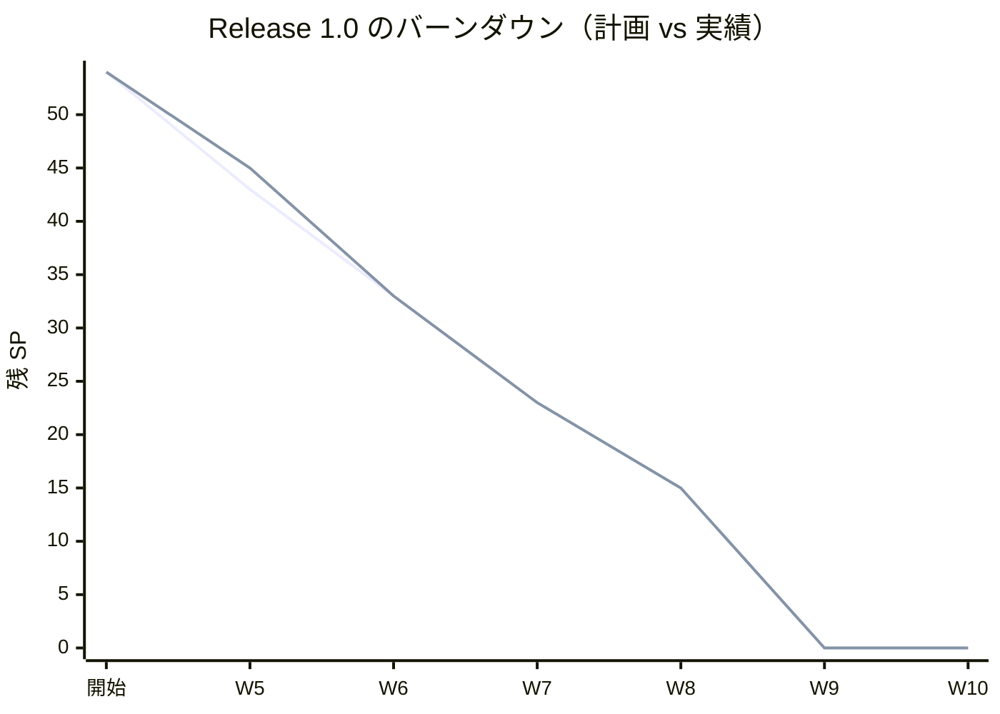
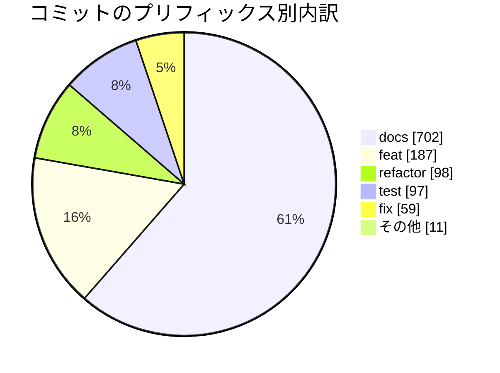

# リリース完了報告書 1.0 - cargo-tracker（A 社国際貨物輸送管理システム）

**報告書作成日**: 2026-11-16

> **承認済み（2026-11-16、human:kakimomokuri）。** ソフトウェアの機能が揃ったことの報告であって、パイロット開始の可否の判断ではない、という位置づけで承認した。

## 概要

cargo-tracker Release 1.0 のリリース完了報告書です。W5〜W10 の 6 週で、計画した 54 SP（15 ストーリーの残りの受入条件）をすべて終えました。認証の完成（TOTP・ロック・session・password の再設定）と利用者・権限の管理、経路設計の完成（Golden dataset、停止中の情報不足）と予約の完成、外部原本の取込（重複・隔離・差異）、有人対応と荷主の問い合わせ、荷主へのメール通知と KPI の計測が、画面で通ります。

**ただし、Release 1.0 のリリース条件はすべては満たしていません。** W10 は「AWS は準備だけでよい」（2026-11-16、human:kakimomokuri）の決定のもと、Terraform・配備のワークフロー・運用タスク・手順書を**コードと検証まで**で止めました。`apply` はしておらず、運用タスクは実環境で一度も動いていません。性能テスト（PERF-01〜09）、時点復旧の訓練（RCV-08）、本番の脆弱性スキャンが未実施で、パイロットの開始条件（ウイルスの検査、運用の通知、最初のシステム管理者の実環境での実行など）も残っています。git のタグと CHANGELOG はまだ運用していません（Release 0.1 と同じ）。そのため本報告書は、**ソフトウェアの機能が揃ったことの報告**であって、パイロット開始の可否の判断ではありません。数値は [リリース計画](release_plan.md)・各週の完了報告書・git log・直近の実行結果から集めました。

---

## プロジェクトサマリー

| 項目 | 値 |
| :--- | :--- |
| **期間** | 2026-10-11 〜 2026-11-16（暦日 37 日。コミットのあった日は 31 日。計画は W5〜W10 の 2026-11-02 〜 2026-12-11、営業日 28 日） |
| **週（計画の単位）** | 6（W5〜W10） |
| **Bolt（イテレーション）** | 159 本（各週の本数の合計: W5 33、W6 34、W7 39、W8 18、W9 18、W10 17。W10 は計画 17 本のすべてに着手し、完了 8 本、一部完了 9 本） |
| **ストーリーポイント** | 54 SP（計画 54 SP） |
| **ユーザーストーリー** | 15 件の受入条件の残りを閉じた（US-18・04・16・06・07・14・12・11・20・23・22・21・01・24・09） |
| **コミット数** | 1,154（Release 0.1 の報告書の時点以降。マージを除く） |
| **テスト** | `test` 6,525 件、`uiTest` 252 シナリオ。失敗 0（W10 の最終のゲート。2026-11-16） |
| **Sonar** | Quality Gate PASS（カバレッジ 95.8%、重複 0.1%、Bug・Vulnerability・Code Smell・Hotspot 0） |
| **ADR** | 23 件（ADR-001〜023。Release 0.1 から +7） |

---

## 計画と実績の差異分析

### 週ごとの達成状況

| 週 | ゴール | 計画 SP | 実績 SP | 達成率 | 差異 |
| :--- | :--- | ---: | ---: | ---: | :--- |
| W5 | Release 0.1 の返済、認証の完成、利用者管理の一部、予約の完成 | 11 | 9 | 82% | US-16 の一部 2 SP を W6 で数えた（W5 の締めで W6 を 10 から 12 SP にした） |
| W6 | 経路設計の完成、利用者の管理の完成 | 10 → 12 | 12 | 100%（12 に対して） | W5 から 2 SP |
| W7 | 外部原本の取込 | 10 | 10 | 100% | なし |
| W8 | 有人対応と問い合わせ | 8 | 8 | 100% | なし |
| W9 | 通知・KPI・残りの受入条件 | 15 | 15 | 100% | なし |
| W10 | 運用準備（SP 0） | 0 | 0 | — | 17 本の計画のうち、完了 8・一部完了 9・未着手 0（[W10 完了報告書](iteration_report-W10.md)） |
| **合計** | | **54** | **54** | **100%** | **0** |

### ストーリーごとの達成状況

| ID | Release 1.0 で通した内容 | SP | 週 |
| :--- | :--- | ---: | :--- |
| US-18 | 認証の完成（TOTP・ロック・session・password の再設定・管理者経路） | 6 | W5 |
| US-04 | 本予約の残り（変更・再見積りを含む D-85） | 3 | W5 |
| US-16 | 利用者の登録と招待、ロックと TOTP の解除、担当範囲 | 5 | W6（W5 の 2 を含む） |
| US-06 | 境界・情報不足・Golden dataset v0 | 5 | W6 |
| US-07 | 情報版の照合・再設計要・出発済み | 2 | W6 |
| US-14 | 外部原本の取込（分類・隔離・差異・判断・採用） | 8 | W7 |
| US-12 | 実績の登録の残り（外部の主要実績の採用） | 2 | W7 |
| US-11 | 有人対応（引継ぎ・受領・回答・終結・再開） | 3 | W8 |
| US-20 | 有人例外案件の起票、営業日カレンダー | 5 | W8 |
| US-23 | 荷主が自分の問い合わせを追跡する | 3 | W9 |
| US-22 | 荷主へのメール通知 | 3 | W9 |
| US-21 | KPI-02、週次の照会、基準値 | 3 | W9 |
| US-01 | 他社の拒否、過去の見積依頼の複製 | 2 | W9 |
| US-24 | 辞退・相談 | 2 | W9 |
| US-09 | 確認中・最新性のお知らせ | 2 | W9 |
| **合計** | | **54** | |

### リリースバーンダウン

**分析結果**: 実績は計画に重なりました。W5 の 2 SP の差は、US-16 の一部を W6 で数える約束によるもので、作業の遅れではありません。W9（15 SP）が最大で、前倒しの余裕で吸収しました。W10 は SP 0 の技術の週で、バーンダウンには現れません。

---

## 計画日程 vs 実績日数の差異分析

### 週ごとの日程比較

各週は計画の期間より前に前倒しで進めました。実績の日数は**暦日**です（稼働日の記録は、記録した週（W9・W10）だけにあり、週ごとに揃いません）。計画は営業日なので、**短縮率は参考値**です。

| 週 | 計画期間 | 計画の営業日 | 実績期間 | 実績の暦日 |
| :--- | :--- | ---: | :--- | ---: |
| W5 | 11-02 〜 11-06（11-03 祝日） | 4 日 | 10-11 〜 10-20 | 10 日 |
| W6 | 11-09 〜 11-13 | 5 日 | 10-20 〜 10-29 | 10 日（重なりを除くと 9 日） |
| W7 | 11-16 〜 11-20 | 5 日 | 11-02 〜 11-13 | 12 日 |
| W8 | 11-23 〜 11-27（11-23 祝日） | 4 日 | 11-13 〜 11-14 | 2 日 |
| W9 | 11-30 〜 12-04 | 5 日 | 11-14 〜 11-15 | 2 日 |
| W10 | 12-07 〜 12-11 | 5 日 | 11-16 | 1 日 |
| **合計** | **11-02 〜 12-11** | **28 日** | **10-11 〜 11-16** | **37 日**（コミットのあった日は 31 日） |

計画の終わり（12-11）に対し、実績は 11-16 で、**暦で 25 日早い**（計画の終わりまでの残り 25 日）。ただし W10 は一部完了のため、計画された運用準備のすべてが終わった日ではありません。

### 工期短縮の要因分析

- AI が計画・分解・生成を担い、人が承認ゲートで検証する構図（AI-DLC）で、実装と文書の作成が速かった。
- 計画の営業日より前に、週の作業を前倒しで進めた（W7 以降は、前の週の締めと次の週の最初の Bolt を同じ日に行った）。
- ただし、短縮は**人の承認待ちと実環境の用意を含まない**。W10 の未完了（`apply`・実環境での運用タスク・性能テスト・時点復旧の訓練）は、短縮の裏側にある積み残しである。

---

## コミットログ分析

### コミットプリフィックス別内訳（Release 0.1 の報告書の時点以降。1,154 件）

| プリフィックス | 件数 | 割合 |
| :--- | ---: | ---: |
| docs | 702 | 60.8% |
| feat | 187 | 16.2% |
| refactor | 98 | 8.5% |
| test | 97 | 8.4% |
| fix | 59 | 5.1% |
| style・chore・ci・build | 11 | 1.0% |

### 分析

文書の比率が高い（60.8%）のは、Bolt ごとの計画・終了報告・台帳・マニュアル・ADR・設計文書の更新を、コードと同じ頻度でコミットしているためです。AI-DLC の「成果物を永続化して次のコンテキストにする」の実践の結果で、コードの変更（feat・refactor・test・fix）は 38.2% です。

---

## 品質メトリクス

### テストと品質ゲート（W10 の最終。2026-11-16）

| メトリクス | 結果 |
| :--- | :--- |
| `test`（単体・統合・アーキテクチャ・業務ルール層のシナリオ・Web） | 6,525 件、失敗 0 |
| `uiTest`（画面の層の受入シナリオ。axe-core によるアクセシビリティの検査を含む） | 252 シナリオ、失敗 0 |
| `@wip` のシナリオ | 0 |
| SonarQube Quality Gate | PASS（カバレッジ 95.8%、重複 0.1%） |
| `terraform validate`・`actionlint` | 成功（`plan`・`apply` は未実施） |

テストの数の推移（各週の完了報告書）: W6 の終わり 3,552 → W7 6,005 → W8 6,290 → W9 6,485 → W10 6,525。

### リリース条件の達成状況（release_plan の Release 1.0 のリリース条件）

| 条件 | 状態 |
| :--- | :--- |
| Must の全受入条件のシナリオが通る（`@wip` なし） | 満たした（`@wip` 0。`uiTest` 252・`test` 6,525 が成功） |
| Comprehensive の対象の統合・Web テストが通る | 満たした（`test` に含む） |
| カバレッジの閾値を満たす | 満たした（Sonar の新しいコードの閾値 70% に対し 95.9%） |
| axe-core の違反 0 件、支援技術による手動確認で重大な問題 0 件 | **axe-core は `uiTest` の中で検査し違反 0。支援技術による手動確認は未実施** |
| 性能テストで PERF-01〜09 を満たす | **未実施**（k6 のスクリプトは準備した。実行は未） |
| 時点復旧の訓練で RTO 2 時間・RPO 5 分を実測し、照合まで行えた | **未実施**（手動の手順の草案まで） |
| 本番の脆弱性スキャンで HIGH・CRITICAL 0 件 | **未実施**（本番がない） |

### ベロシティ

| 項目 | 値 |
| :--- | :--- |
| W5〜W9 の実績 SP | 9、12、10、8、15 |
| 平均 | 10.8 SP / 週（W5〜W9。W10 は SP 0） |
| 最大・最小 | 15（W9）、8（W8） |
| Release 0.1 から通した平均（W1〜W9、89 SP / 9 週） | 9.9 SP / 週 |

---

## リリース履歴

git のタグと CHANGELOG は運用していません（Release 0.1 と同じ）。Release 1.0 は**タグを打たず、リリース済みではありません**。パイロット開始の条件（下の「引き継ぎ」）と、W10 の持ち越しが整ってから、`developing-release` でタグと CHANGELOG を作る想定です。

---

## 主要な成果物

### 実装した主要機能

- **認証・利用者管理**: password＋TOTP、ロックと解除、session の失効と警告、password の再設定、利用者の登録と招待、担当範囲、システム管理者の管理範囲。
- **経路設計**: Golden dataset v0、停止中の情報不足、情報版の照合、再設計要、出発済み、古くなった候補。
- **予約・追跡**: 本予約の確定と再見積り、予約サガ、追跡の下書き・採用・確認中・到着見込み・鮮度。
- **外部原本の取込**: 分類（採用・重複・隔離・差異）、隔離・差異の判断、採用、監査記録。
- **有人対応と荷主の問い合わせ**: 引継ぎ、受領・回答・終結・再開、営業日カレンダー、荷主の問い合わせの追跡と再開。
- **通知・KPI**: 荷主へのメール通知、KPI-02・週次の照会・基準値。
- **運用準備（W10）**: Terraform（VPC・ECR・RDS・S3 Object Lock・ECS Fargate・ALB・WAF・IAM・SSM の踏み台）、配備のワークフロー（OIDC、digest の昇格）、ヘルスチェック（管理用ポート）、ShedLock、`DevProfileGuard`、運用タスク（`db:init`・`db:grants:verify`・`admin:bootstrap`・`external-source:resume`・`deploy:*`）、運用手順書、k6 の負荷テストのスクリプト、24 時間以上判断を待つ隔離の警告（OBS-06）、外部原本の監査の二重の防ぎ。

### 技術的成果

- ADR 23 件（Release 1.0 で ADR-017〜023: 通知モジュールとメール、再見積りの順序の守り、担当範囲外の試行の記録ポート、AWS の前提、通知の再送と購読の置き場所、ウイルスの検査、運用の通知・S-01・メンテナンス表示）。
- アーキテクチャテスト（ArchUnit）の規則の整備。設計の規則の例外は、人の承認を得て ADR・規則に記録した（`ClockConfiguration`・`SchedulingConfiguration`）。
- 運用の SQL（最初の管理者、情報源の再開）を、PostgreSQL の統合テストで確かめる形にした。

---

## ふりかえり（Release 1.0）

| 区分 | 内容 |
| :--- | :--- |
| Keep | 構造・スキーマ・認可・外部ライブラリの導入は、選択肢と推奨を示して人が決める流れ。Bolt ごとの計画・終了報告・台帳で判断を永続化したこと。週ごとの全体のレビューと最終のゲートで、Bolt ごとのレビューでは見えない食い違いを見つけたこと。 |
| Problem | 実環境（AWS）が最後まで用意されず、運用準備の W10 が「準備だけ」になった。実環境で未検証のコードが増えた。承認待ちが多い週は、AI が進められる範囲が早く尽きる。計画の前提（ArchUnit の規則、S-01 が一覧を持たないこと）を、実装の中で初めて知る場面が繰り返された。 |
| Try | 運用準備の Bolt は、開始の前に人が用意するもの（アカウント、認証情報、値の決定）の表を付ける。計画に「関わるアーキテクチャの規則」と「前提とする既存の画面・機能の実在」の確認の欄を足す。実環境ができたら、まずステージングで運用タスクを一度ずつ実行し、結果を手順書に反映する。 |

---

## Release 1.1 とパイロット開始への引き継ぎ

### パイロット開始の条件のうち、W10 の後も残るもの

- AWS のアカウント・認証情報・未決の値（Multi-AZ、保持期間、Object Lock、予算）の用意と、ステージングへの `apply`。
- 運用タスクのステージングでの実行（最初の管理者、情報源の再開、`db:init`・`db:grants:verify`）。
- 必要書類のウイルスの検査（[ADR-022](../../adr/cargo-tracker/022-required-document-virus-scan.md)の実装。それまで書類の添付を使わない）。
- 運用の通知の宛先と SNS の実装（[ADR-023](../../adr/cargo-tracker/023-operations-notification-and-home.md)）、取込がない日の通知（FRS-04）。
- 性能テスト（PERF-01〜09）、時点復旧の訓練（RCV-08）、外部の侵入テスト（SEC-19）、本番の脆弱性スキャン。
- 業務の確認の場（D-164〜D-172。24 時間、週の区切り、通知の宛先）。

### Release 1.1 の頭の返済

W10 完了報告書の持ち越し H-1〜H-11 のうち、決定が出たものの実装（ADR-021・022・023）と、S-01 の役割別の一覧、メンテナンス表示を、小さな Bolt に分けて先に行う。そのあと W11（US-05 変更・取消し、US-17 監査証跡の照会）に入る。

---

## 関連ドキュメント

- [リリース計画](release_plan.md)、[開発戦略](development_strategy.md)
- [W10 完了報告書](iteration_report-W10.md)、[W9](iteration_report-W9.md)、[W8](iteration_report-W8.md)、[W7](iteration_report-W7.md)、[W6](iteration_report-W6.md)
- [W10 週全体レビュー](../../review/cargo-tracker/w10_review_20261116.md)
- [リリース完了報告書 0.1](release_report-0_1.md)
- [運用タスク手順書](../../operation/cargo-tracker/operation_tasks.md)

## 更新履歴

| 日付 | 更新内容 | 更新者 |
| :--- | :--- | :--- |
| 2026-11-16 | 初版（draft。ソフトウェアの機能が揃ったことの報告。リリース条件の一部は未達） | anthropic/claude-sonnet-5-5 |
| 2026-11-27 | 承認の後の訂正。W10 の Bolt の内訳を [W10 完了報告書](iteration_report-W10.md)にそろえ、Bolt の合計を 151 本から 159 本に直した | anthropic/claude-sonnet-5-5 |
