# 2 章 ログインと共通の画面

cargo-tracker にログインする手順と、どの役割でも共通の画面（画面の構成、権限がない画面、もう一度ログインする画面）を説明します。本章は [WF-1](01-業務フロー.md#wf-1-見積依頼から追跡の照会まで) のすべての工程の前提です。

画面の開き方: ブラウザで cargo-tracker の URL を開きます。ログインしていなければ、ログインの画面が開きます。

| 画面 | 役割 | 節 |
| :--- | :--- | :--- |
| ログイン | メールアドレスと password、続けて認証アプリのコード（または回復コード）でログインする | [2.1](#21-ログイン) |
| 画面の構成 | ヘッダー・ナビゲーション・窓口の案内 | [2.2](#22-画面の構成) |
| 権限がありません | 役割にない画面を開いたときに示される | [2.3](#23-権限がありません) |
| もう一度ログインしてください | 一定時間が過ぎたとき、または管理者が利用を止めたときにログアウトして示される | [2.4](#24-もう一度ログインしてください) |
| まもなくログアウトします | ログアウトの 5 分前に画面の中央に開く警告。ログインを延長できる | [2.5](#25-まもなくログアウトします) |
| password の再設定・初回の設定 | password を忘れたときに、再設定のリンクをメールで受け取り、新しい password を設定する。登録されたときに届く案内のリンクから、初回の password を設定する | [2.6](#26-password-を忘れた場合) |
| 認証アプリの再登録 | 回復コードでログインした後に、認証アプリを登録し直し、新しい回復コードを受け取る | [2.7](#27-認証アプリを登録し直す) |
| 画面が見つかりません | 存在しない画面の URL や、開けない番号・利用者の URL を開いたときに示される | [2.8](#28-画面が見つかりません) |

## 2.1 ログイン

### この画面でできること

- 2 段階でログインします。1 段目はメールアドレスと password、2 段目は認証アプリ（6 桁のコードを表示するスマートフォンのアプリ）のコードです。ログインすると、役割ごとの最初の画面（ホーム）が開きます
- 認証アプリを使えないときは、2 段目に認証アプリのコードの代わりに回復コードを使えます
- 初めてログインするときは、2 段目の前に認証アプリを登録し、回復コードを受け取ります

### 画面の開き方

- cargo-tracker の URL を開きます（URL: `/login`）
- 認証コードの画面: ログインの画面でメールアドレスと password を入れてログインすると開きます（URL: `/login/totp`）
- 認証アプリの登録の画面: 初めてログインするときに、認証コードの画面の代わりに開きます（URL: `/login/totp/enroll`）

### 画面の説明

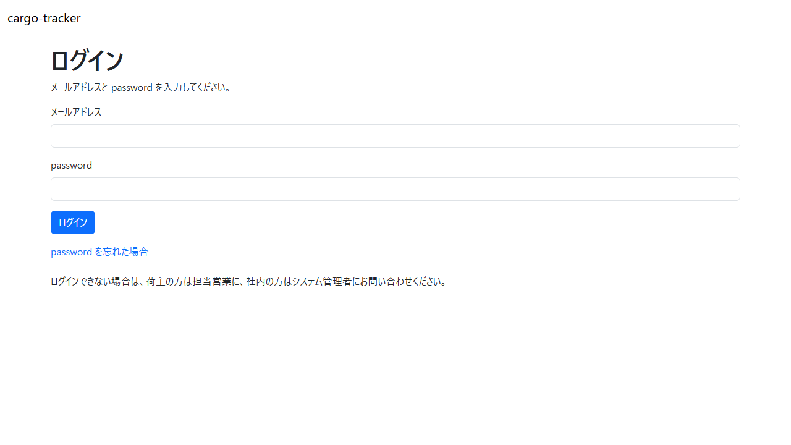

| # | 項目 | 説明 |
| :--- | :--- | :--- |
| ① | メールアドレス | 利用者として登録されたメールアドレス |
| ② | password | 利用者の password |
| ③ | 「ログイン」 | 入力した内容でログインします |
| ④ | 「password を忘れた場合」 | password の再設定の依頼の画面（[2.6](#26-password-を忘れた場合)）を開きます |

認証コードの画面:

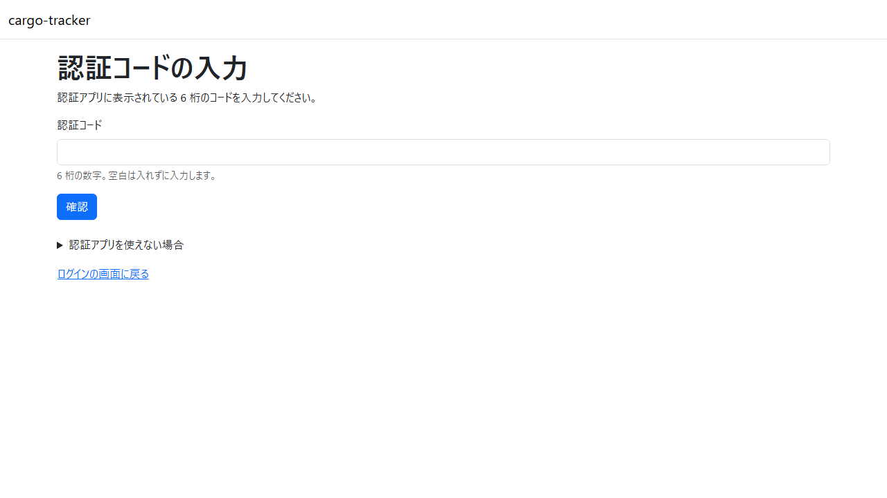

| # | 項目 | 説明 |
| :--- | :--- | :--- |
| ① | 認証コード | 認証アプリに表示されている 6 桁の数字 |
| ② | 「確認」 | 入力したコードでログインを終えます |
| ③ | 「認証アプリを使えない場合」 | 開くと、回復コードの欄と「回復コードで確認」が出ます |
| ④ | 「ログインの画面に戻る」 | ログインの画面に戻ります（別のメールアドレスでログインし直すとき） |

### 操作手順

1. 「メールアドレス」と「password」を入力します
2. 「ログイン」をクリックします
3. 認証コードの画面が開きます。認証アプリに表示されている 6 桁のコードを「認証コード」に入力し、「確認」をクリックします
4. 役割ごとのホームが開きます。荷主担当者は見積依頼の一覧、営業担当者は見積依頼の受付一覧、経路設計者は経路設計案件一覧、追跡管理者は追跡一覧、システム管理者は利用者の一覧が開きます

初めてログインする場合（認証アプリの登録）:

1. 手順 2 の後に、認証アプリの登録の画面が開きます
2. 認証アプリで QR コードを読み取ります。読み取れない場合は、画面のキーを認証アプリに入力します
3. 認証アプリに表示された 6 桁のコードを入力し、「登録する」をクリックします
4. 回復コードが 10 個示されます。印刷するか、安全な場所に書き写してください。この画面を閉じると、もう表示できません
5. 「回復コードを安全な場所に保存した」に印を付け、「ログインを続ける」をクリックします
6. 認証コードの画面で、認証アプリのコードを入力してログインを終えます（手順 3）。登録を始めてから 15 分以内に、登録とログインを終えてください
7. 登録したメールアドレスに、登録のお知らせ（件名「【cargo-tracker】認証アプリの登録のご案内」）が届きます。心当たりのない登録のお知らせが届いたときは、すぐに、荷主の方は担当営業に、社内の方はシステム管理者にお知らせください

認証アプリを使えない場合（回復コードでログインする）:

1. 認証コードの画面で「認証アプリを使えない場合」を開きます
2. 保存した回復コードを 1 つ「回復コード」に入力し、「回復コードで確認」をクリックします
3. 認証アプリの再登録の画面が開きます。認証アプリを登録し直すか、「後で登録する」を選びます（[2.7](#27-認証アプリを登録し直す)）

### 注意・補足

- メールアドレスか password が違うと、「メールアドレスまたは password が正しくありません。続けて 5 回誤ると、15 分ログインできなくなります。」と示されます。どちらが違うかは示しません
- 認証コードか回復コードが違う、またはすでに使ったものだと、ログインの画面に戻り、「認証コードまたは回復コードが正しくないか、すでに使われています。…」と示されます。もう一度メールアドレスと password から入れ直し、認証アプリに表示された新しいコードか、まだ使っていない回復コードを入れてください
- 誤りは password・認証コード・回復コードを合わせて数えます。続けて 5 回誤ると、15 分ログインできなくなります。15 分たってから、もう一度ログインしてください（正しいメールアドレスと password・コードを入れても、15 分たつまでは同じ文言が示されます）。急ぐ場合は、荷主の方は担当営業を通じて、社内の方は直接、システム管理者にロックの解除を頼めます
- 回復コードは、半角の数字と a〜f の英字の 8 文字です（例: 1a2b-3c4d）。大文字、空白、ハイフンはあってもかまいません。1 つの回復コードは 1 回だけ使えます
- password を入れてから 5 分以内に認証コードを入れてください。5 分を過ぎてから「確認」をクリックすると、「もう一度ログインしてください」（[2.4](#24-もう一度ログインしてください)）が示されます。初めてログインする場合は、認証アプリの登録を始めてから 15 分です
- 認証アプリも回復コードもない場合は、荷主の方は担当営業に、社内の方はシステム管理者にお問い合わせください。システム管理者が別の経路で本人であることを確かめてから認証アプリの登録を解除するので、次のログインで認証アプリを登録し直します。解除されると、登録したメールアドレスに解除のお知らせ（件名「【cargo-tracker】認証アプリの登録の解除のご案内」）が届きます
- password を忘れた場合は、「password を忘れた場合」から再設定のリンクをメールで受け取れます（[2.6](#26-password-を忘れた場合)）
- password の再設定を依頼した後は、ログインの画面に「password の再設定の依頼を受け付けました。…」と示されます（[2.6](#26-password-を忘れた場合)）
- ログインできない場合は、荷主の方は担当営業に、社内の方はシステム管理者にお問い合わせください。続けて誤ってロックされていたときは、システム管理者がロックを外せます
- 画面の右上の「ログアウト」をクリックするとログアウトし、ログインの画面に「ログアウトしました。」と示されます
- 共用のパソコンでは、離れる前に必ず「ログアウト」を押してください。画面の右上の「ログアウト」を押すと、そのタブに控えていた入力（[2.5](#25-まもなくログアウトします)）も消えます。控えはタブごとなので、ほかのタブも閉じてから離れてください（[2.4](#24-もう一度ログインしてください) の注意・補足）

## 2.2 画面の構成

### この画面でできること

- ログインした後の画面は、荷主の画面と社内の画面でほぼ同じ構成です。ナビゲーションから、役割で使える画面を開きます

### 画面の開き方

- ログインした後のすべての画面

### 画面の説明

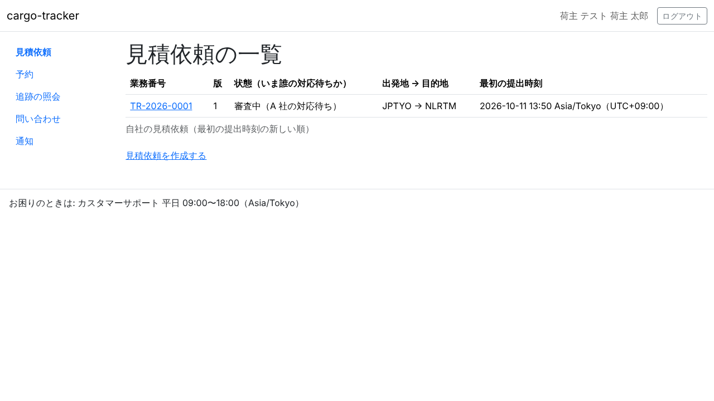

| # | 項目 | 説明 |
| :--- | :--- | :--- |
| ① | ヘッダー | 左に「cargo-tracker」（押すと役割のホームに戻ります）、右にログインしている利用者（会社名と名前）と「ログアウト」 |
| ② | ナビゲーション | 役割で使える画面の一覧。いま開いている画面の項目が強調されます |
| ③ | メインの領域 | 画面ごとの内容 |
| ④ | 窓口の案内 | 荷主の画面の下の「お困りのときは: カスタマーサポート 平日 09:00〜18:00（Asia/Tokyo）」 |

荷主担当者のナビゲーションの項目は次のとおりです。

| 項目 | 開く画面 | 章 |
| :--- | :--- | :--- |
| 見積依頼 | 見積依頼の一覧 | [3 章](03-見積依頼.md) |
| 予約 | 予約一覧 | [5.1](05-予約一覧と追跡の照会.md#51-予約一覧) |
| 追跡の照会 | 追跡の照会 | [5.2](05-予約一覧と追跡の照会.md#52-追跡の照会) |
| 問い合わせ | （準備中） | — |
| 通知 | （準備中） | — |

社内の画面は、ヘッダーが「cargo-tracker 社内」になり、右に役割と名前が示されます。窓口の案内はありません。

社内の役割ごとのナビゲーションの項目は次のとおりです。

| 役割 | 項目 | 章 |
| :--- | :--- | :--- |
| 営業担当者 | 見積依頼・予約・KPI 計測記録 | [6 章](06-受付一覧と審査と見積り.md)・[7 章](07-本予約の確定と予約一覧.md)・[10 章](10-KPI計測記録.md) |
| 経路設計者 | 経路設計 | [8 章](08-経路設計.md) |
| 追跡管理者 | 追跡 | [9 章](09-追跡管理.md) |

### 操作手順

1. ナビゲーションの項目をクリックすると、その画面が開きます
2. 画面の幅が狭いときは、ナビゲーションがメニューのボタンにまとまります。ボタンを押すと項目が開きます

### 注意・補足

- 「問い合わせ」「通知」は、まだ作っていない画面です。開くと「この画面は準備中です」と示されます。使えるようになるまでは、担当営業にご連絡ください
- ログアウトの 5 分前に「まもなくログアウトします」が開きます（[2.5](#25-まもなくログアウトします)）

## 2.3 権限がありません

### この画面でできること

- 役割にない画面（荷主担当者が社内の画面を開いたときなど）を開くと示されます。操作はできません
- ログインしている間に管理者が役割を外したときも、次の操作からその役割の画面でこの画面が示されます。残っている役割の画面はそのまま使えます

### 画面の開き方

- 役割にない画面の URL を直接開いたときに示されます
- 役割を外された後に、その役割の画面をナビゲーションやブックマークから開いたときに示されます（ナビゲーションの項目も次の操作から消えます）

### 画面の説明

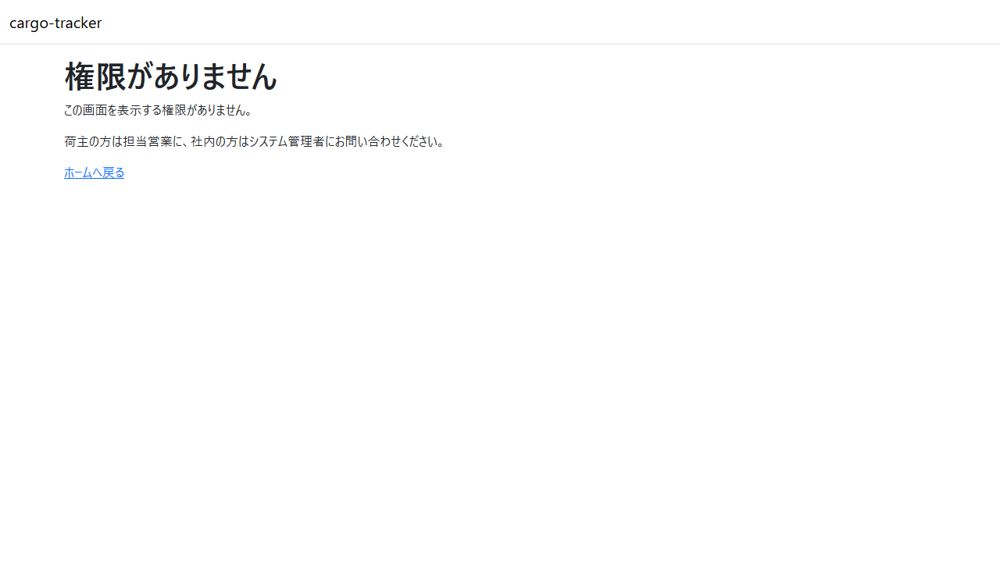

| # | 項目 | 説明 |
| :--- | :--- | :--- |
| ① | メッセージ | 「この画面を表示する権限がありません。」と、問い合わせ先 |
| ② | 「ホームへ戻る」 | 役割ごとのホームへ戻ります |

### 操作手順

1. 「ホームへ戻る」をクリックします

### 注意・補足

- 自分の役割で使う画面なのにこの画面が示される場合は、荷主の方は担当営業に、社内の方はシステム管理者にお問い合わせください（役割が外されていないかを確かめてもらえます）
- 管理者が役割を足したときは、ログインし直さなくても次の操作からその役割の画面とナビゲーションの項目が使えます

## 2.4 もう一度ログインしてください

### この画面でできること

- 一定時間操作がなかったとき、ログインの手続き（認証コードの入力や認証アプリの登録）を時間内に終えなかったとき、またはログインから 8 時間を過ぎたときに、ログアウトして示されます
- ログインしている間に管理者が利用を止めたとき、または所属する企業の利用が止められたときも、次の操作でログアウトして示されます。画面の文言は同じで、利用が止められたことは示しません
- ほかのパソコン・スマートフォン・ブラウザで password を再設定したとき（[2.6](#26-password-を忘れた場合)）も、次の操作でログアウトして示されます。新しい password でログインし直してください
- ほかのパソコン・スマートフォン・ブラウザで認証アプリを登録し直したとき（[2.7](#27-認証アプリを登録し直す)）も、次の操作でログアウトして示されます。登録し直した認証アプリのコードでログインし直してください
- システム管理者があなたの認証アプリの登録を解除したときも、次の操作でログアウトして示されます。次のログインで認証アプリを登録し直してください（画面にも「システム管理者が認証アプリの登録を解除した場合は、次のログインで認証アプリを登録し直してください。」と示されます）。登録したメールアドレスには、解除のお知らせが届きます

### 画面の開き方

- ログアウトした後に画面を操作すると示されます（URL: `/session-expired`）
- ログアウトの警告（[2.5](#25-まもなくログアウトします)）のまま時刻を過ぎた後、「画面を開き直す」（または「もう一度ログインする」）を押しても示されます
- 管理者が利用を止めた後は、画面の移動・送信・認証コードの入力のどれでも、次の操作で示されます。止められた後に送った入力は保存されていません

### 画面の説明

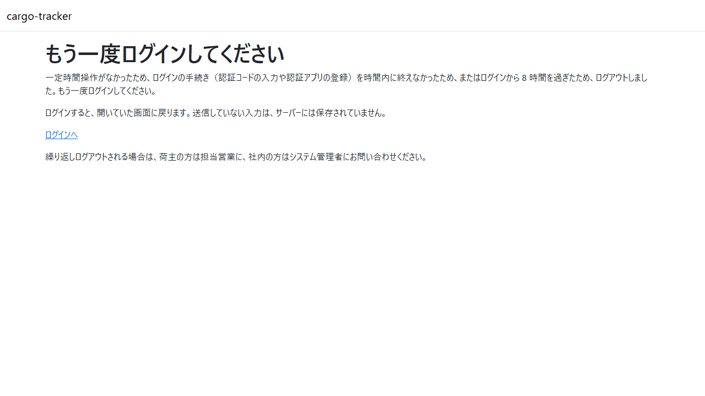

| # | 項目 | 説明 |
| :--- | :--- | :--- |
| ① | メッセージ | ログアウトした理由と、ログインすると開いていた画面に戻ること |
| ② | 「ログインへ」 | ログインの画面を開きます |

### 操作手順

1. 「ログインへ」をクリックします
2. [2.1 ログイン](#21-ログイン) の手順でログインします。ログアウトしたときに開いていた画面（ログアウトの後に別の画面を開こうとした場合はその画面）に戻ります。認証コードを誤ってやり直したときも戻ります。ログインできない場合は、下の「注意・補足」を見てください

### 注意・補足

- 送信していない入力は、サーバーには保存されていません。ただし、ログアウトの前に入力していた内容をブラウザのそのタブに控えていれば、画面に「このタブで同じ利用者がログインし直すと、ログアウトの前に入力していた内容を戻します。」と示され、同じタブでログインし直して同じ画面を開くと入力が戻ります（[2.5](#25-まもなくログアウトします)）
- 「提出」などのボタンを押したときにこの画面が示された場合、押した内容は送信されていません。ログインし直した後の画面に「送信できなかった入力があります。」と示されるので、「入力していた画面を開く」を押すと入力が戻ります
- 管理者に利用を止められていた場合も、この一文は同じように示されます。止められている間はログインできないので、入力は戻りません
- 開いていた画面に戻らず、役割のホームが開く場合があります。開いていた画面は、ナビゲーションから開き直してください
  - 「提出」などのボタンを押したときにこの画面が示された場合（上の「入力していた画面を開く」から入力を戻せます）
  - 「提出」などのボタンを押した後に示された画面（入力の誤りが示された画面など）のまま時間を過ぎた場合
  - 管理者に利用を止められていた場合
  - 別のブラウザやほかのパソコンでログインし直した場合
- 同じブラウザのほかのタブでログインし直したときは、そのタブで開いていた画面に戻ります。入力の控えはタブごとなので、ほかのタブの入力は戻りません
- 共用のパソコンでは、離れる前に画面の右上の「ログアウト」を押してください。ログアウトせずに離れると、次に使う人があなたのログインのまま操作できます。時間切れでログアウトした後も、次にそのブラウザでログインした人は、あなたが開いていた画面の URL に移ります（その画面を見る権限がなければ、内容は見えません）。控えていた入力は、次にログインした人には戻りませんが、そのタブには最長 8 時間残ります。ブラウザで閉じたタブを開き直すと控えが戻ることがあるので、共用のパソコンではログアウトしてから離れてください
- 操作がないままの時間は 30 分まで、ログインしてからの時間は 8 時間までです。どちらも 5 分前に警告が出ます。操作がないときの警告では延長できます（[2.5](#25-まもなくログアウトします)）
- 繰り返しログアウトされる場合や、ログインし直そうとしても「メールアドレスまたは password が正しくありません。」と示されてログインできない場合は、利用が止められていることがあります。荷主の方は担当営業に、社内の方はシステム管理者にお問い合わせください

## 2.5 まもなくログアウトします

### この画面でできること

- 画面の移動や送信がないままログアウトする時刻の 5 分前に、画面の中央に重ねて開きます。「ログインを延長する」で、画面を移らずにログインを続けられます
- ログインから 8 時間になる 5 分前にも開きます。この場合は延長できません

### 画面の開き方

- ログインした後の画面で、画面の移動・送信・延長がないまま 25 分たつと開きます（ログアウトは 30 分です）
- ここでいう操作は、画面を開く・送信する・「ログインを延長する」を押すことです。入力欄に入力しているだけでは数え直されません。長い入力は途中で延長するか、送信してください
- ログインから 7 時間 55 分たつと、延長できない警告が開きます
- ログイン・認証コード・認証アプリの登録・回復コードの保存の画面と、エラーの画面（権限がありません、もう一度ログインしてくださいなど）には開きません

### 画面の説明

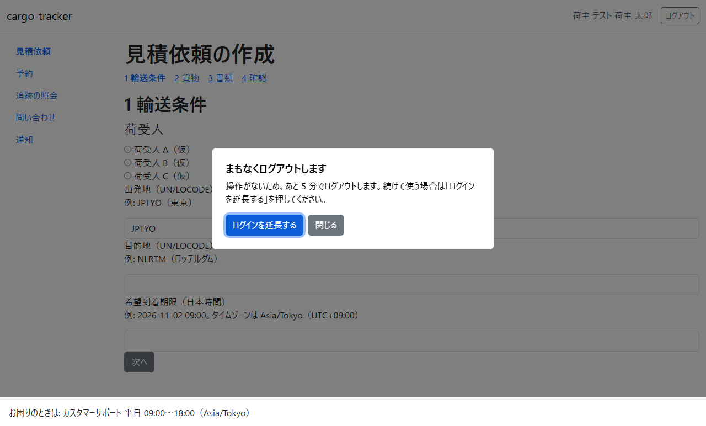

| # | 項目 | 説明 |
| :--- | :--- | :--- |
| ① | メッセージ | ログアウトの理由と、あと何分でログアウトするか |
| ② | 「ログインを延長する」 | ログインを延長します。画面は移らず、入力中の内容もそのまま残ります。ログインから 8 時間になるときは出ません（延長できません） |
| ③ | 「閉じる」 | 警告を閉じます。延長はしません。Esc キーでも閉じます |

### 操作手順

1. 続けて使う場合は「ログインを延長する」を押します（開いたときにこのボタンが選ばれているので、Enter キーでも押せます）。延長すると、警告が閉じ、ログアウトまでの時間を最初から数え直します
2. ログインから 8 時間になる警告では延長できません。入力中の内容は、ログアウトの前に送信してください

### 注意・補足

- 「閉じる」や Esc で閉じると、同じ警告はもう開きません。続けて使う場合は、ログアウトの前に画面を開き直すか送信してください
- 「延長できませんでした。」と示されたら、もう一度「ログインを延長する」を押してください。ログアウトしても、入力中の内容はこのタブでログインし直すと戻ります
- ログアウトの時刻を過ぎると、警告が閉じて画面の先頭に「ログアウトした可能性があります。」と「画面を開き直す」が示されます。入力中の内容は送信されていません。「画面を開き直す」を押すと、入力中の内容をこのタブに控えてから開き直します
- 「画面を開き直す」を押すと、ログアウトしていれば「もう一度ログインしてください」（[2.4](#24-もう一度ログインしてください)）が開き、ログインし直すと同じ画面に戻って入力も戻ります。まだログアウトしていなければ、同じ画面がそのまま開き直って入力が戻ります。「ログインを延長する」を押したときにすでにログアウトしていた場合は、「もう一度ログインしてください」を通らずにログインの画面が開きます。ログインし直すと同じ画面に戻り、入力も戻ります
- 入力が戻ったときの画面です

  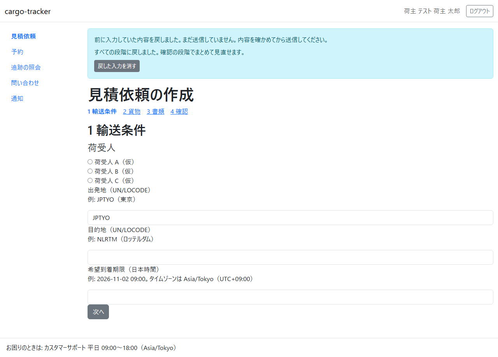

- 入力が戻ると、画面の上に「前に入力していた内容を戻しました。まだ送信していません。内容を確かめてから送信してください。」と示されます。内容を確かめてから送信してください。見積依頼の作成のように段階に分かれた画面では、すべての段階に戻り、最初の段階から開きます。ファイルは戻らないので、「ファイルは選び直してください。」と示されたら選び直してください
- ログインから 8 時間のぎわに送信した場合など、まれに、送信できていた入力が戻ることがあります。送信したかどうか分からないときは、一覧で確かめてから送信してください。また、ログアウトしている間にほかの人が同じ内容を更新していることがあります。戻した内容のまま送信すると、その更新を上書きすることがあるので、送信の前に内容を確かめてください
- 戻した入力が要らなければ「戻した入力を消す」を押すと、入力欄が画面を開いたときの値に戻ります。戻した後に直した内容も消えます
- 「提出」などのボタンを押した後に入力の誤りが示された画面のまま時間を過ぎた場合は、入力は控えられません。「もう一度ログインする」が示されるので、必要なら入力を書き写してから押してください。この画面で「提出」などを押して送信できなかった場合も、入力は戻りません
- 「送信できなかった入力があります。」と示されたら、「入力していた画面を開く」を押すと入力が戻ります。要らなければ「入力していた内容を消す」を押してください。どちらかを押すまで、ほかの画面を開いても示されます
- 控えていた入力は、画面の右上の「ログアウト」でログアウトしたとき、別の人がそのタブでログインしたとき、入力が戻ったときに消えます。控えてから 8 時間を過ぎると、入力は戻しません
- 同じブラウザのほかのタブで画面を開いたり延長したりすると、どのタブでもログアウトまでの時間を数え直し、警告は閉じます

## 2.6 password を忘れた場合

### この画面でできること

- 登録しているメールアドレスに、password を再設定するためのリンクを送ってもらいます
- メールのリンクを開き、新しい password を設定します
- 利用者として登録されたときに届く案内のメールのリンクを開き、初回の password を設定します（下の「初回の password の設定」）

### 画面の開き方

- 依頼の画面: ログインの画面（[2.1](#21-ログイン)）の「password を忘れた場合」をクリックします（URL: `/password-reset`）
- 再設定の画面: 届いたメールのリンクを開きます（リンクを開くと、URL は `/password-reset/new` に変わります）

### 画面の説明

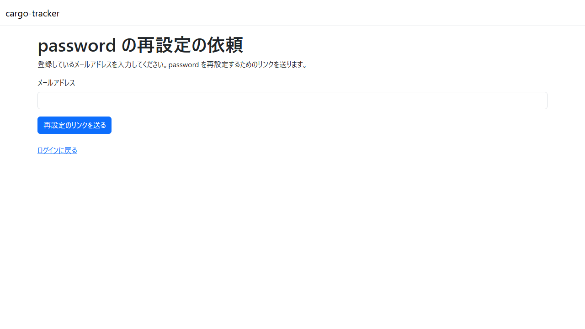

| # | 項目 | 説明 |
| :--- | :--- | :--- |
| ① | メールアドレス | 利用者として登録しているメールアドレス |
| ② | 「再設定のリンクを送る」 | 入力したメールアドレスに再設定のリンクを送るよう依頼します |
| ③ | 「ログインに戻る」 | ログインの画面に戻ります |

再設定の画面:

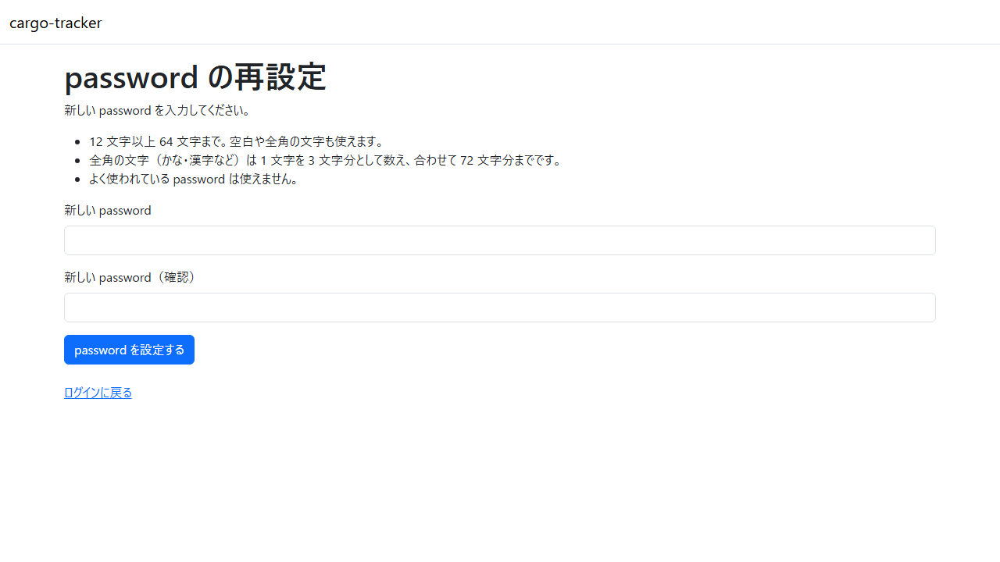

| # | 項目 | 説明 |
| :--- | :--- | :--- |
| ① | 条件 | 新しい password の条件（12 文字以上 64 文字まで、全角の文字の数え方、よく使われている password は使えないこと） |
| ② | 新しい password | 新しく使う password |
| ③ | 新しい password（確認） | 確認のため、同じ password をもう一度 |
| ④ | 「password を設定する」 | 新しい password を設定します |
| ⑤ | 「ログインに戻る」 | 設定せずにログインの画面に戻ります |

### 操作手順

1. 「メールアドレス」を入力します
2. 「再設定のリンクを送る」をクリックします
3. ログインの画面に戻り、「password の再設定の依頼を受け付けました。…」と示されます
4. 登録されていて、ご利用いただける状態であれば、数分のうちに「【cargo-tracker】password の再設定のご案内」のメールが届きます
5. メールのリンクを開きます。再設定の画面が開きます
6. 「新しい password」と「新しい password（確認）」に同じ password を入力し、「password を設定する」をクリックします
7. ログインの画面に戻り、「password を変更しました。」と示されます
8. [2.1 ログイン](#21-ログイン) の手順で、新しい password でログインします。続けて、ふだんどおり認証アプリのコード（または回復コード）を入力します（認証アプリをまだ登録していない場合は、登録の画面が開きます）

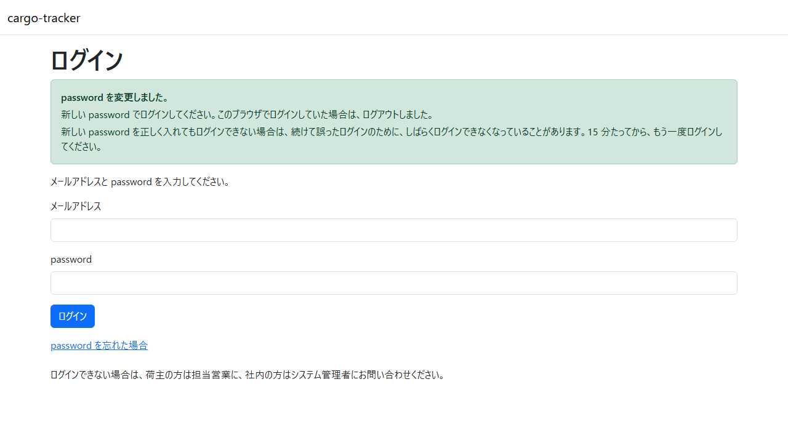

### 注意・補足

- 入力したメールアドレスが登録されているかどうかは、画面に示しません。登録されていて、ご利用いただける状態のときだけメールが届きます
- メールのリンクの有効期限は 30 分で、1 回だけ使えます。新しいリンクを送ると、前に送ったリンクは使えなくなります
- 前にリンクを送ってから 1 分以内にもう一度依頼しても、メールは送られません。数分たっても届かない場合は、迷惑メールのフォルダを確かめてから、1 分以上たってもう一度依頼してください
- それでも届かない場合は、荷主の方は担当営業に、社内の方はシステム管理者にお問い合わせください
- メールの本文には、リンク・期限・使い方だけが書かれ、業務の情報は書かれていません。依頼した覚えのないメールが届いた場合は、何もしなくてかまいません。リンクを開かなければ password は変わりません
- メールアドレスの欄が空か形が正しくないと、欄の下に「メールアドレスを入力してください。」か「メールアドレスの形式が正しくありません。例: user@example.com」と示されます
- 新しい password は 12 文字以上 64 文字までです。空白や全角の文字も使えます。全角の文字（かな・漢字など）は 1 文字を 3 文字分として数え、合わせて 72 文字分までです（絵文字などは数え方が少し違うことがあります。「全角の文字を含めると長すぎます。」と示されたら、短くしてください）
- よく使われている password（多くの人が使っていて推測されやすいもの）は使えません。「この password はよく使われているため、使えません。」と示されたら、別の password にしてください
- 条件に合わないか、確認の欄が違うと、欄の下に誤りが示され、入力した password は消えます。もう一度入力してください。確認の欄の違いを直した後に、条件の誤りが示されることがあります
- 設定すると、ほかのパソコン・スマートフォン・ブラウザでログインしていた場合も、次の操作で「もう一度ログインしてください」（[2.4](#24-もう一度ログインしてください)）になります。設定したブラウザでログインしていた場合は、ログアウトします
- 続けて誤ったログインのためにログインできなくなっていた場合は、新しい password を設定しても、15 分たつまでログインできません
- リンクを開くと「このリンクは使えません」と示された場合は、有効期限を過ぎた、使用済み、新しいリンクが送られた、などが考えられます。いちばん新しいメールのリンクを開くか、「新しいリンクを送る（初めて設定する場合も、ここから設定できます）」からもう一度依頼してください。初回の設定の案内のリンクが使えなくなった場合も同じです

  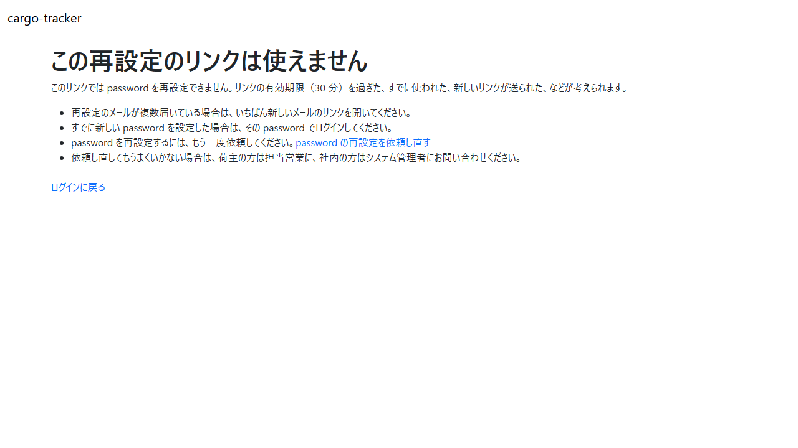

- 再設定の画面を開いたまま 30 分以上たった場合は、「もう一度ログインしてください」が示されます。リンクの有効期限（30 分）も過ぎているので、ログインの画面の「password を忘れた場合」からもう一度依頼してください
- しばらく使っていなかったブラウザでリンクを開いて「もう一度ログインしてください」が示された場合は、メールのリンクをもう一度開いてください（依頼してから 30 分以内なら使えます）

### 初回の password の設定

システム管理者が利用者を登録すると（[11.5](11-利用者の管理.md)）、登録したメールアドレスへ「【cargo-tracker】利用者の登録のご案内」のメールが届きます。このメールのリンクから、初めて使う password を設定します。

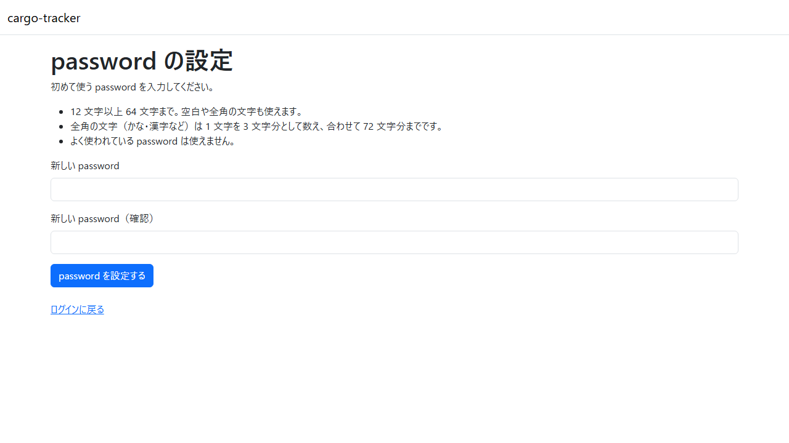

画面の項目は、再設定の画面と同じです。見出しが「password の設定」、説明が「初めて使う password を入力してください。」になります。

1. 案内のメールのリンクを開きます。「password の設定」の画面が開きます
2. 「新しい password」と「新しい password（確認）」に同じ password を入力し、「password を設定する」をクリックします
3. ログインの画面に戻り、「password を設定しました。」と示されます

   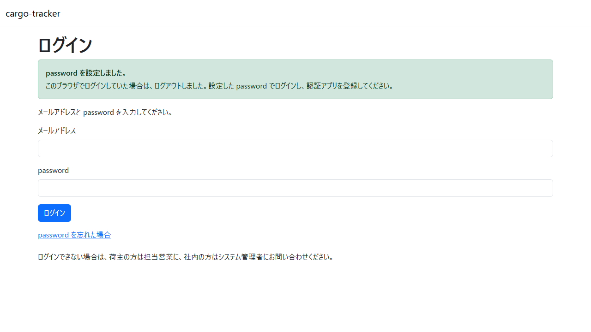

4. [2.1 ログイン](#21-ログイン) の手順で、設定した password でログインします。続けて、認証アプリの登録の画面が開くので、認証アプリを登録します

- 案内のリンクの有効期限は 24 時間で、1 回だけ使えます
- 期限が過ぎた場合や、案内が届かない場合は、ログインの画面の「password を忘れた場合」から設定してください。そのときの画面と知らせは、再設定と同じ「password の再設定」「password を変更しました。」になりますが、初回の設定もそのまま行えます
- 案内のメールが届いた後に、本人かほかの人が「password を忘れた場合」から依頼すると、案内のリンクは使えなくなります。新しく届いた再設定のメールのリンクから設定してください
- 設定したブラウザでほかの利用者がログインしていた場合は、ログアウトします
- ログインできないときは、15 分たってから試してください。急ぐ場合は、システム管理者にロックの解除を頼めます

## 2.7 認証アプリを登録し直す

### この画面でできること

- 回復コードでログインした後に、認証アプリを登録し直します（スマートフォンを失くした、機種を変えた、認証アプリを消してしまった場合など）
- 登録し直すと、新しい回復コードを 10 個受け取ります。前の認証アプリのコードと、残っていた回復コードは使えなくなります

### 画面の開き方

- 回復コードでログインすると開きます（[2.1](#21-ログイン) の「認証アプリを使えない場合」。URL: `/account/authenticator`）
- 「後で登録する」を選んだ後は、業務の画面の上部の「認証アプリを登録し直す」から開きます。ナビゲーションには入口はありません

### 画面の説明

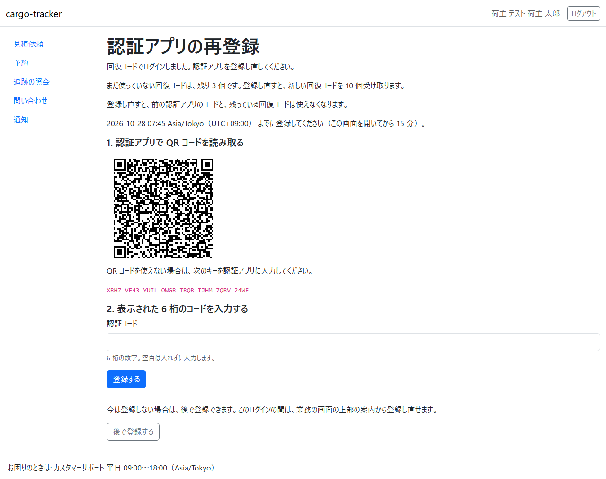

| # | 項目 | 説明 |
| :--- | :--- | :--- |
| ① | 期限 | この画面を開いてから 15 分。この時刻までに登録してください |
| ② | QR コード・キー | 認証アプリで読み取る QR コードと、読み取れない場合に入力するキー |
| ③ | 認証コード | 認証アプリに表示された 6 桁の数字 |
| ④ | 「登録する」 | 認証アプリを登録し直します |
| ⑤ | 「後で登録する」 | 登録せずに業務の画面へ進みます |

新しい回復コードの画面:

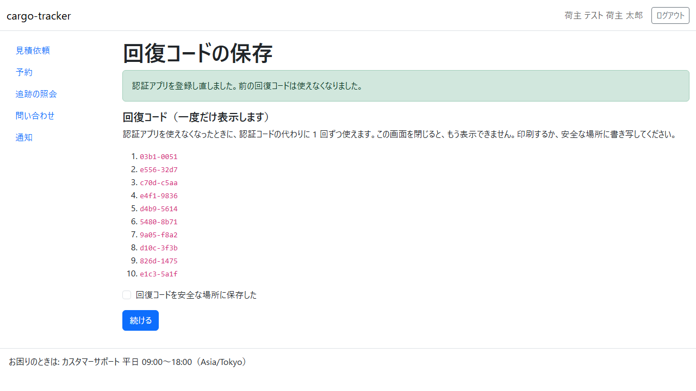

「後で登録する」を選んだ後の、業務の画面の上部の知らせ（まだ使っていない回復コードが 3 個以下なら、残りの数も示されます）:

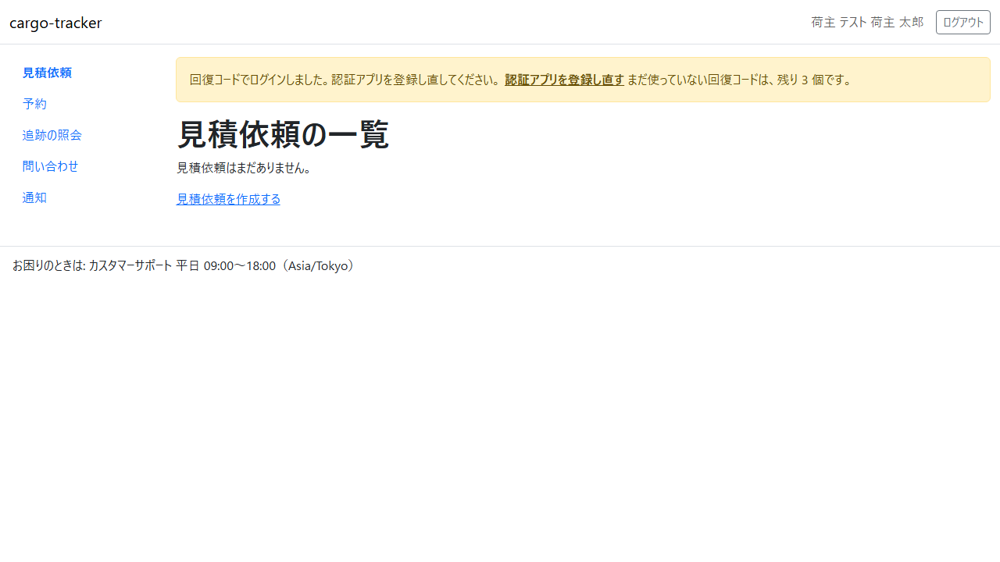

### 操作手順

1. 認証アプリで QR コードを読み取ります。読み取れない場合は、画面のキーを認証アプリに入力します
2. 認証アプリに表示された 6 桁のコードを「認証コード」に入力し、「登録する」をクリックします
3. 「認証アプリを登録し直しました。前の回復コードは使えなくなりました。」と、新しい回復コードが 10 個示されます。印刷するか、安全な場所に書き写してください
4. 「回復コードを安全な場所に保存した」に印を付け、「続ける」をクリックします。ログインの前に開こうとしていた画面か、役割ごとのホームが開きます

### 注意・補足

- 今は登録しない場合は「後で登録する」をクリックします。回復コードでログインしてから 15 分の間は、業務の画面の上部に「回復コードでログインしました。認証アプリを登録し直してください。」と示され、「認証アプリを登録し直す」から登録し直せます
- 回復コードでログインしてから 15 分を過ぎると、この画面からは登録し直せません（知らせは「…15 分を過ぎたため、この画面からは認証アプリを登録し直せません。…」に変わります）。登録し直すには、いったんログアウトして、残っている回復コードでログインし直してください
- 回復コードでログインしたとき、まだ使っていない回復コードが 3 個以下なら、この画面と業務の画面の知らせに残りの数が示されます（ログインに使った 1 個はもう使えないので、その分を引いた数です）。登録し直すと、新しい回復コードを 10 個受け取ります
- 回復コードが残っていないときは、今すぐ登録し直してください。登録し直さずに 15 分を過ぎた場合は、回復コードでログインし直すことができないので、荷主の方は担当営業に、社内の方はシステム管理者に、認証アプリの登録の解除を頼んでください（[付録 B](付録B-トラブルシューティング.md) の Q1-9）
- 後で登録したままログアウトした場合、前の認証アプリを使えなければ、次のログインも残っている回復コードで行うことになり、またこの画面が開きます。回復コードを使い切る前に登録し直してください
- 登録し直すまでは、前の認証アプリのコードと、残っている回復コードを使えます
- 認証コードが違うと「認証コードが正しくありません。認証アプリに表示されている最新のコードを入力してください。」と示されます。同じ QR コードのまま入力し直してください
- 「手続きが中断されたため、新しいキーを発行しました」と示された場合は、先ほど認証アプリに追加した項目を削除し、新しい QR コードを読み取ってください
- 登録し直すと、ほかのパソコン・スマートフォン・ブラウザでログインしていた場合は、次の操作で「もう一度ログインしてください」（[2.4](#24-もう一度ログインしてください)）になります。登録し直したこのブラウザはログインしたままです
- 新しい回復コードの画面を閉じると、もう表示できません。回復コードをなくした場合は、荷主の方は担当営業に、社内の方はシステム管理者にお問い合わせください
- 登録し直すと、登録したメールアドレスに再登録のお知らせ（件名「【cargo-tracker】認証アプリの再登録のご案内」）が届きます。心当たりのない再登録のお知らせが届いたときは、すぐに、荷主の方は担当営業に、社内の方はシステム管理者にお知らせください

## 2.8 画面が見つかりません

### この画面でできること

- 開こうとした画面が見つからないことを確かめ、ホームへ戻ります

### 画面の開き方

- 存在しない画面の URL や、開けない番号・利用者の URL を開いたときに示されます（例: 管理範囲の外の企業の利用者の画面。[11 章](11-利用者の管理.md)）
- 追跡番号の照会で番号が見つからないときは、この画面ではなく 5 章の「追跡番号が見つかりません」が示されます

### 画面の説明

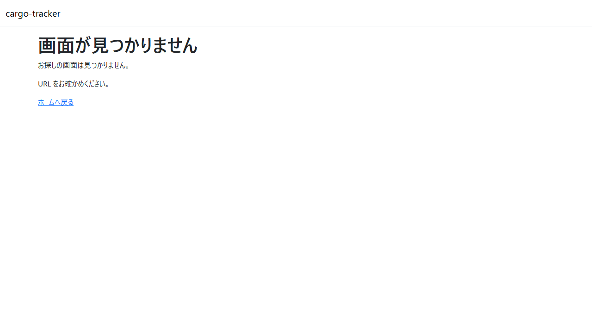

| # | 項目 | 説明 |
| :--- | :--- | :--- |
| ① | 見出し | 「画面が見つかりません」 |
| ② | 案内 | 「お探しの画面は見つかりません。」「URL をお確かめください。」 |
| ③ | ホームへ戻る | 役割のホームへ戻ります |

### 操作手順

1. URL を確かめます
2. 「ホームへ戻る」をクリックし、ナビゲーションから開き直します

### 注意・補足

- この画面には、ナビゲーションと利用者の名前は出ません（業務データを出さないため。「権限がありません」と同じ）
- 存在しない画面なのか、開けない画面なのかは示しません

