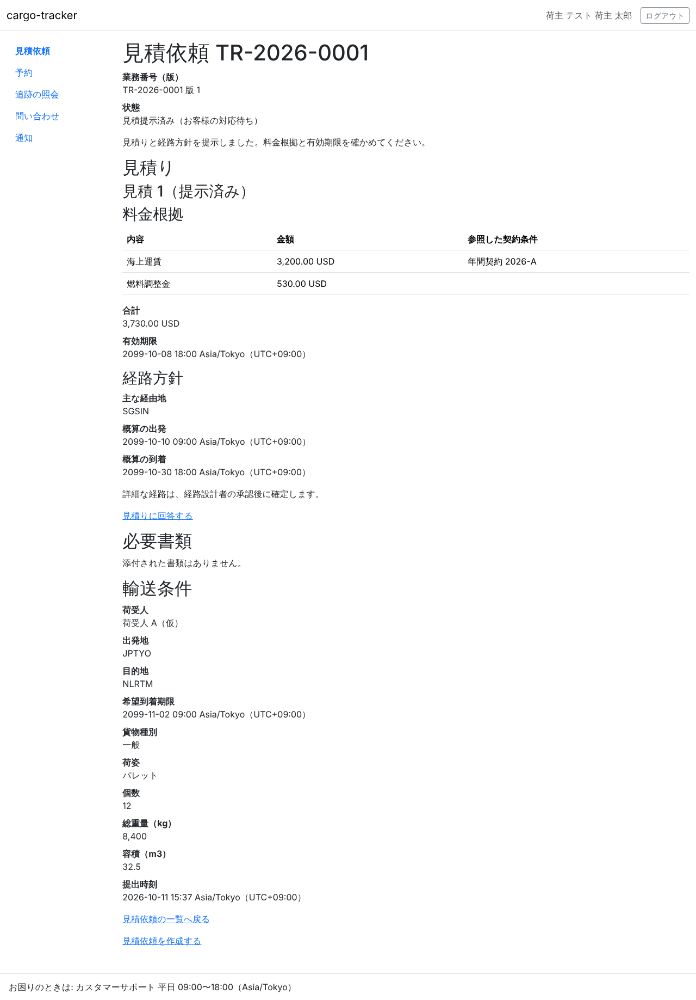
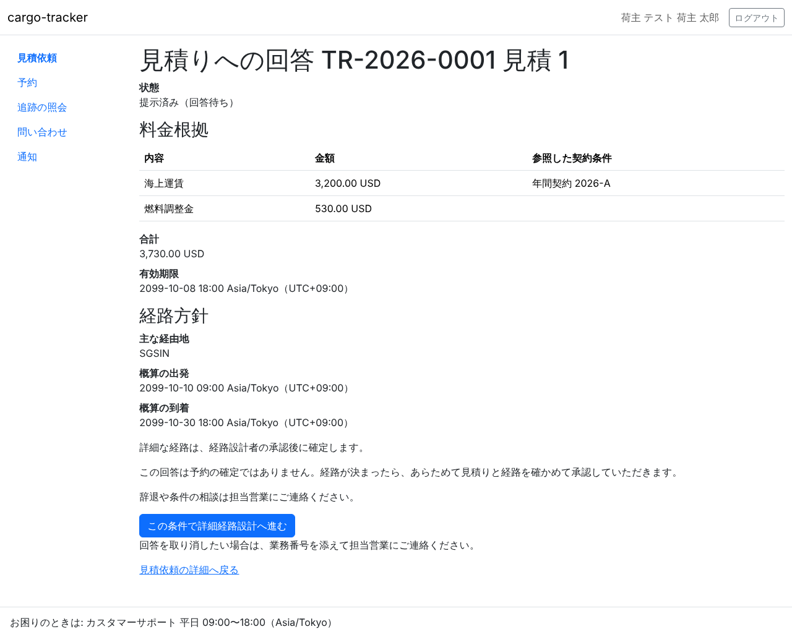
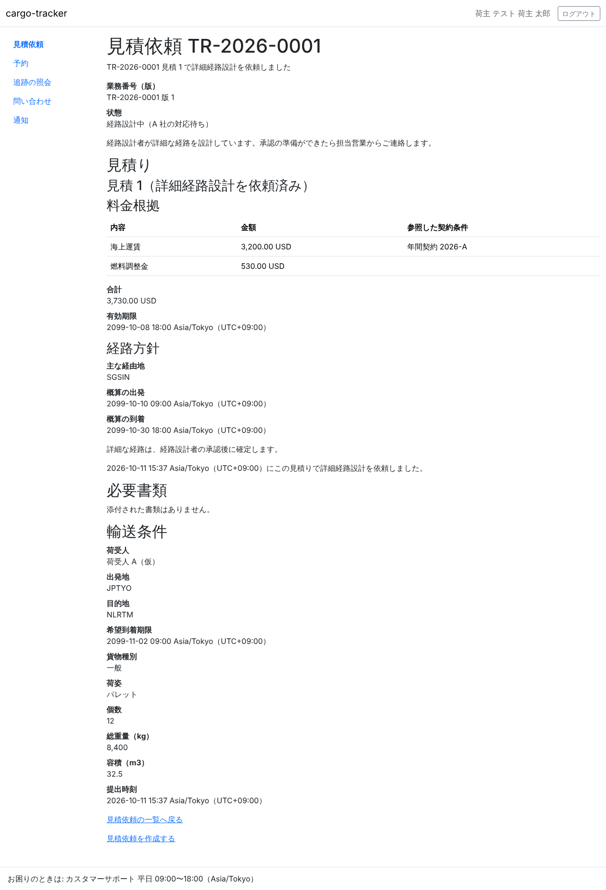
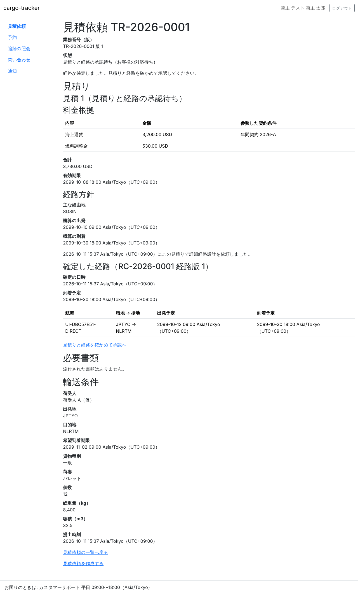
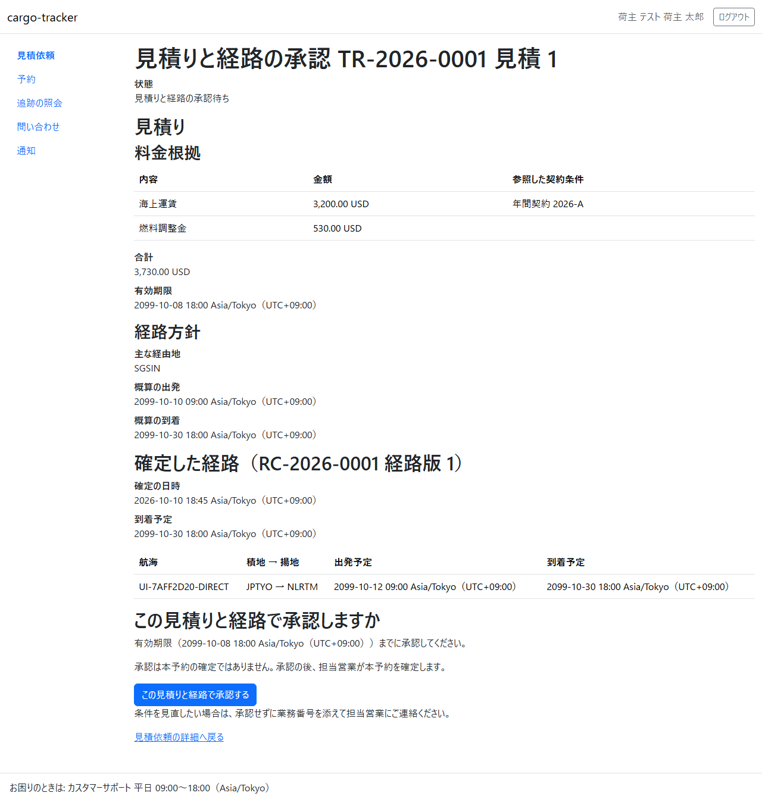
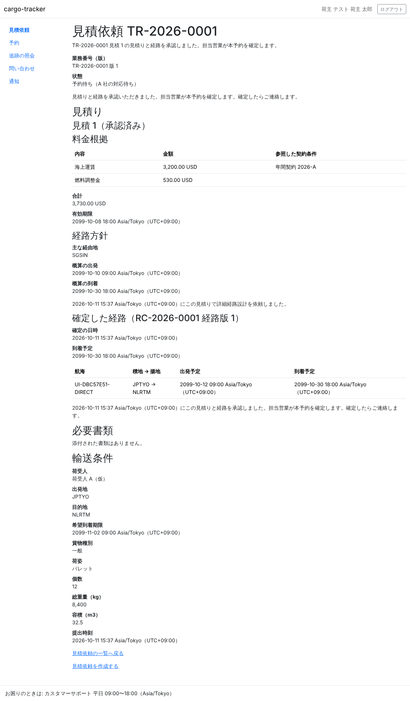
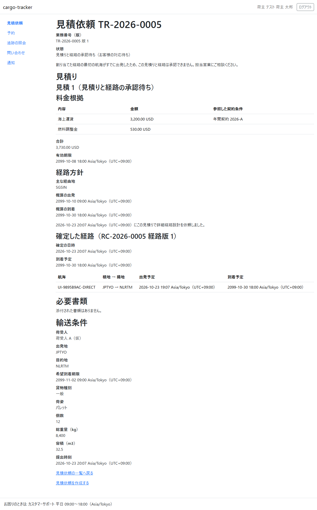
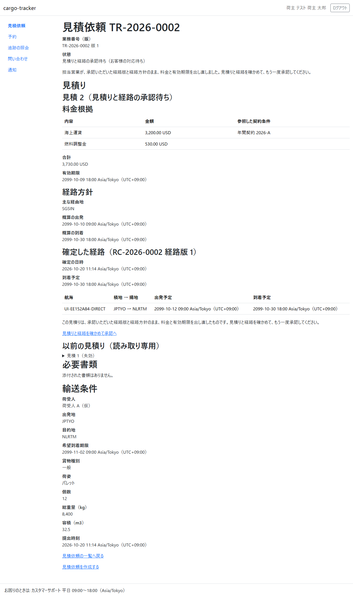
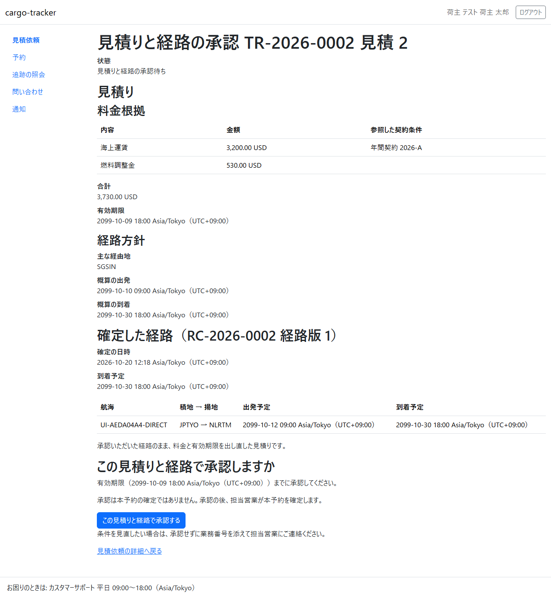

# 4 章 見積りへの回答と承認

営業担当者が提示した見積りに、荷主担当者が回答し、経路が決まった後に見積りと経路を承認する画面です。本章は [WF-1](01-業務フロー.md#wf-1-見積依頼から追跡の照会まで) の工程 3（見積りに回答する）と工程 5（見積りと経路を承認する）に対応します。

画面の開き方: ナビゲーションの「見積依頼」→ 見積依頼の一覧の業務番号 → 見積依頼の詳細の「見積り」の節。

| 画面 | 役割 | 節 |
| :--- | :--- | :--- |
| 見積りへの回答 | 料金根拠と経路方針を確かめ、詳細経路設計へ進む | [4.1](#41-見積りへの回答) |
| 見積りと経路の承認 | 確定した経路を確かめ、見積りと経路を承認する | [4.2](#42-見積りと経路の承認) |
| 再見積りした見積りをもう一度承認する | 承認の後に有効期限を過ぎた見積りを担当営業が出し直したら、もう一度承認する | [4.3](#43-再見積りした見積りをもう一度承認する) |

回答の後の経路の設計は経路設計者が、承認の後の本予約の確定は担当営業が行います。

## 4.1 見積りへの回答

### この画面でできること

- 提示された見積り（料金根拠・合計・有効期限・経路方針）を確かめ、この条件で詳細経路設計へ進むと回答します

### 画面の開き方

- 見積依頼の詳細の「見積りに回答する」（URL: `/customer/transport-requests/{業務番号}/quotations/{見積り番号}/response`）

見積りが提示されると、見積依頼の詳細は次のように「見積り」の節が加わり、状態が「見積提示済み（お客様の対応待ち）」になります。

### 画面の説明

| # | 項目 | 説明 |
| :--- | :--- | :--- |
| ① | 状態 | 「提示済み（回答待ち）」 |
| ② | 料金根拠 | 明細ごとの内容・金額・参照した契約条件 |
| ③ | 合計・有効期限 | 有効期限までに回答してください |
| ④ | 経路方針 | 主な経由地、概算の出発と到着と「詳細な経路は、経路設計者の承認後に確定します。」 |
| ⑤ | 「この条件で詳細経路設計へ進む」 | 回答します |
| ⑥ | 「見積依頼の詳細へ戻る」 | 回答せずに戻ります |

### 操作手順

1. 料金根拠・合計・有効期限・経路方針を確かめます
2. 「この条件で詳細経路設計へ進む」をクリックします
3. 見積依頼の詳細に戻り、状態が「経路設計中（A 社の対応待ち）」になります。「経路設計者が詳細な経路を設計しています。承認の準備ができたら担当営業からご連絡します。」と示されます

### 注意・補足

- この回答は予約の確定ではありません。経路が決まったら、あらためて見積りと経路を確かめて承認していただきます（[4.2](#42-見積りと経路の承認)）
- 辞退や条件の相談は担当営業にご連絡ください
- 回答を取り消したい場合は、業務番号を添えて担当営業にご連絡ください
- 有効期限を過ぎた見積りには回答できません。画面に「…有効期限を過ぎて失効しています。新しい見積りは担当営業にご依頼ください」と示されます。新しい見積りは担当営業にご依頼ください
- 詳細経路設計を依頼した後に有効期限を過ぎたときは「有効期限（…）を過ぎました。詳細経路設計は依頼済みのまま進めています。料金の扱いは担当営業からご連絡します。」と示されます。担当営業からの連絡を待ってください

## 4.2 見積りと経路の承認

### この画面でできること

- 経路設計者が確定した経路（航海・積地と揚地・出発予定・到着予定）と見積りを確かめて承認します

### 画面の開き方

- 見積依頼の詳細の「見積りと経路を確かめて承認へ」（URL: `/customer/transport-requests/{業務番号}/quotations/{見積り番号}/approval`）

経路が確定すると、見積依頼の詳細の状態が「見積りと経路の承認待ち（お客様の対応待ち）」になり、確定した経路が示されます。

### 画面の説明

| # | 項目 | 説明 |
| :--- | :--- | :--- |
| ① | 状態 | 「見積りと経路の承認待ち」 |
| ② | 見積り | 料金根拠・合計・有効期限・経路方針（回答のときと同じ内容） |
| ③ | 確定した経路 | 経路の番号と版、確定の日時、到着予定、区間ごとの航海・積地 → 揚地・出発予定・到着予定 |
| ④ | 「この見積りと経路で承認する」 | 承認します。有効期限までに承認してください |
| ⑤ | 「見積依頼の詳細へ戻る」 | 承認せずに戻ります |

### 操作手順

1. 見積りと確定した経路を確かめます
2. 「この見積りと経路で承認する」をクリックします
3. 見積依頼の詳細に戻り、状態が「予約待ち（A 社の対応待ち）」になります

### 注意・補足

- 承認は本予約の確定ではありません。承認の後、担当営業が本予約を確定します。確定すると、予約一覧（[5.1](05-予約一覧と追跡の照会.md#51-予約一覧)）に出ます
- 条件を見直したい場合は、承認せずに業務番号を添えて担当営業にご連絡ください
- 経路は経路設計者が確定してから届きます。承認の準備ができたら担当営業からご連絡しますので、連絡を待ってから見積依頼の詳細を開いてください
- 有効期限を過ぎた見積りは承認できません。画面に「有効期限（…）を過ぎたため承認できません。新しい見積りは担当営業にご依頼ください。」と示されます。新しい見積りは担当営業にご依頼ください
- 承認した後、本予約の確定の前に有効期限を過ぎたときは、見積依頼の詳細の状態の下に「承認の後に見積りの有効期限を過ぎました。担当営業が新しい見積りを用意しています。」、見積りの節に「承認の後に有効期限（…）を過ぎました。用意できたら、もう一度承認をお願いします。」と示されます。この間、見積依頼の一覧と詳細の状態は「見積り作成中（A 社の対応待ち）」になります。承認が取り消されたのではありません。新しい見積りの依頼は要りません。用意できたら、もう一度承認してください（[4.3](#43-再見積りした見積りをもう一度承認する)）
- 経路が届いた後に、航海の予定の変更などで割り当てた経路の見直しが必要になることがあります。承認の前に見直しが必要になったときは、見積依頼の詳細の状態は「見積りと経路の承認待ち（お客様の対応待ち）」のまま、「見積りと経路を確かめて承認へ」が出ず、状態の下に「割り当てた経路の見直しが必要になったため、この見積りと経路は承認できません。担当営業にご相談ください。」と示されます。業務番号を添えて担当営業にご相談ください

  

- 見直しが必要になった見積りの承認の画面をメールのリンクなどから開いたとき、または画面を開いた後に見直しが必要になったときは、承認できず見積依頼の詳細に戻り、「TR-… 見積 N は割り当てた経路の見直しが必要になったため承認できません。担当営業にご相談ください」と示されます。担当営業にご相談ください
- 承認した後に見直しが必要になったときは、状態は「予約待ち（A 社の対応待ち）」のまま、状態の下に「割り当てた経路の見直しが必要になりました。本予約の扱いは担当営業からご連絡します。」と示されます。承認が取り消されたのではありません。担当営業からの連絡を待ってください
- 割り当てた経路の最初の航海の出発予定を過ぎると、見積りと経路は承認できません。承認の時刻が出発予定と同じときも、出発したものとして扱います。承認の前に最初の航海が出発したときは、見積依頼の詳細の状態は「見積りと経路の承認待ち（お客様の対応待ち）」のまま、「見積りと経路を確かめて承認へ」が出ず、状態の下に「割り当てた経路の最初の航海がすでに出発したため、この見積りと経路は承認できません。担当営業にご相談ください。」と示されます。もう一度承認をお願いする見積り（[4.3](#43-再見積りした見積りをもう一度承認する)）も同じで、「料金と有効期限を出し直した見積りが届きました。もう一度承認してください。」の案内の代わりにこの案内が示されます。業務番号を添えて担当営業にご相談ください

  

- 最初の航海が出発した見積りの承認の画面をメールのリンクなどから開いたとき、または画面を開いた後に出発したときは、承認できず見積依頼の詳細に戻り、「TR-… 見積 N は割り当てた経路の最初の航海がすでに出発したため承認できません。担当営業にご相談ください」と示されます。担当営業にご相談ください
- 承認した後、本予約の確定の前に最初の航海が出発したときは、状態は「予約待ち（A 社の対応待ち）」のまま、状態の下に「割り当てた経路の最初の航海がすでに出発しました。本予約の扱いは担当営業からご連絡します。」と示されます。見積りの節には「（日時）にこの見積りと経路を承認しました。」だけが示され、「担当営業が本予約を確定します。」は示されません。承認が取り消されたのではありません。担当営業からの連絡を待ってください

## 4.3 再見積りした見積りをもう一度承認する

### この画面でできること

- 承認の後に有効期限を過ぎた見積りを、担当営業が出し直した新しい見積りを確かめて、もう一度承認します。経路は承認いただいたもののままで、料金と有効期限だけが出し直されています

### 画面の開き方

- 見積依頼の詳細の「見積りと経路を確かめて承認へ」（URL: `/customer/transport-requests/{業務番号}/quotations/{見積り番号}/approval`）

担当営業が新しい見積りを用意すると、見積依頼の一覧と詳細の状態が「見積りと経路の承認待ち（お客様の対応待ち）」になり、詳細に新しい見積りが示されます。状態の下に「料金と有効期限を出し直した見積りが届きました。もう一度承認してください。」、見積りの節に「承認いただいた経路のまま、料金と有効期限を出し直した見積りです。」と示されます。前の見積りは「以前の見積り（読み取り専用）」に「失効」で残ります。

### 画面の説明

| # | 項目 | 説明 |
| :--- | :--- | :--- |
| ① | 見積り | 新しい見積りの料金根拠・合計・有効期限・経路方針 |
| ② | 確定した経路 | 経路の番号と版、確定の日時、到着予定、区間ごとの航海・積地 → 揚地・出発予定・到着予定。承認いただいた経路から変わっていません |
| ③ | 案内 | 「承認いただいた経路のまま、料金と有効期限を出し直した見積りです。」 |
| ④ | 「この見積りと経路で承認する」 | もう一度承認します。新しい有効期限までに承認してください |

### 操作手順

1. 見積依頼の詳細で、新しい見積りの料金と有効期限を確かめ、「見積りと経路を確かめて承認へ」をクリックします
2. 見積りと経路を確かめ、「この見積りと経路で承認する」をクリックします
3. 見積依頼の詳細に戻り、状態が「予約待ち（A 社の対応待ち）」になります。担当営業が新しい見積りで本予約を確定します

### 注意・補足

- 条件や経路を見直したい場合は、承認せずに業務番号を添えて担当営業にご連絡ください
- 新しい見積りも、有効期限を過ぎると承認できません。画面に「有効期限（…）を過ぎたため承認できません。新しい見積りは担当営業にご依頼ください。」と示されます
