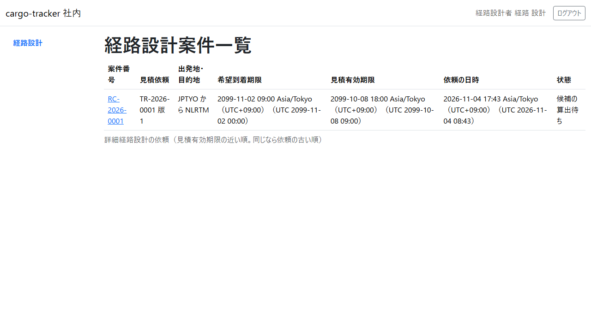
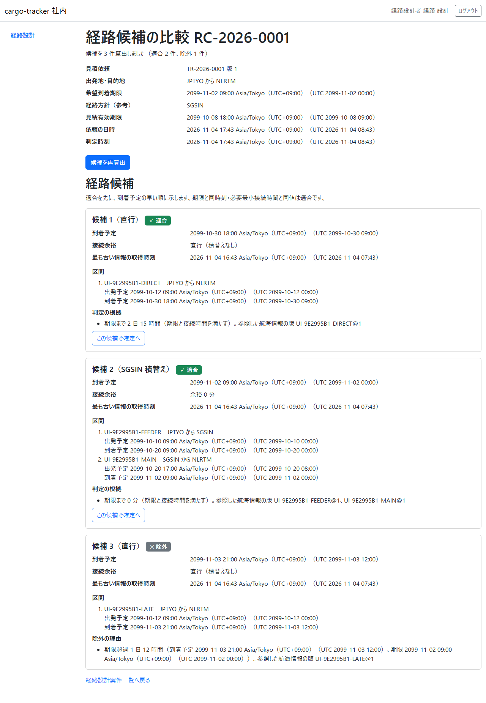
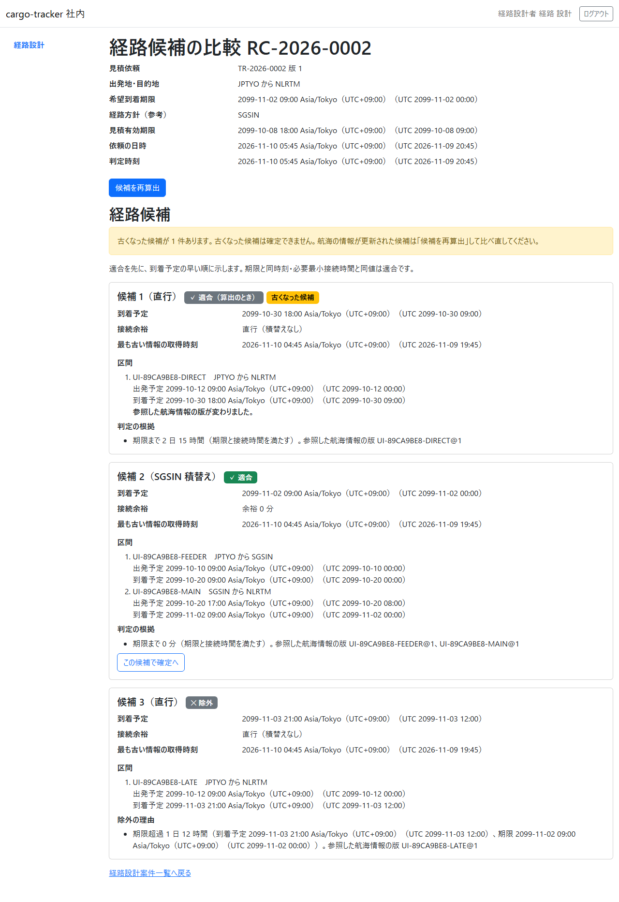
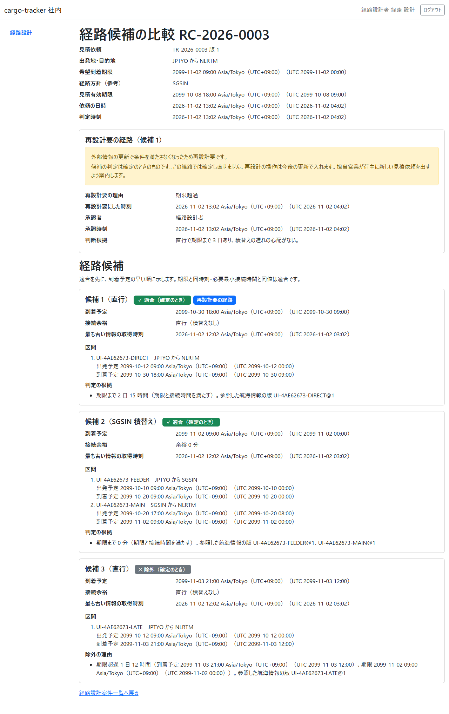
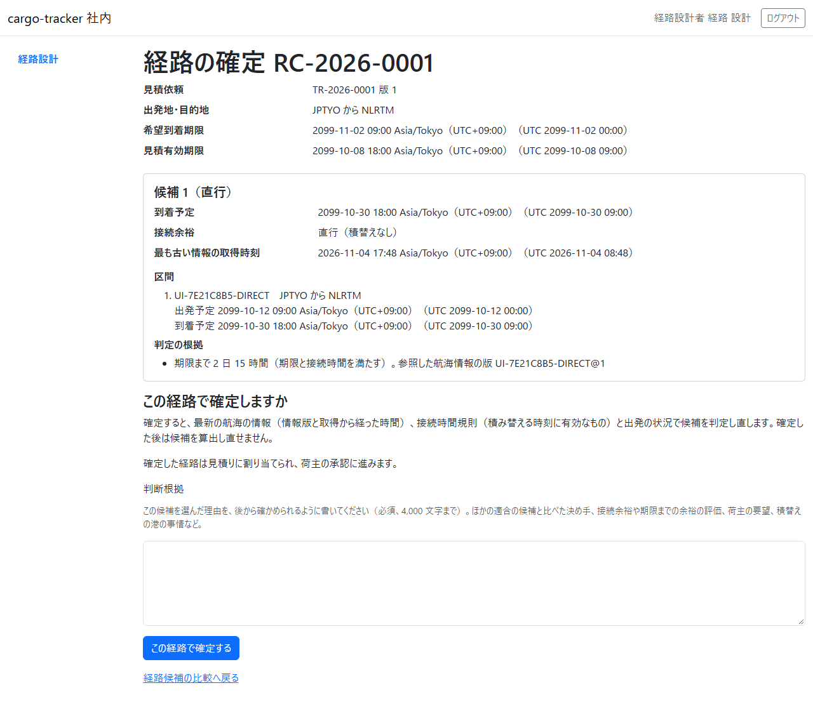
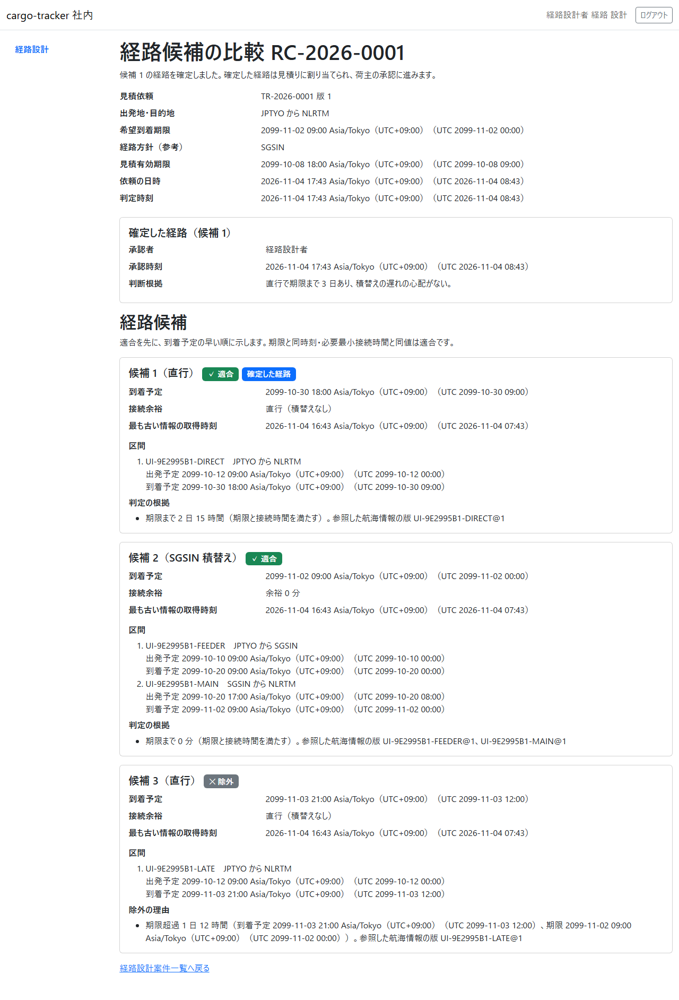

# 8 章 経路設計

荷主が見積りに回答して詳細経路設計を依頼した後に、経路設計者が経路の候補を算出して比べ、判断根拠を残して経路を確定する画面です。本章は [WF-1](01-業務フロー.md#wf-1-見積依頼から追跡の照会まで) の工程 4（経路の候補を比較して確定する）に対応します。

画面の開き方: ナビゲーションの「経路設計」（URL: `/staff/routing-cases`）。経路設計者はログインするとこの画面が開きます。

| 画面 | 役割 | 節 |
| :--- | :--- | :--- |
| 経路設計案件一覧 | 詳細経路設計の依頼を、見積有効期限の近い順に確かめる | [8.1](#81-経路設計案件一覧) |
| 経路候補の比較 | 候補を算出し、適合と除外の候補を理由とともに比べる | [8.2](#82-経路候補の比較) |
| 経路の確定 | 判断根拠を書いて候補を確定する | [8.3](#83-経路の確定) |

## 8.1 経路設計案件一覧

### この画面でできること

- 荷主が依頼した詳細経路設計の案件を、見積有効期限の近い順（同じなら依頼の古い順）に確かめます
- 表示されるのは、あなたの担当企業の荷主の案件だけです。担当企業は、システム管理者が利用者の管理（[11.8](11-利用者の管理.md#118-担当範囲の変更の確認)）で割り当てます

### 画面の開き方

- ナビゲーションの「経路設計」（URL: `/staff/routing-cases`）

### 画面の説明

| # | 項目 | 説明 |
| :--- | :--- | :--- |
| ① | 案件番号 | 経路設計の案件の番号（RC-…）。クリックすると経路候補の比較が開きます |
| ② | 見積依頼 | 業務番号と版 |
| ③ | 出発地・目的地・希望到着期限 | 荷主の輸送条件 |
| ④ | 見積有効期限 | この時刻より前に経路を確定し、荷主が承認する必要があります |
| ⑤ | 依頼の日時・状態 | 例: 「候補の算出待ち」「確定済み」。確定した経路が外部情報の更新で条件を満たさなくなった案件は「再設計要」（[8.2](#82-経路候補の比較) の注意・補足） |

### 操作手順

1. 見積有効期限の近い案件から、案件番号をクリックします

### 注意・補足

- 見積りの有効期限が過ぎた案件は、確定の前後に担当営業と扱いを相談してください
- 担当企業がまだないときは、「担当企業がまだないので、表示できる経路設計の案件はありません。システム管理者に担当企業の割り当てを頼んでください。」とだけ示され、案件は表示されません。システム管理者に担当企業の割り当てを頼んでください
- 「再設計要」は、経路設計者の操作ではなく、航海の情報などの外部情報の更新を受けてシステムが確定した経路を評価し直して付ける状態です。この画面から評価を起こす操作はありません

## 8.2 経路候補の比較

### この画面でできること

- 航海の情報と接続時間の規則から経路の候補を算出し、適合か、除外か（除外の理由とともに）を比べます

### 画面の開き方

- 経路設計案件一覧の案件番号（URL: `/staff/routing-cases/{案件番号}`）

### 画面の説明

| # | 項目 | 説明 |
| :--- | :--- | :--- |
| ① | 案件の情報 | 見積依頼・出発地・目的地・希望到着期限・経路方針（参考）・見積有効期限・依頼の日時・判定時刻（候補を算出した時刻。この時刻より後に出発する区間で候補を作ります） |
| ② | 「候補を算出」（算出の後は「候補を再算出」） | 航海の情報から候補を算出します |
| ③ | 経路候補 | 適合を先に、到着予定の早い順。候補ごとに「適合」「除外」の印。算出の後に古くなった候補には「古くなった候補」の印が付きます（下の「算出の後に候補が古くなったとき」） |
| ④ | 到着予定・接続余裕・最も古い情報の取得時刻 | 候補の判断の材料。算出のときの値です。確定できるかは「古くなった候補」の印で判断します |
| ⑤ | 区間 | 航海・積地から揚地・出発予定・到着予定 |
| ⑥ | 判定の根拠／除外の理由 | 期限までの余裕や除外した理由と、「参照した航海情報の版」。判定に使った航海の情報の版を示します。取り込んだ航海は、提供元の外部版がそのまま示されます（例: 外部版が 1 なら 1）。図の「航海番号@1」の形は、取り込んでいない航海の版の例です。適合の候補は区間の航海ごとに「、」で並び、区間どうしで同じ版なら 1 つにまとまります。除外の理由には、理由ごとに、判定に使った区間の航海の版を示します。理由は、接続、期限超過、情報不足の順に並びます |
| ⑦ | 「この候補で確定へ」 | 適合の候補だけに出ます。古くなった候補には出ません |

### 操作手順

1. 「候補を算出」をクリックします。「候補を N 件算出しました（適合 N 件、除外 N 件）」と示されます
2. 適合の候補の到着予定・接続余裕・判定の根拠を比べます
3. 選んだ候補の「この候補で確定へ」をクリックします。経路の確定（[8.3](#83-経路の確定)）が開きます

### 算出の後に候補が古くなったとき

候補を算出した後に航海の情報が変わると、この画面を開いた時点の航海と比べて、次の候補に「古くなった候補」の印が付きます。

- 候補の区間が今の航海と一致しない候補（航海がないときも）
- 適合の候補で、区間の航海の情報が取得から許容時間（いまは 24 時間）を過ぎた候補

古くなった候補の判定の印は「✓ 適合（算出のとき）」「✕ 除外（算出のとき）」になり、「この候補で確定へ」は出ません。除外の候補は、区間が今の航海と合わないときだけ「古くなった候補」と示します。除外の理由が今も当てはまるか分からないためです。取得から許容時間を過ぎただけの除外の候補には示しません。

「経路候補」の見出しの下に、次の文が示されます。

| 場合 | 文 |
| :--- | :--- |
| 一部の候補が古い（n は候補の数） | 「古くなった候補が n 件あります。古くなった候補は確定できません。航海の情報が更新された候補は「候補を再算出」して比べ直してください。」 |
| 適合の候補がすべて古い | 「適合の候補はすべて古くなっています。古くなった候補は確定できません。航海の情報が更新された候補は「候補を再算出」して比べ直してください。」 |
| 取得から許容時間を過ぎた区間があるとき（続けて示します） | 「取得から許容時間を過ぎた航海は、先に航海の情報の取込をデータ責任者に依頼し、取り込まれたら再算出してください。」 |

古くなった区間の下には、区間ごとに次のいずれかの文が示されます。

| 文 | 意味 |
| :--- | :--- |
| 「今の航海の情報にこの航海がありません。」 | 区間の航海がなくなりました |
| 「参照した航海情報の版が変わりました。」 | 算出に使った版と、今の航海の版が違います |
| 「参照した航海情報の版は同じですが、この区間の予定が変わりました。」 | 同じ版のまま、区間の出発予定か到着予定が変わりました |
| 「航海の情報が取得から許容時間を過ぎています。取込をデータ責任者に依頼してください。」 | 適合の候補の航海の情報が古くなりました |

「古くなった候補」は案件の状態ではなく、この画面を開くたびに今の航海と比べて示す印です。候補と判定はそのまま残ります。

- 航海の情報が更新された候補は、「候補を再算出」して比べ直します
- 取得から許容時間を過ぎた航海は、先に航海の情報の取込をデータ責任者に依頼します
- 同じ情報版で元の値に戻るか、同じ情報版のまま取り込み直されて今の航海と合うと、印は消えます
- 新しい外部版で元の予定に戻したときは、情報版が違うので「候補を再算出」が要ります
- 接続時間規則の変更と最初の区間の出発済みでは「古くなった候補」になりません。確定するときに拒否されます（[8.3](#83-経路の確定) の注意・補足）
- 確定済みと再設計要の案件には示されません

### 注意・補足

- 担当企業の外の案件を URL から開くと、存在しない画面と同じく「画面が見つかりません」と示されます。候補の算出を送ったときは、試行が監査のため記録されます
- 期限と同時刻に着く候補、必要最小接続時間と同じ接続時間の候補は「適合」です
- 候補は直行から積替え 2 回（区間 3 つ）までです。同じ航海や同じ港を 2 回使う候補、目的地を通り過ぎてから戻る候補は出ません
- 接続時間の規則は、積み替える時刻（次の区間の出発予定）に有効なものを使います。判定時刻に有効な規則ではありません。積替えの港に、その時刻に有効な規則がなければ「接続を判定できない」で除外します。接続がいくつかある候補は、足りない接続ごとに除外の理由が出ます。接続余裕は、接続のうち最も小さいものです
- 航海の情報は、取得から許容時間（いまは 24 時間。理由の文言に示されます）を過ぎると古いとみなします。候補を算出した時刻（判定時刻）に、取得から許容時間を過ぎた航海を使う候補は「情報不足（V-301 の情報は取得から 24 時間を過ぎている）。取得 …」で除外されます。ちょうど許容時間は除外しません。航海ごとに理由が出るので、どの航海の情報が古いかが分かります。航海の情報の取込をデータ責任者に依頼し、取り込まれたら「候補を再算出」してください。取り込まれたかは、再算出した後の ④ の最も古い情報の取得時刻が新しくなったかで確かめます
- 判定は判定時刻の航海の情報によります。算出した後に航海の情報が更新されたり、適合の候補の航海の情報が取得から許容時間を過ぎたりすると、この画面に「古くなった候補」と示され、確定できません（上の「算出の後に候補が古くなったとき」）。この画面を開いた後に変わったときは、確定するときに拒否されます（[8.3](#83-経路の確定) の注意・補足）
- 除外の候補は確定できません。除外の理由を確かめてください
- 経路方針（参考）は営業担当者が見積りで示したものです。参考として比べてください
- 確定した経路は、外部情報の更新を受けてシステムが評価し直します。区間の航海の最新の予定で希望到着期限・接続時間を満たさなくなるか、区間の航海の予定が使えなくなる（欠航、寄港の取りやめ、寄港の予定の矛盾。矛盾は、寄る順が逆、出発予定か到着予定がない、到着が出発より後でない、など）と「再設計要」になります。再設計要になると、原因が解消しても確定には戻りません
- 区間の積地か揚地に 2 度寄り、積地と揚地の寄港の組が 2 つ以上できる航海（例: A、B、A、C の順に寄る航海の A から C の区間は、1 番目の A からと 3 番目の A からの 2 組）は、区間の出発予定と到着予定が変わらなければ、航海の情報が更新されても、2 度寄ることを理由に再設計要にはなりません。区間の予定が変わると、確定した寄港の位置（運航の順で何番目の寄港か）の予定で判定します。ほかの港の寄港の増減で位置がずれ、その位置に区間の積地と揚地の組がなくなると、確定した寄港を決められないので「航海の予定が使えない」で再設計要になります。位置の港が偶然同じなら、確定したときとは別の寄港の予定で判定します
- 再設計要の案件では、確定の欄の見出しが「再設計要の経路（候補 n）」に変わり、その下に「外部情報の更新で条件を満たさなくなったため再設計要です。」と「候補の判定は確定のときのものです。この経路では確定し直せません。再設計の操作は今後の更新で入れます。担当営業が荷主に新しい見積依頼を出すよう案内します。」が示されます。欄には承認者・承認時刻・判断根拠（確定のときのまま）の前に「再設計要の理由」と「再設計要にした時刻」が並びます。理由は「期限超過」「接続不足」「接続できない」「航海の予定が使えない」のいずれかで、いくつか当てはまると「、」で並びます。確定した候補には「再設計要の経路」の印が付き、候補の判定の印は「✓ 適合（確定のとき）」「✕ 除外（確定のとき）」になります。「候補を算出」「この候補で確定へ」は出ません
- 再設計要の案件は、この経路で確定し直すことはできません。再設計（新しい経路版を作ること）の操作は、まだありません。担当営業が荷主に新しい見積依頼を出すよう案内し、この案件はそのまま残ります（再設計の操作と案件を終える操作が入るまでの運用の決まりです。再設計は US-08、案件を終える操作は台帳の D-94。入った時点でこの節を改める）。候補の到着予定・判定の根拠は確定のときのもので、最新の航海の情報によるものではありません

## 8.3 経路の確定

### この画面でできること

- 選んだ候補を、判断根拠を残して確定します。確定した経路は見積りに割り当てられ、荷主の承認に進みます

### 画面の開き方

- 経路候補の比較の「この候補で確定へ」（URL: `/staff/routing-cases/{案件番号}/confirmation?candidate={候補番号}`）

### 画面の説明

| # | 項目 | 説明 |
| :--- | :--- | :--- |
| ① | 案件の情報 | 見積依頼・出発地・目的地・希望到着期限・見積有効期限 |
| ② | 選んだ候補 | 到着予定・接続余裕・区間・判定の根拠（参照した航海情報の版を含む） |
| ③ | この経路で確定しますか | 確定するときに、最新の航海の情報（情報版、区間の予定、取得から経った時間）、接続時間規則（積み替える時刻に有効なもの）と出発の状況で判定し直すこと、確定した後は候補を算出し直せないこと |
| ④ | 判断根拠 | この候補を選んだ理由（必須、4,000 文字まで）。ほかの適合の候補と比べた決め手、接続余裕や期限までの余裕の評価、荷主の要望など |
| ⑤ | 「この経路で確定する」 | 確定します |

### 操作手順

1. 選んだ候補の内容を確かめます
2. 「判断根拠」に、この候補を選んだ理由を書きます
3. 「この経路で確定する」をクリックします
4. 経路候補の比較に戻り、「候補 N の経路を確定しました。確定した経路は見積りに割り当てられ、荷主の承認に進みます。」と示されます。確定した経路の承認者・承認時刻・判断根拠が示され、候補に「確定した経路」の印が付きます

### 注意・補足

- 担当企業の外の案件の経路の確定を URL から開くと、存在しない画面と同じく「画面が見つかりません」と示されます。判断根拠が空でも、ほかの経路設計者が先に更新していても同じです。送ったときは、試行が監査のため記録されます
- 判断根拠が空、または長すぎると確定できず、エラーが示されます。入力は残ります
- ほかの経路設計者が先に同じ案件を更新していたときは、「ほかの経路設計者が先にこの案件を更新しました。最新の候補を確かめてください。」と示されます
- 確定するときに、最初の区間が出発済みだったり（「最初の区間が出発済みのため確定できません。候補を再算出してください。」）、候補を算出した後に登録・変更された接続時間規則に合わなくなっていたりすると確定できません。候補を算出し直してください
- 経路候補の比較を開く前に更新された候補は「古くなった候補」と示され、「この候補で確定へ」が出ません（[8.2](#82-経路候補の比較) の「算出の後に候補が古くなったとき」）。経路候補の比較を開いた後に、候補の航海の情報が更新されると（参照した航海情報の版が変わるか、同じ版のまま区間の予定が変わる）、確定できず、経路候補の比較に戻ります。「候補を算出した後に航海の情報が更新されたため確定できません。入力した判断根拠は保存していません。候補を再算出して判断し直してください。」と示されるので、「候補を再算出」して候補を比べ直し、判断根拠を入れ直して確定します（入れた判断根拠は残りません）
- 経路候補の比較を開いた後に時間が過ぎたときや、この画面の URL を直接開いたときに、候補の航海の情報が取得から許容時間（いまは 24 時間）を過ぎていると、情報不足で確定できません。この画面に「航海の情報が取得から許容時間を過ぎているため確定できません（情報不足）。」と示されます。航海の情報の取込をデータ責任者に依頼し、取り込まれたら「候補を再算出」してください
- 再設計要の案件は確定し直せません。URL から経路の確定を開いたとき、または画面を開いた後に再設計要になったときは、経路候補の比較に戻り「この案件の経路は再設計要のため確定し直せません。担当営業が荷主に新しい見積依頼を出すよう案内します。」と示されます（運用の決まりは [8.2](#82-経路候補の比較) の注意・補足）
