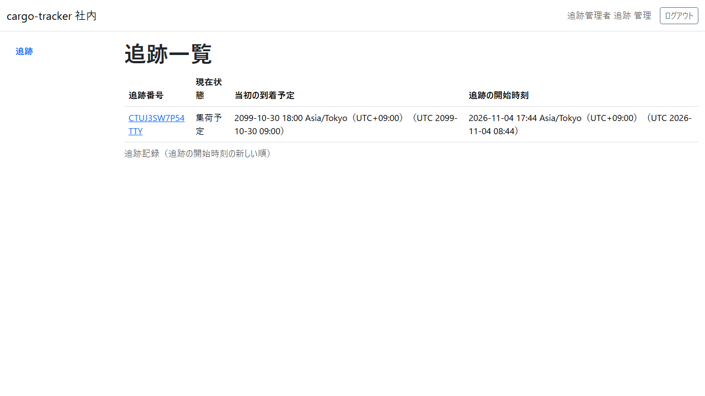
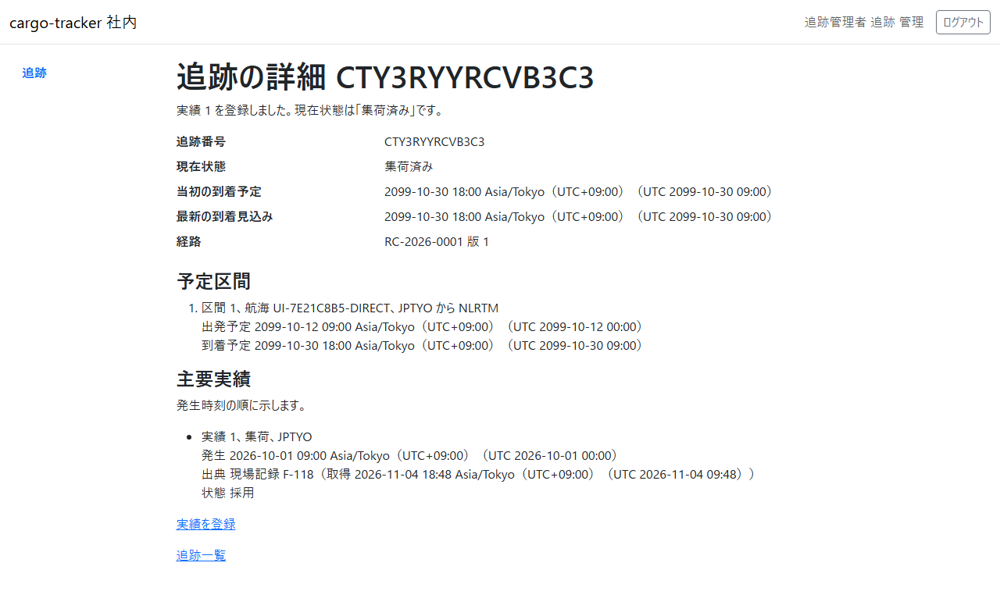
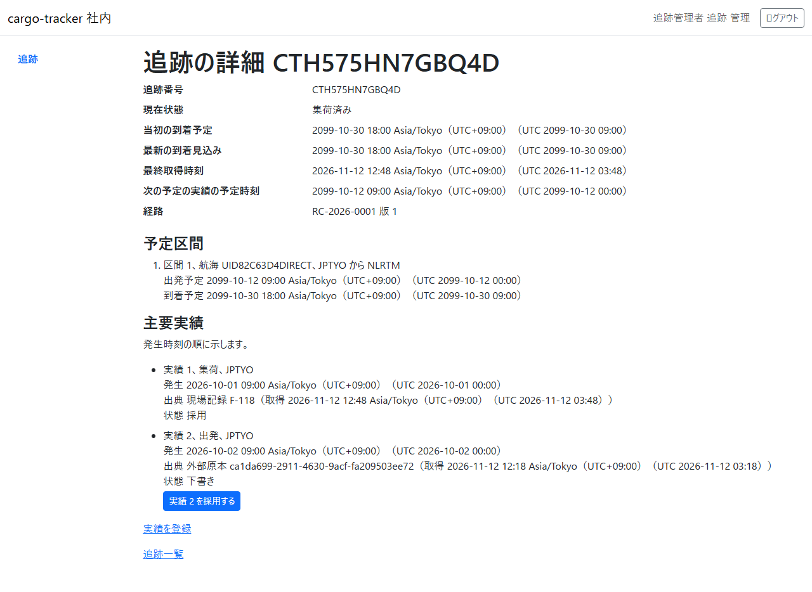
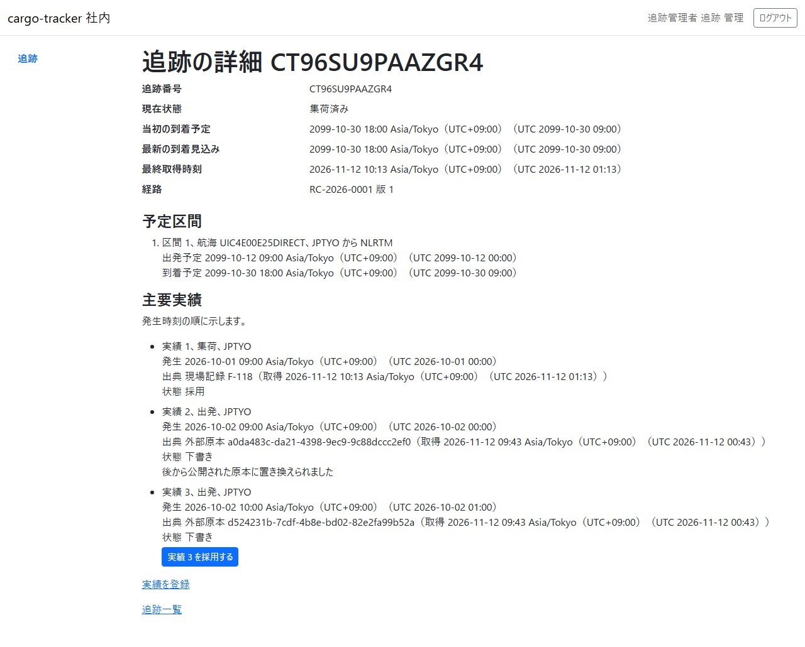
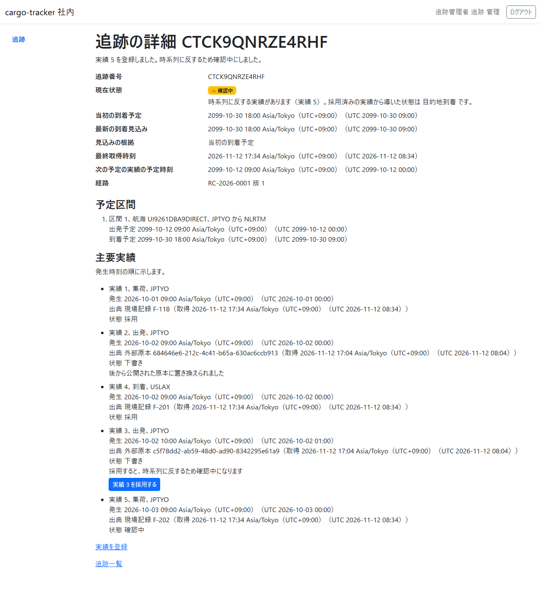
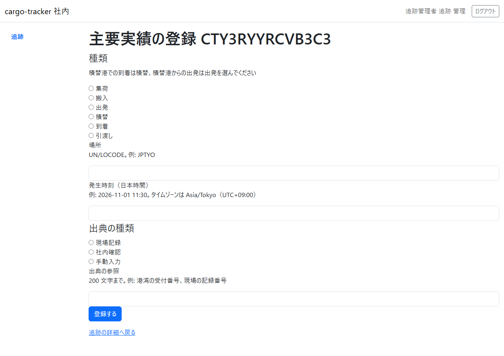

# 9 章 追跡管理

本予約が確定して追跡が始まった貨物について、追跡管理者が予定と主要な実績を確かめ、集荷などの実績を出典とともに登録する画面です。本章は [WF-1](01-業務フロー.md#wf-1-見積依頼から追跡の照会まで) の工程 7（主要な実績を登録する）に対応します。

画面の開き方: ナビゲーションの「追跡」（URL: `/staff/tracking-records`）。追跡管理者はログインするとこの画面が開きます。

| 画面 | 役割 | 節 |
| :--- | :--- | :--- |
| 追跡一覧 | 追跡中の貨物を、追跡の開始時刻の新しい順に確かめる | [9.1](#91-追跡一覧) |
| 追跡の詳細 | 現在状態・到着の予定・予定区間・主要実績を確かめる | [9.2](#92-追跡の詳細) |
| 主要実績の登録 | 実績の種類・場所・発生時刻・出典を入れて登録する | [9.3](#93-主要実績の登録) |

登録した実績は、荷主の追跡の照会（[5.3](05-予約一覧と追跡の照会.md#53-照会の結果)）にも示されます。

## 9.1 追跡一覧

### この画面でできること

- 追跡中の貨物を、追跡の開始時刻の新しい順に確かめ、追跡の詳細を開きます
- 表示されるのは、あなたの担当企業の荷主の追跡記録だけです。担当企業は、システム管理者が利用者の管理（[11.8](11-利用者の管理.md#118-担当範囲の変更の確認)）で割り当てます

### 画面の開き方

- ナビゲーションの「追跡」（URL: `/staff/tracking-records`）

### 画面の説明

| # | 項目 | 説明 |
| :--- | :--- | :--- |
| ① | 追跡番号 | クリックすると追跡の詳細が開きます |
| ② | 現在状態 | 例: 「集荷予定」「集荷済み」。「確認中」は、印（⚠）の付いた状態バッジで示されます（[9.2](#確認中の追跡を確かめる)） |
| ③ | 当初の到着予定 | 予約したときの到着予定 |
| ④ | 追跡の開始時刻 | 本予約の確定の後に追跡が始まった日時 |

### 操作手順

1. 実績を登録する貨物の追跡番号をクリックします

### 注意・補足

- 新しい 50 件まで示します
- 担当企業がまだないときは、「担当企業がまだないので、表示できる追跡記録はありません。システム管理者に担当企業の割り当てを頼んでください。」とだけ示され、追跡記録は表示されません。システム管理者に担当企業の割り当てを頼んでください

## 9.2 追跡の詳細

### この画面でできること

- 貨物の現在状態・当初の到着予定・最新の到着見込み・経路・予定区間・主要実績を確かめ、実績の登録を開きます
- 取り込んだ主要実績の下書きを採用し、現在状態に効かせます

### 画面の開き方

- 追跡一覧の追跡番号（URL: `/staff/tracking-records/{追跡番号}`）

### 画面の説明

| # | 項目 | 説明 |
| :--- | :--- | :--- |
| ① | 結果のメッセージ | 実績を登録した直後に「実績 N を登録しました。現在状態は「…」です。」と示されます |
| ② | 追跡番号・現在状態・当初の到着予定・最新の到着見込み・経路 | 経路は確定した経路の番号と版 |
| ③ | 予定区間 | 区間ごとの航海・積地から揚地・出発予定・到着予定 |
| ④ | 主要実績 | 発生時刻の順。実績番号・種類・場所、発生・出典（取得時刻）・状態。状態は、現在状態を決めるのに使う「採用」、取り込んだ実績が届いたときの「下書き」、完了した追跡に届いた実績の「保持のみ」、採用済みの実績と時系列に反する実績の「確認中」です。取り込んだ実績の出典は「外部原本 …（取得 …）」と示されます。採用できる下書きには「実績 N を採用する」ボタンが、採用しない下書きにはその理由（下の「注意・補足」）が示されます |
| ⑤ | 「実績を登録」 | 主要実績の登録（[9.3](#93-主要実績の登録)）を開きます |
| ⑥ | 「追跡一覧」 | 追跡一覧に戻ります |

### 操作手順

1. 予定区間と主要実績を確かめます
2. 新しい実績があれば「実績を登録」をクリックします

#### 取り込んだ下書きを採用する

1. 主要実績の一覧で、状態「下書き」の実績を確かめます。同じ主要実績の下書きが複数あるときは、後から公開された下書きだけに「実績 N を採用する」ボタンが示されます
2. 内容（種類・場所・発生時刻・出典）を確かめ、「実績 N を採用する」をクリックします
3. 「実績 N を採用しました。現在状態は「…」です。」と示され、実績の状態が「採用」になります。現在状態は採用した実績から決め直されます
4. ボタンの下に「採用すると、時系列に反するため確認中になります」と示されている下書きは、採用すると状態が「確認中」になり、追跡の現在状態も「確認中」になります。採用すると「実績 N を採用しました。時系列に反するため確認中にしました。」と示されます。採用する前に、採用済みの実績と食い違っていないかを確かめてください

#### 確認中の追跡を確かめる

登録した実績や採用した下書きが、採用済みの実績と時系列に反するとき（例: 到着の後に、到着より後の時刻の集荷）、その実績は消えずに状態「確認中」で残り、追跡の現在状態は「確認中」になります。

1. 現在状態の「確認中」の後に示される「時系列に反する実績があります（実績 N）。採用済みの実績から導いた状態は M です。」を読みます。N は最初に確認中になった実績の番号、M は採用済みの実績だけから決めた状態です
2. 主要実績の一覧で、状態「確認中」の実績と、採用済みの実績を見比べ、どちらが正しいかを確かめます
3. 確認中を解く操作（訂正の承認）は今後のリリースで提供します。それまで、追跡は確認中のまま残ります。後から時系列どおりの実績を登録しても、現在状態は確認中のままです

### 注意・補足

- 主要実績がまだなければ「主要実績はまだありません。」と示されます
- 担当企業の外の追跡記録を URL から開くと、存在しない画面と同じく「画面が見つかりません」と示されます
- 現在状態は、採用した主要実績から決まります（例: 集荷の実績で「集荷済み」）。追跡管理者が登録した実績は「採用」になります。ただし、採用済みの実績と時系列に反する実績は「確認中」、完了した追跡に登録した実績は「保持のみ」になります（[9.3](#93-主要実績の登録)）
- 時系列に反するとは、実績の種類の進み（集荷 → 搬入 → 出発・積替 → 到着 → 引渡し）と発生時刻の前後が、採用済みの実績のどれかと逆になることです。出発と積替は同じ進みとして扱います。発生時刻が同じなら反しません
- 確認中の追跡は、荷主の追跡の照会でも現在状態が「確認中」と示されます。確認中の実績そのものは荷主に示されません
- データ責任者が外部データの取込（[12 章](12-外部データ.md)）で採用した主要実績は、状態「下書き」で届きます。届くまで少し時間がかかります。下書きは現在状態を変えず、荷主の追跡の照会にも示されません
- 提供元の記録の発生時刻がいまより後でも、下書きで届きます。提供元の記録をそのまま残すためです。未来の時刻を登録できないのは、主要実績の登録（[9.3](#93-主要実績の登録)）だけです
- 下書きは、採用するまで現在状態を変えません。採用すると、採用した人と時刻が記録されます
- 提供元が同じ主要実績の値を後から直したときは、下書きがもう 1 件届きます。前の下書きは消えず、「後から公開された原本に置き換えられました」と示されます。採用できるのは後から公開された下書きだけです。提供元が元の値の原本を後から公開し直したときは、その下書きが採用できる下書きになります
- 採用できる下書きでも、次のときは採用のボタンを出さず、理由を示します
    - 「採用済みの実績と値が違います」: 同じ主要実績をすでに採用していて、新しい下書きの値がそれと違うとき。採用済みの実績は、この画面では直せません（訂正の操作は今後のリリースで提供します）
    - 「採用済みの実績と同じ値です」: 同じ値をすでに採用しているとき。採用は要りません
    - 「確認中の実績と値が違います」「確認中の実績と同じ値です」: 同じ主要実績の下書きを採用して確認中になっているとき。確認中の実績は、この画面では直せません
    - 「取消済みの予約の実績は採用できません」「完了した追跡の実績は採用できません」: 予約が取り消されたか、追跡が完了した後
    - 「発生時刻がいまより後の実績は採用できません」: 発生時刻になってから採用してください
- 「実績 N を採用する」をクリックしたときに、画面を開いた後でほかの更新（新しい下書きの到着など）があったときは、「ほかの更新が先にこの追跡記録を変更しました。最新の主要実績を確かめ、必要なら、もう一度採用してください。」と示され、採用されません。示された最新の主要実績を確かめ直してください
- 予約が完了した貨物と、採用した実績が引渡しまで進んだ貨物に届いた実績は、状態「保持のみ」で残ります。現在状態を変えず、荷主の追跡の照会にも示されません。現在状態が「確認中」でも、採用した実績に引渡しがあれば同じです
- 追跡番号が見つからない実績と、取消済みの予約の実績は下書きにならず、追跡の詳細に示されません。データ責任者に下書きが届いているかを聞かれたら、この画面の主要実績を確かめて伝えてください（[12 章](12-外部データ.md)）

## 9.3 主要実績の登録

### この画面でできること

- 集荷・搬入・出発・積替・到着・引渡しの実績を、場所・発生時刻・出典とともに登録します

### 画面の開き方

- 追跡の詳細の「実績を登録」（URL: `/staff/tracking-records/{追跡番号}/milestones/new`）

### 画面の説明

| # | 項目 | 説明 |
| :--- | :--- | :--- |
| ① | 種類 | 「集荷」「搬入」「出発」「積替」「到着」「引渡し」。積替港での到着は積替、積替港からの出発は出発を選びます |
| ② | 場所 | 港の UN/LOCODE（例: JPTYO） |
| ③ | 発生時刻（日本時間） | 「2026-11-01 11:30」の形 |
| ④ | 出典の種類 | 「現場記録」「社内確認」「手動入力」 |
| ⑤ | 出典の参照 | 200 文字まで。例: 港湾の受付番号、現場の記録番号 |
| ⑥ | 「登録する」 | 登録します |

### 操作手順

1. 種類を選び、場所と発生時刻を入れます
2. 出典の種類を選び、出典の参照を入れます
3. 「登録する」をクリックします
4. 追跡の詳細に戻り、「実績 N を登録しました。現在状態は「…」です。」と示されます。次のときは文が変わります
    - 採用済みの実績と時系列に反するとき: 「実績 N を登録しました。時系列に反するため確認中にしました。」（[確認中の追跡を確かめる](#確認中の追跡を確かめる)）
    - 完了した追跡（予約が完了したか、採用した実績が引渡しまで進んだ）に登録したとき: 「実績 N を保持のみで登録しました。完了した追跡の現在状態は変わりません。」

### 注意・補足

- 取消済みの予約の追跡には登録できません。「取消済みの予約には主要実績を登録できません。」と示され、入力した値は残ります
- 集荷・引渡しの実績を登録して実績が「採用」になると、少し後に予約の状態が進みます。集荷で「輸送中」、引渡しで「輸送完了」です。営業担当者は予約の詳細（[7.3](07-本予約の確定と予約一覧.md#73-予約の詳細)）を開き直して確かめます。取り込んだ下書きを採用したときも同じです。実績が「確認中」「保持のみ」のときは、予約の状態は進みません

- 担当企業の外の追跡記録の主要実績の登録を URL から開くと、存在しない画面と同じく「画面が見つかりません」と示されます。入力に誤りがあっても、同じ出典の実績がすでにあっても同じです。送ったときは、試行が監査のため記録されます
- 発生時刻は、登録する時刻より前にしてください。未来の時刻は登録できません
- 同じ出典の種類と参照の実績がすでにあるときは、新しい実績を作らず、既存の実績を示します（「出典（…）の実績はすでに登録されています（実績 N）。今回の入力は登録していません。」と「実績 N を一覧で見る」）
- 入力に誤りがあると、画面の上に誤りの一覧が示され、入力した値は残ります
- 画面を開いた後に、ほかの更新が先に同じ追跡記録を変更していたとき（ほかの追跡管理者の登録や、取り込んだ実績が届いたとき）は、登録されずに追跡の詳細に戻り、「ほかの更新が先にこの追跡記録を変更しました。最新の主要実績を確かめ、必要なら、もう一度登録してください。」と示されます
