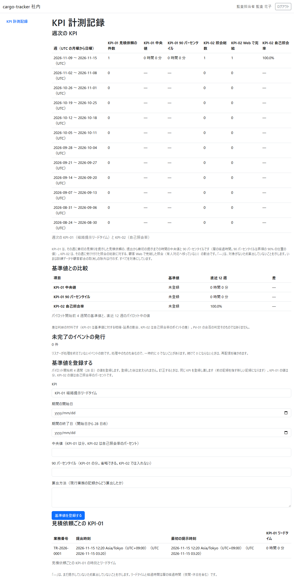

# 10 章 KPI の照会

パイロットの効果を測る KPI-01（経路提示リードタイム: 見積依頼の提出から最初の見積りの提示まで）と KPI-02（自己照会率: 追跡の照会のうち、顧客 Web で完結した割合）を、週ごとに確かめる画面です。パイロット開始前 4 週間の基準値を登録して、パイロット中の値と並べて見られます。この画面は **監査担当者だけ** が使えます（営業担当者など、ほかの役割は開けません）。

画面の開き方: 監査担当者でログインすると最初に開きます。ナビゲーションの「KPI 計測記録」（URL: `/staff/kpi-observations`）からも開けます。

| 画面 | 役割 | 節 |
| :--- | :--- | :--- |
| KPI の照会 | 週次の KPI、基準値との比較、基準値の登録、見積依頼ごとの KPI-01 を確かめる | [10.1](#101-kpi-の照会) |

## 10.1 KPI の照会

### この画面でできること

- 週ごとの KPI-01（中央値と 90 パーセンタイル）と KPI-02（自己照会率）を確かめます
- パイロット開始前 4 週間の基準値と、直近 12 週の値を並べて確かめます
- 基準値を登録します（算出方法と登録者が残ります）
- 未完了のイベントの発行の件数を確かめます
- 見積依頼ごとの提出時刻・最初の提示時刻・KPI-01 リードタイムを確かめます

### 画面の説明

| # | 項目 | 説明 |
| :--- | :--- | :--- |
| ① | 週次の KPI | 直近 12 週を新しい週から並べます。週は UTC の月曜から日曜です。KPI-01 は、その週に最初の見積りを提示した見積依頼の、提出から最初の提示までの時間の中央値と 90 パーセンタイルです。KPI-02 は、その週に受け付けた照会の総数と、そのうち顧客 Web で完結した数と、その割合です。対象がない週は「—」と示され、0 とは扱いません |
| ② | 基準値との比較 | 基準値と、直近 12 週をまとめた値と、差を並べます。差は判断の材料で、パイロットを続けるかどうかの判定そのものではありません。基準値の下に、期間・算出方法・登録者・登録時刻が示されます |
| ③ | 未完了のイベントの発行 | リスナーが処理を終えていないイベントの件数です。処理中のものも含むので、一時的に 0 でないことがあります。続けて 0 にならないときは、運用の担当者に再配信を確かめてもらいます |
| ④ | 基準値を登録する | KPI・期間・値・算出方法を入れて登録します |
| ⑤ | 見積依頼ごとの KPI-01 | 業務番号・提出時刻・最初の提示時刻・KPI-01 リードタイムです |

### 操作手順

1. 週次の KPI で、直近の週の値を確かめます
2. 基準値との比較で、基準値と直近 12 週の値の差を確かめます
3. 基準値がまだなければ、「基準値を登録する」で登録します
   1. KPI を選びます（KPI-01 経路提示リードタイム、KPI-02 自己照会率）
   2. 期間の開始日と終了日を入れます。期間はパイロット開始前の 4 週間（28 日）で、終了日は開始日から 28 日めです
   3. 中央値を入れます。KPI-01 は分、KPI-02 は自己照会率のパーセントです。KPI-01 は 90 パーセンタイル（分）も入れられます（KPI-02 では入れません）
   4. 算出方法（現行業務の記録からどう算出したか）を入れます
   5. 「基準値を登録する」を押します。「KPI-02 の基準値を登録しました」と示されます

### 注意・補足

- 登録した基準値は変えられません。訂正するときは、同じ KPI をもう一度登録します（前の記録を指す新しい記録になり、画面には最新が示されます）
- 入力に誤りがあると、理由が示されて入力が残ります（期間が 28 日でない、値が範囲外、算出方法が空、など）
- リードタイムは暦の経過時間（夜間・休日を含む）です。90 パーセンタイルは、昇順に並べた 90% の位置の値です
- いまは、訓練データや顧客都合の取消しの除外は行わず、すべてを対象にしています
- まだ見積りを提示していない見積依頼は、見積依頼ごとの一覧で「未提示」と示され、リードタイムは算出しません
