# 11 章 利用者の管理

システム管理者が、利用者の一覧と詳細を確かめ、管理範囲の企業に利用者を登録し、利用者の業務の役割を確認の画面を経て付けたり外したりし、利用者の利用を停止し再開し、ログインできなくなった利用者のロックと認証アプリの登録を解除し、業務担当者に担当企業を割り当てる手順です。役割は、荷主担当者・営業担当者・経路設計者・追跡管理者・データ責任者・カスタマーサポート・システム管理者・監査担当者の 8 つに決まっています。この画面で付け外しし、登録のときに付けられるのは、システム管理者・監査担当者を除く 6 つの業務の役割です。

画面の開き方: ログインすると利用者の一覧（11.1）が開きます。ナビゲーションの「利用者」（URL: `/staff/users`）からも開けます。システム管理者だけが開けます。

| 画面 | 役割 | 節 |
| :--- | :--- | :--- |
| 利用者 | 企業と利用者と役割を一覧する | [11.1](#111-利用者) |
| 利用者の詳細 | 今の役割・利用状態を確かめ、変更する役割や停止の理由を選ぶ | [11.2](#112-利用者の詳細) |
| 役割の変更の確認（見出しは「役割を変更しますか」） | 変更の内容を確かめてから変更する | [11.3](#113-役割の変更の確認) |
| 利用状態の変更の確認（見出しは「利用を停止しますか」または「利用を再開しますか」） | 停止・再開の内容を確かめてから停止・再開する | [11.4](#114-利用状態の変更の確認) |
| 利用者の登録（企業を選ぶ・入力・確認。確認の見出しは「利用者を登録しますか」） | 企業を選び、付ける役割とメールアドレスと表示名を入れ、確かめてから登録する | [11.5](#115-利用者の登録) |
| ロックの解除の確認（見出しは「ロックを解除しますか」） | 続けて誤ってログインできなくなった利用者のロックを外す | [11.6](#116-ロックの解除の確認) |
| 認証アプリの登録の解除の確認（見出しは「認証アプリの登録を解除しますか」） | 本人確認の手段と日時を記録し、認証アプリを使えなくなった利用者の登録を解除する | [11.7](#117-認証アプリの登録の解除の確認) |
| 担当範囲の変更の確認（見出しは「担当範囲を変更しますか」） | 業務担当者の担当企業の追加・解除を確かめてから変更する | [11.8](#118-担当範囲の変更の確認) |

## 11.1 利用者

### この画面でできること

- 企業と利用者と役割を一覧で確かめます
- 利用者を選んで詳細を開きます
- 「利用者を登録する」から利用者を登録します（[11.5](#115-利用者の登録)）

### 画面の開き方

- ログインの後に開きます。ナビゲーションの「利用者」（URL: `/staff/users`）からも開けます

### 画面の説明

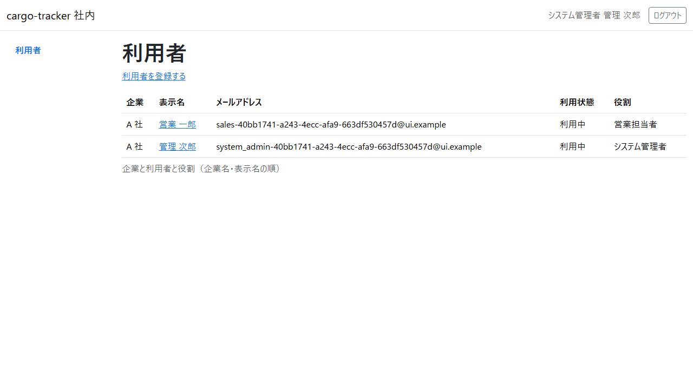

| # | 項目 | 説明 |
| :--- | :--- | :--- |
| ① | 企業 | 利用者が所属する企業 |
| ② | 表示名 | 利用者の名前。押すと詳細が開きます |
| ③ | メールアドレス | ログインに使うメールアドレス |
| ④ | 利用状態 | 利用中か利用停止か |
| ⑤ | 役割 | 利用者が持つ役割 |
| ⑥ | 利用者を登録する | 押すと利用者の登録（企業を選ぶ画面）が開きます |

### 操作手順

- 役割を変えたい利用者、または利用を停止・再開したい利用者の表示名を押します
- 利用者を登録するときは「利用者を登録する」を押します（[11.5](#115-利用者の登録)）

### 注意・補足

- 一覧は企業名・表示名の順に並びます
- 一覧に並ぶのは、あなたの管理範囲の企業の利用者だけです。管理範囲は運用の手順で割り当てます。一覧に出るはずの企業がないときは、運用の担当に管理範囲の割り当てをご依頼ください（管理範囲がなければ「管理する企業の利用者はいません。」と示されます）
- 管理範囲の外の企業の利用者の画面を URL で開くと、存在しない利用者と同じく「画面が見つかりません」と示されます（[2.8](02-ログインと共通の画面.md#28-画面が見つかりません)）。管理範囲の外の利用者の役割を変えようとしたとき、管理範囲の外の企業に利用者を登録しようとしたときは、監査のため記録されます。自分の企業を管理範囲に持たない場合は、自分の詳細も開けません
- 利用の停止と再開は、詳細の「利用状態」から行います（[11.2](#112-利用者の詳細)・[11.4](#114-利用状態の変更の確認)）

## 11.2 利用者の詳細

### この画面でできること

- 利用者の企業・メールアドレス・利用状態・今の役割を確かめます
- 付けたい役割を選び、変更の内容の確認へ進みます
- 停止の理由を選んで利用停止の確認へ、または停止中の利用者の利用再開の確認へ進みます
- ロックの状態と認証アプリの登録の有無を確かめ、ロックの解除や認証アプリの登録の解除の確認へ進みます
- 業務担当者の担当企業を選び、担当範囲の変更の確認へ進みます

### 画面の開き方

- 一覧で利用者の表示名を押します

### 画面の説明

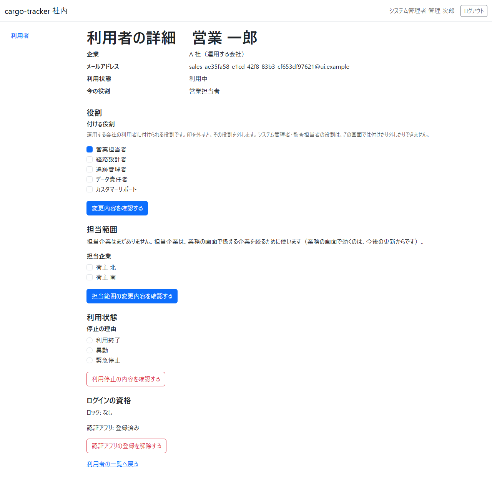

| # | 項目 | 説明 |
| :--- | :--- | :--- |
| ① | 企業 | 所属する企業と、その種類（荷主企業・荷受人の企業・運用する会社） |
| ② | 利用状態 | いまの状態（利用中か利用停止か） |
| ③ | 今の役割 | 利用者がいま持つ役割 |
| ④ | 役割（見出し「役割」の領域） | 「付ける役割」の欄で、変更した後に持たせる役割に印を付けます。今の役割には初めから印が付いていて、印を外すとその役割を外します。利用者の企業の種類に付けられる業務の役割だけが並びます（荷主企業の利用者は荷主担当者、運用する会社の利用者はほかの 5 つ） |
| ⑤ | 変更内容を確認する | 選んだ役割で、変更の内容の確認へ進みます。まだ変更されません |
| ⑥ | 利用状態の領域（見出し「利用状態」） | 利用中の利用者には停止の理由（利用終了・異動・緊急停止）と「利用停止の内容を確認する」、停止中の利用者には「利用再開の内容を確認する」が並びます。押してもまだ停止・再開されません。停止中の利用者には、今の停止の「停止の理由」「停止した人」「停止した日時」も示されます（下の図）。記録が見つからないときは「停止の記録: 記録がありません」と示されます |
| ⑦ | ログインの資格の領域（見出し「ログインの資格」） | 「ロック: ロック中」とその下の「解ける日時: …」、または「ロック: なし」と、「認証アプリ: 登録済み」または「認証アプリ: 未登録」が示されます。ロック中なら「ロックを解除する」、登録済みなら「認証アプリの登録を解除する」が並びます。押してもまだ解除されません。表示は分で切り捨てるので、表示の時刻を過ぎて 1 分ほどは、まだロックされていることがあります。 |
| ⑧ | 担当範囲の領域（見出し「担当範囲」） | 営業担当者・経路設計者・追跡管理者・カスタマーサポートの利用者だけに示されます。「担当企業」の欄に、あなたの管理範囲の中の荷主の企業が並び、今の担当企業に印が付いています。「担当範囲の変更内容を確認する」で担当範囲の変更の確認へ進みます。まだ変更されません。担当企業がなければ「担当企業はまだありません。…」、この画面で変えられない企業（あなたの管理範囲の外の企業や、無効になった企業）も担当していれば「この画面で変えられない企業 1 社も担当しています。」のように数だけが示されます。あなたの管理範囲に担当企業にできる荷主の企業がなければ、「あなたの管理範囲には、担当企業にできる荷主の企業がありません。」とだけ示され、選ぶ欄もボタンも出ません |

停止中で、ロックもされている利用者の詳細は、次のように示されます。停止した人は、今の表示名で示されます。

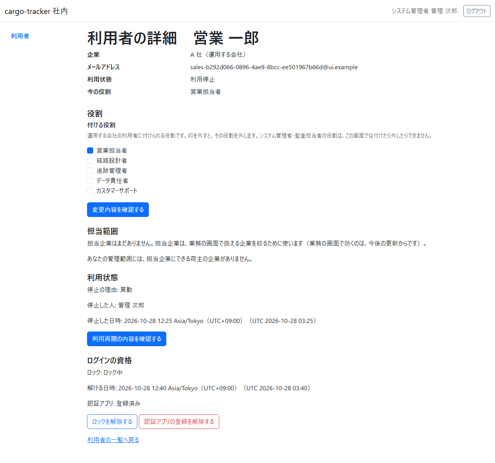

### 操作手順

役割を変えるとき:

1. 「役割」の領域の「付ける役割」で、変更した後に持たせる役割に印を付けます（外したい役割は印を外します）
2. 「変更内容を確認する」を押します

利用を停止するとき:

1. 「利用状態」の「停止の理由」で、利用終了・異動・緊急停止のどれかを選びます
2. 「利用停止の内容を確認する」を押します

停止中の利用者の利用を再開するときは、「利用再開の内容を確認する」を押します。

ロックを外すときは「ログインの資格」の「ロックを解除する」を、認証アプリの登録を解除するときは「認証アプリの登録を解除する」を押します（[11.6](#116-ロックの解除の確認)・[11.7](#117-認証アプリの登録の解除の確認)）。

業務担当者の担当企業を変えるとき:

1. 「担当範囲」の領域の「担当企業」で、変更した後に担当させる企業に印を付けます（外したい企業は印を外します）
2. 「担当範囲」の領域の「担当範囲の変更内容を確認する」を押します（[11.8](#118-担当範囲の変更の確認)）

自分の詳細と、荷受人の企業の利用者の詳細には、「役割」の領域に役割を選ぶ欄がありません。「自分の役割は変更できません。ほかのシステム管理者に依頼してください。」または「荷受人の企業の利用者には役割を付けません。」と示されます。

### 注意・補足

選び方が決まりに合わないときは、確認へ進まず、この画面の上に理由が示され、キーボードの操作と読み上げもそこから始まります。理由は「付ける役割: 役割を 1 つ以上選んでください。」のように欄の名前から始まるリンクになっていて、押すと「付ける役割」の最初のチェックボックスへ移ります。同じ理由は「付ける役割」の欄の下にも示されます（欄の下では欄の名前を付けません）。

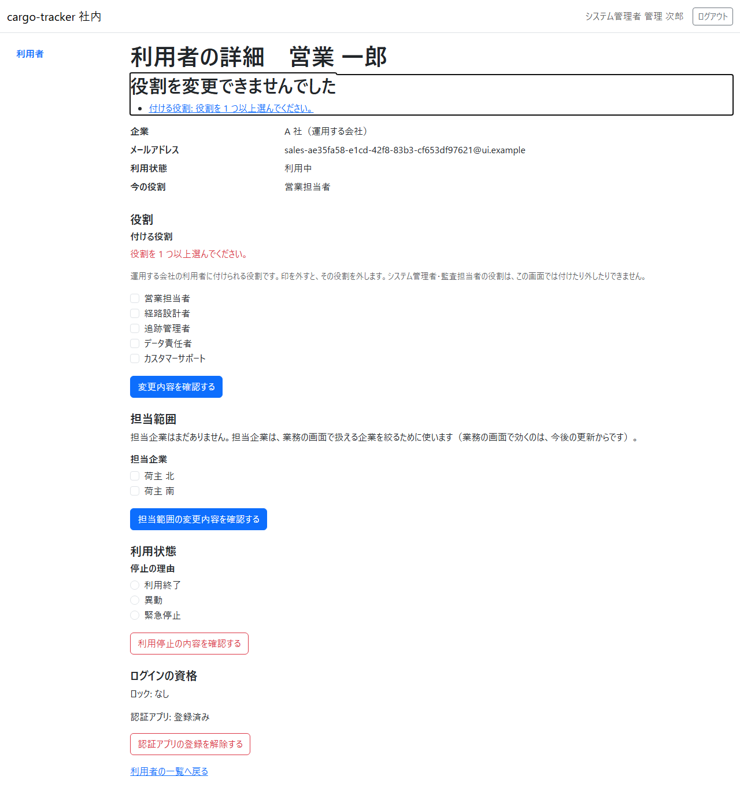

| 示される理由 | 直し方 |
| :--- | :--- |
| 役割を 1 つ以上選んでください。 | 役割を 1 つ以上選びます |
| 今の役割から変わっていません。足す役割か外す役割を選んでください。 | 足す役割か外す役割を選びます |
| システム管理者・監査担当者と、業務データを変更できる役割（…）は併せて付けられません。 | 監査担当者などに業務の役割（荷主担当者・営業担当者・経路設計者・追跡管理者・データ責任者・カスタマーサポート）は付けられません（職務分離）。足した業務の役割の印を外します |

- システム管理者・監査担当者の役割は、この画面では付けたり外したりできません。監督の役割を持つ人どうしが互いに付け合うことや、システム管理者がいなくなることを防ぐためです。付け外しが要るときは、運用の窓口に依頼してください
- 監査担当者などが持つ、この画面で変更しない役割はそのまま残ります（詳細に「この画面で変更しない役割（…）は、そのまま残ります。」と示されます）
- 停止の理由を選ばずに「利用停止の内容を確認する」を押すと、確認へ進まず「停止の理由: 利用終了・異動・緊急停止のどれかを選んでください。」と画面の上に示されます。この理由のリンクを押すと、「停止の理由」の最初の選択肢（利用終了）へ移ります
- 自分の詳細と、システム管理者・監査担当者の詳細の「利用状態」には、停止・再開の操作がありません。「自分の利用状態は変更できません。ほかのシステム管理者に依頼してください。」または「システム管理者・監査担当者の利用停止と再開は、この画面では行いません。」と示されます。システム管理者・監査担当者の停止・再開が要るときは、運用の窓口に依頼してください
- 停止中の利用者の役割も変えられます。再開の前に役割を整えておけます
- 自分の詳細と、システム管理者・監査担当者の詳細の「ログインの資格」には、解除の操作がありません。「自分のログインの資格は、この画面では変えられません。」または「システム管理者・監査担当者のログインの資格は、この画面では変えられません。運用の手順に従ってください。」と示されます。ほかのシステム管理者か、運用の窓口に依頼してください
- ロックの期限を過ぎていれば「ロック: なし」と示されます（15 分たつと自然に解けます）
- 解除の確認を開いた後に、期限が過ぎたり、ほかのシステム管理者が先に解除したりしていたら、解除されず「この利用者のロックは、既に解除されています。」または「この利用者の認証アプリの登録は、既に解除されています。」と画面の上に示されます

停止の理由は、次の 3 つから選びます。

| 停止の理由 | 選ぶとき |
| :--- | :--- |
| 利用終了 | 退職・契約の終了などで、使わなくなったとき |
| 異動 | 異動で、今の役割の仕事をしなくなったとき |
| 緊急停止 | 不正な利用の疑いなどで、すぐに止めたいとき |

どの理由でも効き目は同じで、相手の次の操作から使えなくなります。理由は監査のため記録され、停止中の利用者の詳細に、停止した人と停止した日時とともに示されます（再開すると示されなくなります）。

## 11.3 役割の変更の確認

### この画面でできること

- 対象の利用者・今の役割・足す役割・外す役割・影響・実行者・元に戻す方法を確かめて、役割を変更します

### 画面の開き方

- 利用者の詳細で役割を選び、「変更内容を確認する」を押します

### 画面の説明

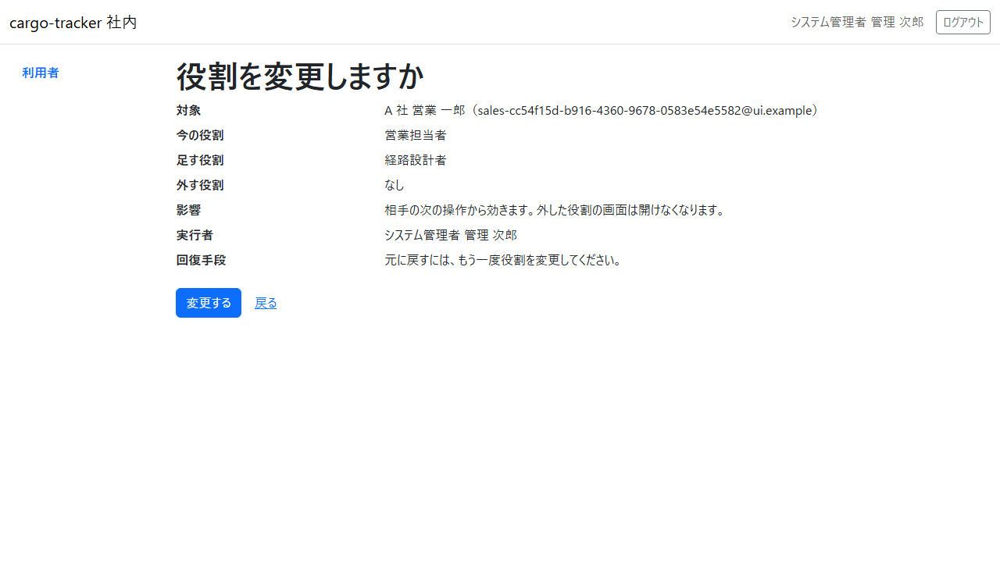

| # | 項目 | 説明 |
| :--- | :--- | :--- |
| ① | 対象 | 役割を変える利用者 |
| ② | 今の役割・足す役割・外す役割 | 変更の内容。足す役割・外す役割がなければ「なし」 |
| ③ | 影響 | 相手の次の操作から効きます。外した役割の画面は開けなくなります |
| ④ | 実行者 | 変更するシステム管理者（あなた） |
| ⑤ | 回復手段 | 元に戻すには、もう一度役割を変更します |
| ⑥ | 変更する・戻る | 「変更する」で変更します。「戻る」で選んだ役割を残したまま詳細に戻ります（確認を開いた後に入った更新は、変更するときに分かります） |

### 操作手順

1. 変更の内容を確かめます
2. 「変更する」を押します
3. 利用者の詳細に「役割を変更しました。相手の次の操作から効きます。」と出て、今の役割が新しい役割になります

### 注意・補足

- 変えた役割は、相手がログインし直さなくても、相手の次の操作から効きます。外した役割の画面を相手が開くと「この画面を表示する権限がありません。」と示されます（[2.3](02-ログインと共通の画面.md#23-権限がありません)）
- 確認している間に、ほかのシステム管理者の変更などでその利用者の情報が先に更新されていたら、変更されず「この利用者の情報が先に更新されました。最新の内容を確かめてから、もう一度変更してください。」と示され、最新の詳細が開きます。今の役割を確かめてから、もう一度選び直してください
- 役割の変更は、操作したシステム管理者・時刻・変更前後の役割として記録されます

## 11.4 利用状態の変更の確認

### この画面でできること

- 対象の利用者・現在の状態・変更内容（停止なら理由も）・影響・元に戻す方法・実行者を確かめて、利用を停止し、または再開します

### 画面の開き方

- 利用者の詳細で、停止の理由を選んで「利用停止の内容を確認する」を押します。停止中の利用者なら「利用再開の内容を確認する」を押します

### 画面の説明

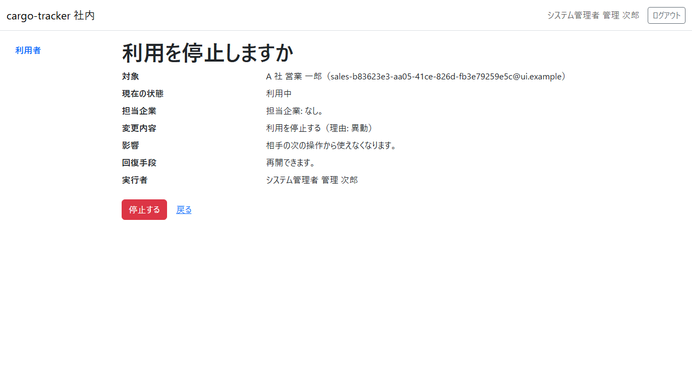

| # | 項目 | 説明 |
| :--- | :--- | :--- |
| ① | 対象 | 利用を停止・再開する利用者 |
| ② | 現在の状態・変更内容 | 今の利用状態（利用中・利用停止）と、変更の内容。停止なら選んだ理由も示されます |
| ③ | 影響 | 停止なら、相手の次の操作から使えなくなります。再開なら、相手は次のログインから使えます |
| ④ | 回復手段 | 停止は再開で、再開はもう一度の停止で元に戻せます |
| ⑤ | 実行者 | 停止・再開するシステム管理者（あなた） |
| ⑥ | 停止する（再開する）・戻る | 「停止する」（再開のときは「再開する」）で確定します。「戻る」で選んだ理由を残したまま詳細に戻ります |

### 操作手順

1. 内容を確かめます
2. 「停止する」（再開のときは「再開する」）を押します
3. 利用者の詳細に「利用を停止しました。相手の次の操作から使えなくなります。」（または「利用を再開しました。相手は次のログインから使えます。」）と出て、利用状態が変わります

### 注意・補足

- 停止した利用者は、ログインし直さなくても、相手の次の操作から使えなくなります。相手の画面は「もう一度ログインしてください」の案内（[2.4](02-ログインと共通の画面.md#24-もう一度ログインしてください)）に移り、その後はログインできません
- 停止しても、相手がそれまでに行った操作の記録は消えません
- 停止すると、相手がそれまでに受け取った password の再設定のリンクは使えなくなります（再開の後は、相手にもう一度依頼してもらいます）
- 再開すると、相手は改めてログインします（停止の前のログインは使えません）
- ほかのシステム管理者が先に同じ変更をしていたら、「利用状態は既に…です。最新の内容を確かめてください。」と示されます。詳細の利用状態を確かめてください
- 止めた相手から問い合わせを受けたときの手がかり: 相手に見えるのは「もう一度ログインしてください」の案内（[2.4](02-ログインと共通の画面.md#24-もう一度ログインしてください)）と、ログインの「メールアドレスまたは password が正しくありません。」だけで、止めた理由は示されません（[付録 B の Q1-1](付録B-トラブルシューティング.md#q1-1-ログインできないメールアドレスまたは-password-が正しくありません認証コードまたは回復コードが正しくないかすでに使われています)・[Q1-2](付録B-トラブルシューティング.md#q1-2-もう一度ログインしてくださいと示された)）。詳細の利用状態を確かめ、停止中なら「停止の理由」「停止した人」「停止した日時」を手がかりに、停止したシステム管理者に事情を確かめてください。利用中なのにログインできないときは、詳細の「ログインの資格」でロックを確かめ（ロック中なら [11.6](#116-ロックの解除の確認) で外せます）、ロックもなければ所属企業の無効化を疑い、運用の窓口に確かめてください
- 確認している間に、ほかのシステム管理者の操作などでその利用者の情報が先に更新されていたら、停止・再開されず「この利用者の情報が先に更新されました。最新の内容を確かめてから、もう一度変更してください。」と示され、最新の詳細が開きます
- 利用の停止と再開は、操作したシステム管理者・時刻・変更前後の利用状態として記録されます。停止は選んだ理由も記録されます

## 11.5 利用者の登録

### この画面でできること

- 管理範囲の企業を選び、その企業の利用者に付けられる役割とメールアドレスと表示名を入れ、確かめてから利用者を登録します
- 登録した利用者には、登録したメールアドレスへ初回の設定の案内（24 時間有効）が送られます

### 画面の開き方

- 利用者の一覧（11.1）で「利用者を登録する」を押します

### 企業を選ぶ

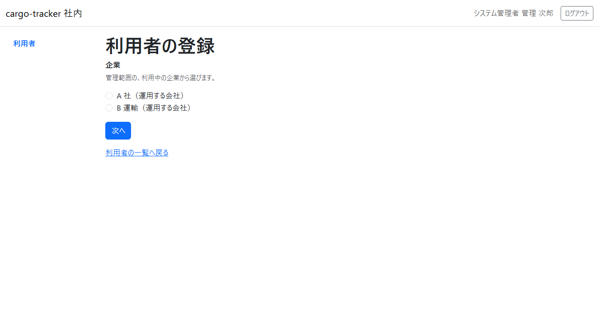

| # | 項目 | 説明 |
| :--- | :--- | :--- |
| ① | 企業 | 管理範囲の、利用中の企業。「企業名（企業の種類）」で並びます。荷受人の企業は並びません |
| ② | 次へ | 選んだ企業の入力の画面へ進みます |

### 入力

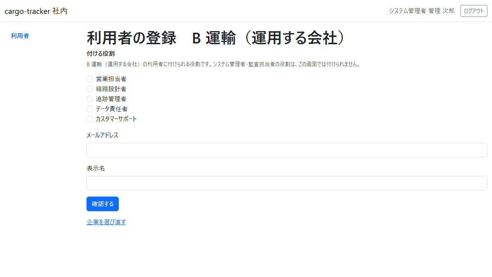

| # | 項目 | 説明 |
| :--- | :--- | :--- |
| ① | 付ける役割 | その企業の利用者に付けられる業務の役割。1 つ以上選びます |
| ② | メールアドレス | 登録する利用者がログインに使うメールアドレス。初回の設定の案内もここへ送られます |
| ③ | 表示名 | 一覧と詳細に出る名前（200 文字以内） |
| ④ | 確認する | 入れた内容の確認へ進みます |
| ⑤ | 企業を選び直す | 企業を選ぶ画面に戻ります |

### 確認

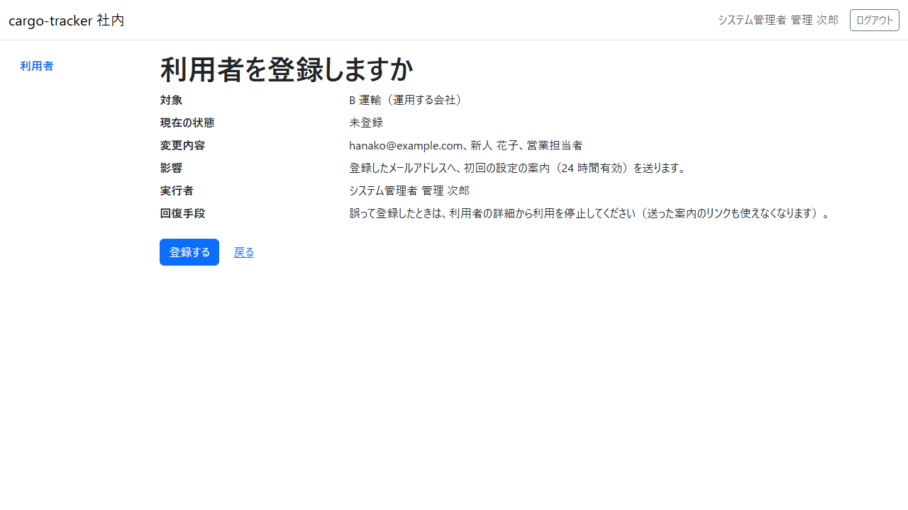

| # | 項目 | 説明 |
| :--- | :--- | :--- |
| ① | 対象・現在の状態 | 登録する企業と、まだ登録していないこと |
| ② | 変更内容 | 登録するメールアドレス・表示名・付ける役割（保存される形。メールアドレスは小文字、表示名は前後の空白を除いた形） |
| ③ | 影響 | 登録したメールアドレスへ、初回の設定の案内（24 時間有効）を送ります |
| ④ | 実行者 | 登録するシステム管理者（あなた） |
| ⑤ | 回復手段 | 誤って登録したときは、利用者の詳細から利用を停止します（送った案内のリンクも使えなくなります） |
| ⑥ | 登録する・戻る | 「登録する」で登録します。「戻る」で入れた内容を残したまま入力の画面に戻ります |

### 操作手順

1. 利用者の一覧で「利用者を登録する」を押します
2. 企業を選び、「次へ」を押します
3. 付ける役割を選び、メールアドレスと表示名を入れて、「確認する」を押します
4. 内容を確かめて、「登録する」を押します
5. 登録した利用者の詳細に「利用者を登録しました。登録したメールアドレスへ初回の設定の案内を送ります。」と出ます

### 注意・補足

- 入れた内容に誤りがあると、画面の上に「利用者を登録できませんでした」と誤りの一覧が出ます。誤りを押すと、その欄へ移ります

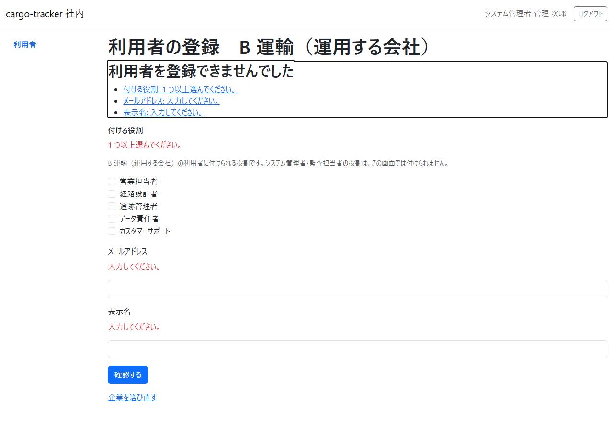

- 企業を選ばずに「次へ」を押すと「企業: 登録する企業を 1 つ選んでください。」と示されます。利用を停止している企業や、付けられる役割のない企業を選んだときは「企業: 選んだ企業には利用者を登録できません。ほかの企業を選んでください。」と示され、企業を選ぶ画面に戻ります

- 既に登録されているメールアドレスは登録できません（「既に登録されています。ほかのメールアドレスを入力してください。」）
- 表示名は、見分けやすい文字で入れます。空白だけの名前や、画面で見分けにくい文字を含む名前は登録できません
- 登録した利用者は、案内のリンクから password を設定し、認証アプリを登録してから使い始めます。案内の期限（24 時間）が過ぎたときや、案内が届かないときは、本人にログインの画面の「password を忘れた場合」から設定してもらいます（[2.6](02-ログインと共通の画面.md#26-password-を忘れた場合) の「初回の password の設定」）
- 登録は、操作したシステム管理者・時刻・付けた役割として記録されます

## 11.6 ロックの解除の確認

### この画面でできること

- 続けて 5 回誤ってログインできなくなった（ロックされた）利用者の、対象・現在の状態・変更内容・影響・回復手段・実行者を確かめて、ロックを外します

### 画面の開き方

- 利用者の詳細の「ログインの資格」で「ロックを解除する」を押します（ロック中の利用者だけに出ます）

### 画面の説明

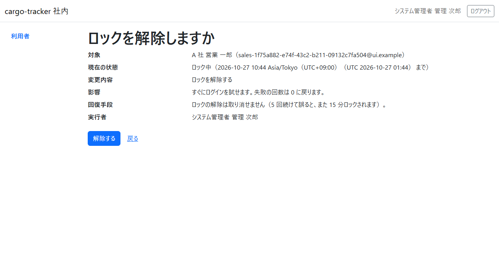

| # | 項目 | 説明 |
| :--- | :--- | :--- |
| ① | 対象 | ロックを外す利用者 |
| ② | 現在の状態・解ける日時 | 「ロック中」と、ロックが解ける日時。表示は分で切り捨てるので、表示の時刻を過ぎて 1 分ほどは、まだロックされていることがあります。 |
| ③ | 変更内容・影響 | ロックを外します。すぐにログインを試せ、失敗の回数は 0 に戻ります |
| ④ | 回復手段 | ロックの解除は取り消せません。続けて 5 回誤ると、また 15 分ロックされます |
| ⑤ | 実行者 | 解除するシステム管理者（あなた） |
| ⑥ | 解除する・戻る | 「解除する」でロックを外します。「戻る」で詳細に戻ります |

### 操作手順

1. 対象の利用者から、ロックの解除を頼まれていることを確かめます
2. 内容を確かめ、「解除する」を押します
3. 利用者の詳細に「ロックを解除しました。」と出て、「ロック: なし」になります
4. 本人に、すぐにログインできることを伝えます

### 注意・補足

- ロックを外しても、本人のログイン中の画面は終わりません。認証アプリの登録も変わりません
- 本人に覚えのない誤りでロックされていた場合は、ほかの人が password を試した可能性があります。本人に password の再設定（[2.6](02-ログインと共通の画面.md#26-password-を忘れた場合)）を勧めてください
- ロックの解除は、操作したシステム管理者・時刻として記録されます

## 11.7 認証アプリの登録の解除の確認

### この画面でできること

- 認証アプリを使えなくなり、回復コードもない利用者について、別の経路で本人であることを確かめた手段と日時を記録して、認証アプリの登録を解除します

### 画面の開き方

- 利用者の詳細の「ログインの資格」で「認証アプリの登録を解除する」を押します（認証アプリを登録済みの利用者だけに出ます）

### 画面の説明

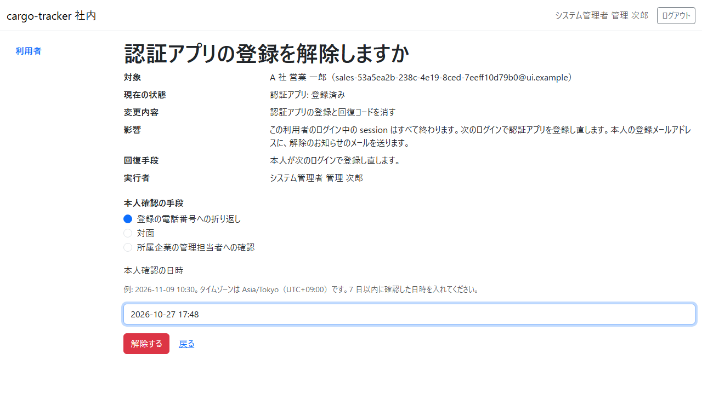

| # | 項目 | 説明 |
| :--- | :--- | :--- |
| ① | 対象 | 登録を解除する利用者 |
| ② | 現在の状態・変更内容 | 「認証アプリ: 登録済み」。認証アプリの登録と回復コードを消します |
| ③ | 影響 | この利用者のログイン中の画面はすべて終わります。次のログインで認証アプリを登録し直します。本人の登録メールアドレスに、解除のお知らせのメールを送ります |
| ④ | 回復手段 | 本人が次のログインで登録し直します |
| ⑤ | 実行者 | 解除するシステム管理者（あなた） |
| ⑥ | 本人確認の手段 | 本人であることを確かめた手段を、登録の電話番号への折り返し・対面・所属企業の管理担当者への確認から選びます |
| ⑦ | 本人確認の日時 | 本人であることを確かめた日時を、日本時間で「2026-11-09 10:30」の形で入れます。7 日以内の日時だけを入れられます |
| ⑧ | 解除する・戻る | 「解除する」で登録を解除します。「戻る」で詳細に戻ります |

### 操作手順

1. 事前に決めた別の経路（登録の電話番号への折り返し・対面・所属企業の管理担当者への確認）で、頼んできた人が本人であることを確かめます
2. 「本人確認の手段」で確かめた手段を選び、「本人確認の日時」に確かめた日時を入れます
3. 内容を確かめ、「解除する」を押します
4. 利用者の詳細に「認証アプリの登録を解除しました。この利用者は次のログインで認証アプリを登録し直します。」と出て、「認証アプリ: 未登録」になります
5. 本人の登録メールアドレスに、解除のお知らせ（件名「【cargo-tracker】認証アプリの登録の解除のご案内」）を送ります。本人が次のログインで認証アプリを登録し直すと（[2.1](02-ログインと共通の画面.md#21-ログイン) の初めてのログインと同じ手順）、登録のお知らせも送ります

### 注意・補足

- 本人確認の手段を選ばない、日時を入れない、形が違う、今より後、7 日より前のときは、解除されず、画面の上に「認証アプリの登録を解除できませんでした」と誤りの一覧が出ます。誤りを押すと、その欄へ移ります

| 示される理由 | 直し方 |
| :--- | :--- |
| 本人確認の手段: どれか 1 つを選んでください。 | 確かめた手段を選びます |
| 本人確認の日時: 入力してください。 | 確かめた日時を入れます |
| 本人確認の日時: 「2026-11-09 10:30」の形で、日本時間で入力してください。 | 年-月-日 時:分 の形で入れ直します |
| 本人確認の日時: 今より後の日時は入力できません。 | 確かめた日時を入れ直します |
| 本人確認の日時: 7 日以内に確認した日時を入力してください。 | もう一度本人に確かめてから入れます |

- 解除すると、その利用者の回復コードもすべて使えなくなります。ログイン中の画面は、次の操作で「もう一度ログインしてください」（[2.4](02-ログインと共通の画面.md#24-もう一度ログインしてください)）に移ります
- ロックは変わりません。ロック中のときは、あわせてロックも外してください（[11.6](#116-ロックの解除の確認)）
- 解除のお知らせには、解除したのがシステム管理者であることと日時だけを書き、あなたの名前・本人確認の手段は書きません。利用停止中の利用者にも届きます（ログインは利用の再開の後になります）
- お知らせを送れなかった場合も、解除は取り消されません。届いていないと言われたら、本人に次のログインで認証アプリを登録し直すことを直接伝えてください
- 確認を開いた後に本人が認証アプリを登録し直していたら、解除されず「登録が変わりました。詳細を開き直してください。」と示されます。詳細を開き直し、まだ解除が要るかを本人に確かめてください
- 登録の解除は、操作したシステム管理者・時刻・本人確認の手段と日時として記録されます

## 11.8 担当範囲の変更の確認

### この画面でできること

- 業務担当者（営業担当者・経路設計者・追跡管理者・カスタマーサポート）の担当企業の追加と解除を確かめてから変更します。担当企業は、その人が業務の画面で扱える企業です（担当の案件は、担当企業で決まります）

### 画面の開き方

- 利用者の詳細の「担当範囲」で担当企業を選び、「担当範囲の変更内容を確認する」を押します

### 画面の説明

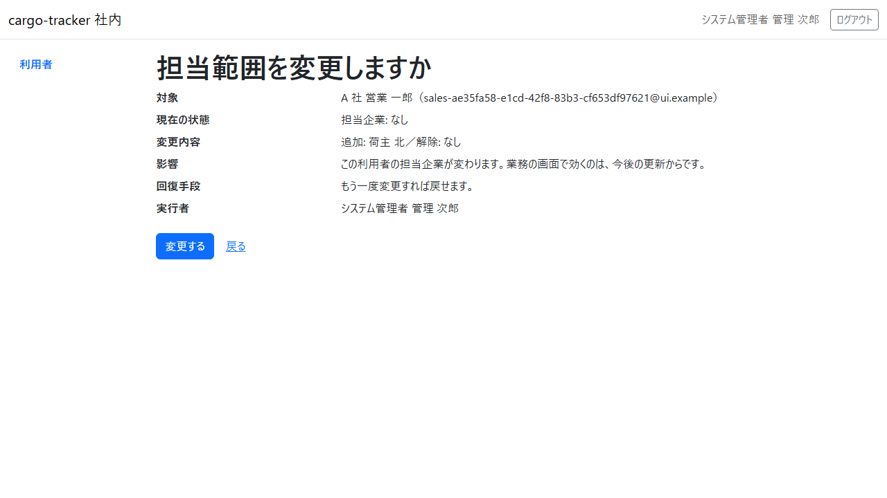

| # | 項目 | 説明 |
| :--- | :--- | :--- |
| ① | 対象 | 担当企業を変える利用者 |
| ② | 現在の状態 | いまの担当企業（この画面で変えられない企業は数だけ） |
| ③ | 変更内容 | 追加する企業と解除する企業 |
| ④ | 影響 | この利用者の担当企業が変わります。業務の画面で効くのは、今後の更新からです |
| ⑤ | 回復手段 | もう一度変更すれば戻せます |
| ⑥ | 実行者 | 変更するシステム管理者（あなた） |
| ⑦ | 変更する・戻る | 「変更する」で変更します。「戻る」で選んだまま詳細に戻ります |

### 操作手順

1. 内容を確かめ、「変更する」を押します
2. 利用者の詳細に「担当範囲を変更しました。」と出て、選んだ企業に印が付きます

### 注意・補足

- 選べるのは、あなたの管理範囲の中の荷主の企業だけです。運用する会社・荷受人の企業・無効になった企業は並びません
- この画面で変えられない担当企業は、変更しても残ります（名前は示されず、数だけが示されます）。外す必要があるときは、管理範囲の外の企業はその企業を管理するシステム管理者に、無効になった企業は運用の窓口に依頼してください
- 何も変えずに「担当範囲の変更内容を確認する」を押すと、確認へ進まず、詳細の上に「担当企業: 今の割り当てから変わっていません。」と示されます
- すべての印を外して確認へ進み「戻る」を押すと、印を外したまま詳細に戻ります
- 確認の間にほかの変更（役割の変更など）が入っていたら、変更されず「この利用者の情報が先に更新されました。最新の内容を確かめてから、もう一度変更してください。」と示されます。担当範囲の変更と役割の変更は同じ版を使うので、片方を変えた後はもう片方も詳細を開き直してから変更します
- 担当企業が業務の画面（見積り・予約・経路設計・追跡）で効くのは、今後の更新からです
- 担当範囲の変更は、操作したシステム管理者・時刻・変更前と変更後の担当企業として記録されます
