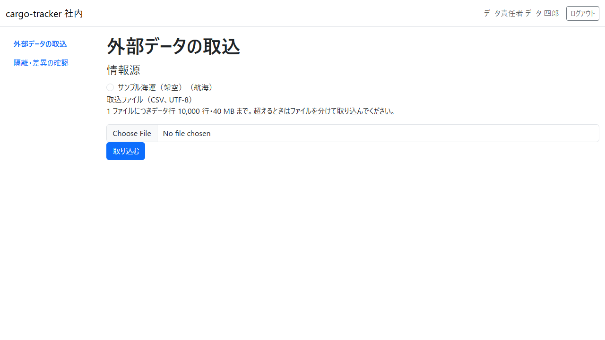
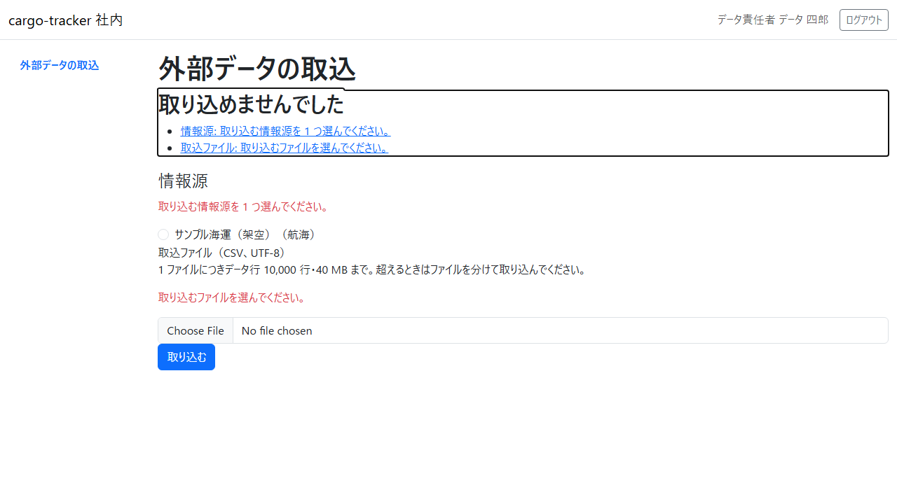
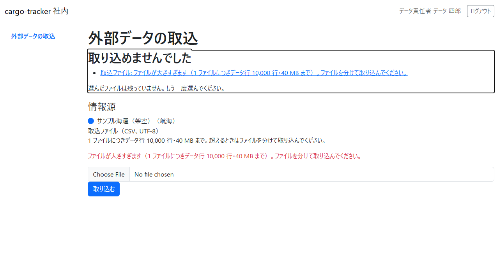
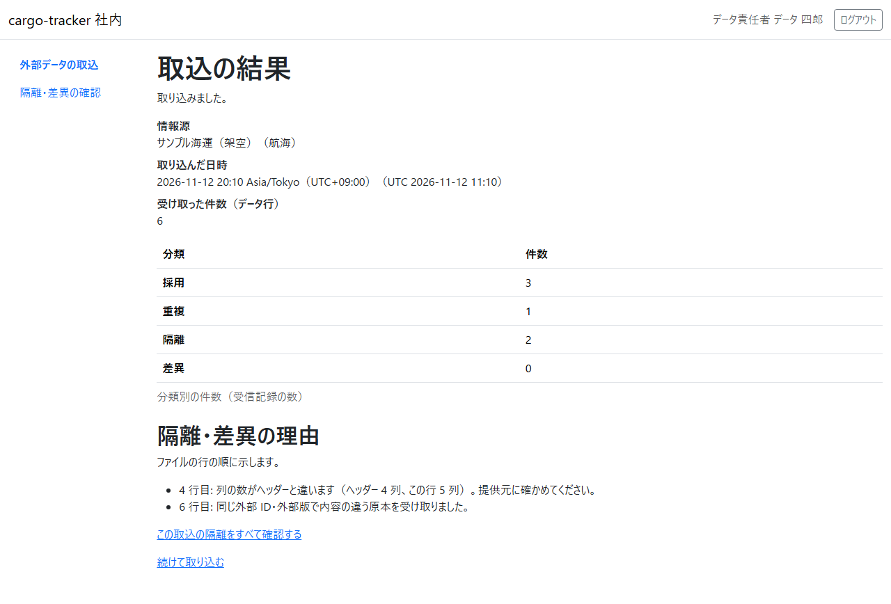
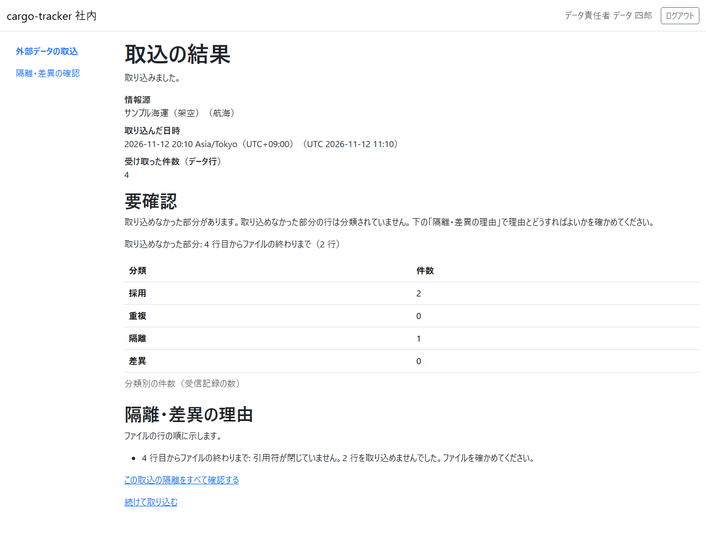
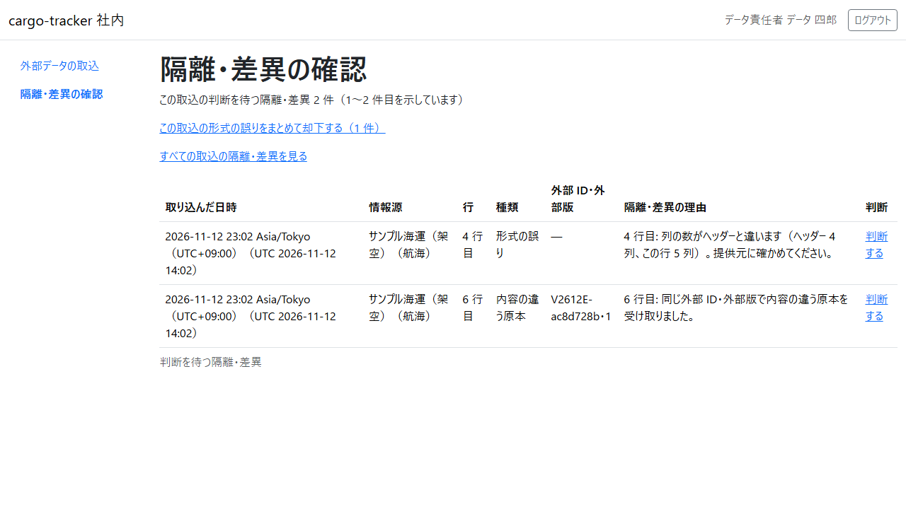
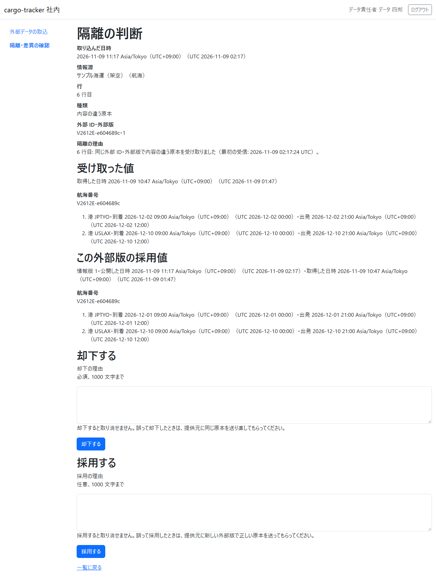
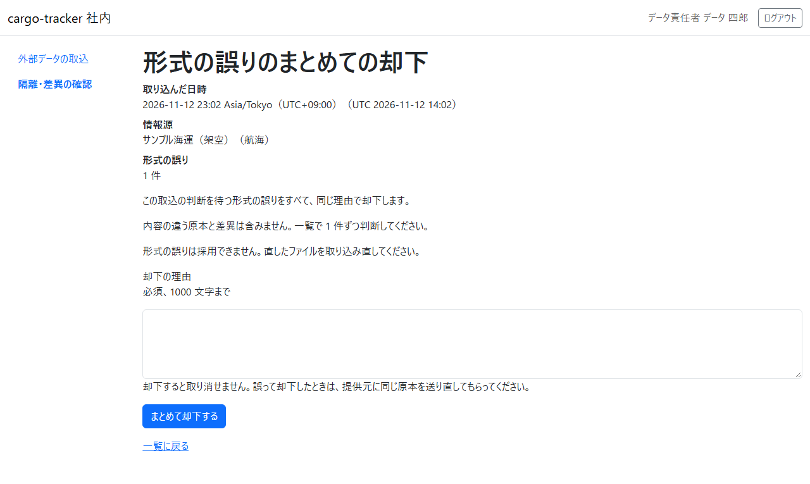

# 12 章 外部データ

データ責任者が、承認済みの情報源（運送会社・港湾などの提供元と、航海・主要実績などの原本の種別の組み合わせ）から受け取った CSV ファイルを取り込み、取り込んだ行がどう分類されたか（採用・重複・隔離・差異）を確かめ、隔離になった行を一覧で確かめて、業務で使わないものを却下し、内容の違う原本（航海・主要実績）で業務で使うものを採用する手順です。外部データの取込は、[1 章 業務フロー](01-業務フロー.md) の WF-1（見積依頼から追跡の照会まで）の工程には含まれません。WF-1 とは別に、データ責任者が提供元からファイルを受け取るたびに行います。

画面の開き方: ログインすると外部データの取込（12.1）が開きます。ナビゲーションの「外部データの取込」（URL: `/staff/external-data/ingestions/new`）からも開けます。隔離・差異の確認（12.2）は、ナビゲーションの「隔離・差異の確認」（URL: `/staff/external-data/undecided-records`）か、取込の結果の画面の「この取込の隔離をすべて確認する」から開きます。隔離の判断は、隔離・差異の確認の各行の「判断する」から開きます。形式の誤りのまとめての却下は、取込で絞った隔離・差異の確認の「この取込の形式の誤りをまとめて却下する（N 件）」から開きます。どの画面もデータ責任者だけが開けます。

| 画面 | 役割 | 節 |
| :--- | :--- | :--- |
| 外部データの取込 | 承認済みの情報源を 1 つ選び、CSV ファイルを取り込む | [12.1](#121-外部データの取込) |
| 取込の結果 | 取り込んだファイルの受け取った件数と、取り込めなかった部分（要確認）と、分類別の件数と、隔離・差異の理由を確かめる | [12.1](#取込の結果を読む) |
| 隔離・差異の確認 | 判断を待つ隔離を、すべての取込にわたって、または 1 つの取込に絞って、100 件ずつ一覧で確かめる | [12.2](#122-隔離差異の確認) |
| 隔離の判断 | 判断を待つ隔離 1 件の中身と隔離の理由の全文を読み、内容の違う原本（航海・主要実績）は受け取った値とこの外部版の採用値を見比べて、理由を書いて却下するか、業務で使うものを採用する | [12.2（却下）](#隔離を却下する)、[12.2（採用）](#隔離を採用する) |
| 形式の誤りのまとめての却下 | 1 つの取込の判断を待つ形式の誤りの件数を確かめ、1 つの理由ですべて却下する | [12.2](#形式の誤りをまとめて却下する) |

情報源の選定と承認は、画面ではなく運用の手順で行います。取り込んだ行のうち隔離になったものは、取込の結果の画面で最初の 100 件の理由を確かめ、すべてを隔離・差異の確認（12.2）で一覧にして確かめ、業務で使わないものを 1 件ずつ却下します。内容の違う原本で業務で使うものは、1 件ずつ採用します。1 つの取込の形式の誤りは、まとめて却下することもできます。取り込んだ行のうち差異になったもの（同じ外部 ID の採用値より前に取得した外部版や、追跡番号の違う外部版）は、採用されず、取込の結果の画面で理由を確かめます。差異は今は隔離・差異の確認の一覧に出ません。

## 12.1 外部データの取込

### この画面でできること

- 承認済みの情報源を 1 つ選び、その情報源から受け取った CSV ファイルを取り込みます
- 取り込んだ後に、受け取った件数と、取り込めなかった部分があるか（要確認）と、採用・重複・隔離・差異の件数と、隔離・差異になった行の理由を確かめます

### 画面の開き方

- ログインすると開きます。ナビゲーションの「外部データの取込」（URL: `/staff/external-data/ingestions/new`）からも開けます
- 取込の結果の画面の「続けて取り込む」からも開けます

### 画面の説明



| # | 項目 | 説明 |
| :--- | :--- | :--- |
| ① | 情報源 | 取り込める情報源（承認済みの情報源）の一覧。「提供元（原本の種別）」の形で示します（例: 「サンプル海運（架空）（航海）」）。1 つだけ選べます。原本の種別は、選んだ情報源から決まります |
| ② | 取込ファイル（CSV、UTF-8） | 取り込む CSV ファイルを選びます。文字コードは UTF-8 です。欄の上に「1 ファイルにつきデータ行 10,000 行・40 MB まで。超えるときはファイルを分けて取り込んでください。」と示されます |
| ③ | 「取り込む」 | 選んだ情報源とファイルで取り込みます |

情報源かファイルを選ばずに「取り込む」をクリックすると、画面の上にエラー要約が示されます。



| # | 項目 | 説明 |
| :--- | :--- | :--- |
| ① | エラー要約 | 見出し「取り込めませんでした」と、直す項目の一覧。「情報源: 取り込む情報源を 1 つ選んでください。」「取込ファイル: 取り込むファイルを選んでください。」のように示し、クリックするとその欄に移ります。情報源を選んでいたら、選んだ情報源はそのまま残ります。ただし、選んだ情報源そのものが取り込めないとき（「情報源: 選んだ情報源は承認済みではないため取り込めません。…」「情報源: 選んだ情報源が見つかりません。…」）は、選んだ情報源は残らないので選び直してください |
| ② | 各欄の誤り | 誤りのある欄の名前のすぐ下（「取込ファイル（CSV、UTF-8）」は上限の説明の下）に、同じ文言が赤字で示されます |

上限（データ行 10,000 行・40 MB）を超えるファイルを選んで「取り込む」をクリックすると、取り込まれず、エラー要約に理由と次の行動が示されます。



| # | 項目 | 説明 |
| :--- | :--- | :--- |
| ① | エラー要約 | 「取込ファイル: ファイルが大きすぎます（1 ファイルにつきデータ行 10,000 行・40 MB まで）。ファイルを分けて取り込んでください。」と、「選んだファイルは残っていません。もう一度選んでください。」が示されます。クリックすると「取込ファイル（CSV、UTF-8）」の欄に移ります |
| ② | 情報源 | 選んだ情報源はそのまま残ります |
| ③ | 取込ファイルの誤り | 上限の説明の下に、「ファイルが大きすぎます（1 ファイルにつきデータ行 10,000 行・40 MB まで）。ファイルを分けて取り込んでください。」が赤字で示されます |

### 操作手順

1. 「情報源」で、ファイルを受け取った情報源を選びます
2. 「取込ファイル（CSV、UTF-8）」で、取り込むファイルを選びます
3. 「取り込む」をクリックします
4. 取込の結果の画面が開き、「取り込みました。」と示されます。件数の読み方は次の「取込の結果を読む」を見てください
5. ほかのファイルを続けて取り込むときは、「続けて取り込む」をクリックし、1. から繰り返します

### 取込の結果を読む

取り込むと、取込の結果の画面が開きます。この画面を読み込み直しても、ファイルをもう一度取り込むことはありません（「取り込みました。」の知らせは、取り込んだ直後だけ示されます）。



| # | 項目 | 説明 |
| :--- | :--- | :--- |
| ① | 「取り込みました。」 | 取り込んだ直後だけ示される知らせ |
| ② | 情報源 | 選んだ情報源（「提供元（原本の種別）」） |
| ③ | 取り込んだ日時 | 取り込んだ日時。日本時間と UTC を併記します（例: 2026-11-16 10:05 Asia/Tokyo（UTC+09:00）（UTC 2026-11-16 01:05）） |
| ④ | 受け取った件数（データ行） | ファイルのデータ行の数。ヘッダーの行と空の行は数えません |
| ⑤ | 要確認 | 取り込めなかった部分があるときだけ、見出し「要確認」と、取り込めなかった部分（「取り込めなかった部分: <どこ>」）が示されます。この図の取込には取り込めなかった部分がないので、要確認は写っていません。要確認の写った図と読み方は、次の「要確認を読む」を見てください |
| ⑥ | 分類別の件数（受信記録の数） | 取り込んだ行の分類ごとの数。「採用」「重複」「隔離」「差異」の 4 行です。0 件の分類も行が示されます |
| ⑦ | 隔離・差異の理由 | 隔離と差異になった行とファイルの理由を、ファイルの行の順に示します。隔離か差異が 1 件以上のときだけ示されます。読み方は次の「隔離・差異の理由を読む」を見てください |
| ⑧ | 「この取込の隔離をすべて確認する」 | 隔離・差異の理由の最後に示されるリンク。この取込の判断を待つ隔離をすべて、隔離・差異の確認（[12.2](#122-隔離差異の確認)）で一覧にします。隔離が 1 件以上のときだけ示されます。差異だけの取込では示されません（差異は今は隔離・差異の確認の一覧に出ません） |
| ⑨ | 「続けて取り込む」 | 外部データの取込の画面に戻ります |

分類の意味と、取り込んだ後にすることは次のとおりです。

| 分類 | 意味 | 取り込んだ後にすること |
| :--- | :--- | :--- |
| 採用 | 初めて受け取った行。業務で使う値として記録されました | ありません |
| 重複 | 提供元・原本の種別・外部 ID・外部版が同じで、この外部版の採用値の元になった原本（同じファイルの前の行を含む）と内容も同じ行。値は増えず、この外部版の採用値はそのままです | ありません。同じファイルを誤って 2 度取り込むと、内容の違う原本も形式の誤りもないファイルは、すべて重複になります。内容の違う原本や形式の誤りを含むファイルは、その行が再び隔離になり、判断を待つ隔離が増えます。判断の後の分類は [直して送り直すとき](#直して送り直すとき) を見てください |
| 隔離 | 提供元・原本の種別・外部 ID・外部版が同じなのに、この外部版の採用値の元になった原本（同じファイルの前の行を含む）と内容が違う行。この外部版の採用値と元になった原本は上書きされず、隔離して残します。ファイルや行の形式を確かめられないとき（中身が空のファイルや、選んだ情報源と違う種別のファイルを選んだときなど）も隔離になります | 形式を確かめられない隔離かもしれないので、まず選んだ情報源とファイルの組み合わせを確かめてください。それでも分からなければ、提供元に、同じ外部 ID・外部版で内容の違う行を送った理由や、ファイルの形式を確かめてください。どの行がどの理由で隔離になったかは、結果の画面の「隔離・差異の理由」で確かめられます（[隔離・差異の理由を読む](#隔離差異の理由を読む)）。ファイルを読めなかったときと、引用符が閉じないままファイルが終わったときは、その取り込めなかった部分が隔離 1 件になり、「要確認」も示されます（[要確認を読む](#要確認を読む)）。隔離はすべて、隔離・差異の確認（[12.2](#122-隔離差異の確認)）で一覧にして確かめられます |
| 差異 | この外部版の採用値がない行（新しい外部版の行など）のうち、この外部 ID の採用値と食い違う行。同じ外部 ID で後に取得した外部版をすでに採用しているのに、前に取得した外部版を受け取ったとき（版の逆転）と、主要実績の追跡番号がこの外部 ID の採用値と違うとき（既存の採用値との矛盾）の 2 つです。差異の行は採用されず、経路設計の航海や追跡の実績は変わりません | どの行がどの理由で差異になったかを、結果の画面の「隔離・差異の理由」で確かめてください（[差異の理由](#差異の理由)）。差異は今は隔離・差異の確認の一覧に出ません |

「この外部版の採用値の元になった原本」は、はじめはその外部 ID・外部版を初めて受け取ったときの原本です。隔離を採用すると、採用した原本に替わります（[直して送り直すとき](#直して送り直すとき)）。

受け取った件数（データ行）と、分類別の件数の合計は、一致しないことがあります。受け取った件数はファイルの行の数で数え、分類別の件数は取り込んだ記録の数で数えるためです。たとえば、1 つの値の中に改行を含む行は、ファイルでは 2 行以上でも 1 件の記録になります。

### 要確認を読む

取り込んだファイルに取り込めなかった部分があると、受け取った件数の下、分類別の件数の表の前に「要確認」が示されます。取り込めなかった部分の行は、採用・重複・隔離・差異に 1 行ずつは分類されていません（取り込めなかった部分のまとまりが隔離 1 件として数えられます）。画面を読み込み直しても、要確認と取り込めなかった部分は変わりません。



| # | 項目 | 説明 |
| :--- | :--- | :--- |
| ① | 要確認 | 見出し「要確認」と、「取り込めなかった部分があります。取り込めなかった部分の行は分類されていません。下の「隔離・差異の理由」で理由とどうすればよいかを確かめてください。」 |
| ② | 取り込めなかった部分 | 「取り込めなかった部分: <どこ>」。どこの形は下の表のとおりです |
| ③ | 分類別の件数（受信記録の数） | 取り込めた行の分類と、取り込めなかった部分の隔離 1 件の数 |
| ④ | 隔離・差異の理由 | 取り込めなかった部分の理由とどうすればよいかが示されます（[隔離・差異の理由を読む](#隔離差異の理由を読む)） |
| ⑤ | 「この取込の隔離をすべて確認する」 | この取込の判断を待つ隔離を、隔離・差異の確認（[12.2](#122-隔離差異の確認)）で一覧にします |

取り込めなかった部分の「どこ」は、次の 3 つの形のどれかです。数は 3 桁ごとに「,」で区切ります。

| 取り込めなかった部分 | 意味 | 隔離・差異の理由の「どこ」 |
| :--- | :--- | :--- |
| 12 行目からファイルの終わりまで（29 行） | 引用符が閉じないままファイルが終わり、12 行目から後の 29 行（ファイルの行の数）を取り込めなかった。11 行目までは取り込み、分類されています | 12 行目からファイルの終わりまで |
| ファイル全体（データ行 1,234 行） | ファイル全体を読めなかった、またはヘッダーの行に誤りがある（文字コード・ヘッダー・必要な列・同じ名前の列）。データ行 1,234 行（受け取った件数）は 1 行も取り込まれていません | ファイル |
| ファイル全体（データ行なし） | 同じくファイルの誤りで、データ行がない（中身が空のファイルなど） | ファイル |

要確認は、上の段落の「受け取った件数と分類別の件数の合計が一致しない」こととは別のものです。値の中の改行で件数が合わないだけなら、要確認は示されません。また、列の数の誤りなど行の誤りだけのときも、要確認は示されません（その行は隔離になり、「隔離・差異の理由」に行の番号と理由が示されます）。要確認が示されたら、まず「隔離・差異の理由」でどうすればよいかを確かめ、ファイルを直してから取り込み直してください。

### 隔離・差異の理由を読む

隔離か差異が 1 件以上あると、分類別の件数の下に「隔離・差異の理由」が示されます。隔離と差異になった行とファイルの理由が、隔離と差異を分けずに、ファイルの行の順に 1 つずつ並びます。ファイル全体の誤りが先、続いて行の番号の順です。画面を読み込み直しても順は変わりません。重複の行の理由は示しません（重複は値に影響せず、することがないため）。

1 つの理由は、次の形で示されます。

```text
<どこ>: <理由>（<詳しい内容>）。<どうすればよいか>
```

例: 「4 行目: 列の数がヘッダーと違います（ヘッダー 4 列、この行 5 列）。提供元に確かめてください。」

「どこ」の読み方は次のとおりです。行の番号は、ヘッダーの行を 1 行目として、ファイルの行を上から数えた番号です（テキストエディターの行の番号と同じです）。

| どこ | 意味 |
| :--- | :--- |
| ファイル | ファイル全体を読めなかった、またはヘッダーの行に誤りがある。ファイルの行は 1 行も取り込まれていません |
| 12 行目 | その 1 行 |
| 12 行目から 13 行目まで | 値の中の改行で 2 行以上にまたがる 1 件 |
| 12 行目からファイルの終わりまで | 引用符が閉じないままファイルが終わり、その行から後を取り込めなかった部分。理由の一覧の最後に示されます |

「詳しい内容」には、誤りのある列の名前や列の数などが括弧の中に示されます。詳しい内容がない理由もあります。

隔離と差異が合わせて 100 件を超えると、最初の 100 件だけを示し、その下に「ほかに 9,900 件の隔離・差異があります（最初の 100 件だけを示しています）。」のように残りの件数を示します。101 件目から後を含むすべての隔離は、隔離・差異の理由の最後の「この取込の隔離をすべて確認する」から開く隔離・差異の確認（[12.2](#122-隔離差異の確認)）で、100 件ずつ確かめられます。差異は今は隔離・差異の確認の一覧に出ないので、101 件目から後の差異の理由は画面で確かめられません。

#### 理由ごとの「どうすればよいか」

理由と、画面に示される「どうすればよいか」は次のとおりです。内容の違う原本と差異の理由には「どうすればよいか」が示されないので、表の「どうすればよいか」に従ってください。

| どこ | 理由（画面の文） | どうすればよいか（画面の文） |
| :--- | :--- | :--- |
| ファイル | 文字コードが UTF-8 ではありません | UTF-8 で保存し直したファイルを取り込んでください。 |
| ファイル | ヘッダーを読めません | ヘッダーの引用符を確かめてください。 |
| ファイル | 必要な列がありません（足りない列の名前） | 選んだ情報源の種別に合ったファイルか確かめてください。合っていれば提供元に確かめてください。 |
| ファイル | 必要な列がありません（足りない列の名前に、すべての列が並びます）。中身が空のファイル、ヘッダーの行がないファイルもこの理由になります。ヘッダーの行がないファイルは 1 行目のデータ行をヘッダーとして読むので、受け取った件数が 1 少なくなります | 選んだ情報源の種別に合ったファイルか確かめてください。合っていれば提供元に確かめてください。 |
| ファイル | 同じ名前の列があります（重なっている列の名前） | 提供元に確かめてください。 |
| 行 | 閉じた引用符の後に文字があります | 提供元に確かめてください。 |
| 行 | 引用符で囲まない値の中に引用符があります | 引用符を含む値は引用符で囲んでください。 |
| 行 | 列の数がヘッダーと違います（ヘッダーの列の数、この行の列の数） | 提供元に確かめてください。 |
| 行 | 値が空です（列の名前） | 提供元に確かめてください。 |
| 行 | 時刻の書式が違います（列の名前など） | オフセット付きの ISO 8601（例 2026-11-03T09:00:00+09:00）で書いてください。 |
| 行 | 値が長すぎます（列の名前と上限の文字数） | 提供元に確かめてください。 |
| 行 | 場所の形が違います（列の名前など） | UN/LOCODE（国コード 2 文字 + 地点コード 3 文字。例 JPTYO）で書いてください。 |
| 行 | 種類が違います（列の名前） | PICKUP・RECEIPT_AT_ORIGIN・DEPARTURE・TRANSSHIPMENT・ARRIVAL・DELIVERY のどれかで書いてください。 |
| 行 | 追跡番号の形が違います（列の名前） | CT と英大文字・数字 12 桁（0・O・1・I・L を除く）で書いてください。 |
| 行 | 寄港の列の形が違います（原因と寄港の番号） | 寄港の並びを提供元に確かめてください。 |
| 行 | 同じ外部 ID・外部版で内容の違う原本を受け取りました | （画面には示されません）比べる相手は、この外部版の採用値の元になった原本です。この外部版の採用値はそのままです。提供元に、同じ外部 ID・外部版で内容の違う行を送った理由を確かめ、[12.2](#122-隔離差異の確認) で却下するか、業務で使うものは採用してください。値と日時は隔離の判断の画面で見比べられます。送り直された行の分類は [直して送り直すとき](#直して送り直すとき) を見てください |
| 行（差異） | 同じ外部 ID で後に取得した外部版 "V" を採用しているので、前に取得したこの外部版は採用していません（版の逆転） | （画面には示されません）比べる相手は、この外部 ID の採用値です。この行は採用されず、経路設計の航海や追跡の実績は変わりません。正しい値なら、提供元に、"V" より後の取得した日時の新しい外部版で送り直してもらってください。同じ原本を送り直しても再び差異になります（[差異の理由](#差異の理由)） |
| 行（差異） | 同じ外部 ID の採用中の外部版 "V" と追跡番号が違うので採用していません（既存の採用値との矛盾） | （画面には示されません）比べる相手は、この外部 ID の採用値です。この行は採用されず、追跡の実績は変わりません。正しい追跡番号の実績なら、追跡管理者に正しい追跡記録へ手入力してもらってください。新しい外部版で送り直しても再び差異になります（[差異の理由](#差異の理由)） |
| ファイルの終わりまで | 引用符が閉じていません。N 行を取り込めませんでした。 | ファイルを確かめてください。 |

「閉じた引用符の後に文字があります」と「引用符で囲まない値の中に引用符があります」は、引用符の誤りでその行から後を読めなくなったときは「12 行目からファイルの終わりまで: 閉じた引用符の後に文字があります。29 行を取り込めませんでした。ファイルを確かめてください。」の形で示されます。このときの「どうすればよいか」は「ファイルを確かめてください。」です。

#### 差異の理由

差異は、この外部版の採用値がない行（新しい外部版の行など）を、この外部 ID の採用値（同じ提供元・原本の種別・外部 ID で、外部版を問わず採用した値）と比べて見つけます。隔離の比べる相手が「この外部版の採用値」（同じ外部版の値）なのに対し、差異の比べる相手は「この外部 ID の採用値」です。差異の理由は次の 2 つで、注記の "V" は比べた相手の外部版です。

| 差異の理由 | 画面の文（例） | 当てはまるとき |
| :--- | :--- | :--- |
| 版の逆転 | 「6 行目: 同じ外部 ID で後に取得した外部版 "V" を採用しているので、前に取得したこの外部版は採用していません（版の逆転）。」 | この行の取得した日時が、この外部 ID の採用値のうち最後に取得したものの取得した日時より前のとき。取得した日時が同じときは版の逆転になりません。外部版の文字列の大小は比べません |
| 既存の採用値との矛盾 | 「6 行目: 同じ外部 ID の採用中の外部版 "V" と追跡番号が違うので採用していません（既存の採用値との矛盾）。」 | 主要実績で、この行の追跡番号が、この外部 ID の採用値（公開した順で最も新しいもの）の追跡番号と違うとき。実績の種類・場所・発生時刻の違いは新しい外部版の直しとして採用になります |

両方に当てはまるときは、版の逆転が示されます。差異にした行は採用されず、経路設計の航海や追跡の実績は変わりません。差異の原本を送り直しても、再び差異になります。正しい値なら、版の逆転は提供元に後の取得した日時の新しい外部版で送り直してもらい、既存の採用値との矛盾は追跡管理者に正しい追跡記録へ手入力してもらってください。

### 注意・補足

- 1 ファイルにつき、データ行 10,000 行・40 MB（41,943,040 バイト）までです。超えるファイルは取り込まれず（ファイルも保存されません）、エラー要約に「取込ファイル: ファイルが大きすぎます（1 ファイルにつきデータ行 10,000 行・40 MB まで）。ファイルを分けて取り込んでください。」と示されます。ファイルを分けて取り込んでください
- 1 回に送る大きさが 55 MB を超えると、外部データの取込の画面ではなく、見出し「取込ファイルが大きすぎます」の画面が開き、「1 ファイルにつきデータ行 10,000 行・40 MB までです。ブラウザの「戻る」で外部データの取込の画面に戻り、ファイルを分けて取り込んでください。」と示されます。ファイルは取り込まれません。ブラウザの「戻る」か、リンク「外部データの取込へ」で取込の画面に戻り、ファイルを分けて取り込んでください
- 1 回に送る大きさが 60 MB を超えると、この案内の画面も開かず、接続が切れてブラウザの接続エラーの画面（「接続がリセットされました」など。文言はブラウザによって違います）になる場合があります。ファイルは取り込まれていません。ブラウザの「戻る」で取込の画面に戻り、ファイルを分けて取り込んでください
- 画面を開いた後に、選んだ情報源が停止されて承認済みでなくなったときは、エラー要約に「情報源: 選んだ情報源は承認済みではないため取り込めません。示された情報源から選び直してください。」と示されます。選んだ情報源がなくなっていたときは「情報源: 選んだ情報源が見つかりません。示された情報源から選び直してください。」と示されます。どちらもファイルは取り込まれず、選んだ情報源は残りません。エラー要約の画面の「情報源」には、いま取り込める情報源が示されます。示された情報源から選び直し、ファイルも選び直して取り込んでください
- 停止で取り込める情報源が 1 つもなくなったときは、エラー要約の下に「取り込める情報源がありません。承認済みの情報源がありません。情報源を選定し、承認してください。承認は運用の手順で行います。」が示され、「情報源」「取込ファイル（CSV、UTF-8）」「取り込む」は示されません。エラー要約の項目をクリックすると、この文に移ります
- ブラウザの決まりで、選んだファイルはエラー要約の画面に残りません。エラー要約に「選んだファイルは残っていません。もう一度選んでください。」と示されたら、ファイルを選び直してください
- 取り込める情報源がないときは、「情報源」「取込ファイル（CSV、UTF-8）」「取り込む」は示されず、「取り込める情報源がありません。承認済みの情報源がありません。情報源を選定し、承認してください。承認は運用の手順で行います。」とだけ示されます。運用の手順で情報源を選定し、承認してから取り込んでください
- 取り込んだファイルの名前は、取込の結果の画面に示されません。どのファイルを取り込んだかは、取り込んだ日時と情報源で控えてください
- 外部データの取込は、データ責任者だけが開けます。ほかの役割の利用者が開くと「権限がありません」と示されます（[2 章](02-ログインと共通の画面.md)）

## 12.2 隔離・差異の確認

### この画面でできること

- 取り込んだ行のうち、隔離になってまだ判断していないもの（判断を待つ隔離。[用語集](用語集.md#1-業務用語)）を、すべての取込にわたって一覧で確かめます
- 1 つの取込の隔離だけに絞って確かめます。取込の結果の画面には最初の 100 件の隔離の理由しか示されませんが、この画面では 101 件目から後も 100 件ずつ読めます
- 判断を待つ隔離を 1 件ずつ開き、隔離の理由の全文を読んでから、理由を書いて却下します（[隔離を却下する](#隔離を却下する)）。内容の違う原本（航海・主要実績）は、受け取った値とこの外部版の採用値を見比べられ、業務で使うものを採用できます（[隔離を採用する](#隔離を採用する)）。却下・採用した隔離は一覧から消えます
- 1 つの取込に絞ったときは、その取込の判断を待つ形式の誤りを、1 つの理由でまとめて却下します（[形式の誤りをまとめて却下する](#形式の誤りをまとめて却下する)）。内容の違う原本は一覧に残ります

### 画面の開き方

- ナビゲーションの「隔離・差異の確認」（URL: `/staff/external-data/undecided-records`）。すべての取込の判断を待つ隔離が示されます
- 取込の結果の画面の「この取込の隔離をすべて確認する」（[12.1](#取込の結果を読む)）。その取込の判断を待つ隔離だけが示されます。このリンクは、隔離が 1 件以上ある取込の結果の画面にだけ示されます

### 画面の説明



図は、取込の結果の画面の「この取込の隔離をすべて確認する」から開き、形式の誤り（4 行目）と内容の違う原本（6 行目）の 2 件が写った状態です。

| # | 項目 | 説明 |
| :--- | :--- | :--- |
| ① | 件数と示している範囲 | 取込で絞っているときは「この取込の判断を待つ隔離 2 件（1〜2 件目を示しています）」、絞っていないときは「判断を待つ隔離 2 件（1〜2 件目を示しています）」の形で示します。数は 3 桁ごとに「,」で区切ります（例: 「この取込の判断を待つ隔離 9,901 件（101〜200 件目を示しています）」） |
| ② | 「この取込の形式の誤りをまとめて却下する（N 件）」 | 取込で絞っていて、その取込に判断を待つ形式の誤りが 1 件以上あるときだけ示されます。N は、示しているページではなく、その取込の判断を待つ形式の誤りの件数です。形式の誤りのまとめての却下の画面を開きます（[形式の誤りをまとめて却下する](#形式の誤りをまとめて却下する)）。この図は形式の誤りが 1 件なので「（1 件）」です |
| ③ | 「すべての取込の隔離を見る」 | 取込で絞っているときだけ示されます。絞らない一覧に移ります |
| ④ | 「前の 100 件」「次の 100 件」 | 判断を待つ隔離が 100 件を超えるとき、前後のページがあるほうだけ、表の前に示されます。この図は 2 件なので写っていません |
| ⑤ | 判断を待つ隔離の表 | 判断を待つ隔離を 1 件ずつ、「取り込んだ日時」「情報源」「行」「種類」「外部 ID・外部版」「隔離の理由」「判断」の列で示します。読み方は次の「一覧の読み方」を見てください。幅の狭い画面では、表を横に動かして読みます |
| ⑥ | 「判断する」 | 表の「判断」の列の、行ごとのリンク。その隔離の判断の画面を開きます（[隔離を却下する](#隔離を却下する)、[隔離を採用する](#隔離を採用する)） |

### 操作手順

1. ナビゲーションの「隔離・差異の確認」か、取込の結果の画面の「この取込の隔離をすべて確認する」をクリックします
2. 件数と示している範囲（①）で、判断を待つ隔離が何件あるかを確かめます
3. 表（⑤）の「種類」と「隔離の理由」で、どの行がなぜ隔離になったかを確かめます。理由ごとにどうすればよいかは、12.1 の [理由ごとの「どうすればよいか」](#理由ごとのどうすればよいか) を見てください
4. 業務で使わないと判断した隔離は、その行の「判断する」（⑥）をクリックして却下します（[隔離を却下する](#隔離を却下する)）。内容の違う原本で業務で使うと判断したものは、同じく「判断する」（⑥）をクリックして採用します（[隔離を採用する](#隔離を採用する)）
5. 取込で絞っているときに、その取込の形式の誤りをまとめて却下するときは、「この取込の形式の誤りをまとめて却下する（N 件）」（②）をクリックします（[形式の誤りをまとめて却下する](#形式の誤りをまとめて却下する)）
6. 100 件を超えるときは、「次の 100 件」「前の 100 件」（④）で前後のページに移ります
7. 取込で絞っているときに、ほかの取込の隔離も確かめるときは、「すべての取込の隔離を見る」（③）をクリックします

### 一覧の読み方

並びは、取込の新しい順です。同じ取込の中は、ファイル全体の誤りが先、続いてファイルの行の順です。画面を読み込み直すと、その間に取り込んだ取込の隔離が先頭に加わります。

| 列 | 説明 |
| :--- | :--- |
| 取り込んだ日時 | その隔離を取り込んだ日時。日本時間と UTC を併記します（例: 2026-11-16 10:05 Asia/Tokyo（UTC+09:00）（UTC 2026-11-16 01:05）） |
| 情報源 | 取り込んだときに選んだ情報源（「提供元（原本の種別）」） |
| 行 | ファイルの行の番号。1 行なら「4 行目」、値の中の改行で 2 行以上にまたがる 1 件と、引用符が閉じないままファイルが終わった取り込めなかった部分は「12〜13 行目」の形です。ファイル全体の誤りには行の番号がなく、「—」と示します（読み上げでは「ファイル全体」） |
| 種類 | 「内容の違う原本」か「形式の誤り」（下の表） |
| 外部 ID・外部版 | 内容の違う原本は、外部 ID と外部版を「・」でつないで示します（例: 「V2612E-1a2b3c4d・1」）。形式の誤りは外部 ID・外部版を読めていないので「—」と示します（読み上げでは「なし」） |
| 隔離の理由 | 取込の結果の画面の「隔離・差異の理由」と同じ文です（[隔離・差異の理由を読む](#隔離差異の理由を読む)） |
| 判断 | 「判断する」のリンク。読み上げでは「判断する（6 行目、V2612E-1a2b3c4d・1）」「判断する（ファイル全体、外部 ID なし）」のように、行と外部 ID・外部版を添えて読みます |

| 種類 | 意味 |
| :--- | :--- |
| 内容の違う原本 | 提供元・原本の種別・外部 ID・外部版が同じなのに、受け取った時点の、この外部版の採用値の元になった原本（同じファイルの前の行を含む）と内容が違う行。隔離になっても、この外部版の採用値は変わりません。同じ外部 ID・外部版の別の隔離を採用すると、判断の画面の比べる相手は採用した値に替わります |
| 形式の誤り | 行やファイルの形式を確かめられず、外部 ID・外部版を読めなかったもの。行の誤り、ファイル全体の誤り、引用符が閉じないままファイルが終わった取り込めなかった部分が、この種類になります |

### 判断を待つ隔離がないとき

判断を待つ隔離がないときは、表は示されず、次の文が示されます。

| 開き方 | 示される文とリンク |
| :--- | :--- |
| 絞らない（ナビゲーションの「隔離・差異の確認」） | 「判断を待つ隔離はありません。」と、リンク「外部データの取込へ」 |
| 取込で絞る | 「この取込に判断を待つ隔離はありません。」と、リンク「すべての取込の隔離を見る」 |

### 隔離を却下する

判断を待つ隔離のうち、業務で使わないと判断したものを却下します。一覧の「判断する」から隔離の判断の画面を開き、隔離の中身と理由の全文を読んでから、却下の理由を書いて「却下する」をクリックします。却下すると、判断した人・時刻・理由が記録され、その隔離は判断を待つ隔離の一覧から消えます。

却下しても、業務で使う値は変わりません。内容の違う原本を却下しても、この外部版の採用値はそのままです。

1 つの取込の形式の誤りは、1 件ずつ開かずにまとめて却下することもできます（[形式の誤りをまとめて却下する](#形式の誤りをまとめて却下する)）。

#### 隔離の判断の画面



図は、隔離・差異の確認の一覧から 6 行目の内容の違う原本（航海）の「判断する」を開き、理由を書く前の状態です。6 行目は、3 行目と同じ外部 ID・外部版で寄港の時刻が違う行なので、「受け取った値」と「この外部版の採用値」の寄港の並びが違います。航海の内容の違う原本で採用できるので、「却下する」と「採用する」の 2 つの欄が示されています。

| # | 項目 | 説明 |
| :--- | :--- | :--- |
| ① | 隔離の中身 | 「取り込んだ日時」「情報源」「行」「種類」「外部 ID・外部版」「隔離の理由」。一覧と同じ項目で、隔離の理由は全文を示します。ファイル全体の誤りの「行」は「ファイル全体」、形式の誤りの「外部 ID・外部版」は「なし」と示します |
| ② | 値が同じことの文 | 受け取った値とこの外部版の採用値が同じときだけ、③ の前に示されます。取得した日時も同じなら「受け取った値はこの外部版の採用値と同じです。同じ原本か、原本の書き方（引用符・空白など）だけが違います。」、取得した日時だけが違うなら「受け取った値はこの外部版の採用値と同じで、取得した日時だけが違います。」です。どちらかの値を読めないときは示されません。この図は寄港の時刻が違うので写っていません |
| ③ | 受け取った値 | この隔離の行で受け取った値。「取得した日時」（この行を取得した日時）の後に値を示します。航海は「航海番号」と、寄港の並び（運航の順に番号を付け、「港 JPTYO・到着 2026-12-02 09:00 Asia/Tokyo（UTC+09:00）（UTC 2026-12-02 00:00）・出発 2026-12-02 21:00 Asia/Tokyo（UTC+09:00）（UTC 2026-12-02 12:00）」の形）です。主要実績は「追跡番号」「実績の種類」（集荷・搬入・出発・積替・到着・引渡しのいずれか）「場所」「発生時刻」です。港と場所は UN/LOCODE で、時刻は日本時間と UTC を併記し、時刻のない到着・出発は「—」と示します。値を記録する前に取り込んだ隔離は、値の代わりに「この隔離は、受け取った値を記録する前に取り込みました。値は原本のファイルで確かめてください。」と示されます。記録した値を読めないときは、取得した日時の後に値の代わりに「値を読めませんでした。」と示されます（この節の注意・補足） |
| ④ | この外部版の採用値 | 同じ外部 ID・外部版で採用した値（[用語集](用語集.md#1-業務用語)）。「情報版 1・公開した日時 …・取得した日時 …」と、③ と同じ形の値（航海は航海番号と寄港の並び、主要実績は追跡番号・実績の種類・場所・発生時刻）を示します。採用値がないときは「この外部版の採用値はありません。」と示されます。採用値を読めないときは、情報版・公開した日時・取得した日時の後に値の代わりに「値を読めませんでした。」と示されます |
| ⑤ | 見出し「却下する」 | 却下の欄の見出し。この下の ⑥〜⑧ で却下します。どの隔離にも示されます |
| ⑥ | 却下の理由 | 却下する理由を書きます。欄の上に「必須、1000 文字まで」と示されます。前後の空白は数えません |
| ⑦ | 取り消せないことの文 | 「却下すると取り消せません。誤って却下したときは、提供元に同じ原本を送り直してもらってください。」 |
| ⑧ | 「却下する」 | 書いた理由で却下します |
| ⑨ | 見出し「採用する」 | 採用の欄の見出し。この下の ⑩〜⑫ で採用します。⑨〜⑫ は採用できる隔離にだけ示されます（[採用の欄が出ない隔離](#採用の欄が出ない隔離)） |
| ⑩ | 採用の理由 | 採用する理由を書きます。書かなくても採用できます。欄の上に「任意、1000 文字まで」と示されます。前後の空白は数えません |
| ⑪ | 取り消せないことの文 | 「採用すると取り消せません。誤って採用したときは、提供元に新しい外部版で正しい原本を送ってもらってください。」 |
| ⑫ | 「採用する」 | 受け取った値を採用します（[隔離を採用する](#隔離を採用する)） |
| ⑬ | 採用できない理由とすることの文 | 採用できない隔離にだけ、却下の欄の後に、⑨〜⑫ の代わりに示されます。文は理由ごとに 6 種類あります（[採用の欄が出ない隔離](#採用の欄が出ない隔離)）。形式の誤りには「形式の誤りは採用できません。直したファイルを取り込み直してください。」が示され、②〜④ は示されません。この図は採用できる隔離なので写っていません |
| ⑭ | 「一覧に戻る」 | 判断せずに、開いたときの一覧（取込の絞り込みとページ）に戻ります |

②〜④ は、内容の違う原本（航海・主要実績）に示されます。主要実績の判断の画面も、図と同じ並びで、③・④ に追跡番号・実績の種類・場所・発生時刻が示され、採用できる隔離には「採用する」の欄（⑨〜⑫）が示されます。ただし、追跡番号がこの外部版の採用値と違う主要実績の隔離には、⑨〜⑫ の代わりに ⑬ が示されます（[採用の欄が出ない隔離](#採用の欄が出ない隔離)）。

値が同じなのに隔離になるのは、次の 2 つのときです。1 つは、隔離を原本の行の中身（書き方と取得した日時を含む）で見分けているので、値が同じでも書き方や取得した日時が違うときです。もう 1 つは、受け取った時点では比べる相手と内容が違っていて、判断を待つ間に同じ内容の別の隔離が採用されたときです。同じ原本がすでに採用されている隔離には ⑨〜⑫ が示されません（[採用の欄が出ない隔離](#採用の欄が出ない隔離)）。値が同じときは却下で片付けてください。値が同じ隔離を却下しても、業務で使う値は変わりません。

#### 却下の手順

1. 隔離・差異の確認の一覧で、却下する隔離の行の「判断する」をクリックします
2. 隔離の判断の画面で、「種類」と「隔離の理由」の全文を読み、却下してよいかを確かめます。内容の違う原本は、「受け取った値」と「この外部版の採用値」の値（航海は航海番号と寄港の並び、主要実績は追跡番号・実績の種類・場所・発生時刻）と取得した日時を見比べ、どこが違うかを確かめます。「値を読めませんでした。」と示された側があるときは、読めた側の値と取得した日時を手がかりに、原本のファイルと提供元に確かめます。内容の違う原本は、提供元に送った理由を確かめてから判断してください
3. 「却下の理由」に、却下する理由を書きます（例: 「提供元に確かめ、誤って送った原本と分かった。」「直したファイルを取り込み直した。」）。理由は判断した人・時刻とともに記録に残ります
4. 「却下する」をクリックします
5. 開いたときの一覧（取込の絞り込みとページ）に戻り、「隔離を却下しました。」と示されます。却下した隔離は一覧から消えています。取込で絞った一覧の最後の隔離を却下したときは、「この取込に判断を待つ隔離はありません。」と示されます

#### 形式の誤りの隔離

種類が形式の誤りの隔離は、外部 ID・外部版を読めていないので採用できません。判断の画面には「形式の誤りは採用できません。直したファイルを取り込み直してください。」が示され、できる判断は却下だけです。ファイルを直して取り込み直し、元の隔離は理由（例: 「直したファイルを取り込み直した。」）を書いて却下してください。元の取込の形式の誤りが多いときは、まとめて却下できます（[形式の誤りをまとめて却下する](#形式の誤りをまとめて却下する)）。直さずに同じファイルを取り込み直すと、形式の誤りは再び判断を待つ隔離になります。直した行の分類は [直して送り直すとき](#直して送り直すとき) を見てください。

#### 却下できないとき

理由を書かずに、または 1000 文字を超えて「却下する」をクリックすると、却下されずに判断の画面に戻り、画面の上にエラー要約（見出し「却下できませんでした」）が示されます。エラー要約の文をクリックすると「却下の理由」の欄に移ります。同じ文が欄の上の「必須、1000 文字まで」の下にも赤字で示されます。書いた理由は残ります。

| 画面の文 | 起きたこと | すること |
| :--- | :--- | :--- |
| 却下の理由を書いてください。 | 理由が空か、空白だけ | 理由を書いて、もう一度「却下する」をクリックしてください |
| 却下の理由は 1000 文字までで書いてください。 | 理由が 1000 文字を超えた | 1000 文字までに縮めて、もう一度「却下する」をクリックしてください |

判断の画面を開いたときや「却下する」をクリックしたときに、その隔離がすでに判断されていると、却下されずに一覧に戻り、「この隔離は判断済みです。」と示されます。ほかのデータ責任者が先に判断したときや、「却下する」を 2 度送ったときに示されます。判断は 1 つだけ記録され、その隔離は一覧から消えています。

### 隔離を採用する

判断を待つ隔離のうち、内容の違う原本（航海・主要実績）で業務で使うと判断したものを採用します。一覧の「判断する」から隔離の判断の画面を開き、「受け取った値」と「この外部版の採用値」を見比べて、「採用する」の欄で理由（任意）を書いて「採用する」をクリックします。採用すると、受け取った値が業務で使う値（採用値）として記録され、判断した人・時刻と、書いたときは理由が記録されて、その隔離は判断を待つ隔離の一覧から消えます。

採用した後は、同じ外部 ID・外部版のほかの隔離の判断の画面で、採用した値が「この外部版の採用値」として示されます。公開した日時は、採用した日時です。航海は、外部版の新旧によらず、最後に採用した値が経路設計の航海になります。より新しい外部版を受け取っているときに古い外部版の隔離を採用しても、経路設計の航海はその値に替わります。採用すると、この外部版の採用値の元になった原本は、採用した原本に替わります。採用した後に原本が送り直されたときの分類は [直して送り直すとき](#直して送り直すとき) を見てください。

航海も主要実績も、手順は同じです。ただし、追跡番号がこの外部版の採用値と違う主要実績の隔離は採用できません（[採用の欄が出ない隔離](#採用の欄が出ない隔離)）。画面の説明は [隔離の判断の画面](#隔離の判断の画面) の ⑨〜⑫ を見てください。

#### 採用の手順

1. 隔離・差異の確認の一覧で、採用する隔離の行の「判断する」をクリックします
2. 隔離の判断の画面で、「種類」と「隔離の理由」の全文を読み、「受け取った値」と「この外部版の採用値」の値（航海は航海番号と寄港の並び、主要実績は追跡番号・実績の種類・場所・発生時刻）と取得した日時を見比べ、どこが違うかを確かめます。採用は取り消せないので、提供元に送った理由を確かめてから判断してください
3. 「採用の理由」に、採用する理由を書きます（例: 「提供元に確かめ、後から受け取った原本が正しいと分かった。」）。理由は任意で、書かなくても採用できます。書いた理由は判断した人・時刻とともに記録に残ります
4. 「採用する」をクリックします
5. 開いたときの一覧（取込の絞り込みとページ）に戻り、「隔離を採用しました。」と示されます。採用した隔離は一覧から消えています。取込で絞った一覧の最後の隔離を採用したときは、「この取込に判断を待つ隔離はありません。」と示されます

「この外部版の採用値」に「この外部版の採用値はありません。」と示された隔離も、採用できます。

#### この外部版の採用値だけを読めないとき

「受け取った値」は読めて、「この外部版の採用値」だけに「値を読めませんでした。」と示された隔離も、採用できます（主要実績で追跡番号が違うときを除きます）。受け取った値と取得した日時を、原本のファイルと提供元に確かめてから採用してください。採用すると、この外部版の採用値は採用した値になり、読めない採用値は比べる相手から外れます。

主要実績で追跡番号が違うときは、「採用する」の欄の代わりに「追跡番号がこの外部版の採用値と違うので採用できません。追跡番号を直した実績は、追跡管理者に正しい追跡記録へ手入力してもらってください（新しい外部版で送り直しても差異になります）。」と示されます。このとき画面には採用値の追跡番号が示されないので、採用値の追跡番号は原本のファイルで確かめてください。追跡番号を直した新しい外部版は、取り込んでも差異になり採用されません（[差異の理由](#差異の理由)）。元の追跡番号の下書きは元の追跡に残ります。

#### 誤って採用したとき

採用は取り消せません。誤って採用したときは、提供元に新しい外部版で正しい原本を送ってもらってください。新しい外部版を取り込むと、新しい外部版の採用値ができ、航海は経路設計でも正しい値に替わります。すでに[再設計要](用語集.md#1-業務用語)になった確定の経路は、正しい原本を採用し直しても確定に戻りません（[8.2](08-経路設計.md#82-経路候補の比較) の注意・補足）。誤って採用した外部版の「この外部版の採用値」は変わりません。却下のときと違い、誤って採用した原本を同じまま送り直してもらっても直りません（重複になります）。主要実績では、追跡番号を直した新しい外部版は差異になり採用されません（[差異の理由](#差異の理由)）。追跡番号を直した実績は、追跡管理者に正しい追跡記録へ手入力してもらってください。元の追跡番号の下書きは元の追跡に残ります。

採用する前の元の原本が正しかったときも、新しい外部版で送ってもらうのが基本の道です。元の原本を同じ外部版のまま送り直してもらうと隔離になり、それを採用すると「この外部版の採用値」は元の値に戻ります（[直して送り直すとき](#直して送り直すとき)）。ただし、誤った判断は取り消されず、両方の判断が記録に残ります。新しい外部版を出してもらえないときの道として使ってください。

新しい外部版でも、元の原本の送り直しでも、最後に採用した値が経路設計の航海になります。経路設計への反映は採用の後に少し遅れます。反映の前に算出した候補は前の予定のままなので、候補を再算出してください。

#### 採用の欄が出ない隔離

次の隔離には、判断の画面に「採用する」の欄（⑨〜⑫）が示されず、「却下する」の欄の後に、採用できない理由とすることの文（⑬）が示されます。どの隔離も却下はできます。2 つ以上に当てはまる隔離には、次の表の上の行から確かめて、最初に当てはまった文だけが示されます。

| 隔離 | 画面の文（見分け方） | 採用できない理由 | すること |
| :--- | :--- | :--- | :--- |
| 形式の誤り | 「形式の誤りは採用できません。直したファイルを取り込み直してください。」 | 外部 ID・外部版を読めていません | ファイルを直して取り込み直し、元の隔離は却下してください（[形式の誤りの隔離](#形式の誤りの隔離)）。情報源が停止中なら、先に運用の手順で承認し直してください |
| 受け取った値を記録する前に取り込んだ隔離 | 「受け取った値を記録する前に取り込んだ隔離は採用できません。受け取った値を使うときは、提供元に新しい外部版で送り直してもらってください。」 | 受け取った値が記録されていないので、採用値を作れません | 却下で片付けてください。受け取った値を使うときは、提供元に新しい外部版で送り直してもらってください。情報源が停止中なら、先に運用の手順で承認し直してください |
| 停止した情報源の隔離 | 「情報源が承認済みではないため採用できません。受け取った値を使うときは、運用の手順で情報源を承認し直してから、この隔離を開き直してください。」 | 採用できるのは、判断の時点で情報源が承認済みの隔離だけです（取込と同じ規則です） | 受け取った値を使うときは、運用の手順で情報源を承認し直してから、この隔離を開き直してください。提供元に送り直してもらう必要はありません。承認が戻らないと決まったら、却下で片付けてください。承認し直した後に、別の理由（同じ原本がすでに採用されている、受け取った値を読めない、追跡番号が違う）が示されることがあります。そのときは、その行のとおりにしてください |
| 同じ原本がすでに採用された隔離 | 「同じ原本がすでに採用されているので採用できません。却下で片付けてください。」 | この隔離の原本は、この外部版の採用値の元になった原本と同じです。採用すると、同じ内容の採用値がもう 1 つできてしまいます | 却下で片付けてください。同じ内容がすでにこの外部版の採用値になっているので、却下しても値は変わりません |
| 受け取った値を読めない隔離 | 「受け取った値を読めないので採用できません。受け取った値を使うときは、提供元に新しい外部版で送り直してもらってください。」 | 受け取った値を読めないので、採用値を作れません | 却下で片付けてください。受け取った値を使うときは、提供元に新しい外部版で送り直してもらってください |
| 追跡番号が違う主要実績の隔離 | 「追跡番号がこの外部版の採用値と違うので採用できません。追跡番号を直した実績は、追跡管理者に正しい追跡記録へ手入力してもらってください（新しい外部版で送り直しても差異になります）。」 | 受け取った値の追跡番号が、この外部版の採用値の追跡番号と違います | 却下で片付けてください。追跡番号を直した実績は、追跡管理者に正しい追跡記録へ手入力してもらってください。追跡番号を直した新しい外部版は差異になり採用されません（[差異の理由](#差異の理由)）。元の追跡番号の下書きは元の追跡に残ります |

新しい外部版は、新しい原本として取込で採用になります。ただし、前に取得した外部版と、追跡番号の違う外部版は差異になります（[差異の理由](#差異の理由)）。情報源が停止中かどうかは、外部データの取込（[12.1](#121-外部データの取込)）の「情報源」の一覧で確かめられます（停止中の情報源は一覧に示されません）。

#### 採用できないとき

理由が 1000 文字を超えて「採用する」をクリックすると、採用されずに判断の画面に戻り、画面の上にエラー要約（見出し「採用できませんでした」）が示されます。エラー要約の文をクリックすると「採用の理由」の欄に移ります。同じ文が欄の上の「任意、1000 文字まで」の下にも赤字で示されます。書いた理由は残ります。

| 画面の文 | 起きたこと | すること |
| :--- | :--- | :--- |
| 採用の理由は 1000 文字までで書いてください。 | 理由が 1000 文字を超えた | 1000 文字までに縮めて、もう一度「採用する」をクリックしてください |

「採用する」をクリックしたときに、その隔離がすでに判断されていると、採用されずに一覧に戻り、「この隔離は判断済みです。」と示されます。ほかのデータ責任者が先に判断したときや、「採用する」を 2 度送ったときに示されます。判断は 1 つだけ記録され、その隔離は一覧から消えています。

判断の画面を開いた後に採用できなくなったとき（情報源が停止されたとき、同じ原本が採用されたときなど）は、「採用する」をクリックしても採用されず、判断の画面に戻ります。画面の上にエラー要約（見出し「採用できませんでした」）で採用できない理由の文が示され、「却下する」の欄の後にも同じ文が示されます（[採用の欄が出ない隔離](#採用の欄が出ない隔離)）。エラー要約の文をクリックすると、「却下する」の欄の後の文に移ります。「採用する」の欄は示されなくなり、採用の欄に書いた理由は残りません（理由が 1000 文字を超えていたときも同じです）。却下で片付けるか、示された文のとおりにしてください。情報源が停止されたときは、承認が戻ればこの隔離を開き直して採用できます。

「採用する」をクリックしたのと同じ時に、ほかのデータ責任者が同じ外部 ID・外部版の別の隔離を採用していると、後になった側は採用されず、判断の画面に戻ります。画面の上にエラー要約（見出し「採用できませんでした」）で「ほかの隔離が先に採用されたため採用できませんでした。この外部版の採用値を読み直して、もう一度判断してください。」と示されます。エラー要約の文をクリックすると、「この外部版の採用値」に移ります。判断は記録されず、採用の欄に書いた理由は残りません。「この外部版の採用値」は先に採用された値に替わっているので、読み直してもう一度判断してください。先に採用された隔離と同じ原本のときは、「採用する」の欄の代わりに「同じ原本がすでに採用されているので採用できません。却下で片付けてください。」が示されます。

判断の画面を開いた後に別の隔離の採用が終わっていたときは、この文は示されず、ほかに採用できない理由がなければ、「採用する」をクリックすると採用されます。後から採用した値がこの外部版の採用値になり、両方の判断が記録に残ります。画面の「この外部版の採用値」は開いたときの値なので、開いてから時間がたったときは、開き直して確かめてから採用してください。

### 形式の誤りをまとめて却下する

1 つの取込の判断を待つ形式の誤りを、1 つの理由ですべて却下します。直したファイルを取り込み直したときや、提供元に確かめて業務で使わないと分かったときに、形式の誤りを 1 件ずつ開かずに片付けられます。取込で絞った一覧の「この取込の形式の誤りをまとめて却下する（N 件）」から形式の誤りのまとめての却下の画面を開き、取込と件数を確かめてから、却下の理由を書いて「まとめて却下する」をクリックします。

却下した形式の誤りごとに、判断した人・時刻・理由が 1 件ずつ記録されます。理由と時刻は、まとめて却下したすべての形式の誤りで同じです。内容の違う原本は含まれず、一覧に残ります。内容の違う原本は、1 件ずつ開いて判断してください（[隔離を却下する](#隔離を却下する)）。

#### 形式の誤りのまとめての却下の画面



図は、上の隔離・差異の確認の一覧（形式の誤り 1 件と内容の違う原本 1 件）の「この取込の形式の誤りをまとめて却下する（1 件）」を開き、理由を書く前の状態です。

| # | 項目 | 説明 |
| :--- | :--- | :--- |
| ① | 取込の中身 | 「取り込んだ日時」「情報源」と、「形式の誤り」の件数（例: 「1 件」「9,900 件」）。件数は、画面を開いたときのその取込の判断を待つ形式の誤りの数です。どの行が対象かは、一覧の「種類」が「形式の誤り」の行で確かめます |
| ② | 対象の説明 | 「この取込の判断を待つ形式の誤りをすべて、同じ理由で却下します。」「内容の違う原本は含みません。一覧で 1 件ずつ判断してください。」「形式の誤りは採用できません。直したファイルを取り込み直してください。」 |
| ③ | 却下の理由 | 却下する理由を書きます。欄の上に「必須、1000 文字まで」と示されます。前後の空白は数えません。書いた理由が、すべての形式の誤りに記録されます |
| ④ | 取り消せないことの文 | 「却下すると取り消せません。誤って却下したときは、提供元に同じ原本を送り直してもらってください。」 |
| ⑤ | 「まとめて却下する」 | 書いた理由で、その取込の判断を待つ形式の誤りをすべて却下します |
| ⑥ | 「一覧に戻る」 | 却下せずに、その取込で絞った一覧の 1 ページ目に戻ります |

#### まとめての却下の手順

1. 取込の結果の画面の「この取込の隔離をすべて確認する」で、取込で絞った隔離・差異の確認を開きます。取込で絞らない一覧からは、取込で絞れません。直したファイルを取り込み直す前に、元の取込の結果の画面から開いておくか、開いた一覧の URL を控えておいてください
2. 「この取込の形式の誤りをまとめて却下する（N 件）」をクリックします。このリンクは、取込で絞っていて、その取込に判断を待つ形式の誤りがあるときだけ示されます
3. 形式の誤りのまとめての却下の画面で、「取り込んだ日時」「情報源」「形式の誤り」の件数を確かめ、却下してよい取込かを確かめます
4. 「却下の理由」に、却下する理由を書きます（例: 「列の数を直したファイルを取り込み直した。」）
5. 「まとめて却下する」をクリックします
6. 取込で絞った一覧の 1 ページ目に戻り、「形式の誤り N 件を却下しました。」と示されます。N は実際に却下した件数です。一覧には内容の違う原本だけが残り、「この取込の形式の誤りをまとめて却下する（N 件）」は示されなくなります。内容の違う原本もない取込では、「この取込に判断を待つ隔離はありません。」と示されます

件数が多いと、一覧に戻るまでしばらくかかります。その間も、ほかのデータ責任者は一覧を読めます。

#### まとめて却下できないとき

理由を書かずに、または 1000 文字を超えて「まとめて却下する」をクリックすると、却下されずにまとめての却下の画面に戻り、画面の上にエラー要約（見出し「却下できませんでした」）が示されます。文と直し方は 1 件ずつの却下と同じです（[却下できないとき](#却下できないとき)）。書いた理由は残ります。形式の誤りは 1 件も却下されていません。

| 画面の文 | 起きたこと | すること |
| :--- | :--- | :--- |
| この取込にまとめて却下できる形式の誤りはありません。 | 画面を開いたときか「まとめて却下する」をクリックしたときに、その取込の判断を待つ形式の誤りが残っていなかった。ほかのデータ責任者が先にまとめて却下したとき、すべてを 1 件ずつ却下したとき、「まとめて却下する」を 2 度送ったときに示されます | 取込で絞った一覧に戻っています。この操作では何も却下されていません。2 度送ったときは、先の送信で却下が終わっています。一覧で残っている隔離を確かめてください |

画面を開いてから「まとめて却下する」をクリックするまでに、ほかのデータ責任者がその取込の形式の誤りの一部を却下したときは、残っている分だけが却下されます。このとき、知らせの件数は画面に示された件数より少なくなります。

### 直して送り直すとき

判断の後に提供元が原本を送り直したときや、ファイルを直して取り込み直したときの分類です。取込は行ごとに、この外部版の採用値の元になった原本と比べて分類します。比べる相手は、はじめはその外部 ID・外部版を初めて受け取ったときの原本で、隔離を採用すると採用した原本に替わります。却下では替わりません。この外部版の採用値がない行（新しい外部版の行など）は、この外部 ID の採用値と比べて、差異かどうかを見ます（[差異の理由](#差異の理由)）。

| 取り込む行 | 分類 | すること |
| :--- | :--- | :--- |
| 採用した原本をそのまま送り直した行 | 重複 | ありません。値は増えず、判断を待つ隔離の一覧にも出ません |
| 採用する前の元の原本を、同じ外部版のまま送り直した行 | 隔離 | 判断を待つ隔離の一覧に出ます。判断の画面の「この外部版の採用値」は、採用した値です。却下して、もう一度送り直されると、再び隔離になります。採用すると、元の原本がこの外部版の採用値の元に戻ります（続けて元の原本を送り直すと重複、前に採用した原本を送り直すと隔離になります）。誤って採用したときの基本の道は新しい外部版です（[誤って採用したとき](#誤って採用したとき)） |
| 却下した原本をそのまま送り直した行 | 隔離 | 判断を待つ隔離の一覧に戻り、判断し直せます。却下は取り消せないので、誤って却下したときはこの方法で判断し直します。ただし、同じ内容の別の隔離をすでに採用していたときは重複になり、判断は要りません（その内容がすでにこの外部版の採用値の元になっています） |
| 形式の誤りの行を直さずに、同じファイルで取り込み直した行 | 隔離（形式の誤り） | 前の形式の誤りを却下していても、再び判断を待つ隔離になります。ファイルを直して取り込み直してください |
| 形式の誤りを直した行 | その外部 ID・外部版を初めて受け取るときは採用。すでに受け取っていれば重複か隔離 | この外部版の採用値の元になった原本と内容が同じなら重複、違えば隔離です。元の形式の誤りの隔離は却下で片付けてください（[形式の誤りをまとめて却下する](#形式の誤りをまとめて却下する)） |
| 新しい外部版の行 | 採用。ただし、前に取得した外部版と、追跡番号の違う外部版は差異 | 採用のときは、ありません。元の外部版の採用値と隔離は変わりません。航海は、外部版の新旧によらず、最後に採用した値が経路設計の航海になります。差異のときは、採用されず、[差異の理由](#差異の理由) のとおりにしてください |
| 差異になった原本を送り直した行 | 差異 | 同じ原本を送り直しても、再び差異になります。正しい値なら、版の逆転は提供元に後の取得した日時の新しい外部版で送り直してもらい、既存の採用値との矛盾は追跡管理者に正しい追跡記録へ手入力してもらってください |
| 同じ外部版のまま内容を直した行 | 隔離 | 判断を待つ隔離の一覧で、却下するか、業務で使うものは採用してください |

「そのまま」は、行の中身がすべて同じことです。書き方と取得した日時の列も中身に含まれるので、提供元が取得した日時を変えて出し直すと、違う原本として扱います。採用した原本でも、取得した日時を変えて送り直すと隔離になります。新しい外部版の取得した日時が、この外部 ID の採用値のうち最後に取得したものより前だと、差異（版の逆転）になります。

同じファイルをもう一度取り込んだときは、行ごとに上の表のとおりに分類します。

同じ原本を判断の前に 2 度受け取ると（同じファイルを 2 度取り込んだときなど）、判断を待つ隔離が 2 つできます。1 つを採用しても、もう 1 つは自動では片付かず、一覧に残ります。残った隔離の判断の画面には、「却下する」の欄の後に「同じ原本がすでに採用されているので採用できません。却下で片付けてください。」が示されます（[採用の欄が出ない隔離](#採用の欄が出ない隔離)）。却下で片付けてください。

### 注意・補足

- 一覧に示すのは、分類が隔離の行だけです。採用と重複の行は示されません。差異の行も今は示されないので、取込の結果の画面の「隔離・差異の理由」で確かめてください（[差異の理由](#差異の理由)）
- URL の取込の指定が誤っているときや、指定した取込がないときは、「指定された取込が見つかりません。」と示され、取込で絞らない一覧が示されます
- URL のページの指定が誤っているときは 1 ページ目が、最後のページより後を指定したときは最後のページが示されます。読み込みの間にほかのデータ責任者が最後のページの隔離をすべて判断したときも、その時点の最後のページか、判断を待つ隔離がないことの文が示されます
- 却下は、1 件ずつでもまとめてでも取り消せません。誤って却下したときは、提供元に同じ原本を送り直してもらってください。再び隔離になり、判断を待つ隔離の一覧に戻ります。同じ内容の別の隔離をすでに採用していたときは重複になり、判断は要りません。同じファイルを取り込み直すと、形式の誤りは再び判断を待つ隔離になります（[直して送り直すとき](#直して送り直すとき)）
- 形式の誤りの隔離は却下だけです。採用はできないので、直したファイルを取り込み直してください（[形式の誤りの隔離](#形式の誤りの隔離)）
- 採用は取り消せません。誤って採用したときは、提供元に新しい外部版で正しい原本を送ってもらってください（[誤って採用したとき](#誤って採用したとき)）。すでに再設計要になった確定の経路は、正しい原本を採用し直しても確定に戻りません
- 航海の採用値は、経路設計の候補の算出と確定、確定した経路の評価に使われます（候補を再算出すると新しい予定で比べます。算出済みの候補は、経路候補の比較を開いたときに「古くなった候補」と示され、再算出するまで確定できません）。追跡中の貨物の最後の区間を運ぶ航海の採用値は、追跡の最新の到着見込みにも使われます（その航海の最後の揚地への到着予定。反映は採用の後に少し遅れます。[9.2](09-追跡管理.md#最新の到着見込みと最終取得時刻)）。主要実績の採用値は、追跡管理者の追跡の詳細に、状態「下書き」で届きます（取込で採用した値も、隔離を採用した値も同じです。届くまで少し時間がかかります）。下書きは、追跡管理者が採用するまで追跡の現在状態を変えません（[9.2](09-追跡管理.md#92-追跡の詳細)）。完了した追跡には、状態「保持のみ」で残ります
- 追跡番号が見つからない実績と、取消済みの予約の実績は、下書きになりません。外部データの画面では採用のまま示され、下書きにならなかったことは示されません。追跡番号が見つからなかった実績は、後から追跡が始まっても下書きになりません。下書きが届かないときは追跡管理者に確かめ、新しい外部版で送り直してもらってください（取消済みの予約の実績は、送り直しても下書きになりません。追跡番号を直した新しい外部版は差異になるので、追跡番号を直した実績は追跡管理者に正しい追跡記録へ手入力してもらってください）
- 内容の違う原本は採用できます（[隔離を採用する](#隔離を採用する)）。採用できない隔離には、判断の画面に理由とすることが示されます（[採用の欄が出ない隔離](#採用の欄が出ない隔離)）
- 採用した隔離の行をもう一度取り込むと重複になり、元の行を取り込むと隔離になります（[直して送り直すとき](#直して送り直すとき)）
- 隔離の判断の画面の「受け取った値」か「この外部版の採用値」に「値を読めませんでした。」と示されたときは、記録した値を読めなかったため、その側の値は示されません。記録した値が直に書き換えられたときや、知らない原本の種別が記録されたときなどに起きます。取得した日時（この外部版の採用値は情報版・公開した日時・取得した日時）と、読めた側の値は示されます。それらを手がかりに原本のファイルと提供元に確かめ、受け取った値を読めないときは却下で片付けてください（この外部版の採用値だけを読めないときは、受け取った値を確かめて採用もできます。主要実績で追跡番号が違うときを除きます。採用値の追跡番号は原本のファイルで確かめてください。[この外部版の採用値だけを読めないとき](#この外部版の採用値だけを読めないとき)）
- 受け取った値を記録する前に取り込んだ隔離は、「受け取った値」に「この隔離は、受け取った値を記録する前に取り込みました。値は原本のファイルで確かめてください。」と示されます。「この外部版の採用値」は示されるので、原本のファイルの行と見比べてください。この隔離は採用できません（[採用の欄が出ない隔離](#採用の欄が出ない隔離)）
- 「この外部版の採用値」は、同じ外部 ID・外部版の採用値です。同じ外部 ID のほかの外部版の値とは比べません。外部版をまたいだ比べは、取込で差異として行い、比べる相手はこの外部 ID の採用値です。差異は取込の結果の画面の「隔離・差異の理由」で確かめられます（[差異の理由](#差異の理由)）。判断の画面でほかの外部版の値と見比べることは、まだできません
- 「この隔離は判断済みです。」と示されたら、ほかのデータ責任者が先に判断したか、「却下する」か「採用する」を 2 度送っています。判断は 1 つだけ記録されているので、もう一度判断する必要はありません（[却下できないとき](#却下できないとき)、[採用できないとき](#採用できないとき)）
- 判断した隔離の一覧と、却下・採用の理由を後から読む画面はまだありません
- 隔離の判断の画面の URL の受信記録が誤っているときや、隔離でない受信記録（採用・重複）を指しているときは、「画面が見つかりません」と示されます（[2.8](02-ログインと共通の画面.md#28-画面が見つかりません)）
- まとめて却下できるのは、1 つの取込の判断を待つ形式の誤りだけです。内容の違う原本と、ほかの取込の隔離は含みません。すべての取込にわたってまとめて却下することはできないので、取込ごとに取込で絞った一覧から却下してください。取込で絞った一覧は、その取込の結果の画面からだけ開けます（[形式の誤りをまとめて却下する](#形式の誤りをまとめて却下する)）
- 形式の誤りのまとめての却下の画面の URL の取込の指定がないとき、誤っているとき、指定した取込がないときは、「画面が見つかりません」と示されます（[2.8](02-ログインと共通の画面.md#28-画面が見つかりません)）
- 隔離・差異の確認と隔離の判断と形式の誤りのまとめての却下は、データ責任者だけが開けます。ほかの役割の利用者が開くと「権限がありません」と示されます（[2 章](02-ログインと共通の画面.md)）
