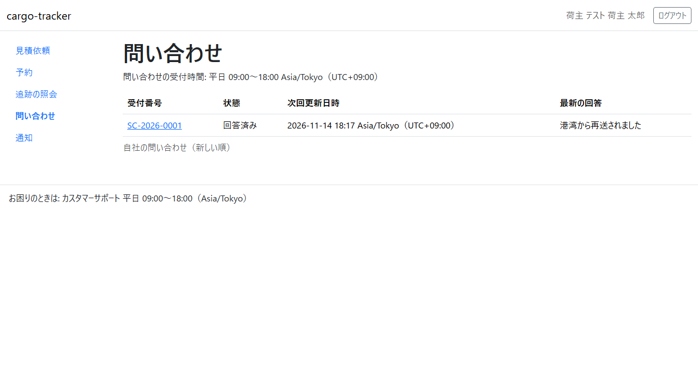
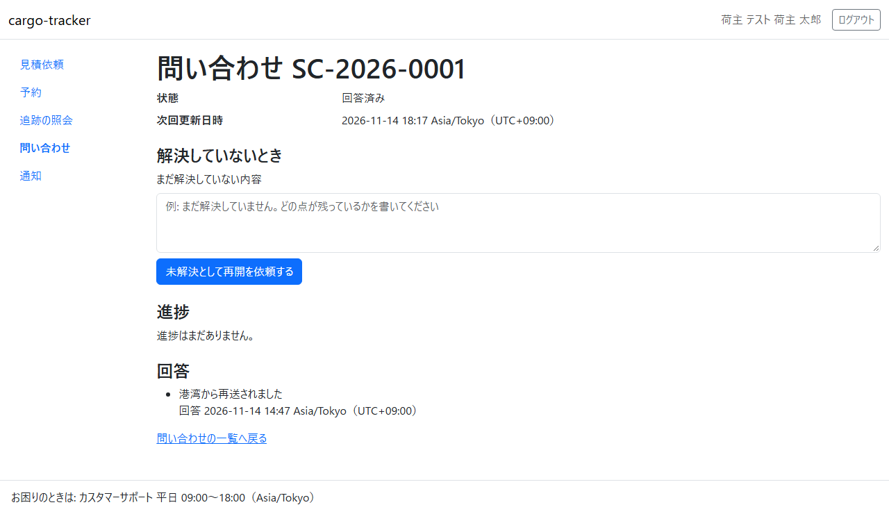
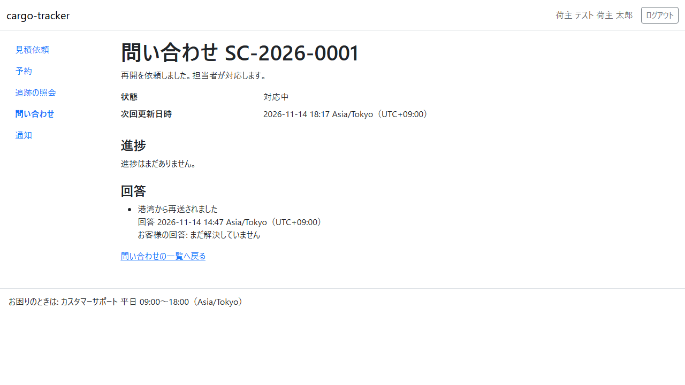

# 14 章 問い合わせの追跡

荷主担当者が、自社が出した問い合わせの受付番号・状態・次回更新日時・最新の回答を確かめ、進捗と回答の履歴を読み、解決していなければ再開を依頼する画面です。電話で聞き直さずに、問い合わせの進み具合を画面で確かめられます。

画面の開き方: ナビゲーションの「問い合わせ」（URL: `/customer/inquiries`）。

| 画面 | 役割 | 節 |
| :--- | :--- | :--- |
| 問い合わせ一覧 | 自社の問い合わせの受付番号・状態・次回更新日時・最新の回答を確かめる | [14.1](#141-問い合わせ一覧) |
| 問い合わせの詳細 | 進捗と回答の履歴を読む。解決していなければ再開を依頼する | [14.2](#142-問い合わせの詳細と再開の依頼) |

## 14.1 問い合わせ一覧

### この画面でできること

- 自社の問い合わせを、新しい順に確かめます
- 問い合わせの窓口の受付時間を確かめます

### 画面の開き方

- ナビゲーションの「問い合わせ」（URL: `/customer/inquiries`）

### 画面の説明

| # | 項目 | 説明 |
| :--- | :--- | :--- |
| ① | 受付時間 | 問い合わせの窓口の受付時間。平日 09:00〜18:00 です。時間帯は日時の表示と同じ「Asia/Tokyo（UTC+09:00）」で示します |
| ② | 受付番号 | 問い合わせごとの番号（SC-年-連番）。クリックすると詳細が開きます。電話やメールで問い合わせるときにお伝えください |
| ③ | 状態 | 「受付済み」「上位対応中」「対応中」「回答済み」「終結」 |
| ④ | 次回更新日時 | 次に状況をお知らせする予定の日時 |
| ⑤ | 最新の回答 | 担当者の最新の回答。まだなければ「回答はまだありません。」と示します |

### 操作手順

1. ナビゲーションの「問い合わせ」を押します
2. 確かめたい問い合わせの受付番号と状態、次回更新日時、最新の回答を読みます
3. 詳しく読むときは、受付番号を押します（[14.2](#142-問い合わせの詳細と再開の依頼)）

### 注意・補足

- 一覧に出るのは自社の問い合わせだけです。他社の問い合わせは出ません
- 新しい 200 件まで示します。それより前の問い合わせは担当者にご連絡ください
- 受付時間は標準の時間です。祝日・年末年始の扱いは担当者にご確認ください

## 14.2 問い合わせの詳細と再開の依頼

### この画面でできること

- 問い合わせの進捗と、担当者の回答の履歴を読みます
- 回答を読んでもまだ解決していないときは、未解決の内容を書いて再開を依頼します。同じ受付番号で再開し、過去の回答の履歴は残ります

### 画面の開き方

- 問い合わせ一覧の受付番号を押します（URL: `/customer/inquiries/{受付番号}`）

### 画面の説明

| # | 項目 | 説明 |
| :--- | :--- | :--- |
| ① | 状態・次回更新日時 | いまの状態と、次に状況をお知らせする予定の日時 |
| ② | 解決していないとき | 状態が「回答済み」か「終結」のときだけ出る、再開の依頼の欄 |
| ③ | 進捗 | 担当者が書いた進捗の履歴（新しいものが下） |
| ④ | 回答 | 担当者の回答の履歴。再開を依頼した内容は「お客様の回答」として回答の下に残ります |

### 操作手順

1. 回答を読みます
2. まだ解決していなければ、「まだ解決していない内容」の欄に残っている点を書き、「未解決として再開を依頼する」を押します
3. 詳細に戻り、「再開を依頼しました。担当者が対応します。」と示されます。状態は「対応中」になります

### 注意・補足

- 再開の依頼は、状態が「回答済み」か「終結」のときだけできます。受付済み・対応中のときは、担当者が対応中です
- 他社の問い合わせの受付番号を入れても「画面が見つかりません」と示され、内容は出ません。存在しない受付番号と同じ画面です
- 再開しても受付番号は変わりません。過去の回答と進捗は消えません
