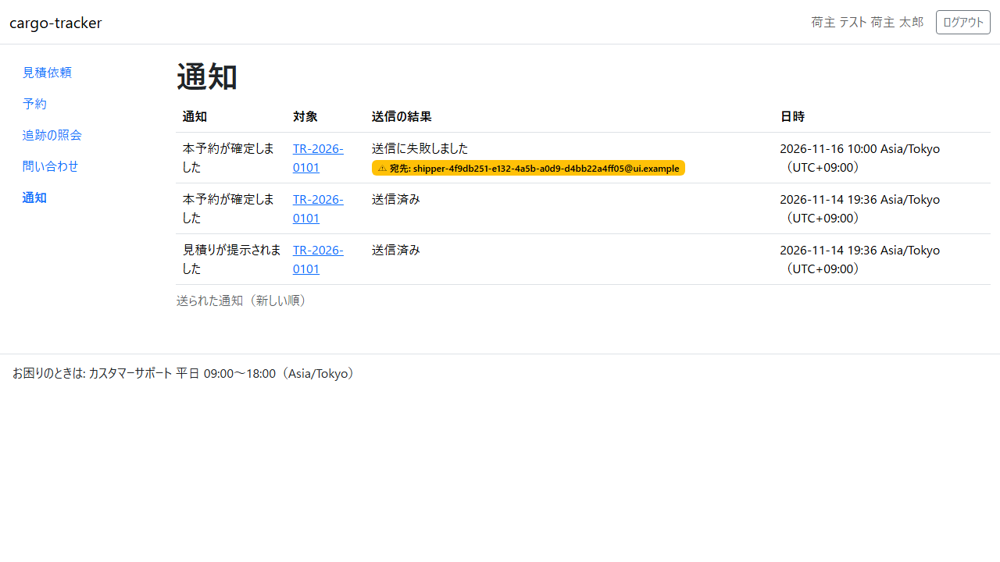

# 15 章 通知

荷主担当者が、見積りの提示・経路の承認・本予約の確定・追跡の確認中・見積りの有効期限が近いことをメールで知り、通知一覧で同じ内容と送信の結果を確かめる画面です。毎日画面を見に行かなくても、対応の遅れを防げます。

画面の開き方: ナビゲーションの「通知」（URL: `/customer/notifications`）。

| 画面 | 役割 | 節 |
| :--- | :--- | :--- |
| 通知一覧 | 送られた通知と送信の結果を確かめる | [15.1](#151-通知一覧) |

## 15.0 どんなときにメールが届くか

自社の荷主担当者のうち、利用中の方全員に、次のときメールが届きます。

| 契機 | 件名 | メールの内容 |
| :--- | :--- | :--- |
| 見積りが提示された | 【cargo-tracker】見積りが提示されました | 業務番号と、見積依頼の詳細への導線 |
| 経路が承認され、荷主の承認が必要になった | 【cargo-tracker】経路が承認されました。ご承認をお願いします | 業務番号と、見積依頼の詳細への導線 |
| 見積りの有効期限が近い（24 時間前） | 【cargo-tracker】見積りの有効期限が近づいています | 業務番号と、見積依頼の詳細への導線 |
| 本予約が確定した | 【cargo-tracker】本予約が確定しました | 業務番号と、予約一覧への導線 |
| 追跡が確認中になった | 【cargo-tracker】貨物の追跡を確認しています | 追跡番号と、追跡の照会の結果への導線 |

メールには、料金・契約条件・書類・ほかの予約の情報は書きません。件名と、画面への導線だけです。内容は導線の先の画面で確かめてください。

## 15.1 通知一覧

### この画面でできること

- 自分に送られた通知を、新しい順に確かめます
- 送信に失敗した通知と、その宛先を確かめます
- 通知の対象（業務番号・追跡番号）を押して、対象の画面へ移ります

### 画面の開き方

- ナビゲーションの「通知」（URL: `/customer/notifications`）

### 画面の説明

| # | 項目 | 説明 |
| :--- | :--- | :--- |
| ① | 通知 | 通知の種類（見積りが提示されました、本予約が確定しました など） |
| ② | 対象 | 業務番号か追跡番号。押すと、メールの導線と同じ画面が開きます |
| ③ | 送信の結果 | 「送信済み」「送信に失敗しました」「送信待ち」。失敗したときは、送った宛先のメールアドレスも示します |
| ④ | 日時 | 送った日時（送信済み以外は記録した日時）。日本時間とUTCのずれで示します |

### 操作手順

1. ナビゲーションの「通知」を押します
2. メールが届かないときは、通知一覧で「送信済み」か「送信に失敗しました」かを確かめます
3. 失敗していたら、宛先のメールアドレスが正しいか確かめ、担当営業にご連絡ください

### 注意・補足

- 一覧に出るのは自分に宛てた通知だけです。自社のほかの荷主担当者の通知は出ません
- 新しい 100 件まで示します
- 通知の配信設定（受け取る種類の選択、静穏時間）はまだありません。自社の荷主担当者全員に届きます
