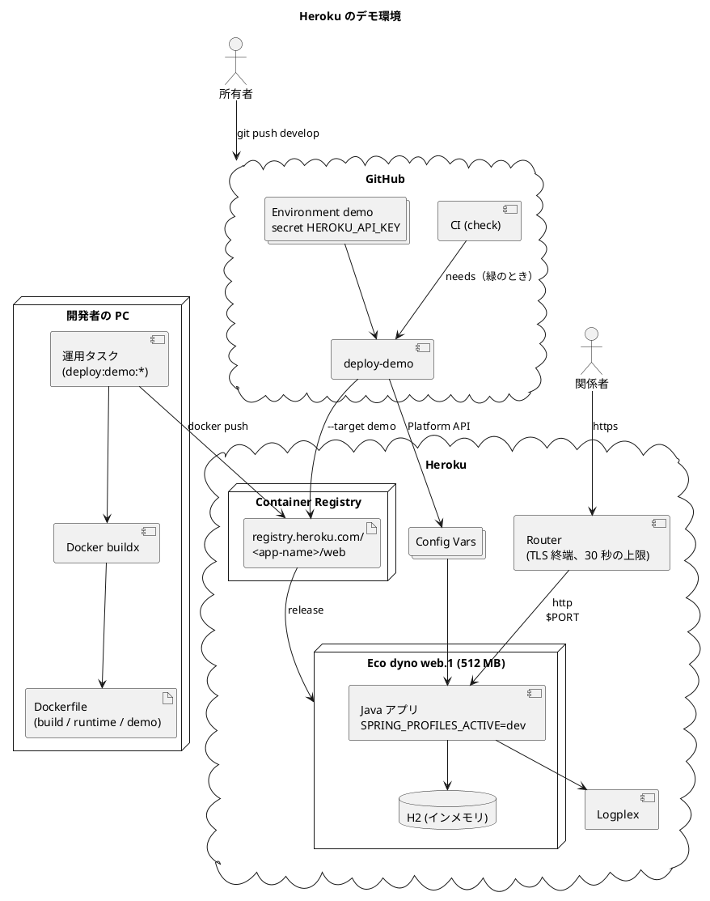
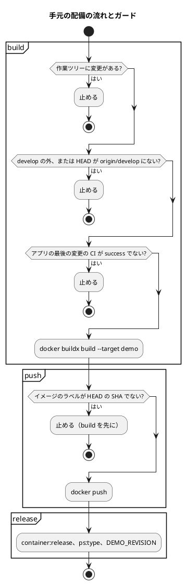

# Java アプリケーションデモ環境構築ガイド

## 概要

本ガイドは、Java（Spring Boot）アプリケーションのデモ環境を Heroku に作り、運用するための汎用の手順です。関係者がブラウザで触って確かめることだけを目的とし、本番の代わりにはしません。値（アプリ名・URL・タスク名）は各プロジェクトの手順書に書き、本ガイドでは考え方と手順の型を示します。ビルドツール（Gradle・Maven）やタスクランナーは、各プロジェクトのものに読み替えてください。

| 項目 | 目安 |
| :--- | :--- |
| 配備先 | Heroku（Common Runtime）、stack `container`、Container Registry |
| dyno | Eco（512 MB）、web 1 つ |
| プロファイル | 開発用（`dev`）。データベースは H2 のインメモリ |
| 配備 | CI の `deploy-demo` ジョブで自動。CI が使えないときは手元から |
| 認証（CI） | GitHub の Environment（デモ用、配備のブランチを限る）の secret に Heroku の API キー |
| 費用 | Eco の定額（月 5 USD、アカウントの全 Eco dyno に共通） |
| 所有者 | Heroku のアカウント・費用・停止の手段を持つ人を 1 人決める |
| 配備のブランチ | 本ガイドでは `develop` と書く。`main` など、各プロジェクトのブランチに読み替える |

> **注意**: デモは、URL を知っていればだれでも開ける前提で作ります。本物の利用者・取引のデータを入れないでください。データは dyno の再起動で初期状態に戻ります。不審な利用に気づいたら、再起動か停止をします。

### 環境の構成



### イメージの構成

Dockerfile を多段にし、デモ用のステージを分けます。

| ステージ | 中身 | 使う場所 |
| :--- | :--- | :--- |
| `build` | 実行可能 jar のビルド（Gradle なら `./gradlew bootJar`、Maven なら `mvn package`）と、デモ用の依存（H2）を写すタスクの実行 | — |
| `runtime` | bootJar だけ。H2 を含まない | 本番の成果物 |
| `demo` | `runtime` に H2 を足す | デモ環境 |

H2 は本番の成果物の jar には入れません（Gradle なら `developmentOnly`、Maven なら開発用のプロファイルに限る）。デモのときだけ、別のタスク（例: `copyDemoLibs`）で H2 を `build/demo-lib` に写し、`demo` のステージでクラスパスに足します。本番の成果物にデモ用の依存を混ぜないための分離です。

## 1. 前提条件

| もの | 確かめ方 |
| :--- | :--- |
| Heroku のアカウントと Eco の契約 | Heroku の Billing で Eco dynos plan が有効 |
| Heroku CLI | `heroku --version` |
| Docker（buildx を含む） | `docker buildx version` |
| GitHub CLI（CI の結果を見る） | `gh auth status` |
| 運用タスクの実行環境（タスクランナーを使う場合。Gulp・Make・シェルなど） | 各プロジェクトの手順に従い導入済み |

ログインは対話のため、人が行います。Container Registry の認証は Heroku CLI のログインとは別です。

```bash
heroku login
heroku container:login
```

運用手順書に定義済みのタスクがあれば、それを使います。使い捨てのスクリプトを増やさず、無い操作は正式なタスクとして追加し、手順書にも書きます。

## 2. 初回のセットアップ

アプリの作成、Config Vars の設定、メモリのログの有効化を行います。2 回目以降に実行しても、作成を飛ばして Config Vars を合わせるだけにします（冪等）。

```bash
heroku create <app-name> --stack container --region us
heroku config:set -a <app-name> \
  SPRING_PROFILES_ACTIVE=dev \
  JAVA_TOOL_OPTIONS="-Xmx300m -XX:+UseSerialGC -Xss512k -XX:ReservedCodeCacheSize=64m -XX:MaxMetaspaceSize=192m"
heroku labs:enable log-runtime-metrics -a <app-name>
```

| Config Var | 理由 |
| :--- | :--- |
| `SPRING_PROFILES_ACTIVE=dev` | デモは開発用のプロファイルだけで動かす。`staging`・`prod` を混ぜない |
| `JAVA_TOOL_OPTIONS` | 512 MB の dyno に収める。`-XX:MaxRAMPercentage` は使わず `-Xmx` で固定する（R14 の回避） |

アプリが `$PORT` で待ち受け、`X-Forwarded-Proto` を信頼する設定（`server.forward-headers-strategy=framework` など）にします。Heroku の Router が TLS を終端し、http でアプリに渡すためです。

### CI からの配備の準備

GitHub の Environment `demo` を作り、配備のブランチを develop に限ります。

```bash
gh api -X PUT repos/<owner>/<repo>/environments/demo \
  -F 'deployment_branch_policy[protected_branches]=false' -F 'deployment_branch_policy[custom_branch_policies]=true'
gh api -X POST repos/<owner>/<repo>/environments/demo/deployment-branch-policies \
  -f name=develop -f type=branch
```

Heroku の API キー（authorization）を作り、Environment の secret `HEROKU_API_KEY` に登録します。

- キーの説明に用途と作った日を入れる（例: `GitHub Actions <app-name> demo deploy YYYY-MM-DD`）
- キーが空なら登録しない。手で貼ったコマンドが折り返しで崩れ、空の secret が登録されて `Password required` で失敗した例がある
- 期限の 2 週間前を期日にした更新の Issue を立てる
- 新しいキーで配備が通ることを確かめてから、古いキーを失効させる

| 場面 | すること |
| :--- | :--- |
| 更新の期日 | 新しいキーを作って登録し、配備が通るのを確かめ、古いキーを失効させる |
| 漏えいの疑い | 新しいキーにして、すぐ古いキーを失効させる。`heroku releases` と Dashboard の Activity で覚えのない release や collaborator がないか確かめる。同じアカウントのほかのアプリも確かめる |
| デモ環境をやめる | 説明が一致するキーをすべて `heroku authorizations:revoke <ID>` で失効させ、`gh secret delete HEROKU_API_KEY --env demo` |

キーの境界は「develop に push できる人と AI のセッション」です。develop に push できれば、ワークフローを書き換えてキーを使えます。`.github/workflows/` の変更は人がレビューしてください。

## 3. 配備

### CI からの配備（通常）

develop への push で、CI の check が緑になった後に `deploy-demo` ジョブが配備します。手で配備し直すときは、develop で CI を実行します。

```bash
gh workflow run <ci-workflow>.yml --ref develop
gh run watch
```

`deploy-demo` の設計の要点です。

- `needs: [check]` で、develop の push と手動の実行のときだけ動かす。Pull Request では動かさない
- `docker/build-push-action` で `demo` のステージを `linux/amd64`・Docker v2 の manifest（`oci-mediatypes=false`）で作り、ラベルに `github.sha` を付けて push する
- Heroku Platform API で release し、web の dyno が up で ヘルスチェック用の公開ページ（`/` や `/login` など、各アプリで決める）が 200 になるのを待ってから、Config Vars の `DEMO_REVISION` を `github.sha` にする。release と Config Vars の変更はそれぞれ再起動を起こす。続けて出すと 2 つの起動が重なり、残ったプロセスのインメモリ DB が閉じることがある
- 古い実行の再実行で古いコミットを配備しないよう、release の前に、対象のパスを最後に変えたコミットが、配備するコミットまでと develop の先頭までで同じかを確かめる。違えば警告を出して配備を飛ばす
- 配備のジョブはワークフローの取り消しの外に置き、release の途中で取り消されないようにする。配備どうしは 1 つずつ動かす（concurrency）
- 配備の後に、`DEMO_REVISION`・最新の release の状態・dyno の up・公開ページの 200 を確かめる。さらに、DB を使う操作（ログインなど）が 500 にならないことを確かめる。表示だけのページは DB を使わないので、DB が閉じていても 200 になるため
- どれかが来なければ直前の release に Platform API で戻し、ジョブを失敗にする。Eco には preboot がなく、新しい dyno が起動に失敗すると古い dyno は止まっているため、戻さないとデモが落ちたままになる
- ログイン・ビルド・push で失敗したときは release の前なので、前の release のまま動き続ける
- develop に push するたびにデモ環境が再起動し、データが初期状態に戻る。デモの最中は develop に push しない
- CI の配備の実行中は、手元で配備しない

### 手元からの配備（CI が使えないとき）

develop の CI が緑のコミットから配備します。`build` → `push` → `release` を順に行う運用タスクにします。

```bash
docker buildx build --target demo \
  --provenance=false --sbom=false \
  --label org.opencontainers.image.revision=$(git rev-parse HEAD) \
  --output type=image,name=registry.heroku.com/<app-name>/web,oci-mediatypes=false \
  apps/<app>
docker push registry.heroku.com/<app-name>/web
heroku container:release web -a <app-name>
heroku ps:type web=eco -a <app-name>
heroku config:set DEMO_REVISION=$(git rev-parse HEAD) -a <app-name>
```



- 運用タスクに、次の確かめを入れます。作業ツリーに変更がない、develop にいて HEAD が `origin/develop` に含まれる、アプリを最後に変えたコミットの CI が success、手元のイメージが HEAD から作ったもの（ラベル）。
- Heroku の Container Registry は Docker v2 の manifest だけを受けます。`oci-mediatypes=false`、`--provenance=false`、`--sbom=false` を付けて作ります。`docker build` で作り直さないでください。
- ビルドの context は作業ツリーです。gitignore されたファイルは作業ツリーの確かめに出ないまま、`src/` の下にあればイメージに入ります。手元だけのファイルを `src/` に置かないでください。
- 確かめを飛ばすときだけ環境変数（例: `DEMO_SKIP_GUARD=1`）を付け、使ったら理由を記録します。
- 所要時間は、依存のキャッシュがあれば 1 分前後、初回と `build.gradle` を変えた後は 4〜9 分です。

## 4. 確認

```bash
heroku ps -a <app-name>
heroku config -a <app-name>
heroku open -a <app-name>
```

| 確かめること | 期待する結果 |
| :--- | :--- |
| URL を開く | https のままログインの画面へ移る |
| 開発用の利用者でログイン | 役割ごとの最初の画面が開く |
| 権限のない画面を開く | 権限なしの画面になる |
| プロファイル | `dev` だけ（`staging`・`prod` を含まない） |
| 動いているコミット | `DEMO_REVISION` が配備したコミット |

## 5. ログと週次の確かめ

```bash
heroku logs --tail -a <app-name>
```

メモリの値は `log-runtime-metrics` で 20 秒ごとにログに出ます（`sample#memory_total`）。`memory_total` が 450 MB を超えるか、R14・R15 が出たら、dyno の種類（Basic・Standard-2X）の変更を所有者に諮ります。

週次の見直しで、次を確かめます。

- dyno が up、プロファイルが `dev` だけ、`DEMO_REVISION` が想定のコミット
- R14・R15・R10 がない。見覚えのない大量のアクセスや書類の添付がない
- 不審な利用があれば再起動でデータを消し、続くなら停止して所有者に知らせる

## 6. デモの前に

```bash
heroku restart -a <app-name>
heroku open -a <app-name>
```

- 再起動すると、入れたデータは消え、開発用の初期データ（`data.sql` や Flyway の開発用の移行など）だけになります。起動は 5 秒前後です。
- Eco dyno は 30 分アクセスがないとスリープします。スリープからの最初のアクセスは遅くなります。デモの数分前に一度開いておきます。
- 初期データには、どの役割でもすぐ画面を確かめられるサンプルを入れておきます。サンプルの一覧と見せ方は、アプリごとの手順書に書きます。
- 起動の時刻を基準にする日時のデータ（初期データの取得時刻など）は、起動から時間が経つと古いと判定されることがあります。デモの前に起動からの経過を確かめ、長ければ再起動します。

## 7. ロールバック

```bash
heroku releases -a <app-name>
heroku rollback v<番号> -a <app-name>
```

`heroku rollback` は、イメージと Config Vars をその release の状態に戻した新しい release を作ります。`DEMO_REVISION` は、その release の値になります。戻せないとき（イメージが Registry から消えているなど）は、戻したいコミットを配備のブランチで作り直して配備します（`git revert` が基本です）。

## 8. 停止と削除

```bash
heroku ps:scale web=0 -a <app-name>   # 停止（公開と Eco の時間の消費を止める）
heroku ps:scale web=1 -a <app-name>   # 再開
```

デモ環境が要らなくなったら、アプリを消します。取り消せないため、タスクにはせず、人が確かめてから手で実行します。

```bash
heroku apps:destroy -a <app-name> --confirm <app-name>
```

消した後は、Eco の契約がほかのアプリで要らないかを Heroku の Billing で確かめます。

## 9. 制約とよくあるつまずき

| 症状 | 原因と対処 |
| :--- | :--- |
| `docker push` が `error from registry: unsupported` | Docker の containerd のイメージストアが OCI の media type で送っている。`oci-mediatypes=false`、`--provenance=false`、`--sbom=false` を付けて `buildx` で作る |
| ログに `Error R14 (Memory quota exceeded)` | ヒープが 512 MB を基準にしていない。`-XX:MaxRAMPercentage` ではなく `-Xmx300m` を使い、Config Vars を合わせる |
| 起動で `ClassNotFoundException: org.h2.Driver` | `runtime` のステージのイメージを送った。`--target demo` で作る |
| 起動でプロファイルの検証が失敗する | `SPRING_PROFILES_ACTIVE` に `staging`・`prod` が混ざっている。`dev` だけにする |
| 手元の build が「CI が緑ではありません」で止まる | アプリの最後の変更の CI が終わっていないか失敗している。`gh run list` で確かめ、緑になってから配備する。取り消されたときは CI を再実行する |
| 「develop から配備してください」「HEAD が origin/develop にありません」で止まる | develop に切り替え、push して CI を待ってから配備する |
| push が「HEAD から作ったものではありません」で止まる | 手元のイメージが古い。build を先に行う |
| `deploy-demo` が `Password required` か `unauthorized` | secret `HEROKU_API_KEY` が空か、キーの期限が切れた。登録し直し、`gh workflow run` で配備し直す（失敗した実行の再実行は、より新しい配備の対象があると飛ばされる） |
| 古い実行を再実行したら、古いコミットが配備された | 再実行は、その実行のときのワークフローの定義で動く。最新かを確かめる処理を入れた以降のコミットだけ再実行する。develop で `git revert` して push するか、`gh workflow run` で最新を配備し直す |
| 「より新しい配備の対象があります」の警告で配備を飛ばした | 古い実行を再実行した。新しい実行の結果を見る |
| 「起動を確かめられません」で失敗し、直前の release に戻した | 新しいイメージが起動しなかった。ログで原因を確かめ、develop で直して push する |
| `push に失敗しました` | `heroku container:login` をしていない |
| 入れたデータが消えた | 仕様（H2 のインメモリ）。Heroku は dyno を 1 日 1 回以上再起動し、配備とスリープでも初期状態に戻る |
| 大きな書類の添付が失敗する | Heroku の Router は 30 秒で request を打ち切る。デモでは小さなファイルを使う |

## 関連ドキュメント

- [Java アプリケーション環境構築ガイド](Javaアプリケーション環境構築ガイド.md)
- [Heroku Container Registry & Runtime](https://devcenter.heroku.com/articles/container-registry-and-runtime)
