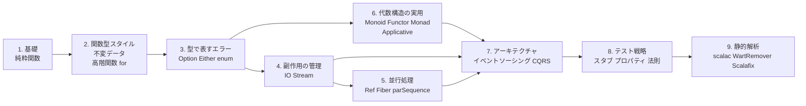
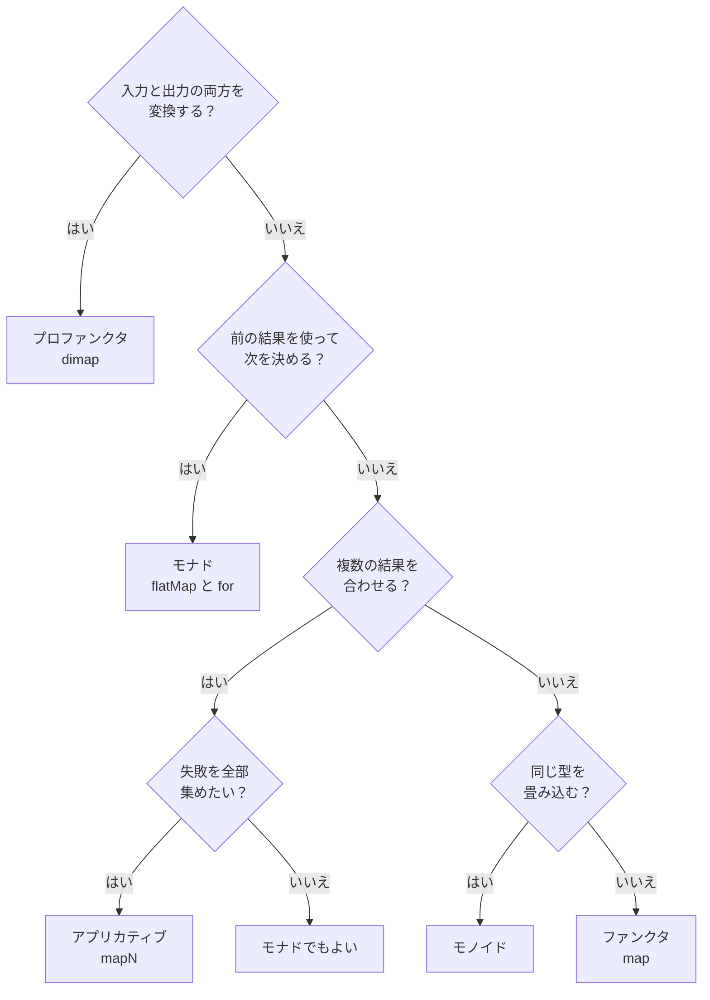
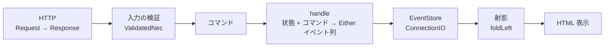

# 関数型プログラミングガイド（Scala 編）

## このガイドについて

関数型プログラミング（FP）は、状態の書き換えではなく値の変換でプログラムを組み立てる考え方である。変更を楽に安全にできるソフトウェアを作るための技術的な手段のひとつであり、副作用を境界に押し出し、型で失敗を表し、小さな関数を合成する。

本ガイドは、Scala でこの考え方を実践するための要点を整理する。構成は [関数型プログラミングガイド（Kotlin 編）](./関数型プログラミングガイド_Kotlin編.md) と [関数型プログラミングガイド（Rust 編）](./関数型プログラミングガイド_Rust編.md) に合わせている。次の 2 つの学習記事を元にしている。

| 出典 | 内容 | 本ガイドでの扱い |
| --- | --- | --- |
| Grokking Functional Programming Scala 版（全 12 章） | 純粋関数、イミュータブルなデータ、Option/Either、IO、ストリーム、並行処理、実践的なアプリケーション、テスト戦略 | 第 1〜5 章の骨格 |
| Zettai Scala 版（全 13 章、From Objects to Functions 演習） | ToDo アプリを題材にした HTTP、ドメインモデリング、イベントソーシング、関数型エラーハンドリング、アプリカティブ、関数型 JSON | 第 6〜8 章の骨格 |

- **対象**: Scala の基本的な文法を知っていて、関数型の設計を体系的に身につけたい開発者。
- **使うもの**: 第 1〜3 章は Scala の標準ライブラリのみ。第 4 章以降は [Cats](https://typelevel.org/cats/)、[Cats Effect](https://typelevel.org/cats-effect/)、[fs2](https://fs2.io/) を使う。Zettai 版は、これに http4s と doobie を加える。
- **コード例**: 出典の記事から転記している（表記を Scala 3 に直した点は次の「表記」を参照）。本文に載せたコードは、このガイドのために書き下ろしたものではない。ただし第 9 章の設定と確認用コードだけは例外で、このガイドのために書き、実際に実行して確認した。詳細な解説と演習問題は出典の記事を参照する。
- **表記**: コード例は、すべて Scala 3 の表記にそろえている。波括弧を使わないインデント構文（`def f(x: Int): Int =` の次の行から本体、`object X:`、`enum E:`、`match` の次の行から `case`）、`if 条件 then`、`for ... yield`、`import x.*` である。出典のうち Grokking 版は Scala 2 風の波括弧の書き方なので、意味を変えずに表記だけを直した。Zettai 版は、出典がすでに Scala 3 の表記である。`test("...") { ... }` や `.forall { case ... }` のように、関数を渡すための波括弧は、Scala 3 でも使うので残した。全 125 個のコードブロックが、Scala 3.7.0 の構文解析を通ることを確認した。

### Kotlin・Rust との違い

Scala は、FP の構造を、言語（`for` 内包表記、`enum`、`case class`）とライブラリ（Cats、Cats Effect）が与える。Kotlin 編では自前に作った構造が、Scala では型クラスとして用意されている。

| | Kotlin | Rust | Scala |
| --- | --- | --- | --- |
| 不変性 | `val` は再代入を防ぐだけ。`List` は読み取り専用のビュー | 束縛はデフォルトで不変 | `val` と、標準の `List` は不変 |
| 失敗の型 | nullable、Arrow の `Either` | `Option`、`Result`、`?` | `Option`、`Either`、`for` |
| 代数的データ型 | `sealed interface` | `enum` | `enum`、`case class` |
| 逐次の合成 | `either { }` と `bind()`、`suspend` | `?`、`async` | `for` 内包表記（言語にある） |
| 副作用の型付け | `suspend` | `async fn` | `IO`（Cats Effect。値として組み立てる） |
| 代数構造 | 自作と Arrow | 自作と言語 | Cats の型クラス（`Monoid`、`Functor`、`Applicative`、`Monad`） |
| 静的解析 | detekt、ktlint、PMD | clippy | scalac のオプション、WartRemover、Scalafix |

## 全体像



| 章 | 主題 | 一言で言うと |
| --- | --- | --- |
| 1 | 基礎 | 同じ入力には同じ出力。外に触れない |
| 2 | 関数型スタイル | 変更せず、新しい値を作る。関数を値として渡す |
| 3 | 型で表すエラー | 失敗を例外ではなく戻り値の型で表す |
| 4 | 副作用の管理 | 副作用を「実行しない記述」として値にする |
| 5 | 並行処理 | 並行処理も、型と値で組み立てる |
| 6 | 代数構造の実用 | 合成のパターンに名前を付け、判断の手順で使い分ける |
| 7 | アーキテクチャ | 状態を事実（イベント）の列として扱う |
| 8 | テスト戦略 | 純粋関数の性質と、代数構造の法則をテストで言い切る |
| 9 | 静的解析とルール設定 | 関数型の規約を、コンパイラと WartRemover に守らせる |

---

## 1. 基礎: 純粋関数

### 1.1 命令型と関数型

命令型は「どうやるか」の手順を書き、関数型は「何であるか」の定義を書く。Scala では、ブロックの最後の式が値になるので、`return` も途中の代入も要らない。

```scala
// Scala: 関数型でワードスコアを計算
def wordScore(word: String): Int =
  word.length()
```

```scala
def increment(x: Int): Int =
  x + 1

def getFirstCharacter(s: String): Char =
  s.charAt(0)

def wordScore(word: String): Int =
  word.length()
```

変数の宣言には、再代入できない `val` と、再代入できる `var` がある。関数型のスタイルでは、原則として `val` を使い、`var` は使わない。`if` も式なので、そのまま値として使える。

### 1.2 純粋関数

純粋関数は次の 2 つを満たす。

1. 同じ入力には常に同じ出力を返す。
2. 副作用がない（外部状態を変更しない）。

```scala
def wordScore(word: String): Int =
  word.replaceAll("a", "").length

// テスト
assert(wordScore("Scala") == 3)    // "Scl" → 3文字
assert(wordScore("function") == 8) // 'a' なし → 8文字
assert(wordScore("") == 0)         // 空文字 → 0文字
```

純粋関数は、引数だけから結果を計算するので、テストが入力と出力の確認だけで済む。

```scala
def increment(x: Int): Int =
  x + 1

// テストケース
assert(increment(6) == 7)
assert(increment(0) == 1)
assert(increment(-6) == -5)
assert(increment(Integer.MAX_VALUE - 1) == Integer.MAX_VALUE)
```

### 1.3 状態を持たせず、引数で受け取る

ショッピングカートの割引率は、カートという状態を持つ代わりに、中身を引数で受け取る純粋関数にする。状態の食い違いが起きる余地が、最初からなくなる。

```scala
object ShoppingCart:
  def getDiscountPercentage(items: List[String]): Int =
    if items.contains("Book") then
      5
    else
      0
```

```scala
object TipCalculator:
  def getTipPercentage(names: List[String]): Int =
    if names.size > 5 then 20
    else if names.size > 0 then 10
    else 0
```

### 1.4 参照透過性

純粋関数の呼び出しは、その結果の値に置き換えても、プログラムの意味が変わらない。これを参照透過性と呼ぶ。

**純粋関数の利点**: テストが入力と出力の確認だけで済む。並行に呼んでも安全である。呼び出しを値に置き換えても意味が変わらないので、読んで理解しやすい。

---

## 2. 関数型スタイル: 不変データと高階関数

### 2.1 新しい値を作る

Scala の `List` は、標準でイミュータブルである。「変更する」操作は、変更を加えた新しい `List` を返す。Kotlin の `List` は読み取り専用のビューにすぎないが、Scala の `List` は、後から書き換える手段がそもそもない。

```scala
val appleBook      = List("Apple", "Book")
val appleBookMango = appleBook.appended("Mango")

assert(appleBook.size == 2)       // 元のリストは変わらない
assert(appleBookMango.size == 3)  // 新しいリストが作成される
assert(appleBookMango == List("Apple", "Book", "Mango"))
```

```scala
def firstTwo(list: List[String]): List[String] =
  list.slice(0, 2)

def lastTwo(list: List[String]): List[String] =
  list.slice(list.size - 2, list.size)

assert(firstTwo(List("a", "b", "c")) == List("a", "b"))
assert(lastTwo(List("a", "b", "c")) == List("b", "c"))
```

```scala
// 最初の2要素を末尾に移動
def movedFirstTwoToTheEnd(list: List[String]): List[String] =
  val firstTwo        = list.slice(0, 2)
  val withoutFirstTwo = list.slice(2, list.size)
  withoutFirstTwo.appendedAll(firstTwo)

assert(movedFirstTwoToTheEnd(List("a", "b", "c")) == List("c", "a", "b"))
```

旅程の再計画の例では、元の計画が変わらないことを、テストで確かめている。

```scala
def replan(plan: List[String], newCity: String, beforeCity: String): List[String] =
  val beforeCityIndex = plan.indexOf(beforeCity)
  val citiesBefore    = plan.slice(0, beforeCityIndex)
  val citiesAfter     = plan.slice(beforeCityIndex, plan.size)
  citiesBefore.appended(newCity).appendedAll(citiesAfter)

val planA = List("Paris", "Berlin", "Kraków")
val planB = replan(planA, "Vienna", "Kraków")

assert(planB == List("Paris", "Berlin", "Vienna", "Kraków"))
assert(planA == List("Paris", "Berlin", "Kraków"))  // 元の計画は変わらない!
```

`case class` も同じで、`copy` で一部だけ違う新しい値を作る。

### 2.2 関数を値として渡す

関数は引数にも戻り値にもなる。変わる部分を関数として外から渡すと、同じ枠組みで振る舞いを差し替えられる。

```scala
def score(word: String): Int = word.replaceAll("a", "").length

val words = List("rust", "java")
val sortedWords = words.sortBy(score)
assert(sortedWords == List("java", "rust"))
// java: 2文字 (j, v), rust: 4文字 (r, u, s, t)
```

```scala
def score(word: String): Int = word.replaceAll("a", "").length
def bonus(word: String): Int = if word.contains("c") then 5 else 0
def penalty(word: String): Int = if word.contains("s") then 7 else 0

val words = List("ada", "haskell", "scala", "java", "rust")

// 関数を引数として渡す
def rankedWords(wordScore: String => Int, words: List[String]): List[String] =
  words.sortBy(wordScore).reverse

// 基本スコアでランキング
val ranking1 = rankedWords(score, words)
assert(ranking1 == List("haskell", "rust", "scala", "java", "ada"))

// ボーナス付きスコアでランキング
val ranking2 = rankedWords(w => score(w) + bonus(w), words)
assert(ranking2 == List("scala", "haskell", "rust", "java", "ada"))
```

### 2.3 map / filter / foldLeft

| 操作 | 役割 |
| --- | --- |
| `map` | 各要素を変換する（要素数は同じ） |
| `filter` | 条件に合う要素だけ残す |
| `foldLeft` | 初期値から畳み込んで 1 つの値にする |

```scala
def len(s: String): Int = s.length
val lengths = List("scala", "rust", "ada").map(len)
assert(lengths == List(5, 4, 3))

def double(i: Int): Int = 2 * i
val doubles = List(5, 1, 2, 4, 0).map(double)
assert(doubles == List(10, 2, 4, 8, 0))
```

```scala
def odd(i: Int): Boolean = i % 2 == 1
val odds = List(5, 1, 2, 4, 0).filter(odd)
assert(odds == List(5, 1))

def largerThan4(i: Int): Boolean = i > 4
val large = List(5, 1, 2, 4, 0).filter(largerThan4)
assert(large == List(5))
```

```scala
val sum = List(5, 1, 2, 4, 100).foldLeft(0)((acc, i) => acc + i)
assert(sum == 112)

val max = List(5, 1, 2, 4, 15).foldLeft(Int.MinValue)((max, i) =>
  if i > max then i else max
)
assert(max == 15)
```

`case class` のフィールドは、アンダースコアの省略記法でも取り出せる。

```scala
case class ProgrammingLanguage(name: String, year: Int)

val javalang  = ProgrammingLanguage("Java", 1995)
val scalalang = ProgrammingLanguage("Scala", 2004)
val languages = List(javalang, scalalang)

// フィールドにアクセス
val names = languages.map(lang => lang.name)
assert(names == List("Java", "Scala"))

// 省略記法（アンダースコア）
val names2 = languages.map(_.name)
assert(names2 == List("Java", "Scala"))

// 条件でフィルタ
val young = languages.filter(_.year > 2000)
assert(young == List(scalalang))
```

### 2.4 関数を返す関数とカリー化

条件を関数として組み立てて返すと、同じ `filter` に別の条件を渡せる。

```scala
def largerThan(n: Int): Int => Boolean = i => i > n

val large = List(5, 1, 2, 4, 0).filter(largerThan(4))
assert(large == List(5))

val medium = List(5, 1, 2, 4, 0).filter(largerThan(1))
assert(medium == List(5, 2, 4))
```

Scala は、引数リストを複数に分けて書くだけで、カリー化できる。先頭の引数だけ与えると、残りを待つ関数になる。

```scala
// 通常の関数
def largerThanNormal(n: Int, i: Int): Boolean = i > n

// カリー化された関数
def largerThan(n: Int)(i: Int): Boolean = i > n

// 使用例
val large = List(5, 1, 2, 4, 0).filter(largerThan(4))
assert(large == List(5))
```

### 2.5 flatMap と for 内包表記

`map` で「コレクションを返す関数」を適用すると、結果がネストする。`flatMap` は適用と平坦化を一度に行う。

```scala
case class Book(title: String, authors: List[String])

val books = List(
  Book("FP in Scala", List("Chiusano", "Bjarnason")),
  Book("The Hobbit", List("Tolkien"))
)

// map だけだとネストする
val authorLists = books.map(_.authors)
// List(List("Chiusano", "Bjarnason"), List("Tolkien"))

// flatten で平坦化
val authors = authorLists.flatten
// List("Chiusano", "Bjarnason", "Tolkien")
```

```scala
// map して flatten
val authors1 = books.map(_.authors).flatten

// flatMap で同じことを1行で
val authors2 = books.flatMap(_.authors)

assert(authors1 == authors2)
// List("Chiusano", "Bjarnason", "Tolkien")
```

`flatMap` が返すリストの大きさは自由で、要素数を増やすことも、減らす（フィルタの代わりにする）こともできる。

```scala
// 要素数が増える
List(1, 2, 3).flatMap(i => List(i, i + 10))
// List(1, 11, 2, 12, 3, 13) - 6要素

// 要素数が同じ
List(1, 2, 3).flatMap(i => List(i * 2))
// List(2, 4, 6) - 3要素

// 要素数が減る（フィルタリング効果）
List(1, 2, 3).flatMap(i => if i % 2 == 0 then List(i) else List.empty)
// List(2) - 1要素
```

`flatMap` の入れ子は、深くなると読みにくい。Scala には、同じ意味を平らに書ける `for` 内包表記が、言語にある。Kotlin では `sequence { }` で、Rust では `flat_map` のチェーンで補っていた部分である。

```scala
// flatMap/map 版
val c1 = books.flatMap(book =>
  book.authors.flatMap(author =>
    bookAdaptations(author).map(movie =>
      s"You may like ${movie.title}, because you liked $author's ${book.title}"
    )
  )
)

// for 内包表記版（等価）
val c2 = for
  book   <- books
  author <- book.authors
  movie  <- bookAdaptations(author)
yield s"You may like ${movie.title}, because you liked $author's ${book.title}"

assert(c1 == c2)
```

`for` 内包表記は、`List` に限らず、`flatMap` と `map` を持つ型なら何にでも使える。次章の `Option` と `Either`、第 4 章の `IO` も、同じ形で書く。

---

## 3. 型で表すエラー

例外は関数のシグネチャに現れず、呼び出し側が備えられない。失敗の可能性を戻り値の型に出すと、扱いをコンパイラが強制する。

### 3.1 Option

値がないことだけを表すなら、標準の `Option[A]` を使う。次の実装は、前提が崩れると例外を投げる。

```scala
def parseShow(rawShow: String): TvShow =
  val bracketOpen  = rawShow.indexOf('(')
  val bracketClose = rawShow.indexOf(')')
  val dash         = rawShow.indexOf('-')

  val name      = rawShow.substring(0, bracketOpen).trim
  val yearStart = rawShow.substring(bracketOpen + 1, dash).toInt
  val yearEnd   = rawShow.substring(dash + 1, bracketClose).toInt

  TvShow(name, yearStart, yearEnd)

// 正常ケース
parseShow("Breaking Bad (2008-2013)")  // TvShow("Breaking Bad", 2008, 2013)

// 異常ケース → 例外がスローされる!
parseShow("Chernobyl (2019)")           // StringIndexOutOfBoundsException
parseShow("The Wire 2002-2008")         // StringIndexOutOfBoundsException
```

小さな関数が `Option` を返すようにして、`for` 内包表記で合成する。途中で `None` が出れば、全体が `None` になる。

```scala
// 名前を抽出
def extractName(rawShow: String): Option[String] =
  val bracketOpen = rawShow.indexOf('(')
  if bracketOpen > 0 then Some(rawShow.substring(0, bracketOpen).trim)
  else None
```

```scala
def parseShow(rawShow: String): Option[TvShow] =
  for
    name      <- extractName(rawShow)
    yearStart <- extractYearStart(rawShow)
    yearEnd   <- extractYearEnd(rawShow)
  yield TvShow(name, yearStart, yearEnd)

// 正常ケース
parseShow("Breaking Bad (2008-2013)")  // Some(TvShow("Breaking Bad", 2008, 2013))

// 異常ケース → None が返される（例外なし）
parseShow("The Wire 2002-2008")         // None
```

`orElse` は「`None` なら代替を使う」フォールバックである。

```scala
val seven: Option[Int] = Some(7)
val eight: Option[Int] = Some(8)
val none: Option[Int]  = None

seven.orElse(eight)  // Some(7) - 最初が Some なのでそのまま
none.orElse(eight)   // Some(8) - 最初が None なので代替を使用
seven.orElse(none)   // Some(7)
none.orElse(none)    // None
```

```scala
def parseShow(rawShow: String): Option[TvShow] =
  for
    name      <- extractName(rawShow)
    yearStart <- extractYearStart(rawShow).orElse(extractSingleYear(rawShow))
    yearEnd   <- extractYearEnd(rawShow).orElse(extractSingleYear(rawShow))
  yield TvShow(name, yearStart, yearEnd)
```

主要なメソッドは次のとおりである。

```scala
val year: Option[Int]   = Some(996)
val noYear: Option[Int] = None

// map
year.map(_ * 2)    // Some(1992)
noYear.map(_ * 2)  // None

// flatMap
year.flatMap(y => Some(y * 2))    // Some(1992)
noYear.flatMap(y => Some(y * 2))  // None

// filter
year.filter(_ < 2020)   // Some(996)
year.filter(_ > 2020)   // None

// orElse
year.orElse(Some(2020))    // Some(996)
noYear.orElse(Some(2020))  // Some(2020)
```

### 3.2 Either: 失敗の理由を持つ

`Option` は「なぜ失敗したか」を運べない。理由を持たせるときは `Either[E, A]` を使う。慣例で、左（`Left`）が失敗、右（`Right`）が成功である。`Option` から変えるには `toRight` を使う。

```scala
val year: Option[Int] = Some(996)
val noYear: Option[Int] = None

year.toRight("no year given")    // Right(996)
noYear.toRight("no year given")  // Left("no year given")
```

```scala
def extractName(show: String): Either[String, String] =
  val bracketOpen = show.indexOf('(')
  if bracketOpen > 0 then Right(show.substring(0, bracketOpen).trim)
  else Left(s"Can't extract name from $show")

extractName("The Wire (2002-2008)")  // Right("The Wire")
extractName("(2022)")                // Left("Can't extract name from (2022)")
```

`Either` も `for` 内包表記で合成できる。`Option` の合成と同じ形で、最初の `Left` で止まる。

```scala
def parseShow(rawShow: String): Either[String, TvShow] =
  for
    name      <- extractName(rawShow)
    yearStart <- extractYearStart(rawShow).orElse(extractSingleYear(rawShow))
    yearEnd   <- extractYearEnd(rawShow).orElse(extractSingleYear(rawShow))
  yield TvShow(name, yearStart, yearEnd)

parseShow("The Wire (2002-2008)")  // Right(TvShow("The Wire", 2002, 2008))
parseShow("Mad Men ()")            // Left("Can't extract single year from Mad Men ()")
parseShow("The Wire (-)")          // Left("Can't extract single year from The Wire (-)")
parseShow("(2002-2008)")           // Left("Can't extract name from (2002-2008)")
```

```scala
val year: Either[String, Int]   = Right(996)
val noYear: Either[String, Int] = Left("no year")

// map
year.map(_ * 2)    // Right(1992)
noYear.map(_ * 2)  // Left("no year")

// flatMap
year.flatMap(y => Right(y * 2))             // Right(1992)
noYear.flatMap(y => Right(y * 2))           // Left("no year")
year.flatMap(y => Left("can't progress"))   // Left("can't progress")

// orElse
year.orElse(Right(2020))           // Right(996)
noYear.orElse(Right(2020))         // Right(2020)
noYear.orElse(Left("can't recover")) // Left("can't recover")

// toOption
year.toOption    // Some(996)
noYear.toOption  // None
```

### 3.3 エラーの型を設計する

`String` のエラーを、業務の言葉の `enum` にする。Zettai 版は、業務の失敗を `Either[ZettaiError, A]` で表し、`IO` の失敗は想定外の失敗に限った（ADR-050）。

```scala
enum ZettaiError:
  case ListNotFound(user: User, name: ListName)
  case ListAlreadyExists(user: User, name: ListName)
  case ItemNotFound(user: User, name: ListName, description: String)
  case InvalidTransition(description: String, from: ToDoStatus, to: ToDoStatus)
```

境界で、エラーを HTTP の状態コードに対応付ける。`match` が網羅されるので、エラーの種類を足すと、対応付けを忘れた箇所が警告になる。Zettai 版は、`-Werror` でこの警告をビルドの失敗にして、漏れを止めた。

```scala
  def statusOf(error: ZettaiError): Int =
    error match
      case ZettaiError.ListNotFound(_, _)         => 404
      case ZettaiError.ItemNotFound(_, _, _)      => 404
      case ZettaiError.ListAlreadyExists(_, _)    => 400
      case ZettaiError.InvalidTransition(_, _, _) => 400
```

### 3.4 リストの失敗の扱い

リストを処理するときの失敗の扱いは、次の戦略から選ぶ。

```scala
def parseShows(rawShows: List[String]): List[TvShow] =
  rawShows
    .map(parseShow)     // List[Option[TvShow]]
    .map(_.toList)      // List[List[TvShow]]
    .flatten            // List[TvShow]

val rawShows = List(
  "Breaking Bad (2008-2013)",
  "The Wire 2002 2008",        // 無効な形式
  "Mad Men (2007-2015)"
)

parseShows(rawShows)
// List(TvShow("Breaking Bad", 2008, 2013), TvShow("Mad Men", 2007, 2015))
// 無効なものは無視される
```

```scala
def addOrResign(
    parsedShows: Option[List[TvShow]],
    newParsedShow: Option[TvShow]
): Option[List[TvShow]] =
  for
    shows      <- parsedShows
    parsedShow <- newParsedShow
  yield shows.appended(parsedShow)

def parseShows(rawShows: List[String]): Option[List[TvShow]] =
  val initialResult: Option[List[TvShow]] = Some(List.empty)
  rawShows
    .map(parseShow)
    .foldLeft(initialResult)(addOrResign)
```

前者は、パースできたものだけを返す（best-effort）。後者は、1 つでも失敗すれば全体が `None` になる（all-or-nothing）。全部のエラーを集めたいときは、6.3 節の `Validated` を使う。

### 3.5 enum で ADT を作る

取りうる場合を限定した型（代数的データ型）を `enum` で表し、`match` で網羅的に処理する。場合を追加したとき、扱いを忘れている `match` は、コンパイラが警告する。

```scala
enum MusicGenre:
  case HeavyMetal
  case Pop
  case HardRock

enum YearsActive:
  case StillActive(since: Int)
  case ActiveBetween(start: Int, end: Int)
```

```scala
def wasArtistActive(artist: Artist, yearStart: Int, yearEnd: Int): Boolean =
  artist.yearsActive match
    case StillActive(since)        => since <= yearEnd
    case ActiveBetween(start, end) => start <= yearEnd && end >= yearStart
```

「活動中なら終了年に 0 を入れる」のようなデータは、値の意味を隠す。`Option` や `enum` で、場合を型にする。

```scala
case class Artist(
    name: String,
    genre: String,
    origin: String,
    yearsActiveStart: Int,
    yearsActiveEnd: Option[Int]  // アクティブなら None
)

val metallica = Artist("Metallica", "Heavy Metal", "U.S.", 1981, None)
val ledZeppelin = Artist("Led Zeppelin", "Hard Rock", "England", 1968, Some(1980))
```

### 3.6 使い分け

| 状況 | 使うもの |
| --- | --- |
| 値がないことだけを表したい | `Option[A]` と `for`、`orElse` |
| 失敗の理由を呼び出し側に伝えたい | `Either[E, A]` と `for` |
| `Option` を `Either` に変えたい | `toRight` |
| すべての検証エラーをまとめて返したい | 6.3 節の `ValidatedNec` と `mapN` |
| 取りうる場合を限定して漏れを防ぎたい | `enum` と `match`（`-Werror` で警告を止める） |
| 業務の失敗か、想定外の失敗か | 業務の失敗は `Either`。`IO` の失敗は想定外に限る |

---

## 4. 副作用の管理

### 4.1 副作用を値として扱う

副作用のある処理を「実行しない記述」として値にすると、いつ実行するかを呼び出し側が決められる。Scala では、Cats Effect の `IO` が、その記述にあたる。まず、副作用を持つ不純な関数を示す。

```scala
def castTheDieImpure(): Int =
  val random = new java.util.Random()
  random.nextInt(6) + 1

// 呼び出すたびに異なる値が返る
println(castTheDieImpure())  // 3
println(castTheDieImpure())  // 5
println(castTheDieImpure())  // 1
```

### 4.2 IO は副作用の記述になる

`IO.delay` で包むと、作った時点では実行されない。`unsafeRunSync()` などで実行したときに、初めて副作用が起きる。Kotlin の `suspend` や Rust の `async fn` に近い役割だが、`IO` は普通の値なので、`List` に入れたり、関数に渡したりできる。

```scala
import cats.effect.IO

def castTheDie(): IO[Int] = IO.delay(castTheDieImpure())

// IO 値を作成（この時点では実行されない）
val dieCast: IO[Int] = castTheDie()
println(dieCast)  // IO(...) - まだ実行されていない

// 実際に実行
println(dieCast.unsafeRunSync())  // 4
```

```scala
// IO.delay: 副作用を遅延実行
val delayedPrint: IO[Unit] = IO.delay(println("Hello"))
// println はまだ実行されていない

// IO.pure: 既存の値をラップ
val pureValue: IO[Int] = IO.pure(42)
// 副作用なし、即座に 42 が確定
```

合成には、`for` 内包表記を使う。値の組み立てなので、実行は最後まで起きない。

```scala
def castTheDieTwice(): IO[Int] =
  for
    firstCast  <- castTheDie()
    secondCast <- castTheDie()
  yield firstCast + secondCast

// まだ実行されていない
val program: IO[Int] = castTheDieTwice()

// 実行
val result: Int = program.unsafeRunSync()
```

`IO` を実行する場所は、アプリケーションの入口と、テストの境界だけに限る。それ以外のコードは、`IO` の値を組み立てるだけである。

### 4.3 純粋な計算と IO を分ける

純粋な計算と副作用を分け、副作用は `IO` に包んで外から組み合わせる。ミーティングの空き時間の計算は純粋関数で、カレンダーの取得と作成だけが `IO` である。

```scala
case class MeetingTime(startHour: Int, endHour: Int)

// 副作用のある API 呼び出しを IO でラップ
def calendarEntries(name: String): IO[List[MeetingTime]] =
  IO.delay(calendarEntriesApiCall(name))

def createMeeting(names: List[String], meeting: MeetingTime): IO[Unit] =
  IO.delay(createMeetingApiCall(names, meeting))
```

```scala
def scheduledMeetings(person1: String, person2: String): IO[List[MeetingTime]] =
  for
    person1Entries <- calendarEntries(person1)
    person2Entries <- calendarEntries(person2)
  yield person1Entries.appendedAll(person2Entries)
```

```scala
def possibleMeetings(
    existingMeetings: List[MeetingTime],
    startHour: Int,
    endHour: Int,
    lengthHours: Int
): List[MeetingTime] =
  val slots = List.range(startHour, endHour - lengthHours + 1)
    .map(start => MeetingTime(start, start + lengthHours))

  slots.filter(slot =>
    existingMeetings.forall(meeting => !meetingsOverlap(meeting, slot))
  )
```

### 4.4 失敗とリトライ

`IO` の失敗は、`orElse` で代替の `IO` に切り替える。再実行は、`orElse` を重ねて表せる。

```scala
val year: IO[Int]   = IO.delay(996)
val noYear: IO[Int] = IO.delay(throw new Exception("no year"))

year.orElse(IO.delay(2020)).unsafeRunSync()    // 996
noYear.orElse(IO.delay(2020)).unsafeRunSync()  // 2020
```

```scala
// API 呼び出しを3回までリトライ
calendarEntries("Alice")
  .orElse(calendarEntries("Alice"))
  .orElse(calendarEntries("Alice"))
  .orElse(IO.pure(List.empty))  // 全部失敗したら空リスト
```

```scala
def retry[A](action: IO[A], maxRetries: Int): IO[A] =
  List.range(0, maxRetries)
    .map(_ => action)
    .foldLeft(action)((program, retryAction) =>
      program.orElse(retryAction)
    )

// 使用例
retry(calendarEntries("Alice"), 10)
```

`IO` の `List` は、`sequence` で `List` の `IO` にまとめられる。

```scala
def scheduledMeetings(attendees: List[String]): IO[List[MeetingTime]] =
  attendees
    .map(attendee => retry(calendarEntries(attendee), 10))
    .sequence
    .map(_.flatten)
```

### 4.5 ストリーム: List と Stream

連続したデータを遅延評価で扱う。必要な要素だけが評価されるので、無限のストリームも定義できる。fs2 の `Stream[F, A]` は、`F` に `IO` を指定すると副作用を含められ、`Pure` を指定すると副作用を含まない。

| 型 | 評価 | 副作用 | 向く場面 |
| --- | --- | --- | --- |
| `List` | 即時 | 含まない | メモリ上の変換 |
| `Stream[Pure, A]` | 遅延 | 含まない | 無限列の定義 |
| `Stream[IO, A]` | 遅延 | 含む | I/O を伴う連続した値 |

```scala
import fs2.{Pure, Stream}

// 有限ストリーム
val numbers: Stream[Pure, Int] = Stream(1, 2, 3)

// List に変換
numbers.toList  // List(1, 2, 3)

// フィルタリング
val oddNumbers = numbers.filter(_ % 2 != 0)
oddNumbers.toList  // List(1, 3)
```

```scala
// repeat で無限に繰り返し
val infinite123s: Stream[Pure, Int] = Stream(1, 2, 3).repeat

// take で有限個を取得
infinite123s.take(8).toList  // List(1, 2, 3, 1, 2, 3, 1, 2)
```

```scala
import cats.effect.IO
import fs2.Stream

def castTheDie(): IO[Int] = IO.delay(castTheDieImpure())

// 単一の IO をストリームに
val dieCast: Stream[IO, Int] = Stream.eval(castTheDie())

// 無限にサイコロを振るストリーム
val infiniteDieCasts: Stream[IO, Int] = Stream.eval(castTheDie()).repeat
```

```scala
// 最初の3回を取得
val firstThree: IO[List[Int]] = infiniteDieCasts.take(3).compile.toList
firstThree.unsafeRunSync()  // List(4, 2, 6)

// 6 が出るまで振り続ける
val six: IO[List[Int]] = infiniteDieCasts.filter(_ == 6).take(1).compile.toList
six.unsafeRunSync()  // List(6)
```

窓を使ったトレンド検出は、純粋関数として切り出し、ストリームには `sliding` で窓を渡す。

```scala
def trending(rates: List[BigDecimal]): Boolean =
  rates.size > 1 &&
  rates.zip(rates.drop(1)).forall {
    case (previousRate, rate) => rate > previousRate
  }

trending(List(0.81, 0.82, 0.83))  // true (上昇トレンド)
trending(List(0.81, 0.84, 0.83))  // false
```

```scala
def exchangeIfTrending(
    amount: BigDecimal,
    from: Currency,
    to: Currency
): IO[BigDecimal] =
  rates(from, to)
    .sliding(3)
    .map(_.toList)
    .filter(trending)        // 上昇トレンドを検出
    .map(_.last)             // 最新のレートを取得
    .take(1)
    .compile
    .lastOrError
    .map(_ * amount)
```

---

## 5. 並行処理

### 5.1 共有状態は Ref でアトミックに更新する

複数の処理から共有状態を更新するときは、読み取りと書き込みを分けずに、`Ref` の `update` で一度に行う。`Ref` も `IO` の中で作る値である。

```scala
import cats.effect.Ref

// Ref の作成と使用
val example: IO[Int] = for
  counter <- Ref.of[IO, Int](0)    // 初期値 0 の Ref を作成
  _       <- counter.update(_ + 3)  // アトミックに更新
  result  <- counter.get            // 現在の値を取得
yield result

example.unsafeRunSync()  // 3
```

```scala
def storeCheckIn(storedCheckIns: Ref[IO, Map[City, Int]])(city: City): IO[Unit] =
  storedCheckIns.update(_.updatedWith(city) {
    case None           => Some(1)
    case Some(checkIns) => Some(checkIns + 1)
  })
```

### 5.2 parSequence で並列に実行する

`sequence` は `IO` を順番に実行し、`parSequence` は並列に実行する。並列にすると、処理時間が「合計」から「最も遅い処理」に縮む。

```scala
import cats.implicits.*

// 順次実行
val sequential: IO[List[Int]] =
  List(IO.pure(1), IO.pure(2), IO.pure(3)).sequence

// 並列実行
val parallel: IO[List[Int]] =
  List(IO.pure(1), IO.pure(2), IO.pure(3)).parSequence
```

```scala
import scala.concurrent.duration.*

val program1 = IO.sleep(1.second).flatMap(_ => IO.pure(1))
val program2 = IO.sleep(1.second).flatMap(_ => IO.pure(2))
val program3 = IO.sleep(1.second).flatMap(_ => IO.pure(3))

// 順次実行: 約3秒
List(program1, program2, program3).sequence

// 並列実行: 約1秒
List(program1, program2, program3).parSequence
```

並列に実行した結果を、`Ref` に集めることもできる。

```scala
// 3つのサイコロを並行して振り、結果を Ref に保存
val program: IO[List[Int]] = for
  storedCasts <- Ref.of[IO, List[Int]](List.empty)
  singleCast   = castTheDie().flatMap(result =>
                   storedCasts.update(_.appended(result)))
  _           <- List.fill(3)(singleCast).parSequence
  casts       <- storedCasts.get
yield casts
```

### 5.3 チェックインの集計を並行にする

チェックインの処理、ランキングの更新、出力の 3 つのプログラムを、`parSequence` で並行に実行する。`foreverM` は、永遠に繰り返す。

```scala
def updateRanking(
    storedCheckIns: Ref[IO, Map[City, Int]],
    storedRanking: Ref[IO, List[CityStats]]
): IO[Nothing] =
  storedCheckIns.get
    .map(topCities)
    .flatMap(storedRanking.set)
    .foreverM  // 永遠に繰り返す
```

```scala
def processCheckIns(checkIns: Stream[IO, City]): IO[Unit] =
  for
    storedCheckIns <- Ref.of[IO, Map[City, Int]](Map.empty)
    storedRanking  <- Ref.of[IO, List[CityStats]](List.empty)

    // ランキング更新プログラム（永遠に実行）
    rankingProgram  = updateRanking(storedCheckIns, storedRanking)

    // チェックイン処理プログラム
    checkInsProgram = checkIns.evalMap(storeCheckIn(storedCheckIns)).compile.drain

    // 出力プログラム（1秒ごとにランキングを出力）
    outputProgram   = IO.sleep(1.second)
                        .flatMap(_ => storedRanking.get)
                        .flatMap(IO.println)
                        .foreverM

    // 3つのプログラムを並行実行
    _ <- List(rankingProgram, checkInsProgram, outputProgram).parSequence
  yield ()
```

### 5.4 Fiber でバックグラウンドに起動し、キャンセルする

`start` で `Fiber`（軽量スレッド）として起動すると、呼び出し元にすぐ制御が戻る。`cancel` で止められる。

```scala
val program: IO[Unit] = for
  // Fiber を起動（バックグラウンドで実行）
  fiber <- IO.sleep(300.millis)
             .flatMap(_ => IO.println("hello"))
             .foreverM
             .start

  // 1秒待機
  _ <- IO.sleep(1.second)

  // Fiber をキャンセル
  _ <- fiber.cancel

  // さらに1秒待機（hello は出力されない）
  _ <- IO.sleep(1.second)
yield ()
```

起動した処理の「状態を読む」手段と「止める」手段を、`IO` の値として呼び出し元に返すと、呼び出し元が制御できる。

```scala
case class ProcessingCheckIns(
  currentRanking: IO[List[CityStats]],  // 現在のランキングを取得
  stop: IO[Unit]                         // 処理を停止
)

def processCheckIns(checkIns: Stream[IO, City]): IO[ProcessingCheckIns] =
  for
    storedCheckIns <- Ref.of[IO, Map[City, Int]](Map.empty)
    storedRanking  <- Ref.of[IO, List[CityStats]](List.empty)

    rankingProgram  = updateRanking(storedCheckIns, storedRanking)
    checkInsProgram = checkIns.evalMap(storeCheckIn(storedCheckIns)).compile.drain

    // Fiber として起動し、すぐに戻る
    fiber <- List(rankingProgram, checkInsProgram).parSequence.start
  yield ProcessingCheckIns(storedRanking.get, fiber.cancel)
```

### 5.5 IO.sleep と Thread.sleep

`Thread.sleep` はスレッドを塞ぐ。`IO.sleep` は `Fiber` を眠らせるだけで、スレッドは解放される。

```scala
// Thread.sleep: スレッドをブロック
val threadSleep = IO.delay(Thread.sleep(1000))

// IO.sleep: Fiber をスリープ（スレッドは解放）
val fiberSleep = IO.sleep(1.second)

// シングルスレッドで3つの IO.sleep を並行実行 → 約1秒
List.fill(3)(fiberSleep).parSequence

// シングルスレッドで3つの Thread.sleep を並行実行 → 約3秒
List.fill(3)(threadSleep).parSequence
```

---

## 6. 代数構造の実用

モノイド・ファンクタ・モナド・アプリカティブ・プロファンクタは、これまでに使ってきた `foldLeft`、`map`、`flatMap`、`mapN` の共通のパターンに付けた名前である。数学の用語を覚えることが目的ではなく、「この型にこの操作が使える」と見抜いて、合成の道具を選べるようにするために使う。

Zettai 版では、5 つの構造がすべて現れた。Scala では、Cats が型クラスとして用意している。

| 構造 | 章 | Scala |
| --- | --- | --- |
| モノイド | 5 | Cats の `Monoid` のインスタンスを書く |
| ファンクタ | 7・8 | `map` が標準にあり、Cats の `Functor` でも扱える。`Nested` で二重にできる |
| モナド | 9 | `for` 内包表記と `flatMap`。`IO` も `ConnectionIO` もモナド |
| アプリカティブ | 11 | Cats の `Validated` と `mapN` |
| プロファンクタ | 12 | Cats の `Profunctor`。双方向の束には `Invariant` |

### 6.1 モノイドでイベントを畳み込む

イベントの列を、`foldLeft` で状態へ畳み込む。

```scala
  def replayFrom(initial: ToDoListState, events: List[ToDoListEvent]): ToDoListState =
    events.foldLeft(initial)(Events.apply)
```

イベントを固定すると、「状態を受け取り状態を返す関数」になる。この関数を値として扱い、合成（`andThen`）を用意する。

```scala
final case class StateTransition(run: ToDoListState => ToDoListState)
```

```scala
  def fromEvent(event: ToDoListEvent): StateTransition =
    StateTransition(state => Events.apply(state, event))
```

```scala
  def andThen(a: StateTransition, b: StateTransition): StateTransition =
    StateTransition(state => b.run(a.run(state)))
```

何もしない変換（単位元）と合成を、Cats の `Monoid` のインスタンスにすると、`combineAll` でイベント列を 1 つの変換に畳める。

```scala
  given Monoid[StateTransition] with
    def empty: StateTransition = StateTransition(state => state)
    def combine(a: StateTransition, b: StateTransition): StateTransition = andThen(a, b)
```

```scala
  def fromEvents(events: List[ToDoListEvent]): StateTransition =
    Monoid[StateTransition].combineAll(events.map(fromEvent))
```

この構造には、結合律と単位元の法則がある。法則が成り立つので、長いイベント列を分割して別々に畳み込み、後で合成しても、結果が変わらない。

### 6.2 ファンクタとモナドは Cats と言語にある

`List`、`Option`、`Either` の `map` は、ファンクタである。読み出しが `IO[List[...]]` のように二重になるときは、Cats の `Nested` で二重の `map` を 1 つのファンクタにできる。

```scala
  private type Query[A] = Nested[IO, List, A]
  private def query(value: List[ToDoListRow]): Query[ToDoListRow] = Nested(IO.pure(value))
```

ファンクタには、恒等則と合成則がある。

```scala
  test("恒等則: map(identity) は何も変えない") {
    for sample <- samples do assertEquals(Functor[Result].map(sample)(identity), sample)
  }
```

```scala
  test("合成則: map(f).map(g) は map(g compose f) と同じ") {
    for sample <- samples do
      assertEquals(
        Functor[Result].map(Functor[Result].map(sample)(f))(g),
        Functor[Result].map(sample)(f andThen g)
      )
  }
```

二重の `map` も、同じ法則を満たす。

```scala
  test("二重の map は恒等則を満たす") {
    rows.foldLeft(IO.unit) { (done, value) =>
      done *> Functor[Query].map(query(value))(identity).value.map(assertEquals(_, value))
    }
  }
```

モナドは、前の結果を使って次を決める。`for` 内包表記が、`flatMap` の連鎖を上から順に読める形で書ける。コマンドの処理では、「読む、検証する、保存する」が、それぞれ失敗しうる `Either` の連鎖になる。

```scala
  def handle(command: ToDoListCommand, state: ToDoListState): Either[ZettaiError, List[ToDoListEvent]] =
    command match
      case ToDoListCommand.CreateToDoList(user, name) =>
        Events.listFor(state, user, name) match
          case Some(_) => Left(ZettaiError.ListAlreadyExists(user, name))
          case None    => Right(List(ToDoListEvent.ListCreated(user, name)))
      case ToDoListCommand.AddToDoItem(user, name, item) =>
        for _ <- requireList(state, user, name)
        yield List(ToDoListEvent.ItemAdded(user, name, item))
      case ToDoListCommand.ChangeItemStatus(user, name, description, next) =>
        for
          list    <- requireList(state, user, name)
          item    <- requireItem(user, name, description, list)
          allowed <- checkTransition(description, item, next)
        yield List(ToDoListEvent.ItemStatusChanged(user, name, allowed, next))
```

### 6.3 アプリカティブでバリデーションを合成する

`for` 内包表記の `Either` は、最初のエラーで止まる。独立した複数の検証をすべて走らせ、エラーを全部集めるには、Cats の `ValidatedNec` と `mapN` を使う。誤りは `NonEmptyChain` に集まり、失敗しているなら誤りが 1 つ以上あることを型が保証する。

```scala
enum FieldProblem:
  case Blank(field: InputField)
  case TooLong(field: InputField, limit: Int)
  case ForbiddenCharacter(field: InputField)
```

```scala
  def notBlank(field: InputField, raw: String): ValidatedNec[FieldProblem, Unit] =
    if raw.trim.isEmpty then fail(FieldProblem.Blank(field)) else ().validNec
```

```scala
  def validateName(field: InputField, raw: String): ValidatedNec[FieldProblem, String] =
    (notBlank(field, raw), withinLength(field, raw), noForbiddenCharacter(field, raw)).mapN((_, _, _) => raw)
```

3 つの入力の誤りは、最初の 1 つで止めず、入力の順にすべて集まる。`Either` の連鎖とは、集めている数が違う。

```scala
    assertEquals(viaEither, Left(FieldProblem.Blank(InputField.UserName)))
    assertEquals(Validate.validateRename("", "", "").fold(_.length, _ => 0L), 3L)
```

アプリカティブにも法則がある。

```scala
  private val A = Applicative[[X] =>> ValidatedNec[FieldProblem, X]]
```

```scala
  test("恒等則: pure(identity) を適用しても何も変わらない") {
    for v <- samples do assertEquals(A.ap(A.pure[Int => Int](identity))(v), v)
  }
```

### 6.4 プロファンクタで入力と出力の両方を変換する

関数 `A => B` は、入力が反変、出力が共変の位置にある。入力を読み替え、出力を書き換える操作が `dimap` である。

```scala
  def dimap[A, A2, B, B2](pre: A2 => A, post: B => B2, f: A => B): A2 => B2 =
    x => post(f(pre(x)))
```

入力は逆向きに、出力は順向きに写る。

```scala
  test("入力は逆向きに、出力は順向きに写る") {
    val shout = Dimap.dimap((s: String) => s.length, (n: Int) => "*" * n, (n: Int) => n + 1)
    assertEquals(shout("abc"), "****")
  }
```

自作の `dimap` は、Cats の `Profunctor` の `dimap` と一致した。

```scala
  test("自作の dimap は、Cats の Profunctor の dimap と一致する") {
    for f <- base; p <- pre; q <- post; x <- domain do
      assertEquals(Dimap.dimap(p, q, f)(x), Profunctor[Function1].dimap(f)(p)(q)(x))
  }
```

木との双方向変換には、一般の `dimap` を作れない。型 `A` が、`encode` の入力にも、`decode` の出力にも現れるためである。反変の位置と共変の位置の両方に現れる型には、行きと戻りの写像を両方渡す `imap`（不変ファンクタ）を使う。

```scala
final case class Converter[A](encode: A => JsonTree, decode: JsonTree => Either[String, A])
```

```scala
  given Invariant[Converter] with
    def imap[A, B](fa: Converter[A])(f: A => B)(g: B => A): Converter[B] =
      Converter(b => fa.encode(g(b)), json => fa.decode(json).map(f))
```

```scala
  test("型を変えるには、行きと戻りの両方向の写像が要る（imap）") {
    val lengthOf = Invariant[Converter].imap(Converter.string)(_.length)("x".repeat(_))
    assertEquals(lengthOf.encode(3), JString("xxx"))
    assertEquals(lengthOf.decode(JString("xxx")), Right(3))
  }
```

関数には `dimap`、双方向の束には `imap`。型の位置が、使える道具を決める。

### 6.5 どの構造を選ぶか: 判断の手順

5 つの構造を「いつ選ぶか」で整理する。

| 構造 | 持つもの | 選ぶとき | 連載の章 |
| --- | --- | --- | --- |
| モノイド | 合成と単位元 | 同じ型のものを畳み込みたい | 5 |
| ファンクタ | `map` | 箱の中身だけを変えたい | 7・8 |
| アプリカティブ | `map` と `mapN` | 独立な計算を合わせ、失敗を全部集めたい | 11 |
| モナド | `map` と `flatMap` と `pure` | 前の結果を使って次を決めたい | 9・10 |
| プロファンクタ | `map` と `contramap` | 入力と出力の両方を変換したい | 12 |

実際には、次の順で考えると決まる。



上から順に「いいえ」なら下へ進む。強い構造から確かめて、要らなければ弱いものにする。

「強い」とは「できることが多い」という意味で、「偉い」という意味ではない。`map` で足りるなら `map` を使う。できることを増やすと、できなくなることがある。モナドは「前の結果を使う」能力を得た代わりに、「失敗を集める」能力を失った。必要な強さを選ぶ。

---

## 7. アーキテクチャ: 型と値で組み立てる

### 7.1 薄い縦串から始める

最初に、HTTP からドメイン、表示までを貫く最小の経路を作る。Zettai 版は、http4s のルートを、ハブ（取得の関数を持つ値）に対する関数として書いた。

```scala
  def routes(hub: Hub): HttpRoutes[IO] =
    HttpRoutes.of[IO] {
      case GET -> Root / "todo" / user / list =>
        hub.getList(User(user), ListName(list)).flatMap {
          case Some(found) => Ok(Html.render(found)).map(_.withContentType(html))
          case None        => NotFound()
        }
    }
```

サーバを起こさなくても、ルートは `Request` を受け取って `Response` を返す関数なので、関数として呼べる。

```scala
  private val app = ZettaiRoutes.routes(hub).orNotFound

  private def get(path: String): IO[Response[IO]] =
    app.run(Request[IO](Method.GET, Uri.unsafeFromString(path)))

  test("リストを HTML で返す") {
    for
      response <- get("/todo/uberto/book")
      body     <- response.as[String]
    yield
      assertEquals(response.status, Status.Ok)
      assert(body.contains("<li>write chapter</li>"))
  }
```

HTML に埋め込む文字列は、エスケープする。

```scala
  def escape(text: String): String =
    text
      .replace("&", "&amp;")
      .replace("<", "&lt;")
      .replace(">", "&gt;")
      .replace("\"", "&quot;")
```

### 7.2 依存は関数の型で表す

外部とのやり取りを、関数を持つ `case class` で受け取る。ハブは、取得の関数を持つだけの値である。テストでは、渡す関数を差し替える。

```scala
final case class Hub(getList: (User, ListName) => IO[Option[ToDoList]])
```

```scala
  def inMemory(lists: Map[User, List[ToDoList]]): Hub =
    Hub((user, name) => IO.pure(Domain.findToDoList(lists, user, name)))
```

同じシナリオを複数の経路（ドメインを直接、HTTP を通す）に流すには、操作を関数値のケースクラスにまとめて、経路ごとに値を作る。

```scala
final case class ZettaiActions(
    name: String,
    getToDoList: (User, ListName) => IO[Option[List[ToDoItem]]]
)
```

```scala
  def onEveryRoute(lists: Map[User, List[ToDoList]])(scenario: ZettaiActions => IO[Unit]): IO[Unit] =
    List(domainActions(lists), httpActions(lists)).foldLeft(IO.unit) { (done, route) =>
      done *> route.use(scenario)
    }
```

依存を渡す方法は、ほかにもある。Zettai 版は、`Kleisli` で渡す、タグレス・ファイナルで渡す、を書いて比べ、タグレス・ファイナルは採らなかった（第 4 章）。次は、`Kleisli` で渡す版である。

```scala
  def byReader(user: User, name: ListName): Kleisli[IO, Hub, Option[String]] =
    Kleisli(hub => byHub(hub, user, name))
```

```scala
trait ToDoLists[F[_]]:
  def get(user: User, name: ListName): F[Option[ToDoList]]
```

### 7.3 コマンドと状態遷移

コマンド（意図）を `enum` で表し、状態遷移の可否は、許す組を列挙して、残りを拒否する。

```scala
enum ToDoListCommand:
  case CreateToDoList(user: User, name: ListName)
  case AddToDoItem(user: User, name: ListName, item: ToDoItem)
  case ChangeItemStatus(user: User, name: ListName, description: String, status: ToDoStatus)
```

```scala
  def canTransition(current: ToDoStatus, next: ToDoStatus): Boolean =
    (current, next) match
      case (ToDoStatus.Todo, ToDoStatus.InProgress)    => true
      case (ToDoStatus.Todo, ToDoStatus.Done)          => true
      case (ToDoStatus.InProgress, ToDoStatus.Done)    => true
      case (ToDoStatus.InProgress, ToDoStatus.Blocked) => true
      case (ToDoStatus.Blocked, ToDoStatus.InProgress) => true
      case _                                           => false
```

遷移表の末尾の `case _` は、許さない組を一括で拒否する。許す組を足し忘れても、コンパイラは止めない。このため、「Done からは戻せない」のような性質は、テストで確かめる。

```scala
  test("Done からは戻せない") {
    assertEquals(
      ToDoStatus.values.toList.filter(next => Domain.canTransition(ToDoStatus.Done, next)),
      Nil
    )
  }
```

### 7.4 状態をイベントの列として扱う

現在の状態を直接更新せず、起きた事実（イベント）を追記し、状態はイベントの再生で導く。状態の更新は、`enum` を `match` する純粋関数になる。

```scala
enum ToDoListEvent:
  case ListCreated(user: User, name: ListName)
  case ItemAdded(user: User, name: ListName, item: ToDoItem)
```

```scala
final case class ToDoListState(lists: Map[(User, ListName), ToDoList])
```

```scala
  def apply(state: ToDoListState, event: ToDoListEvent): ToDoListState =
    event match
      case ToDoListEvent.ListCreated(user, name) =>
        put(state, user, name, ToDoList(name, Nil))
      case ToDoListEvent.ItemAdded(user, name, item) =>
        listFor(state, user, name) match
          case Some(ToDoList(_, items)) => put(state, user, name, ToDoList(name, items :+ item))
          case None                     => state
```

再生は、再帰でも `foldLeft` でも書ける。2 つが同じ状態を返すことは、テストで確かめられる。

```scala
  @tailrec
  def replayByRecursion(initial: ToDoListState, events: List[ToDoListEvent]): ToDoListState =
    events match
      case Nil     => initial
      case e :: es => replayByRecursion(Events.apply(initial, e), es)
```

### 7.5 コマンドと問い合わせの分離（CQRS）

書き込み（コマンドからイベント）と読み取り（イベントから射影）を分ける。読み取り側は、イベントの列を畳み込む純粋関数として書ける。

```scala
final case class ToDoListRow(name: ListName, total: Int, done: Int)
```

```scala
  def projectFrom(user: User, events: List[ToDoListEvent]): List[ToDoListRow] =
    events
      .filter(owner(_) == user)
      .foldLeft(Map.empty: Lists)(step)
      .toList
      .map(toRow)
```

```scala
  test("他の利用者のイベントは含めない") {
    assertEquals(Projection.projectFrom(alice, events), List(ToDoListRow(book, 0, 0)))
  }
```

### 7.6 永続化とトランザクション境界

永続化は、doobie の `ConnectionIO` で書く。`ConnectionIO` もモナドで、複数の操作を 1 つのトランザクションに束ねられる。競合は、版（バージョン）を持たせて検出する。

```scala
final case class Versioned(version: Int, events: List[ToDoListEvent])
```

```scala
  def transactor(config: Config): Transactor[IO] =
    Transactor.fromDriverManager[IO]("org.postgresql.Driver", config.url, config.user, config.password, None)
```

```scala
      def insert(rows: List[Row]): ConnectionIO[Int] =
        Update[Row](
          s"insert into $table (version, kind, user_name, list_name, description, status) values (?, ?, ?, ?, ?, ?)"
        ).updateMany(rows)
```

テーブル名のように、SQL の文字列に埋め込まざるをえない値は、組み立てる前に検査して断る。

```scala
  def validTableName(name: String): Boolean =
    name.nonEmpty && name.forall(c => c.isLower || c.isDigit || c == '_')
```

ストアを使う処理は、`Kleisli` で、ストアを文脈として受け取る形にもできる。

```scala
  type Context[A] = Kleisli[IO, EventStore, A]
```

```scala
  def process(command: ToDoListCommand): Context[Either[ZettaiError, Unit]] =
    Kleisli { store =>
      store.load.flatMap { read =>
        val state = Replay.replayFrom(Events.empty, read.events)
        Commands.handle(command, state) match
          case Right(events) => store.append(read.version, events)
          case Left(error)   => IO.pure(Left(error))
      }
    }
```

文脈の渡し忘れは、`Kleisli` なら実行前に型で分かる。`IOLocal` で渡すと、設定し忘れが実行時にしか分からないので、Zettai 版は採らなかった。

### 7.7 バリデーションと境界

境界で、生の文字列を検証済みの型に変え、内側では検証を繰り返さない。検証には 6.3 節の `ValidatedNec` を使う。

### 7.8 監視は合成で足す

ログは、載せるものを型で決める。ログに載せる値は `LogRecord` の型にあり、載せたくない値は、載せる場所がそもそもない。

```scala
final case class LogRecord(
    kind: String,
    name: String,
    outcome: String,
    user: Option[String],
    list: Option[String],
    durationMs: Int
)
```

ログの出力先は、`IO` を返す関数を持つ値として外から渡す。時計も `IO[Long]` で渡すので、テストでは固定できる。

```scala
final case class LogSink(write: String => IO[Unit])
```

```scala
  def observe[A](
      sink: LogSink,
      clock: IO[Long],
      kind: String,
      name: String,
      user: Option[String],
      list: Option[String],
      operation: IO[Either[ZettaiError, A]]
  ): IO[Either[ZettaiError, A]] =
    for
      startedAt  <- clock
      attempted  <- operation.attempt
      finishedAt <- clock
      outcome     = attempted.fold(_ => "UnexpectedFailure", outcomeOf)
      duration    = math.min(finishedAt - startedAt, Int.MaxValue.toLong).toInt
      line        = Json.render(Logs.toJson(LogRecord(kind, name, outcome, user, list, duration)))
      _          <- sink.write(line).handleError(_ => ())
      result     <- IO.fromEither(attempted)
    yield result
```

### 7.9 全体の形と、効果の境界



核になる純粋関数（検証、`handle`、`Events.apply`、射影）を中心に置き、副作用（HTTP、データベース、ログ）は、`IO` の値として外側の薄い層に寄せる。

`IO` を実行する場所は、アプリケーションの入口 `Main`（`IOApp`）と、テストの境界だけである。それ以外のコードは、`IO` の値を組み立てるだけで、作っただけでは何も起きない。サーバー、クライアント、テスト用のテーブルの後始末は、`Resource` が担い、`use` を抜けると、失敗しても止まる。

---

## 8. テスト戦略

純粋関数は、入力を与えて出力を確かめるだけでテストできる。副作用は `IO` として外から渡し、テスト用に差し替える。

### 8.1 失敗を型で返す

「良いガイドが見つからなかった」ことも、失敗の理由を持った値で返す。

```scala
case class SearchReport(
    attractionsSearched: Int,
    errors: List[String]
)

case class TravelGuide(
    attraction: Attraction,
    subjects: List[String],
    searchReport: SearchReport
)
```

### 8.2 テスト用スタブ

外部への依存を `trait` で受け取り、テスト用の実装を差し替える。

```scala
// テスト用のスタブ実装
val testDataAccess: DataAccess = new DataAccess:
  def findAttractions(
      name: String,
      ordering: AttractionOrdering,
      limit: Int
  ): IO[List[Attraction]] = IO.pure(
    List(
      Attraction(
        "Test Attraction",
        Some("A test attraction"),
        Location(LocationId("Q123"), "Test City", 100000)
      )
    )
  )
```

### 8.3 プロパティベーステスト

具体的な値の例ではなく、「どんな入力でも成り立つ性質」をテストする。ScalaCheck の `Gen` で、入力を生成する。

```scala
import org.scalacheck.Gen
import org.scalacheck.Prop.forAll

// ジェネレータの定義
val locationIdGen: Gen[LocationId] =
  Gen.alphaNumStr.map(LocationId.apply)

val locationGen: Gen[Location] = for
  id         <- locationIdGen
  name       <- Gen.alphaStr
  population <- Gen.posNum[Int]
yield Location(id, name, population)

val attractionGen: Gen[Attraction] = for
  name        <- Gen.alphaStr
  description <- Gen.option(Gen.alphaStr)
  location    <- locationGen
yield Attraction(name, description, location)
```

```scala
// プロパティ: SearchReport のエラー数は検索数以下
property("SearchReport errors are bounded by searches") =
  forAll(attractionGen) { attraction =>
    val guide = travelGuide(testDataAccess, attraction.name).unsafeRunSync()
    guide.forall { g =>
      g.searchReport.errors.size <= 2 // artists + movies
    }
  }
```

なお Zettai 版は、ScalaCheck を入れず、小さな範囲の全パターンを並べてテストした。範囲の外は何も言えないが、入力が小さいうちは、これで足りた（10.1 節）。

```scala
  def ofLength[A](k: Int, xs: List[A]): List[List[A]] =
    if k <= 0 then List(Nil)
    else for x <- xs; rest <- ofLength(k - 1, xs) yield x :: rest
```

### 8.4 代数構造の法則をテストする

代数構造は、実装が法則を守っているかをテストで確かめる。壊れた実装を見分けられるかも、テストで確かめる。たとえばファンクタの `map` を 2 回適用する壊れた実装は、恒等則を通るが、合成則で落ちる。

```scala
  private def brokenMap[A](result: Result[A])(h: A => A): Result[A] = result.map(h).map(h)
```

```scala
  test("壊れた map は、恒等則を通るが、合成則で落ちる") {
    assert(samples.forall(s => brokenMap(s)(identity) == s))
    assert(samples.exists(s => brokenMap(brokenMap(s)(f))(g) != brokenMap(s)(f andThen g)))
  }
```

Zettai 版は、5 つの構造を、次のように確かめた。

| 構造 | Scala 版の確かめ方 |
| --- | --- |
| モノイド | Cats の `Monoid` のインスタンス。全パターン。`empty` を壊すと 2 本が落ちる |
| ファンクタ | 壊れた `map` を見分ける。`Nested` の二重の `map` |
| モナド | 実際の PostgreSQL に対する、3 つの値の法則。ロールバックの確認 |
| アプリカティブ | 4 つの法則。「左の誤りだけ」の合成を見分ける |
| プロファンクタ | `dimap` は Cats と一致。双方向の束には `imap` |

### 8.5 テストの種類

| テストの種類 | 確かめること | 道具 |
| --- | --- | --- |
| 例によるテスト | 代表的な入力での振る舞い | munit の `assertEquals` |
| スタブを使ったテスト | 副作用の失敗や組み合わせでの振る舞い | `trait` を実装したスタブ |
| プロパティベーステスト | どんな入力でも成り立つ性質 | ScalaCheck、または全パターンの列挙 |
| 法則のテスト | 代数構造の実装が法則を守ること | 全パターンと、壊した実装の検出 |
| 結合テスト | 実際のデータベースとの接続 | Testcontainers の PostgreSQL |
| 受け入れテスト | 同じシナリオを、複数の経路で | 関数値のケースクラスで経路を差し替える（ADR-049） |

---

## 9. 静的解析とルール設定

関数型の規約（`var` を避ける、`null` を使わない、`head` のような部分関数を避ける、副作用を境界に寄せる）は、レビューだけに頼ると漏れる。Scala では、コンパイラのオプション、WartRemover、Scalafix が、多くを機械で守る。

### 9.1 ツールの選び方

| ツール | 役割 | Scala への適用 |
| --- | --- | --- |
| scalac のオプション | 警告をビルドの失敗にする、未使用や捨てた値を検出する | 常に有効。出典の Zettai 版も `-Werror` を使う |
| Scalafmt | 整形 | 書式の統一 |
| WartRemover | 危険な書き方（Wart）を、コンパイル時に禁止する | 関数型の規約の中心 |
| Scalafix | 構文や記号に対するルール（`DisableSyntax`、`Disable`）と、書き換え | 副作用を持つ呼び出しの禁止 |

PMD は、Scala に対して PMD のルールと重複コードの検出（CPD）の両方に対応している（[PMD の Scala 対応](https://pmd.github.io/pmd/pmd_languages_scala.html)で確認）。ただし、公式ページに、対応する Scala の版（Scala 3 に対応するか）と、個々のルールの一覧は載っていない。そのため、本ガイドでは PMD のルールを使わず、Scala 3 のコンパイラの上で動く WartRemover と、構文を読む Scalafix を使う。detekt と ktlint は Kotlin 用で、Scala のソースは対象にならない。

### 9.2 コンパイラが守るもの

Zettai 版の `build.sbt` は、次のオプションだけを置いた。

```scala
    scalacOptions ++= Seq("-deprecation", "-feature", "-Werror")
```

`-Werror` は、警告をビルドの失敗にする。`enum` の `match` の網羅漏れは警告なので、`-Werror` の下で、ビルドが止まる。守る範囲は、思っているより狭い。

| 何を | 守ったか |
| --- | --- |
| `enum` の `match` の漏れ | 守った（`-Werror` の下で止まる） |
| 文字列で読み戻す境界の `match` | 守らない（`enum` の外から入る値は、型で止められない） |
| 遷移表の `case _` で隠れた許可漏れ | 守らない（テストで確かめる） |
| `IO` の値を作っただけで実行しないこと | 守った（作っただけでは何も起きない） |
| 文脈（`Kleisli`）の渡し忘れ | 守った（型に現れる） |

### 9.3 検査に何を入れるか

ツールを入れる前に、守りたいことを決める。出典の Zettai 版の `build.sbt` は、静的解析ツールを入れず、`-Werror` と、`enum` の型に守らせている。ScalaCheck、`EitherT`、circe、log4cats、HikariCP などの道具も、「入れていない」か「試していない」と書いている（10.1 節）。入れるなら、実際に起きた問題を数え、足したときの副作用（依存、ビルド時間）を測ってから決める。

| 状況 | 推奨 |
| --- | --- |
| 複数人の開発、長く保守するプロダクト | scalac のオプションと WartRemover を CI で止める。Scalafmt で整形を揃える |
| 1 人の教材・記事のコード | `-Werror` を入れる。WartRemover は、実際に起きた問題に絞って足す |
| 副作用を境界に寄せたい | Scalafix の `DisableSyntax` で、呼び出しを禁止する |

### 9.4 関数型ルールを WartRemover と Scalafix の設定にする

各章の規約を、WartRemover の Wart、scalac のオプション、Scalafix のルールの設定で表す。

> **検証状況**: このガイドのために書いた設定で、**Scala 3.7.0（Scala CLI 1.7.1）、WartRemover 3.4.1、Scalafix 0.14.3 で実行して確認した**。下の確認用コードに対して、期待どおりの行で報告された。出典の Zettai 版は Scala 3.3.9 を使っているので、使う版で、「ルールの確認」の手順を先に実行すること。

#### 章とルールの対応

| 章 | 規約 | 設定 |
| --- | --- | --- |
| 1 基礎 | `var` を使わない | WartRemover の `Var`（`case class` の `var` も含む） |
| 2 関数型スタイル | 可変コレクションを使わない | `MutableDataStructures` |
| 2 関数型スタイル | 部分関数を避ける | `IterableOps`（`head`、`reduce` など）、`Return` |
| 3 型で表すエラー | `null` と例外を使わない | `Null`、`Throw` |
| 3 型で表すエラー | 失敗しうる取り出しを避ける | `OptionPartial`（`Option#get`）、`TryPartial`、`EitherProjectionPartial` |
| 3 型で表すエラー | 型を偽らない | `AsInstanceOf`、`IsInstanceOf` |
| 3 型で表すエラー | 未実装を残さない | `TripleQuestionMark`、`DefaultArguments` |
| 3 型で表すエラー | 捨てた値を見逃さない | scalac の `-Wvalue-discard`、`-Wnonunit-statement`、`-Wunused:all`、`-Werror` |
| 4 副作用の管理 | 標準出力・時計・スリープを `IO` の外で呼ばない | Scalafix の `DisableSyntax.regex` |
| 5 並行処理 | スレッドを塞がない | Scalafix の `DisableSyntax.regex`（`Thread.sleep`） |
| 6 代数構造の実用 | 法則を守っていること | ルールでは表せない。8.4 節の法則のテストで確かめる |
| 7 アーキテクチャ | `IO` を実行する場所を入口に限る | ルールでは表せない。レビューで守る |
| 8 テスト戦略 | テストの中の例外 | ルールを、テストのソースに適用しない |

#### 設定と確認用コード（WartRemover と scalac）

先頭の `//> using` は、Scala CLI の設定である。sbt では、同じプラグインを追加し、同じオプションを `scalacOptions` に書く（sbt では確認していない）。

```scala
//> using scala 3.7.0
//> using plugin org.wartremover:::wartremover:3.4.1
//> using options -Werror -Wunused:all -Wvalue-discard -Wnonunit-statement
//> using options -P:wartremover:traverser:org.wartremover.warts.Var
//> using options -P:wartremover:traverser:org.wartremover.warts.Null
//> using options -P:wartremover:traverser:org.wartremover.warts.Throw
//> using options -P:wartremover:traverser:org.wartremover.warts.OptionPartial
//> using options -P:wartremover:traverser:org.wartremover.warts.TryPartial
//> using options -P:wartremover:traverser:org.wartremover.warts.EitherProjectionPartial
//> using options -P:wartremover:traverser:org.wartremover.warts.IterableOps
//> using options -P:wartremover:traverser:org.wartremover.warts.AsInstanceOf
//> using options -P:wartremover:traverser:org.wartremover.warts.IsInstanceOf
//> using options -P:wartremover:traverser:org.wartremover.warts.Return
//> using options -P:wartremover:traverser:org.wartremover.warts.MutableDataStructures
//> using options -P:wartremover:traverser:org.wartremover.warts.TripleQuestionMark
//> using options -P:wartremover:traverser:org.wartremover.warts.DefaultArguments

final case class Counter(var x: Int)

object Sample:
  var counter = 0

  def nul: String | Null = null

  def boom(): Nothing = throw new IllegalStateException("boom")

  def first(o: Option[Int]): Int = o.get

  def head(xs: List[Int]): Int = xs.head

  def reduced(xs: List[Int]): Int = xs.reduce(_ + _)

  def cast(a: Any): String = a.asInstanceOf[String]

  def isText(a: Any): Boolean = a.isInstanceOf[String]

  def early(xs: List[Int]): Int =
    for x <- xs do if x > 1 then return x
    0

  def mutable(): Int =
    val b = scala.collection.mutable.ListBuffer(1)
    b.size

  def discarded(): Unit =
    List(1, 2).map(_ + 1)

  def todo: Int = ???

  def withDefault(x: Int = 1): Int = x

  def pureOk(xs: List[Int]): Option[Int] = xs.headOption

  def sumOk(xs: List[Int]): Int = xs.foldLeft(0)(_ + _)
```

```bash
scala compile Sample.scala
```

期待する結果は、次の 14 件である。

| 行 | 報告される内容 | 対応する設定 |
| --- | --- | --- |
| 18 | `case class` の `var` | `Var` |
| 21 | `var counter` | `Var` |
| 23 | `null` | `Null` |
| 25 | `throw` | `Throw` |
| 27 | `Option#get`（`fold` を使うよう案内される） | `OptionPartial` |
| 29 | `head`（`headOption` を使うよう案内される） | `IterableOps` |
| 31 | `reduce`（`reduceOption` か `fold` を使うよう案内される） | `IterableOps` |
| 33 | `asInstanceOf` | `AsInstanceOf` |
| 35 | `isInstanceOf` | `IsInstanceOf` |
| 38 | `return` | `Return` |
| 42 | `scala.collection.mutable` | `MutableDataStructures` |
| 46 | 捨てた値（`List[Int]`）の警告が、`-Werror` でエラーになる | `-Wnonunit-statement` |
| 48 | `???` | `TripleQuestionMark` |
| 50 | デフォルト引数 | `DefaultArguments` |

次のコードは報告されない。`headOption` を使う `pureOk`、`foldLeft` を使う `sumOk` である。WartRemover のメッセージは、`[wartremover:Var] var is disabled` の形で、使うべき代わりの書き方まで案内する。

#### 設定と確認用コード（Scalafix）

標準出力、時計、スリープの呼び出しは、WartRemover の標準の Wart では表せない。Scalafix の `DisableSyntax.regex` に、パターンと案内を書く。

```text
rules = [DisableSyntax]

DisableSyntax.regex = [
  {
    id = "println"
    pattern = "\\bprintln\\("
    message = "標準出力は IO.println で IO にする"
  }
  {
    id = "clock"
    pattern = "System\\.(currentTimeMillis|nanoTime)\\("
    message = "時計は IO.realTime で受け取る"
  }
  {
    id = "threadSleep"
    pattern = "Thread\\.sleep\\("
    message = "Thread.sleep の代わりに IO.sleep を使う"
  }
]
```

```scala
object Sample:
  def say(): Unit = println("x")
  def now(): Long = System.currentTimeMillis()
  def nap(): Unit = Thread.sleep(1)
  def ok(): Int = 1
```

```bash
scalafix --check --scala-version 3.3.4 --config .scalafix.conf src/Sample.scala
```

`scalafix` は、Scalafix の CLI を指す。今回の確認では、Scala CLI から `--dep ch.epfl.scala:scalafix-cli_2.13.16:0.14.3 --main-class scalafix.cli.Cli` を指定して起動した。

期待する結果は、`DisableSyntax.println`（2 行目）、`DisableSyntax.clock`（3 行目）、`DisableSyntax.threadSleep`（4 行目）の 3 件で、`ok`（5 行目）は報告されない。Scalafix は、既定の Scala 2.13 の方言で解析する。Scala 3 のインデント構文のコードは、`--scala-version` を指定しないと、構文エラーになる。

#### 限界

- **文字列のパターンである。** `DisableSyntax.regex` は、コードの文字列に対する検査なので、`import` で別名を付けた呼び出しや、ラッパーの中に隠した呼び出しは見逃す。記号に対する検査が要るなら、`Disable` ルール（記号の完全な名前で禁止する）がある。ただし、`Disable` は SemanticDB が要るため、本ガイドでは確認していない。
- **意味は検査できない。** 遷移表の許可の漏れ、法則が守られているか、`IO` を実行する場所は、ルールでは表せない。テストとレビューで確かめる。
- **テストには適用しない。** テストの中では `Option#get` や `head` を使うほうが読みやすいことがある。テストのソースには、これらのオプションを渡さない。
- **版に依存する。** Wart の名前とメッセージは、WartRemover の版で変わりうる。

#### 導入の進め方

1. まず `-Werror` を外したまま、違反の件数を数える（9.3 節）。
2. 件数が多い Wart は、新しいコードだけに適用する。
3. 例外を許すときは、`@SuppressWarnings` を乱用せず、理由をコメントに書く。層ごとに許すなら、プロジェクトを分け、オプションをプロジェクトごとに置く。
4. ルールを増やすのは、同じ指摘をレビューで繰り返したときに限る。

---

## 10. 判断の指針

### 10.1 自前で作るか、道具を使うか

Zettai 版は、他の対象との違いを、次のように整理している。副作用は、言語やデザインではなく、ライブラリ（`IO`）が与える形である。

| 論点 | Kotlin FP 版 | Scala 版 |
| --- | --- | --- |
| 副作用 | `suspend`（設計） | `IO` の値（ライブラリ） |
| 失敗の型 | Arrow の `Either` | 標準の `Either`（ADR-050） |
| 文脈の持ち回り | 型引数と引数 | `Kleisli`（第 10 章） |
| 複数の誤り | `zipOrAccumulate` | `Validated` と `mapN`（第 11 章） |
| JSON | `JsonElement` の木 | 自作の木（ADR-052） |
| 受け入れテスト | Cucumber | 関数値のケースクラス（ADR-049） |
| 永続化のテスト | Testcontainers | Testcontainers（ADR-051） |

採用しなかった道具と、試していない道具は、次のとおりである。

| 道具 | 状態 |
| --- | --- |
| Cucumber（`cucumber-scala`） | 決定のあとで試して動いた（シナリオ 2 件）。`sbt test` には載せず、CLI で実行する確認用に残した |
| タグレス・ファイナル | 3 通りの依存の渡し方で書いて比べ、採らなかった（第 4 章） |
| `IOLocal` | 比べて採らなかった。設定し忘れが実行時にしか分からない（第 10 章） |
| `EitherT` | 試していない。連鎖が短く、必要にならなかった |
| circe、log4cats | 試していない。載せるものを型で決める方針による判断（ADR-052） |
| ScalaCheck | 入れていない。全パターンを並べた |
| HikariCP（接続プール） | 入れていない。トランザクションごとに接続を開く |

判断を残した 4 件の ADR は次のとおりである。

| ADR | 判断 |
| --- | --- |
| ADR-049 | 受け入れテストの経路を、関数値を持つケースクラスで差し替える |
| ADR-050 | 業務の失敗は `Either`、`IO` の失敗は想定外に限る |
| ADR-051 | doobie 1.0.0-RC13 と Testcontainers |
| ADR-052 | JSON と `LogRecord` を自作する |

### 10.2 落とし穴

| 落とし穴 | 対処 |
| --- | --- |
| `IO` を作っただけで実行されたと思う | 作っただけでは何も起きない。入口（`IOApp`）かテストの境界で実行する |
| `IO` の中で `Thread.sleep` を呼ぶ | スレッドを塞ぐ。`IO.sleep` を使う（5.5 節） |
| `sequence` で並列になると思う | `sequence` は順次。並列には `parSequence` を使う |
| `flatMap` の入れ子が深くなる | `for` 内包表記で平らに書く |
| 最初のエラーだけを返す | 独立な検証は、`ValidatedNec` と `mapN` で集める |
| 遷移表の `case _` で許可の漏れを隠す | 「許す組」を列挙し、拒否する側をテストで確かめる |
| `enum` の `match` を、文字列から読み戻す境界で使う | 型では止まらない。境界で、未知の値を失敗として扱い、テストで確かめる |
| `head`、`reduce`、`Option#get` を使う | `headOption`、`reduceOption`、`fold` を使う（9.4 節の WartRemover） |
| 文脈を `IOLocal` で渡す | 設定し忘れが実行時にしか分からない。`Kleisli` を使う |
| 業務の失敗を `IO` の失敗にする | 業務の失敗は `Either`。`IO` の失敗は想定外に限る（ADR-050） |

### 10.3 導入の順序

一度にすべてを取り入れる必要はない。効果が大きく、リスクの小さい順に進める。

1. `val`、イミュータブルな `List`、`case class` と `copy` を使う。
2. 副作用のある処理と純粋な計算を、別の関数に分ける。
3. 例外の代わりに `Option` と `Either` を返し、`for` で合成する。
4. 副作用を `IO` に包み、実行する場所を入口とテストに限る。
5. 並行処理は、`Ref`、`parSequence`、`Fiber` で組み立てる。
6. `-Werror` を入れ、必要に応じて WartRemover と Scalafix を足す。
7. 状態の更新をイベントの列にする設計は、変更の履歴が価値を持つ領域に限って検討する。

---

## 11. 参考資料

- Grokking Functional Programming Scala 版: 純粋関数から並行処理、テスト戦略までを章立てで学ぶ記事（出典）
- Zettai Scala 版（From Objects to Functions 演習）: ToDo アプリを題材に、HTTP、ドメインモデリング、イベントソーシング、関数型エラーハンドリングまでを実装する連載（出典）
- 上記 2 つのシリーズへのリンクは [記事](../article/index.md) にある。
- [関数型プログラミングガイド（Kotlin 編）](./関数型プログラミングガイド_Kotlin編.md)、[関数型プログラミングガイド（Rust 編）](./関数型プログラミングガイド_Rust編.md): 同じ構成で Kotlin と Rust を扱ったガイド
- [Cats](https://typelevel.org/cats/)、[Cats Effect](https://typelevel.org/cats-effect/)、[fs2](https://fs2.io/): 型クラス、副作用、ストリーム
- [WartRemover](https://www.wartremover.org/)、[Scalafix](https://scalacenter.github.io/scalafix/)、[Scalafmt](https://scalameta.org/scalafmt/): 静的解析と整形
- 関連ガイド: [テスト戦略ガイド](./テスト戦略ガイド.md)、[コーディングとテストガイド](./コーディングとテストガイド.md)、[ドメインモデル設計ガイド](./ドメインモデル設計ガイド.md)
